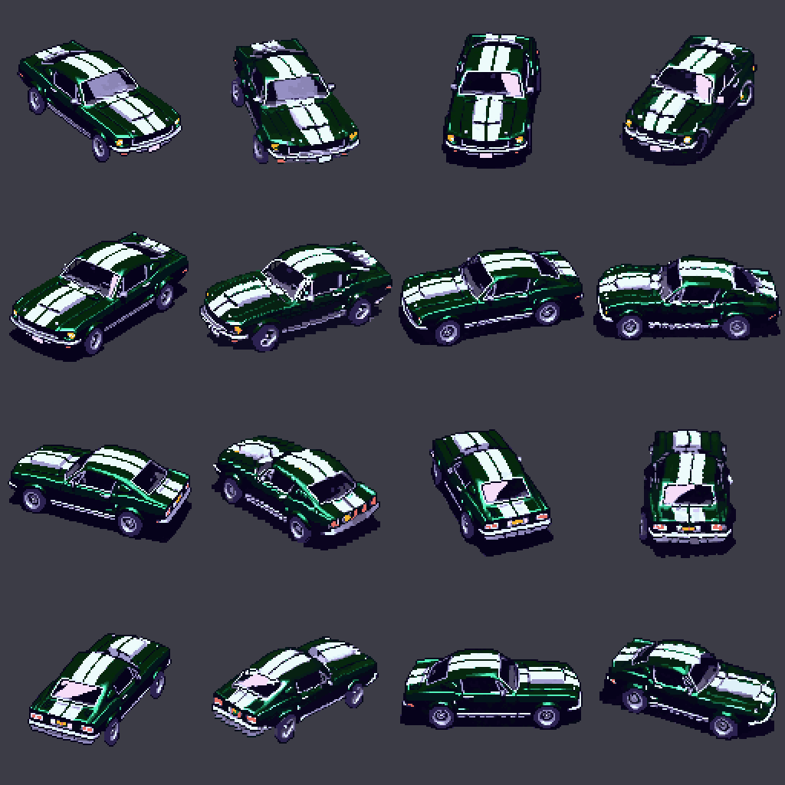
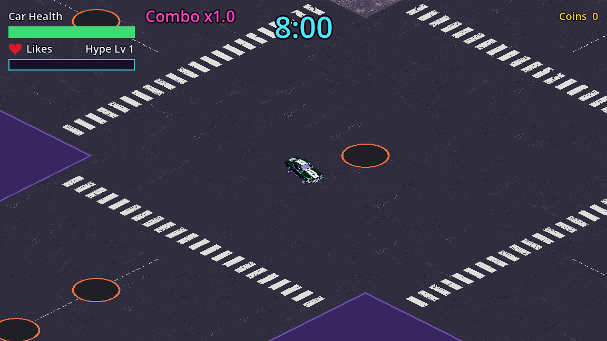
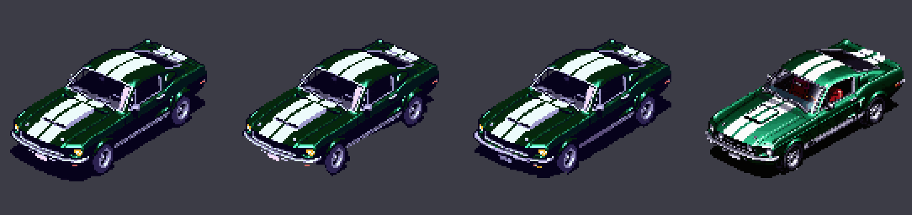
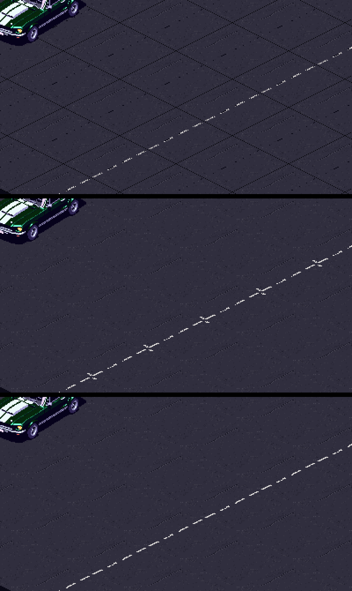

# Asset pipeline: Solid Carbide

Solid Carbide is a drift-driving roguelite built in Godot 4 by a team of AI agents (Claude Code). I am the designer: I describe what I want, review what comes back and make the final call. This page shows how the game's art gets made, using the work of 12 October 2026: the player's car and the city's ground.

## How the pipeline works

```
Me ──► Project Lead ──► task file ──► Asset Generation agent ──► QA agent ──► my review ──► game
          (agent)       (tasks/)        PixelLab API + scripts     (agent)        │
                                                                                   └──► art-archive/ (everything I don't use)
```

1. **I describe the asset** in plain words to the **Project Lead**, the agent I talk to. It records my decisions in the design docs ([`docs/visual-style.md`](../../docs/visual-style.md)) and writes a **task file**: what to make, and acceptance criteria that can be checked.
2. **The Asset Generation agent** ([definition](../../.claude/agents/asset-generation.md)) reads the visual style and the game's [extended narrative](../../docs/extended-narrative.md) (the story and tone behind the game), so its art stays close to the game's style and world. It calls the [PixelLab](https://www.pixellab.ai) API, then post-processes by script: fitting the game's isometric view, cutting tiles so they join, keeping to the palette. Each call is logged with its prompt, settings and cost ([`game/art/pixellab-generation-log.jsonl`](../../game/art/pixellab-generation-log.jsonl)).
3. **The QA agent** ([definition](../../.claude/agents/qa-integration.md)) checks every criterion, runs the tests and takes its own screenshots in the game. It writes a pass or fail on the task file.
4. **I review the result**, in pictures or by playing the game. I approve it, give feedback, or edit it myself.
5. **Approved art goes into the game** (`game/art/`). **Everything else is archived, never deleted** ([`art-archive/`](../../art-archive/README.md)), with a note on why it wasn't used.

**All output of this pipeline** is in two folders: [`game/art/`](../../game/art/) holds the approved, game-ready art, and [`art-archive/`](../../art-archive/README.md) holds every other generation (rejected versions, failed attempts, raw PixelLab output), one folder per task.

All 12 agents are defined in [`.claude/agents/`](../../.claude/agents/) and [`CLAUDE.md`](../../CLAUDE.md). Every decision is recorded in [`docs/timeline.md`](../../docs/timeline.md).

## My workflow

- **One sample first.** I ask for a single asset (one car direction, one road tile), judge it, and only then ask for the full set, built from the sample I approved.
- **I review at every step.** Every art task needs my sign-off: nothing reaches the game without it.
- **Spend carefully.** One round of generation per task. If a result is off, the agent reports it instead of regenerating, and I decide what happens next. Free script fixes come before paid generations.
- **Keep everything.** Rejected and failed generations go to the archive, so it's clear what is game-ready and what isn't.

The result of one day: the car in 16 directions and the full ground set, in the game, for 44 PixelLab generations.





## Examples of my feedback

**1. The car's shadow** ([task T-014](../../tasks/T-014-car-sprites-16-directions.md), "Board review"). I described the car (a 1967 Mustang GT, dark green, two white stripes with a gap) and liked the first sprite, but asked to see it without its shadow. We tried a script edit, PixelLab inpainting (twice) and a fresh generation with "no shadow" in the prompt. None was better, so I went back to the original. That experience is where my rule to archive every generation came from.



**2. The road's white line, edited by hand** ([task T-063](../../tasks/T-063-map-ground-art.md), "Board review"). PixelLab's tiles showed a grid where they joined (top). A free script fix removed the grid but left "+" marks on the line (middle). I fixed the line myself in an image editor (bottom), and that tile became the base of the whole ground set.



**3. Decisions while reviewing.** I answered the agents' design questions (white lane lines, zebra crossings, light cracks) and moved pavements to after the MVP when they would have changed the map's layout ([task T-103](../../tasks/T-103-map-ground-art-full-set.md)). After playing the car in the game, I asked for 32 directions later on ([task T-101](../../tasks/T-101-car-sprites-remaining-directions.md)).
