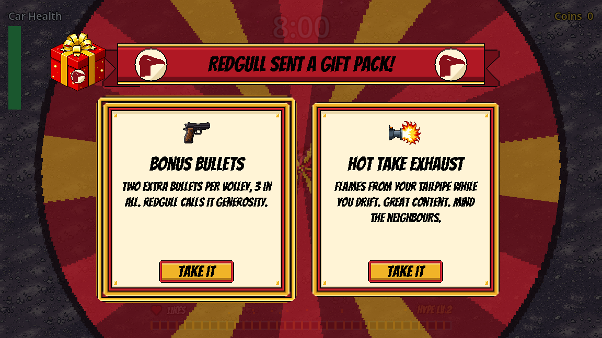
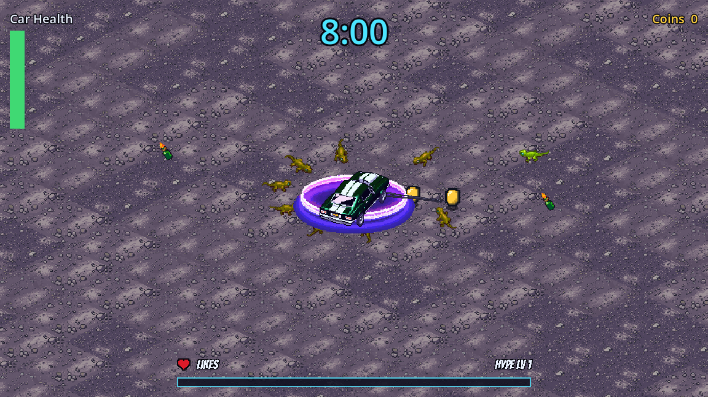

# Goal-oriented code agent: Solid Carbide

Solid Carbide is a drift-driving roguelite built in Godot 4 by a team of AI agents (Claude Code). I am the designer: I describe what I want, the **Project Lead** agent turns it into task files, eleven specialist agents build them, and a QA agent checks every task against its acceptance criteria.

For this assignment I built a **goal-oriented code agent**, the **goal runner**: I give it one goal, and it plans, builds and checks until that goal is reached, then I play the result once.

## My use case, and the assignment's

The assignment's agent reads the whole GDD, compares it with the code, and builds everything that's missing. Mine can do that, but I mostly want to **build one feature at a time**: "the trick system with its final art", "a fully working MVP with five weapons". So the goal is whatever I say. "The whole short GDD" is just one possible goal. My tutor agreed to this.

## How it works

```
my goal ──► 1. Priority scoring ──► 2. Gap detection ──► 3. Code writing ──► 4. Iteration loop ──┐
              sub-goals, ranked       vs. tickets + code     agents build,       rescan after       │
              + the goal's own        → only the missing     QA checks each      every ticket;      │
              stop criteria             tickets are written  ticket              stop when the      │
                                                                                 goal's criteria    │
                    ▲                                                            pass               │
                    └────────────────────── new gaps found ◄────────────────────────────────────────┘
                                                                     goal reached ──► I play it once
```

| Layer | What it does | Code |
|---|---|---|
| 1. Priority scoring | Turns my goal into sub-goals, each with acceptance criteria, and writes the goal's own criteria (the stop condition). Claude proposes; the ranking is done by code: first what unblocks the most other sub-goals, then value. | [`prioritize.py`](../../tools/goal_agent/prioritize.py) |
| 2. Gap detection | Checks every sub-goal against the existing tickets and code: already done, already in progress (reused), or missing. Writes only the missing tickets, and refuses any that break the studio's rules. | [`gaps.py`](../../tools/goal_agent/gaps.py), [`tickets.py`](../../tools/goal_agent/tickets.py) |
| 3. Code writing | Builds each ticket in rank order with the multi-agent framework: the ticket's agent works in its own git worktree, then the QA agent checks it. A first fail goes back once; a second fail is flagged for me. | [`build.py`](../../tools/goal_agent/build.py) |
| 4. Iteration loop | After every ticket, rescans the tickets and the code and runs gap detection again. Stops only when QA confirms the goal's own criteria, or pauses (and says why) on a safety stop. | [`loop.py`](../../tools/goal_agent/loop.py) |

Everything a run does is written down in one **goal file** in [`goals/`](../../goals/): the goal in my words, its criteria, the ranked sub-goals, the tickets, and a log entry for every iteration. [`goal_file.py`](../../tools/goal_agent/goal_file.py) reads and writes it, [`claude_call.py`](../../tools/goal_agent/claude_call.py) is the only place that calls Claude, and [`run.py`](../../tools/goal_agent/run.py) is the command line:

```
python tools/goal_agent/run.py start "<goal>" --art-cap 20     # plan, then build until the goal is reached
python tools/goal_agent/run.py start "<goal>" --plan-only      # only plan: read the sub-goals and tickets first
python tools/goal_agent/run.py status G-001
python tools/goal_agent/run.py resume G-001                    # carry on after a pause or a cut-off
```

To see a whole run without calling Claude, `python tools/goal_agent/try_fixture.py` runs a sample goal in a temporary copy of the repo with a fake team of agents: it plans two sub-goals, builds both tickets (one fails QA once and passes on its retry), checks the goal and ends `ready-to-play`.

## Safety stops

An agent that runs on its own needs to know when to stop. The goal runner pauses, and writes the reason in the goal file, when it:

- reaches its maximum number of iterations;
- runs out of the art budget I gave it (PixelLab generations cost credits);
- has a ticket that failed QA twice and that other work depends on;
- sees the same gap come back twice with no progress;
- hits a merge conflict, or is waiting on a ticket another session owns;
- is refused something it needs by the permission system or the project's hooks. It never works around a refusal: an agent skips a refused step it can do without and the refusal is logged; when the step was essential, the run pauses.

## My rules for a run

While a goal is running, I don't review each step. The goal itself is my go to generate art up to its budget, and I play the whole result once at the end, from its own build. Nothing reaches the main branch before I've played it. The rules are in [`docs/working-with-the-board.md`](../../docs/working-with-the-board.md) ("Goal runs") and [`tasks/README.md`](../../tasks/README.md) ("Goal runs").

## How it was built

The goal runner was built the way the studio builds everything: through two task files, each checked by the QA agent.

- [T-162](../../tasks/T-162-goal-runner-plan-and-gaps.md): the goal file, priority scoring and gap detection.
- [T-163](../../tasks/T-163-goal-runner-build-and-loop.md): building the tickets and the iteration loop.

Its tests are in [`tools/goal_agent/`](../../tools/goal_agent/) (`test_*.py`). They use a fake Claude, so they never call Claude or PixelLab: `python -m unittest discover -s tools -p "test_*.py"`.

## A feature it built

My goal, in one go: **three new weapons (a neon underglow, molotovs and a windshield wiper), each with 8 upgrade tiers, level-ups offering two random choices from all five weapons, and an image of the weapon on every level-up card, with their PixelLab art.** I set an art budget of 40 generations, let it build straight through, and played the result once at the end. It works great.

- **The run's whole record:** [goals/G-002](../../goals/G-002-add-an-image-of-the.md): the goal in my words, its 9 criteria (all passed), the 11 ranked sub-goals, the tickets and every iteration.
- **Layer 1** turned the goal into 11 sub-goals, starting with the weapon numbers (everything else waited on them) and ending with an integration check.
- **Layer 2** found nothing existing that covered them and wrote 11 tickets, [T-166](../../tasks/T-166-weapon-numbers-the-neon-underglow-the.md) to [T-176](../../tasks/T-176-qa-the-five-weapons-the-random.md), following the studio's rules: the weapons first with placeholder looks, the card text from the Narrative Theme Agent, the art tasks after the features they dress.
- **Layer 3** had six different agents build them (game data, enemies, weapons, narrative, UI, art), each checked by QA; one ticket failed QA once and passed the second time. 9 of the 40 PixelLab generations were used.
- **Layer 4** rescanned after each of the 11 iterations and ended when QA confirmed all 9 of the goal's criteria.





### What the first real run taught me

Getting there took two goal files: [G-001](../../goals/G-001-add-an-image-of-the.md) stopped in planning and was started again as G-002, and between them the runs paused eight times. Every pause was a safety stop doing its job, and each became a small fix (tickets T-164, T-165, T-177 to T-180):

- **Planning:** the planner could try shell commands it wasn't meant to use. Now it gets read-only tools.
- **Windows:** prompts were too long for the Windows command line. They now go to Claude on standard input.
- **Permissions:**
  - Agents running unattended couldn't run their tests or commit. I added a narrow list of pre-approved commands; the safety check rightly wouldn't let the AI widen its own permissions.
  - A refused command the agent could do without stopped the whole run. Now it's logged, and only a refusal that blocks the work pauses the run.
- **QA:** QA's pass marks with notes weren't recognised. The status script now accepts them.
- **The goal check:** it needed the same rules as the other checks, and the docs check only the Project Lead may run.
- **The usage limit:** it paused the run cleanly, and it resumed afterwards where it stopped.
