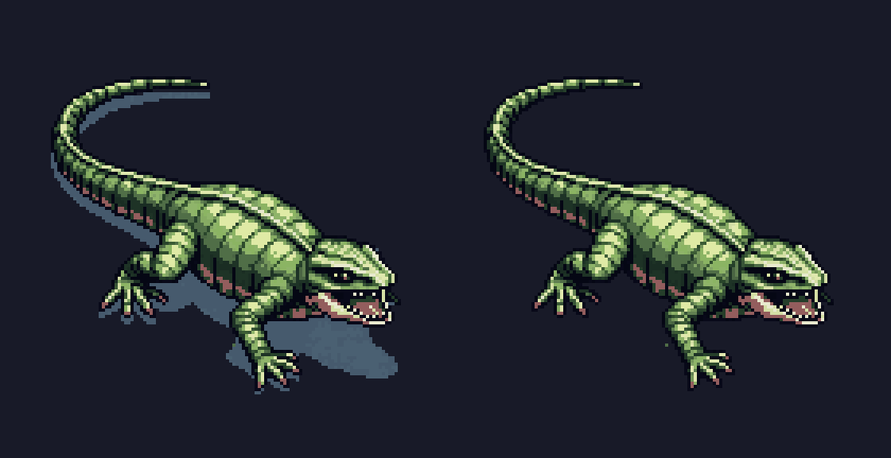
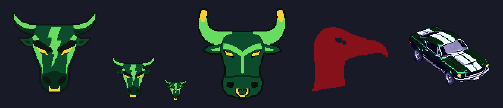
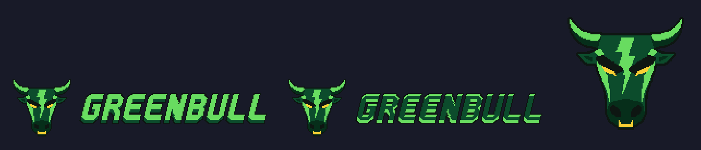

# Style Guide Agent: Solid Carbide

Solid Carbide is a drift-driving roguelite built in Godot 4 by a team of AI agents (Claude Code). The player is **Stunt Driver**, sponsored by the out-of-touch brand **Greenbull** (called Redgull until its rebrand on 2026-10-26, Example 2), drifting through a night-time Tokyo under a kaiju attack for a livestream's likes. I am the designer; a **Project Lead** agent turns what I ask for into tickets for twelve specialist agents.

For this assignment I built the **style loop** and made it part of how the studio works: every asset and every piece of player-facing text is generated, scored against the game's style guide by an evaluator agent, and refined from the evaluator's reason until it scores 8/10, with no one stepping in. It is enforced, so nothing can skip it.

> Status: the loop is built, tested and merged. Example 1 is its first real run, approved and merged. Examples 2 and 3 come from the Greenbull rebrand: checked by QA, approved by me (the emblem's run 2 and the wordmark's run 1) and merged.

## 01. The style guide, taken from the game's own documents

The style guide is two numbered rule lists inside the game's existing design documents, each rule condensed from a decision already made there (no new universe; each rule names the decision it comes from):

| Rules | Where | Constraint types |
|---|---|---|
| **Visual style, Rules 1–10** | [`docs/visual-style.md`](../../docs/visual-style.md), Content, "Rules" | pixel-art format (size, transparency, ≤ 30 colours); mood (night, retro, drawn glow); palette and lore (Greenbull's colours only on Greenbull's things, rule 6; the steel-and-glass city; the alien boulders); no copies (the kaiju is Godzilla-*style*, never Godzilla); each subject's look |
| **Text rules 1–4** | [`docs/extended-narrative.md`](../../docs/extended-narrative.md), Content, "Text rules" | tone (satirical, Greenbull out of touch, never mocking the city's people); vocabulary ("likes" never "XP", "the kaiju" never "Godzilla", "Greenbull" never its old name, "gift pack", "Stunt Driver"); who speaks (no "Greenbull says…"); format and length by kind (popups in capitals ending "!", card titles ≤ 30 characters…) |

The rules a script can check are checked by one module, [`game/tools/style_rules.py`](../../game/tools/style_rules.py) (sizes, colours, transparency, the brand's colours, lengths, banned words); the evaluator judges the rest.

## 02. The Evaluator and Refiner loop

```
brief ──► Generator ──► script checks + Evaluator ──► SCORE 1-10 + REASON ──► ≥ 8: keep
           (the asset or text agent)     (style-evaluator agent)               │
              ▲                                                                ▼ < 8
              └──────────── Refiner: the same agent session, given the REASON ◄─┘
                            (at most 3 refines; then the best version is kept
                             and the ticket is flagged for my review)
```

| Part | What it is | File |
|---|---|---|
| Generator | The Asset Generation Agent (art, through PixelLab) or the Narrative Theme Agent (text) | [`.claude/agents/asset-generation.md`](../../.claude/agents/asset-generation.md), [`.claude/agents/narrative-theme.md`](../../.claude/agents/narrative-theme.md) |
| Evaluator | The Style Evaluator Agent: scores 1–10 with a reason naming the broken rules; never makes or fixes anything | [`.claude/agents/style-evaluator.md`](../../.claude/agents/style-evaluator.md) |
| Refiner | The generator's own session, resumed with the score and the reason: free script fixes first, a paid regeneration only if needed | [`tools/style_loop/loop.py`](../../tools/style_loop/loop.py) |
| The loop | Runs it all and writes every round into the ticket's `## Style review` | [`tools/style_loop/run.py`](../../tools/style_loop/run.py) |
| Enforcement | PixelLab refuses to generate outside a live loop run; art and text tickets can't go to QA without a Style review | [`game/tools/pixellab_client.py`](../../game/tools/pixellab_client.py), [`tools/task_status.py`](../../tools/task_status.py) |
| The rules of the loop | Threshold 8, at most 3 refines, the record | [`tasks/README.md`](../../tasks/README.md), "The style loop" |

Built in tickets [T-290](../../tasks/T-290-style-rules-module.md) (the rules module), [T-291](../../tasks/T-291-style-loop-tool.md) (the loop) and [T-292](../../tasks/T-292-style-loop-enforcement.md) (enforcement), each checked by the QA agent. `python tools/style_loop/run.py text ... --fake tools/style_loop/fixtures/text-4-6-9.json` runs a whole loop for free.

## 03. Before and after

### Example 1: the minion redesigned as a mini kaiju (art)

I asked for the small lizard enemy to become "slightly like a mini kaiju monster… still a lizard, on all fours, a snapping jaw with teeth, about as big as the car". The loop ran four versions with no one stepping in; the whole record, every score and reason, is the ticket's Style review: [T-293](../../tasks/T-293-art-minion-mini-kaiju-sample.md).


| Round | Score | What the Evaluator caught | Violation class |
|---|---|---|---|
| v1 | 5/10 | Red in the mouth (rule 6 as it was then: the sponsor's red only on the sponsor's things); bright daylight greens (rule 4, night); upright side view (rule 3, isometric) | palette / lore, mood, format |
| v2 | 5/10 | Fixed the red, the night palette and the view; but a thin, small lizard, not car-sized (rule 3, scale), little detail (rule 2) | format / scale |
| v3 | 4/10 | Car-sized with teeth, but standing upright like Godzilla (rule 9, no copies of existing characters) | lore |
| v4 | 6/10 | Fixed the Godzilla look and the view (four legs on the ground, seen from above); one dull pink left in the mouth (rule 6) | palette |

Each refine fixed what the reason named, and found the next problem. It still ended below 8 after three refines, so the loop kept the best version and flagged the ticket for me, as designed. I reviewed it next to the car and the old minion ([dark](../../art-archive/T-293/review_sample_vs_car_dark.png), [light](../../art-archive/T-293/review_sample_vs_car_light.png)), approved version 4, kept its dull pink mouth (since the rebrand, red is no longer the sponsor's colour, so rule 6 no longer flags it), and had its baked-in shadow removed by a free script, since its rotations and animations will be made from it:



### Example 2: the sponsor's new logo, a bull's head (art)

I renamed the game's sponsor from Redgull to **Greenbull** in a complete rebrand, and asked for a new logo: "a head of a bull … like a cool logo", in dark green, light green and yellow, "don't use yellow too much", and nothing like the real energy-drink logo. The rebrand changed the style guide first: Visual style rule 6 went from "Redgull red" to **"Greenbull's colours"**, so the loop scored the logo against the new rule. The whole record is the ticket's Style review: [T-294](../../tasks/T-294-art-greenbull-emblem.md).

| Run | Version | Score | What the Evaluator said | Violation class |
|---|---|---|---|---|
| 1 | [v1](../../art-archive/T-294/style-loop/v1.png) | 8/10 | Kept: rule 6 met (dark green leads, yellow only on the eyes and nose ring), rule 9 met (its own bull's head, no charging bulls, no sun), rule 1 met. Only polish: the horns nearly touch the edges | none broken |
| 2 | [v1-2](../../art-archive/T-294/style-loop/v1-2.png) | 8/10 | Kept: rules 1, 6 and 9 met; yellow only as small angry eyes. Only polish: thin horns may thin out at 32 px, a muddy muzzle | none broken |

Both runs passed on their first version, and that taught me something about the loop: **the Evaluator checks the rules, not taste.** Run 1 broke no rule, but it read as a calm farm bull, not "a cool logo". The Project Lead judged it plain, kept it, and ran the loop again with a bolder brief (sharper horns, a V-shaped face, a heavy brow, a lightning blaze). That second run is the emblem. My generation budget lets a loop run up to three times on one asset for exactly this; the emblem used 2 PixelLab generations of the 12 I allowed.



One thing went wrong, and QA caught it: the loop tool rewrote the whole Style review on each run, so run 2 erased run 1's record. QA failed the ticket for the missing round; the Project Lead restored it from run 1's own output, and QA passed it in round 2. Repeated runs were new, and the tool had to add to the record instead of replacing it; that is now fixed (Example 3).

### Example 3: the wordmark, GREENBULL next to the emblem (art)

The logo also needed a wordmark: the emblem from Example 2 with the name GREENBULL. PixelLab is weak at lettering, so the agent drew the letters with a script (the loop accepts script-drawn art) and pasted the emblem in unchanged. The whole record is the ticket's Style review: [T-295](../../tasks/T-295-art-greenbull-wordmark.md).

| Run | Version | Score | What the Evaluator said | Violation class |
|---|---|---|---|---|
| 1 | [v1](../../art-archive/T-295/style-loop/v1.png) | 8/10 | Kept: spelled right, bold slanted letters, its own lettering (rule 9), yellow only in the emblem. One soft point against rule 6: the letters are mostly light green, but dark green should lead | palette |
| 2 | [v1-2](../../art-archive/T-295/style-loop/v1-2.png) | 8/10 | Kept: dark green now leads the letters (rule 6 met). Soft point: the thin light green edge makes it busier and a little less crisp on dark | none broken |

This is the loop working as a refiner across runs. Run 1 passed, but the Evaluator's reason named a real gap against my direction ("lean into the dark green"), and run 2 fixed exactly that, at no PixelLab cost. The fix had a price, though: run 2 is less legible on a dark background. The rules can't settle that trade-off between my brand colour and legibility; it's my call, made by looking at both.



Two practical lessons came out of this run. The first attempt stopped with no image, because the agent kept its drawing script inside the ticket's archive folder, where the ticket guard refuses to run scripts; the brief now tells agents to keep scripts in `game/tools/`. And run 2 erased run 1's record, as in Example 2, so the Project Lead restored it from a copy saved after run 1. The record is what exposed this flaw in the loop itself, so it was fixed the same day: since ticket [T-296](../../tasks/T-296-style-loop-keeps-earlier-runs.md), a repeated run keeps the earlier runs' rounds and adds its own after them, each under its own "Run N" heading, and QA checked it.

## 04. Where it fits in the pipeline

This Style Guide Agent runs on every asset and every piece of player-facing text the Asset Generation and Narrative Theme agents make, before the ticket can reach QA, so all of Solid Carbide's art stays in its night-time, steel-and-glass Tokyo look and all its text keeps Greenbull's out-of-touch, satirical voice.
