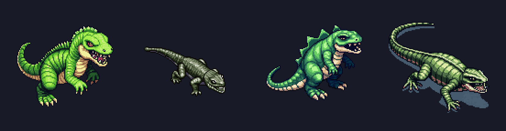

# Style Guide Agent: Solid Carbide

Solid Carbide is a drift-driving roguelite built in Godot 4 by a team of AI agents (Claude Code). The player is **Stunt Driver**, sponsored by the out-of-touch energy drink **Redgull**, drifting through a night-time Tokyo under a kaiju attack for a livestream's likes. I am the designer; a **Project Lead** agent turns what I ask for into tickets for twelve specialist agents.

For this assignment I built the **style loop** and made it part of how the studio works: every asset and every piece of player-facing text is generated, scored against the game's style guide by an evaluator agent, and refined from the evaluator's reason until it scores 8/10, with no one stepping in. It is enforced, so nothing can skip it.

> Status: the loop is built, tested and merged. Example 1 is its first real run; its files are on the ticket's branch until I approve the art. Examples 2 and 3 are still to come.

## 01. The style guide, taken from the game's own documents

The style guide is two numbered rule lists inside the game's existing design documents, each rule condensed from a decision already made there (no new universe; each rule names the decision it comes from):

| Rules | Where | Constraint types |
|---|---|---|
| **Visual style, Rules 1–10** | [`docs/visual-style.md`](../../docs/visual-style.md), Content, "Rules" | pixel-art format (size, transparency, ≤ 30 colours); mood (night, retro, drawn glow); palette and lore (Redgull red only on Redgull's things; the steel-and-glass city; the alien boulders); no copies (the kaiju is Godzilla-*style*, never Godzilla); each subject's look |
| **Text rules 1–4** | [`docs/extended-narrative.md`](../../docs/extended-narrative.md), Content, "Text rules" | tone (satirical, Redgull out of touch, never mocking the city's people); vocabulary ("likes" never "XP", "the kaiju" never "Godzilla", "gift pack", "Stunt Driver"); who speaks (no "Redgull says…"); format and length by kind (popups in capitals ending "!", card titles ≤ 30 characters…) |

The rules a script can check are checked by one module, [`game/tools/style_rules.py`](../../game/tools/style_rules.py) (sizes, colours, transparency, Redgull red, lengths, banned words); the evaluator judges the rest.

## 02. The Evaluator and Refiner loop

```
brief ──► Generator ──► script checks + Evaluator ──► SCORE 1-10 + REASON ──► ≥ 8: keep
           (the asset or text agent)     (style-evaluator agent)               │
              ▲                                                                ▼ < 8
              └──────────── Refiner: the same agent session, given the REASON ◄─┘
                            (at most 3 refines; then the best version is kept
                             and the ticket is flagged for my review)
```

| Part | What it is | File |
|---|---|---|
| Generator | The Asset Generation Agent (art, through PixelLab) or the Narrative Theme Agent (text) | [`.claude/agents/asset-generation.md`](../../.claude/agents/asset-generation.md), [`.claude/agents/narrative-theme.md`](../../.claude/agents/narrative-theme.md) |
| Evaluator | The Style Evaluator Agent: scores 1–10 with a reason naming the broken rules; never makes or fixes anything | [`.claude/agents/style-evaluator.md`](../../.claude/agents/style-evaluator.md) |
| Refiner | The generator's own session, resumed with the score and the reason: free script fixes first, a paid regeneration only if needed | [`tools/style_loop/loop.py`](../../tools/style_loop/loop.py) |
| The loop | Runs it all and writes every round into the ticket's `## Style review` | [`tools/style_loop/run.py`](../../tools/style_loop/run.py) |
| Enforcement | PixelLab refuses to generate outside a live loop run; art and text tickets can't go to QA without a Style review | [`game/tools/pixellab_client.py`](../../game/tools/pixellab_client.py), [`tools/task_status.py`](../../tools/task_status.py) |
| The rules of the loop | Threshold 8, at most 3 refines, the record | [`tasks/README.md`](../../tasks/README.md), "The style loop" |

Built in tickets [T-290](../../tasks/T-290-style-rules-module.md) (the rules module), [T-291](../../tasks/T-291-style-loop-tool.md) (the loop) and [T-292](../../tasks/T-292-style-loop-enforcement.md) (enforcement), each checked by the QA agent. `python tools/style_loop/run.py text ... --fake tools/style_loop/fixtures/text-4-6-9.json` runs a whole loop for free.

## 03. Before and after

### Example 1: the minion redesigned as a mini kaiju (art)

I asked for the small lizard enemy to become "slightly like a mini kaiju monster… still a lizard, on all fours, a snapping jaw with teeth, about as big as the car". The loop ran four versions with no one stepping in; the whole record, every score and reason, is the ticket's Style review: [T-293](../../tasks/T-293-art-minion-mini-kaiju-sample.md).



| Round | Score | What the Evaluator caught | Violation class |
|---|---|---|---|
| v1 | 5/10 | Red in the mouth (rule 6, Redgull red only on Redgull's things); bright daylight greens (rule 4, night); upright side view (rule 3, isometric) | palette / lore, mood, format |
| v2 | 5/10 | Fixed the red, the night palette and the view; but a thin, small lizard, not car-sized (rule 3, scale), little detail (rule 2) | format / scale |
| v3 | 4/10 | Car-sized with teeth, but standing upright like Godzilla (rule 9, no copies of existing characters) | lore |
| v4 | 6/10 | Fixed the Godzilla look and the view (four legs on the ground, seen from above); one dull pink left in the mouth (rule 6) | palette |

Each refine fixed what the reason named, and found the next problem. It still ended below 8 after three refines, so the loop kept the best version and flagged the ticket for me, as designed: the ticket's Result notes and review images ([dark](../../art-archive/T-293/review_sample_vs_car_dark.png), [light](../../art-archive/T-293/review_sample_vs_car_light.png)) are what I review.

### Example 2

To come.

### Example 3

To come.

## 04. Where it fits in the pipeline

This Style Guide Agent runs on every asset and every piece of player-facing text the Asset Generation and Narrative Theme agents make, before the ticket can reach QA, so all of Solid Carbide's art stays in its night-time, steel-and-glass Tokyo look and all its text keeps Redgull's out-of-touch, satirical voice.
