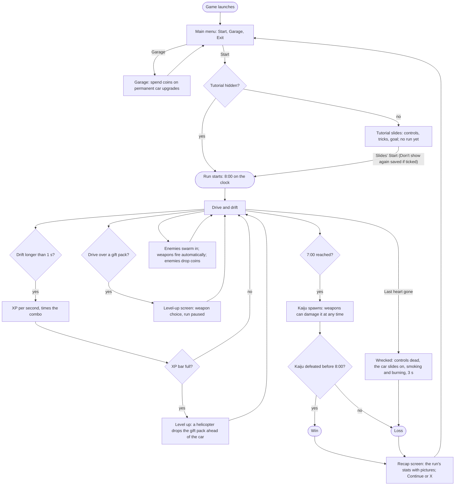

# Game loop architecture

## Summary

Solid Carbide is played in 8-minute runs. The player only drives: drifting earns XP, each level-up brings a weapon choice, weapons fire on their own at the enemies swarming in, and enemies drop coins. At 7 minutes the kaiju arrives, and the player has the last 60 seconds to defeat it; it can be damaged at any time. Between runs, the player is back at the main menu, where the Garage spends coins on permanent car upgrades, and Start begins the next run.

## Decisions

- A run lasts 8 minutes. (2026-10-07)
- The player only drives. The car's weapons fire automatically. (2026-10-07)
- Enemies come in from the edges of the screen, in numbers that grow over the run (how they scale: Enemies, Decisions). (2026-10-07)
- XP comes only from driving, never from kills. In the MVP it comes from drifting only, since challenges are left out of the MVP (Level design, Decisions); if they come back, completed challenges give XP too. (2026-10-07; drifting only in the MVP, 2026-10-11)
- **Combo:** tricks (Drifting, Decisions) raise a combo multiplier, and the multiplier multiplies all XP gained (from challenges and from drifting). Each trick adds to the multiplier: extended drifts a little, a 360 more, an alternate drift the most. Colliding with anything, enemies included, cuts the combo by 50%. If no trick follows within 2 seconds, the combo drains away quickly. The Game Data Agent proposes the numbers; the board judges them in playtests. The XP from drifting seconds stays as it is, alongside the extended-drift trick. Part of the MVP. (2026-10-10)
- The higher the combo, the more enemies spawn (how: Enemies, Decisions). The board will judge in playtests whether to keep this. (2026-10-10)
- A drift that lasts longer than 1 second gives XP for every second it lasts, the first second included (a 3-second drift gives 3 seconds' worth). (2026-10-07)
- Each second of drifting gives a fixed amount of XP: 10% of the XP bar at level 1. The amount does not grow with the bar, so at higher levels it is a smaller share of the bar and drifting gives only a little XP. (2026-10-07)
- **Likes drain:** when the player isn't doing tricks, the likes bar empties, but never below the start of the current level, so the player never loses a level. It starts once the combo has fully drained, and any trick stops it. The speed is the board's playtest value, 8% of the current level's bar a second (four times the first proposal; the number: [game/data/run.json](../game/data/run.json)). Part of the MVP. (board, 2026-10-13; four times faster the same day)
- "Drifting", for XP, uses the Unity prototype's definition: any moment W or S is held together with A or D (Unity prototype report, section 3). (2026-10-07)
- After the MVP, if challenges come back (2026-10-11): at level 1, completing one challenge fills the XP bar: the player reaches level 2 and gets the weapon choice. (2026-10-08)
- How much XP challenges and drifting give at each level, and how much XP each level needs, is worked out by the Game Data Agent as sensible XP scaling, within the decisions here. (2026-10-08)
- The weapon choice opens only when the XP bar fills and the player levels up (how many weapons are offered: Weapons, Decisions). The weapons chosen reset at the start of every run. (2026-10-07; weapon choice on level-up only, 2026-10-08)
- **Gift pack drop** (board, 2026-10-16; tasks T-144 to T-146): the level-up screen no longer just appears. When the player levels up, a helicopter sent by Greenbull (first Redgull) flies over the screen and drops a package carrying Greenbull's brand (the gift pack). When the player drives over the package, the level-up screen (the gift pack screen) opens. The look of the helicopter and the package: Visual style, Decisions. The run keeps going while the helicopter comes and the package waits; it pauses only when the screen opens. The package lands a short way ahead of the car, on open road, and stays until picked up. One package per level-up, each opening its own screen. When a landed package is off screen, an arrow at the screen edge points to it. (answers, 2026-10-16)
- **A falling gift pack shows its shadow** (board, 2026-10-30): while the gift pack falls, a shadow on the ground (or the platform) where it will land shows the player where it is coming down, the same shadow the car casts when it is in the air. (T-407)
- After the MVP, if challenges come back (2026-10-11): completing a challenge flashes a score, the likes it gave, and gives XP. (2026-10-07; the score is the likes gained, 2026-10-09)
- Enemies drop coins. The coins collected in a run are kept whether the run is won or lost. (2026-10-07; kept on a loss, 2026-10-09)
- At the 7-minute mark the kaiju spawns. It moves slowly toward the player, deals contact damage, and can be damaged at any time (Enemies, Decisions). (2026-10-07; always vulnerable, 2026-10-11, replacing the windows opened by challenges)
- Win: defeat the kaiju within the final 60 seconds. Loss: the car's HP reaches 0 at any point, or the kaiju survives the timer. (2026-10-07)
- Between runs, coins are spent in the Garage on permanent car upgrades that improve the car in the next run (which upgrades: Garage design, Decisions). (2026-10-07)
- The game opens on a main menu with three buttons: Start (begins a run), Garage, and Exit. When a run ends, win or loss, the player returns to the main menu (through the recap screen, below). (2026-10-08; Exit rather than Quit, 2026-10-10)
- The final release adds a recap screen right after a run ends, win or loss: how many of each enemy type the player killed, and other stats the board will choose (task T-017). In the MVP there is no recap: the run ends at the main menu. (2026-10-07; corrected 2026-10-09, it said the MVP goes to the Garage)
- The final release adds local co-op for 2 players (screen split in halves) and 4 players (screen split in quarters). The MVP is single-player. (2026-10-07)
- **Music** (board, 2026-10-20): the board's own two tracks, "DEMO BEAT 1 (ANDY GAME)" and "DEMO BEAT 2 (ANDY GAME)" (made by the board; the music is human-made), play through the whole game, menus and runs alike, without stopping between screens: one track, then the other, alternating and looping. Its volume is the pause screen's music volume slider (HUD and menus, Decisions). Built in T-209: one music player, a child of the game flow, so the screens changing never restarts it; it plays on its own "Music" bus, and the setting is `music_volume` in `game_settings.gd` (0 to 100, saved with the SFX volume, starting at 40 as a proposal for the playtest). (tasks T-209, T-210)
- **Pickup magnet** (board, 2026-10-21): coins, level-up gift packs and health drops are pulled towards the car once they are within a radius of 1 car length, so they are easier to pick up. The radius is a garage upgrade (Garage design, Decisions). Built in T-222: the radius is 3 units (the car is drawn 3 units long, Drifting, Decisions), read from `run.json`'s `pickup_magnet`, and pickups fly to the car at 30 units per second (proposals for the playtest: the pull speed, and the reach measured on the flat map); since T-402 it pulls only pickups on the level the car is on (the ground under the car), so nothing is pulled up or down a rooftop's wall, and a pulled pickup is drawn at the height of the ground it crosses (proposal for the playtest); `game/docs/game-loop/gift-pack-and-pickups.md`, "The pickup magnet (T-222)". (T-222)
- **An arrow for every gift pack on the map** (board, 2026-10-28): every gift pack on the map gets its own arrow, the same arrow that today points at a landed package off screen, so several arrows show when several packages are out. (T-314)
- **A crash pays the trick in progress** (board, 2026-10-28): when a crash breaks the combo, the player still gets the trick they were doing up to that moment (a drift pays for the time it lasted), instead of losing it. (T-315)
- **Time's up screen** (board, 2026-10-28): when the 8-minute timer runs out (the kaiju survived it, a loss), a 3-second animated failure screen plays before the run ends. Its text: HUD and menus, Content (T-316). (T-317)
- **Recap screen in the MVP** (board, 2026-10-28; replaces "In the MVP there is no recap" above): after a run ends, the player sees a recap of the run: the enemies slain, the tricks completed, the highest combo multiplier reached and the weapons used, each shown with pictures where it can be (the enemies' and weapons' own art). Its text: HUD and menus, Content (T-318). (T-319, T-320)
- **Wrecked: the stream keeps rolling** (board, 2026-10-29; replaces the time's up screen's proposal that losing all health ends the run as before): when the car loses its last heart, the run doesn't end at once. The controls go dead, the car keeps whatever movement it had and slides or rolls to a stop, and it sits there crashed, smoking and burning (pixel art smoke and flames), for **3 seconds**, with the stream (the HUD, the live viewers) still on screen. It is like the end of a stream that doesn't cut away. Then the recap screen shows. No text. (T-360, T-361)
- **A health pickup revives a wrecked car** (board, 2026-10-30): while the car is wrecked and still sliding, if it comes within a health pickup's pickup range (its magnet), it picks it up and comes back with **1 heart**: the controls return, the smoke and flames stop and the run goes on; the recap does not show. Whether the usual 1-second invulnerability follows, and what happens to the combo and the live viewers, are proposals for the playtest. (T-406)
- **The recap always closes a run** (board, 2026-10-29): every run ends on the recap screen (a win, the time's up screen, the wreck), and the player leaves it with a Continue button or an X at the top right, both to the main menu. (T-320)
- **The runs list** (board, 2026-10-29): each run's recap stats are saved on this computer, and a new button on the main menu opens a list of the player's past runs. Its text: HUD and menus, Content (T-362). (T-363, T-364)
- **More gift packs, earlier** (board, 2026-10-28): the early levels need fewer likes, so the first gift packs come more often at the start of a run. The new curve is the Game Data Agent's proposal for the playtest, built in T-328: 30, 45, 65, 95, 140, 200, 290, 400, 560, 745 and 931 likes for levels 2 to 12 (total 3,501, was 4,255); the table and reasons are in Content, "Likes and levels". (T-328)
- **A crash cuts the combo by 50%** (board, 2026-10-28; replaces the 80% in "Combo" above): a collision or any damage to the car cuts the part of the multiplier above "no combo" by 50% instead of 80%, so the player keeps half of their combo bonus (x4 becomes x2.5). (T-329)
- **A bigger gift pack helicopter** (board, 2026-10-28): the helicopter that drops each gift pack is drawn 30% larger on screen than today (about 125 x 104 drawn pixels instead of 96 x 80), with the same art. The package still hangs clear of its belly. (T-330)
- **The combo shows as live viewers** (board, 2026-10-28): the combo multiplier keeps working exactly as it does (tricks raise it, crashes cut it, it drains, it multiplies what drifting earns), but the player sees it as the stream's live viewers instead of "Combo x2.00": about 20,000 at x2 and 1,000,000 at x6 (the board's anchors), on a smooth curve between them (and below x2, a proposal). The number behaves like a real stream's: it counts towards its value and keeps moving a little. The higher it is, the hotter it looks, and over a million it is on fire. (T-332, T-336)
- **Subs instead of likes** (board, 2026-10-28): what the player earns toward the next gift pack is **subs** (the stream's subscribers), not likes: drifting brings subs, the viewers multiply them, each full **sub goal** sends a gift pack, and the drain is people unsubscribing when the stream gets dull. Only the name and the look change; the numbers and rules of the likes stay (the likes bar becomes the sub goal: HUD and menus, Decisions). Extended narrative, Decisions, "Subs". (T-331, T-337)
- **Hearts instead of health points** (board, 2026-10-28): the car has **5 hearts**. A minion's hit and a meteor take 1 heart, the kaiju's 2. After any hit the car is invulnerable for **1 second**, blinking, so the player can escape a swarm; hits during that second do nothing and don't cut the combo. A health pickup heals 1 heart, and drops at half today's chance (15%, Enemies). The garage's car health upgrade adds 1 heart per level (Garage design). (T-333, T-334, T-338) Numbers (T-333, `game/data/run.json` `car`): `starting_hearts` 5, `invulnerability_seconds` 1.0, `blink_interval_seconds` 0.1 (a proposal: each on or off phase of the blink). The old `starting_health` 100 is gone. Built in T-334 ([game/docs/game-loop/the-run.md](../game/docs/game-loop/the-run.md), "Hearts and the invulnerability (T-334)"); proposals for the playtest: a hit during the second also gives **no knockback** (so the car drives out of the swarm), a hit ignored during it does not restart the second, and the blink starts with the car hidden, so the hit shows at once.
- **The tutorial slides come between Start and the run** (board, 2026-10-29; the slides, their text and the "Don't show again" checkbox: HUD and menus, Decisions, "Tutorial slides before the first run"): the main menu's Start shows the tutorial slides first, and the run begins (its clock starts at 8:00) only when the slides' own Start is pressed. If "Don't show again" was ticked then, that is saved, and every later Start, also after restarting the game, goes straight into the run. The pause screen's Restart starts a fresh run directly, without the slides. (T-382, T-387)
- **A red flash when the car takes damage** (board, 2026-10-30): when the car loses a heart, it flashes red, so the hit reads at once. How it fits with the invulnerability blink, its length and its shade of red are proposals for the playtest. The same red flash shows on enemies when they take damage (Enemies, Decisions). (T-403) Built in T-403 ([game/docs/game-loop/the-run.md](../game/docs/game-loop/the-run.md), "The red hit flash (T-403)"); proposals for the playtest (`game/data/run.json` `hit_flash`): `seconds` 0.4 and `color` [1.0, 0.25, 0.25] (a multiply tint). The car is hidden for the first 0.1 s of the blink, so the flash shows as red on the next two visible phases (0.1 to 0.2 s and 0.3 to 0.4 s), then the plain blink goes on; a hit ignored during the invulnerability does not flash.
- **The wreck decides the loss at its end** (board, 2026-10-30, audit; replaces "The loss is decided at once" and "a kaiju kill can no longer turn it into a win" in Content, "Wrecked"): the run is lost only when the wreck's 3 seconds end and the recap shows. Until then a health pickup revives the car (T-406): the clock runs again, the controls return and the loss is undone; a trick in progress at the wreck is dropped, not paid. A kaiju kill during the wreck wins the run. Coins and health pickups are pulled in and count as usual. Restart or Exit from the pause screen during the wreck cancels the run: no coins kept, no runs-list entry. Which weapons keep working during the wreck: Weapons, Decisions.
- **A tie goes to the player** (board, 2026-10-30, audit): if the kaiju dies on the same step the clock reaches 0:00, the run is won.
- **Closing the game mid-run** (board, 2026-10-30, audit): closing the window during a run ends it as a loss: its coins are kept and it goes in the runs list. Switching to another window pauses the game.
- **A health pickup at full hearts stays** (board, 2026-10-30, audit): with full hearts the car doesn't pick a health pickup up, and the magnet doesn't pull it.
- **Hits close together cut the combo once** (board, 2026-10-30, audit): a collision within 0.5 seconds of the one that cut the combo doesn't cut it again (0.5 s is a proposal for the playtest).

## Content

### One run

### The run scene

The run is one Godot scene (task T-036; how to use it: [game/docs/game-loop/the-run.md](../game/docs/game-loop/the-run.md), section "The run"). It loads the run's map and puts the drift car (Drifting) on it, at the centre of the map, in the gravel square, with the camera following the car in the isometric view, as in the drift prototype.

The run's map (task T-206; Level design, Decisions, "The elevation sample map becomes the run's map") is the elevation sample map's layout with its rooftops and ramps (Level design, Content, "Elevation sample map", "The run on this map"): the car has its height there, and everything else in the run (enemies, weapons, pickups, coins, the HUD, the pause screen) works on it as on the MVP map. The MVP map (Level design, Content, "MVP map") stays in the project; one constant in the run switches back to it ([game/docs/game-loop/the-run.md](../game/docs/game-loop/the-run.md), "The run").

The run owns its state: the clock (8:00 counting down, stopping while the game is paused), the car's health in hearts (starting at the value in [game/data/run.json](../game/data/run.json), plus the garage upgrade's hearts; Decisions, "Hearts instead of health points"), and the coins collected in the run. Other parts of the game plug into it:

- At 1:00 left the run sends "boss time"; the kaiju spawns on it (Enemies).
- Enemies damage the car and add coins through the run; the kaiju's death ends the run as a win.
- The car reaching 0 hearts, or the clock reaching 0:00, ends the run as a loss. At 0 hearts the car is wrecked first, for 3 seconds (Wrecked, below).
- Either way, the run sends one "run ended" signal with the result and the coins collected, which are saved (Garage design).
- The HUD reads the time left, the health and the coins from the run (HUD and menus).

### Likes and levels

The run also owns the likes (XP) and the level (task T-037; how to use it: [game/docs/game-loop/the-run.md](../game/docs/game-loop/the-run.md), section "The run"; the numbers: [game/data/run.json](../game/data/run.json)):

- Every completed challenge, preset or the kaiju's meteor challenges, gives the current level's challenge XP, and the run sends a "score" signal with it for the challenge popup.
- The run follows the car's drift state step by step: once an unbroken drift reaches 1 second it gives the drift XP for that second, then for each further full second.
- When XP reaches the level's threshold the level goes up (leftover XP carries over, so one gain can give several level-ups), and the run sends "level up" with the new level. At the top level the bar stops.
- On every level-up the run plays the level-up effect: a burst of pixel particles from the car, following it while it plays (task T-112; the look: Visual style, Decisions, "Level-up effect"). Several level-ups in the same moment show as one burst, and the burst keeps playing while the run is paused for the weapon choice.
- The HUD reads the XP, the level's threshold and the level, with a signal whenever they change.
- A level-up does not pause the run by itself: it sends the gift pack (below, task T-144). The run pauses (clock and car) when the car drives over the gift pack's package and the level-up screen opens (task T-052), until the weapon choice is made, one choice after another when several packages are picked up at once.
- **Likes drain** (task T-115; the speed: [game/data/run.json](../game/data/run.json), `likes_drain`, task T-114): once the combo has fully drained back to "no combo", the XP in the current level goes down, stopping at the start of the level, so the level never goes down. Any trick raises the combo and stops it; it starts again once the combo has drained again. It stops while the run is paused (pause screen, level-up screen) and after the run ends. At the top level there is nothing to drain. The HUD's likes bar follows it, so the bar visibly empties.
- **The curve (T-328, proposal for the playtest; the numbers: `levels` in [game/data/run.json](../game/data/run.json)):** the early levels need far fewer likes so the first gift packs come quickly, and the last two levels are unchanged. One drift second is 10 likes at x1, so the seconds below are drift seconds at that combo (a drift pays whole seconds only):

  | Level up to | Likes needed | Seconds at x1 | at x2 | at x4 | Likes in total |
  |---|---|---|---|---|---|
  | 2 | 30 (was 100) | 3.0 | 1.5 | 0.75 | 30 |
  | 3 | 45 (was 125) | 4.5 | 2.25 | 1.1 | 75 |
  | 4 | 65 (was 156) | 6.5 | 3.25 | 1.6 | 140 |
  | 5 | 95 (was 195) | 9.5 | 4.75 | 2.4 | 235 |
  | 6 | 140 (was 244) | 14 | 7 | 3.5 | 375 |
  | 7 | 200 (was 305) | 20 | 10 | 5 | 575 |
  | 8 | 290 (was 381) | 29 | 14.5 | 7.3 | 865 |
  | 9 | 400 (was 477) | 40 | 20 | 10 | 1,265 |
  | 10 | 560 (was 596) | 56 | 28 | 14 | 1,825 |
  | 11 | 745 (same) | 74.5 | 37 | 18.6 | 2,570 |
  | 12 | 931 (same) | 93 | 47 | 23 | 3,501 |

  The total for all 11 level-ups is 3,501 likes, 18% under today's 4,255; the level cap stays 12. Reasons for the shape: each level needs about 1.4 to 1.5 times the one before at the start (the old curve's 1.25 from a much higher start), easing to 1.25 at the end, so the first gift pack comes after about 3 seconds of drifting (the board's "a few seconds") and the first four within about 10 seconds of drift at x2 (140 likes), against about 38 s at x1 before; the gaps then stretch so the middle and late run keep the old pace, and levels 10 and 11 are exactly today's. Time to each gift pack in a typical run, my estimate from the formula only (not a scripted run): drifting about half the time at an average x2 earns about 10 likes a second, so levels 2 to 5 arrive at about 3, 7, 14 and 24 s, level 8 at about 87 s and level 12 at about 350 s of an 8-minute run (480 s); the old curve reached level 5 at about 70 s and level 12 at about 430 s. The board judges it in the playtest. The likes drain is a share of the level's bar (8% a second), so a full bar still empties in 12.5 s at every level: 2.4 likes a second at level 2's 30-like bar, against 10 likes earned for each drifted second, so it only eats the progress made inside the level. The challenge XP of the old MVP map keeps its share of the level's bar (30, 40, 50, 65, 84, 106, 135, 164, 201, then the old 236, 259, 285), so one challenge never skips levels it did not skip before.
- A new run starts back at level 1 with no XP.

### The gift pack drop

How the level-up screen is reached (task T-144; how to use it: [game/docs/game-loop/gift-pack-and-pickups.md](../game/docs/game-loop/gift-pack-and-pickups.md), section "The gift pack drop"; the numbers: [game/data/gift_pack.json](../game/data/gift_pack.json)):

- On every level-up the run sends a helicopter. It flies across the screen from beyond one edge to beyond the other, carrying the package, and drops it over the landing spot; the package falls and lands. Built with placeholder art for now (the final art: tasks T-145 and T-146).
- The helicopter is drawn 30% bigger than its first size (T-330): scale 0.65 on its 192 x 160 sheet frames, about 125 x 104 drawn pixels, set as `helicopter.draw_scale` in `gift_pack.json`. The package hangs `hang_below_px` 88 (was 80) under its centre, so it still hangs clear of the bigger belly; the top margin and the off-screen margin are read from the drawn size and did not change.
- The landing spot is a short way ahead of the car, along the way it is moving, on open road: never in a building, a boulder or past the map's edge. If straight ahead is blocked, the nearest open spot around it is used.
- On a map with rooftops (T-402; Level design, Decisions, "A gift pack that falls on a platform shows on it"; proposal for the playtest): the landing spot is on the street whenever one is open within the search. Only when none is (the car well inside a large rooftop) does the package land on open, flat ground of the rooftop the car is on, away from its edges, ramps and any higher rooftop on it. Wherever it lands it is drawn at the height of that ground and in the depth order the car has there, so it is never drawn below a rooftop; the pickup magnet moves it with the ground's height. The car picks it up only from that height or above (a car on the street beside the rooftop does not; a car jumping over a package still does).
- The falling shadow (T-407; board, 2026-10-30): from the moment the helicopter drops the package until it lands, the car's air shadow (`game/scripts/driving/car_shadow.gd`, no new art; it does not grow or darken, as the car's does not) lies at the landing spot, at the height of the ground it lands on (the street or the rooftop), in the car's shadow depth order there. It is gone the moment the package lands (and on pickup or a new run). Not shown while the helicopter still carries it.
- Every pickup at its height (board, 2026-10-30, widening T-402: "when I go to pick up the gift on a platform, its hitbox is in the wrong place"): gift packages, coins and health pickups are drawn and picked up at the height of the ground they lie on. On a rooftop the car picks them up there, never from the street below; one rule for all of them (`game/scripts/run/pickup_height.gd`: the car's height at least the pickup's less 0.5 units).
- The run keeps going the whole time (the clock, enemies, likes and the likes drain). The level-up moment itself (the "level up" signal, the level-up effect, the likes bar) is unchanged.
- One package per level-up. Packages stay on the ground until picked up; a new run clears them.
- Driving over a landed package removes it and opens the level-up screen for that level, with the same weapon choices as before; the run pauses until the choice is made. Two packages picked up together give two screens, one after the other.
- Every package on the map gets its own arrow (board, 2026-10-28; T-314): while a package that has been dropped, falling or landed, is off screen, an arrow at the screen's edge points to it, one per package, kept clear of the HUD, so several arrows show when several packages are out. The package still carried by the helicopter has none yet. Arrows that would overlap are slid apart along the edge (proposal for the playtest). Proposal for the playtest: arrows only for packages off screen, none for a package on screen (the board asked for "the same one that appears today at the edge of the screen").

### The combo

The run also owns the combo (task T-081; how to use it: [game/docs/game-loop/the-run.md](../game/docs/game-loop/the-run.md), section "The run"; the numbers: [game/data/combo.json](../game/data/combo.json)):

- Each trick the car does raises the combo multiplier by that trick's amount, up to a cap. The run sends a signal with the trick, the amount added and the new multiplier, for the trick popups.
- The tricks: the extended drift (paid once per drift, by its length), the 360, the alternate drift (Drifting, Decisions), the air 180 and air 360 (Drifting, Decisions, "Aerial tricks"), the airtime trick (Drifting, Decisions, "Airtime trick"), and **thread the needle** (task T-272; Level design, Decisions, "Thread the needle"): on a level made in the creator, driving through the gap between two obstacles the board paired, without touching either. When each fires is in `game/docs/driving/tricks.md`, "Tricks" (thread the needle: "Level creator", "Thread the needle (T-272)"); what each adds is in `combo.json`.
- The multiplier multiplies all XP gained: each completed challenge's XP (the "score" signal carries the multiplied amount) and each drift second's XP.
- Hitting a wall, a building, the map edge or a boulder cuts the combo by 50%, and so does any damage to the car (enemies, meteors). The cut applies to the part of the multiplier above "no combo".
- A crash pays the trick in progress first (task T-315; Decisions, "A crash pays the trick in progress"): a drift under way pays its extended drift for the time it lasted until the crash, and in the air the spins and the airtime so far pay too; then the combo is cut, so the trick's popup shows just before COMBO BROKEN!. Which tricks count and why: Drifting, Content, "A crash pays the trick in progress". The order is a switch in `combo.json` (`crash_pays_trick_first`).
- When no trick has come for 2 seconds, the combo drains, down to "no combo". A trick restarts the wait.
- **Live viewers (T-332):** the player sees the multiplier as viewers. The curve, heat steps (20,000, 84,736 and 236,026, then fire from 1,000,000), the counting speed, the wobble and the number format are in [game/data/viewers.json](../game/data/viewers.json), read through `ViewersData` (`viewers_for`, `step_for_viewers`, `count_toward`, `with_wobble`, `trick_gain`, `crash_loss`, `format`). x1 = 2,500, x2 = 20,000, x6 = 1,000,000. The HUD counter is T-336.
- The HUD and enemy spawning read the multiplier, with a signal whenever it changes. It stops while the run is paused and resets with every new run.

Starting a new run resets the map, the car and the state. The run's camera zoom can be changed from the pause screen.

### The run's stats for the recap

The run keeps the stats the recap screen shows (task T-319; Decisions, "Recap screen in the MVP"; how to read them: [game/docs/game-loop/the-run.md](../game/docs/game-loop/the-run.md), "The run's recap summary"). One read-only summary, a plain dictionary that also serialises to JSON (so the runs list, T-363, can save it), is cleared when a new run starts and stays readable after the run ends:

- **enemies_slain:** kills per enemy type ("minion", "kaiju"), counted when the car's weapons kill one.
- **tricks:** how many times each trick was completed, by the id the combo uses (the drifts, 360s, alternate drifts, air tricks, airtime, thread the needle).
- **highest_combo:** the highest multiplier reached.
- **peak_viewers:** the live viewers counter's highest number in the run (T-320, the board's quick tuning of 2026-10-29: the recap's "Peak engagement" shows viewers, not a multiplier): the viewers for the highest combo on the viewers curve (Decisions, "The combo shows as live viewers"), the number the counter counts up to, without its small wobble. Saved with the run history like the rest.
- **weapons:** every weapon the car owned at the end, with the tier it ended on and the kills it made (the kills are a proposal, since they were cheap to count).
- **Also kept, for the recap and the runs list:** the result (win or loss), why a loss happened (the clock ran out, or health), the time survived, the coins, the likes gained in total and the level reached.

Nothing in this changes what the player sees.

### Wrecked

When the car loses its last heart (Decisions, "Wrecked: the stream keeps rolling"; task T-360; how it is built: [game/docs/game-loop/the-run.md](../game/docs/game-loop/the-run.md), "Wrecked (T-360)"):

- **The loss is decided at the wreck's end** (Decisions, "The wreck decides the loss at its end"; task T-413). The last heart starts the wreck but sets no result: the run is lost (on health, which the recap keeps as the reason) only when the **3 seconds** are over (the board's number, in [game/data/run.json](../game/data/run.json), `wreck.seconds`), with the same "run ended" as before, so the next screen follows as for any other end. During the 3 seconds no damage, likes, gift packs or tricks count; the trick in progress at the last heart's hit is dropped, not paid. Proposals for the playtest (T-413, not the board's yet): the car makes no tricks while wrecked; kills during the wreck count in the recap; the level creator's Play follows the same pause rule. Coins count, coins and health pickups are pulled in by the magnet as usual (the gift packs stand still), a health pickup revives the car (below), and a kaiju kill ends the run at once as a win, with the win recap. Restart or Exit on the pause screen during the wreck cancels the run: no coins are kept and nothing goes into the runs list. The time's up (the clock) has its own 3 seconds, its screen over the frozen run (T-317; HUD and menus, Content, "Time's up screen"), and a kaiju kill on the same step the clock reaches 0:00 still wins (Decisions, "A tie goes to the player").
- **The controls go dead.** No steering, throttle or brake reaches the car. It keeps the movement it had and slows to a stop with its normal physics: it can still slide, spin, bounce off walls or land a jump. The camera keeps following it. Its handling while alive is unchanged.
- **Smoke and flames** come out of the car for the 3 seconds: placeholders drawn in code (grey pixel puffs that rise, grow and shrink, left behind as the car slides, and flickering flames on the car in red, orange and a white-hot core, none of Greenbull's colours) until T-361's pixel art animations replace them.
- **Pause** still works: it freezes the wreck, and the 3 seconds carry on when the game resumes.
- **Proposals for the playtest** (the board's questions left open, settled by the Game Loop Agent; T-360): the **HUD stays on screen** as it was at the last heart (the hearts empty, the coins, the viewers counter and the sub goal) so the stream still feels live; the **clock stops** at the moment the last heart goes (that is the time survived the recap shows); the weapons, the kaiju's meteors and the gift pack helicopter stand still, as they do at any end of the run; the engine sound stops.
- **The enemies swarm the wreck** (board, quick tuning, 2026-10-29: "I don't want the monsters to stop moving when I die, when the car gets destroyed. I want them to keep coming and swarming the car. But with no like interaction or anything, they just come and swarm over the car."): during the 3 seconds the minions keep coming (they still spawn) and walk to the wrecked car as they normally would, and a kaiju already there keeps walking to it too, but nothing interacts: no damage or knockback to the car, and no likes. Once the run has ended they stand still. (Coins count during the wreck: "The wreck decides the loss at its end", T-413. Which weapons still hurt enemies during the wreck, so whether minions and the kaiju can die: Weapons, Decisions, "Weapons during the wreck", T-414.) (Replaces the first proposal, that they freeze.)
- **A health pickup revives the wreck** (board, 2026-10-30; task T-406; Decisions, "A health pickup revives a wrecked car"): during the 3 seconds a health pickup still flies to the sliding car inside its usual pickup range (the magnet) and is picked up as it touches it. The car comes back with **1 heart**: the controls return, the smoke and flames stop, the run goes on (no result was set, T-413; the recap does not show and `run_ended` is not sent), the clock runs on from where it stopped, and likes, tricks and damage count again. Proposals for the playtest: the usual **1-second invulnerability** follows the revive (with the blink), so the swarm round the wreck does not finish it at once; the **combo** stays cut as the fatal hit left it and the **live viewers** follow it as always (the recap's peak is kept). The **gift packs** stay still during the wreck; coins are pulled and count (T-413, replacing T-406's proposal that they stay still too). Without a pickup in reach, the wreck ends with the recap as before.

### The run history

Every run's recap stats are kept on this computer (task T-363; Decisions, "The runs list"), for the runs list screen (T-364). When a run ends, win or loss, its final recap summary (the section above) is added to a history file, once, on `run_ended`; how the ending is reached (including the wreck's wait) makes no difference. Each entry is that summary plus the date and time the run ended (`ended_at`, local, and `ended_unix`). The result (win, loss by health, loss by time), the time survived, the coins and the likes are in it. The history keeps the newest 200 runs and drops older ones (a proposal; the board can change the cap). A missing or broken file is an empty history. The list is read newest first. Only the game's own runs are saved, not the level creator's Play. The file, fields and functions: [game/docs/data/game-data.md](../game/docs/data/game-data.md), "Run history". Nothing the player sees changes.

### Screen flow

One screen is on show at a time (task T-055; how to use it: [game/docs/game-loop/screen-flow.md](../game/docs/game-loop/screen-flow.md), section "Screen flow"):

- The game opens on the main menu (HUD and menus, Content).
- **Start** replaces the menu with the **tutorial slides** (task T-387; Decisions, "The tutorial slides come between Start and the run"; the slides: HUD and menus, Content, "Tutorial slides and trick list"). No run exists while they are up, so its clock has not started. The slides' own Start replaces them with a fresh run, after saving "Don't show again" when it is ticked. Once it has been saved, Start replaces the menu with a fresh run straight away. During the run, Escape pauses and resumes it (the pause screen, HUD and menus).
- When the run ends, win or loss (a loss on health after the wreck's 3 seconds, Wrecked, above), the run is removed and the **recap screen** shows its stats (task T-320; Decisions, "The recap always closes a run"; the look: HUD and menus, Content, "Recap screen"). Its Continue button and the X at its top right both bring the main menu back. Another Start begins a fresh run.
- **Garage** opens the garage, and leaving the garage goes back to the main menu (Garage design). Wired in task T-089: the garage's back button returns to the main menu.
- **Exit** closes the game.
- **Restart and Exit on the pause screen** (board, 2026-10-28; T-327): the pause screen's **Restart** keeps the coins collected so far (banked as on a loss), removes the run and starts a fresh one straight away, never showing the tutorial slides (T-387) (level 1, the same map, the garage upgrades applied). Its **Exit** keeps the coins, removes the run and shows the main menu (Exit on the main menu still closes the game). Neither shows a time's up screen or a recap, and neither goes through the run's `run_ended` signal; the recap (T-320) must skip them the same way. HUD and menus, Content, has the buttons' look and the proposals.

The drift prototype is not part of the flow; it stays as a tuning tool, opened on its own.

## Open questions

- (After MVP) Difficulty modifiers the player can turn on for a level after completing it the first time; the plot might also tie into them (Extended narrative).
- (After MVP) Which stats does the recap screen show besides kills per enemy type, and what does it look like? (Task T-017.)

## References

- Final GDD (historical; superseded by the game area docs): [short-gdd/Solid_Carbide_-_Final_GDD.pdf](short-gdd/Solid_Carbide_-_Final_GDD.pdf), sections "Game Specificity" and "Player Experience".
- Unity prototype report: [drifting/unity-prototype-report.md](drifting/unity-prototype-report.md), for the definition of drifting used for XP.
- Run numbers (XP per challenge, XP per level, drift XP, car starting hearts, invulnerability, blink): [game/data/run.json](../game/data/run.json), read through `game/scripts/data/run_data.gd`.
- Combo numbers (what each trick adds, the cap, the collision cut, the drain, how the combo raises spawning): [game/data/combo.json](../game/data/combo.json), read through `game/scripts/data/combo_data.gd`.
- Gift pack numbers (the helicopter's speed, height and margin; the package's fall time, landing distance, clearance and pickup radius): [game/data/gift_pack.json](../game/data/gift_pack.json), read through `game/scripts/data/gift_pack_data.gd`.
