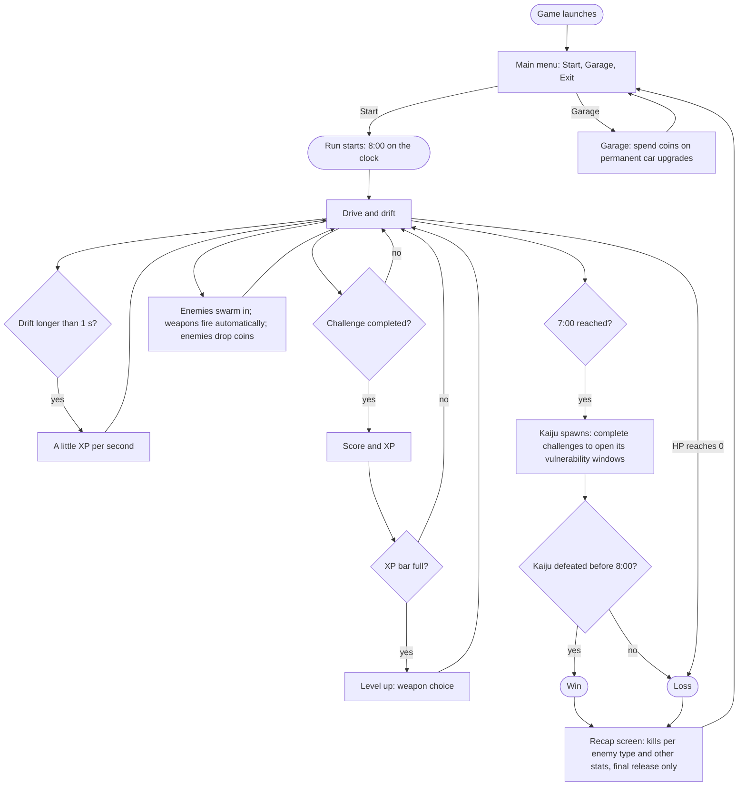

# Game loop architecture

## Summary

Solid Carbide is played in 8-minute runs. The player only drives: completing driving challenges and drifting earn XP, each level-up brings a weapon choice, weapons fire on their own at the enemies swarming in, and enemies drop coins. At 7 minutes the kaiju arrives, and the player has the last 60 seconds to defeat it. Between runs, the player is back at the main menu, where the Garage spends coins on permanent car upgrades, and Start begins the next run.

## Decisions

- A run lasts 8 minutes. (2026-10-07)
- The player only drives. The car's weapons fire automatically. (2026-10-07)
- Enemies come in from the edges of the screen, in numbers that grow over the run (how they scale: Enemies, Decisions). (2026-10-07)
- XP comes only from driving, never from kills: from completed challenges, and from drifting. (2026-10-07)
- **Combo:** tricks (Drifting, Decisions) raise a combo multiplier, and the multiplier multiplies all XP gained (from challenges and from drifting). Each trick adds to the multiplier: extended drifts a little, a 360 more, an alternate drift the most. Colliding with anything, enemies included, cuts the combo by 80%. If no trick follows within 2 seconds, the combo drains away quickly. The Game Data Agent proposes the numbers; the board judges them in playtests. The XP from drifting seconds stays as it is, alongside the extended-drift trick. Part of the MVP. (2026-10-10)
- The higher the combo, the more enemies spawn (how: Enemies, Decisions). The board will judge in playtests whether to keep this. (2026-10-10)
- A drift that lasts longer than 1 second gives XP for every second it lasts, the first second included (a 3-second drift gives 3 seconds' worth). (2026-10-07)
- Each second of drifting gives a fixed amount of XP: 10% of the XP bar at level 1. The amount does not grow with the bar, so at higher levels it is a smaller share of the bar and drifting gives only a little XP. (2026-10-07)
- "Drifting", for XP, uses the Unity prototype's definition: any moment W or S is held together with A or D (Unity prototype report, section 3). (2026-10-07)
- At level 1, completing one challenge fills the XP bar: the player reaches level 2 and gets the weapon choice. (2026-10-08)
- How much XP challenges and drifting give at each level, and how much XP each level needs, is worked out by the Game Data Agent as sensible XP scaling, within the decisions here. (2026-10-08)
- Completing a challenge flashes a score, the likes it gave, and gives XP. The weapon choice opens only when the XP bar fills and the player levels up (how many weapons are offered: Weapons, Decisions). The weapons chosen reset at the start of every run. (2026-10-07; weapon choice on level-up only, 2026-10-08; the score is the likes gained, 2026-10-09)
- Enemies drop coins. The coins collected in a run are kept whether the run is won or lost. (2026-10-07; kept on a loss, 2026-10-09)
- At the 7-minute mark the kaiju spawns. It moves slowly toward the player, deals contact damage, and can only be damaged during a window opened by completing a challenge (how: Enemies, Decisions). (2026-10-07)
- Win: defeat the kaiju within the final 60 seconds. Loss: the car's HP reaches 0 at any point, or the kaiju survives the timer. (2026-10-07)
- Between runs, coins are spent in the Garage on permanent car upgrades that improve the car in the next run (which upgrades: Garage design, Decisions). (2026-10-07)
- The game opens on a main menu with three buttons: Start (begins a run), Garage, and Exit. When a run ends, win or loss, the player returns straight to the main menu, with no win or loss message in the MVP. (2026-10-08; no message, 2026-10-09; Exit rather than Quit, 2026-10-10)
- The final release adds a recap screen right after a run ends, win or loss: how many of each enemy type the player killed, and other stats the board will choose (task T-017). In the MVP there is no recap: the run ends at the main menu. (2026-10-07; corrected 2026-10-09, it said the MVP goes to the Garage)
- The final release adds local co-op for 2 players (screen split in halves) and 4 players (screen split in quarters). The MVP is single-player. (2026-10-07)

## Content

### One run

### The run scene

The run is one Godot scene (task T-036; how to use it: [game/README.md](../game/README.md), section "The run"). It loads the MVP map (Level design, Content, "MVP map") and puts the drift car (Drifting) on it, at the centre of the map, in the gravel square, with the camera following the car in the isometric view, as in the drift prototype.

The run owns its state: the clock (8:00 counting down, stopping while the game is paused), the car's health (starting at the value in [game/data/run.json](../game/data/run.json)), and the coins collected in the run. Other parts of the game plug into it:

- At 1:00 left the run sends "boss time"; the kaiju spawns on it (Enemies).
- Enemies damage the car and add coins through the run; the kaiju's death ends the run as a win.
- Health reaching 0, or the clock reaching 0:00, ends the run as a loss.
- Either way, the run sends one "run ended" signal with the result and the coins collected, which are saved (Garage design).
- The HUD reads the time left, the health and the coins from the run (HUD and menus).

Starting a new run resets the map, the car and the state. Returning to the main menu when a run ends comes with the screen flow, in a later task.

## Open questions

- (After MVP) Gift-pack drops: a plane flies over and drops the gift pack on the ground, and the reward screen opens when the player drives over it, so driving isn't interrupted. In the MVP the reward screen opens as soon as the player levels up.
- (After MVP) Difficulty modifiers the player can turn on for a level after completing it the first time; the plot might also tie into them (Extended narrative).
- (After MVP) Which stats does the recap screen show besides kills per enemy type, and what does it look like? (Task T-017.)

## References

- Final GDD (historical; superseded by the game area docs): [short-gdd/Solid_Carbide_-_Final_GDD.pdf](short-gdd/Solid_Carbide_-_Final_GDD.pdf), sections "Game Specificity" and "Player Experience".
- Unity prototype report: [drifting/unity-prototype-report.md](drifting/unity-prototype-report.md), for the definition of drifting used for XP.
- Run numbers (XP per challenge, XP per level, drift XP, car starting health): [game/data/run.json](../game/data/run.json), read through `game/scripts/data/run_data.gd`.
