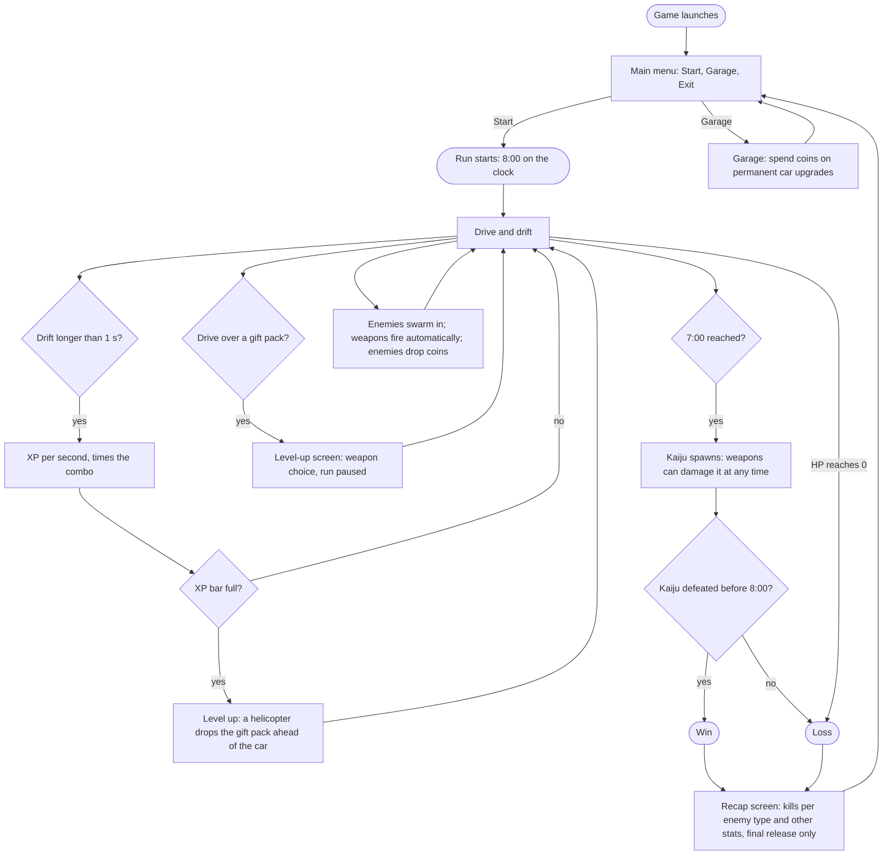

# Game loop architecture

## Summary

Solid Carbide is played in 8-minute runs. The player only drives: drifting earns XP, each level-up brings a weapon choice, weapons fire on their own at the enemies swarming in, and enemies drop coins. At 7 minutes the kaiju arrives, and the player has the last 60 seconds to defeat it; it can be damaged at any time. Between runs, the player is back at the main menu, where the Garage spends coins on permanent car upgrades, and Start begins the next run.

## Decisions

- A run lasts 8 minutes. (2026-10-07)
- The player only drives. The car's weapons fire automatically. (2026-10-07)
- Enemies come in from the edges of the screen, in numbers that grow over the run (how they scale: Enemies, Decisions). (2026-10-07)
- XP comes only from driving, never from kills. In the MVP it comes from drifting only, since challenges are left out of the MVP (Level design, Decisions); if they come back, completed challenges give XP too. (2026-10-07; drifting only in the MVP, 2026-10-11)
- **Combo:** tricks (Drifting, Decisions) raise a combo multiplier, and the multiplier multiplies all XP gained (from challenges and from drifting). Each trick adds to the multiplier: extended drifts a little, a 360 more, an alternate drift the most. Colliding with anything, enemies included, cuts the combo by 80%. If no trick follows within 2 seconds, the combo drains away quickly. The Game Data Agent proposes the numbers; the board judges them in playtests. The XP from drifting seconds stays as it is, alongside the extended-drift trick. Part of the MVP. (2026-10-10)
- The higher the combo, the more enemies spawn (how: Enemies, Decisions). The board will judge in playtests whether to keep this. (2026-10-10)
- A drift that lasts longer than 1 second gives XP for every second it lasts, the first second included (a 3-second drift gives 3 seconds' worth). (2026-10-07)
- Each second of drifting gives a fixed amount of XP: 10% of the XP bar at level 1. The amount does not grow with the bar, so at higher levels it is a smaller share of the bar and drifting gives only a little XP. (2026-10-07)
- **Likes drain:** when the player isn't doing tricks, the likes bar empties, but never below the start of the current level, so the player never loses a level. It starts once the combo has fully drained, and any trick stops it. The speed is the board's playtest value, 8% of the current level's bar a second (four times the first proposal; the number: [game/data/run.json](../game/data/run.json)). Part of the MVP. (board, 2026-10-13; four times faster the same day)
- "Drifting", for XP, uses the Unity prototype's definition: any moment W or S is held together with A or D (Unity prototype report, section 3). (2026-10-07)
- After the MVP, if challenges come back (2026-10-11): at level 1, completing one challenge fills the XP bar: the player reaches level 2 and gets the weapon choice. (2026-10-08)
- How much XP challenges and drifting give at each level, and how much XP each level needs, is worked out by the Game Data Agent as sensible XP scaling, within the decisions here. (2026-10-08)
- The weapon choice opens only when the XP bar fills and the player levels up (how many weapons are offered: Weapons, Decisions). The weapons chosen reset at the start of every run. (2026-10-07; weapon choice on level-up only, 2026-10-08)
- **Gift pack drop** (board, 2026-10-16; tasks T-144 to T-146): the level-up screen no longer just appears. When the player levels up, a helicopter sent by Redgull flies over the screen and drops a package carrying Redgull's brand (the gift pack). When the player drives over the package, the level-up screen (the gift pack screen) opens. The look of the helicopter and the package: Visual style, Decisions. The run keeps going while the helicopter comes and the package waits; it pauses only when the screen opens. The package lands a short way ahead of the car, on open road, and stays until picked up. One package per level-up, each opening its own screen. When a landed package is off screen, an arrow at the screen edge points to it. (answers, 2026-10-16)
- After the MVP, if challenges come back (2026-10-11): completing a challenge flashes a score, the likes it gave, and gives XP. (2026-10-07; the score is the likes gained, 2026-10-09)
- Enemies drop coins. The coins collected in a run are kept whether the run is won or lost. (2026-10-07; kept on a loss, 2026-10-09)
- At the 7-minute mark the kaiju spawns. It moves slowly toward the player, deals contact damage, and can be damaged at any time (Enemies, Decisions). (2026-10-07; always vulnerable, 2026-10-11, replacing the windows opened by challenges)
- Win: defeat the kaiju within the final 60 seconds. Loss: the car's HP reaches 0 at any point, or the kaiju survives the timer. (2026-10-07)
- Between runs, coins are spent in the Garage on permanent car upgrades that improve the car in the next run (which upgrades: Garage design, Decisions). (2026-10-07)
- The game opens on a main menu with three buttons: Start (begins a run), Garage, and Exit. When a run ends, win or loss, the player returns straight to the main menu, with no win or loss message in the MVP. (2026-10-08; no message, 2026-10-09; Exit rather than Quit, 2026-10-10)
- The final release adds a recap screen right after a run ends, win or loss: how many of each enemy type the player killed, and other stats the board will choose (task T-017). In the MVP there is no recap: the run ends at the main menu. (2026-10-07; corrected 2026-10-09, it said the MVP goes to the Garage)
- The final release adds local co-op for 2 players (screen split in halves) and 4 players (screen split in quarters). The MVP is single-player. (2026-10-07)
- **Music** (board, 2026-10-20): the board's own two tracks, "DEMO BEAT 1 (ANDY GAME)" and "DEMO BEAT 2 (ANDY GAME)" (made by the board; the music is human-made), play through the whole game, menus and runs alike, without stopping between screens: one track, then the other, alternating and looping. Its volume is the pause screen's music volume slider (HUD and menus, Decisions). Built in T-209: one music player, a child of the game flow, so the screens changing never restarts it; it plays on its own "Music" bus, and the setting is `music_volume` in `game_settings.gd` (0 to 100, saved with the SFX volume, starting at 40 as a proposal for the playtest). (tasks T-209, T-210)
- **Pickup magnet** (board, 2026-10-21): coins, level-up gift packs and health drops are pulled towards the car once they are within a radius of 1 car length, so they are easier to pick up. The radius is a garage upgrade (Garage design, Decisions). Built in T-222: the radius is 3 units (the car is drawn 3 units long, Drifting, Decisions), read from `run.json`'s `pickup_magnet`, and pickups fly to the car at 30 units per second (proposals for the playtest: the pull speed, and the reach ignoring heights); `game/README.md`, "The pickup magnet (T-222)". (T-222)

## Content

### One run

### The run scene

The run is one Godot scene (task T-036; how to use it: [game/README.md](../game/README.md), section "The run"). It loads the run's map and puts the drift car (Drifting) on it, at the centre of the map, in the gravel square, with the camera following the car in the isometric view, as in the drift prototype.

The run's map (task T-206; Level design, Decisions, "The elevation sample map becomes the run's map") is the elevation sample map's layout with its rooftops and ramps (Level design, Content, "Elevation sample map", "The run on this map"): the car has its height there, and everything else in the run (enemies, weapons, pickups, coins, the HUD, the pause screen) works on it as on the MVP map. The MVP map (Level design, Content, "MVP map") stays in the project; one constant in the run switches back to it ([game/README.md](../game/README.md), "The run").

The run owns its state: the clock (8:00 counting down, stopping while the game is paused), the car's health (starting at the value in [game/data/run.json](../game/data/run.json)), and the coins collected in the run. Other parts of the game plug into it:

- At 1:00 left the run sends "boss time"; the kaiju spawns on it (Enemies).
- Enemies damage the car and add coins through the run; the kaiju's death ends the run as a win.
- Health reaching 0, or the clock reaching 0:00, ends the run as a loss.
- Either way, the run sends one "run ended" signal with the result and the coins collected, which are saved (Garage design).
- The HUD reads the time left, the health and the coins from the run (HUD and menus).

### Likes and levels

The run also owns the likes (XP) and the level (task T-037; how to use it: [game/README.md](../game/README.md), section "The run"; the numbers: [game/data/run.json](../game/data/run.json)):

- Every completed challenge, preset or the kaiju's meteor challenges, gives the current level's challenge XP, and the run sends a "score" signal with it for the challenge popup.
- The run follows the car's drift state step by step: once an unbroken drift reaches 1 second it gives the drift XP for that second, then for each further full second.
- When XP reaches the level's threshold the level goes up (leftover XP carries over, so one gain can give several level-ups), and the run sends "level up" with the new level. At the top level the bar stops.
- On every level-up the run plays the level-up effect: a burst of pixel particles from the car, following it while it plays (task T-112; the look: Visual style, Decisions, "Level-up effect"). Several level-ups in the same moment show as one burst, and the burst keeps playing while the run is paused for the weapon choice.
- The HUD reads the XP, the level's threshold and the level, with a signal whenever they change.
- A level-up does not pause the run by itself: it sends the gift pack (below, task T-144). The run pauses (clock and car) when the car drives over the gift pack's package and the level-up screen opens (task T-052), until the weapon choice is made, one choice after another when several packages are picked up at once.
- **Likes drain** (task T-115; the speed: [game/data/run.json](../game/data/run.json), `likes_drain`, task T-114): once the combo has fully drained back to "no combo", the XP in the current level goes down, stopping at the start of the level, so the level never goes down. Any trick raises the combo and stops it; it starts again once the combo has drained again. It stops while the run is paused (pause screen, level-up screen) and after the run ends. At the top level there is nothing to drain. The HUD's likes bar follows it, so the bar visibly empties.
- A new run starts back at level 1 with no XP.

### The gift pack drop

How the level-up screen is reached (task T-144; how to use it: [game/README.md](../game/README.md), section "The gift pack drop"; the numbers: [game/data/gift_pack.json](../game/data/gift_pack.json)):

- On every level-up the run sends a helicopter. It flies across the screen from beyond one edge to beyond the other, carrying the package, and drops it over the landing spot; the package falls and lands. Built with placeholder art for now (the final art: tasks T-145 and T-146).
- The landing spot is a short way ahead of the car, along the way it is moving, on open road: never in a building, a boulder or past the map's edge. If straight ahead is blocked, the nearest open spot around it is used.
- The run keeps going the whole time (the clock, enemies, likes and the likes drain). The level-up moment itself (the "level up" signal, the level-up effect, the likes bar) is unchanged.
- One package per level-up. Packages stay on the ground until picked up; a new run clears them.
- Driving over a landed package removes it and opens the level-up screen for that level, with the same weapon choices as before; the run pauses until the choice is made. Two packages picked up together give two screens, one after the other.
- While a landed package is off screen, an arrow at the screen's edge points to it, one per package, kept clear of the HUD.

### The combo

The run also owns the combo (task T-081; how to use it: [game/README.md](../game/README.md), section "The run"; the numbers: [game/data/combo.json](../game/data/combo.json)):

- Each trick the car does raises the combo multiplier by that trick's amount, up to a cap. The run sends a signal with the trick, the amount added and the new multiplier, for the trick popups.
- The multiplier multiplies all XP gained: each completed challenge's XP (the "score" signal carries the multiplied amount) and each drift second's XP.
- Hitting a wall, a building, the map edge or a boulder cuts the combo by 80%, and so does any damage to the car (enemies, meteors). The cut applies to the part of the multiplier above "no combo".
- When no trick has come for 2 seconds, the combo drains, down to "no combo". A trick restarts the wait.
- The HUD and enemy spawning read the multiplier, with a signal whenever it changes. It stops while the run is paused and resets with every new run.

Starting a new run resets the map, the car and the state. The run's camera zoom can be changed from the pause screen.

### Screen flow

One screen is on show at a time (task T-055; how to use it: [game/README.md](../game/README.md), section "Screen flow"):

- The game opens on the main menu (HUD and menus, Content).
- **Start** replaces the menu with a fresh run. During the run, Escape pauses and resumes it (the pause screen, HUD and menus).
- When the run ends, win or loss, the run is removed and the main menu comes straight back, with no message. Another Start begins a fresh run.
- **Garage** opens the garage, and leaving the garage goes back to the main menu (Garage design). Wired in task T-089: the garage's back button returns to the main menu.
- **Exit** closes the game.

The drift prototype is not part of the flow; it stays as a tuning tool, opened on its own.

## Open questions

- (After MVP) Difficulty modifiers the player can turn on for a level after completing it the first time; the plot might also tie into them (Extended narrative).
- (After MVP) Which stats does the recap screen show besides kills per enemy type, and what does it look like? (Task T-017.)

## References

- Final GDD (historical; superseded by the game area docs): [short-gdd/Solid_Carbide_-_Final_GDD.pdf](short-gdd/Solid_Carbide_-_Final_GDD.pdf), sections "Game Specificity" and "Player Experience".
- Unity prototype report: [drifting/unity-prototype-report.md](drifting/unity-prototype-report.md), for the definition of drifting used for XP.
- Run numbers (XP per challenge, XP per level, drift XP, car starting health): [game/data/run.json](../game/data/run.json), read through `game/scripts/data/run_data.gd`.
- Combo numbers (what each trick adds, the cap, the collision cut, the drain, how the combo raises spawning): [game/data/combo.json](../game/data/combo.json), read through `game/scripts/data/combo_data.gd`.
- Gift pack numbers (the helicopter's speed, height and margin; the package's fall time, landing distance, clearance and pickup radius): [game/data/gift_pack.json](../game/data/gift_pack.json), read through `game/scripts/data/gift_pack_data.gd`.
