# Level design

## Summary

The MVP has one map: a city laid out as a grid of building blocks, with roads of different widths running between them. Obstacles (crashed meteor boulders) stand on the roads in set patterns. Driving challenges, arrows painted on the ground around some of the patterns, are left out of the MVP; the board might bring them back later, and their design is kept here for that.

## Decisions

- **Challenges are left out of the MVP.** The MVP map has no challenge arrows and no challenges: the obstacle pattern copies stay on the roads as plain boulder obstacles. The board might bring challenges back after the MVP; the decisions below about challenges, arrows and corridors are kept for that and do not apply to the MVP. (2026-10-11)
- A challenge is defined as a curved corridor with a width, so there is room for tolerance. (2026-10-03)
- The car counts as in the challenge as long as any part of it is touching the corridor. "The car" here is the drawn car (1 by 3 units), not its smaller physics body. (2026-10-03; drawn car confirmed 2026-10-08)
- The MVP map is a city laid out as a grid: blocks of buildings, with roads running between the blocks. (How it looks: Visual style, Decisions.) (2026-10-07)
- Roads are 24 units wide, three times the first plan's 8, so the car drives through them easily (board, after playing the first map). A street never widens along its length. (2026-10-07; 24 units, 2026-10-11; replaces "between 5 and 10 times as wide as the car")
- Map sizes are measured in units, where 1 unit is the drawn car's width (the smaller of its two dimensions; Drifting, Decisions). It is the same unit the driving values use. (2026-10-07)
- The MVP map is **240 by 240 units**: the first plan's 80 by 80 map with everything three times bigger (perimeter road, blocks, roads and the gravel centre). The boulders and the challenges stay sized to the car. (2026-10-07; everything three times bigger, 2026-10-11; replaces the 242 by 242 map of 13 by 13 small blocks)
- A wide road, 24 units wide, runs around the whole edge of the map. The map ends in a hard stop at its edges. (2026-10-07; 24 units, 2026-10-11)
- Inside the perimeter road, building blocks of 30 by 30 units are laid out in a 4 by 4 grid, separated by roads 24 units wide (3 roads in each direction). (2026-10-07; three times bigger, 2026-10-11)
- The centre of the map is an open square of 84 by 84 units with no blocks. Its ground is gravel, not road. (2026-10-07; three times bigger, 2026-10-11)
- Obstacles are placed on the roads. In the MVP the only obstacle is a crashed meteor boulder; more kinds come later. (2026-10-07)
- In the MVP, obstacles are circles, all 3 units across (one car length), so they never block a road. They stay this size on the bigger map. (2026-10-08; replaces the 2026-10-07 decision of 3, 6 or 9 units; confirmed car-sized 2026-10-11)
- In the MVP, a challenge includes up to 2 obstacles. (2026-10-07)
- Each challenge's arrow path is shaped to its obstacles, using scripts from the Driving & Drift Agent that show what the car can actually drive and how it behaves. (2026-10-07)
- Some obstacles are on the map from the start; others appear during the run, dropped by the boss (Enemies, Decisions). (2026-10-07)
- The obstacles on the map from the start are placed in set patterns, called obstacle pattern groups. The board defines the patterns. (2026-10-07)
- The MVP has 2 obstacle patterns, each drawn by the board (Content, "MVP challenges") (2026-10-08; replaces the earlier plan of 3):
  - **Single Boulder:** 1 boulder, with 2 possible challenges: one loop clockwise and one counter-clockwise around it.
  - **Two Boulders:** 2 boulders, with 1 possible challenge: a figure-eight around both.
- A pattern can have several possible challenges: each challenge is a different arrow path around the same obstacles. (2026-10-08)
- For the MVP, the board does no level design itself. The Level/Challenge Design Agent makes the map once, following the rules in this document and the board's descriptions and drawings, and every run uses that same map. (2026-10-07)
- 30% of the obstacle pattern groups on the map become challenges. Each challenge gets an arrow that appears under it, animated as if painted on the ground, showing the player how to drive the challenge. The arrow's animation is designed in advance. (2026-10-07)
- Which pattern groups are challenges is set in advance, the same every run. The Level/Challenge Design Agent makes the first choice, and the board adjusts it if needed. (2026-10-08)
- The painted arrow marks the challenge's corridor (the corridor in the first Decision). The arrow is as wide as the car is long (3 units), so the player doesn't have to follow its centre line exactly: the car only has to touch the arrow. The Driving & Drift Agent's scripts make sure each path is drivable. (2026-10-08)
- The Level/Challenge Design Agent decides how many copies of each pattern are placed on the map, and where. (2026-10-08)
- A challenge is completed when the drawn car touches its corridor continuously from the arrow's start to its end, in the arrow's direction. Leaving the corridor midway means starting again from the start. (2026-10-08)
- When a challenge is completed, its arrow disappears and the player gets XP on the XP bar. The group's boulders stay on the map as plain obstacles for the rest of the run. (2026-10-08)
- When a pattern with several possible arrows becomes a challenge, the Level/Challenge Design Agent picks one of its arrows. (2026-10-08)
- The board draws each challenge as its own drawing in Crash City Grid (References): one drawing per arrow path, kept in a folder per obstacle pattern. Every drawing in a pattern's folder has the same boulders; only the arrow differs. (2026-10-08)
- The board's drawings are rough sketches of each challenge's general shape, not exact layouts. The Level/Challenge Design Agent makes them fit the map (for example the 8-unit roads), with whatever reasonable adjustments that needs (size, spacing, how tight the loops are), while keeping the shape: how many boulders, which way the arrow goes around each one, and the overall path (a loop, a figure-eight). The Driving & Drift Agent's check confirms the fitted versions can be driven. (2026-10-08)
- The kaiju's meteors leave plain boulders where they land, not challenges (Enemies, Decisions). (2026-10-11)
- After the MVP, if challenges come back (2026-10-11): a challenge the kaiju's meteors create never lands on another challenge: its boulders and its arrow corridor must not overlap any other challenge's arrow corridor, preset or meteor. (2026-10-10)
- **Raised areas and ramps** (board, 2026-10-17; go-ahead 2026-10-19): the map can have elevated areas, for example in the size of the current 2 by 2 grid of blocks. One side of a raised area is a ramp the car drives up; its other edges are drop-offs the car can jump off. How the car's height works: Drifting, Decisions, "Elevation". First built in a test scene with one raised platform, one ramp and one drop-off edge, not in the real map. The map's data format leaves room for heights and ramps from the start, for the level editor the board wants later.
- **Raised areas turn see-through like buildings** (board, 2026-10-19, after playing the elevation test scene): when a raised area (and its ramp) covers the car on screen, it fades the way buildings do ("When a building fades" below), with the same logic, so the car never vanishes behind it.
- **Elevation sample map** (board, 2026-10-19, after approving the elevation test scene): elevation goes into the game first, the tricks later. A drive-only sample map (no enemies, weapons or run timer; driving around freely, like the test scene but city-sized), made by the agents, with **three layers**: the street (height 0), a first floor (height 3) and a second floor (height 6), with ramps connecting the street to the first floor and the first floor to the second, so the car can jump from higher with more airtime. The raised areas are building rooftops and the ramps parking-garage-style ramps (look: Visual style, Decisions, "Elevation sample map art"). It uses the elevation system as approved (the car's height, edges, see-through, the round shadow) and the map's buildings, boulders and roads. Its map file holds the heights and ramps in the format a level editor would later edit. After the board's playtest: if the board is happy, maybe aerial tricks next (a 360 in the air, a combo from airtime); if not, a level editor so the board can make levels by hand and playtest them at once. The arrow-key tricks come after both. Full runs on elevated maps (enemies that handle heights) are a later step.
- **The elevation sample map becomes the run's map** (board, 2026-10-20, after playing it: "plays great"): a run started from the main menu now plays on the elevation sample map's layout, with its rooftops, ramps and the car's height, as the full game (enemies, weapons, timer, likes, levels, the kaiju), so the board can see how the enemies behave on it. The MVP map stays in the project and can be switched back to (tasks T-206, T-207). How enemies handle heights: Enemies, Decisions, "Enemies follow the car up the ramps" (board, 2026-10-21).
- **Level creator** (board, 2026-10-21): a separate app, opened like the game but never shipped with it, where the board makes levels by hand. It lists the levels made so far: pick one to play it as a full run (the same 8 minutes, enemies and kaiju as the game), or press a button to create a new one (the only option when there are none). Creating or editing a level is a scene with a side panel of every asset already in the game (ground tiles, roads, buildings, boulders, rooftops, ramps): pick one, place it, rotate it before placing (which means switching between the views the art exists in and mirroring them, since the art has only the angles that were generated), with rooftops and ramps at heights 3 and 6 as on today's map, and pieces snapping to the map's tile grid and to close neighbours so they align with little effort. Custom levels are played only from the creator; the game keeps its own map. Enemies find their way on whatever is built. Built by a goal run (G-005), first with today's art only.
- **Level creator piece set** (board, 2026-10-22, after playing G-005's creator; replaces "no new art is generated for it"): today's assets are not enough to build a full level, so the creator gets a comprehensive set of pieces generated with PixelLab, with no cap on generations (board, 2026-10-24: "we have all the budget available to us"; this replaces the first cap of 100). The aim is a functional, multi-layer world to drive around: rooftops and platforms that can be made smaller and bigger, ramps between the layers, and pieces in more rotations. What the set holds is the Project Lead's plan (the tickets list it); the board judges it in the playtest.
- **Level creator rework** (board, 2026-10-22, after playing the piece set; the plan the board read: https://claude.ai/artifact/2TXG35AkZFYXKvfNUUPfNN): the side panel is one button per kind of thing, in six groups from the ground up (Roads, Ground, Levels, Buildings, Obstacles, Decoration), with a piece's looks, turns, mirror and height chosen by keys and shown in a strip under the selected piece, instead of a button per rotation and variant. **Roads are painted with a brush**: drag to lay a road, which comes whole (a centre line in its middle, not two half tiles) and joins itself into corners, T-junctions, crossroads and dead ends; road kinds are plain, centre line, zebra crossing and cracked. **Ramps** are closed blocks with a wall at their tall end, and each ramp in each direction and height step can have its arrows pointing up or down the slope, the board's choice per ramp. **Platforms** (rooftops) have one-click sizes S 8 x 8, M 16 x 16 and L 32 x 32 units at heights 3 and 6, besides dragging any size. **Skyscraper banners** are on or off per building, off by default. No new generations.
- **The car's spawn point** (board, 2026-10-22): every level has a spawn point, where the car starts a run on it. It is visible in the editor from the moment a level opens and the board can move it anywhere the car can stand (dragging it, and turning it for the car's starting heading, a proposal). It can never be deleted: a level always has exactly one. A new level starts with it at the map's centre; a level saved before this has it there too. (T-279, T-280)
- **Thread the needle** (board, 2026-10-22): in the level creator the board can mark two obstacles (anything the car crashes into and that cuts the combo: boulders, barriers, cones, crates) as a pair. In a run on that level, driving through the gap between a marked pair is a trick, **thread the needle**, that raises the combo like the other tricks (Game loop architecture, Decisions, "The combo"). What it is worth, whether it pays again on the next pass, and how the pair shows in the editor and in the run are the agents' proposals for the playtest. Its popup text: HUD and menus, Content (T-271). (T-272)
- **Tutorial levels** (board, 2026-10-20, "not a request now"): short tutorial levels that show the player the tricks, one trick at a time. The board will describe them later; nothing is built until then (task T-211).

## Content

### MVP challenges

The board's sketches of the 3 MVP challenges, one per arrow path. They show the general shape only; the fitted versions on the map are the Level/Challenge Design Agent's (Decisions). Each drawing's data (boulders and arrow points, in units from the sheet's centre) is in a `.json` file next to its picture. The pale band is the 3-unit corridor, the white dot is the start, and the arrowhead is the finish.

| Pattern | Challenge | How the arrow goes |
|---|---|---|
| Single Boulder | [arrow 1](level-design/single-boulder/arrow-1.svg) | One loop around the boulder, clockwise |
| Single Boulder | [arrow 2](level-design/single-boulder/arrow-2.svg) | One loop around the boulder, counter-clockwise |
| Two Boulders | [arrow 1](level-design/two-boulders/arrow-1.svg) | A figure-eight: clockwise around the top boulder, counter-clockwise around the bottom one |

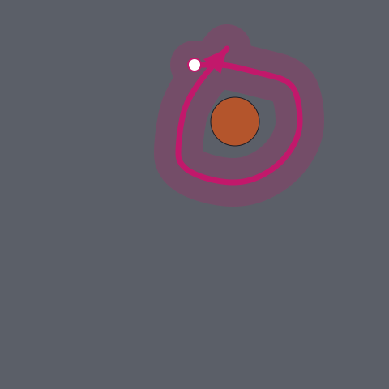
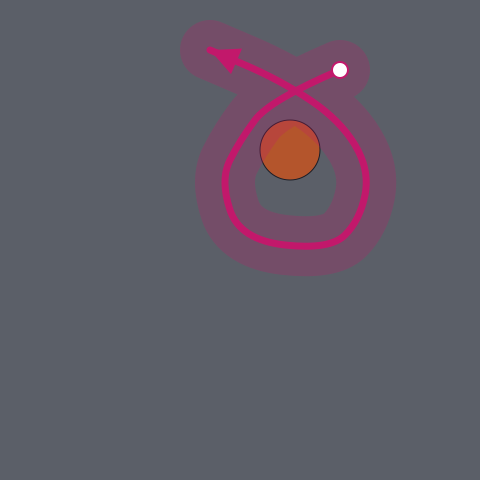
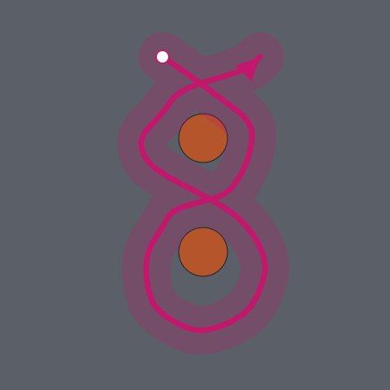

### Drivability check

The Driving & Drift Agent's drivability check (References) drove the board's sketches with the car's driving code (task T-021), both with the Unity prototype's top speed and with the board's top speed of 3.0 times cruise speed (Drifting, Decisions); the results were the same:

- Single Boulder, arrow 1: drivable: yes.
- Single Boulder, arrow 2: drivable: yes.
- Two Boulders, arrow 1: drivable: yes.

### MVP map

The MVP map as built in Godot (task T-019; made bigger after Playtest 1 in task T-094, then rebuilt with everything three times bigger after the combined playtest in task T-096), in flat placeholder colours: dark grey roads, the tan gravel centre, purple buildings, and dark boulders with an orange rim. The art replaces the colours later. Since task T-103 the isometric view draws the ground art, and since task T-034 its buildings rise as boxes that turn see-through ("See-through buildings" below).

**No challenges in the MVP** (task T-097, as Decisions says). The map draws no challenge arrows and tracks no challenges, so it never sends a completed challenge and the run never flashes a score; likes come from drifting only. Every pattern copy below stays on the roads, its boulders exactly where they were, as plain obstacles the car bounces off. The challenges, the fitted versions, the completion rule, the arrows and the meteor challenges are kept in the code and the layout data, unused, so they can be switched back on in one place if the board brings them back (how: `game/README.md`, "MVP map"). The parts of this section about challenges and arrows describe what comes back then.

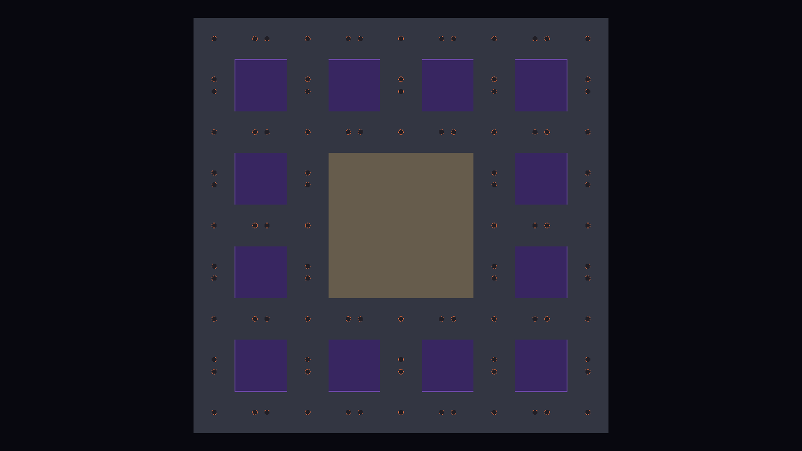

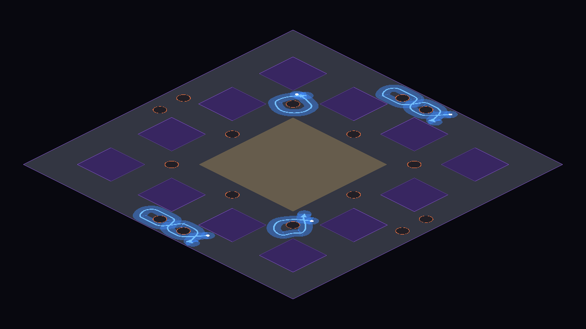

**Size.** The map is **240 by 240 units**, as Decisions says: across the map, the two 24-unit sides of the perimeter road, 4 blocks of 30 and the 3 roads of 24 between them (24 + 4 x 30 + 3 x 24 + 24 = 240). The gravel centre is the middle 2 by 2 blocks and the road between them, 84 by 84 units, which leaves 12 blocks.

**Coordinates.** Positions are in units from the map's centre, x to the right and y down, as in Crash City Grid, so the map runs from -120 to 120. The perimeter road runs from the edge to 96 units from the centre; the blocks start at -96, -42, 12 and 66 on each axis; the gravel centre runs from -42 to 42. The road centre lines are at -108 and 108 (the perimeter road) and -54, 0 and 54 (the roads between the blocks), and the middle of each block side is at -81, -27, 27 or 81. The car starts at 0, 0, in the gravel.

**Fitted patterns.** Each sketch has a fitted version next to it (`arrow-1.fitted.json` and `.svg`), made by a script from the sketch. The rule is the same as before: the sketch's boulders are kept, 3 units across and as far apart as drawn, and its arrow points are moved as little as possible until the arrow's centre line stays at least 2 units from each boulder's centre (the rock's radius plus half the car's width) and the 3-unit corridor stays at least 0.25 units from every building. On the 24-unit roads every sketch already keeps those distances, so no arrow point is moved: each fitted version is the board's sketch exactly, only shifted so its boulders sit on the crossing's centre or the road's centre line.

| Fitted version | Made to fit | Around each boulder |
|---|---|---|
| [Single Boulder, arrow 1](level-design/single-boulder/arrow-1.fitted.svg) | A crossing of two 24-unit roads, the boulder on its centre | Clockwise, 389 degrees, as in the sketch |
| [Single Boulder, arrow 2](level-design/single-boulder/arrow-2.fitted.svg) | A crossing of two 24-unit roads, the boulder on its centre | Counter-clockwise, 431 degrees, as in the sketch |
| [Two Boulders, arrow 1](level-design/two-boulders/arrow-1.fitted.svg) | A straight 24-unit road, the boulders on its centre line, 7 units apart | Clockwise 422 degrees, then counter-clockwise 332, as in the sketch |

The figure-eight is no longer squeezed across the road: its loops are as wide as the board drew them (about 8 units).

**Pattern copies.** 60 copies: 24 Single Boulder and 36 Two Boulders. None is in the gravel.

- A Single Boulder on the centre of every place where two road centre lines meet: the 8 crossings of the inner roads, the 12 junctions where they join the perimeter road, and its 4 corners.
- A Two Boulders on the middle of every stretch of road between those places (the middle of each block side), turned to run along the road.
- So along any road the next copy is 27 units away.

Every copy has room for any of its pattern's arrows, clear of buildings, the map's edge and the other copies, so which copies are challenges can change later without moving them.

**Challenges (off in the MVP, kept for later).** 30% of 60 is 18 challenges (rounded half up, as before): 6 Single Boulder (3 with arrow 1, 3 with arrow 2) and 12 Two Boulders. They are the same every run. They are chosen evenly through the copies in reading order (top to bottom, then left to right), which spreads them over the whole map; the Single Boulder ones take arrow 1 and arrow 2 in turn. The rotation turns the fitted version clockwise on screen (0: the Two Boulders runs along y).

| Copy | Pattern | Centre | Where | Rotation | Challenge (when switched on) |
|---|---|---|---|---|---|
| copy-01 | Single Boulder | -108, -108 | corner of the perimeter road | 0 |  |
| copy-02 | Two Boulders | -81, -108 | perimeter road, top side | 90 | challenge-1, arrow 1 (figure-eight) |
| copy-03 | Single Boulder | -54, -108 | perimeter road junction | 0 |  |
| copy-04 | Two Boulders | -27, -108 | perimeter road, top side | 90 |  |
| copy-05 | Single Boulder | 0, -108 | perimeter road junction | 0 |  |
| copy-06 | Two Boulders | 27, -108 | perimeter road, top side | 90 | challenge-2, arrow 1 (figure-eight) |
| copy-07 | Single Boulder | 54, -108 | perimeter road junction | 0 |  |
| copy-08 | Two Boulders | 81, -108 | perimeter road, top side | 90 |  |
| copy-09 | Single Boulder | 108, -108 | corner of the perimeter road | 0 | challenge-3, arrow 1 (clockwise) |
| copy-10 | Two Boulders | -108, -81 | perimeter road, left side | 0 |  |
| copy-11 | Two Boulders | -54, -81 | road along y | 0 |  |
| copy-12 | Two Boulders | 0, -81 | road along y | 0 | challenge-4, arrow 1 (figure-eight) |
| copy-13 | Two Boulders | 54, -81 | road along y | 0 |  |
| copy-14 | Two Boulders | 108, -81 | perimeter road, right side | 0 |  |
| copy-15 | Single Boulder | -108, -54 | perimeter road junction | 0 |  |
| copy-16 | Two Boulders | -81, -54 | road along x | 90 | challenge-5, arrow 1 (figure-eight) |
| copy-17 | Single Boulder | -54, -54 | crossing | 0 |  |
| copy-18 | Two Boulders | -27, -54 | road along x | 90 |  |
| copy-19 | Single Boulder | 0, -54 | crossing | 0 | challenge-6, arrow 2 (counter-clockwise) |
| copy-20 | Two Boulders | 27, -54 | road along x | 90 |  |
| copy-21 | Single Boulder | 54, -54 | crossing | 0 |  |
| copy-22 | Two Boulders | 81, -54 | road along x | 90 | challenge-7, arrow 1 (figure-eight) |
| copy-23 | Single Boulder | 108, -54 | perimeter road junction | 0 |  |
| copy-24 | Two Boulders | -108, -27 | perimeter road, left side | 0 |  |
| copy-25 | Two Boulders | -54, -27 | road along y | 0 |  |
| copy-26 | Two Boulders | 54, -27 | road along y | 0 | challenge-8, arrow 1 (figure-eight) |
| copy-27 | Two Boulders | 108, -27 | perimeter road, right side | 0 |  |
| copy-28 | Single Boulder | -108, 0 | perimeter road junction | 0 |  |
| copy-29 | Two Boulders | -81, 0 | road along x | 90 | challenge-9, arrow 1 (figure-eight) |
| copy-30 | Single Boulder | -54, 0 | crossing | 0 |  |
| copy-31 | Single Boulder | 54, 0 | crossing | 0 |  |
| copy-32 | Two Boulders | 81, 0 | road along x | 90 | challenge-10, arrow 1 (figure-eight) |
| copy-33 | Single Boulder | 108, 0 | perimeter road junction | 0 |  |
| copy-34 | Two Boulders | -108, 27 | perimeter road, left side | 0 |  |
| copy-35 | Two Boulders | -54, 27 | road along y | 0 |  |
| copy-36 | Two Boulders | 54, 27 | road along y | 0 | challenge-11, arrow 1 (figure-eight) |
| copy-37 | Two Boulders | 108, 27 | perimeter road, right side | 0 |  |
| copy-38 | Single Boulder | -108, 54 | perimeter road junction | 0 |  |
| copy-39 | Two Boulders | -81, 54 | road along x | 90 | challenge-12, arrow 1 (figure-eight) |
| copy-40 | Single Boulder | -54, 54 | crossing | 0 |  |
| copy-41 | Two Boulders | -27, 54 | road along x | 90 |  |
| copy-42 | Single Boulder | 0, 54 | crossing | 0 | challenge-13, arrow 1 (clockwise) |
| copy-43 | Two Boulders | 27, 54 | road along x | 90 |  |
| copy-44 | Single Boulder | 54, 54 | crossing | 0 |  |
| copy-45 | Two Boulders | 81, 54 | road along x | 90 |  |
| copy-46 | Single Boulder | 108, 54 | perimeter road junction | 0 | challenge-14, arrow 2 (counter-clockwise) |
| copy-47 | Two Boulders | -108, 81 | perimeter road, left side | 0 |  |
| copy-48 | Two Boulders | -54, 81 | road along y | 0 |  |
| copy-49 | Two Boulders | 0, 81 | road along y | 0 | challenge-15, arrow 1 (figure-eight) |
| copy-50 | Two Boulders | 54, 81 | road along y | 0 |  |
| copy-51 | Two Boulders | 108, 81 | perimeter road, right side | 0 |  |
| copy-52 | Single Boulder | -108, 108 | corner of the perimeter road | 0 | challenge-16, arrow 1 (clockwise) |
| copy-53 | Two Boulders | -81, 108 | perimeter road, bottom side | 90 |  |
| copy-54 | Single Boulder | -54, 108 | perimeter road junction | 0 |  |
| copy-55 | Two Boulders | -27, 108 | perimeter road, bottom side | 90 |  |
| copy-56 | Single Boulder | 0, 108 | perimeter road junction | 0 | challenge-17, arrow 2 (counter-clockwise) |
| copy-57 | Two Boulders | 27, 108 | perimeter road, bottom side | 90 |  |
| copy-58 | Single Boulder | 54, 108 | perimeter road junction | 0 |  |
| copy-59 | Two Boulders | 81, 108 | perimeter road, bottom side | 90 | challenge-18, arrow 1 (figure-eight) |
| copy-60 | Single Boulder | 108, 108 | corner of the perimeter road | 0 |  |

**Completing a challenge (when switched on).** The map checks the drawn car (a 3 by 1 unit rectangle on the car's position and heading) against each open challenge every physics step. A run starts when the car touches the arrow's start; it moves forward while the car keeps touching the corridor, and only along the stretch of arrow the car is on, so crossing a figure-eight or passing the start of a loop does not skip ahead. Not touching the corridor at all, even for one step, ends the run. Reaching the arrow's end completes the challenge.

**Drivability.** The fitted challenges have not yet been checked with the Driving & Drift Agent's script (task T-021); since task T-096 they are the board's sketches unchanged, which that check found drivable ("Drivability check" above). The 18 challenges are copies of the 3 fitted versions, so checking those 3 covers them all.

### See-through buildings

Built on the MVP map in task T-034, following task T-020's research (Visual style, References) and the values in Visual style, Decisions. In the isometric view each building is now a box that rises 15 units above its block (a placeholder height until the building art; the flat view still draws them flat), drawn in depth order with the car: a building nearer the viewer is drawn over what is behind it.

- **When a building fades:** while it covers the car on screen. The car counts as behind a building when its centre is not in front of either of the building's two visible walls (the walls facing +x and +y, towards the viewer), and covered when the drawn car (its 1 by 3 unit rectangle on the ground, together with the same rectangle 1 unit higher) overlaps the building's outline on screen. Being further back alone is not enough: the car in the gravel centre is behind the blocks south of it, but not hidden by them.
- **How:** the whole building fades as one object, to 15% visible over 0.15 seconds, and fades back to fully opaque over 0.15 seconds when the car comes out. Only the buildings covering the car fade; every other building stays fully opaque. Only the car is checked, not enemies or the kaiju.
- **Drawing order:** the car is drawn under the buildings that cover it and over every other building. The ground, the drift marks and the boulders are drawn under all the buildings.
- **Under a building:** the ground art has no tiles under the blocks, so a faded building shows the dark night colour where it stands.

How it is built, and what the final building art has to do to keep it: `game/README.md`, "MVP map", "See-through buildings".

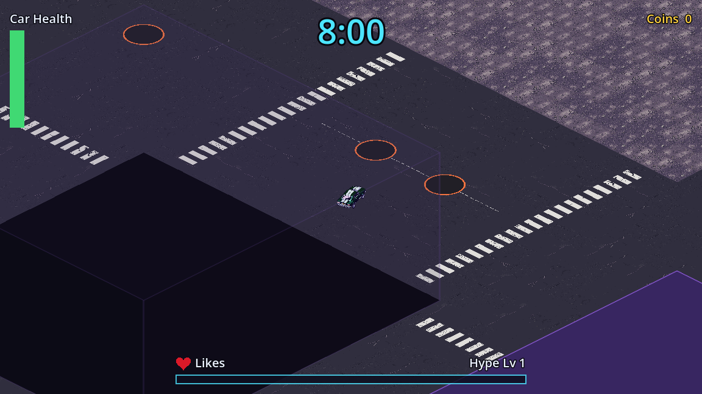

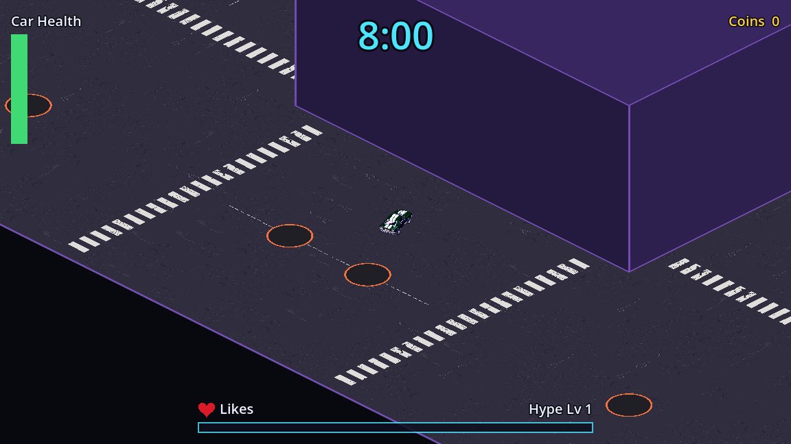

### Meteor boulders

The kaiju's meteors leave plain boulders where they land (task T-097; when and where the kaiju drops them: Enemies). The map can place one boulder at any position during a run, the same size (3 units across), look and collision as the map's own boulders, so the car bounces off it; no challenge or arrow comes with it. A placement check says whether a spot is free: the boulder must lie wholly inside the map and must not overlap a building or any boulder already on the map (a pattern copy's or another meteor boulder's); just touching is allowed. A new run builds a new map, so the meteor boulders go with the old one. The functions are listed in `game/README.md` ("MVP map", "Meteor boulders").

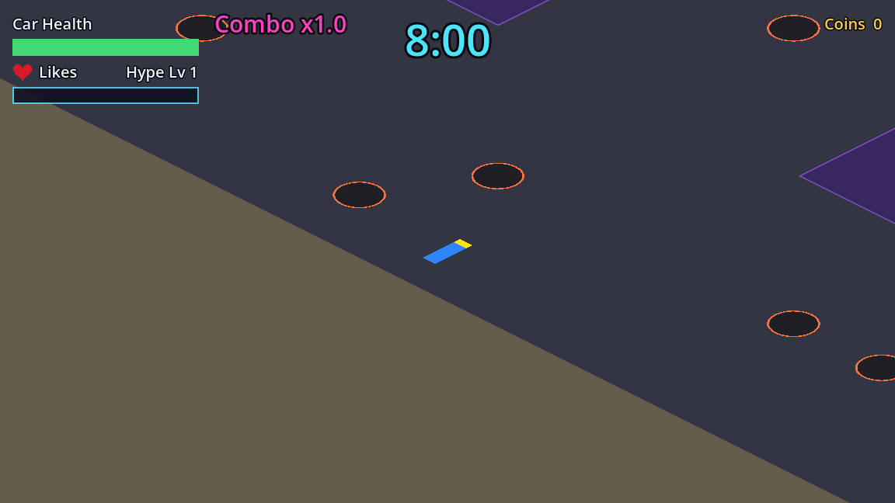

### Meteor challenges (off in the MVP, kept for later)

Not used in the MVP: the kaiju's meteors leave plain boulders instead ("Meteor boulders" above). Kept for if challenges come back. The challenges the kaiju's meteors create during a run (task T-035; when and where the kaiju drops them: Enemies). The map can place any of the 3 fitted challenge designs (Single Boulder arrow 1 and arrow 2, Two Boulders arrow 1) at any position and angle, with the fitted boulders (3 units across) and the arrow corridor drawn in green, while the map's preset challenges stay blue. They follow the same completion rule as the preset challenges; when one is completed, its arrow disappears and its boulders stay as plain obstacles, and the map sends a separate signal for meteor challenges, so the kaiju's shield can tell them from the preset ones. Several can be open at once, each completed on its own.

A placement check says whether a design fits at a spot: none of its boulders and no part of its 3-unit corridor may overlap a building, a boulder already on the map (the pattern copies' or another meteor challenge's) or the map's edge.

The designs are stored unplaced (units from the pattern's centre, angle 0) in the layout data, under `challenge_designs`. The functions and the signal are listed in `game/README.md` ("MVP map", "Meteor challenges").

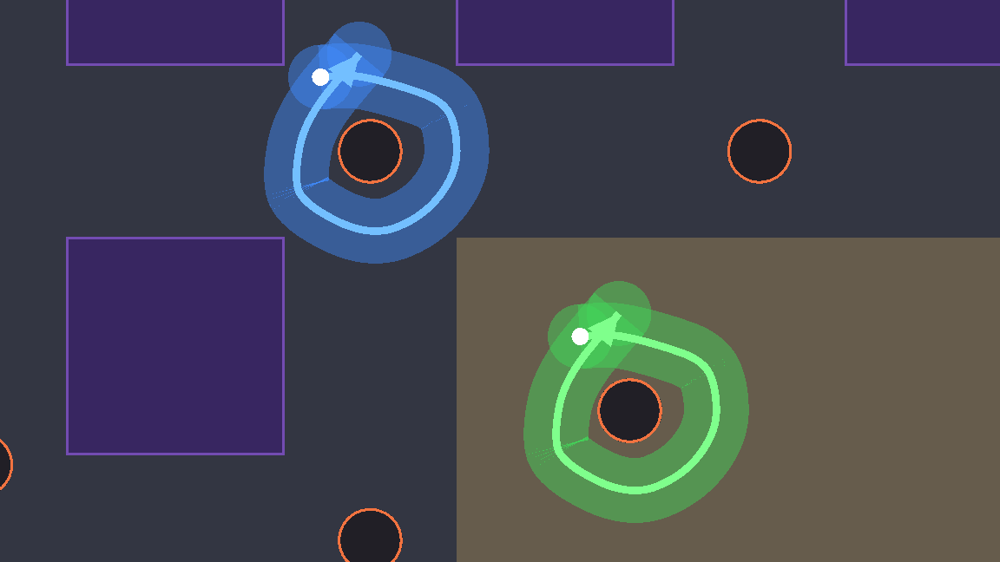

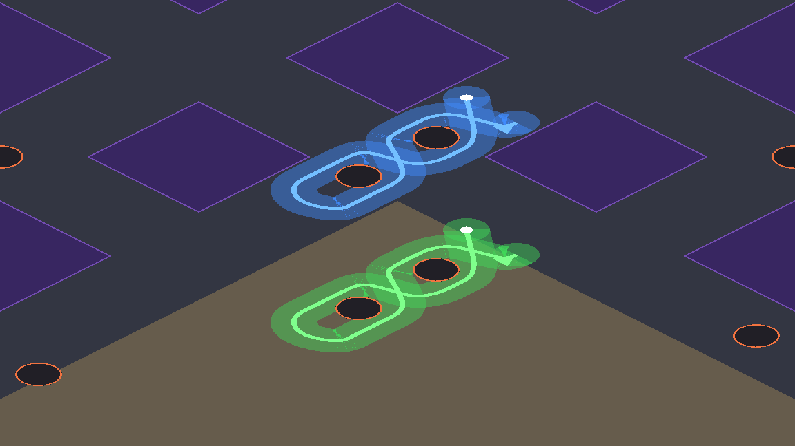

### Elevation test scene

The ground side of the elevation test scene (task T-182; Decisions, "Raised areas and ramps"). Every number below is a proposal for the board's playtest. Units are the flat world's (x east, y south).

- **Platform:** one raised platform, an axis-aligned rectangle of 16 by 16 units (proposal), 3 units high (proposal). The car can drive onto and across it.
- **Ramp:** one ramp on the platform's east side, 12 by 8 units (proposal), rising in a straight line from 0 at its foot to the platform's height at the platform's edge.
- **Drop-off edges:** the platform's other three sides, and its east side beside the ramp, are drop-offs: leaving the platform there is a step down of the platform's height.
- **Height data format:** `game/data/level/elevation_test.json` holds a list of platforms (rectangle and height) and a list of ramps (footprint, platform, the side it climbs, bottom and top height), so the map and the board's later level editor can add more. The file's fields and the query's functions: `game/README.md`, "Elevation test scene". The ramp's top is at the platform's side, and its foot is 12 units east of it (x from 8 to 20, y from -4 to 4; the platform spans -8 to 8 on both). The art drawn over them: Drifting, Content, "Elevation test scene".

### Elevation sample map

The drive-only sample map with three layers (Decisions, "Elevation sample map"). Every number below is a proposal for the board's playtest. Units are the flat world's (x east, y south).

**Height data** (task T-193). The map's heights are a list of areas a level editor can later edit, in the same format as the elevation test scene's file:

- **Platforms** (raised areas, the rooftops): each has an `id`, an axis-aligned rectangle (`x`, `y` = its north-west corner, `w`, `h`) and a `height` (3 for the first floor, 6 for the second).
- **Stacking:** a platform may stand on another (a second-floor rooftop on a first-floor one). It says so with an optional `on` field naming the platform under it; its whole rectangle lies inside that platform, and it is higher. Two areas may overlap only like that; any other overlap is a mistake. At any point the ground's height is the highest area's.
- **Ramps:** each has an `id`, the `platform` it climbs to, the `side` of that platform it climbs (`north`, `east`, `south` or `west`), a footprint rectangle next to that side (its top end on the side), a `bottom_height` and a `top_height`. The height rises in a straight line from the foot to the top. `bottom_height` is the ground at the foot: 0 for a ramp from the street, 3 for a ramp standing on a first-floor rooftop and climbing to a second-floor one. `top_height` is the height of the area it climbs to.
- **Drop-offs:** every side of a raised area without a ramp, and a ramp's own two sides, are drop-offs. From a second-floor rooftop onto the first-floor rooftop under it, the drop is 3; onto the street, 6.
- **Validator:** `python game/tools/check_height_data.py <file>` checks a height-data file before a map is handed over (overlaps, stacking, each ramp's top touching its area, its bottom and top heights matching the ground at its foot and the area it climbs to, its side). Every field and how to run it: `game/README.md`, "Elevation sample map".

**The layout** (task T-194). The MVP map ("MVP map" above: 240 by 240, the same roads, gravel centre, buildings and boulders) with two parking garages added. Every rooftop, ramp, size and position here is the Level/Challenge Design Agent's **proposal for the board's playtest**.

- **North-west garage** (proposal): a first-floor rooftop (height 3) over the top row's two west blocks and the road between them (x -96 to -12, y -96 to -66, 84 by 30). On its east block stands a second-floor rooftop (height 6, x -42 to -12, 30 by 30), whose north, east and south sides drop 6 straight to the street.
- **Ramps** (proposal): a 0-to-3 ramp climbs the first floor's south side from the road below it (x -86 to -76, y -66 to -54); a 3-to-6 ramp stands on the first floor and climbs the second floor's west side (x -54 to -42, y -86 to -76). Each is 12 units long per 3 units of rise (the elevation test scene's slope) and 10 units wide (the car is 1 by 3; roads are 24).
- **The drive:** street, up the first ramp onto the height-3 rooftop, east up the second ramp onto the height-6 rooftop, then off its east edge onto the road at x 0 (a 6-unit drop), or off its north or south edge.
- **South-east garage** (proposal): the same, turned half a turn around the map's centre (first floor x 12 to 96, y 66 to 96; second floor x 12 to 42; the 0-to-3 ramp on the first floor's north side, the 3-to-6 ramp on the second floor's east side).
- **Left out of the MVP layout:** the 4 buildings under the rooftops, and the 8 boulders on a rooftop, on a ramp or on the 6-unit strip in front of a ramp's foot (4 Two Boulders copies, so 1 challenge, kept off in the MVP, goes too). Everything else is the MVP map's, unchanged.

The file is `game/data/level/elevation_sample_map.json`, made by `python game/tools/build_elevation_sample_map.py` from `mvp_map.json` (which it doesn't change); how to rebuild and check it: `game/README.md`, "Elevation sample map", "The layout file (T-194)".

**The scene** (task T-196): `game/scenes/elevation_sample/elevation_sample_map.tscn`, drive-only (no enemies, weapons, run timer, likes, levels or HUD). It shows, in the isometric view, the MVP map's ground art, buildings (see-through), boulders and edge walls built from the layout file above; every rooftop and ramp of it with the elevation test scene's script drawing as a placeholder (the art is a later ticket); the car with its final sprite lifted by its height and its round shadow on the ground under it, with its real height on the rooftops and ramps; and the camera following as in the elevation test scene. W/A/S/D drive.

- **Start** (proposal): on the road at (-81, -50), facing north, 4 units from the foot of the north-west garage's 0-to-3 ramp, so W drives straight up it.
- **How the board opens it** (proposal, an open question below): like the elevation test scene, open the scene in the editor and press F6, or the run command in `game/README.md`, "Elevation sample map", "The scene (T-196)". No main menu button.
- **Depth order** (task T-197): every rooftop, ramp and building is drawn in one back-to-front order with the others: a second-floor rooftop over the first-floor one it stands on, a ramp standing on a rooftop over that rooftop, and otherwise whatever lies wholly west or north of another (the far sides on screen) under it. The car and its shadow are drawn under any rooftop, ramp or building they are behind and lower than its top, and over the ones they are on, above or in front of: on a height-3 rooftop behind a height-6 one, the car is over the first and under the second; in the air above 6 it is over both. As in the elevation test scene (T-191), "behind" is judged by the car's centre, so a car driving into a rooftop's back side (top-left or top-right on screen) stays under it through the hit, with no popping over it. How it works: `game/README.md`, "Elevation sample map", "Depth order and see-through (T-197)".
- **See-through** (task T-197; Decisions, "Raised areas turn see-through like buildings"): every rooftop and ramp that covers the car fades exactly like the buildings ("When a building fades"), with the buildings' own fade, not a copy; the others stay solid. The buildings keep fading as on the MVP map, judged against the car drawn at its height.

**The run on this map** (task T-206; Decisions, "The elevation sample map becomes the run's map"): a run started from the main menu plays on this layout, with the rooftops, ramps, the car's height, its round shadow, its shadowless frames in the air, see-through and the depth order exactly as in the drive-only scene (the same code, `game/scripts/level/elevation_layer.gd`), and with the whole run on top: enemies, weapons, the timer, likes and levels, the gift pack drop and the kaiju. The drive-only scene stays as it is (F6). Proposals for the playtest:

- **Start:** the run's start is unchanged, the centre of the gravel square (0, 0), nose north; the gravel square is the MVP map's and lies at street level on this layout.
- **Enemies, coins, pickups and effects** are drawn at street level (height 0) in the depth order: under a rooftop or ramp that covers them, like the car on the street. Gift packages, meteors and other things that look for an open spot on the ground only pick street-level spots (no rooftop or ramp). How enemies deal with heights is task T-207's.
- **The car's drift smoke and boost** are lifted with the ground under the car, so on a rooftop they stay at its tyres; in the air they stay on the rooftop or street under it.
- **Switching back to the MVP map:** one constant, `USE_ELEVATION_MAP` in `game/scripts/run/run.gd` (`game/README.md`, "The run").

**The art** (task T-198; proposal for the board's playtest): the rooftops are building rooftops with the city's lit-window walls, and the ramps parking-garage ramps of concrete with painted lane lines. What was generated, and the weak results: Visual style, Decisions, "Elevation sample map art, what T-198 made"; how it is built: `game/README.md`, "Rooftop and ramp art (T-198)".

**The scripted drive** (task T-195): `bash game/tools/drive_elevation_sample.sh` drives the real car from the street up the 0-to-3 ramp, up the 3-to-6 ramp and off the height-6 edge, and prints the layers reached, the maximum height and the airtime. What it checks and its log: `game/README.md`, "The car's height on the three layers (T-195)"; the behaviour: Drifting, Content, "Elevation sample map".

**The final screenshot set** (task T-199, final art) is in `art-archive/T-199/screenshots/`: `street.png`, `ramp-0-3.png`, `ramp-3-6.png`, `height-3.png`, `height-6.png`, `air.png`, `behind-height-3.png`, `behind-height-6.png` and `city-overview.png`.

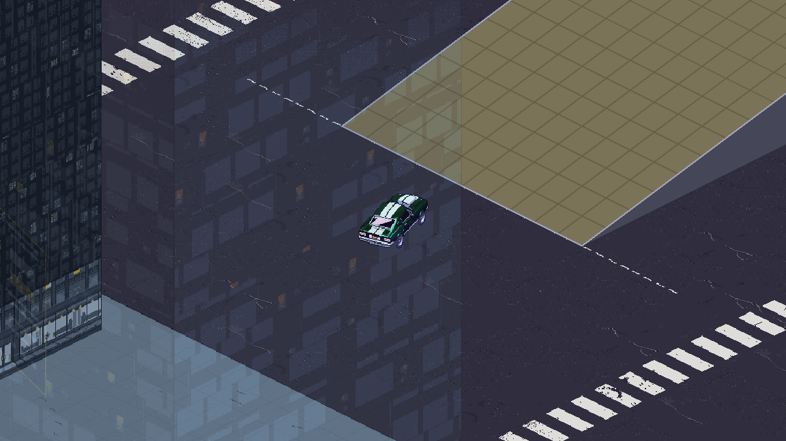

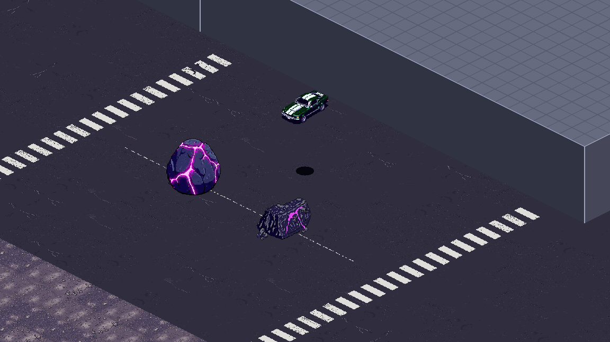

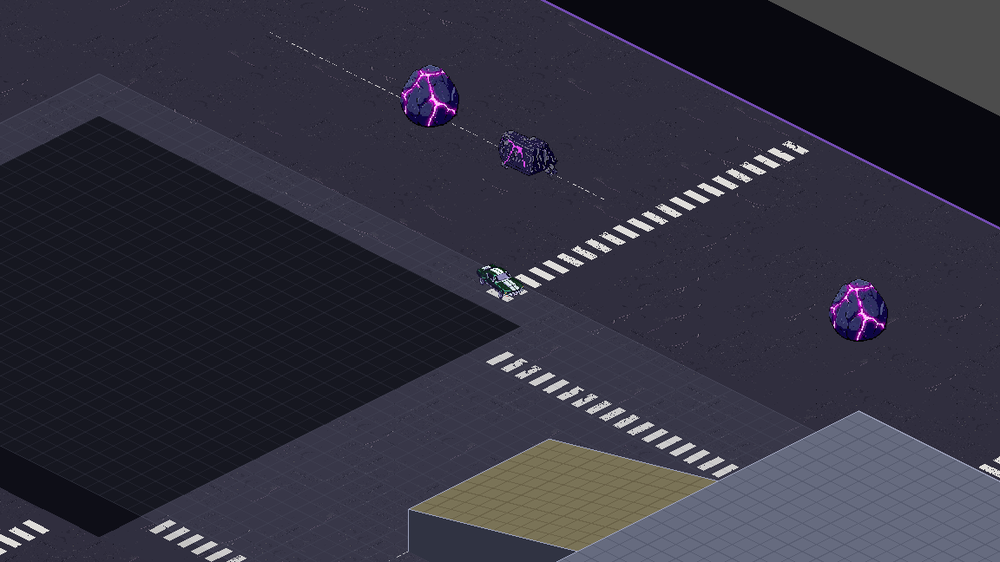

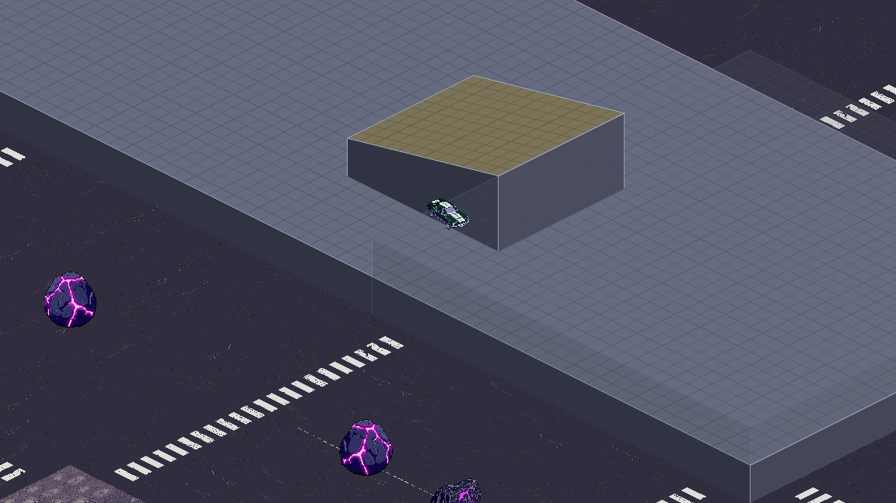

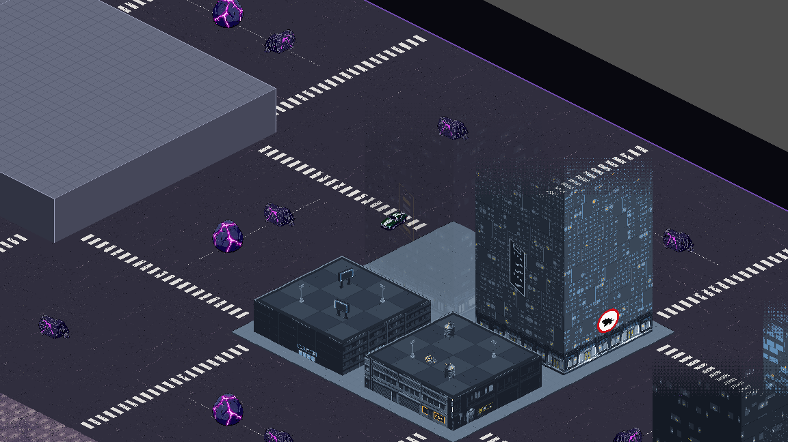

## Open questions

- How the board opens the elevation sample map (T-196). Proposed: as the elevation test scene, the scene in the editor with F6, or the run command in `game/README.md`; no main menu button (a button would need its text from the Narrative Theme Agent, in a new ticket).

- (After MVP) Pavements along the building blocks (board, 2026-10-12): how wide, whether they take room from the blocks or the roads, and whether the car can drive on them. Partly answered (board, 2026-10-14): in the MVP every building asset has a pavement drawn around it, inside its block, so it takes no room from the roads and the car cannot drive on it (Visual style, Decisions).
- (After MVP) The board plans to draw future maps by hand, and may explore generating a new map for every run.

## References

- The board's challenge drawings: `docs/level-design/` (Content, "MVP challenges"). They are exported from Crash City Grid with `python tools/export_challenge_drawings.py <folder of downloaded drawings>`.
- Drivability check (task T-021): `game/tools/check_challenge.sh`, explained in `game/README.md` ("Challenge drivability check"). The lines the car drove on the board's sketches: [Single Boulder, arrow 1](level-design/single-boulder/arrow-1.driven.svg), [Single Boulder, arrow 2](level-design/single-boulder/arrow-2.driven.svg), [Two Boulders, arrow 1](level-design/two-boulders/arrow-1.driven.svg) (data in the `.driven.json` next to each).
- The MVP map's layout data (Content, "MVP map"): [../game/data/level/mvp_map.json](../game/data/level/mvp_map.json), with the buildings, ground cells, pattern copies, boulders and challenges (arrow points and centre lines) in units from the map's centre. It and the fitted patterns are made with `python game/tools/build_mvp_map.py`; how to open the map in Godot: [../game/README.md](../game/README.md), section "MVP map".
- Crash City Grid, the map editor the board and the Project Lead draw the map in: https://claude.ai/artifact/R9AUtdNttfHKNgeqGDCPAH (private to the board). Each map is saved as an 80 by 80 grid of cells, plus its boulders, pattern groups, challenges and arrow paths, in units from the map centre; the Project Lead reads it and copies what the Level/Challenge Design Agent needs into its tasks.
