# Level design

## Summary

The MVP has one map: a city laid out as a grid of building blocks, with roads of different widths running between them. Obstacles (crashed meteor boulders) stand on the roads in set patterns. Driving challenges, arrows painted on the ground around some of the patterns, are left out of the MVP; the board might bring them back later, and their design is kept here for that.

## Decisions

- **Challenges are left out of the MVP.** The MVP map has no challenge arrows and no challenges: the obstacle pattern copies stay on the roads as plain boulder obstacles. The board might bring challenges back after the MVP; the decisions below about challenges, arrows and corridors are kept for that and do not apply to the MVP. (2026-10-11)
- A challenge is defined as a curved corridor with a width, so there is room for tolerance. (2026-10-03)
- The car counts as in the challenge as long as any part of it is touching the corridor. "The car" here is the drawn car (1 by 3 units), not its smaller physics body. (2026-10-03; drawn car confirmed 2026-10-08)
- The MVP map is a city laid out as a grid: blocks of buildings, with roads running between the blocks. (How it looks: Visual style, Decisions.) (2026-10-07)
- Roads are 24 units wide, three times the first plan's 8, so the car drives through them easily (board, after playing the first map). A street never widens along its length. (2026-10-07; 24 units, 2026-10-11; replaces "between 5 and 10 times as wide as the car")
- Map sizes are measured in units, where 1 unit is the drawn car's width (the smaller of its two dimensions; Drifting, Decisions). It is the same unit the driving values use. (2026-10-07)
- The MVP map is **240 by 240 units**: the first plan's 80 by 80 map with everything three times bigger (perimeter road, blocks, roads and the gravel centre). The boulders and the challenges stay sized to the car. (2026-10-07; everything three times bigger, 2026-10-11; replaces the 242 by 242 map of 13 by 13 small blocks)
- A wide road, 24 units wide, runs around the whole edge of the map. The map ends in a hard stop at its edges. (2026-10-07; 24 units, 2026-10-11)
- Inside the perimeter road, building blocks of 30 by 30 units are laid out in a 4 by 4 grid, separated by roads 24 units wide (3 roads in each direction). (2026-10-07; three times bigger, 2026-10-11)
- The centre of the map is an open square of 84 by 84 units with no blocks. Its ground is gravel, not road. (2026-10-07; three times bigger, 2026-10-11)
- Obstacles are placed on the roads. In the MVP the only obstacle is a crashed meteor boulder; more kinds come later. (2026-10-07)
- In the MVP, obstacles are circles, all 3 units across (one car length), so they never block a road. They stay this size on the bigger map. (2026-10-08; replaces the 2026-10-07 decision of 3, 6 or 9 units; confirmed car-sized 2026-10-11)
- In the MVP, a challenge includes up to 2 obstacles. (2026-10-07)
- Each challenge's arrow path is shaped to its obstacles, using scripts from the Driving & Drift Agent that show what the car can actually drive and how it behaves. (2026-10-07)
- Some obstacles are on the map from the start; others appear during the run, dropped by the boss (Enemies, Decisions). (2026-10-07)
- The obstacles on the map from the start are placed in set patterns, called obstacle pattern groups. The board defines the patterns. (2026-10-07)
- The MVP has 2 obstacle patterns, each drawn by the board (Content, "MVP challenges") (2026-10-08; replaces the earlier plan of 3):
  - **Single Boulder:** 1 boulder, with 2 possible challenges: one loop clockwise and one counter-clockwise around it.
  - **Two Boulders:** 2 boulders, with 1 possible challenge: a figure-eight around both.
- A pattern can have several possible challenges: each challenge is a different arrow path around the same obstacles. (2026-10-08)
- For the MVP, the board does no level design itself. The Level/Challenge Design Agent makes the map once, following the rules in this document and the board's descriptions and drawings, and every run uses that same map. (2026-10-07)
- 30% of the obstacle pattern groups on the map become challenges. Each challenge gets an arrow that appears under it, animated as if painted on the ground, showing the player how to drive the challenge. The arrow's animation is designed in advance. (2026-10-07)
- Which pattern groups are challenges is set in advance, the same every run. The Level/Challenge Design Agent makes the first choice, and the board adjusts it if needed. (2026-10-08)
- The painted arrow marks the challenge's corridor (the corridor in the first Decision). The arrow is as wide as the car is long (3 units), so the player doesn't have to follow its centre line exactly: the car only has to touch the arrow. The Driving & Drift Agent's scripts make sure each path is drivable. (2026-10-08)
- The Level/Challenge Design Agent decides how many copies of each pattern are placed on the map, and where. (2026-10-08)
- A challenge is completed when the drawn car touches its corridor continuously from the arrow's start to its end, in the arrow's direction. Leaving the corridor midway means starting again from the start. (2026-10-08)
- When a challenge is completed, its arrow disappears and the player gets XP on the XP bar. The group's boulders stay on the map as plain obstacles for the rest of the run. (2026-10-08)
- When a pattern with several possible arrows becomes a challenge, the Level/Challenge Design Agent picks one of its arrows. (2026-10-08)
- The board draws each challenge as its own drawing in Crash City Grid (References): one drawing per arrow path, kept in a folder per obstacle pattern. Every drawing in a pattern's folder has the same boulders; only the arrow differs. (2026-10-08)
- The board's drawings are rough sketches of each challenge's general shape, not exact layouts. The Level/Challenge Design Agent makes them fit the map (for example the 8-unit roads), with whatever reasonable adjustments that needs (size, spacing, how tight the loops are), while keeping the shape: how many boulders, which way the arrow goes around each one, and the overall path (a loop, a figure-eight). The Driving & Drift Agent's check confirms the fitted versions can be driven. (2026-10-08)
- The kaiju's meteors leave plain boulders where they land, not challenges (Enemies, Decisions). (2026-10-11)
- After the MVP, if challenges come back (2026-10-11): a challenge the kaiju's meteors create never lands on another challenge: its boulders and its arrow corridor must not overlap any other challenge's arrow corridor, preset or meteor. (2026-10-10)
- **Raised areas and ramps** (board, 2026-10-17; go-ahead 2026-10-19): the map can have elevated areas, for example in the size of the current 2 by 2 grid of blocks. One side of a raised area is a ramp the car drives up; its other edges are drop-offs the car can jump off. How the car's height works: Drifting, Decisions, "Elevation". First built in a test scene with one raised platform, one ramp and one drop-off edge, not in the real map. The map's data format leaves room for heights and ramps from the start, for the level editor the board wants later.
- **Raised areas turn see-through like buildings** (board, 2026-10-19, after playing the elevation test scene): when a raised area (and its ramp) covers the car on screen, it fades the way buildings do ("When a building fades" below), with the same logic, so the car never vanishes behind it.
- **Elevation sample map** (board, 2026-10-19, after approving the elevation test scene): elevation goes into the game first, the tricks later. A drive-only sample map (no enemies, weapons or run timer; driving around freely, like the test scene but city-sized), made by the agents, with **three layers**: the street (height 0), a first floor (height 3) and a second floor (height 6), with ramps connecting the street to the first floor and the first floor to the second, so the car can jump from higher with more airtime. The raised areas are building rooftops and the ramps parking-garage-style ramps (look: Visual style, Decisions, "Elevation sample map art"). It uses the elevation system as approved (the car's height, edges, see-through, the round shadow) and the map's buildings, boulders and roads. Its map file holds the heights and ramps in the format a level editor would later edit. After the board's playtest: if the board is happy, maybe aerial tricks next (a 360 in the air, a combo from airtime); if not, a level editor so the board can make levels by hand and playtest them at once. The arrow-key tricks come after both. Full runs on elevated maps (enemies that handle heights) are a later step.
- **The elevation sample map becomes the run's map** (board, 2026-10-20, after playing it: "plays great"): a run started from the main menu now plays on the elevation sample map's layout, with its rooftops, ramps and the car's height, as the full game (enemies, weapons, timer, likes, levels, the kaiju), so the board can see how the enemies behave on it. The MVP map stays in the project and can be switched back to (tasks T-206, T-207). How enemies handle heights: Enemies, Decisions, "Enemies follow the car up the ramps" (board, 2026-10-21).
- **Level creator** (board, 2026-10-21): a separate app, opened like the game but never shipped with it, where the board makes levels by hand. It lists the levels made so far: pick one to play it as a full run (the same 8 minutes, enemies and kaiju as the game), or press a button to create a new one (the only option when there are none). Creating or editing a level is a scene with a side panel of every asset already in the game (ground tiles, roads, buildings, boulders, rooftops, ramps): pick one, place it, rotate it before placing (which means switching between the views the art exists in and mirroring them, since the art has only the angles that were generated), with rooftops and ramps at heights 3 and 6 as on today's map, and pieces snapping to the map's tile grid and to close neighbours so they align with little effort. Custom levels are played only from the creator; the game keeps its own map. Enemies find their way on whatever is built. Built by a goal run (G-005), first with today's art only.
- **Level creator piece set** (board, 2026-10-22, after playing G-005's creator; replaces "no new art is generated for it"): today's assets are not enough to build a full level, so the creator gets a comprehensive set of pieces generated with PixelLab, with no cap on generations (board, 2026-10-24: "we have all the budget available to us"; this replaces the first cap of 100). The aim is a functional, multi-layer world to drive around: rooftops and platforms that can be made smaller and bigger, ramps between the layers, and pieces in more rotations. What the set holds is the Project Lead's plan (the tickets list it); the board judges it in the playtest.
- **Asking for a new piece from the creator** (board, 2026-10-24): a "+" button in the creator's side panel opens a tab where the board picks a kind (building, obstacle or decoration), describes the piece in its own words and presses Send. Send is the board's go for that piece. The request reaches a Project Lead session through an inbox (T-284). The session writes an art ticket, and the Asset Generation Agent makes the piece from Visual style and the Extended narrative, in one generation round. Narrative Theme names it, a script adds it to the catalogue (T-285), and it appears in the panel while the creator is open (T-283; text T-282). The board's look in the creator is the review. QA checks the requested pieces together before they merge. The creator itself never calls PixelLab. Expected time from Send to the piece in the panel: about 5 to 10 minutes while a session is open (an estimate; the first request times it).
  - **Road pieces (T-252):** drawn by script from the existing road tiles (no PixelLab), at today's two-tile-wide roads' size so they join the straight roads the game's map and the creator already use: each piece is 2 x 2 tiles (4 x 4 units), placed with one click, and on every open side its lane (centre) line continues the straight tiles' line exactly. 4 corners, 4 T-junctions, a crossroads and 4 dead ends; a dead end closes the road with a white kerb line across it and gravel beyond. Each rotation is its own button under Roads, labelled from `creator_texts.json`, listed before the older road tiles. The older road tiles (centre-line halves, zebra crossings; x and y versions) stay as they were, so the game's own map is unchanged. Details: `game/docs/level/level-creator.md`, "Level creator (T-231)".
- **Small and long buildings** (T-254, part of the piece set above): two more short buildings for the creator, both with their roofs showing, solid, see-through when the car is behind them and pathed round by enemies like today's. The **small** one covers 6 x 6 units, the **long** one 12 x 6 (6 x 12 rotated, R). **Height (a proposal for the board): 4.3 units**, the same as today's short buildings. Placeholder look: a code-drawn box in the city's palette (pale lit windows on cool blue-grey walls); T-257 generates the final art. Their art per rotation and mirror is in `game/data/level/creator_buildings.json`. The game's own map is unchanged.
- **Level creator rework** (board, 2026-10-22, after playing the piece set; the plan the board read: https://claude.ai/artifact/2TXG35AkZFYXKvfNUUPfNN): the side panel is one button per kind of thing, in six groups from the ground up (Roads, Ground, Levels, Buildings, Obstacles, Decoration), with a piece's looks, turns, mirror and height chosen by keys and shown in a strip under the selected piece, instead of a button per rotation and variant. **Roads are painted with a brush**: drag to lay a road, which comes whole (a centre line in its middle, not two half tiles) and joins itself into corners, T-junctions, crossroads and dead ends; road kinds are plain, centre line, zebra crossing and cracked. **Ramps** are closed blocks with a wall at their tall end, and each ramp in each direction and height step can have its arrows pointing up or down the slope, the board's choice per ramp. **Platforms** (rooftops) have one-click sizes S 8 x 8, M 16 x 16 and L 32 x 32 units at heights 3 and 6, besides dragging any size. **Skyscraper banners** are on or off per building, off by default. No new generations.
- **The car's spawn point** (board, 2026-10-22): every level has a spawn point, where the car starts a run on it. It is visible in the editor from the moment a level opens and the board can move it anywhere the car can stand (dragging it, and turning it for the car's starting heading, a proposal). It can never be deleted: a level always has exactly one. A new level starts with it at the map's centre; a level saved before this has it there too. (T-279, T-280)
- **Thread the needle** (board, 2026-10-22): in the level creator the board can mark two obstacles (anything the car crashes into and that cuts the combo: boulders, barriers, cones, crates) as a pair. In a run on that level, driving through the gap between a marked pair is a trick, **thread the needle**, that raises the combo like the other tricks (Game loop architecture, Decisions, "The combo"). What it is worth, whether it pays again on the next pass, and how the pair shows in the editor and in the run are the agents' proposals for the playtest. Its popup text: HUD and menus, Content (T-271). (T-272)
- **Tutorial levels** (board, 2026-10-20, "not a request now"): short tutorial levels that show the player the tricks, one trick at a time. The board will describe them later; nothing is built until then (task T-211).
- **The board's own level becomes the game's map** (board, 2026-10-29): the board builds a level by hand in the level creator over several hours, then hands it over; that level becomes the map the game's Start plays, in place of the elevation sample map. The board handed over Kaiju City on 2026-10-30; the file the game plays: Content, "The game's map". (T-372)
- ~~**The kaiju alert signs move onto Kaiju City** (board, 2026-10-31): since Kaiju City became the game's map (T-372), the kaiju alert signs still sat at the old sample map's places and the hanging banners weren't drawn. All of them move onto Kaiju City: the hanging banners back on this map's skyscrapers and the standing signs on pavement beside its roads. The spots are the Level/Challenge Design Agent's proposal for the board's playtest. (T-439)~~ Replaced by the next line.
- **Kaiju alert signs are level creator pieces** (board, 2026-10-31, after T-439 placed them at fixed spots: "I want to be able to have the signs as components from the level creator. That way I can place them wherever I want, either on the ground or buildings"): two new pieces in the level creator, a standing alert sign placed on the ground or a rooftop and an alert banner hung on a skyscraper's wall, each in both designs (head and body), with the existing art. The fixed sign list (`kaiju_signs.json`) is retired: a map shows only the signs placed in its level, so Kaiju City has none until the board places them. T-439 is cancelled. (T-440, T-441)
- **Roads painted in the creator show in the run** (board, 2026-10-29; a bug, fixed at once): roads the board places on the ground in the level creator don't show up when the level is played. What is painted in the editor must be what the run draws. (T-391)
- **Obstacles and decorations respect the buildings' and rooftops' heights** (board, 2026-10-29; a bug, fixed at once): in the level creator, barriers placed by a building or a rooftop ignore its height (they draw over it as if it weren't there), and the board suspects other objects do the same. Every placed object must sit at the height of what it stands on and be drawn in front of or behind buildings and rooftops correctly, in the editor and in the run. (T-393)
- **A row of obstacles can be threaded gap after gap** (board, 2026-10-29): the board wants to thread the needle through every gap in a row of obstacles, one after another, but an obstacle can be in only one pair today (pairing it again unpairs it from the other). The board asked the Project Lead for an intuitive way that works both ways; the Project Lead's design: an obstacle can be in several pairs (pairing B with C keeps A with B), several obstacles can be picked in order and paired in one go as a chain (A with B, B with C, C with D), Unpair removes only the pair it is aimed at, and in the run each gap pays its own thread the needle, so a row threaded gap after gap pays each one. The board judges it in the playtest. (T-394)
- **Threading the needle flashes the pair** (board, 2026-10-31): when the car threads the needle, the two paired obstacles and the dashed line that connects them flash, so the player sees which gap paid. How long and in what colour are the agent's proposals for the playtest. (T-451)
- **Sidewalks and parked cars in the level creator** (board, 2026-10-30): new pieces for the creator, with art that fits the roads, the buildings and the other assets. **Sidewalks** are painted like roads; wherever a sidewalk meets a road the editor adds the curb edge itself. In the run the car drives up over the curb (it is a step under the 0.1-unit curb rule, Drifting, Decisions). The curb is drawn only, with no height step: the car feels no bump going onto a sidewalk (board, 2026-10-30, after playing T-398). **Parked cars**: a few normal, boring city cars and some broken (wrecked) ones, each at four facings (top right, bottom right, bottom left, top left). They are solid obstacles like boulders: the car crashes into them, and two of them can be paired for thread the needle. PixelLab up to 50 generations for the whole set, sample first (one sidewalk tile with its curb, one parked car facing) for the board's review. **Meteor craters** (board, 2026-10-30, the same day): holes the meteors left in the ground, placed in the creator as ground pieces, not obstacles: the car drives over them with no crash. A few looks, made inside the same 50-generation cap, one crater in the sample. This reopens the pavement question for the creator's levels only (Open questions); the game's own map is unchanged. (T-396 to T-399, T-401)
- **A gift pack that falls on a platform shows on it** (board, 2026-10-30; a bug, fixed at once): a gift pack dropped onto a platform (rooftop) is drawn below the platform, hidden under it. It must be drawn at the height of what it lands on. Whether a gift pack may land on a platform at all (today's rule, Content, "Elevation sample map": street-level spots only) or is drawn on the platform and picked up there is the agent's proposal, written with the root cause, for the board's playtest. (T-402)
- **Short buildings become platforms** (board, 2026-10-30): on platforms "a lot of stuff seems not to be working": a gift pack's pickup is in the wrong place, a low-rise under a platform is drawn correctly but its invisible body still stops the car, so it can't reach the platform's end, and nothing says what happens when the car jumps off a platform over a building. The board's decision: the low-rise, small and long buildings no longer exist as buildings; each is a **platform at height 3** with the same art (walls trimmed by script to height 3, no new generations), driven on like a rooftop and reached by today's 0-to-3 ramps. Placed side by side they **connect** into one larger platform (no walls or roof edges drawn between them). Only skyscrapers stay solid buildings. Every collider and pickup works at the height it is at (nothing below a platform stops the car on top of it; a pickup on a platform is picked up there), and the car that jumps off a platform falls to the ground or a lower platform; a skyscraper blocks it at any height. Levels saved before, and the game's own map, turn their short buildings into these platforms. (T-402, T-405)
- **A small jump ramp** (board, 2026-10-30): besides today's ramps (0 to 3, 3 to 6 and 0 to 6, each about three tiles long), a small ramp only one tile long that rises about 2 units from the ground it stands on, for small jumps: the car drives up it and flies off its top. It is placed, turned and raised like the other ramps (on the ground or on a rooftop). Its exact length, height and whether its tall end is open or closed are proposals for the playtest. (T-400)
- **Rain over the map** (board, 2026-11-02; built in T-506 to T-509): it rains on the map during a run. A toggle in the settings turns the rain on or off; the choice is saved like the other settings. Its art is made with PixelLab, and the board said not to be stingy with generations (the board's go for this feature, 2026-11-02; still through the style loop, every generation kept in art-archive). **Off by default** (board, 2026-11-02, after playing it; T-510): a new player has no rain until they tick the toggle; a player who already chose keeps their choice. After the board's playtest the rain has half the drops it first had (T-509). Proposals for the playtest: steady light rain over the whole run, falling at a slant that suits the isometric view, drawn over the map and under the HUD; small splashes where drops hit the ground and rooftops; it changes nothing in how the car drives or how enemies behave; it keeps the frame time low, in the desktop and the web build alike.
- **Rails** (board, 2026-11-05); a prototype with its own playtest (Drifting, Decisions, "Rail grinding, a prototype"): rails are a map piece that can be placed anywhere on the map, in the level creator like the other pieces, and saved in the level file. For the prototype they use placeholder art; the playtest build has a few rails on the map to try.

## Content

### The game's map

The map the main menu's Start plays (task T-372; Decisions, "The board's own level becomes the game's map") is the board's own level, **Kaiju City**, built by hand in the level creator and handed over on 2026-10-30. The game plays a copy of it in its own data, **`game/data/level/kaiju_city_map.json`**; the board's working file in the creator's levels folder (`game/data/levels/kaiju_city.json`) stays the board's, untouched and never committed. The copy was the board's file byte for byte; the only change since is the five rails T-541 added for the rail grind playtest (Content, "Rails (task T-541)"). The elevation sample map (`game/data/level/elevation_sample_map.json`, "Elevation sample map" below) stays in the project: the tests and the level creator use it, and a run with no map named still plays it. The creator's Play still plays the creator's own levels.

- **What it holds:** a 240 by 240 unit map with a hard stop at its edges, 42 buildings (skyscrapers, and short buildings that are platforms at height 3), 13 rooftops at heights 3 and 6, 28 ramps (among them T-400's small jump ramps), 82 props, 9 boulders, 10 meteor craters, 20 thread-the-needle pairs, 5 rails (T-541), sidewalks and painted roads, and its spawn point at (1, 1) on a road, heading 270 (up the screen's right, the run's usual start).
- **Checks:** `python game/tools/check_level.py` and `python game/tools/check_height_data.py` both print `OK` on it.
- **What the agents found in a scripted run, for the board's playtest** (T-372; the level is not changed): the rooftop roof-13 (height 6, west of the map's centre) has no ramp up to it (its four small ramps all climb from 6 to 8 on top of it), so it is reached only from the air, and minions can't follow the car onto it. When the car stands on a few rooftops in the north-west cluster and on roof-1 (west of the centre), the ring where minions spawn, just beyond the screen's edge, lies wholly on rooftops and buildings, so no new minions spawn until the car comes back near a street (minions spawn only on the street). The game's kaiju alert signs (task T-130) were placed for the elevation sample map's blocks: their two standing signs were drawn on this map at those same places, which belong to no block here. (Since T-441 that fixed list is retired: Kaiju City has no alert signs until the board places them in the level creator; Content, "Level creator: kaiju alert signs and banners".)

How the run loads it: `game/docs/level/game-map.md`.

### Rails (task T-541)

The map side of the decision "Rails" (Decisions, above) for the rail grinding prototype; how the car grinds them is Drifting, Content, "Rail grinding (task T-541)". Proposals for the playtest. Code: `game/scripts/level/rails.gd` (reading and checking), `game/scripts/level/rail_drawing.gd` (the look).

- **The format, in the level file:** a top-level list `"rails"`, one entry per rail, written like the other pieces (sorted keys, numbers in map units):
  `{"id": "rail-1", "x1": -36.0, "y1": 2.0, "z1": 3.0, "x2": -36.0, "y2": -21.0, "z2": 6.1}`
  - `id`: unique in the level, `rail-N` as the creator names its pieces;
  - `x1`, `y1` and `x2`, `y2`: the rail's two ends on the map (x east, y south, the map's own units, as every piece); any direction, not only along the grid; the order of the ends does not matter (the car grinds either way);
  - `z1` and `z2`: the bar's height above the street at each end, units, above 0; `z2` may be left out, then it is `z1` (a level rail). Between the ends the height changes in a straight line, so a rail can climb from one rooftop to a higher one;
  - a level with no `"rails"` key has no rails. An entry with a missing or non-number end, a height at or under the street, or shorter than 1 unit is skipped by the game (with a warning).
- **Straight only (proposal):** a rail is one straight segment; a corner is two rails whose ends meet. Curves are not needed for the prototype: straight rails already connect the rooftops and make the jump pair, and a curve would need its own format and grind rules. The board decides after the playtest.
- **Where a rail should start:** a rail that begins just inside a rooftop's edge, at the rooftop's height plus a little (0.1), is caught by a car driving off that edge along it (the car falls onto the bar at once). A rail that ends just over a rooftop at about its height drops the car onto the roof to drive on.
- **Placeholder look (drawn in code, no art):** a metal bar three pixels thick (light grey top, mid grey, dark underside) at its height in the isometric view, on thin dark posts down to the ground every 6 units and at both ends, with a dark half see-through shadow line on the street under it. The bar is cut into pieces of at most 2 units, each placed in the map's depth order like the car at that place and height (under the buildings and rooftops in front of it, over the rest); the car on the rail is drawn over it, and the pieces just in front of a car passing under a rail are drawn over the car. The shadow lies on the street only (under a rooftop it is hidden).
- **Rails are not obstacles:** a car on the street drives under (through) a rail; only a car in the air can land on one.
- **The rails on the game's map** (Kaiju City, `game/data/level/kaiju_city_map.json`, for the playtest; the board moves or removes them in the level creator once T-542 adds the rail piece):
  - `rail-1`: from roof-12's north edge (height 3) up to roof-13 (height 6), at x = -36, climbing from 3.0 to 6.1. Roof-13 had no way up (Content, "The game's map"): driving north off roof-12 along the rail now reaches it.
  - `rail-2`: from roof-13's north edge north to roof-10 (height 3), at x = -30, level at 6.1, over the street and the jump ramp on roof-10's south side; the car drops onto roof-10 at its end.
  - `rail-3` and `rail-4`, **the jump pair:** two level rails at height 1.0 on the road just north-east of the spawn point, x = 5 (y -6 to -60) and x = 8.5 (y -14 to -68), 3.5 units apart: a first-tier Jump from the street lands on either (its hop peaks at about 1.04), and a Jump with the nose turned right of the rail line (D on the rail) hops from rail-3 to rail-4 driving north (turned left, A, when driving south).
  - `rail-5`: from roof-2's east edge (height 6) down to the street east of it, at y = 70, falling from 6.1 to 1.0 over 35 units; the car flies off its end onto the street.
- **For the level creator (T-542):** it reads and writes the same list; the game's checks are `Rails.problem()` (the same rules as above). Built in the next section.

### Rails in the level creator (task T-542)

The creator's side of the decision "Rails" (Decisions, above): the rail is a piece of the level creator, in the **Levels** group of the side panel (button "Rail", a small picture of a bar on posts), placed, changed and deleted like the other pieces, drawn with T-541's placeholder (`rail_drawing.gd`, the same code the run draws it with) and saved to and loaded from the level file's `"rails"` list in T-541's format (Content, "Rails (task T-541)"). A rail is not an obstacle and has no footprint, so nothing blocks it being laid; the only refusals are the game's own (`Rails.problem()`: shorter than 1 unit, a height at or under the street) and an end outside the map (message "Can't place the rail here: ..."). Every number below is a proposal for the board's playtest. Code: `game/scripts/level_creator/rail_piece.gd` (the numbers and the geometry), `level_document.gd` (`place_rail`, `set_rail`, `rails`), `editor.gd` (the mouse and keys); how it works: `game/docs/level/level-creator-pieces.md`, "Rails (T-542)".

- **Laying one:** pick Rail, then drag on the map from one end to the other (the bar shows in blue while dragging, with its line on the ground under it); a click without a drag lays a rail 12 units long from the click in the picked direction. **R** (while Rail is picked) turns that direction in steps of 45 degrees (0 is east, clockwise on the map; the top bar shows it). Ends snap to half units.
- **Height (H):** the Rail's heights are *auto* (the first), 1, 3.1 and 6.1. Auto puts each end just above what is under it: 1 over the street, the surface's height plus 0.1 over a rooftop or ramp (so a rail can start on the street and climb onto a rooftop, 1 to 3.1, as T-541's rail-1 does; Content, "Rails (task T-541)", "Where a rail should start"). A fixed height gives both ends that height. The top bar says which is picked.
- **Selecting and changing:** with nothing picked, click a rail's bar (or right-click it) to select it: a yellow outline with a handle on each end and a readout in the top bar (id, length, the two heights, direction). Drag an **end** to resize and turn it (the other end stays), drag the **bar** to move it (all snapped to half units); **R** turns it 45 degrees round its middle; **[** and **]** shorten and lengthen it by a unit from its second end (never under 1 unit); **H** steps its height (auto, 1, 3.1, 6.1, both ends); **Del** (or the Delete button) deletes it. Esc during a drag puts the rail back as it was.
- **Saved and played:** Save writes the rails in the file's `"rails"` list (a level with none writes no key); a level opened from a file shows its rails and edits them the same way, so the board can move or remove the five rails of the game's map (`game/data/level/kaiju_city_map.json`, Content, "Rails (task T-541)") in a copy in the creator's levels folder. The creator's Play, and a run on the saved file, give the rails to the car's grind and draw them (T-541's `Run._build_rails`).

### Rain

Built in T-507 (Decisions, "Rain over the map"); its PixelLab art came in T-509 (Visual style, Content, "The rain": 3 drop variants and a 4-frame splash, density 200 drops a screen after the board's halving, splash chance 0.45) and the settings toggle in T-508. Proposals for the playtest.

- **What the player sees:** steady light rain for the whole run, over the whole visible map: thin streaks falling down the screen at a slant (leaning about 18 degrees, tops to the right), and small splashes where drops end, on whatever is drawn there, the street or a rooftop. It moves with the map as the camera follows the car.
- **Where it draws:** over the map, the car and the enemies, under the HUD and every screen above it.
- **Placeholder look** (kept in code as the fallback when `rain.json` names no textures, since T-509 it is not used): drawn in code, opaque pale blue-grey pixels (a 1-pixel streak with a lighter tip, and a three-frame splash), on the map art's pixel grid; none of Greenbull's colours.
- **Its numbers** are data in `game/data/rain.json`: drops per 1080p screen (220), fall speed (900 art px a second), angle (18 degrees), streak length (10 art px), drop life, splash chance (0.35), most splashes at once (60), splash life, colours, and the slots for T-509's textures.
- **On or off:** the saved setting `rain_enabled` (off by default, T-510), saved with the other settings; it shows or hides the rain at once. It changes nothing in driving or enemies.
- **Cost:** about 0.2 to 0.4 ms a frame of the rain's own work with a 1080p screen's drops, and no measurable change in the headless frame time (T-507's result notes). It uses nothing the web build lacks and was seen raining in the web export.

How it works: `game/docs/level/rain.md`.

### MVP challenges

The board's sketches of the 3 MVP challenges, one per arrow path. They show the general shape only; the fitted versions on the map are the Level/Challenge Design Agent's (Decisions). Each drawing's data (boulders and arrow points, in units from the sheet's centre) is in a `.json` file next to its picture. The pale band is the 3-unit corridor, the white dot is the start, and the arrowhead is the finish.

| Pattern | Challenge | How the arrow goes |
|---|---|---|
| Single Boulder | [arrow 1](level-design/single-boulder/arrow-1.svg) | One loop around the boulder, clockwise |
| Single Boulder | [arrow 2](level-design/single-boulder/arrow-2.svg) | One loop around the boulder, counter-clockwise |
| Two Boulders | [arrow 1](level-design/two-boulders/arrow-1.svg) | A figure-eight: clockwise around the top boulder, counter-clockwise around the bottom one |

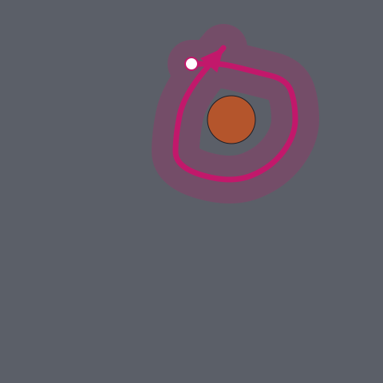
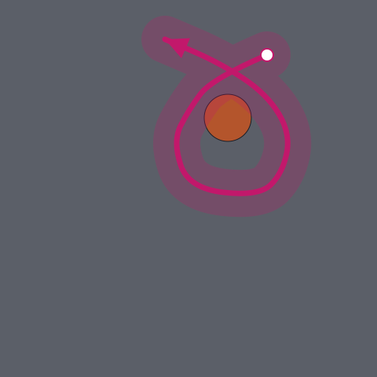
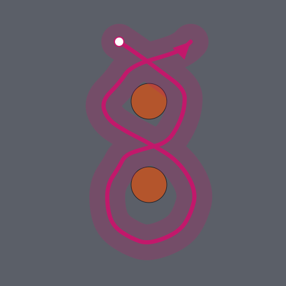

### Drivability check

The Driving & Drift Agent's drivability check (References) drove the board's sketches with the car's driving code (task T-021), both with the Unity prototype's top speed and with the board's top speed of 3.0 times cruise speed (Drifting, Decisions); the results were the same:

- Single Boulder, arrow 1: drivable: yes.
- Single Boulder, arrow 2: drivable: yes.
- Two Boulders, arrow 1: drivable: yes.

### MVP map

The MVP map as built in Godot (task T-019; made bigger after Playtest 1 in task T-094, then rebuilt with everything three times bigger after the combined playtest in task T-096), in flat placeholder colours: dark grey roads, the tan gravel centre, purple buildings, and dark boulders with an orange rim. The art replaces the colours later. Since task T-103 the isometric view draws the ground art, and since task T-034 its buildings rise as boxes that turn see-through ("See-through buildings" below).

**No challenges in the MVP** (task T-097, as Decisions says). The map draws no challenge arrows and tracks no challenges, so it never sends a completed challenge and the run never flashes a score; likes come from drifting only. Every pattern copy below stays on the roads, its boulders exactly where they were, as plain obstacles the car bounces off. The challenges, the fitted versions, the completion rule, the arrows and the meteor challenges are kept in the code and the layout data, unused, so they can be switched back on in one place if the board brings them back (how: `game/docs/level/mvp-map.md`, "MVP map"). The parts of this section about challenges and arrows describe what comes back then.

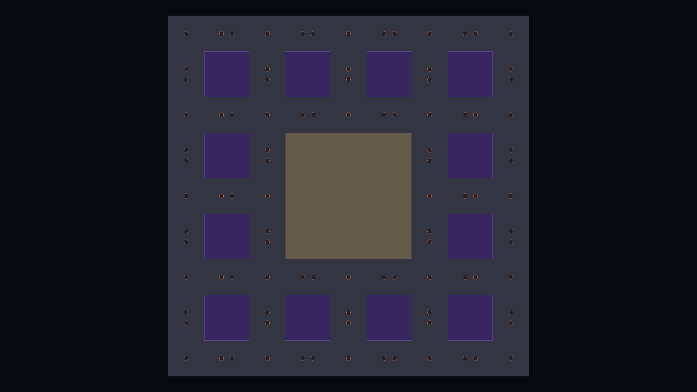

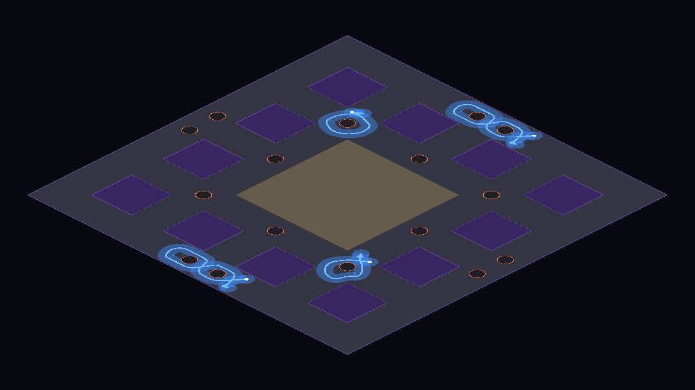

**Size.** The map is **240 by 240 units**, as Decisions says: across the map, the two 24-unit sides of the perimeter road, 4 blocks of 30 and the 3 roads of 24 between them (24 + 4 x 30 + 3 x 24 + 24 = 240). The gravel centre is the middle 2 by 2 blocks and the road between them, 84 by 84 units, which leaves 12 blocks.

**Coordinates.** Positions are in units from the map's centre, x to the right and y down, as in Crash City Grid, so the map runs from -120 to 120. The perimeter road runs from the edge to 96 units from the centre; the blocks start at -96, -42, 12 and 66 on each axis; the gravel centre runs from -42 to 42. The road centre lines are at -108 and 108 (the perimeter road) and -54, 0 and 54 (the roads between the blocks), and the middle of each block side is at -81, -27, 27 or 81. The car starts at 0, 0, in the gravel.

**Fitted patterns.** Each sketch has a fitted version next to it (`arrow-1.fitted.json` and `.svg`), made by a script from the sketch. The rule is the same as before: the sketch's boulders are kept, 3 units across and as far apart as drawn, and its arrow points are moved as little as possible until the arrow's centre line stays at least 2 units from each boulder's centre (the rock's radius plus half the car's width) and the 3-unit corridor stays at least 0.25 units from every building. On the 24-unit roads every sketch already keeps those distances, so no arrow point is moved: each fitted version is the board's sketch exactly, only shifted so its boulders sit on the crossing's centre or the road's centre line.

| Fitted version | Made to fit | Around each boulder |
|---|---|---|
| [Single Boulder, arrow 1](level-design/single-boulder/arrow-1.fitted.svg) | A crossing of two 24-unit roads, the boulder on its centre | Clockwise, 389 degrees, as in the sketch |
| [Single Boulder, arrow 2](level-design/single-boulder/arrow-2.fitted.svg) | A crossing of two 24-unit roads, the boulder on its centre | Counter-clockwise, 431 degrees, as in the sketch |
| [Two Boulders, arrow 1](level-design/two-boulders/arrow-1.fitted.svg) | A straight 24-unit road, the boulders on its centre line, 7 units apart | Clockwise 422 degrees, then counter-clockwise 332, as in the sketch |

The figure-eight is no longer squeezed across the road: its loops are as wide as the board drew them (about 8 units).

**Pattern copies.** 60 copies: 24 Single Boulder and 36 Two Boulders. None is in the gravel.

- A Single Boulder on the centre of every place where two road centre lines meet: the 8 crossings of the inner roads, the 12 junctions where they join the perimeter road, and its 4 corners.
- A Two Boulders on the middle of every stretch of road between those places (the middle of each block side), turned to run along the road.
- So along any road the next copy is 27 units away.

Every copy has room for any of its pattern's arrows, clear of buildings, the map's edge and the other copies, so which copies are challenges can change later without moving them.

**Challenges (off in the MVP, kept for later).** 30% of 60 is 18 challenges (rounded half up, as before): 6 Single Boulder (3 with arrow 1, 3 with arrow 2) and 12 Two Boulders. They are the same every run. They are chosen evenly through the copies in reading order (top to bottom, then left to right), which spreads them over the whole map; the Single Boulder ones take arrow 1 and arrow 2 in turn. The rotation turns the fitted version clockwise on screen (0: the Two Boulders runs along y).

| Copy | Pattern | Centre | Where | Rotation | Challenge (when switched on) |
|---|---|---|---|---|---|
| copy-01 | Single Boulder | -108, -108 | corner of the perimeter road | 0 |  |
| copy-02 | Two Boulders | -81, -108 | perimeter road, top side | 90 | challenge-1, arrow 1 (figure-eight) |
| copy-03 | Single Boulder | -54, -108 | perimeter road junction | 0 |  |
| copy-04 | Two Boulders | -27, -108 | perimeter road, top side | 90 |  |
| copy-05 | Single Boulder | 0, -108 | perimeter road junction | 0 |  |
| copy-06 | Two Boulders | 27, -108 | perimeter road, top side | 90 | challenge-2, arrow 1 (figure-eight) |
| copy-07 | Single Boulder | 54, -108 | perimeter road junction | 0 |  |
| copy-08 | Two Boulders | 81, -108 | perimeter road, top side | 90 |  |
| copy-09 | Single Boulder | 108, -108 | corner of the perimeter road | 0 | challenge-3, arrow 1 (clockwise) |
| copy-10 | Two Boulders | -108, -81 | perimeter road, left side | 0 |  |
| copy-11 | Two Boulders | -54, -81 | road along y | 0 |  |
| copy-12 | Two Boulders | 0, -81 | road along y | 0 | challenge-4, arrow 1 (figure-eight) |
| copy-13 | Two Boulders | 54, -81 | road along y | 0 |  |
| copy-14 | Two Boulders | 108, -81 | perimeter road, right side | 0 |  |
| copy-15 | Single Boulder | -108, -54 | perimeter road junction | 0 |  |
| copy-16 | Two Boulders | -81, -54 | road along x | 90 | challenge-5, arrow 1 (figure-eight) |
| copy-17 | Single Boulder | -54, -54 | crossing | 0 |  |
| copy-18 | Two Boulders | -27, -54 | road along x | 90 |  |
| copy-19 | Single Boulder | 0, -54 | crossing | 0 | challenge-6, arrow 2 (counter-clockwise) |
| copy-20 | Two Boulders | 27, -54 | road along x | 90 |  |
| copy-21 | Single Boulder | 54, -54 | crossing | 0 |  |
| copy-22 | Two Boulders | 81, -54 | road along x | 90 | challenge-7, arrow 1 (figure-eight) |
| copy-23 | Single Boulder | 108, -54 | perimeter road junction | 0 |  |
| copy-24 | Two Boulders | -108, -27 | perimeter road, left side | 0 |  |
| copy-25 | Two Boulders | -54, -27 | road along y | 0 |  |
| copy-26 | Two Boulders | 54, -27 | road along y | 0 | challenge-8, arrow 1 (figure-eight) |
| copy-27 | Two Boulders | 108, -27 | perimeter road, right side | 0 |  |
| copy-28 | Single Boulder | -108, 0 | perimeter road junction | 0 |  |
| copy-29 | Two Boulders | -81, 0 | road along x | 90 | challenge-9, arrow 1 (figure-eight) |
| copy-30 | Single Boulder | -54, 0 | crossing | 0 |  |
| copy-31 | Single Boulder | 54, 0 | crossing | 0 |  |
| copy-32 | Two Boulders | 81, 0 | road along x | 90 | challenge-10, arrow 1 (figure-eight) |
| copy-33 | Single Boulder | 108, 0 | perimeter road junction | 0 |  |
| copy-34 | Two Boulders | -108, 27 | perimeter road, left side | 0 |  |
| copy-35 | Two Boulders | -54, 27 | road along y | 0 |  |
| copy-36 | Two Boulders | 54, 27 | road along y | 0 | challenge-11, arrow 1 (figure-eight) |
| copy-37 | Two Boulders | 108, 27 | perimeter road, right side | 0 |  |
| copy-38 | Single Boulder | -108, 54 | perimeter road junction | 0 |  |
| copy-39 | Two Boulders | -81, 54 | road along x | 90 | challenge-12, arrow 1 (figure-eight) |
| copy-40 | Single Boulder | -54, 54 | crossing | 0 |  |
| copy-41 | Two Boulders | -27, 54 | road along x | 90 |  |
| copy-42 | Single Boulder | 0, 54 | crossing | 0 | challenge-13, arrow 1 (clockwise) |
| copy-43 | Two Boulders | 27, 54 | road along x | 90 |  |
| copy-44 | Single Boulder | 54, 54 | crossing | 0 |  |
| copy-45 | Two Boulders | 81, 54 | road along x | 90 |  |
| copy-46 | Single Boulder | 108, 54 | perimeter road junction | 0 | challenge-14, arrow 2 (counter-clockwise) |
| copy-47 | Two Boulders | -108, 81 | perimeter road, left side | 0 |  |
| copy-48 | Two Boulders | -54, 81 | road along y | 0 |  |
| copy-49 | Two Boulders | 0, 81 | road along y | 0 | challenge-15, arrow 1 (figure-eight) |
| copy-50 | Two Boulders | 54, 81 | road along y | 0 |  |
| copy-51 | Two Boulders | 108, 81 | perimeter road, right side | 0 |  |
| copy-52 | Single Boulder | -108, 108 | corner of the perimeter road | 0 | challenge-16, arrow 1 (clockwise) |
| copy-53 | Two Boulders | -81, 108 | perimeter road, bottom side | 90 |  |
| copy-54 | Single Boulder | -54, 108 | perimeter road junction | 0 |  |
| copy-55 | Two Boulders | -27, 108 | perimeter road, bottom side | 90 |  |
| copy-56 | Single Boulder | 0, 108 | perimeter road junction | 0 | challenge-17, arrow 2 (counter-clockwise) |
| copy-57 | Two Boulders | 27, 108 | perimeter road, bottom side | 90 |  |
| copy-58 | Single Boulder | 54, 108 | perimeter road junction | 0 |  |
| copy-59 | Two Boulders | 81, 108 | perimeter road, bottom side | 90 | challenge-18, arrow 1 (figure-eight) |
| copy-60 | Single Boulder | 108, 108 | corner of the perimeter road | 0 |  |

**Completing a challenge (when switched on).** The map checks the drawn car (a 3 by 1 unit rectangle on the car's position and heading) against each open challenge every physics step. A run starts when the car touches the arrow's start; it moves forward while the car keeps touching the corridor, and only along the stretch of arrow the car is on, so crossing a figure-eight or passing the start of a loop does not skip ahead. Not touching the corridor at all, even for one step, ends the run. Reaching the arrow's end completes the challenge.

**Drivability.** The fitted challenges have not yet been checked with the Driving & Drift Agent's script (task T-021); since task T-096 they are the board's sketches unchanged, which that check found drivable ("Drivability check" above). The 18 challenges are copies of the 3 fitted versions, so checking those 3 covers them all.

### See-through buildings

Built on the MVP map in task T-034, following task T-020's research (Visual style, References) and the values in Visual style, Decisions. In the isometric view each building is now a box that rises 15 units above its block (a placeholder height until the building art; the flat view still draws them flat), drawn in depth order with the car: a building nearer the viewer is drawn over what is behind it.

- **When a building fades:** while it covers the car on screen. The car counts as behind a building when its centre is not in front of either of the building's two visible walls (the walls facing +x and +y, towards the viewer), and covered when the drawn car (its 1 by 3 unit rectangle on the ground, together with the same rectangle 1 unit higher) overlaps the building's outline on screen. Being further back alone is not enough: the car in the gravel centre is behind the blocks south of it, but not hidden by them.
- **How:** the whole building fades as one object, to 15% visible over 0.15 seconds, and fades back to fully opaque over 0.15 seconds when the car comes out. Only the buildings covering the car fade; every other building stays fully opaque. Only the car is checked, not enemies or the kaiju.
- **Drawing order:** the car is drawn under the buildings that cover it and over every other building. The ground, the drift marks and the boulders are drawn under all the buildings.
- **Under a building:** the ground art has no tiles under the blocks, so a faded building shows the dark night colour where it stands.

How it is built, and what the final building art has to do to keep it: `game/docs/level/mvp-map.md`, "MVP map", "See-through buildings".

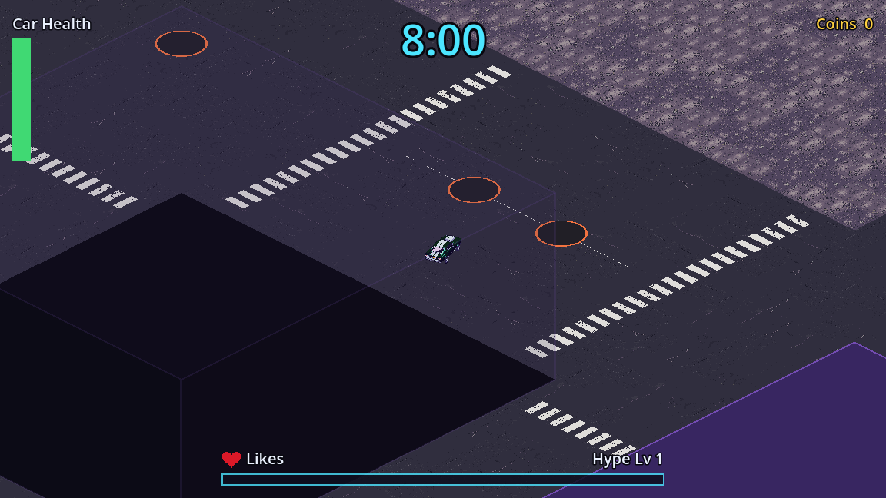

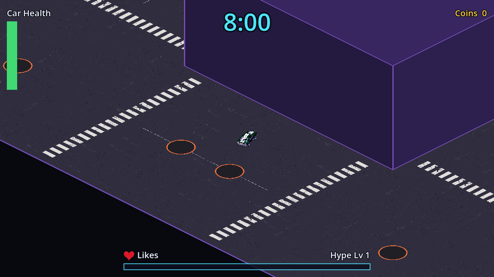

### Meteor boulders

The kaiju's meteors leave plain boulders where they land (task T-097; when and where the kaiju drops them: Enemies). The map can place one boulder at any position during a run, the same size (3 units across), look and collision as the map's own boulders, so the car bounces off it; no challenge or arrow comes with it. A placement check says whether a spot is free: the boulder must lie wholly inside the map and must not overlap a building or any boulder already on the map (a pattern copy's or another meteor boulder's); just touching is allowed. A new run builds a new map, so the meteor boulders go with the old one. The functions are listed in `game/docs/level/mvp-map.md` ("MVP map", "Meteor boulders").

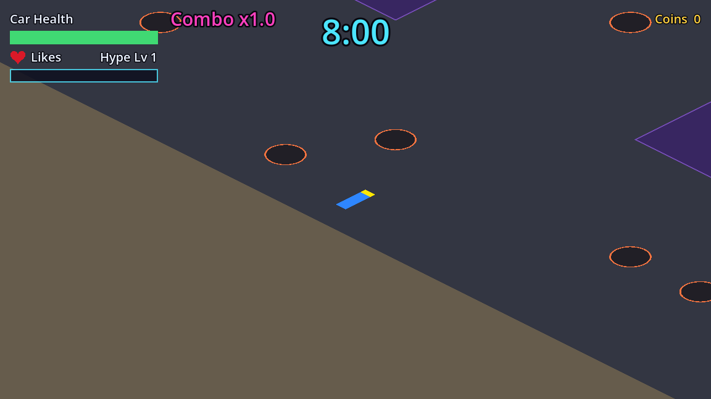

### Meteor challenges (off in the MVP, kept for later)

Not used in the MVP: the kaiju's meteors leave plain boulders instead ("Meteor boulders" above). Kept for if challenges come back. The challenges the kaiju's meteors create during a run (task T-035; when and where the kaiju drops them: Enemies). The map can place any of the 3 fitted challenge designs (Single Boulder arrow 1 and arrow 2, Two Boulders arrow 1) at any position and angle, with the fitted boulders (3 units across) and the arrow corridor drawn in green, while the map's preset challenges stay blue. They follow the same completion rule as the preset challenges; when one is completed, its arrow disappears and its boulders stay as plain obstacles, and the map sends a separate signal for meteor challenges, so the kaiju's shield can tell them from the preset ones. Several can be open at once, each completed on its own.

A placement check says whether a design fits at a spot: none of its boulders and no part of its 3-unit corridor may overlap a building, a boulder already on the map (the pattern copies' or another meteor challenge's) or the map's edge.

The designs are stored unplaced (units from the pattern's centre, angle 0) in the layout data, under `challenge_designs`. The functions and the signal are listed in `game/docs/level/mvp-map.md` ("MVP map", "Meteor challenges").

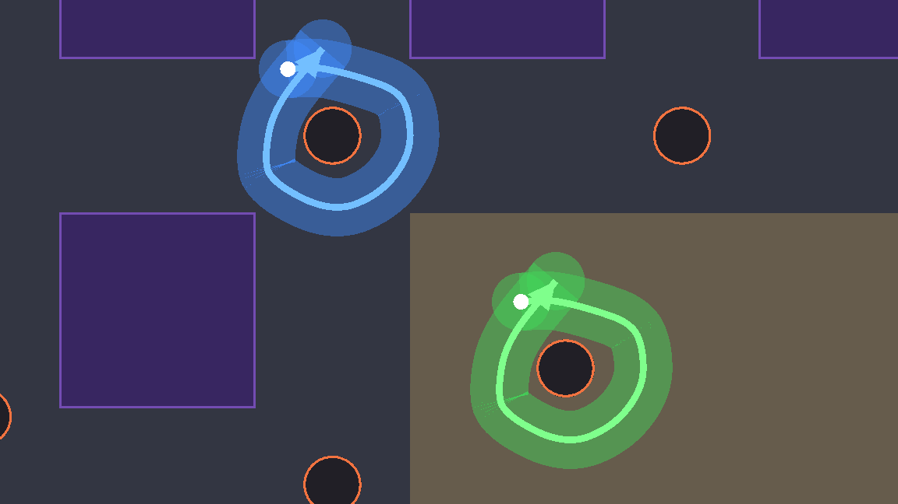

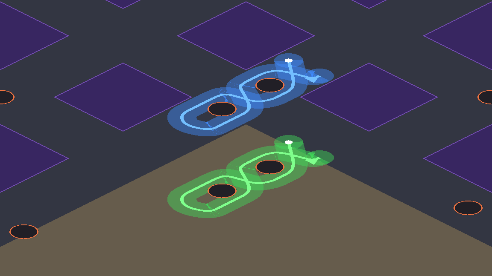

### Level creator text

The creator's text lives in `game/data/level/creator_texts.json` (the source; each piece has a text and a note of where it appears). Plain labels: the creator is the board's own tool (task T-233). Buttons fit 16 characters, category names 12.

- **List screen:** title "Levels"; button "New level" (alone when there are no levels); per level "Play" and "Edit".
- **Editor, naming:** default name "New level"; field label "Level name".
- **Side panel categories:** Ground, Roads, Buildings, Boulders, Rooftops, Ramps.
- **Heights:** rooftops "Height 3", "Height 6"; ramps "Ramp 0 to 3", "Ramp 3 to 6".
- **Actions:** Rotate, Mirror, Delete, Save; confirmation "Level saved."; back button "Back to list".
- **Overlap message:** "Can't place here: it overlaps another piece."
- **Controls hint:** "Mouse: place. R: rotate. M: mirror. Del: delete." (the keys R, M and Del are the text's proposal; the creator's scripts must use the same keys).

Added for the piece set (task T-250; same file, T-233's keys unchanged; the pieces' tickets are T-251 to T-254):

- **Sizing a rooftop:** top bar hint "Drag to set the size."; readout "Size: {w} x {d}" (`size_hint`, `size_readout`).
- **Ramp directions:** "Climbs north", "Climbs east", "Climbs south", "Climbs west" on the top bar for a picked ramp; height label "Ramp 0 to 6" (`ramp_height_0_6`, used only if the creator adds it).
- **Road pieces (Roads):** "Corner", "T-junction", "Crossroads", "Dead end".
- **Props (new category "Props"):** "Concrete barrier", "Traffic cones", "Crate stack", "AC unit", "Water tank", "Roof vent", "Street lamp", "Rooftop sign".
- **Buildings:** "Small building", "Long building".
- **Controls hint with sizing:** "Mouse: place. Drag: size a rooftop. R: rotate. M: mirror. Del: delete." (`controls_hint_sizing`; the old `controls_hint` stays; the creator should show the new one, same keys).

Added for the creator rework (task T-261; same file, every earlier key unchanged; Decisions, "Level creator rework"):

- **Groups (side panel):** "Roads", "Ground", "Levels", "Buildings", "Obstacles", "Decoration" (`group_*`).
- **Pieces (side panel), Roads:** "Road", "Centre line", "Zebra crossing", "Cracked road". **Ground:** "Gravel", "Pavement". **Levels:** "Platform", "Ramp". **Buildings:** "Small building", "Long building", "Low-rise", "Skyscraper". **Obstacles:** "Boulder", "Barrier", "Cones", "Crates". **Decoration:** "Street lamp", "AC unit", "Water tank", "Roof vent", "Rooftop sign" (`piece_*`).
- **Looks strip under a selected piece:** heading "Looks"; counter "Look {n} of {count}" (`looks_heading`, `look_counter`).
- **Platform sizes (top bar):** "S", "M", "L", "Any size (drag)" (`platform_size_*`).
- **Ramp arrows (top bar):** "Arrows up", "Arrows down" (`ramp_arrows_up`, `ramp_arrows_down`).
- **Banner (top bar, skyscrapers):** "Banner on", "Banner off" (`banner_on`, `banner_off`).
- **Road brush (top bar):** "Drag to paint a road" (`road_brush_hint`).
- **Controls hint:** "Drag: paint roads, size platforms. R: turn. V: next look. M: mirror. H: height. A: arrows. B: banner. T: style. Del: delete." (`controls_hint_rework`; the older hints stay; the creator should show this one, same keys).

Added for sidewalks and parked cars (task T-396; same file, every earlier key unchanged; Decisions, "Sidewalks and parked cars in the level creator"; T-398 copies them into `creator_texts.json`):

- **Ground (side panel):** "Sidewalk", next to "Gravel" (`piece_sidewalk`).
- **Obstacles (side panel):** "Parked car", "Broken car", after "Crates" (`piece_parked_car`, `piece_broken_car`).
- **Looks strip under a selected car:** model counter "Model {n} of {count}" (`model_counter`), shown only if T-398 gives the cars several models; the facing labels "Facing top right", "Facing bottom right", "Facing bottom left", "Facing top left" (`facing_top_right`, `facing_bottom_right`, `facing_bottom_left`, `facing_top_left`), shown only if T-398 shows the facing.
- Style loop: score 9/10 in round 1 (Style review, T-396). The script's complaints about one line and sentence case came from checking all eight labels as one block; each label alone is short, plain and in the existing voice.

Added for meteor craters (task T-401; same file, every earlier key unchanged; Decisions, "Sidewalks and parked cars in the level creator", Meteor craters; T-398 copies it into `creator_texts.json`):

- **Ground (side panel):** "Meteor crater", after "Sidewalk" (`piece_meteor_crater`). The looks strip reuses T-396's "Model {n} of {count}" (`model_counter`).
- Style loop: score 10/10 in round 1 (Style review, T-401).

Added for the kaiju alert sign and banner pieces (task T-440; same file, every earlier key unchanged; Decisions, "Kaiju alert signs are level creator pieces"; the pieces ticket T-441 builds them):

- **Side panel buttons:** "Alert sign" (`piece_alert_sign`, the standing sign on the ground or a rooftop) and "Alert banner" (`piece_alert_banner`, hangs on a skyscraper's wall).
- **Looks strip, the two designs:** "Head in triangle" (`alert_design_head`) and "Body in circle" (`alert_design_body`).
- **Banner hints in the strip:** "R: next wall." (`banner_wall_hint`) and "H: next height." (`banner_height_hint`); the keys are the existing turn and height keys, a proposal the creator must follow.
- Style loop: score 8/10 in round 1 (Style review, T-440). The script's complaints about one line and sentence case came from checking the six labels as one block.

### Level creator: one button per kind of piece

Task T-262 (Decisions, "Level creator rework"). How it works and where its data is: `game/docs/level/level-creator.md`, "Level creator", "The side panel: one button per kind of piece (T-262)". The groupings of looks are the Level/Challenge Design Agent's **proposals for the board's playtest**.

- **The panel:** six groups from the ground up with one button per kind (20 in all): Roads (Road, Centre line, Zebra crossing, Cracked road), Ground (Gravel), Levels (Platform, Ramp), Buildings, smallest to tallest (Small building, Long building, Low-rise, Skyscraper), Obstacles (Boulder, Barrier, Cones, Crates), Decoration (Street lamp, AC unit, Water tank, Roof vent, Rooftop sign). **Pavement is left out:** the game's only pavement art is the block pavement drawn under buildings, not a ground tile.
- **Keys:** V next look, R turn, M mirror, H height (Platform 3 / 6; Ramp 0 to 3, 3 to 6, 0 to 6), T style. Under the picked piece a **looks strip** shows its looks as small clickable pictures with "Look n of count".
- **Looks (proposals):** Road is the plainer asphalts (the approved tile with its mirror, and two PixelLab ones); **Cracked road** is the three visibly cracked PixelLab asphalts; Centre line holds the line tiles on every asphalt and the corner, T-junction, crossroads and dead-end pieces (R turns them); Zebra crossing the zebra tiles on every asphalt; a road tile turns (R) to its tile along the other axis. **Skyscraper** has 12 looks: each of the 6 towers' two bodies (the second body was in the game's art but not offered by the old panel). Since T-263 the road kinds are brushes ("Level creator: the road brush" below).
- **Saved levels** are unchanged: a piece writes the same data as before, so earlier levels open, place and play as before.

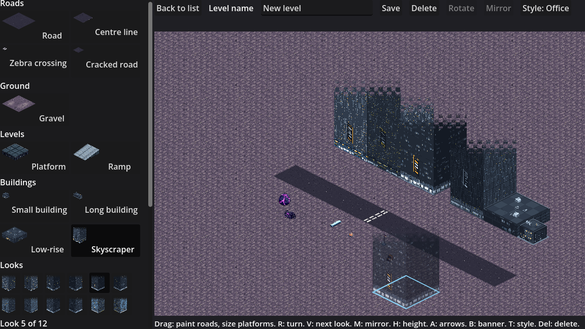

### Level creator: the road brush

Task T-263 (Decisions, "Level creator rework"). How it works and where its code and tiles are: `game/docs/level/level-creator-pieces.md`, "Level creator", "The road brush (T-263)". The points marked as proposals are the Level/Challenge Design Agent's, for the board's playtest.

- **Painting:** pick Road, Centre line or Cracked road, press the left button on the map and drag. The road comes whole along the drag, today's two-tile-wide road (4 units), with the centre line in its middle for Centre line. The road follows the drag in steps along x and y, with no gaps when the drag goes diagonally. V picks the asphalt: Road and Centre line a0 (M: its mirror a0m), g6, g9; Cracked road g4, g5, g7. Painting over a road changes its kind and asphalt. The top bar shows "Drag to paint a road".
- **Joining:** wherever painted roads meet, the editor picks the piece itself: straights along y and x, corners, T-junctions, crossroads, and a dead end at each open end (a kerb across the road, gravel beyond). With Centre line the line runs on through every piece. On Road and Cracked road a corner, T-junction or crossroads is plain asphalt.
- **Erasing:** a right-drag erases road along the drag, and Del erases the road under the mouse. The roads around then join again.
- **Zebra crossing:** pick it and click on a straight road. The crossing goes across the road on the row of tiles clicked, on that road's own asphalt, and stays when the road is painted over with another kind. It is not laid on a corner, junction or dead end, and goes away when its block becomes one.
- **Never over:** a road is not painted over a building, platform or ramp. It stops at them, and they close it in a dead end.
- **Proposals:** roads lie on a 4-unit grid (blocks of 2 x 2 tiles). Every road block joins every road block next to it, so two roads painted side by side become one wide road. A single block on its own is plain asphalt. Where a centre-line road meets a road without a line, the line runs to the edge of its own block. A crossing has four stripes evenly across the road (the full zebra tile on both tiles). The game's map leaves out the stripe at each edge, which on a road this narrow would leave only two.
- **New tiles, drawn by script (no PixelLab):** T-252's centre-line pieces on the asphalts a0m, g6 and g9, and the dead ends of roads without a line on all seven asphalts. 268 tiles, appended to the ground atlas, so every earlier tile keeps its index.
- **Saved levels** write the same ground data as before (a road tile per cell), so a painted level passes the level check and plays. Earlier levels open unchanged, and a road saved earlier joins a newly painted one when its tiles fill whole blocks. The old single road tiles are no longer panel looks; they stay in the catalogue so old levels draw.
- **In the run (T-391; Decisions, "Roads painted in the creator show in the run"):** a level played from the creator draws exactly the ground and road tiles painted in the editor, roads beside rooftops and ramps included. Before the fix the run always drew the game's own map's ground, whatever the level held, so painted roads never showed. A level saved with the creator's ground (every level the creator saves) now shows its own: a level that is all gravel, like `level_01`, plays on plain gravel instead of the game's streets. The game's own map, and a level file without the creator's ground, draw the game's ground as before. Where the code is: `game/docs/level/level-creator.md`, "Painted roads in the run (T-391)".

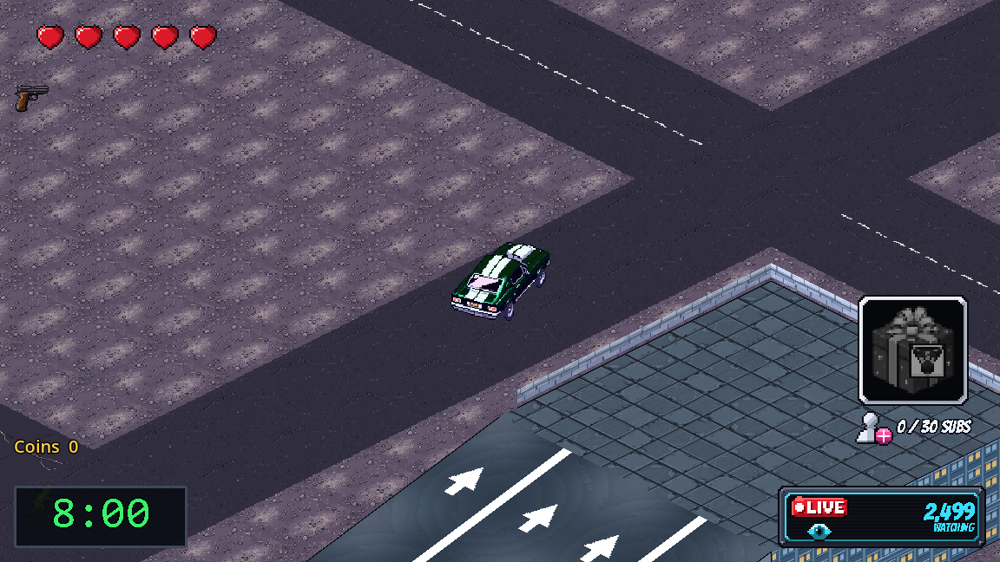

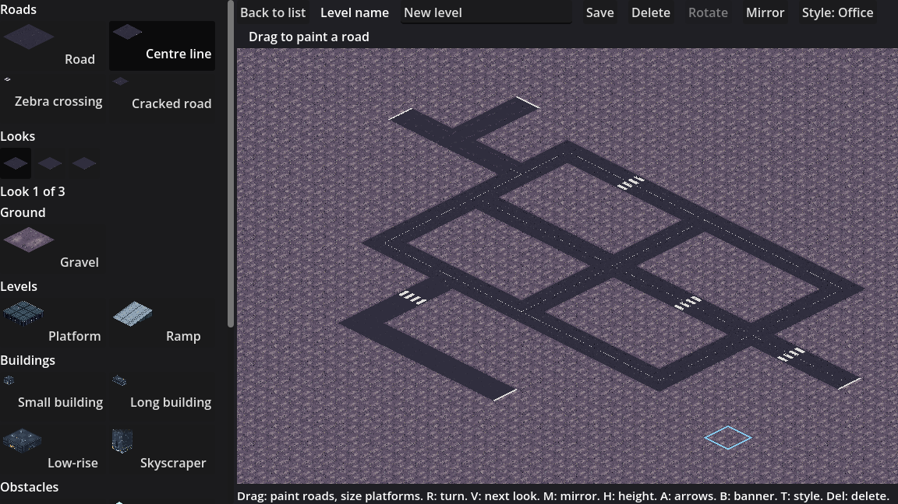

### Level creator: closed ramps, arrows and platform sizes

Task T-264 (Decisions, "Level creator rework"). How it works: `game/docs/level/level-creator-pieces.md`, "Level creator", "Closed ramps, arrows up or down, platform sizes (T-264)". The numbers are the Level/Challenge Design Agent's proposals for the board's playtest.

- **Closed ramps:** every ramp, in each direction and height step, has a wall at its tall end down to what it stands on, in the ramp side's texture, even where it meets a rooftop or building.
- **Arrows:** every ramp can have its arrows pointing up or down the slope, the board's choice per ramp (key A, or the top bar's "Arrows up" and "Arrows down"), saved with the ramp. The default is up.
- **Platform sizes:** a platform at height 3 or 6 places in one click at S 8 x 8, M 16 x 16 or L 32 x 32 units, chosen on the top bar; the default is M. Dragging still sizes it freely ("Any size (drag)").

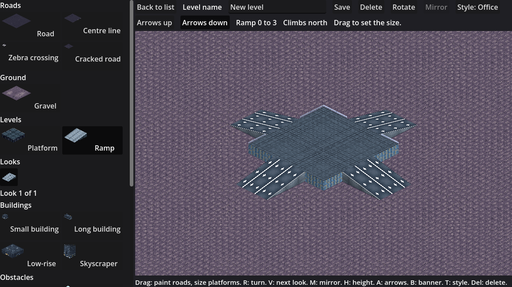
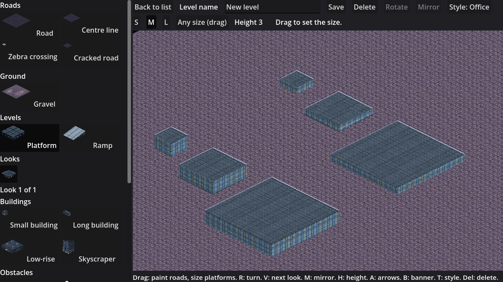

### Level creator: the small jump ramp

Task T-400 (Decisions, "A small jump ramp"). How it works: `game/docs/level/level-creator-pieces.md`, "Level creator", "The small jump ramp (T-400)". Every point below is the Level/Challenge Design Agent's proposal for the board's playtest.

- **The piece:** three more height steps of the Ramp family, after 0 to 6: **Ramp 0 to 2** (on the street), **Ramp 3 to 5** (on a height 3 rooftop) and **Ramp 6 to 8** (on a height 6 rooftop), so it rises 2 units from whatever it stands on, as the other ramps are raised by their height step. Key **H** steps 0 to 3, 3 to 6, 0 to 6, 0 to 2, 3 to 5, 6 to 8; **R** turns it to climb north, east, south or west; dragging sets its width (default 10, at least 4 units), like the other ramps.
- **Size:** one tile long, 4 units (a third of a 12-unit ramp), and 2 units high, so its slope (1 in 2) is twice a 0 to 3 ramp's.
- **Its tall end is open:** it climbs to no rooftop. Nothing stands above its lip, so the car drives up it and flies off the top, taking off along the slope (the ramp's own vertical speed, as at a ramp's top) when it climbs at 4 units/s or more; slower it just rolls off. The face under the lip is drawn as the ramp's back in the ramp side's texture (as the other ramps' tall ends), so it doesn't look hollow; from behind it is a 2-unit step the car can't climb, like any raised side. A jump counts for the airtime trick and the air tricks like a ramp hop: after a 22-unit run-up from a standstill the car spends about 1.6 seconds in the air and rises to about 4.7 units (2.7 over the lip) on a Ramp 0 to 2.
- **Its slope:** shown by today's arrows on its top, up the slope by default, turned with key A.
- **Enemies** go round it or over it as the height rules decide (it is a ramp like the others: up from its foot, down off its top or its sides).

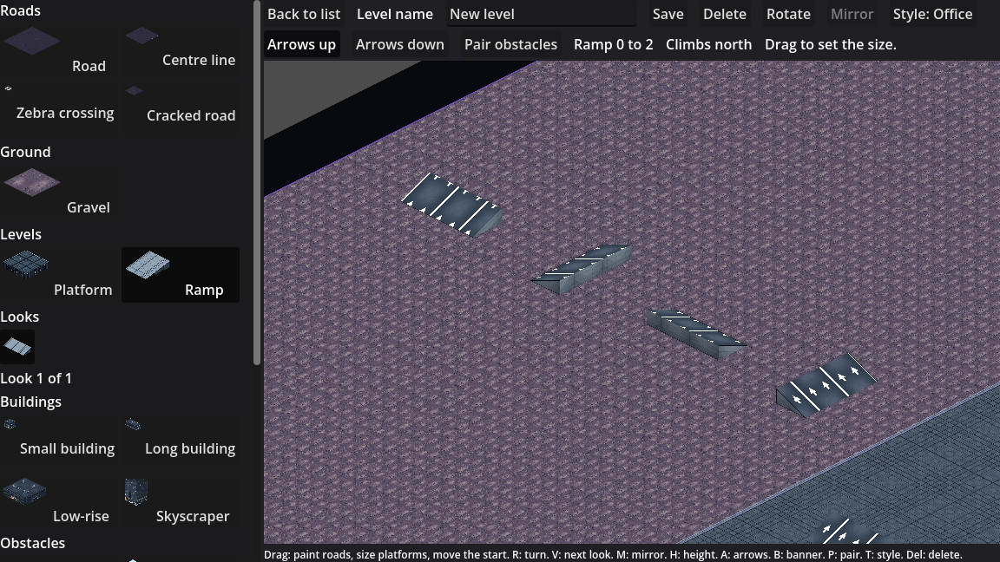
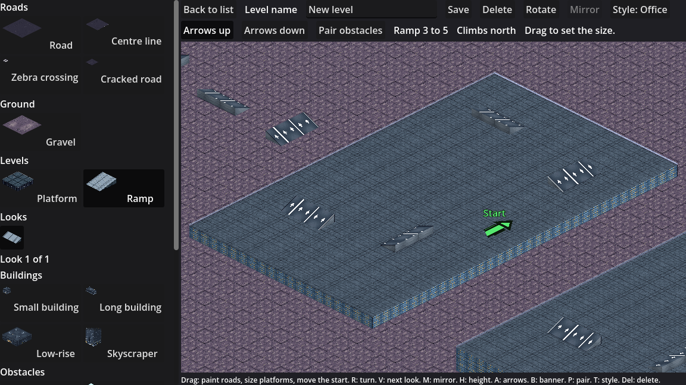
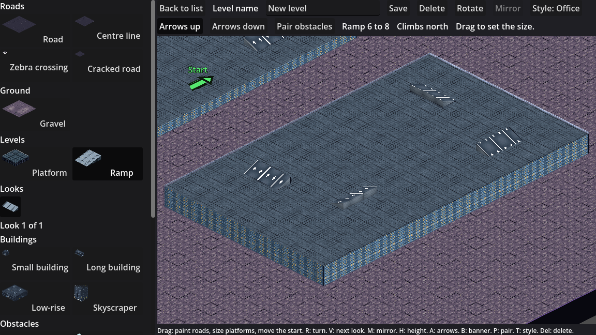

GIF of the car jumping off the small ramps in a run: `art-archive/T-400/screenshots/jump_drive.gif`.

### Level creator: skyscraper banners on or off

Task T-265 (Decisions, "Level creator rework"). How it works: `game/docs/level/level-creator-pieces.md`, "Level creator", "Skyscraper banners on or off (T-265)". The choices marked here are the Level/Challenge Design Agent's proposals for the board's playtest.

- **What the banner is:** the vertical sign in the middle of a skyscraper's face is painted into the building's own picture (every one of the 12 looks has one), not a separate sprite. The kaiju alert banners (`game/art/banners/`) are a different thing and are not part of this: since T-441 they are pieces of their own ("Level creator: kaiju alert signs and banners" below).
- **On or off per skyscraper:** key B, or the top bar's "Banner on" and "Banner off", chooses it for the next skyscraper placed; with a skyscraper selected and nothing picked, B changes that building. **Off by default.** The choice is saved with the building and the preview shows it.
- **The pictures without a banner:** the same 12 bodies, built again by script from the same pieces with the sign left out (no PixelLab); the originals stay.
- **Earlier saved levels** (a skyscraper with no banner choice written) open with the banner **off** (a proposal).
- **The game's own map** keeps its banners and signs as before.

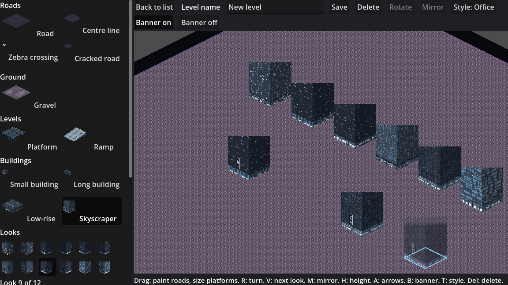
Added for thread the needle (task T-271; same file, every earlier key unchanged; Decisions, "Thread the needle"; the build is T-272):
- **Pair tool (top bar or Obstacles panel):** button "Pair obstacles" (`pair_tool`); hint while picked "Pair: click two obstacles" (`pair_hint`).
- **Messages (top bar):** after a pair is made "Pair made. Drive between them." (`pair_made`); when the click is not on an obstacle "Not an obstacle. Pick a boulder, barrier, cones or crates." (`pair_not_obstacle`).
- **Removing a pair:** button "Unpair" (`unpair_label`).
- **Controls hint:** the rework hint with "P: pair." added: "Drag: paint roads, size platforms. R: turn. V: next look. M: mirror. H: height. A: arrows. B: banner. P: pair. T: style. Del: delete." (`controls_hint_pairs`; the older hints stay; the creator should show this one; P is the text's proposal and the creator must use the same key).
Added for the car's spawn point (task T-279; same file, every earlier key unchanged; Decisions, "The car's spawn point"; the build is T-280):
- **Marker (on the map):** "Start" (`spawn_label`).
- **Hint while selected (top bar):** "Start: drag to move. R: turn." (`spawn_hint`; R is the same turn key as for pieces, the heading being a proposal).
- **Message when it can't go where dropped (top bar):** "Can't start here: it's blocked." (`spawn_blocked`; inside a building, on an obstacle or off the map).
- **Message when the board tries to delete it (top bar):** "The start can't be deleted." (`spawn_no_delete`).
- **Controls hint:** the pairs hint with "move the start" added: "Drag: paint roads, size platforms, move the start. R: turn. V: next look. M: mirror. H: height. A: arrows. B: banner. P: pair. T: style. Del: delete." (`controls_hint_spawn`; the older hints stay; the creator should show this one).

### Level creator: thread the needle

Task T-272 (Decisions, "Thread the needle"; the text is T-271's, above). How it works: `game/docs/level/level-creator-pieces.md`, "Level creator", "Thread the needle (T-272)". The points marked as proposals are the Level/Challenge Design Agent's, for the board's playtest; the numbers are in `game/data/combo.json` (`trick_add.thread_the_needle` and `thread_the_needle`, with their reasons).

- **Which pieces are obstacles:** the four of the panel's Obstacles group, boulders, barriers, cones and crates. Decoration (street lamps, AC units, water tanks, roof vents, rooftop signs) is refused with "Not an obstacle...", as are buildings, rooftops, ramps and the ground.
- **Pairing:** the top bar's "Pair obstacles", or **P**, turns the pair tool on (it drops the picked piece); click one obstacle, then another: the top bar says "Pair made. Drive between them." The tool stays on for the next pair until P, Esc, a right-click or picking a piece. Clicking the same obstacle twice lets it go.
- **An obstacle in several pairs (T-394, below):** pairing an obstacle that is already in a pair keeps its old pair too; T-272's "one pair per obstacle" is gone.
- **How a pair shows in the editor (a proposal):** a dashed mint-green line across the gap, from one obstacle's edge to the other's, and a ring round each; the obstacles picked with the tool on are ringed thicker.
- **Removing a pair:** select a paired obstacle (nothing picked) and press "Unpair" (since T-394 this removes all of its pairs), or delete either obstacle.
- **In the level file:** a `pairs` list, saved and reopened with the level; `check_level.py` checks every pair names two different existing obstacles (since T-394 an obstacle can be in several pairs, but the same two obstacles make one pair at most).
- **In a run on the level:** when the car's centre crosses the line between the two obstacles' centres without touching either, it is the **thread the needle** trick: the combo goes up and THREAD THE NEEDLE! "+{amount}" pops. Proposals: worth **0.5**, like ALT DRIFT! and AIR 360!; the same pair pays again on a later pass in either direction once **3 seconds** have gone by since it last paid; it **counts in the air** (a jump through the gap); a touch of either obstacle from half a second before the crossing until a quarter second after it voids the pass, and the crash cuts the combo as always. The trick pops a quarter second after the crossing, once the car is clear.
- **How a pair shows in the run (a proposal):** a faint dashed chalk-white line on the ground across the gap, under the car and the obstacles, drawn in code.
- **The flash when a pair pays (T-451, board, 2026-10-31; the look is a proposal for the playtest):** on the step the trick pays, the two obstacles of the threaded pair and the dashed line between them flash: two quick white pulses over **0.6 seconds** (bright at once, dark at 0.15 s, bright again at 0.3 s, at rest from 0.6 s). The obstacles' pixels mix up to 75 percent towards white (alpha kept), the line goes opaque white and twice as thick. Only the pair just threaded flashes: in a chained row the other gaps stay still, and the next gap flashes when it pays. A pass that doesn't thread (going round, or a touch that voids it) makes no flash. Code only, no new art (`game/scripts/level/needle_flash.gd`).
- **The game's own map** has no pairs and is unchanged.

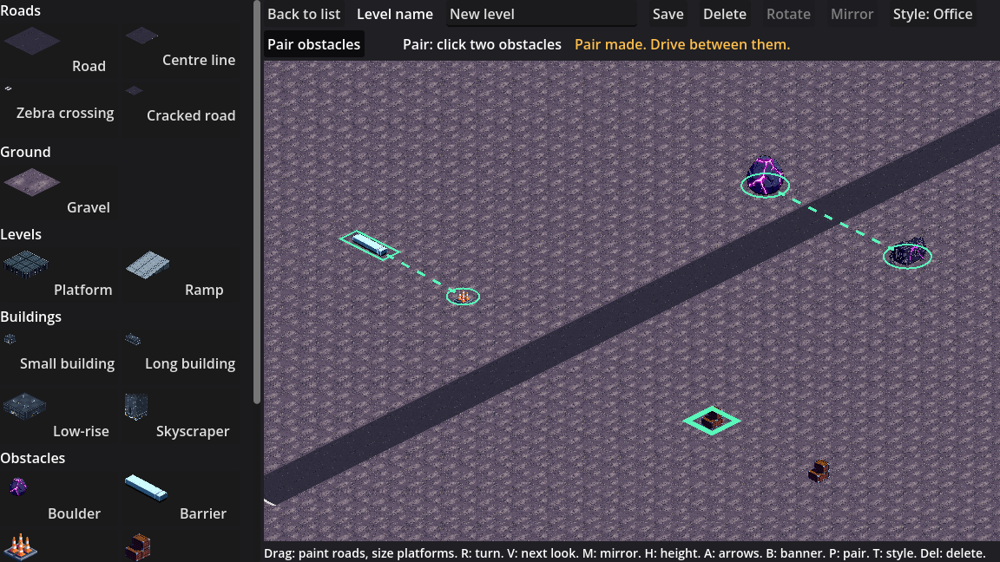
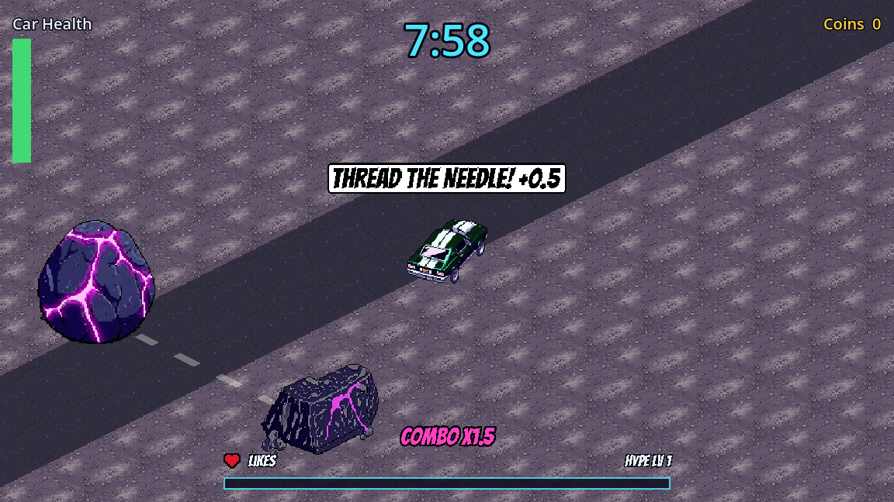
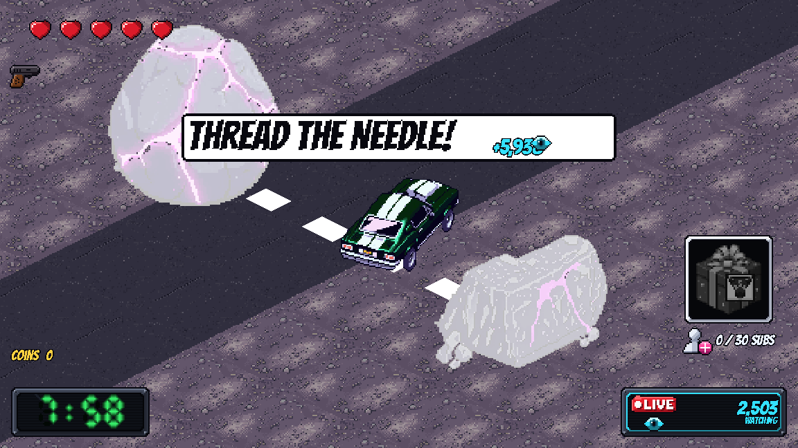

### Level creator: a row paired as a chain

Task T-394 (Decisions, "A row of obstacles can be threaded gap after gap"). It changes the pair tool above; no new text (the labels and messages are T-271's). How it works: `game/docs/level/level-creator-pieces.md`, "Thread the needle (T-272)", "Several pairs and chains (T-394)".
- **Two ways to pair a row.** One pair at a time, as before: click A, then B; click B, then C; and so on. Each new pair keeps the earlier ones, so the row ends up paired A-B, B-C, C-D. Or the whole row in one go: with the pair tool on, **Shift+click** the obstacles in order (each is ringed thicker and numbered 1, 2, 3 above it; Shift+click a numbered one again to take it out), then press **P** or **Pair obstacles**: each is paired with the next (A with B, B with C, C with D) and the tool stays on. A plain click after a Shift+click row adds that obstacle as the last one and pairs the row straight away. Shift+click on an obstacle with the pair tool off (and nothing picked) turns the tool on and starts a row with it.
- **The same two obstacles are one pair at most:** pairing them again (in either order) changes nothing.
- **Unpair removes only the pair aimed at.** With the pair tool on, Shift+click to aim, then "Unpair": two picked removes their pair; a row picked removes only the pairs between consecutive picked ones (A-B, B-C), and the obstacles' other pairs stay; one picked removes all of its pairs. With the tool off, a selected obstacle's "Unpair" removes all of its pairs (the proposal for one obstacle: all its pairs, rather than a choice). "Unpair" shows only when there is something to remove. Deleting an obstacle removes its pairs; the rest of a chain stays.
- **In the editor** every pair shows its own dashed line, so a chain reads as a row of links.
- **In the run** each pair is its own gap: threading a row gap after gap pays thread the needle for each gap, each gap with its own 3-second cool-down; a touch of an obstacle voids the passes of every gap it is part of, and the crash pays nothing and cuts the combo as always.
- **Saved levels:** the level file keeps its `pairs` list, one pair per entry, so a level saved before opens with its pairs, and `check_level.py` accepts an obstacle in several pairs.

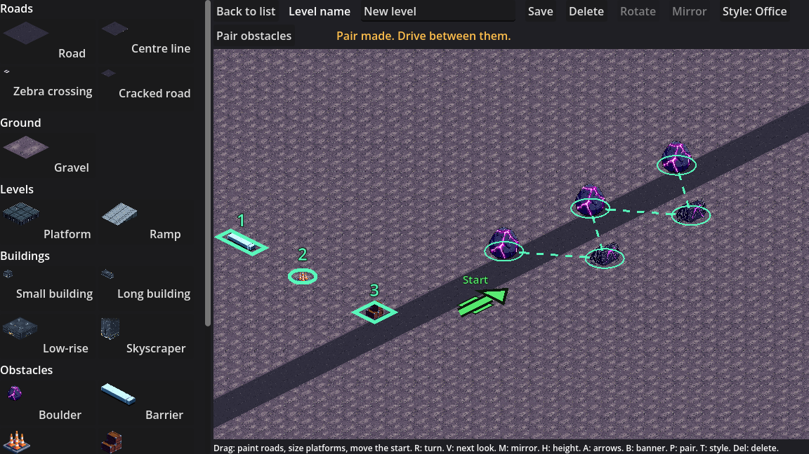
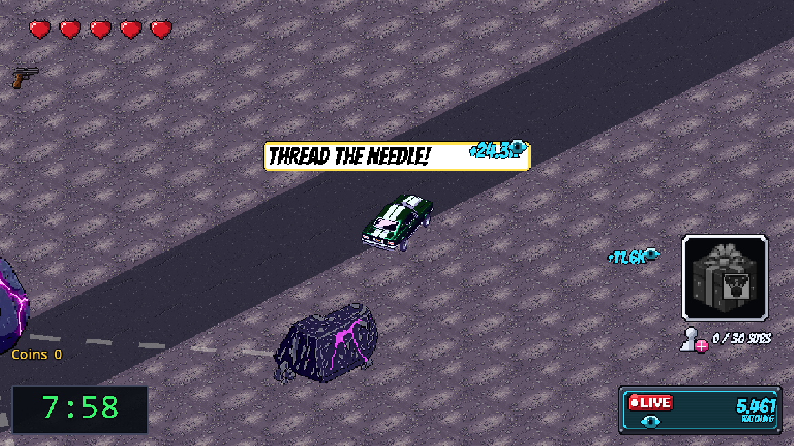

### Level creator: the spawn point

Built in task T-280 from Decisions, "The car's spawn point", with T-279's labels. The choices below are proposals for the playtest.

- **The marker:** a green arrow on the point's cell, turned to the car's starting heading, with a dark outline and the label "Start" above it, drawn in code above every piece so nothing hides it, lifted to the surface it stands on (a rooftop's or ramp's height). Never Redgull red. Selected, it gets the yellow selection outline and the top bar shows its hint.
- **Moving it:** press on it and drag; a ghost shows the cell under the mouse (grey when the car can't stand there) and the point snaps to that cell's middle on release. Anywhere the car can stand: the street, a rooftop or a ramp. A plain click only selects it. (The decision's "select it and click where it should go" is not built; the drag does the job.)
- **Where the car can stand:** inside the map and clear of every building, obstacle (barrier, cones, crates and the other props) and boulder by 1 unit; the cell beside one is fine. Anywhere else is refused with "Can't start here: it's blocked." and the point stays where it was. A building or obstacle placed over it is refused with the same message.
- **Turning it:** R with it selected steps the heading round eight directions (45 degrees each); a new level starts facing the way the run always did.
- **Never deleted:** Del shows "The start can't be deleted." and it stays.
- **Saved and used:** the level file's `spawn` ({x, y, heading}); a run started from the creator puts the car there, at the ground's height there, facing that way. The level check refuses a level whose spawn point is missing or not where a car can stand. The game's own map has none and starts the car as before.

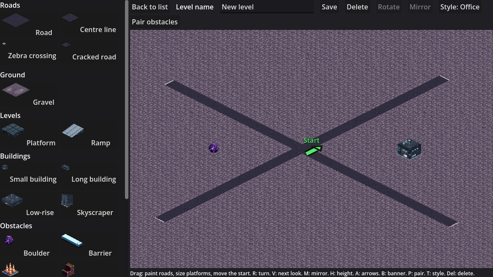
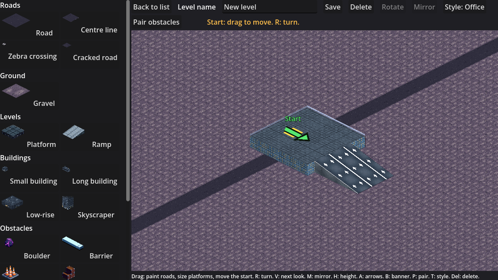
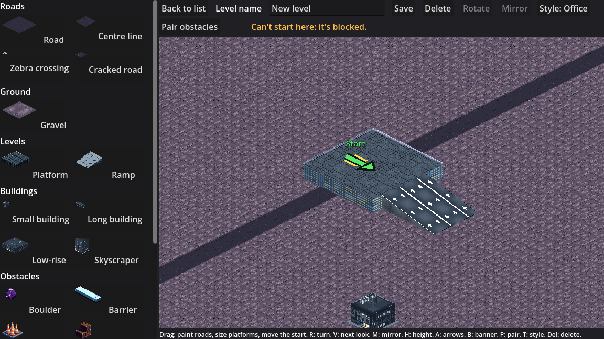

### Level creator: rooftops of any size and ramps in every direction

Task T-251 (Decisions, "Level creator piece set"). Every number here is the Level/Challenge Design Agent's **proposal for the board's playtest**. Units are the flat world's (x east, y south). How it works and how to rebuild it: `game/docs/level/level-creator-pieces.md`, "Level creator", "Rooftops and ramps of any size (T-251)".

- **Rooftops** at height 3 and 6, of any size: picked, then dragged on the map over the cells they cover, so every size is even (whole 2 x 2 unit cells), at least 4 by 4, at most the map. A click without a drag places the elevation sample map's size (84 by 30 at height 3, 30 by 30 at 6). A 6 stands on a 3 that holds its whole footprint (`on`) or on the street. Snapping and the overlap refusal are as before (T-237).
- **Ramps** climb north, east, south or west (R steps through the four; the top bar names the direction), at 0 to 3, 3 to 6 and **0 to 6** (the height data allows it: a ramp from the street straight up to a 6 standing on the street, or on a 3 whose edge it shares). The width along the rooftop's side is dragged (at least 4 units, 10 on a click, the sample map's); the length is fixed at the sample map's slope, **12 units per 3 of rise** (12 for 0 to 3 and 3 to 6, 24 for 0 to 6).
- **Drawn in the engine**, not as fixed pictures: tileable textures projected onto the top and the east and south walls (the sample map art's projection), mirror-tiled, hard pixel edges, a dark outline on the edges, and a low parapet on a rooftop's back (north and west) edges, broken where a ramp meets the edge or a higher rooftop stands on it. Walls start on what the piece stands on. Until T-255 the textures are T-198's (Visual style, "Elevation sample map art"); they are settings in one resource, so new ones swap in there.
- **The game's own map** is unchanged: its rooftops and ramps, and pieces placed before T-251 (which name an `art` piece), keep their art.
- **The multi-layer test level** (`game/tests/fixtures/level_creator_pieces_level.gd`; screenshots and a GIF of the car driving it in a run in `art-archive/T-251/screenshots/`): a 48 by 32 rooftop at 3 with a 14 by 12 at 6 on it, a 16 by 16 at 3, a 16 by 16 at 6 on the street; ramps 0 to 3 climbing north, east and west, 3 to 6 climbing south and east on the big 3, and a 0 to 6 climbing north.

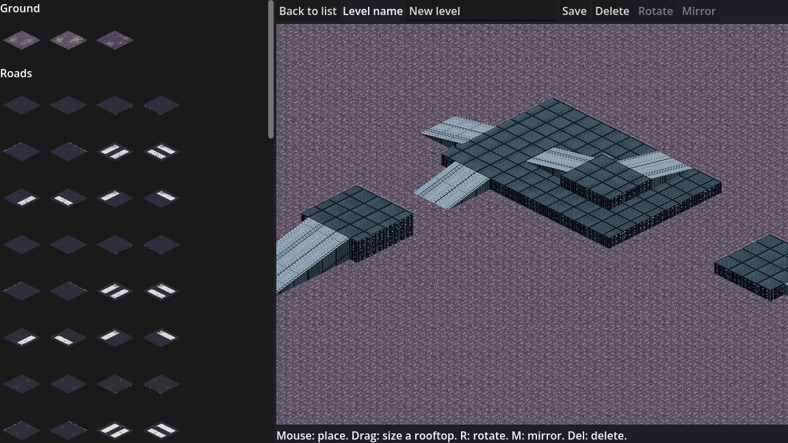

### Level creator: props

Task T-253 (Decisions, "Level creator piece set"). Every number here is the Level/Challenge Design Agent's **proposal for the board's playtest**. How it works and how to rebuild the placeholder art: `game/docs/level/level-creator-pieces.md`, "Level creator", "Props (T-253)".

- **The set** (category "Props", names from T-250): concrete barrier, traffic cones, crate stack, AC unit, water tank, roof vent, street lamp, rooftop sign. Footprints (north-facing, units): barrier 4 by 1, rooftop sign 4 by 1, water tank 4 by 4, the rest 2 by 2. Heights drawn: barrier 1.2, cones 0.9, crates 2.2, AC unit 1.5, roof vent 1.45, sign 3.3, tank 3.3, lamp 5.35.
- **Four rotations** (R steps north, east, south, west; the facing is the direction a small pale arrow on the placeholder points). East and west swap the footprint's two numbers. A prop goes on the 2 by 2 tile grid like the other pieces, is not refused for overlapping other objects, and is refused where its footprint would leave the map, reach into a building or stand across a rooftop's or ramp's edge (T-393, below).
- **Ground or rooftop:** a prop stands at the height under the centre of its footprint (the street, a rooftop, a ramp's slope), drawn lifted by it.
- **Solid obstacles:** each is a static body like a boulder: the car crashes into it (the combo is cut as for a boulder) and the minions and the kaiju are stopped by it; the enemies' paths close the cells it takes. Collision: a rectangle (the footprint) for the barrier, crates, AC unit and sign, a circle for the cones (radius 0.9), tank (1.8), roof vent (0.9) and lamp (0.4). Since T-405 a prop blocks the car only at its own heights, from the ground it stands on to its top ("Short buildings as platforms", below).
- **Placeholder look:** code-drawn boxes and cylinders (a top and two visible faces, a dark outline, none of Greenbull's colours), one sprite per prop and rotation. Everything about a prop is in `game/data/level/props.json` (footprint, collision, height, the sprite of each rotation and its anchor), so T-256's art changes only that file and the PNGs.
- **Saved levels** keep their props in a `props` list; `check_level.py` checks that each names a known prop and rotation, has the right turned footprint and lies inside the map.

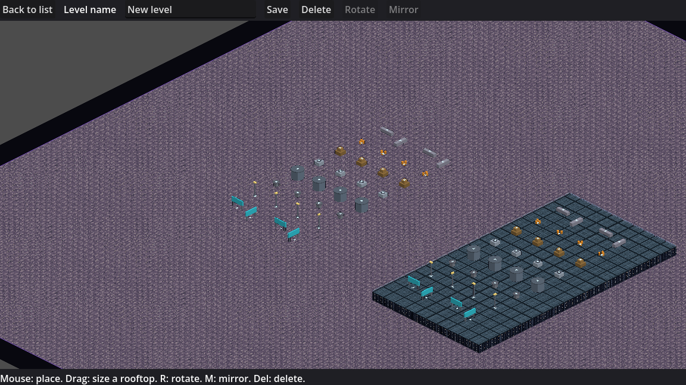

### Level creator: objects, heights and depth

Task T-393 (Decisions, "Obstacles and decorations respect the buildings' and rooftops' heights"). How it works in the code: `game/docs/level/level-creator-pieces.md`, "Props (T-253)", "Heights and depth of placed objects (T-393)".

- **Heights:** every placed object, the boulders and the eight props, stands at the height under the centre of its footprint: the street (0), a rooftop (3 or 6) or a ramp's slope, in the editor and in the run. Boulders used to stand on the street even on a rooftop; now they are lifted like the props.
- **Depth:** an object behind a building or a rooftop and overlapping it on screen is drawn under it; one in front of it, or standing on it, is drawn over it. The board's barriers by the low-rise were drawn over it on any level with rooftops, because the buildings' order there was read wrongly; that is fixed for every kind of object.
- **Edges (the Level/Challenge Design Agent's proposal for the board's playtest):** an object stands wholly on one surface. One whose footprint would reach into a building, or across the edge of a rooftop or a ramp, is not placed, with the same message as a piece that overlaps another ("Can't place here: it overlaps another piece."); touching a building or an edge is fine. The other way round, a building placed over an object, or a rooftop or ramp whose edge would cut through one, is not placed either; a rooftop or ramp placed wholly over an object lifts it to its height. Levels saved before keep what they have (the board's Kaiju City barrier inside its low-rise stays; since T-405 the low-rise is a platform, so it stands on its roof). Since T-405 "a building" here means a skyscraper: the short buildings are platforms and take objects like rooftops.
- **As before:** the game's own map and levels without rooftops draw their objects exactly as before.

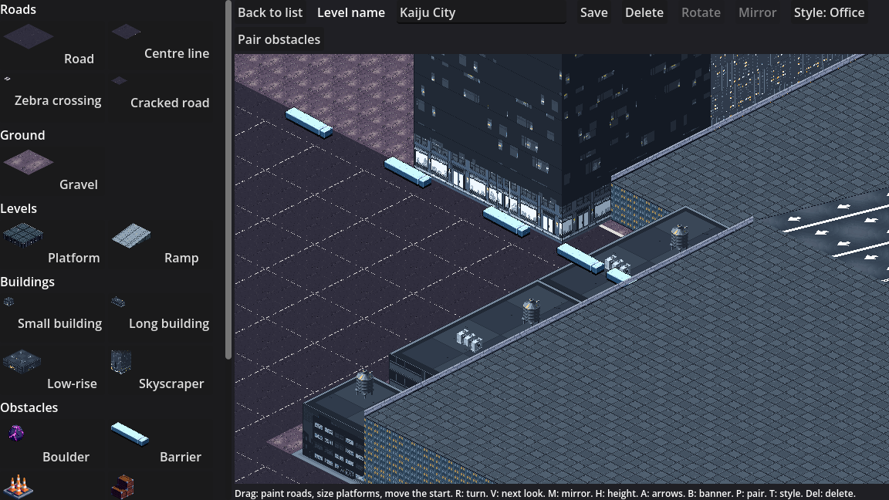

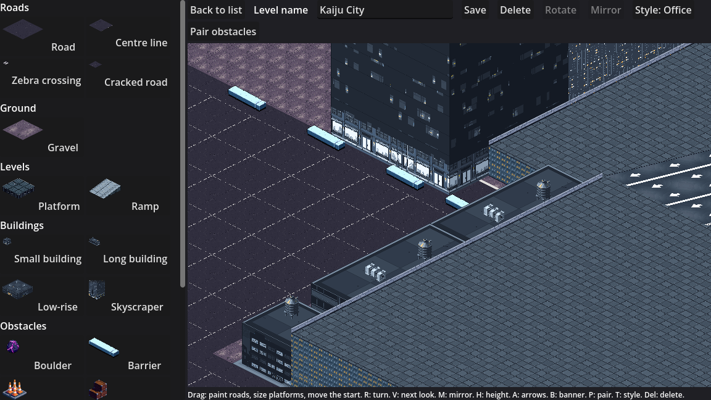

### Level creator: sidewalks, parked cars and meteor craters

Task T-398 (Decisions, "Sidewalks and parked cars in the level creator"; names from T-396 and T-401, "Level creator text" above). Placeholder art until T-399. The points marked as proposals are the Level/Challenge Design Agent's, for the board's playtest. How it works in the code: `game/docs/level/level-creator-pieces.md`, "Sidewalks, parked cars and meteor craters (T-398)".

- **Sidewalk (Ground):** pick it, press the left button on the map and drag, as with a road; a right-drag erases it, and Del erases the tile under the mouse. A proposal: it paints one ground tile (2 x 2 units) at a time, so a sidewalk can be one tile wide beside a road. It is never painted over a road, a building, a platform or a ramp. **The curb comes by itself** on every side where a sidewalk tile meets a road: straight curbs, outer corners (two sides) and inner corners (a road only diagonally next to it), and it follows the roads: painting or erasing a road next to a sidewalk changes its curb. 47 curb pieces in all.
- **In a run** the sidewalk is ground at the street's height; the curb is drawn on the tile, so the car drives up over it and back down with no crash and no slowing (a step under the 0.1-unit curb rule, Drifting, Decisions, "Curbs"). Enemies cross it like any ground.
- **Parked car and Broken car (Obstacles):** three parked models and two broken ones (a proposal); V steps the model ("Model {n} of {count}" under the looks), R turns the car through its four facings, top right, bottom right, bottom left, top left, named on the top bar ("Facing top right" ...). Each is a solid obstacle like a boulder: the car crashes into it and the combo is cut, the enemies go round it, and it can be paired or chained for thread the needle. It stands at the height under it (on a rooftop too) and is refused where it would reach into a building or across an edge (T-393). Proposals: a footprint of 2 by 3 units (3 along the way it faces), 1.35 units high (the broken ones 0.95), collision the whole footprint.
- **Meteor crater (Ground):** three models (V, "Model {n} of {count}"), placed with a click like a piece, one ground tile (2 x 2 units) each, drawn on the ground under everything else. Not an obstacle: the car drives over it with no crash, enemies cross it, and it never blocks the start. A proposal: it lies on the street only, so it is refused where it would reach onto a building, a platform or a ramp.
- **Saved levels:** a sidewalk is ground tiles like the roads (a tile per cell), the cars are props, and the craters a new `craters` list; `check_level.py` checks the craters (a known crater, its footprint, inside the map). Levels saved before open unchanged, and the game's own map has none of these pieces.

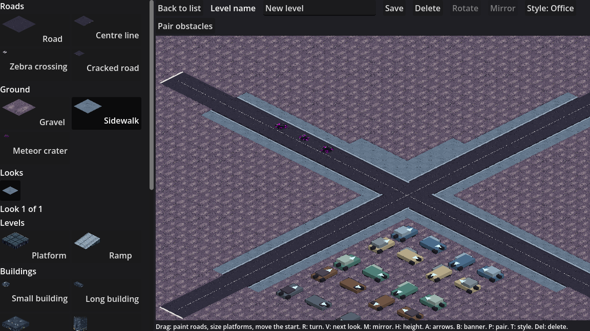

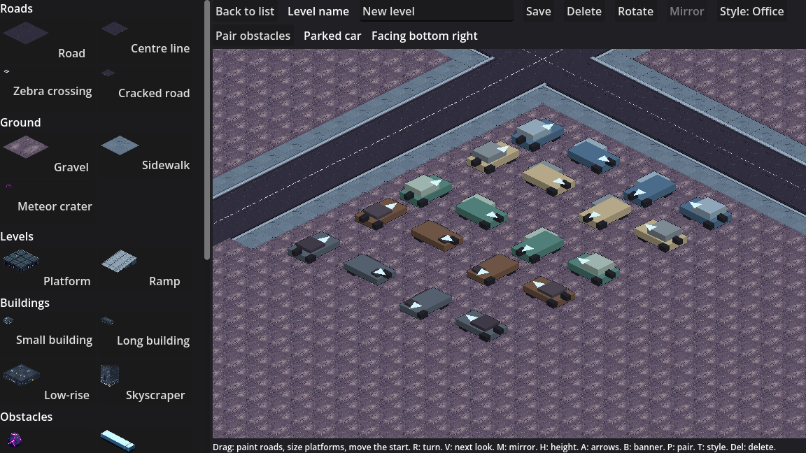

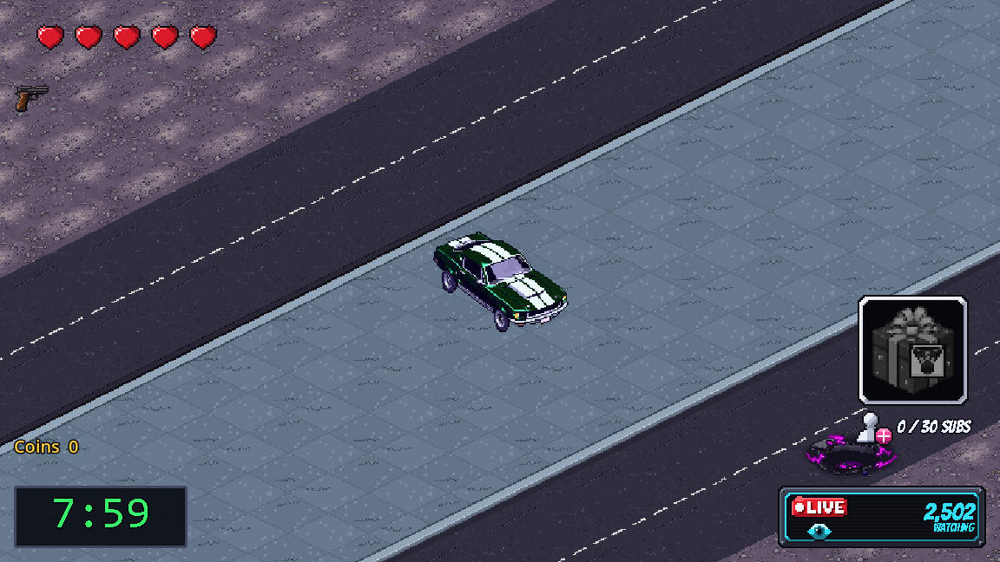

### Level creator: kaiju alert signs and banners

Task T-441 (Decisions, "Kaiju alert signs are level creator pieces"; the labels are T-440's, "Level creator text" above). How it works: `game/docs/level/level-creator-pieces.md`, "Kaiju alert signs and banners (T-441)". The art is T-130's (`game/art/banners/`), no new art. The points marked as proposals are the Level/Challenge Design Agent's, for the board's playtest.

- **Two pieces under Decoration:** "Alert sign" (the standing road-style sign) and "Alert banner" (the banner that hangs on a skyscraper's wall). Each comes in the two designs, chosen in the looks strip under the picked piece or with V: "Head in triangle" (the red triangle with the kaiju's head) and "Body in circle" (the red circle with its body); the strip names the chosen design.
- **The standing sign** goes on the 2 x 2 unit cell clicked, its post on the cell's middle, on whatever is there: the street, a rooftop or ramp, or a low-rise or small or long building (they are platforms), and it stands at that height (Decisions, "Obstacles and decorations respect the buildings' and rooftops' heights"). Its art has one view, so R does nothing; **M mirrors it** (a proposal: the kaiju then faces the other way). Like a prop, it is not placed where it would reach into a skyscraper or across a rooftop's or ramp's edge ("Can't place here: it overlaps another piece.").
- **The banner** goes on the skyscraper under the mouse (the nearest one drawn there), and on nothing else: over a platform, a low-rise, a small or long building, or the street nothing happens. **R chooses the wall** (the south or the east face, the two the view shows; "R: next wall." in the strip), and **H how high** its bottom hangs: 3, 6, 9, 12 or 15 units above the ground (a proposal: 3 is T-130's height, 15 keeps it below the tower's dissolving top; "H: next height." in the strip). Along the wall it is centred on the mouse, in half-unit steps, and always stays on the wall (a proposal). It looks as T-130's banners did: sheared onto the wall, flipped for the east face, part of that skyscraper's picture, so it fades with that skyscraper when the car is behind it and is drawn in its depth.
- **Preview, selecting, moving, deleting:** the piece is shown where it will go before the click (a banner only over a skyscraper). A click on a placed sign's or banner's picture selects it (outlined), and Delete removes it; moving one is deleting it and placing it again, as for the other pieces. Deleting a skyscraper takes its banners with it.
- **Pictures only:** neither has a collision; the car, the enemies and the kaiju pass through them.
- **Saved levels:** a new `alert_signs` list in the level file (a sign: its cell and design and whether it is mirrored; a banner: its skyscraper, wall, place along the wall, height and design). The run draws them exactly where the editor shows them. Levels saved before have none and open unchanged.
- **The fixed sign list is retired:** `game/data/level/kaiju_signs.json` (T-130's four banners and two standing signs at fixed places) is gone, and a map shows only the signs its own level places. The game's map, Kaiju City, has none until the board places them in the creator and the level is copied into the game.

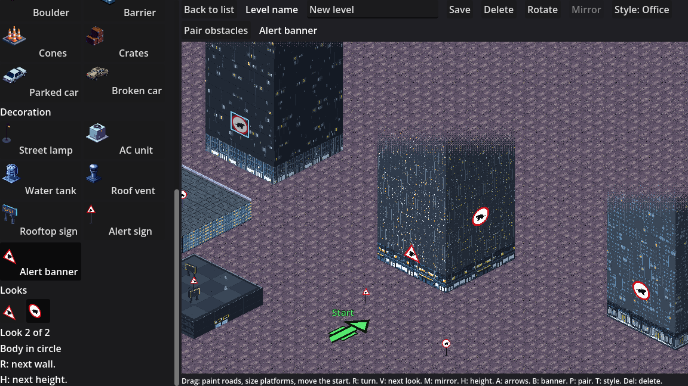

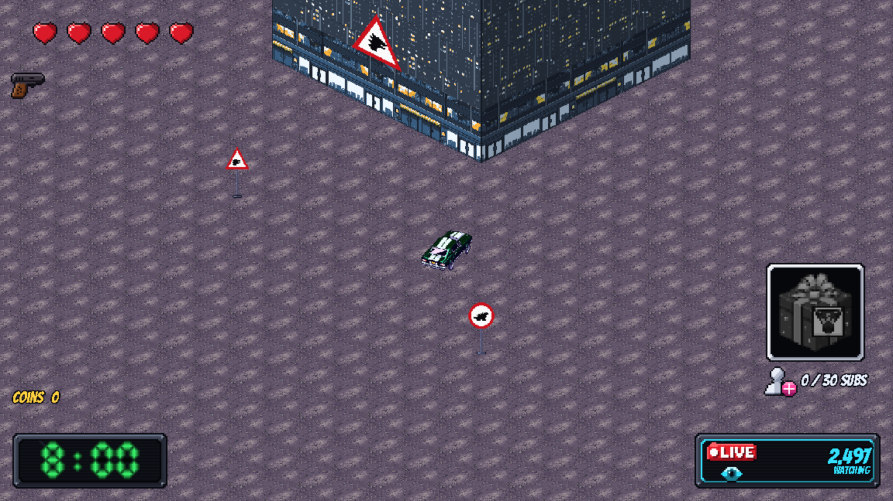

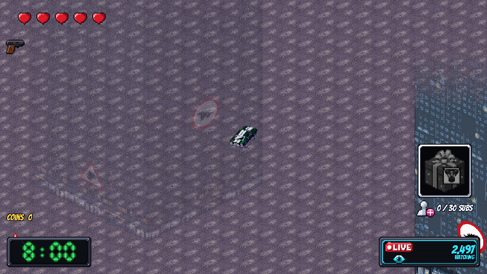

### Short buildings as platforms

Task T-405 (Decisions, "Short buildings become platforms"). How it works in the code: `game/docs/level/level-creator-pieces.md`, "Short buildings as platforms (T-405)". The art: Visual style, Content, "Short buildings as platforms".

- **Which buildings:** the low-rise (4 designs, 2 looks each), the small (6 by 6) and the long (12 by 6, turned 6 by 12) building are platforms at **height 3**. Only the skyscrapers stay solid buildings. Nothing changes in how they are placed, mirrored or saved: a level file still lists them under `buildings`, so every level saved before loads them as platforms.
- **Driving:** the car drives on a short building's roof like on a rooftop, reaches it by a 0-to-3 ramp (the creator links a ramp to it like to a rooftop at 3), meets its sides from the street as walls, and falls off its edges. A rooftop at 6 may stand on it.
- **Joins:** two short buildings side by side, or one beside (or overlapping) a 3-high rooftop, make one surface: the same height, so no bump and no wall, and no wall or roof edge drawn along the join. A parapet breaks where a ramp meets the edge, as on the rooftops. A short building beside a higher rooftop draws no wall or edge against it either.
- **Enemies** treat them as rooftops: they walk up the ramps onto them and drop off their edges (the enemies' paths, T-226).
- **Objects:** props and boulders go on them like on a rooftop, at height 3; one across a short building's edge, or across the join between two of them, is not placed (T-393's edge rule; a proposal: the join could be allowed later). The car's spawn point may stand on one.
- **See-through (proposal):** a short building fades while it covers the car behind it, as the rooftops do (the car on its roof, or in front of it, never fades it).
- **The game's own map:** each short building of its blocks (about one per block) is a platform on its 12 by 12 footprint; the block's other three slots stay solid skyscrapers with their pavement, and the pavement round the short building is open street (proposal: before, the whole block was solid). It has no ramp to them, so they are reached only from the air. The old MVP map without heights is unchanged.

**The altitude audit (proposals for the board's playtest).** Every collider of a level and how it works at height:

| Collider | How it blocks the car |
|---|---|
| Skyscraper (and a block's skyscraper slot) | A wall at any height, on the street, on a rooftop and in the air. |
| Map edge | A wall at any height. |
| Short building, rooftop | No body: its sides stop a car below its top (a car that drives into a 3 from the street bounces off its side); a car at or above its top drives or lands on it. |
| Ramp | No body: its sides stop a car below the slope; its foot and top end are open. |
| Prop (barrier, cones, crates, AC unit, water tank, roof vent, street lamp, rooftop sign) | Only from the ground it stands on (the height under its centre) up to its top (its drawn height): a car on a rooftop passes over a street prop at the rooftop's edge, a car in the air passes over a prop it clears, a car on the street never touches a prop up on a roof. |
| Boulder (placed, a meteor's) | The same, from its ground up by its diameter (3 units). |
| Spawn point | Not a body: the car starts at the ground's height there (a short building's 3 included). |

The car's own height model treats the car as its centre point (car_height.gd): a car that lands overlapping a prop or boulder keeps passing through it until it is clear of it rather than being pushed out (a proposal); T-411 (the car's whole footprint) would make the sides and edges meet the drawn car instead.

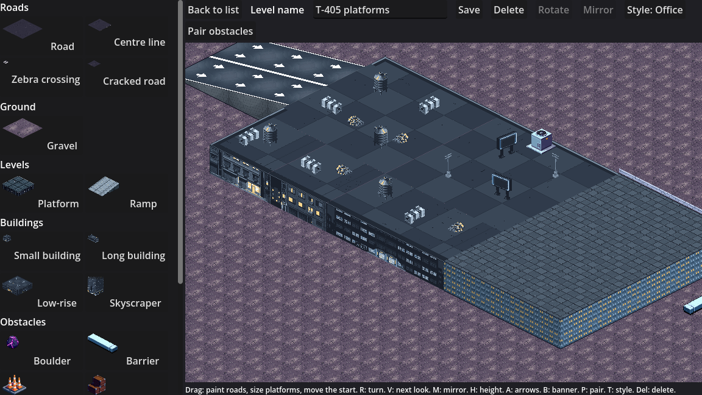

### Elevation test scene

The ground side of the elevation test scene (task T-182; Decisions, "Raised areas and ramps"). Every number below is a proposal for the board's playtest. Units are the flat world's (x east, y south).

- **Platform:** one raised platform, an axis-aligned rectangle of 16 by 16 units (proposal), 3 units high (proposal). The car can drive onto and across it.
- **Ramp:** one ramp on the platform's east side, 12 by 8 units (proposal), rising in a straight line from 0 at its foot to the platform's height at the platform's edge.
- **Drop-off edges:** the platform's other three sides, and its east side beside the ramp, are drop-offs: leaving the platform there is a step down of the platform's height.
- **Height data format:** `game/data/level/elevation_test.json` holds a list of platforms (rectangle and height) and a list of ramps (footprint, platform, the side it climbs, bottom and top height), so the map and the board's later level editor can add more. The file's fields and the query's functions: `game/docs/level/elevation-test-scene.md`, "Elevation test scene". The ramp's top is at the platform's side, and its foot is 12 units east of it (x from 8 to 20, y from -4 to 4; the platform spans -8 to 8 on both). The art drawn over them: Drifting, Content, "Elevation test scene".

### Elevation sample map

The drive-only sample map with three layers (Decisions, "Elevation sample map"). Every number below is a proposal for the board's playtest. Units are the flat world's (x east, y south).

**Height data** (task T-193). The map's heights are a list of areas a level editor can later edit, in the same format as the elevation test scene's file:

- **Platforms** (raised areas, the rooftops): each has an `id`, an axis-aligned rectangle (`x`, `y` = its north-west corner, `w`, `h`) and a `height` (3 for the first floor, 6 for the second).
- **Stacking:** a platform may stand on another (a second-floor rooftop on a first-floor one). It says so with an optional `on` field naming the platform under it; its whole rectangle lies inside that platform, and it is higher. Two areas may overlap only like that; any other overlap is a mistake. At any point the ground's height is the highest area's.
- **Ramps:** each has an `id`, the `platform` it climbs to, the `side` of that platform it climbs (`north`, `east`, `south` or `west`), a footprint rectangle next to that side (its top end on the side), a `bottom_height` and a `top_height`. The height rises in a straight line from the foot to the top. `bottom_height` is the ground at the foot: 0 for a ramp from the street, 3 for a ramp standing on a first-floor rooftop and climbing to a second-floor one. `top_height` is the height of the area it climbs to.
- **Drop-offs:** every side of a raised area without a ramp, and a ramp's own two sides, are drop-offs. From a second-floor rooftop onto the first-floor rooftop under it, the drop is 3; onto the street, 6.
- **Validator:** `python game/tools/check_height_data.py <file>` checks a height-data file before a map is handed over (overlaps, stacking, each ramp's top touching its area, its bottom and top heights matching the ground at its foot and the area it climbs to, its side). Every field and how to run it: `game/docs/level/elevation-sample-map.md`, "Elevation sample map".

**The layout** (task T-194). The MVP map ("MVP map" above: 240 by 240, the same roads, gravel centre, buildings and boulders) with two parking garages added. Every rooftop, ramp, size and position here is the Level/Challenge Design Agent's **proposal for the board's playtest**.

- **North-west garage** (proposal): a first-floor rooftop (height 3) over the top row's two west blocks and the road between them (x -96 to -12, y -96 to -66, 84 by 30). On its east block stands a second-floor rooftop (height 6, x -42 to -12, 30 by 30), whose north, east and south sides drop 6 straight to the street.
- **Ramps** (proposal): a 0-to-3 ramp climbs the first floor's south side from the road below it (x -86 to -76, y -66 to -54); a 3-to-6 ramp stands on the first floor and climbs the second floor's west side (x -54 to -42, y -86 to -76). Each is 12 units long per 3 units of rise (the elevation test scene's slope) and 10 units wide (the car is 1 by 3; roads are 24).
- **The drive:** street, up the first ramp onto the height-3 rooftop, east up the second ramp onto the height-6 rooftop, then off its east edge onto the road at x 0 (a 6-unit drop), or off its north or south edge.
- **South-east garage** (proposal): the same, turned half a turn around the map's centre (first floor x 12 to 96, y 66 to 96; second floor x 12 to 42; the 0-to-3 ramp on the first floor's north side, the 3-to-6 ramp on the second floor's east side).
- **Left out of the MVP layout:** the 4 buildings under the rooftops, and the 8 boulders on a rooftop, on a ramp or on the 6-unit strip in front of a ramp's foot (4 Two Boulders copies, so 1 challenge, kept off in the MVP, goes too). Everything else is the MVP map's, unchanged.

The file is `game/data/level/elevation_sample_map.json`, made by `python game/tools/build_elevation_sample_map.py` from `mvp_map.json` (which it doesn't change); how to rebuild and check it: `game/docs/level/elevation-sample-map.md`, "Elevation sample map", "The layout file (T-194)".

**The scene** (task T-196): `game/scenes/elevation_sample/elevation_sample_map.tscn`, drive-only (no enemies, weapons, run timer, likes, levels or HUD). It shows, in the isometric view, the MVP map's ground art, buildings (see-through), boulders and edge walls built from the layout file above; every rooftop and ramp of it with the elevation test scene's script drawing as a placeholder (the art is a later ticket); the car with its final sprite lifted by its height and its round shadow on the ground under it, with its real height on the rooftops and ramps; and the camera following as in the elevation test scene. W/A/S/D drive.

- **Start** (proposal): on the road at (-81, -50), facing north, 4 units from the foot of the north-west garage's 0-to-3 ramp, so W drives straight up it.
- **How the board opens it** (proposal, an open question below): like the elevation test scene, open the scene in the editor and press F6, or the run command in `game/docs/level/elevation-sample-map.md`, "Elevation sample map", "The scene (T-196)". No main menu button.
- **Depth order** (task T-197): every rooftop, ramp and building is drawn in one back-to-front order with the others: a second-floor rooftop over the first-floor one it stands on, a ramp standing on a rooftop over that rooftop, and otherwise whatever lies wholly west or north of another (the far sides on screen) under it. The car and its shadow are drawn under any rooftop, ramp or building they are behind and lower than its top, and over the ones they are on, above or in front of: on a height-3 rooftop behind a height-6 one, the car is over the first and under the second; in the air above 6 it is over both. As in the elevation test scene (T-191), "behind" is judged by the car's centre, so a car driving into a rooftop's back side (top-left or top-right on screen) stays under it through the hit, with no popping over it. How it works: `game/docs/level/elevation-sample-map.md`, "Elevation sample map", "Depth order and see-through (T-197)".
- **See-through** (task T-197; Decisions, "Raised areas turn see-through like buildings"): every rooftop and ramp that covers the car fades exactly like the buildings ("When a building fades"), with the buildings' own fade, not a copy; the others stay solid. The buildings keep fading as on the MVP map, judged against the car drawn at its height.

**The run on this map** (task T-206; Decisions, "The elevation sample map becomes the run's map"): a run started from the main menu plays on this layout, with the rooftops, ramps, the car's height, its round shadow, its shadowless frames in the air, see-through and the depth order exactly as in the drive-only scene (the same code, `game/scripts/level/elevation_layer.gd`), and with the whole run on top: enemies, weapons, the timer, likes and levels, the gift pack drop and the kaiju. The drive-only scene stays as it is (F6). Proposals for the playtest:

- **Start:** the run's start is unchanged, the centre of the gravel square (0, 0), nose north; the gravel square is the MVP map's and lies at street level on this layout.
- **Enemies, coins, pickups and effects** are drawn at street level (height 0) in the depth order: under a rooftop or ramp that covers them, like the car on the street. Gift packages, meteors and other things that look for an open spot on the ground only pick street-level spots (no rooftop or ramp). One exception, the gift package (T-402; Decisions, "A gift pack that falls on a platform shows on it"): when no street spot is open within its search, because the car is well inside a large rooftop, it lands on open, flat ground of that rooftop, drawn at the rooftop's height and picked up there (Game loop architecture, "The gift pack drop"). Every pickup (gift package, coin, health pickup) is drawn and picked up at the height of the ground it lies on: on a rooftop only from the rooftop, never from the street below (board, 2026-10-30, T-402). How enemies deal with heights is task T-207's.
- **The car's drift smoke and boost** are lifted with the ground under the car, so on a rooftop they stay at its tyres; in the air they stay on the rooftop or street under it.
- **Switching back to the MVP map:** one constant, `USE_ELEVATION_MAP` in `game/scripts/run/run.gd` (`game/docs/game-loop/the-run.md`, "The run").

**The art** (task T-198; proposal for the board's playtest): the rooftops are building rooftops with the city's lit-window walls, and the ramps parking-garage ramps of concrete with painted lane lines. What was generated, and the weak results: Visual style, Decisions, "Elevation sample map art, what T-198 made"; how it is built: `game/docs/level/elevation-sample-map.md`, "Rooftop and ramp art (T-198)".

**The scripted drive** (task T-195): `bash game/tools/drive_elevation_sample.sh` drives the real car from the street up the 0-to-3 ramp, up the 3-to-6 ramp and off the height-6 edge, and prints the layers reached, the maximum height and the airtime. What it checks and its log: `game/docs/level/elevation-sample-map.md`, "The car's height on the three layers (T-195)"; the behaviour: Drifting, Content, "Elevation sample map".

**The final screenshot set** (task T-199, final art) is in `art-archive/T-199/screenshots/`: `street.png`, `ramp-0-3.png`, `ramp-3-6.png`, `height-3.png`, `height-6.png`, `air.png`, `behind-height-3.png`, `behind-height-6.png` and `city-overview.png`.

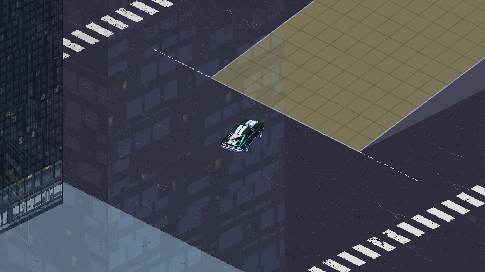

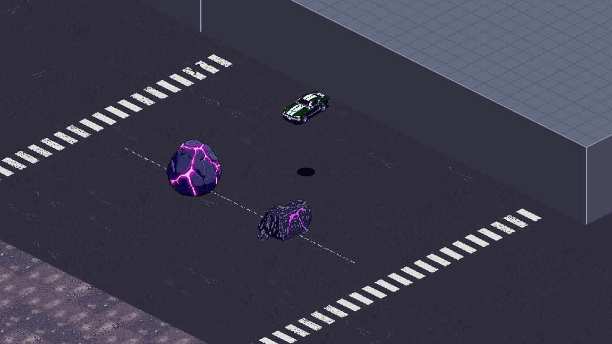

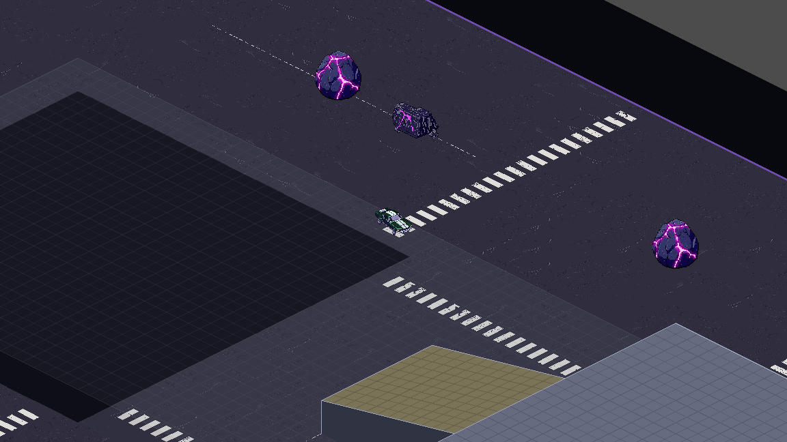

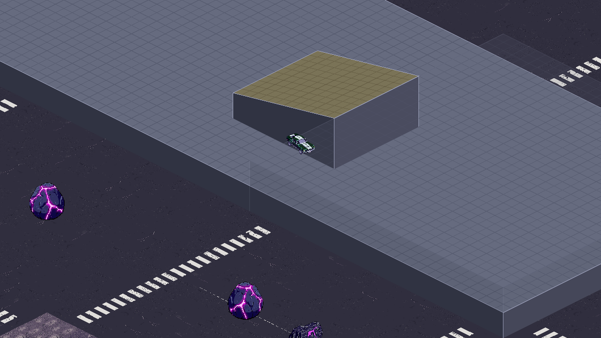

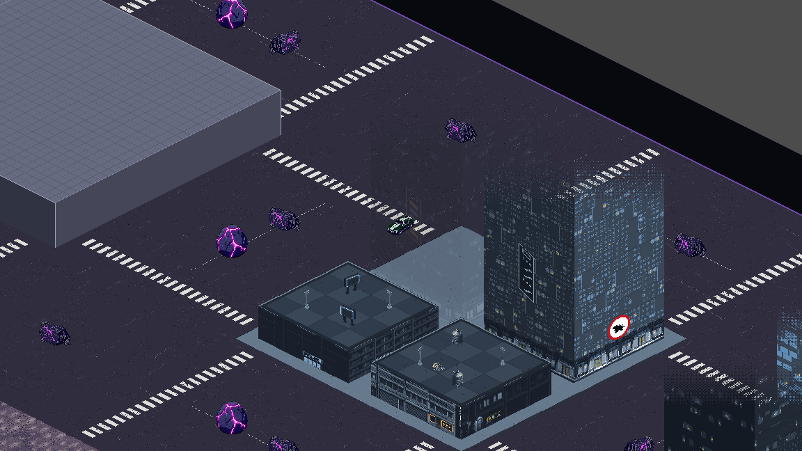

## Open questions

- How the board opens the elevation sample map (T-196). Proposed: as the elevation test scene, the scene in the editor with F6, or the run command in `game/docs/level/elevation-sample-map.md`; no main menu button (a button would need its text from the Narrative Theme Agent, in a new ticket).

- (After MVP) Pavements along the building blocks (board, 2026-10-12): how wide, whether they take room from the blocks or the roads, and whether the car can drive on them. Partly answered (board, 2026-10-14): in the MVP every building asset has a pavement drawn around it, inside its block, so it takes no room from the roads and the car cannot drive on it (Visual style, Decisions).
- (After MVP) The board plans to draw future maps by hand, and may explore generating a new map for every run.

## References

- The board's challenge drawings: `docs/level-design/` (Content, "MVP challenges"). They are exported from Crash City Grid with `python tools/export_challenge_drawings.py <folder of downloaded drawings>`.
- Drivability check (task T-021): `game/tools/check_challenge.sh`, explained in `game/docs/level/challenge-check.md` ("Challenge drivability check"). The lines the car drove on the board's sketches: [Single Boulder, arrow 1](level-design/single-boulder/arrow-1.driven.svg), [Single Boulder, arrow 2](level-design/single-boulder/arrow-2.driven.svg), [Two Boulders, arrow 1](level-design/two-boulders/arrow-1.driven.svg) (data in the `.driven.json` next to each).
- The MVP map's layout data (Content, "MVP map"): [../game/data/level/mvp_map.json](../game/data/level/mvp_map.json), with the buildings, ground cells, pattern copies, boulders and challenges (arrow points and centre lines) in units from the map's centre. It and the fitted patterns are made with `python game/tools/build_mvp_map.py`; how to open the map in Godot: [../game/docs/level/mvp-map.md](../game/docs/level/mvp-map.md), section "MVP map".
- Crash City Grid, the map editor the board and the Project Lead draw the map in: https://claude.ai/artifact/R9AUtdNttfHKNgeqGDCPAH (private to the board). Each map is saved as an 80 by 80 grid of cells, plus its boulders, pattern groups, challenges and arrow paths, in units from the map centre; the Project Lead reads it and copies what the Level/Challenge Design Agent needs into its tasks.
