# Solid Carbide: Long GDD

The whole game design in one document, condensed from the game area docs in this folder: each chapter is one game area doc's Summary, Decisions, Content and References. Open questions stay in their own game area docs.

**Generated, do not edit by hand.** Change the game area doc instead, then regenerate with `python tools/generate_long_gdd.py`. The short GDD condenses this document (`short-gdd/`).

## Contents

1. [Game loop architecture](#1-game-loop-architecture)
2. [Drifting](#2-drifting)
3. [Level design](#3-level-design)
4. [Enemies](#4-enemies)
5. [Weapons](#5-weapons)
6. [Garage design](#6-garage-design)
7. [Visual style](#7-visual-style)
8. [Extended narrative](#8-extended-narrative)
9. [HUD and menus](#9-hud-and-menus)

## 1. Game loop architecture

*Source: [game-loop-architecture.md](game-loop-architecture.md). The overall flow of the game. Short, and reworked if the loop changes (not expected).*

Solid Carbide is played in 8-minute runs. The player only drives: drifting earns XP, each level-up brings a weapon choice, weapons fire on their own at the enemies swarming in, and enemies drop coins. At 7 minutes the kaiju arrives, and the player has the last 60 seconds to defeat it; it can be damaged at any time. Between runs, the player is back at the main menu, where the Garage spends coins on permanent car upgrades, and Start begins the next run.

### Decisions

- A run lasts 8 minutes.
- The player only drives. The car's weapons fire automatically.
- Enemies come in from the edges of the screen, in numbers that grow over the run (how they scale: Enemies, Decisions).
- XP comes only from driving, never from kills. In the MVP it comes from drifting only, since challenges are left out of the MVP (Level design, Decisions); if they come back, completed challenges give XP too.
- **Combo:** tricks (Drifting, Decisions) raise a combo multiplier, and the multiplier multiplies all XP gained (from challenges and from drifting). Each trick adds to the multiplier: extended drifts a little, a 360 more, an alternate drift the most. Colliding with anything, enemies included, cuts the combo by 50%. If no trick follows within 2 seconds, the combo drains away quickly. The Game Data Agent proposes the numbers; the board judges them in playtests. The XP from drifting seconds stays as it is, alongside the extended-drift trick. Part of the MVP.
- The higher the combo, the more enemies spawn (how: Enemies, Decisions). The board will judge in playtests whether to keep this.
- A drift that lasts longer than 1 second gives XP for every second it lasts, the first second included (a 3-second drift gives 3 seconds' worth).
- Each second of drifting gives a fixed amount of XP: 10% of the XP bar at level 1. The amount does not grow with the bar, so at higher levels it is a smaller share of the bar and drifting gives only a little XP.
- **Likes drain:** when the player isn't doing tricks, the likes bar empties, but never below the start of the current level, so the player never loses a level. It starts once the combo has fully drained, and any trick stops it. The speed is the board's playtest value, 8% of the current level's bar a second (four times the first proposal; the number: [game/data/run.json](../game/data/run.json)). Part of the MVP.
- "Drifting", for XP, uses the Unity prototype's definition: any moment W or S is held together with A or D (Unity prototype report, section 3).
- After the MVP, if challenges come back (2026-10-11): at level 1, completing one challenge fills the XP bar: the player reaches level 2 and gets the weapon choice.
- How much XP challenges and drifting give at each level, and how much XP each level needs, is worked out by the Game Data Agent as sensible XP scaling, within the decisions here.
- The weapon choice opens only when the XP bar fills and the player levels up (how many weapons are offered: Weapons, Decisions). The weapons chosen reset at the start of every run.
- **Gift pack drop** (board, 2026-10-16; tasks T-144 to T-146): the level-up screen no longer just appears. When the player levels up, a helicopter sent by Greenbull (first Redgull) flies over the screen and drops a package carrying Greenbull's brand (the gift pack). When the player drives over the package, the level-up screen (the gift pack screen) opens. The look of the helicopter and the package: Visual style, Decisions. The run keeps going while the helicopter comes and the package waits; it pauses only when the screen opens. The package lands a short way ahead of the car, on open road, and stays until picked up. One package per level-up, each opening its own screen. When a landed package is off screen, an arrow at the screen edge points to it.
- **A falling gift pack shows its shadow** (board, 2026-10-30): while the gift pack falls, a shadow on the ground (or the platform) where it will land shows the player where it is coming down, the same shadow the car casts when it is in the air. (T-407)
- After the MVP, if challenges come back (2026-10-11): completing a challenge flashes a score, the likes it gave, and gives XP.
- Enemies drop coins. The coins collected in a run are kept whether the run is won or lost.
- At the 7-minute mark the kaiju spawns. It moves slowly toward the player, deals contact damage, and can be damaged at any time (Enemies, Decisions).
- Win: defeat the kaiju within the final 60 seconds. Loss: the car's HP reaches 0 at any point, or the kaiju survives the timer.
- Between runs, coins are spent in the Garage on permanent car upgrades that improve the car in the next run (which upgrades: Garage design, Decisions).
- The game opens on a main menu with three buttons: Start (begins a run), Garage, and Exit. When a run ends, win or loss, the player returns to the main menu (through the recap screen, below).
- The final release adds a recap screen right after a run ends, win or loss: how many of each enemy type the player killed, and other stats the board will choose (task T-017). In the MVP there is no recap: the run ends at the main menu.
- The final release adds local co-op for 2 players (screen split in halves) and 4 players (screen split in quarters). The MVP is single-player.
- **Music** (board, 2026-10-20): the board's own two tracks, "DEMO BEAT 1 (ANDY GAME)" and "DEMO BEAT 2 (ANDY GAME)" (made by the board; the music is human-made), play through the whole game, menus and runs alike, without stopping between screens: one track, then the other, alternating and looping. Its volume is the pause screen's music volume slider (HUD and menus, Decisions). Built in T-209: one music player, a child of the game flow, so the screens changing never restarts it; it plays on its own "Music" bus, and the setting is `music_volume` in `game_settings.gd` (0 to 100, saved with the SFX volume, starting at 40 as a proposal for the playtest). (tasks T-209, T-210)
- **Pickup magnet** (board, 2026-10-21): coins, level-up gift packs and health drops are pulled towards the car once they are within a radius of 1 car length, so they are easier to pick up. The radius is a garage upgrade (Garage design, Decisions). Built in T-222: the radius is 3 units (the car is drawn 3 units long, Drifting, Decisions), read from `run.json`'s `pickup_magnet`, and pickups fly to the car at 30 units per second (proposals for the playtest: the pull speed, and the reach measured on the flat map); since T-402 it pulls only pickups on the level the car is on (the ground under the car), so nothing is pulled up or down a rooftop's wall, and a pulled pickup is drawn at the height of the ground it crosses (proposal for the playtest); `game/docs/game-loop/gift-pack-and-pickups.md`, "The pickup magnet (T-222)". (T-222)
- **An arrow for every gift pack on the map** (board, 2026-10-28): every gift pack on the map gets its own arrow, the same arrow that today points at a landed package off screen, so several arrows show when several packages are out. (T-314)
- **A crash pays the trick in progress** (board, 2026-10-28): when a crash breaks the combo, the player still gets the trick they were doing up to that moment (a drift pays for the time it lasted), instead of losing it. (T-315)
- **Time's up screen** (board, 2026-10-28): when the 8-minute timer runs out (the kaiju survived it, a loss), a 3-second animated failure screen plays before the run ends. Its text: HUD and menus, Content (T-316). (T-317)
- **Recap screen in the MVP** (board, 2026-10-28; replaces "In the MVP there is no recap" above): after a run ends, the player sees a recap of the run: the enemies slain, the tricks completed, the highest combo multiplier reached and the weapons used, each shown with pictures where it can be (the enemies' and weapons' own art). Its text: HUD and menus, Content (T-318). (T-319, T-320)
- **Wrecked: the stream keeps rolling** (board, 2026-10-29; replaces the time's up screen's proposal that losing all health ends the run as before): when the car loses its last heart, the run doesn't end at once. The controls go dead, the car keeps whatever movement it had and slides or rolls to a stop, and it sits there crashed, smoking and burning (pixel art smoke and flames), for **3 seconds**, with the stream (the HUD, the live viewers) still on screen. It is like the end of a stream that doesn't cut away. Then the recap screen shows. No text. (T-360, T-361)
- **A health pickup revives a wrecked car** (board, 2026-10-30): while the car is wrecked and still sliding, if it comes within a health pickup's pickup range (its magnet), it picks it up and comes back with **1 heart**: the controls return, the smoke and flames stop and the run goes on; the recap does not show. Whether the usual 1-second invulnerability follows, and what happens to the combo and the live viewers, are proposals for the playtest. (T-406)
- **The recap always closes a run** (board, 2026-10-29): every run ends on the recap screen (a win, the time's up screen, the wreck), and the player leaves it with a Continue button or an X at the top right, both to the main menu. (T-320)
- **The runs list** (board, 2026-10-29): each run's recap stats are saved on this computer, and a new button on the main menu opens a list of the player's past runs. Its text: HUD and menus, Content (T-362). (T-363, T-364)
- **More gift packs, earlier** (board, 2026-10-28): the early levels need fewer likes, so the first gift packs come more often at the start of a run. The new curve is the Game Data Agent's proposal for the playtest, built in T-328: 30, 45, 65, 95, 140, 200, 290, 400, 560, 745 and 931 likes for levels 2 to 12 (total 3,501, was 4,255); the table and reasons are in Content, "Likes and levels". (T-328)
- **A crash cuts the combo by 50%** (board, 2026-10-28; replaces the 80% in "Combo" above): a collision or any damage to the car cuts the part of the multiplier above "no combo" by 50% instead of 80%, so the player keeps half of their combo bonus (x4 becomes x2.5). (T-329)
- **A bigger gift pack helicopter** (board, 2026-10-28): the helicopter that drops each gift pack is drawn 30% larger on screen than today (about 125 x 104 drawn pixels instead of 96 x 80), with the same art. The package still hangs clear of its belly. (T-330)
- **The combo shows as live viewers** (board, 2026-10-28): the combo multiplier keeps working exactly as it does (tricks raise it, crashes cut it, it drains, it multiplies what drifting earns), but the player sees it as the stream's live viewers instead of "Combo x2.00": about 20,000 at x2 and 1,000,000 at x6 (the board's anchors), on a smooth curve between them (and below x2, a proposal). The number behaves like a real stream's: it counts towards its value and keeps moving a little. The higher it is, the hotter it looks, and over a million it is on fire. (T-332, T-336)
- **Subs instead of likes** (board, 2026-10-28): what the player earns toward the next gift pack is **subs** (the stream's subscribers), not likes: drifting brings subs, the viewers multiply them, each full **sub goal** sends a gift pack, and the drain is people unsubscribing when the stream gets dull. Only the name and the look change; the numbers and rules of the likes stay (the likes bar becomes the sub goal: HUD and menus, Decisions). Extended narrative, Decisions, "Subs". (T-331, T-337)
- **Hearts instead of health points** (board, 2026-10-28): the car has **5 hearts**. A minion's hit and a meteor take 1 heart, the kaiju's 2. After any hit the car is invulnerable for **1 second**, blinking, so the player can escape a swarm; hits during that second do nothing and don't cut the combo. A health pickup heals 1 heart, and drops at half today's chance (15%, Enemies). The garage's car health upgrade adds 1 heart per level (Garage design). (T-333, T-334, T-338) Numbers (T-333, `game/data/run.json` `car`): `starting_hearts` 5, `invulnerability_seconds` 1.0, `blink_interval_seconds` 0.1 (a proposal: each on or off phase of the blink). The old `starting_health` 100 is gone. Built in T-334 ([game/docs/game-loop/the-run.md](../game/docs/game-loop/the-run.md), "Hearts and the invulnerability (T-334)"); proposals for the playtest: a hit during the second also gives **no knockback** (so the car drives out of the swarm), a hit ignored during it does not restart the second, and the blink starts with the car hidden, so the hit shows at once.
- **The tutorial slides come between Start and the run** (board, 2026-10-29; the slides, their text and the "Don't show again" checkbox: HUD and menus, Decisions, "Tutorial slides before the first run"): the main menu's Start shows the tutorial slides first, and the run begins (its clock starts at 8:00) only when the slides' own Start is pressed. If "Don't show again" was ticked then, that is saved, and every later Start, also after restarting the game, goes straight into the run. The pause screen's Restart starts a fresh run directly, without the slides. (T-382, T-387)
- **A red flash when the car takes damage** (board, 2026-10-30): when the car loses a heart, it flashes red, so the hit reads at once. How it fits with the invulnerability blink, its length and its shade of red are proposals for the playtest. The same red flash shows on enemies when they take damage (Enemies, Decisions). (T-403) Built in T-403 ([game/docs/game-loop/the-run.md](../game/docs/game-loop/the-run.md), "The red hit flash (T-403)"); proposals for the playtest (`game/data/run.json` `hit_flash`): `seconds` 0.4 and `color` [1.0, 0.25, 0.25] (a multiply tint). The car is hidden for the first 0.1 s of the blink, so the flash shows as red on the next two visible phases (0.1 to 0.2 s and 0.3 to 0.4 s), then the plain blink goes on; a hit ignored during the invulnerability does not flash.
- **The wreck decides the loss at its end** (board, 2026-10-30, audit; replaces "The loss is decided at once" and "a kaiju kill can no longer turn it into a win" in Content, "Wrecked"): the run is lost only when the wreck's 3 seconds end and the recap shows. Until then a health pickup revives the car (T-406): the clock runs again, the controls return and the loss is undone; a trick in progress at the wreck is dropped, not paid. A kaiju kill during the wreck wins the run. Coins and health pickups are pulled in and count as usual. Restart or Exit from the pause screen during the wreck cancels the run: no coins kept, no runs-list entry. Which weapons keep working during the wreck: Weapons, Decisions.
- **A tie goes to the player** (board, 2026-10-30, audit): if the kaiju dies on the same step the clock reaches 0:00, the run is won.
- **A health pickup at full hearts stays** (board, 2026-10-30, audit): with full hearts the car doesn't pick a health pickup up, and the magnet doesn't pull it. Built in T-415 (`health_pickup.gd` `wants_health()`, `pickup_magnet.gd`): a health pickup is taken only below full hearts, or during the wreck (it revives the car); it waits where it lies, and is taken once the car is hurt.
- **Hits close together cut the combo once** (board, 2026-10-30, audit): a collision within 0.5 seconds of the one that cut the combo doesn't cut it again (0.5 s is a proposal for the playtest). Built in T-415 (`combo.json` `collision_window_seconds` 0.5, `run_state.gd` `_cut_combo()`, on the run's clock); a new run clears it. Proposals for the playtest (T-415, not the board's yet): the window starts only when a collision really cut the combo, a collision inside it does not start a new one, and the crash still pays its trick in progress (`crashed`) as before.
- **The garage adds to run.json's base** (board, 2026-10-30, audit; T-415): the run's starting hearts and the magnet's radius are stored in `run.json` only (`car.starting_hearts`, `pickup_magnet.radius_units`). `garage.json` stores for those two upgrades only each level's `bonus` (no `base_value`, no absolute `value`); `RunState.start_run()` adds the bonus to `run.json`'s base, and `GarageData.value()` (the garage screen) is that same sum. Changing the base in `run.json` changes both the run and the garage screen.
- **Closing the game mid-run** (board, 2026-10-30, audit): ~~closing the window during a run ends it as a loss: its coins are kept and it goes in the runs list~~ (replaced the same day by "Restart, Exit or closing cancels the run", below). Switching to another window pauses the game. How it works (T-416): losing focus opens the pause screen, except during the level-up choice and the time's up screen, where pause is already blocked, and outside a run (proposal for the playtest: no auto-resume when focus returns, the player resumes with Escape).
- **Restart, Exit or closing cancels the run** (board, 2026-10-30, after playing build I: "I told you to CANCEL the run, NOT SAVE it if it gets restarted or quit"; "coins are lost too, nothing saved"): Restart or Exit on the pause screen, and closing the game window, at any point of a run (the wreck included), cancel it: the coins picked up in it are lost, nothing goes into the run history, and no recap shows. Replaces the coins kept by Restart and Exit (Content, "Restart and Exit on the pause screen", T-327), and the loss with coins kept on closing (above). (T-416)
- **Mission packs** (board, 2026-10-31): besides the subs (which give weapons through the level-up gift pack), a run has **missions**, shown one at a time on the **left side** of the screen as a pixel-art **notebook page**. A mission is one or more **mission goals** (for example "thread the needle 3 times"); each goal has a checkbox, a quantity goal shows its progress (for example "2/4 Alt drifts"), a duration or other goal shows none, and a goal is crossed off when completed. When every goal of a mission is done, the mission is completed and the next one appears. Missions are for **one run only**: they start over from the first mission every run. There are **30 missions** a run. The **first 5 are always the same**, in this order: (1) drift for 2 seconds continuously (the board, 2026-11-01; was 4); (2) perform 10 alt drifts; (3) get 3 seconds of airtime; (4) perform 3 air 180s; (5) perform an air 360. **Missions 6 to 30 are generated at random each run** from combinations of the tricks and their amounts; the generator's rules (which tricks, how amounts grow, how many goals per mission) are the agents' proposal for the board's review. Airtime from the Jump power-up counts towards the airtime and air-trick goals (board, 2026-10-31). A completed mission gives a **driving power-up gift** instead of a weapon: like the level-up gift pack, it pauses the run and offers **2 choices** (a new power-up or the next tier of one the car has), on an overlay similar to the weapons' gift menu but clearly distinct, to show these are driving power-ups, not weapons. The power-ups: Drifting, Decisions, "Driving power-ups". (goal G-009)

### Content

#### One run

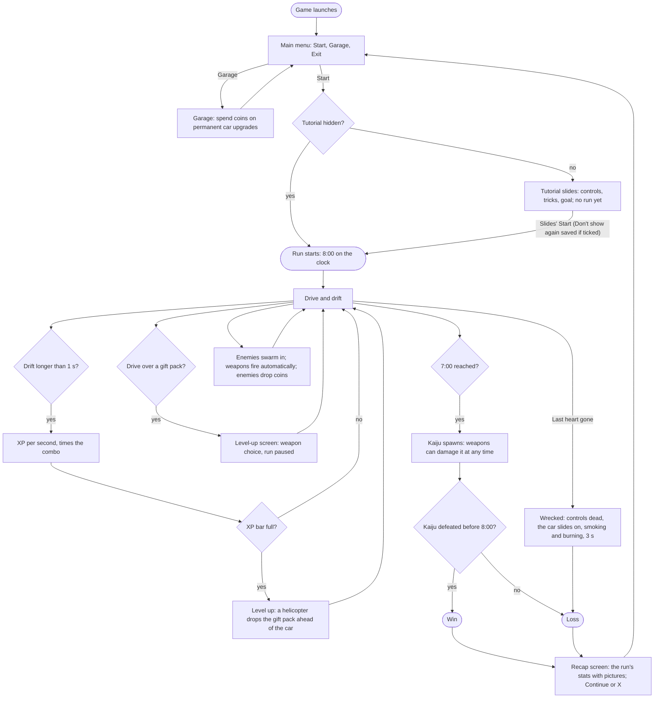

#### The run scene

The run is one Godot scene (task T-036; how to use it: [game/docs/game-loop/the-run.md](../game/docs/game-loop/the-run.md), section "The run"). It loads the run's map and puts the drift car (Drifting) on it, at the centre of the map, in the gravel square, with the camera following the car in the isometric view, as in the drift prototype.

The run's map (task T-206; Level design, Decisions, "The elevation sample map becomes the run's map") is the elevation sample map's layout with its rooftops and ramps (Level design, Content, "Elevation sample map", "The run on this map"): the car has its height there, and everything else in the run (enemies, weapons, pickups, coins, the HUD, the pause screen) works on it as on the MVP map. The MVP map (Level design, Content, "MVP map") stays in the project; one constant in the run switches back to it ([game/docs/game-loop/the-run.md](../game/docs/game-loop/the-run.md), "The run").

The run owns its state: the clock (8:00 counting down, stopping while the game is paused), the car's health in hearts (starting at the value in [game/data/run.json](../game/data/run.json), plus the garage upgrade's hearts; Decisions, "Hearts instead of health points"), and the coins collected in the run. Other parts of the game plug into it:

- At 1:00 left the run sends "boss time"; the kaiju spawns on it (Enemies).
- Enemies damage the car and add coins through the run; the kaiju's death ends the run as a win.
- The car reaching 0 hearts, or the clock reaching 0:00, ends the run as a loss. At 0 hearts the car is wrecked first, for 3 seconds (Wrecked, below).
- Either way, the run sends one "run ended" signal with the result and the coins collected, which are saved (Garage design).
- The HUD reads the time left, the health and the coins from the run (HUD and menus).

#### Likes and levels

The run also owns the likes (XP) and the level (task T-037; how to use it: [game/docs/game-loop/the-run.md](../game/docs/game-loop/the-run.md), section "The run"; the numbers: [game/data/run.json](../game/data/run.json)):

- Every completed challenge, preset or the kaiju's meteor challenges, gives the current level's challenge XP, and the run sends a "score" signal with it for the challenge popup.
- The run follows the car's drift state step by step: once an unbroken drift reaches 1 second it gives the drift XP for that second, then for each further full second.
- When XP reaches the level's threshold the level goes up (leftover XP carries over, so one gain can give several level-ups), and the run sends "level up" with the new level. At the top level the bar stops.
- On every level-up the run plays the level-up effect: a burst of pixel particles from the car, following it while it plays (task T-112; the look: Visual style, Decisions, "Level-up effect"). Several level-ups in the same moment show as one burst, and the burst keeps playing while the run is paused for the weapon choice.
- The HUD reads the XP, the level's threshold and the level, with a signal whenever they change.
- A level-up does not pause the run by itself: it sends the gift pack (below, task T-144). The run pauses (clock and car) when the car drives over the gift pack's package and the level-up screen opens (task T-052), until the weapon choice is made, one choice after another when several packages are picked up at once.
- **Likes drain** (task T-115; the speed: [game/data/run.json](../game/data/run.json), `likes_drain`, task T-114): once the combo has fully drained back to "no combo", the XP in the current level goes down, stopping at the start of the level, so the level never goes down. Any trick raises the combo and stops it; it starts again once the combo has drained again. It stops while the run is paused (pause screen, level-up screen) and after the run ends. At the top level there is nothing to drain. The HUD's likes bar follows it, so the bar visibly empties.
- **The curve (T-328, proposal for the playtest; the numbers: `levels` in [game/data/run.json](../game/data/run.json)):** the early levels need far fewer likes so the first gift packs come quickly, and the last two levels are unchanged. One drift second is 10 likes at x1, so the seconds below are drift seconds at that combo (a drift pays whole seconds only):

  | Level up to | Likes needed | Seconds at x1 | at x2 | at x4 | Likes in total |
  |---|---|---|---|---|---|
  | 2 | 30 (was 100) | 3.0 | 1.5 | 0.75 | 30 |
  | 3 | 45 (was 125) | 4.5 | 2.25 | 1.1 | 75 |
  | 4 | 65 (was 156) | 6.5 | 3.25 | 1.6 | 140 |
  | 5 | 95 (was 195) | 9.5 | 4.75 | 2.4 | 235 |
  | 6 | 140 (was 244) | 14 | 7 | 3.5 | 375 |
  | 7 | 200 (was 305) | 20 | 10 | 5 | 575 |
  | 8 | 290 (was 381) | 29 | 14.5 | 7.3 | 865 |
  | 9 | 400 (was 477) | 40 | 20 | 10 | 1,265 |
  | 10 | 560 (was 596) | 56 | 28 | 14 | 1,825 |
  | 11 | 745 (same) | 74.5 | 37 | 18.6 | 2,570 |
  | 12 | 931 (same) | 93 | 47 | 23 | 3,501 |

  The total for all 11 level-ups is 3,501 likes, 18% under today's 4,255; the level cap stays 12. Reasons for the shape: each level needs about 1.4 to 1.5 times the one before at the start (the old curve's 1.25 from a much higher start), easing to 1.25 at the end, so the first gift pack comes after about 3 seconds of drifting (the board's "a few seconds") and the first four within about 10 seconds of drift at x2 (140 likes), against about 38 s at x1 before; the gaps then stretch so the middle and late run keep the old pace, and levels 10 and 11 are exactly today's. Time to each gift pack in a typical run, my estimate from the formula only (not a scripted run): drifting about half the time at an average x2 earns about 10 likes a second, so levels 2 to 5 arrive at about 3, 7, 14 and 24 s, level 8 at about 87 s and level 12 at about 350 s of an 8-minute run (480 s); the old curve reached level 5 at about 70 s and level 12 at about 430 s. The board judges it in the playtest. The likes drain is a share of the level's bar (8% a second), so a full bar still empties in 12.5 s at every level: 2.4 likes a second at level 2's 30-like bar, against 10 likes earned for each drifted second, so it only eats the progress made inside the level. The challenge XP of the old MVP map keeps its share of the level's bar (30, 40, 50, 65, 84, 106, 135, 164, 201, then the old 236, 259, 285), so one challenge never skips levels it did not skip before.
- A new run starts back at level 1 with no XP.

#### The gift pack drop

How the level-up screen is reached (task T-144; how to use it: [game/docs/game-loop/gift-pack-and-pickups.md](../game/docs/game-loop/gift-pack-and-pickups.md), section "The gift pack drop"; the numbers: [game/data/gift_pack.json](../game/data/gift_pack.json)):

- On every level-up the run sends a helicopter. It flies across the screen from beyond one edge to beyond the other, carrying the package, and drops it over the landing spot; the package falls and lands. Built with placeholder art for now (the final art: tasks T-145 and T-146).
- The helicopter is drawn 30% bigger than its first size (T-330): scale 0.65 on its 192 x 160 sheet frames, about 125 x 104 drawn pixels, set as `helicopter.draw_scale` in `gift_pack.json`. The package hangs `hang_below_px` 88 (was 80) under its centre, so it still hangs clear of the bigger belly; the top margin and the off-screen margin are read from the drawn size and did not change.
- The landing spot is a short way ahead of the car, along the way it is moving, on open road: never in a building, a boulder or past the map's edge. If straight ahead is blocked, the nearest open spot around it is used.
- On a map with rooftops (T-402; Level design, Decisions, "A gift pack that falls on a platform shows on it"; proposal for the playtest): the landing spot is on the street whenever one is open within the search. Only when none is (the car well inside a large rooftop) does the package land on open, flat ground of the rooftop the car is on, away from its edges, ramps and any higher rooftop on it. Wherever it lands it is drawn at the height of that ground and in the depth order the car has there, so it is never drawn below a rooftop; the pickup magnet moves it with the ground's height. The car picks it up only from that height or above (a car on the street beside the rooftop does not; a car jumping over a package still does).
- The falling shadow (T-407; board, 2026-10-30): from the moment the helicopter drops the package until it lands, the car's air shadow (`game/scripts/driving/car_shadow.gd`, no new art; since T-454 it is small while the package is high and grows to the package's size as it comes down: Visual style, Content, "Shadows that shrink with height") lies at the landing spot, at the height of the ground it lands on (the street or the rooftop), in the car's shadow depth order there. It is gone the moment the package lands (and on pickup or a new run). Not shown while the helicopter still carries it.
- Every pickup at its height (board, 2026-10-30, widening T-402: "when I go to pick up the gift on a platform, its hitbox is in the wrong place"): gift packages, coins and health pickups are drawn and picked up at the height of the ground they lie on. On a rooftop the car picks them up there, never from the street below; one rule for all of them (`game/scripts/run/pickup_height.gd`: the car's height at least the pickup's less 0.5 units).
- The run keeps going the whole time (the clock, enemies, likes and the likes drain). The level-up moment itself (the "level up" signal, the level-up effect, the likes bar) is unchanged.
- One package per level-up. Packages stay on the ground until picked up; a new run clears them.
- Loaded with the run (T-482; the board's recording of 2026-11-01 showed a 97 ms hitch at the first pickup): the level-up screen builds every possible card once while the run is set up (`LevelUpScreen.prewarm()`, called by `setup()`), hidden, and clears them, so the card and highlight frames, every weapon's picture and the cards' text shaping are loaded before the first gift pack pickup. Nothing the player sees changes.
- Driving over a landed package removes it and opens the level-up screen for that level, with the same weapon choices as before; the run pauses until the choice is made. Two packages picked up together give two screens, one after the other.
- Every package on the map gets its own arrow (board, 2026-10-28; T-314): while a package that has been dropped, falling or landed, is off screen, an arrow at the screen's edge points to it, one per package, kept clear of the HUD, so several arrows show when several packages are out. The package still carried by the helicopter has none yet. Arrows that would overlap are slid apart along the edge (proposal for the playtest). Proposal for the playtest: arrows only for packages off screen, none for a package on screen (the board asked for "the same one that appears today at the edge of the screen").

#### The combo

The run also owns the combo (task T-081; how to use it: [game/docs/game-loop/the-run.md](../game/docs/game-loop/the-run.md), section "The run"; the numbers: [game/data/combo.json](../game/data/combo.json)):

- Each trick the car does raises the combo multiplier by that trick's amount, up to a cap. The run sends a signal with the trick, the amount added and the new multiplier, for the trick popups.
- The tricks: the extended drift (paid once per drift, by its length), the 360, the alternate drift (Drifting, Decisions), the air 180 and air 360 (Drifting, Decisions, "Aerial tricks"), the airtime trick (Drifting, Decisions, "Airtime trick"), and **thread the needle** (task T-272; Level design, Decisions, "Thread the needle"): on a level made in the creator, driving through the gap between two obstacles the board paired, without touching either. When each fires is in `game/docs/driving/tricks.md`, "Tricks" (thread the needle: "Level creator", "Thread the needle (T-272)"); what each adds is in `combo.json`.
- The multiplier multiplies all XP gained: each completed challenge's XP (the "score" signal carries the multiplied amount) and each drift second's XP.
- Hitting a wall, a building, the map edge or a boulder cuts the combo by 50%, and so does any damage to the car (enemies, meteors). The cut applies to the part of the multiplier above "no combo".
- A crash pays the trick in progress first (task T-315; Decisions, "A crash pays the trick in progress"): a drift under way pays its extended drift for the time it lasted until the crash, and in the air the spins and the airtime so far pay too; then the combo is cut, so the trick's popup shows just before COMBO BROKEN!. Which tricks count and why: Drifting, Content, "A crash pays the trick in progress". The order is a switch in `combo.json` (`crash_pays_trick_first`).
- When no trick has come for 2 seconds, the combo drains, down to "no combo". A trick restarts the wait.
- **Live viewers (T-332):** the player sees the multiplier as viewers. The curve, heat steps (20,000, 84,736 and 236,026, then fire from 1,000,000), the counting speed, the wobble and the number format are in [game/data/viewers.json](../game/data/viewers.json), read through `ViewersData` (`viewers_for`, `step_for_viewers`, `count_toward`, `with_wobble`, `trick_gain`, `crash_loss`, `format`). x1 = 2,500, x2 = 20,000, x6 = 1,000,000. The HUD counter is T-336.
- The HUD and enemy spawning read the multiplier, with a signal whenever it changes. It stops while the run is paused and resets with every new run.

Starting a new run resets the map, the car and the state. The run's camera zoom can be changed from the pause screen.

#### The run's stats for the recap

The run keeps the stats the recap screen shows (task T-319; Decisions, "Recap screen in the MVP"; how to read them: [game/docs/game-loop/the-run.md](../game/docs/game-loop/the-run.md), "The run's recap summary"). One read-only summary, a plain dictionary that also serialises to JSON (so the runs list, T-363, can save it), is cleared when a new run starts and stays readable after the run ends:

- **enemies_slain:** kills per enemy type ("minion", "kaiju"), counted when the car's weapons kill one.
- **tricks:** how many times each trick was completed, by the id the combo uses (the drifts, 360s, alternate drifts, air tricks, airtime, thread the needle).
- **highest_combo:** the highest multiplier reached.
- **peak_viewers:** the live viewers counter's highest number in the run (T-320, the board's quick tuning of 2026-10-29: the recap's "Peak engagement" shows viewers, not a multiplier): the viewers for the highest combo on the viewers curve (Decisions, "The combo shows as live viewers"), the number the counter counts up to, without its small wobble. Saved with the run history like the rest.
- **weapons:** every weapon the car owned at the end, with the tier it ended on and the kills it made (the kills are a proposal, since they were cheap to count).
- **Also kept, for the recap and the runs list:** the result (win or loss), why a loss happened (the clock ran out, or health), the time survived, the coins, the likes gained in total and the level reached.

Nothing in this changes what the player sees.

#### Wrecked

When the car loses its last heart (Decisions, "Wrecked: the stream keeps rolling"; task T-360; how it is built: [game/docs/game-loop/the-run.md](../game/docs/game-loop/the-run.md), "Wrecked (T-360)"):

- **The loss is decided at the wreck's end** (Decisions, "The wreck decides the loss at its end"; task T-413). The last heart starts the wreck but sets no result: the run is lost (on health, which the recap keeps as the reason) only when the **3 seconds** are over (the board's number, in [game/data/run.json](../game/data/run.json), `wreck.seconds`), with the same "run ended" as before, so the next screen follows as for any other end. During the 3 seconds no damage, likes, gift packs or tricks count; the trick in progress at the last heart's hit is dropped, not paid. Proposals for the playtest (T-413, not the board's yet): the car makes no tricks while wrecked; kills during the wreck count in the recap; the level creator's Play follows the same pause rule. Coins count, coins and health pickups are pulled in by the magnet as usual (the gift packs stand still), a health pickup revives the car (below), and a kaiju kill ends the run at once as a win, with the win recap. Restart or Exit on the pause screen during the wreck cancels the run: no coins are kept and nothing goes into the runs list. The time's up (the clock) has its own 3 seconds, its screen over the frozen run (T-317; HUD and menus, Content, "Time's up screen"), and a kaiju kill on the same step the clock reaches 0:00 still wins (Decisions, "A tie goes to the player").
- **The controls go dead.** No steering, throttle or brake reaches the car. It keeps the movement it had and slows to a stop with its normal physics: it can still slide, spin, bounce off walls or land a jump. The camera keeps following it. Its handling while alive is unchanged.
- **Smoke and flames** come out of the car for the 3 seconds: placeholders drawn in code (grey pixel puffs that rise, grow and shrink, left behind as the car slides, and flickering flames on the car in red, orange and a white-hot core, none of Greenbull's colours) until T-361's pixel art animations replace them.
- **Pause** still works: it freezes the wreck, and the 3 seconds carry on when the game resumes.
- **Proposals for the playtest** (the board's questions left open, settled by the Game Loop Agent; T-360): the **HUD stays on screen** as it was at the last heart (the hearts empty, the coins, the viewers counter and the sub goal) so the stream still feels live; the **clock stops** at the moment the last heart goes (that is the time survived the recap shows); the weapons, the kaiju's meteors and the gift pack helicopter stand still, as they do at any end of the run; the engine sound stops.
- **The enemies swarm the wreck** (board, quick tuning, 2026-10-29: "I don't want the monsters to stop moving when I die, when the car gets destroyed. I want them to keep coming and swarming the car. But with no like interaction or anything, they just come and swarm over the car."): during the 3 seconds the minions keep coming (they still spawn) and walk to the wrecked car as they normally would, and a kaiju already there keeps walking to it too, but nothing interacts: no damage or knockback to the car, and no likes. Once the run has ended they stand still. (Coins count during the wreck: "The wreck decides the loss at its end", T-413. Which weapons still hurt enemies during the wreck, so whether minions and the kaiju can die: Weapons, Decisions, "Weapons during the wreck", T-414.) (Replaces the first proposal, that they freeze.)
- **A health pickup revives the wreck** (board, 2026-10-30; task T-406; Decisions, "A health pickup revives a wrecked car"): during the 3 seconds a health pickup still flies to the sliding car inside its usual pickup range (the magnet) and is picked up as it touches it. The car comes back with **1 heart**: the controls return, the smoke and flames stop, the run goes on (no result was set, T-413; the recap does not show and `run_ended` is not sent), the clock runs on from where it stopped, and likes, tricks and damage count again. Proposals for the playtest: the usual **1-second invulnerability** follows the revive (with the blink), so the swarm round the wreck does not finish it at once; the **combo** stays cut as the fatal hit left it and the **live viewers** follow it as always (the recap's peak is kept). The **gift packs** stay still during the wreck; coins are pulled and count (T-413, replacing T-406's proposal that they stay still too). Without a pickup in reach, the wreck ends with the recap as before.

#### The run history

Every run's recap stats are kept on this computer (task T-363; Decisions, "The runs list"), for the runs list screen (T-364). When a run ends, win or loss, its final recap summary (the section above) is added to a history file, once, on `run_ended`; how the ending is reached (including the wreck's wait) makes no difference. Each entry is that summary plus the date and time the run ended (`ended_at`, local, and `ended_unix`). The result (win, loss by health, loss by time), the time survived, the coins and the likes are in it. The history keeps the newest 200 runs and drops older ones (a proposal; the board can change the cap). A missing or broken file is an empty history. The list is read newest first. Only the game's own runs are saved, not the level creator's Play. The file, fields and functions: [game/docs/data/game-data.md](../game/docs/data/game-data.md), "Run history". Nothing the player sees changes.

#### Missions: the generator's rules (task T-455, proposals)

The data is `game/data/missions.json` (read through `MissionData`; [game/docs/data/game-data.md](../game/docs/data/game-data.md)). `total` is 30. The 5 fixed missions are the board's (Decisions, "Mission packs"): drift 4 s unbroken (`extended_drift`, seconds), 10 alt drifts (`alternate_drift`), 3 s airtime (`airtime`, seconds), 3 air 180s (`air_one_eighty`), 1 air 360 (`air_three_sixty`). The ids are the ones the trick detector emits (`trick_detector.gd`); `thread_the_needle` comes from `thread_the_needle.gd`; `three_sixty` (a ground 360) is the seventh. The rules for missions 6 to 30 are **proposals for the board's playtest** (the driving numbers are the Driving & Drift Agent's call by the docs; Game Data wrote them on its behalf), each with a reason in the file:

- **Goals per mission:** 1 for missions 6 to 14, 2 for 15 to 24, 3 for 25 to 30, never the same trick twice in a mission. Reason: a new mission stays quick to read early; later ones take longer.
- **Amounts** grow in a straight line from mission 6 to a cap (`base + growth × (mission − 6)`, capped; seconds rounded to 0.5): drift 5 s (+0.2, cap 10); alt drifts 12 (+0.8, cap 32); ground 360s 2 (+0.2, cap 7); airtime 4 s (+0.25, cap 10); air 180s 4 (+0.3, cap 11); air 360s 2 (+0.12, cap 5); thread the needle 3 (+0.25, cap 9). Reason: each starts just above the fixed mission of its kind and ends at about 2.5 times, still doable inside a run; the hardest tricks have the lowest caps.

#### Missions in the run (task T-457)

The run keeps its missions and the car's driving power-ups (Decisions, "Mission packs"; how to use it: [game/docs/game-loop/the-run.md](../game/docs/game-loop/the-run.md), "Missions and the car's power-ups (T-457)"). Nothing in this shows on screen by itself: the notebook page and the power-up gift overlay (T-459) are separate tickets that read it.

- **A fresh set every run:** a new run (Start, or Restart from the pause screen) starts at mission 1 with 30 missions: the 5 fixed ones, then missions 6 to 30 generated from the rules above with a new random seed each run (a test can give the seed).
- **One mission at a time:** every goal of the current mission counts at once; when all are done the mission is completed and the next one is current.
- **What counts:** the car's tricks as the combo gets them (alt drifts, 360s, air 180s and 360s, thread the needle), every landing's airtime added up (also a hop too short to raise the combo), and, for the drift goal, **one unbroken drift**: it is ticked off the moment the drift reaches its seconds, and a drift that ends, by letting go or hitting something, starts over from 0. How tricks pay in the combo and likes does not change.
- **Signals** for the HUD page and the gift overlay: a goal's progress (done out of total), a goal completed, a mission completed, and a mission started.
- **The car's driving power-ups:** the run keeps which power-ups the car owns and at which tier (0 = not owned); a gift gives a new one at tier 1 or the next tier of one owned, never past its last tier; a signal fires when they change; a new run clears them.
- **The gift's pause (T-459):** a completed mission pauses the run for the driving power-up overlay, like the level-up's weapon choice, and taking a power-up resumes it. The two never show at once: whichever opens second waits for the first to close, and the run stays paused between them; a gift with nothing left to offer is skipped without a pause. The rules and the look: HUD and menus, Content, "Power-up overlay".
- **Proposals for the playtest** (T-457, not the board's yet): after mission 30 nothing more is offered; a trick that completes a mission does not count for the next one too; a new mission's drift goal counts only drifting done after it appeared.

#### Screen flow

One screen is on show at a time (task T-055; how to use it: [game/docs/game-loop/screen-flow.md](../game/docs/game-loop/screen-flow.md), section "Screen flow"):

- The game opens on the main menu (HUD and menus, Content).
- **Start** replaces the menu with the **tutorial slides** (task T-387; Decisions, "The tutorial slides come between Start and the run"; the slides: HUD and menus, Content, "Tutorial slides and trick list"). No run exists while they are up, so its clock has not started. The slides' own Start replaces them with a fresh run, after saving "Don't show again" when it is ticked. Once it has been saved, Start replaces the menu with a fresh run straight away. During the run, Escape pauses and resumes it (the pause screen, HUD and menus).
- When the run ends, win or loss (a loss on health after the wreck's 3 seconds, Wrecked, above), the run is removed and the **recap screen** shows its stats (task T-320; Decisions, "The recap always closes a run"; the look: HUD and menus, Content, "Recap screen"). Its Continue button and the X at its top right both bring the main menu back. Another Start begins a fresh run.
- **Garage** opens the garage, and leaving the garage goes back to the main menu (Garage design). Wired in task T-089: the garage's back button returns to the main menu.
- **Exit** closes the game.
- **Restart and Exit on the pause screen** (board, 2026-10-28; T-327; coins since 2026-10-30: Decisions, "Restart, Exit or closing cancels the run", T-416): the pause screen's **Restart** ~~keeps the coins collected so far (banked as on a loss)~~ cancels the run (its coins are lost, nothing saved), removes the run and starts a fresh one straight away, never showing the tutorial slides (T-387) (level 1, the same map, the garage upgrades applied). Its **Exit** ~~keeps the coins~~ cancels the run the same way, removes the run and shows the main menu (Exit on the main menu still closes the game). Neither shows a time's up screen or a recap, and neither goes through the run's `run_ended` signal; the recap (T-320) must skip them the same way. HUD and menus, Content, has the buttons' look and the proposals.

The drift prototype is not part of the flow; it stays as a tuning tool, opened on its own.

### References

- Final GDD (historical; superseded by the game area docs): [short-gdd/Solid_Carbide_-_Final_GDD.pdf](short-gdd/Solid_Carbide_-_Final_GDD.pdf), sections "Game Specificity" and "Player Experience".
- Unity prototype report: [drifting/unity-prototype-report.md](drifting/unity-prototype-report.md), for the definition of drifting used for XP.
- Run numbers (XP per challenge, XP per level, drift XP, car starting hearts, invulnerability, blink): [game/data/run.json](../game/data/run.json), read through `game/scripts/data/run_data.gd`.
- Combo numbers (what each trick adds, the cap, the collision cut, the drain, how the combo raises spawning): [game/data/combo.json](../game/data/combo.json), read through `game/scripts/data/combo_data.gd`.
- Gift pack numbers (the helicopter's speed, height and margin; the package's fall time, landing distance, clearance and pickup radius): [game/data/gift_pack.json](../game/data/gift_pack.json), read through `game/scripts/data/gift_pack_data.gd`.

## 2. Drifting

*Source: [drifting.md](drifting.md). How the car drives, drifts and reverses, the prototypes built so far, and the research and decisions behind them.*

Drifting is the one core skill of Solid Carbide. The car's driving and drifting copy the board's older Unity prototype, including its drift curve and its camera, with a higher top speed chosen after the board's playtest of the Godot version, and the car can also reverse. The player sets the camera zoom in the pause menu. The player drives with W to go forward, S to reverse, and A and D to steer and drift.

### Decisions

- The car's driving and drifting copy the board's Unity prototype (see Content, "Prototypes so far").
- The car can reverse with the S key, as in the Unity prototype. Controls: W to go forward, S to reverse, A and D to steer and drift.
- The drift curve is the one the Unity prototype uses. This replaces the earlier plan to choose between three candidate curves (square root, linear or exponential) by playtesting. Drift is not meant to be realistic.
- The camera behaves like the Unity prototype's camera by default (how it follows the car, its zoom and any look-ahead), unless the board decides otherwise later.
- The car is drawn 3 times as long as it is wide: 1 unit wide and 3 units long. This is the drawing only: the car's physics body stays a 1 by 1 unit square, as in the Unity prototype, so collisions behave the same. The drawing sticks out past the body at the front and back.
- The car bounces off walls slightly (buildings and the map's edges), and off boulders the same way.
- The car does not bounce off enemies: they only damage it.
- ~~The bounce off walls and boulders sends the car back at a quarter of the speed it hit with (bounce strength 0.25). While W is held the car stays pressed against the wall, and a knockback against the car's nose is cancelled, because W keeps snapping the car back to cruise speed; the board is fine with both. (2026-10-10)~~ Replaced by the next line.
- **The car bounces off walls** (board, 2026-10-30, after playing master: "the wall grabs me when I keep accelerating on it"; drifting into a wall with W held, the car stayed stuck on it and the drift kept climbing): the car really bounces off walls, buildings, raised areas' sides, the map's edges and boulders, even while W is held, instead of being pressed against them. The bounce grows with how hard the car hits, up to a maximum, so a very fast hit is not a comically big bounce. No throttle cut: the board rejected switching W off for a time after a hit. The scale and the maximum are proposals for the playtest. Replaces the 2026-10-10 line above. (T-435)
- **A wall hit ends the drift** (board, 2026-10-31, after playing T-435's wall bounce): when the car hits a wall, a building, a raised area's side, the map's edge or a boulder while drifting, the drift ends at the hit, as if the player had ended it: it pays once for the time it lasted up to the hit (Game loop architecture, Decisions, "A crash pays the trick in progress"), then the hit's combo cut applies as before. A new drift can start right after the bounce. (T-438)
- The MVP has three **tricks**, all done with the car's existing driving (what tricks are worth: Game loop architecture, Decisions):
  - **Extended drift:** every second of drifting counts as one low-value trick.
  - **360:** the car's heading turns a full 360 degrees in one direction during one unbroken drift; a mid-value trick. 720 degrees counts as two.
  - **Alternate drift:** drift forwards, release W while still steering, switch to S and drift backwards, then back to W, so the car draws semicircles. Each switch between a forward and a backward drift while keeping the same steering direction counts as one high-value trick. The Driving & Drift Agent proposes the timing limits; the board tunes them.
- **Aerial tricks** (board, 2026-10-21): two tricks in the air, from turning the car while it is airborne (off a ramp or a rooftop's edge): a **180** (the heading turns 180 degrees during one airtime) and a **360** (a full turn). Either direction counts the same: a left 180 and a right 180 are the same trick, and so for the 360. What they are worth, and whether a 360 also counts its 180, are the Driving & Drift Agent's proposals for the playtest (Game loop architecture, Decisions, for how tricks raise the combo). Their popup texts: HUD and menus, Content (T-218). (T-219) The car turns faster in the air than on the ground, so an air 360 fits in a jump off the tallest rooftop (board, 2026-10-21, after T-219 found the longest airtime, 1 second, too short for a 360 at the ground turn rate); how fast is the Driving & Drift Agent's proposal for the playtest. Each spin pays once (board, 2026-10-21): turning while airborne no longer counts towards the drift's 360, so an air spin pays only its aerial trick, not FULL 360! as well. No drifting in the air (board, 2026-10-21, after playing T-219): once the car leaves the ground it keeps the speed and direction it had at takeoff and its path can't be changed until it lands; W, S, A and D in the air only spin the car (its heading), they don't steer, speed up, slow down or drift it. Since the car isn't drifting in the air, airtime doesn't count as drift time for LONG DRIFT! either. **A little side slip out of a drift** (board, 2026-10-22; "insanely crucial to the fundamental feel"): when a drift ends, the car keeps a small amount of sideways slide for a moment, so the player has to steady it with a touch of counter-steer, as in Hotshot Racing and Mario Kart; getting that right should feel satisfying. Tiny, not a spin-out; how much and for how long are tuning values the board sets in a playtest of its own, separate from every other change (T-278). **Hype speed boost** (board, 2026-10-22): the higher the hype level (the combo heat steps x2, x3, x4 and up; HUD and menus, Decisions), the faster the car goes: its top speed (and how fast it gets there, the agent's call) rises with each step and falls back when the combo drops; how much per step is the Driving & Drift Agent's proposal for the playtest. (T-275) **Slower air turn, upgradable** (board, 2026-10-22): the car's turn rate in the air is halved (the multiplier over the ground rate from 2.5 to 1.25), and a new garage upgrade raises it (Garage design, Decisions, "Air turn upgrade"). (T-269, T-270)
- **Airtime trick** (board, 2026-10-21): every time the car is off the ground, its airtime is a trick of its own: on landing it pays a combo amount that scales with how long it was in the air (seconds and hundredths). Reasonable defaults for the scaling are the Driving & Drift Agent's proposal for the playtest. It counts alongside AIR 180! and AIR 360!. Its popup text: HUD and menus, Content (T-241). (T-242)
- **Drift pays once, at its end** (board, 2026-10-22, like the airtime trick): the extended drift no longer pays a small trick every second; a whole drift pays once when it ends, with a combo amount scaled by how long it lasted (seconds and hundredths). Its popup keeps the existing LONG DRIFT! text with its amount. The XP from drifting seconds stays as it is (Game loop architecture, Decisions). The scaling defaults are the Driving & Drift Agent's proposal for the playtest. (T-246)
- Settling the movement mechanics is one of the project's top priorities and the first thing to work on.
- When W makes the car jump instantly to cruise speed, a short "boost" effect plays to emphasise the jump. This comes after the MVP (tasks T-008 and T-009, final release). Its look: Visual style, Decisions.
- The reference feel is the Unity prototype on its Grass stage, the only stage the board played. Grass has no off-road slowdown, so the Isometric stage's off-road damping is not part of the reference.
- The camera zoom is a player setting: a slider in the pause menu (HUD and menus, Decisions), with the Unity prototype's range, 6 to 20, and its default, 14.4. As in the Unity prototype, the player's choice is saved between sessions.
- Two camera options to try, each a pause-screen checkbox, off by default and saved like the zoom (board, 2026-10-13): **camera smoothing** (the camera follows the car with a short smooth lag instead of sitting exactly on it), and the **dynamic camera** (the zoom follows the car's speed, from a min zoom at very low speed to a max zoom at the car's top forward speed, easing there with a short delay instead of jumping; while it is on it replaces the slider's fixed zoom). The board tunes the min and max in playtests with temporary pause-screen buttons. These are a change from the Unity prototype's camera, which stays the default.
- **The camera follows the car's height** (board, 2026-10-21, after playing the elevation map, where on a height-6 rooftop the car sat high on the screen and the view was hard to read): the camera follows the car as drawn, height included, so the car stays near the middle of the screen on rooftops, ramps and in the air; the height change is eased smoothly so jumps and landings don't jerk the view. (T-228)
- The car's top forward speed is **half** what it was: 16.5 units a second instead of 33 (the top-speed multiplier on the cruise speed goes from 3 to 1.5; the cruise speed of 11 is unchanged). Tried in the board's quick tuning on T-124 and kept.
- The Godot car runs its physics at 50 steps per second, like the Unity prototype, so the per-step values carry over exactly. If 50 turns out not to be possible, the values are converted for 60.
- The car's physics stays flat top-down, as in the Unity prototype, and the Godot version draws it isometrically.
- The board playtested the Godot drift prototype in the isometric view and is very happy with it. The game uses the isometric view and the Unity values, with two changes: the top speed is **3.0 times** cruise speed (Unity: 2.5), and **physics interpolation is on**, for smoother motion between physics steps. The jump to cruise speed stays at 11.

- **Arrow-key tricks, prototype** (board, 2026-10-16): a standalone trick prototype to playtest the idea of tricks done by chaining arrow keys while driving with W/A/S/D. One trick for now: Up, Right, Down, Left in a row makes the car do a **side flip to the right** (a full roll around its long axis) with the illusion of a small jump; the car's physics stays on the ground. A live HUD in the bottom-right corner shows the four arrow keys as they are pressed, and completing the sequence plays a comic-style confirmation animation. The roll is generated with PixelLab for one car direction first. Not part of the MVP; it tries out the far-future trick idea (Open questions). Tasks T-150 to T-153.

- **Trick prototype, round 2** (board, 2026-10-17, after playing it): during any trick's jump the car flies over obstacles and walls, and clearing one earns a jump-over bonus that counts as a trick. Two more arrow tricks: **Up, Left, Down, Right**, the side flip to the left (the mirror of the right one), and **Up, Down, Up, Up**, the nose launch: the car leans onto its nose, then springs forward into the air with its nose flipping up as it flies, and lands, like a toy car pressed down at the back and let go. The board's verdict on the first roll art: fine for a prototype, but it looks flat, like flipping a 2D image ("Paper Mario"), with no depth or sense of physics. Asked how to give the tricks real depth (a 3D car rendered as pixels, more PixelLab, or keep the code stand-in), the board first chose to keep the code stand-in, then the same day replaced that: the tricks get full generated art made with PixelLab's rotation tools (`/rotate` with its tilt, in-betweens from `/interpolation-v2`), not the code stand-in (board, 2026-10-17: "scratch the current way, i want to do it with the full art"). Sample first: one direction for the side roll and the nose pop, then all 16 directions after the board approves. Tasks T-154 to T-157.

- **Trick prototype, round 3** (board, 2026-10-17): while the car is on the ground, the last pressed arrow key that is still held tilts the car slightly toward that direction (relative to the car, matching the tricks), as live feedback. **Wall grinds:** landing from a trick close to the edge of a wall (walls, not boulders) locks the car into a grind, sitting across the wall nearly perpendicular but slightly diagonal, carrying on along the wall in the direction it was going and slowing as it burns speed, with discrete sparks; the grind counts as a trick. Space (a new jump key) or another arrow trick exits it, keeping the speed and direction along the wall. Tasks T-158 to T-160.

- **The trick prototype is a reference; tricks are rebuilt on real height** (board, 2026-10-19): building the trick prototype before an elevation system was a mistake, since its jumps only fake height. The tricks are rebuilt on the elevation system below, once the board trusts it. The prototype is not merged: its trick definitions, animations, numbers and art stay as a reference (Content, "Trick prototype (reference)"), its code on the branch `hold/trick-prototype`, and tasks T-151 to T-160 are cancelled.

- **Elevation** (board, 2026-10-17; go-ahead 2026-10-19): the car gets a real height above the ground, separate from where it is on the map, with gravity, a takeoff speed and a landing. It can drive up a ramp onto a raised area, drive along it, and jump off its edge or off a ramp. The illusion of height in this 2D game: the car's drawing lifts up the screen with its height while its round shadow stays on the ground under it (the car is always drawn at its normal size; the board tried drawing it bigger when high and removed it, task T-192). Built first in a test scene, the way the drift prototype was, not in the real map. The map side (raised areas and ramps) is in Level design. Later, on top of it: the car jumping on its own, grinds, and rotating the car in the air (the trick system, rebuilt from the reference); far later, maybe loops.

- **Elevation test scene, the board's playtest** (board, 2026-10-19): the board likes the physics: how the car drives, how it looks going up the ramp, and jumping over the platform ("amazing"). Three changes before it merges:
  - **See-through raised areas.** When the car is behind a raised area it must not disappear: the raised area turns see-through the way the map's buildings do (Level design, "When a building fades"), reusing the same logic. And driving into a raised area's side from behind (its top-right or top-left side on screen, where the car is hidden) must not make the car suddenly draw over the raised area.
  - **No "bigger when high" option.** The board tried drawing the car bigger with height and didn't like it: the option is removed, and the car is always drawn at its normal size.
  - **A round shadow.** The shadow is a circle right under the centre of the car, in the same colour and feel as now, instead of the rectangle, so the player sees where the car is on the ground when it is in the air.
- **No sprite shadow in the air** (board, 2026-10-20, from the elevation sample map's screenshots): the car's sprite has a drop shadow drawn into most of its 16 frames, which travels up with the car when it is in the air, beside the round shadow. In the air the car is drawn without it, so only the round shadow shows; on the ground it keeps the sprite's own shadow, as now. The shadowless frames are made by a free script, not PixelLab (Visual style, Decisions, "The car without its shadow").
- **No drift smoke or tyre marks in the air** (board, 2026-10-21, after playing the full game on the elevation map): while the car is airborne it leaves no drift smoke and no tyre marks, even if the drift keys are held; both come back when it lands (tyre marks: board, 2026-10-21, same day). (T-206)
- **Every ramp launches the car off its top** (board, 2026-10-30, audit): leaving a ramp through its top end launches the car, whether or not anything stands at the top, and the faster the car, the higher it flies, so a fast car reaches roofs it couldn't before. Leaving a ramp over its long side is still a fall. (T-411)
- **Driving power-ups** (board, 2026-10-31): the car can gain driving abilities during a run, as gifts for completed missions (Game loop architecture, Decisions, "Mission packs"). Each has an icon and an upgrade progression (tiers, like the weapons); the tiers and their numbers are the Driving & Drift Agent's proposals for the playtest. The four: **Rev Charge**: hold accelerate (W) and brake (S) at the same time to charge a powerful boost that fires when the brake is released, with a visible charging and boost effect. **Jump**: press Space to do a small hop (its airtime counts towards missions). **Bouncy Bumpers**: increase the bounce distance from crashing into obstacles (the wall bounce, T-435). **Rusty Overcoat**: the car deals damage to enemies on contact. (goal G-009)
- **The Jump clears obstacles** (board, 2026-11-01, after playing goal G-009): with the Jump power-up, Space hops the car over obstacles: it passes over an obstacle while it is higher than the obstacle's top, and meets it as a wall when it is lower. Taller buildings and the map's edge still block it. The car already takes no damage from enemies while it is above them (the board confirmed it in the playtest). Rusty Overcoat only adds damage to the enemies it touches: it never stops their hit on the car (the board found it made the car take no damage at all).

### Content

#### Prototypes so far

The board built two drift prototypes before this project:

- **The older prototype, in Unity: the board is very happy with it.** It is at `C:\Users\andre\drift-to-survive` on the board's machine (Unity 6000.3, project name DriftSurvivors). The reference is its current state. Its driving values come from the project files (the vehicle data asset); the board's earlier pause-menu tuning is no longer read by the current code, and only the camera zoom is still a saved pause-menu setting (in the Windows registry). Its driving and drifting are the reference for Solid Carbide. It also has reverse on the S key.
- **The newer prototype: the board is not happy with how it turned out.** It is not used as a reference and will not be analysed.

A report on how driving, drifting and reverse behave in the Unity prototype, with the preparations needed to reproduce them in Godot, is done (task T-006). See References.

#### Unity prototype summary

Facts from the report (Unity prototype report, sections 1 to 7). No new decisions.

- The car is a top-down 2D physics body. Every physics step (50 per second) the code sets its velocity directly, split into speed along the nose and speed across it. No forces.
- The handling values come from the car's data asset in the project files. The current code reads no driving value from the registry; the only saved setting that still matters is the camera zoom.
- W snaps the car to a cruise speed of 11 units per second (the Unity car is 1 unit long), then speed climbs in a straight line to a top speed of 27.5. Letting go coasts down in a straight line.
- S brakes in a straight line while moving forward, snaps to 11 backwards at zero, then climbs to 27.5 backwards. W always wins over S.
- A and D rotate the car at a fixed 191.9 degrees per second at every speed, including standing still.
- The drift comes from sideways speed being kept at 98% per physics step: held W + A or W + D builds a wide slide that levels off near a 75 degree drift angle at about 34 units per second.
- A coded "drift amount" ramps from 0 to 1 in 0.08 seconds and back in 0.33 seconds. With the current car values it does not change the handling; it drives the drift effects.
- The camera is orthographic, sits exactly on the car every frame, never rotates, and has no smoothing or look-ahead. Its zoom (default 14.4, half the visible height in world units) is a saved pause-menu setting.

#### Godot drift prototype

The Godot copy of the Unity car (task T-012), for the board's playtest.

- **Where:** the scene `game/scenes/drift_prototype/drift_prototype.tscn`, the project's main scene, with its code in `game/scripts/driving/`. How it is built, its keys and how to run it: `game/docs/driving/drift.md`, "Drift prototype".
- **How to run it:** open `game/` in Godot 4.6 and press F5, or run `"$GODOT_BIN" --path game` from the repo root.
- **Controls:** W, S, A and D as in the Unity prototype (Unity prototype report, section 2). Tab opens the tuning panel, V switches the view. No jump, arrow keys or gamepad.
- **Ground:** flat and empty, like the Unity Grass stage, with a grid (a thin line every unit, a stronger one every 5 units) and a marker at the start point.
- **Movement:** the Unity prototype report's section 4, step by step, at 50 physics steps per second, with the Unity values (report, section 5). The GUT tests check it against the report's numbers. One difference: the comparison that decides whether W snaps to cruise speed (and S to reverse cruise speed) ignores rounding errors below 0.000000001 units per second. Without it, at some headings the forward speed reads back a hair under cruise speed and W would snap to cruise speed on every step instead of climbing to top speed.
- **Boost signal:** the car signals each time W makes it jump up to cruise speed, with the speed before the jump and whether W was just pressed. During a held W + A or W + D drift the slide pulls the forward speed under cruise speed, so the jump happens on most steps of the drift too (with W not just pressed).
- **Scale and camera:** 16 pixels per unit, the scale of the placeholder car sheets. The camera sits exactly on the drawn car, never rotates and has no smoothing or look-ahead. Its zoom is Unity's orthographic size, half the visible height in units.
- **View switch:** the physics always runs in the flat top-down world. V, or the panel's "Isometric view" toggle, switches only the drawing: flat top-down with the flat placeholder sheet, or a standard 2:1 isometric projection (screen = (x - y, (x + y) / 2)) of the same world with the isometric sheet. It can be switched mid-drive; the car's position, speed and rotation do not change.
- **Collisions (task T-033):** the car's 1 by 1 unit body bounces off walls, buildings, the map's edge and boulders, and drives through enemies without bouncing. How hard it bounces is a tuning panel slider, "Wall bounce", in a "Collisions" group at the bottom of the panel: the share of its speed into the wall the car keeps, bouncing back (0 = no bounce, 1 = full bounce); the Unity prototype has no bounce. Since task T-435 (Decisions, "The car bounces off walls") the bounce wins over W: after a hit, W held with the nose towards the wall no longer snaps the car back to cruise speed (which kept it pressed against the wall) but speeds it up at a steady rate, so the car first bounces away, then W brings it back; turning away or letting go of W ends that at once, and W is never switched off. The bounce grows with the hit speed up to a cap. A wall hit also ends the drift in progress (Decisions, "A wall hit ends the drift", task T-438): `car.gd` clears the model's `is_drifting` on the hit step, so the trick detector pays the drift once, for the time up to the hit, and a player still holding the keys starts a new drift on the next step; in a run the crash pays it first, then the 50% combo cut, as for any crash. Proposals for the playtest, on the same panel group: "Wall bounce" 0.4 (was 0.25), "Wall bounce: hardest hit" 16.5 units/s (the top speed) and "Wall bounce: W pull-back" 12 units/s per second: a head-on hit at cruise speed bounces about 0.9 units away, at top speed or faster about 1.75. The prototype has a test room for trying it: a few walls and a boulder 3 units across. The car also signals each hit (for the combo) and can be knocked back by other code (minions, meteors). Details, the collision layers and the knockback function: `game/docs/driving/collisions.md`, "Car collisions".
- **Tricks (task T-079):** the car finds the three tricks (Decisions) in its own driving without changing how it drives, and signals each one with its id for the combo and the popups. "Drifting" is the Unity definition (W or S held together with A or D); any step without it is a break. An extended drift is one whole unbroken drift, paid once when it ends (since T-246; it paid every full second before). A 360 is each full turn of the heading in one direction during one unbroken drift; turning back the other way or a break starts the count again. An alternate drift is each switch between a forward drift (W) and a backward drift (S) with the same steering side, within limits the board tunes in the tuning panel's "Tricks" group: the switch from one drift to the other may take at most 0.5 seconds, both drifts must last at least 0.3 seconds (the trick counts when the new one reaches it), and A or D must stay held on the same side during the switch. These three values are proposals. The tuning panel's readout shows the last trick. The signal, the trick ids and the details: `game/docs/driving/tricks.md`, "Tricks".
- **Camera options (task T-123):** the two camera options (Decisions, 2026-10-13), both off by default; with both off the camera is exactly as above. They work the same in the drift prototype and in the run (also a run started from the main menu), and are saved with the zoom in the player's settings. **Camera smoothing:** each physics step the camera closes 1 - e^(-8 x step time) of its gap to the drawn car (rate 8 per second), so it trails a moving car by about its speed / 8 (about 4 units at the top speed of 33 units per second, under a third of the default half-height of 14.4) and catches up within about half a second once the car stops. **Dynamic camera:** the zoom's target is the min zoom at a standstill and the max zoom at the car's top forward speed, in a straight line in between (half speed: halfway), using the car's speed in any direction as a share of its top forward speed (capped at 1), so a fast slide or a fast reverse also zooms out. The zoom eases toward the target at a rate of 3 per second (about 63% of the way in a third of a second, 95% in one second), so it never jumps. While it is on it replaces the slider's zoom; moving the slider while it is on shows that zoom at once (so the board can see the value it is about to set as min or max), and the camera eases back to the speed's zoom once the car moves. Turning it off goes straight back to the slider's zoom. **Min and max:** proposed 11 (zoomed in at a standstill) and 17 (zoomed out at top speed), around the default 14.4 and within the slider's 6 to 20; the board sets them in playtests with the pause screen's buttons (task T-124), which take the slider's current zoom. The two rates are proposals in one place in the code. Settings keys, the API for the pause screen and where the saved min and max can be read: `game/docs/hud-and-menus/camera.md`, "Camera options".
- **Camera follows the car's height (task T-228; the decision is in Decisions, 2026-10-21):** the camera's position is the ground part plus a height part. The ground part follows the car's map position as before, with the camera options (smoothing, dynamic camera). The height part is the lift of the car's drawing (16 pixels per unit of height, straight up the screen) and **eases** toward it at a rate of 4 per second (a proposal, `HEIGHT_EASE_RATE` in `camera_follow.gd`): about 63% of a change in a quarter of a second and 95% in 0.75 s, so a jump, a landing or a ramp climb never jerks the view, and the car sits near the middle of the screen on a rooftop once it has settled (within 5 px of a height-6 rooftop's 96 px after 0.75 s). While the car rises or falls, it is off-centre by the part not yet eased (at most the full lift). A new run or a view switch snaps the camera straight onto the lifted car. At height 0 the lift is 0 and the camera is exactly as before, so the street is unchanged. It is used in the run on the elevation map, the drive-only elevation sample scene and the elevation test scene; the drift prototype has no heights.
- **Tuning panel (Tab):** one slider per setting in the report's section 8 list except off-road damping and the physics rate (cruise speed, top speed multiplier, time to top speed, coast slowdown, turn speed, steering sensitivity, base sideways grip, drift grip at low and high speed, drift speed reference, drift enter and exit rates), plus the camera zoom (6 to 20, starting at 14.4), and the side slip out of a drift's four sliders in their own group (task T-278; "Side slip out of a drift (task T-278)" below). Each slider applies live and has a tooltip showing the Unity value. The sliders start at the game's values (Decisions, 2026-10-08 and 2026-10-10), and one button resets everything to them. A "Physics interpolation" toggle (on, the game's value; Unity has it off) smooths the motion between physics steps. A readout shows speed, drift angle and drift amount. Nothing is saved between runs.

#### Elevation test scene

The test scene for the car's real height (Decisions, "Elevation"; tasks T-182 to T-187), built like the Godot drift prototype and kept apart from the real map. How it is built: `game/docs/level/elevation-test-scene.md`, "Elevation test scene".

- **Where:** `game/scenes/elevation_test/elevation_test.tscn`. It is not the project's main scene and no menu leads to it.
- **How to run it:** open the scene in the Godot editor and press F6 (Run Current Scene), or run `"$GODOT_BIN" --path game res://scenes/elevation_test/elevation_test.tscn` from the repo root. W, S, A and D drive as in the drift prototype; there is no tuning panel, view switch, pause screen or on-screen text. The car starts on the street east of the ramp's foot, facing it (a proposal), so W drives straight up the ramp.
- **What is in it:** the drift prototype's car (the same driving, at 50 physics steps per second, with physics interpolation on), its camera (the saved zoom and camera options) and its isometric view, on the street with its grid, plus one raised platform and one ramp up to it (Level design, "Elevation test scene").
- **What the car's height does** (tasks T-183 and T-184): the car has a height above the ground, separate from where it is on the map. On the ground and on the ramp it follows the ground. Leaving the ramp's top climbing at 4 units/s or more, it takes off with the ramp's slope; driving off a drop-off edge or a ramp's side, it falls. In the air, gravity of 12 units/s² pulls it down until it lands on whatever ground is under it, the platform's top or the street. In the air the car keeps its takeoff speed and direction and the keys only spin it (task T-219; Content, "Aerial tricks (task T-219)", "No drifting in the air"). From the street, a drop-off edge or a ramp's side higher than 0.1 units is a wall the car bounces off; lower steps are curbs it drives over. Details and the numbers: "Elevation: the platform's sides" below and `game/docs/level/elevation-test-scene.md`, "The car's height (T-183)".
- **The drawing (task T-185):** the car's drawing is lifted straight up the screen by its height, 16 pixels per unit (the drawing's scale), so on the platform it sits 48 pixels up. Its **shadow**, a dark opaque filled circle about 1 unit across (a proposal; task T-192), an ellipse twice as wide as tall on screen, not turning with the car, stays centred at the car's map position on the ground under it: on the platform's top or the ramp when over them, on the street otherwise. Its size doesn't change with height (a proposal; the car is always drawn at its normal size: the bigger-when-high option was removed). (Superseded by T-228, 2026-10-21: the camera now follows the car as drawn, height included, see "Camera follows the car's height" below.)
- **A round shadow, and no bigger-when-high (task T-192, board's playtest 2026-10-19):** the board tried drawing the car bigger when high (task T-187) and did not like it: the option is removed, the car is always drawn at its normal size. The shadow is now a filled circle on the ground right under the centre of the car's map position (the platform's top or the ramp when over them), about 1 unit across (a proposal, for the board's playtest), drawn in the isometric view as an ellipse twice as wide as it is tall. Same dark, opaque colour with hard pixel edges as before; it does not turn with the car and does not change with height (changed 2026-10-31, T-454: it now shrinks as the car rises, Visual style, Decisions, "Shadows shrink with height"). Where it sits, its depth order and the see-through stay as they were. See `game/docs/level/elevation-test-scene.md`, "The round shadow, and no bigger-when-high (T-192)".
- **The platform and ramp art (task T-186):** PixelLab art (`game/art/elevation/platform.png` and `ramp.png`) is drawn over the platform and the ramp, made from 3 generations and fitted to the sizes in the height data. How it is built: `game/docs/level/elevation-test-scene.md`, "The platform and ramp art (T-186)". Screenshots: [elevation-final-art](drifting/elevation-final-art.png), [elevation-final-art-platform](drifting/elevation-final-art-platform.png).
- **The script drawing (fallback):** the first version, still used if the art files are missing: flat-coloured top faces with a grid every unit, the east and south side faces the isometric view shows, and light edges. Grey-blue for the platform, a dull sand colour for the ramp's top (proposals), none of Greenbull's colours, no semi-transparent pixels. The five screenshots below show this version.
- **Depth order:** the car and its shadow are drawn under a raised area they are behind (their centre north or west of it on the map, not wholly east or south of it, and lower than its top), and over it when on it, above it or in front of it. Each is placed on its own: a car high above the street behind the platform is drawn over it while its shadow on the street is hidden under it. Behind is judged by the car's centre (task T-191): driving into the platform's back sides (top-left and top-right on screen), the car's centre stops at the side while its body reaches into it, and the old rule (the whole body north or west of it) drew the car over the platform for the moment of the hit. Now it stays under it through the hit.
- **See-through raised areas (task T-191):** when the car is behind the platform or the ramp and it covers the car on screen, the whole area fades like the map's buildings, with their numbers: to 15% visible over 0.15 seconds, and back over 0.15 seconds when it no longer covers the car (Level design, Content, "When a building fades"). The code is shared with the buildings rather than copied: the numbers are the map's (`mvp_map.gd`), the fade step is the buildings' (`map_building.gd`) and so is the car's on-screen shape. Where it lives: `game/docs/level/elevation-test-scene.md`, "See-through raised areas (T-191)". Screenshots: the car behind the see-through platform and at a wall hit on each back side, and the same hits with the fade off (the car hidden under the platform): `art-archive/T-191/screenshots/`.
- **The car's sheet in the air (task T-205; Decisions, "No sprite shadow in the air"):** while the car's height is above the ground under it, the isometric car is drawn from the shadowless sheet (`car_iso_noshadow.png`, same layout, same frame for the heading), so only the round shadow shows; on the ground, a rooftop or a ramp it is drawn from `car_iso.png` with its own shadow. The sheet switches on the physics step the car takes off and the step it lands. The run and the drift prototype have no ground heights, so their car never switches. Screenshots: `art-archive/T-205/screenshots/`.
- **Screenshots:** the car on the street, on the ramp, on the platform, in the air past the platform's south edge, and behind the platform (only its roof shows): [elevation-ground](drifting/elevation-ground.png), [elevation-ramp](drifting/elevation-ramp.png), [elevation-platform](drifting/elevation-platform.png), [elevation-air](drifting/elevation-air.png), [elevation-behind](drifting/elevation-behind.png).
- **Before T-191:** a car behind the platform was hidden by it (the last screenshot, taken before the see-through existed).

#### Elevation: the platform's sides (task T-184)

How the sides of a raised area and its ramp meet the car, in the elevation test scene (Decisions, "Elevation"; the ground: Level design, "Raised areas and ramps"). The docs left these open; each point below is a **proposal for the board's playtest**, built on the car's existing collisions (Godot drift prototype, "Collisions"). How it is built and its one number: `game/docs/level/elevation-test-scene.md`, "The platform's sides (T-184)".

- **A drop-off edge met from the ground below** (proposal): for a car lower than the platform's top, the edge is a wall. The car stops at it and bounces off it like off any wall, with the same "Wall bounce" share, and signals the hit like any wall hit. It stays on the ground. A car high enough to clear the edge (in the air, above the top) passes over it.
- **Landing** (proposal): a jump that ends over the platform's top lands on the top; one that ends beside it lands on the ground. A car in the air that would enter the platform's outline lower than its top meets its side as a wall (it bounces off and keeps falling beside it), so it never ends a physics step inside the platform.
- **The ramp's sides** (its two long sides, not its climbing end or its top; proposal): the same as a drop-off edge, a step of the ramp's height at that point. Driving off a side from on the ramp, the car leaves the ground at the ramp's height there and falls to the ground with gravity. From the ground beside the ramp, the side is a wall as high as the ramp at that point.
- **Curbs** (proposal): a step of the ground no higher than 0.1 units is driven over, not a wall or a drop; near the ramp's foot, where its sides are that low, the car drives onto the ramp from the side.

#### The car's footprint (task T-411)

How the car's drawn size meets the sides of raised areas (rooftops, ramps, T-405's platforms) (Decisions, "Elevation", and the drawn size, 2026-10-07). Before, only the car's centre met them: the drawn front half drove into a rooftop's or ramp's side before the car bounced, turning beside a side swept the nose into it, and tyre marks streaked down the wall at a roof edge. How it is built: `game/docs/level/elevation-test-scene.md`, "The car's footprint (T-411)".

- **The drawn car stops at a side** (proposal for the board's playtest; open question (b) below): the whole drawn outline, 1 wide and 3 long, meets the sides by the rule of "Elevation: the platform's sides" (above), so the bumper, a corner or a flank bounces off as soon as it touches, head-on, at an angle and while turning: a turn into a side stops like a drive into it. The ramp the car is on is never a wall for its own nose or tail, and touching platforms of the same height have no wall between them.
- **Unchanged:** the 1 by 1 physics body for buildings, boulders and the map's edge (Decisions, 2026-10-07); falling off a roof edge and landing, which still go by the centre (open question (a) below); the curb height. Near a ramp's foot, a side is a curb only where it is under 0.1 high under every point of the car, so the car can no longer slip on over the side with its centre at the lowest 0.4 units and its flank over a taller part.
- **Ramp tops** (Decisions, "Every ramp launches the car off its top"): already built by T-400; T-411 checks a free-standing ramp launches, higher at 16.5 units/s than at 11.
- **Tyre marks at a roof edge:** a rear tyre hanging over an edge (its ground more than 0.1 below the car) lays no mark and its mark ends; a new one starts when it is back on the ground, as after a jump (Decisions, "No drift smoke or tyre marks in the air").
- **Open questions for the board** (the T-411 assessment; today's choices kept): (a) when a car crawling off a roof edge tips off: when its middle passes the edge (today), when its front wheels leave, or as soon as the nose leaves; (b) whether the drawn body should bounce off a rooftop's or ramp's side as soon as the bumper touches (built, as a proposal); (c) whether a crawling car (under 4 units/s) launches off a ramp's top too, or whether there is a minimum speed (today: under 4 it rolls off and falls); (d) whether the nose may still enter skyscrapers by 1 unit (the 1 by 1 body, today).
- **Screenshots:** before and after, the car pressed against the platform's south, north and west sides and the ramp's side in the elevation test scene: `art-archive/T-411/screenshots/compare_before_after.png` (and the `before_*.png`, `after_*.png` frames).

#### Elevation: the three layers of the sample map (task T-195)

The car's height (above) checked on the elevation sample map's three layers, the street (0), the first-floor rooftops (3) and the second-floor rooftops (6) (Level design, "Elevation sample map"). It works there unchanged: the ramps whose foot is on a rooftop (3 to 6) need no special case, since the car's height always follows, leaves and lands on the ground under it, whatever that ground's height. The numbers (gravity, the takeoff speed and factor, the curb height) are unchanged. How it is tested and run: `game/docs/level/elevation-sample-map.md`, "The car's height on the three layers (T-195)".

- **What the tests show**, with the real car code, picking the ramps and rooftops from the map's file by their heights: up a 0-to-3 ramp and a 3-to-6 ramp the car follows the slope; off a 3-to-6 ramp's top at cruise speed it takes off along the slope, as at the test scene's ramp; driving off a height-6 rooftop's side it falls and lands on the height-3 rooftop under it, or on the street; on a height-3 rooftop, the side of a height-6 rooftop is a wall it bounces off. In the sample map scene, the MVP map's tall buildings and boulders block the car at every height it can reach: on the street, on 3, on 6 and in the air (they are walls in the flat world, so no jump clears them; a proposal kept from the MVP map).
- **The scripted drive** (`game/tools/drive_elevation_sample.sh`, or `.ps1`, from the repo root): drives the car, headless, from the street up a 0-to-3 ramp, up a 3-to-6 ramp and off a height-6 edge, the way a player would (W held, steering toward the route), and prints each layer reached, every jump, the maximum height and the airtime off the edge. With today's layout and numbers: height 3 at 1.8 s, height 6 at 5.3 s, a small hop off each ramp's top (up to 3.75 and 6.89), and 1.00 s in the air falling the 6 units off the edge onto the street. Plot of the height over time: [art-archive/T-195/screenshots/height-over-time.png](../art-archive/T-195/screenshots/height-over-time.png).

#### Aerial tricks (task T-219)

The air 180 and air 360 (Decisions, "Aerial tricks"), built in `game/scripts/driving/trick_detector.gd` from the car's heading and its airborne state; how it is built is in `game/docs/driving/tricks.md`, "Tricks". The detector only reads the driving. Two changes to the driving in the air come from the board (below): no drifting in the air, and faster turning in the air. Ground driving is unchanged. Every point below is a proposal for the board's playtest.

- **No drifting in the air** (Decisions, "Aerial tricks", board 2026-10-21, after playing T-219): from the first step that starts with the car in the air, the driving model keeps the car's velocity (speed and direction on the map) exactly as it was at takeoff. There is no speeding up, braking, steering of the path, grip or drift. W, S, A and D only spin the body: A and D at the air turn rate, and W and S alone do nothing. The car is not drifting in the air (its drift amount fades as whenever it stops drifting), so there is no drift smoke or tyre marks, no drift likes, no LONG DRIFT! and no drift sound, and the exhaust flamethrower, which fires while drifting, is off in the air too.
  - **Not changed:** the takeoff step is still a ground step. A wall or building side met in the air still bounces the car, and an enemy's knockback still pushes it, as before; neither is driving.
  - **Landing:** driving resumes on the step after the landing, from the heading the car landed with and the velocity it kept.
    - Landing straight on, it simply drives on.
    - Landing at an angle to its path, the part of its speed along the new nose becomes its forward speed. The part across the nose is a sideways slide that fades with the normal grip: 0.98 is kept per step when not drifting, so about a third of it is left after a second. In effect it lands into a drift-like slide.
    - With W held, a forward speed under cruise snaps up to cruise along the new nose, as W always does.
    - Landing backwards (more than 90 degrees off its path) with W held, the car snaps to cruise speed forward along its new nose, which is a sudden turnaround. Holding A or D with W or S on landing is a normal drift from that step.

- **What counts:** only heading turned on physics steps that end with the car in the air (from the takeoff step to the step before landing). Turning on the ground, before the takeoff or after the landing, counts nothing, and turns in two airtimes don't add up. The turn is counted in one direction; turning back starts a new count, and the airtime keeps its largest one, so a 180 followed by a small wiggle back still counts. Letting go of A or D in the air keeps the count. W makes no difference (steering turns the car with or without it).
- **Paid on landing:** the tricks are given on the step the car lands, not mid-air, so the turn must be finished before landing, and the popup shows as the car lands. A run that resets mid-air (a new car) forgets the airtime.
- **A 360 counts only the 360, not its 180 too.** The airtime's turn is paid in half turns: 180 gives AIR 180!, 360 gives AIR 360!, **540 gives AIR 360! and AIR 180!**, **720 gives two AIR 360!**.
- **Worth:** `air_one_eighty` adds 0.25 to the combo (as much as a drift 360) and `air_three_sixty` 0.5 (twice the turn, as much as an alternate drift, the hardest ground trick), in `game/data/combo.json`, `trick_add`.
- **A drift 360 that spans the jump: each spin pays once** (Decisions, "Aerial tricks", board 2026-10-21; this replaces the first build's independent counting). Turning on a step that ends in the air counts only for the aerial tricks and never towards the drift's FULL 360!, so an air spin with W held pays AIR 360! (or AIR 180!) and no FULL 360!.
  - **At takeoff**, since there is no drifting in the air, the airtime is a break in the drift. A drift 360 in progress starts again from zero, and a drift in progress ends there and pays (T-246). A drift segment ends too, for the alternate drift's switch timing. After landing, a drift starts counting from the landing. (Before "no drifting in the air", a drift 360 in progress was kept through the airtime.)
- **Faster turning in the air** (Decisions, "Aerial tricks"; the board chose this after the first build found the 360 out of reach): in the air the car turns `air_turn_multiplier` times faster than on the ground. This is a tuning value in `game/scripts/driving/car_tuning.gd`, with a slider in the drift prototype's tuning panel ("In the air"). **Halved in T-269** (Decisions, "Slower air turn, upgradable", board 2026-10-22): the base is now **1.25**, which is 239.9 degrees a second (4.8 per physics step) in the air; the first build had 2.5 (479.75). The ground rate stays 191.9. A garage bonus (T-270) is added to the multiplier at a run's start (`air_turn_bonus`, set by `apply_air_turn_bonus()`; 0 without the upgrade). At 1.25 an air 180 takes 38 steps (0.76 s) and is reachable off the tallest rooftop (a fall counts 49 steps, 0.98 s); an air 360 takes about 76 and is not. A 360 off that rooftop becomes reachable from a total of about **1.9** (1.85 is just short, 1.95 works; 2.0 has a margin), so the upgrade's top levels should reach about 2.0 or more. The faster rate applies on every step that starts with the car in the air, so the takeoff step still turns at the ground rate.
- **What it gives on today's map** (measured in the tests): the highest drop is a height-6 rooftop onto the street, 1.0 s, of which 49 steps count as in the air.
  - **A 360 takes 38 steps (0.76 s).** A player who steers the whole fall makes it with **about 0.2 s to spare**: starting the turn 10 steps (0.2 s) late still gives AIR 360!, while 12 steps late gives only AIR 180!.
  - **A 180 takes 19 steps (0.38 s)**, half of that, so it also fits a hop off a ramp's top (about 0.7 s).
  - The most a rooftop fall can turn is about 470 degrees, so a 540 can't be done on today's map.
  - **The board, 2026-11-01:** an AIR 360! is reachable on today's map at the base air-turn speed: with enough speed a ramp throws the car far across the map, much longer in the air than a rooftop fall. The rooftop-fall numbers above stand; they are not the longest airtime.
- **The recordings:**
  - [air_360_run_straight.gif](../art-archive/T-219/screenshots/air_360_run_straight.gif), the current build (no drifting in the air), in a run on the elevation map. The car drives off a height-6 rooftop's side with W and holds W and A for the whole fall. It keeps flying in its takeoff direction while it spins about 470 degrees: the camera follows the car, so the street and boulders scroll past steadily in one direction while the car turns on the spot over its shadow. It lands to AIR 360! +0.5 alone, with no LONG DRIFT! and no FULL 360!. Popup: [air_360_run_straight_popup.png](../art-archive/T-219/screenshots/air_360_run_straight_popup.png).
  - Kept from before "no drifting in the air": [air_360_run_pays_once.gif](../art-archive/T-219/screenshots/air_360_run_pays_once.gif), with the faster air turn and each spin paying once, in a run on the elevation map. The car drives off a height-6 rooftop's side with W and turns with A for the whole fall (about 470 degrees). Nothing pops mid-air. It lands to AIR 360! +0.5, with LONG DRIFT! +0.05 from the drift's seconds, and no FULL 360!. Popup: [air_360_run_pays_once_popup.png](../art-archive/T-219/screenshots/air_360_run_pays_once_popup.png).
  - Kept from before each spin paid once: [air_360_run.gif](../art-archive/T-219/screenshots/air_360_run.gif), with the faster air turn, in a run on the elevation map. The car drives off a height-6 rooftop's side with W and turns with A for the whole fall (50 steps, about 470 degrees). FULL 360! +0.25 pops mid-air, and the car lands to AIR 360! +0.5 (with LONG DRIFT! +0.05). Popup: [air_360_run_popup.png](../art-archive/T-219/screenshots/air_360_run_popup.png).
  - From the first build, at the ground turn rate (kept, not re-recorded): [air_180_run.gif](../art-archive/T-219/screenshots/air_180_run.gif), the same drive turning about 188 degrees in the air and landing to AIR 180! +0.25. Also [air_360_staged_drop.gif](../art-archive/T-219/screenshots/air_360_staged_drop.gif), a staged drop: the car is let go 22 units above the gravel square, zoomed out, and turns a full circle in 95 steps to AIR 360! +0.5. Popups: [air_180_popup.png](../art-archive/T-219/screenshots/air_180_popup.png), [air_360_popup.png](../art-archive/T-219/screenshots/air_360_popup.png).

#### Airtime trick (task T-242)

The board's airtime trick (Decisions, "Airtime trick", 2026-10-21): every airtime is a trick of its own, paid on landing by how long the car was in the air. Built in `game/scripts/driving/trick_detector.gd` (how: `game/docs/driving/effects.md`, "Airtime trick"); it reads the car's airborne state like the aerial tricks and changes no driving. Its popup is "HANG TIME!" with its amount (HUD and menus, Content, T-241). The live counter while airborne is T-243's. Every number below is a proposal for the board's playtest, in `game/data/combo.json`, `airtime`.

- **Seconds** are the sum of the physics steps that end in the air (0.02 s each), so a rooftop fall of 49 steps is 0.98 s.
- **Amount** = airtime (to hundredths) times `per_second`, nothing under `min_seconds`, held at `max_add`, rounded to hundredths. It adds to the combo like any trick (held at the combo's cap; at the cap only the name shows).
- **Proposed numbers and why:**
  - `min_seconds` **0.3**: a curb or a small hop stays under it, so only a real jump pays and the popup never fires for nothing. Ramp tops and rooftop falls (about 0.7 s to 1.0 s) are well over it.
  - `per_second` **0.2**: the rooftop fall (0.98 s) pays **0.20** and a 0.7 s ramp hop 0.14. That is less than an AIR 180! (0.25), since an airtime alone asks for no steering.
  - `max_add` **0.6**: reached at 3 s, a little above an AIR 360! (0.5), so a very long fall is worth about a spin and a bit, never much more than the hardest aerial trick. Today's highest drop is 1.0 s, so the cap is not reached on today's map.
- **Next to the aerial tricks:** it pays on the same landing step, after AIR 180! or AIR 360!, as its own popup. A spin does not replace it: a 360 off a height-6 rooftop pays AIR 360! +0.5 and HANG TIME! +0.2.
- **Recording:** [airtime_run.gif](../art-archive/T-242/screenshots/airtime_run.gif), a run on the elevation map: the car drives straight off a height-6 rooftop's side, flies 0.98 s over its shadow and lands to HANG TIME! +0.2 (combo x1.2). Popup: [airtime_popup.png](../art-archive/T-242/screenshots/airtime_popup.png).

#### Drift pays once, at its end (task T-246)

The Decision "Drift pays once, at its end" (board, 2026-10-22), built in `trick_detector.gd` and `combo.json`; how: `game/docs/driving/tricks.md`, "Tricks". Nothing pays while a drift lasts. When it ends (the keys let go, W alone, or a takeoff, "No drifting in the air") it pays one `extended_drift` trick, with the existing LONG DRIFT! popup and its amount (the amount is `+0.12` for a 2.37 s drift). FULL 360!, ALT DRIFT! and the XP from drifting seconds are unchanged. The numbers are in `game/data/combo.json`, `drift_pay`; every one is a proposal for the board's playtest:

- **per_second: 0.05.** The old build paid 0.05 for each full second, so a drift pays about what it did in total (a 4 s drift: 0.20, as 4 x 0.05 before), now with hundredths of a second counting.
- **min_seconds: 1.0.** The old build paid nothing before the first full second; a shorter drift still pays nothing.
- **max: 0.5.** The same as an ALT DRIFT!, reached at 10 s of drifting, so one very long drift cannot outrun the other tricks. The old build had no cap.

The popup stays the small size (a drift is a small trick). Screenshot and GIF: `art-archive/T-246/screenshots/`.

#### A crash pays the trick in progress (task T-315)

The Decision "A crash pays the trick in progress" (board, 2026-10-28) is in Game loop architecture, Decisions. Built in `trick_detector.gd` (`settle()`), `car.gd` (`settle_tricks()`) and `run_state.gd` (the `crashed` signal); how: `game/docs/driving/tricks.md`, "Tricks", "A crash pays the trick in progress (T-315)". A crash is anything that cuts the combo: hitting a wall, a building, a boulder, the map's edge or a side of the raised ground, or any damage to the car (minions, the kaiju, meteors).

- **The extended drift:** a drift under way when the car crashes pays its `extended_drift` at once, for the time it lasted until the crash, with its LONG DRIFT! popup and amount (`drift_pay`, as for a drift that ends normally). The keys are usually still held, so the car goes on drifting: the rest of the drift after the crash is a new drift, counted from zero, and pays when it ends (or at the next crash). Since T-438 a wall hit (not damage from enemies) also ends the drift itself, so the new drift starts on the step after the hit. A drift still shorter than `drift_pay.min_seconds` is left alone and goes on counting, as before. The XP from drifting seconds is unchanged: it is paid second by second while the drift lasts, not at its end.
- **The aerial tricks and the airtime trick:** a car in the air can crash into an obstacle or be hit by an enemy. The spins turned so far (AIR 180!, AIR 360!) and the airtime so far (HANG TIME!) pay at the crash, as if the car had landed; the rest of the airtime counts from the crash and pays on landing. An airtime still under `airtime.min_seconds` with no half turn yet is left alone.
- **Not changed, since nothing of them is in progress:** the drift 360 (FULL 360!) and the alternate drift (ALT DRIFT!) pay the moment they are complete, so a crash never cuts one that would have paid; a 360 under way is not a trick yet and keeps counting as before. Thread the needle pays a short moment after the gap is crossed; a touch of either obstacle voids the pass by its own rule (Level design, Decisions, "Thread the needle"), and other crashes don't touch it.
- **The order (proposal for the playtest, approved by the board):** the trick pays first, then the crash cuts the combo (by 50% since T-329; 80% before), so its popup shows just before COMBO BROKEN! (stacked under it). The cut then takes the same share of the trick too. The other order is a switch, `crash_pays_trick_first` in `game/data/combo.json`: `false` cuts first and then adds the trick to the cut combo, which keeps the whole trick (at the old 80% cut, a 1.7 s drift from x2.0: x1.22 paid first, x1.29 cut first) and shows COMBO BROKEN! first.
- **Feel (the agent's note for the playtest):** paying first reads as cause and effect (the drift is credited, then the crash), and both popups show at once, LONG DRIFT! under COMBO BROKEN!. The drift's amount is small (at most +0.5) and most of it is cut away, so the cost of a crash stays clear.

The HUD's drift counter (T-247) is not changed: it still shows the whole drift's seconds through a crash, while the paid part starts again from zero (a question for the playtest; HUD and menus owns it). GIF and screenshot: `art-archive/T-315/screenshots/`.

#### Hype speed boost (task T-275)

The decision is in Decisions ("Hype speed boost"). Proposals for the board's playtest, kept in `game/data/combo.json` (`hype_speed`):

| Combo heat step | Combo (ComboHeat.THRESHOLDS) | Top speed above the base | Top speed (base 16.5 units/s) |
| --- | --- | --- | --- |
| 0 | below x2 | +0% | 16.5 |
| 1 | from x2 | +8% | 17.8 |
| 2 | from x3 | +16% | 19.1 |
| 3 | from x4 up | +25% | 20.6 |

- **Why these amounts:** the first step has to be felt, and the last must not break the street's spacing. +8% (1.3 units/s) is just noticeable, +16% clearly quicker, and +25% (4.1 units/s) is the reward for holding x4 or more. The steps grow as the combo climbs, as the HUD's heat steps do.
- **Acceleration:** it rises with the top speed (my call). The ramp rate is top speed over the time to top speed, and that time (2.3 s, and the garage's acceleration upgrade) is untouched, so a hot car climbs to its higher top in the same time: about 25% quicker at x4. W's snap to cruise speed (11 units/s) is unchanged. Coasting loses a share of the top speed, so it scales the same way.
- **Easing:** the bonus moves towards the step's amount at 0.2 per second (`ease_per_second`): +8% takes 0.4 s, the full +25% 1.25 s, and it falls back at the same rate, so a combo cut by a crash slows the car over about a second, not at once.
- **What does not change:** turning, drift grip, and the drift prototype (no combo, so its top speed stays 16.5). The garage's speed upgrades multiply as before: the bonus multiplies the top speed as it stands.
- **Jumps:** a fall off the tallest rooftop (height 6) lasts 1.0 s (gravity 12) and the car keeps its takeoff speed in the air, so a jump off it carries about 16.5 units at the base top speed and about 20.6 units at the top step (4.1 units farther), if the car has reached top speed on the roof. Ramps launch farther the same way. Challenge distances (Level design) were made at the base speed, so a hot car only lands farther.
- Tests: `game/tests/unit/test_hype_speed.gd`.

#### Side slip out of a drift (task T-278)

The board's "little side slip out of a drift" (Decisions). The values are **proposals for the board's own playtest**, set with sliders in the drift prototype's tuning panel. How it is built: `game/docs/driving/drift.md`, "Side slip out of a drift (T-278)".

- **How a drift ended before:** the car already slides a lot. Its sideways speed fades by only 2% every physics step, drifting or not (the Unity values), so when a drift ends the car is still about 65 degrees sideways and straightens over a second or so as its path swings round onto its nose. What stopped dead was the car's **turn**: the moment A or D was let go, the body went from turning at 192 degrees a second to not turning at all, in one step. Nothing carried on that the player had to catch.
- **What it does now:** when a drift ends on the ground because A or D is let go, the car's tail keeps swinging out a little: the body keeps turning the drift's way for a moment, so the slide grows a touch before it settles. The extra turn starts at a share of the normal turn rate and fades to nothing on its own; a touch of the other key (D after a left drift, A after a right one) catches it four times faster, and the player then steers straight. Doing nothing, it settles by itself: the whole extra turn after a full drift is about 14 degrees, a little over half of one of the car sprite's 16 directions, so it is never a spin-out. Everything else (speed, grip, the drift amount behind the smoke and marks, the tricks and their payouts) is unchanged.
- **Only after a real slide:** the slip grows with how sideways the car was when the drift ended (with the square of the drift angle, full from 60 degrees), so a quick steering touch barely slips. It only carries on a turn that was swinging the tail out, never one that was already straightening the car. Letting go of W while still steering (as in the alternate drift) has no slip, since the car is still turning.
- **Not in the air:** a slip stops when the car leaves the ground, and a drift that ends in the air or on landing has none (Decisions, "No drifting in the air").
- **The four sliders and their defaults** (group "Out of a drift: side slip"; the Unity car has no slip):
  - **Strength**, 0.35 of the turn rate (67 degrees a second) for a full drift. Small enough to read as a wobble, not a second turn. 0 turns it off.
  - **Length**, 0.4 seconds to fade with no input. Long enough to notice and catch, short enough that a player who ignores it is straight again almost at once.
  - **Catch**, 4 times faster with counter-steer: caught within a tenth of a second, so a quick tap is enough and feels decisive.
  - **Full at drift angle**, 60 degrees: a held drift settles at about 68, so every proper drift gets the full slip and small corrections don't.
- **GIFs** (in `art-archive/T-278/screenshots/`): `drift_exit_slip_prototype.gif` (the drift prototype) and `drift_exit_slip_run.gif` (a run), each with a drift with the slip off, one left alone and one caught with counter-steer, with a caption showing the slip and the drift angle; stills `prototype_slip_off_released.png`, `prototype_slip_left_alone.png`, `run_slip_caught.png`.

#### Driving power-ups: the tiers (task T-455, proposals)

The data is `game/data/power_ups.json` (read through `PowerUpData`), four tiers each, every number a **proposal for the board's playtest** with its reason in the file (Game Data wrote them on the Driving & Drift Agent's behalf). Icons are fixed at `res://art/power_ups/<id>.png`; the files come with the art ticket.

- **Rev Charge:** charge time to full 1.6 / 1.3 / 1.0 / 0.7 s; boost speed ×1.5 / 1.6 / 1.75 / 1.9 for 0.8 / 1.0 / 1.2 / 1.5 s. Slow and short at first, so the idea shows; the top tier is cheap to use mid-drift.
- **Jump:** takeoff speed 5 / 6 / 7 / 8 (hop height, hence airtime) with a cooldown of 2.0 / 1.7 / 1.4 / 1.1 s. The first hop is enough for the airtime missions, the third for an air 180, the fourth for an air 360.
- **Bouncy Bumpers:** the T-435 wall bounce distance ×1.4 / 1.8 / 2.2 / 2.6.
- **Rusty Overcoat:** contact damage 2 / 3 / 4 / 5 (a minion has 4 health, T-408), a per-enemy repeat cooldown of 0.5 / 0.5 / 0.4 / 0.3 s, and the kaiju is hit only at tier 4. **Open questions for the board:** the repeat cooldown (so a crowd does not melt each frame) and whether the kaiju is hit.
- **When every power-up is at its last tier** (`offer_when_exhausted`): the mission gift is skipped, with no overlay and no pause, and the run goes on. Reason: an overlay with nothing to choose would only interrupt the run.

#### Rev Charge (task T-460)

The decision is in Decisions ("Driving power-ups"); the tier numbers are above. How it is built: `game/docs/driving/drift.md`, "Rev Charge (T-460)".

- **What it does:** with Rev Charge owned, holding W and S together charges a boost; releasing S fires it. The charge fills in the tier's charge time (1.6 / 1.3 / 1.0 / 0.7 s). The boost lifts the car at once to its top speed × the tier's multiplier (×1.5 / 1.6 / 1.75 / 1.9; from a top speed of 16.5 units/s that is 24.8 / 26.4 / 28.9 / 31.4) and holds it there for the tier's boost time (0.8 / 1.0 / 1.2 / 1.5 s); then the car slows back to its top speed on its own over a second or two. The top speed it multiplies includes the hype speed boost, so a hot car boosts harder.
- **Without it:** W+S drives exactly as before (W wins over S).
- **The proposals for the playtest** (Driving & Drift Agent's calls):
  - **While charging, the car slows to cruise speed** (brakes from top speed at the normal ramp rate, about 0.8 s, then holds cruise, 11 units/s) **and keeps driving**: steering and drifting work as with W alone. Reason: the car is never parked in the middle of a run full of enemies, and a charge can be built inside a drift (the tiers' reasons count on charging mid-drift); the slowdown is the price of the charge and makes the release feel like a kick.
  - **A partial charge fires a partial boost:** the boost's extra speed and its length both scale with how full the charge was. Below a quarter of a full charge nothing fires, so a brief W+S overlap while switching keys never boosts.
  - **Letting go of W first** (S still held) drops the charge with no boost: the car then brakes or reverses on S as usual.
  - **Drifting:** charging works mid-drift (above), and the boost holds its speed through a drift; it is the same forward push as W's, so the drift's grip and the tricks are unchanged.
  - **The air:** the charge does not grow in the air but is kept; releasing S in the air drops it (no boost: in the air the car keeps its takeoff speed, Decisions, "No drifting in the air"). A boost already running keeps its clock in the air and holds its speed again on landing if time is left.
  - **Walls:** a wall, building, boulder or ground-side hit ends a running boost (as it ends the drift since T-438); a charge in progress is kept.
  - **The wreck:** the controls go dead, so the charge and any running boost are dropped, with no boost.
- **The placeholder effect** (drawn in code until the art ticket replaces it): while charging, a round glow at the car's rear, in the heat yellows and oranges, that grows with the charge and pulses once it is full; while boosting, five light blue-grey speed lines streaming back from the rear, fading as the boost runs out. Both stop when the charge or boost ends; nothing shows without the power-up.
- Screenshots and GIF: `art-archive/T-460/screenshots/`.

#### Jump (task T-461)

The decision is in Decisions ("Driving power-ups"); the tier numbers are above. How it is built: `game/docs/driving/tricks.md`, "Jump (T-461)".

- **What it does:** with Jump owned, a press of Space on the ground makes a small hop. It is the car's own height (Elevation): the car leaves the ground straight up at the tier's takeoff speed (5 / 6 / 7 / 8 units/s), falls with the same gravity as off a rooftop (12 units/s²) and lands. Everything a fall off a rooftop does, the hop does: the car keeps its flat speed and heading in the air (no driving in the air) and spins faster there, it meets the sides of rooftops and ramps at its height and passes over what is lower than it, and its airtime and spins pay the airtime, AIR 180 and AIR 360 tricks, so they count for the missions' airtime and air-spin goals (board, 2026-10-31).
- **How high and how long** (from the tier numbers, flat ground): about 1.0 / 1.5 / 2.0 / 2.7 units high, 0.83 / 1.0 / 1.17 / 1.33 s in the air.
- **Without it:** Space does nothing while driving, as before.
- **The proposals for the playtest** (Driving & Drift Agent's calls):
  - **Only on the ground, no double jump:** a press in the air does nothing and is not kept for the landing. Reason: the hop is a small lift, not flying; a double jump would make the tallest tier reach rooftops.
  - **The cooldown counts from the takeoff** (the tier's 2.0 / 1.7 / 1.4 / 1.1 s), in the air too; a press while it runs does nothing and is not kept. So at tier 1 the next hop is ready about 1.2 s after landing, at tier 4 as soon as the car lands.
  - **One hop per press:** holding Space does not hop again on landing.
  - **From anywhere on the ground:** a street, a rooftop or a ramp; on a ramp it adds to nothing (straight up at the takeoff speed).
- **Note on the tier reasons (for Game Data and the board):** at the base air turn rate (240 degrees a second) the tier 1 hop already fits an air 180 (200 degrees), and the tier 4 hop (320 degrees) does not quite fit an air 360 without the garage's air turn upgrade. The tier numbers are unchanged; the playtest decides.
- Screenshots and GIF: `art-archive/T-461/screenshots/`.

#### The Jump clears obstacles (task T-478)

The decision is in Decisions ("The Jump clears obstacles"). How it is built: `game/scripts/level/mvp_map.gd` (`obstacle_heights`, `obstacle_floor`, `update_car_obstacles`) and `game/scripts/driving/car_height.gd` (`floor_height`).

- **The rule:** every boulder and prop has a bottom and a top (the ground it stands on, up to its height). The car passes over it while its height is at the top (within 0.05 units) or above, and meets it as a wall, with the bounce, when it is lower. Walls (skyscrapers) and the map's edge have no top: they block at any height. Short buildings are platforms of 3 units: a hop that stays below 3 meets their side as before.
- **Heights** (proposals for the playtest): a boulder (the map's and the meteors') is **0.8 units** high (width stays its 3-unit diameter). A prop's collision height is its `height_units` in `creator_assets.json` times 0.75 (`PROP_HEIGHT_SCALE`, so the street props are about as low as a boulder). The hop's peak: tier 1 1.04, tier 2 1.5, tier 3 2.04, tier 4 2.67.
- **What each tier clears** (collision heights): boulder 0.8, barrier 0.9, cones 0.68, broken cars 0.71: every tier. Parked cars 1.01 and a prop of 1.1 to 1.2 (AC unit, roof vent, after the scale): tier 2 and up. Crates 1.65: tier 3 and up. Roof sign and water tank 2.5: tier 4. The street lamp (4.0), the 3-unit platforms, the skyscrapers (30) and the map's edge: no tier.
- **Timing:** a car passes an obstacle once it is at its top (within 0.05), or while it is rising, its apex clears the obstacle's top and it is already 10% of the way up from the foot (`RISE_PASS_FRACTION`). So Space pressed when the car's drawn nose looks level with the obstacle (its body is 1 unit, its sprite 3, so contact comes about 1 unit, 0.06 s at full speed, later) clears it, and a Space about 0.04 s later than that still does; later, the car meets it as a wall. The board played the first version (a 0.8 clearance, pressed 6 to 7 units short) and could not do it.
- **Never landing inside** (proposal): the car lands on the obstacle it is over, at its top, and drives along it like on a low platform; off its edge it falls to the ground. It is never put inside an obstacle by a landing (a car falling through one it passes is put on its top).
- Screenshots and GIF: `art-archive/T-478/screenshots/`.

#### Bouncy Bumpers (task T-462)

The decision is in Decisions ("Driving power-ups"); the tier numbers (×1.4 / 1.8 / 2.2 / 2.6) are above. How it is built: `game/docs/driving/collisions.md`, "Bouncy Bumpers (T-462)".

- **What it does:** with Bouncy Bumpers owned, the wall bounce of "The car bounces off walls" (T-435: walls, buildings, raised sides, the map's edge, boulders) carries the car further, by the owned tier's factor. A head-on hit at cruise speed that travels about 0.9 units from the wall goes about 1.23 / 1.59 / 1.94 / 2.30 units at tiers 1 to 4 (measured, 0.87 without it; tests/unit/test_bouncy_bumpers.gd).
- **Without it:** the bounce is exactly the T-435 bounce.
- **The proposals for the playtest** (Driving & Drift Agent's calls):
  - **The factor multiplies the distance, not the speed:** a bounce's distance goes with its speed squared (W pulls the car back at a steady rate), so the bounce speed is scaled by the square root of the factor. Reason: the data calls it a distance multiplier and the screen text says "Bounce 1.4x farther".
  - **The bounce's maximum scales the same way:** a hit faster than the hardest-hit cap bounces like one at the cap, and that bounce is also times the factor, so the farthest bounce is the factor times today's (about 1.75 × 2.6 = 4.5 units at tier 4).
  - **Everything else is unchanged:** the drift still ends on a hit, the combo still cuts, W still pulls the car back at the same rate.
- Screenshots: `art-archive/T-462/screenshots/` (bounce distance per tier).

#### Trick prototype (reference)

What the trick prototype built (tasks T-151 to T-160, 2026-10-16 and 17), kept as the reference for rebuilding the tricks on real height (Decisions, 2026-10-19). Its code is on the branch `hold/trick-prototype` (the README sections named below are on that branch); its PixelLab art is in `art-archive/T-153/` and `art-archive/T-157/`. The card texts were approved in T-154 and T-158: RIGHT FLIP!, LEFT FLIP!, NOSE POP!, CLEARED IT!, GRIND!. All numbers were proposals for the board's playtest.

**Round 1 (task T-151).** A standalone scene to try the arrow-key tricks: the Godot drift prototype unchanged, driven with W/A/S/D, plus tricks on the arrow keys. Up, Right, Down, Left as consecutive presses, each within 0.6 seconds of the one before, makes a side flip to the right; a wrong key or a slow press starts the sequence again, and no new trick starts while a flip plays. The flip is drawing only: the car rises 16 pixels on an arc and lands after 0.6 seconds with a short squash, rolling a full turn on the way, while a dark shadow stays on the ground and shrinks and fades a little at the top. The car keeps driving and colliding as before. A HUD (T-152) in the bottom-right corner, 16 px from the edges, shows the label TRICK and four arrow keys in keyboard layout: a held key lights up white, a key already in the sequence gets a yellow ring, and a finished trick shows its name on a white rounded card with a black border in Bangers, popping in with an overshoot, holding and fading over 1 second, while the four keys flash yellow for 0.35 seconds.

**Round 2 (task T-155).**
- **Two more arrow tricks.** Up, Left, Down, Right is the side flip to the left: the same hop, rolling the other way (the roll frames played backwards). Up, Down, Up, Up is the nose launch: a 0.15 second nose dip on the ground (the drawing tips forward and squashes), then the launch, which adds 8 units/s to the car's speed along its nose (cruise is 11), a hop of 0.9 seconds and 28 pixels with the drawing pitching nose-up through one full backflip, and a deeper landing squash. All three start with Up and are told apart at the second key.
- **Jumping over obstacles.** While any trick is in the air, the car passes over obstacles and walls instead of hitting them. It never lands inside one: if the hop would end over an obstacle, it stays in the air, low (6 pixels up), until it is clear, then lands; while it waits, a car slower than 3 units/s is pushed gently along its nose. The car can still drive while in the air.
- **The jump-over bonus** counts as a trick of its own: one for each obstacle cleared, at the moment the car comes clear of it. It has its own card (T-156), which can show while a flip's card is showing; visible cards stack upward, 16 px apart, from 28% down the screen.
- **Known limits:** no depth order (the car was always drawn over obstacles), and a jump could carry the car out of the test room.

**Round 3 (task T-159).**
- **Live tilt.** On the ground, the last pressed arrow key that is still held tilts the car's drawing toward it, relative to the car: Up the nose down, Down the tail down, Left and Right onto that side. Releasing it falls back to the key pressed before it, if still held. Slight (25 degrees' worth of squash and a 2 pixel lean), easing in and out in 0.08 seconds; none during a trick or grind.
- **Wall grinds.** Landing from a trick with the car's side within 1.5 units of a wall's long edge, or on top of the wall, or up to a unit past its end (walls, not boulders), while moving along the wall at 1 unit/s or more (an angled landing counts its speed along the wall), locks the car into a grind. (Loosened after the board's playtest, "make grinding a little bit easier"; at first half a unit, beside the wall only, 2 units/s.) The car snaps onto the wall's edge and sits across it at 70 degrees to the wall, the nose leaning the way it travels, and carries on along the wall, slowing by 4 units/s every second. Yellow and orange pixel sparks fly back from the contact point, 5 per second for each unit/s of speed. The grind counts as a trick. When the wall runs out or the speed drops below 1.5 units/s, the car drops off onto the ground on the side it came from.
- **Leaving a grind.** Space (a jump key that only works on a wall) makes a small hop with no trick, landing beside the wall; any arrow trick also carries the car off. Either way the car keeps its speed and direction along the wall, its nose turned along the wall, and doesn't land back on the same wall or count it as a jump-over.
- **Known limits:** dropping off moved the car sideways in one step, and its nose turned along the wall at once.

**The art.** T-153 made the side-flip roll with PixelLab for one direction (the car's start direction, frame 12): one `/animate-with-text-v3` call, 8 frames, palette-matched by script. The board found it flat, like flipping a 2D image. T-157 then made a sample with real depth for the same direction: a script (`game/tools/render_trick_guides.py`) draws a simple 3D model of the car rolled or pitched by any angle, and each frame is one PixelLab `/rotate` call with the real car as the reference and the drawing as the pose (15 calls, starting-image strength 450); `game/tools/build_trick_frames.py` maps the colours and centres the frames. The result: the nose pop has real depth in most frames (the 135-degree one is weak); the roll is inconsistent in its middle frames. The board hadn't chosen the next step for the roll when the prototype was stopped (a free script fix was the Project Lead's pick).

### References

- Unity prototype report: [drifting/unity-prototype-report.md](drifting/unity-prototype-report.md).
- Godot drift prototype: [../game/docs/driving/drift.md](../game/docs/driving/drift.md), section "Drift prototype".

- **Garage acceleration upgrade (T-060):** at the start of a run (not in the drift prototype) the car's time to top speed is the acceleration upgrade's value at the player's saved level (Garage design). Level 0 is the base 2.3 s, so the car is unchanged until the player buys it. How it is applied: `game/docs/data/game-data.md`, "Saving and buying".

## 3. Level design

*Source: [level-design.md](level-design.md). What the map looks like, plus the designs for the driving challenges. The board defines the challenges geometrically or visually at first, then agents build from that.*

The MVP has one map: a city laid out as a grid of building blocks, with roads of different widths running between them. Obstacles (crashed meteor boulders) stand on the roads in set patterns. Driving challenges, arrows painted on the ground around some of the patterns, are left out of the MVP; the board might bring them back later, and their design is kept here for that.

### Decisions

- **Challenges are left out of the MVP.** The MVP map has no challenge arrows and no challenges: the obstacle pattern copies stay on the roads as plain boulder obstacles. The board might bring challenges back after the MVP; the decisions below about challenges, arrows and corridors are kept for that and do not apply to the MVP.
- A challenge is defined as a curved corridor with a width, so there is room for tolerance.
- The car counts as in the challenge as long as any part of it is touching the corridor. "The car" here is the drawn car (1 by 3 units), not its smaller physics body.
- The MVP map is a city laid out as a grid: blocks of buildings, with roads running between the blocks. (How it looks: Visual style, Decisions.)
- Roads are 24 units wide, three times the first plan's 8, so the car drives through them easily (board, after playing the first map). A street never widens along its length.
- Map sizes are measured in units, where 1 unit is the drawn car's width (the smaller of its two dimensions; Drifting, Decisions). It is the same unit the driving values use.
- The MVP map is **240 by 240 units**: the first plan's 80 by 80 map with everything three times bigger (perimeter road, blocks, roads and the gravel centre). The boulders and the challenges stay sized to the car.
- A wide road, 24 units wide, runs around the whole edge of the map. The map ends in a hard stop at its edges.
- Inside the perimeter road, building blocks of 30 by 30 units are laid out in a 4 by 4 grid, separated by roads 24 units wide (3 roads in each direction).
- The centre of the map is an open square of 84 by 84 units with no blocks. Its ground is gravel, not road.
- Obstacles are placed on the roads. In the MVP the only obstacle is a crashed meteor boulder; more kinds come later.
- In the MVP, obstacles are circles, all 3 units across (one car length), so they never block a road. They stay this size on the bigger map.
- In the MVP, a challenge includes up to 2 obstacles.
- Each challenge's arrow path is shaped to its obstacles, using scripts from the Driving & Drift Agent that show what the car can actually drive and how it behaves.
- Some obstacles are on the map from the start; others appear during the run, dropped by the boss (Enemies, Decisions).
- The obstacles on the map from the start are placed in set patterns, called obstacle pattern groups. The board defines the patterns.
- The MVP has 2 obstacle patterns, each drawn by the board (Content, "MVP challenges"):
  - **Single Boulder:** 1 boulder, with 2 possible challenges: one loop clockwise and one counter-clockwise around it.
  - **Two Boulders:** 2 boulders, with 1 possible challenge: a figure-eight around both.
- A pattern can have several possible challenges: each challenge is a different arrow path around the same obstacles.
- For the MVP, the board does no level design itself. The Level/Challenge Design Agent makes the map once, following the rules in this document and the board's descriptions and drawings, and every run uses that same map.
- 30% of the obstacle pattern groups on the map become challenges. Each challenge gets an arrow that appears under it, animated as if painted on the ground, showing the player how to drive the challenge. The arrow's animation is designed in advance.
- Which pattern groups are challenges is set in advance, the same every run. The Level/Challenge Design Agent makes the first choice, and the board adjusts it if needed.
- The painted arrow marks the challenge's corridor (the corridor in the first Decision). The arrow is as wide as the car is long (3 units), so the player doesn't have to follow its centre line exactly: the car only has to touch the arrow. The Driving & Drift Agent's scripts make sure each path is drivable.
- The Level/Challenge Design Agent decides how many copies of each pattern are placed on the map, and where.
- A challenge is completed when the drawn car touches its corridor continuously from the arrow's start to its end, in the arrow's direction. Leaving the corridor midway means starting again from the start.
- When a challenge is completed, its arrow disappears and the player gets XP on the XP bar. The group's boulders stay on the map as plain obstacles for the rest of the run.
- When a pattern with several possible arrows becomes a challenge, the Level/Challenge Design Agent picks one of its arrows.
- The board draws each challenge as its own drawing in Crash City Grid (References): one drawing per arrow path, kept in a folder per obstacle pattern. Every drawing in a pattern's folder has the same boulders; only the arrow differs.
- The board's drawings are rough sketches of each challenge's general shape, not exact layouts. The Level/Challenge Design Agent makes them fit the map (for example the 8-unit roads), with whatever reasonable adjustments that needs (size, spacing, how tight the loops are), while keeping the shape: how many boulders, which way the arrow goes around each one, and the overall path (a loop, a figure-eight). The Driving & Drift Agent's check confirms the fitted versions can be driven.
- The kaiju's meteors leave plain boulders where they land, not challenges (Enemies, Decisions).
- After the MVP, if challenges come back (2026-10-11): a challenge the kaiju's meteors create never lands on another challenge: its boulders and its arrow corridor must not overlap any other challenge's arrow corridor, preset or meteor.
- **Raised areas and ramps** (board, 2026-10-17; go-ahead 2026-10-19): the map can have elevated areas, for example in the size of the current 2 by 2 grid of blocks. One side of a raised area is a ramp the car drives up; its other edges are drop-offs the car can jump off. How the car's height works: Drifting, Decisions, "Elevation". First built in a test scene with one raised platform, one ramp and one drop-off edge, not in the real map. The map's data format leaves room for heights and ramps from the start, for the level editor the board wants later.
- **Raised areas turn see-through like buildings** (board, 2026-10-19, after playing the elevation test scene): when a raised area (and its ramp) covers the car on screen, it fades the way buildings do ("When a building fades" below), with the same logic, so the car never vanishes behind it.
- **Elevation sample map** (board, 2026-10-19, after approving the elevation test scene): elevation goes into the game first, the tricks later. A drive-only sample map (no enemies, weapons or run timer; driving around freely, like the test scene but city-sized), made by the agents, with **three layers**: the street (height 0), a first floor (height 3) and a second floor (height 6), with ramps connecting the street to the first floor and the first floor to the second, so the car can jump from higher with more airtime. The raised areas are building rooftops and the ramps parking-garage-style ramps (look: Visual style, Decisions, "Elevation sample map art"). It uses the elevation system as approved (the car's height, edges, see-through, the round shadow) and the map's buildings, boulders and roads. Its map file holds the heights and ramps in the format a level editor would later edit. After the board's playtest: if the board is happy, maybe aerial tricks next (a 360 in the air, a combo from airtime); if not, a level editor so the board can make levels by hand and playtest them at once. The arrow-key tricks come after both. Full runs on elevated maps (enemies that handle heights) are a later step.
- **The elevation sample map becomes the run's map** (board, 2026-10-20, after playing it: "plays great"): a run started from the main menu now plays on the elevation sample map's layout, with its rooftops, ramps and the car's height, as the full game (enemies, weapons, timer, likes, levels, the kaiju), so the board can see how the enemies behave on it. The MVP map stays in the project and can be switched back to (tasks T-206, T-207). How enemies handle heights: Enemies, Decisions, "Enemies follow the car up the ramps" (board, 2026-10-21).
- **Level creator** (board, 2026-10-21): a separate app, opened like the game but never shipped with it, where the board makes levels by hand. It lists the levels made so far: pick one to play it as a full run (the same 8 minutes, enemies and kaiju as the game), or press a button to create a new one (the only option when there are none). Creating or editing a level is a scene with a side panel of every asset already in the game (ground tiles, roads, buildings, boulders, rooftops, ramps): pick one, place it, rotate it before placing (which means switching between the views the art exists in and mirroring them, since the art has only the angles that were generated), with rooftops and ramps at heights 3 and 6 as on today's map, and pieces snapping to the map's tile grid and to close neighbours so they align with little effort. Custom levels are played only from the creator; the game keeps its own map. Enemies find their way on whatever is built. Built by a goal run (G-005), first with today's art only.
- **Level creator piece set** (board, 2026-10-22, after playing G-005's creator; replaces "no new art is generated for it"): today's assets are not enough to build a full level, so the creator gets a comprehensive set of pieces generated with PixelLab, with no cap on generations (board, 2026-10-24: "we have all the budget available to us"; this replaces the first cap of 100). The aim is a functional, multi-layer world to drive around: rooftops and platforms that can be made smaller and bigger, ramps between the layers, and pieces in more rotations. What the set holds is the Project Lead's plan (the tickets list it); the board judges it in the playtest.
- **Asking for a new piece from the creator** (board, 2026-10-24): a "+" button in the creator's side panel opens a tab where the board picks a kind (building, obstacle or decoration), describes the piece in its own words and presses Send. Send is the board's go for that piece. The request reaches a Project Lead session through an inbox (T-284). The session writes an art ticket, and the Asset Generation Agent makes the piece from Visual style and the Extended narrative, in one generation round. Narrative Theme names it, a script adds it to the catalogue (T-285), and it appears in the panel while the creator is open (T-283; text T-282). The board's look in the creator is the review. QA checks the requested pieces together before they merge. The creator itself never calls PixelLab. Expected time from Send to the piece in the panel: about 5 to 10 minutes while a session is open (an estimate; the first request times it).
  - **Road pieces (T-252):** drawn by script from the existing road tiles (no PixelLab), at today's two-tile-wide roads' size so they join the straight roads the game's map and the creator already use: each piece is 2 x 2 tiles (4 x 4 units), placed with one click, and on every open side its lane (centre) line continues the straight tiles' line exactly. 4 corners, 4 T-junctions, a crossroads and 4 dead ends; a dead end closes the road with a white kerb line across it and gravel beyond. Each rotation is its own button under Roads, labelled from `creator_texts.json`, listed before the older road tiles. The older road tiles (centre-line halves, zebra crossings; x and y versions) stay as they were, so the game's own map is unchanged. Details: `game/docs/level/level-creator.md`, "Level creator (T-231)".
- **Small and long buildings** (T-254, part of the piece set above): two more short buildings for the creator, both with their roofs showing, solid, see-through when the car is behind them and pathed round by enemies like today's. The **small** one covers 6 x 6 units, the **long** one 12 x 6 (6 x 12 rotated, R). **Height (a proposal for the board): 4.3 units**, the same as today's short buildings. Placeholder look: a code-drawn box in the city's palette (pale lit windows on cool blue-grey walls); T-257 generates the final art. Their art per rotation and mirror is in `game/data/level/creator_buildings.json`. The game's own map is unchanged.
- **Level creator rework** (board, 2026-10-22, after playing the piece set; the plan the board read: https://claude.ai/artifact/2TXG35AkZFYXKvfNUUPfNN): the side panel is one button per kind of thing, in six groups from the ground up (Roads, Ground, Levels, Buildings, Obstacles, Decoration), with a piece's looks, turns, mirror and height chosen by keys and shown in a strip under the selected piece, instead of a button per rotation and variant. **Roads are painted with a brush**: drag to lay a road, which comes whole (a centre line in its middle, not two half tiles) and joins itself into corners, T-junctions, crossroads and dead ends; road kinds are plain, centre line, zebra crossing and cracked. **Ramps** are closed blocks with a wall at their tall end, and each ramp in each direction and height step can have its arrows pointing up or down the slope, the board's choice per ramp. **Platforms** (rooftops) have one-click sizes S 8 x 8, M 16 x 16 and L 32 x 32 units at heights 3 and 6, besides dragging any size. **Skyscraper banners** are on or off per building, off by default. No new generations.
- **The car's spawn point** (board, 2026-10-22): every level has a spawn point, where the car starts a run on it. It is visible in the editor from the moment a level opens and the board can move it anywhere the car can stand (dragging it, and turning it for the car's starting heading, a proposal). It can never be deleted: a level always has exactly one. A new level starts with it at the map's centre; a level saved before this has it there too. (T-279, T-280)
- **Thread the needle** (board, 2026-10-22): in the level creator the board can mark two obstacles (anything the car crashes into and that cuts the combo: boulders, barriers, cones, crates) as a pair. In a run on that level, driving through the gap between a marked pair is a trick, **thread the needle**, that raises the combo like the other tricks (Game loop architecture, Decisions, "The combo"). What it is worth, whether it pays again on the next pass, and how the pair shows in the editor and in the run are the agents' proposals for the playtest. Its popup text: HUD and menus, Content (T-271). (T-272)
- **Tutorial levels** (board, 2026-10-20, "not a request now"): short tutorial levels that show the player the tricks, one trick at a time. The board will describe them later; nothing is built until then (task T-211).
- **The board's own level becomes the game's map** (board, 2026-10-29): the board builds a level by hand in the level creator over several hours, then hands it over; that level becomes the map the game's Start plays, in place of the elevation sample map. The board handed over Kaiju City on 2026-10-30; the file the game plays: Content, "The game's map". (T-372)
- ~~**The kaiju alert signs move onto Kaiju City** (board, 2026-10-31): since Kaiju City became the game's map (T-372), the kaiju alert signs still sat at the old sample map's places and the hanging banners weren't drawn. All of them move onto Kaiju City: the hanging banners back on this map's skyscrapers and the standing signs on pavement beside its roads. The spots are the Level/Challenge Design Agent's proposal for the board's playtest. (T-439)~~ Replaced by the next line.
- **Kaiju alert signs are level creator pieces** (board, 2026-10-31, after T-439 placed them at fixed spots: "I want to be able to have the signs as components from the level creator. That way I can place them wherever I want, either on the ground or buildings"): two new pieces in the level creator, a standing alert sign placed on the ground or a rooftop and an alert banner hung on a skyscraper's wall, each in both designs (head and body), with the existing art. The fixed sign list (`kaiju_signs.json`) is retired: a map shows only the signs placed in its level, so Kaiju City has none until the board places them. T-439 is cancelled. (T-440, T-441)
- **Roads painted in the creator show in the run** (board, 2026-10-29; a bug, fixed at once): roads the board places on the ground in the level creator don't show up when the level is played. What is painted in the editor must be what the run draws. (T-391)
- **Obstacles and decorations respect the buildings' and rooftops' heights** (board, 2026-10-29; a bug, fixed at once): in the level creator, barriers placed by a building or a rooftop ignore its height (they draw over it as if it weren't there), and the board suspects other objects do the same. Every placed object must sit at the height of what it stands on and be drawn in front of or behind buildings and rooftops correctly, in the editor and in the run. (T-393)
- **A row of obstacles can be threaded gap after gap** (board, 2026-10-29): the board wants to thread the needle through every gap in a row of obstacles, one after another, but an obstacle can be in only one pair today (pairing it again unpairs it from the other). The board asked the Project Lead for an intuitive way that works both ways; the Project Lead's design: an obstacle can be in several pairs (pairing B with C keeps A with B), several obstacles can be picked in order and paired in one go as a chain (A with B, B with C, C with D), Unpair removes only the pair it is aimed at, and in the run each gap pays its own thread the needle, so a row threaded gap after gap pays each one. The board judges it in the playtest. (T-394)
- **Threading the needle flashes the pair** (board, 2026-10-31): when the car threads the needle, the two paired obstacles and the dashed line that connects them flash, so the player sees which gap paid. How long and in what colour are the agent's proposals for the playtest. (T-451)
- **Sidewalks and parked cars in the level creator** (board, 2026-10-30): new pieces for the creator, with art that fits the roads, the buildings and the other assets. **Sidewalks** are painted like roads; wherever a sidewalk meets a road the editor adds the curb edge itself. In the run the car drives up over the curb (it is a step under the 0.1-unit curb rule, Drifting, Decisions). The curb is drawn only, with no height step: the car feels no bump going onto a sidewalk (board, 2026-10-30, after playing T-398). **Parked cars**: a few normal, boring city cars and some broken (wrecked) ones, each at four facings (top right, bottom right, bottom left, top left). They are solid obstacles like boulders: the car crashes into them, and two of them can be paired for thread the needle. PixelLab up to 50 generations for the whole set, sample first (one sidewalk tile with its curb, one parked car facing) for the board's review. **Meteor craters** (board, 2026-10-30, the same day): holes the meteors left in the ground, placed in the creator as ground pieces, not obstacles: the car drives over them with no crash. A few looks, made inside the same 50-generation cap, one crater in the sample. This reopens the pavement question for the creator's levels only (Open questions); the game's own map is unchanged. (T-396 to T-399, T-401)
- **A gift pack that falls on a platform shows on it** (board, 2026-10-30; a bug, fixed at once): a gift pack dropped onto a platform (rooftop) is drawn below the platform, hidden under it. It must be drawn at the height of what it lands on. Whether a gift pack may land on a platform at all (today's rule, Content, "Elevation sample map": street-level spots only) or is drawn on the platform and picked up there is the agent's proposal, written with the root cause, for the board's playtest. (T-402)
- **Short buildings become platforms** (board, 2026-10-30): on platforms "a lot of stuff seems not to be working": a gift pack's pickup is in the wrong place, a low-rise under a platform is drawn correctly but its invisible body still stops the car, so it can't reach the platform's end, and nothing says what happens when the car jumps off a platform over a building. The board's decision: the low-rise, small and long buildings no longer exist as buildings; each is a **platform at height 3** with the same art (walls trimmed by script to height 3, no new generations), driven on like a rooftop and reached by today's 0-to-3 ramps. Placed side by side they **connect** into one larger platform (no walls or roof edges drawn between them). Only skyscrapers stay solid buildings. Every collider and pickup works at the height it is at (nothing below a platform stops the car on top of it; a pickup on a platform is picked up there), and the car that jumps off a platform falls to the ground or a lower platform; a skyscraper blocks it at any height. Levels saved before, and the game's own map, turn their short buildings into these platforms. (T-402, T-405)
- **A small jump ramp** (board, 2026-10-30): besides today's ramps (0 to 3, 3 to 6 and 0 to 6, each about three tiles long), a small ramp only one tile long that rises about 2 units from the ground it stands on, for small jumps: the car drives up it and flies off its top. It is placed, turned and raised like the other ramps (on the ground or on a rooftop). Its exact length, height and whether its tall end is open or closed are proposals for the playtest. (T-400)

### Content

#### The game's map

The map the main menu's Start plays (task T-372; Decisions, "The board's own level becomes the game's map") is the board's own level, **Kaiju City**, built by hand in the level creator and handed over on 2026-10-30. The game plays a copy of it in its own data, **`game/data/level/kaiju_city_map.json`**; the board's working file in the creator's levels folder (`game/data/levels/kaiju_city.json`) stays the board's, untouched and never committed. The copy is the board's file byte for byte; nothing in it was changed. The elevation sample map (`game/data/level/elevation_sample_map.json`, "Elevation sample map" below) stays in the project: the tests and the level creator use it, and a run with no map named still plays it. The creator's Play still plays the creator's own levels.

- **What it holds:** a 240 by 240 unit map with a hard stop at its edges, 42 buildings (skyscrapers, and short buildings that are platforms at height 3), 13 rooftops at heights 3 and 6, 28 ramps (among them T-400's small jump ramps), 82 props, 9 boulders, 10 meteor craters, 20 thread-the-needle pairs, sidewalks and painted roads, and its spawn point at (1, 1) on a road, heading 270 (up the screen's right, the run's usual start).
- **Checks:** `python game/tools/check_level.py` and `python game/tools/check_height_data.py` both print `OK` on it.
- **What the agents found in a scripted run, for the board's playtest** (T-372; the level is not changed): the rooftop roof-13 (height 6, west of the map's centre) has no ramp up to it (its four small ramps all climb from 6 to 8 on top of it), so it is reached only from the air, and minions can't follow the car onto it. When the car stands on a few rooftops in the north-west cluster and on roof-1 (west of the centre), the ring where minions spawn, just beyond the screen's edge, lies wholly on rooftops and buildings, so no new minions spawn until the car comes back near a street (minions spawn only on the street). The game's kaiju alert signs (task T-130) were placed for the elevation sample map's blocks: their two standing signs were drawn on this map at those same places, which belong to no block here. (Since T-441 that fixed list is retired: Kaiju City has no alert signs until the board places them in the level creator; Content, "Level creator: kaiju alert signs and banners".)

How the run loads it: `game/docs/level/game-map.md`.

#### MVP challenges

The board's sketches of the 3 MVP challenges, one per arrow path. They show the general shape only; the fitted versions on the map are the Level/Challenge Design Agent's (Decisions). Each drawing's data (boulders and arrow points, in units from the sheet's centre) is in a `.json` file next to its picture. The pale band is the 3-unit corridor, the white dot is the start, and the arrowhead is the finish.

| Pattern | Challenge | How the arrow goes |
|---|---|---|
| Single Boulder | [arrow 1](level-design/single-boulder/arrow-1.svg) | One loop around the boulder, clockwise |
| Single Boulder | [arrow 2](level-design/single-boulder/arrow-2.svg) | One loop around the boulder, counter-clockwise |
| Two Boulders | [arrow 1](level-design/two-boulders/arrow-1.svg) | A figure-eight: clockwise around the top boulder, counter-clockwise around the bottom one |

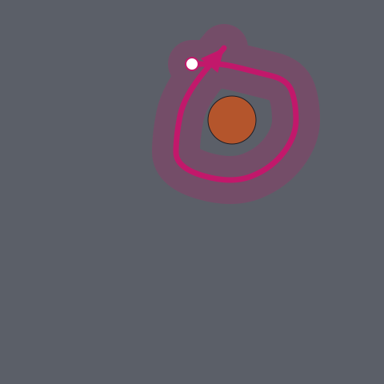
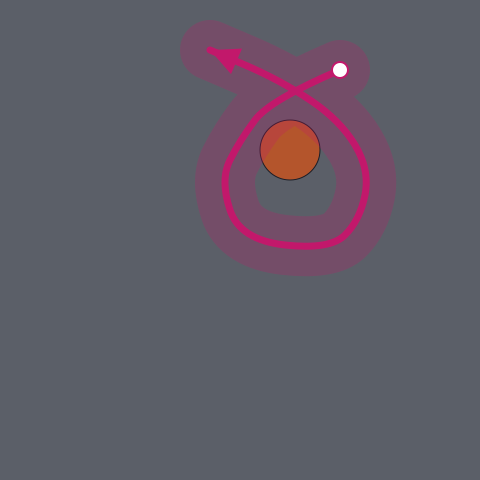
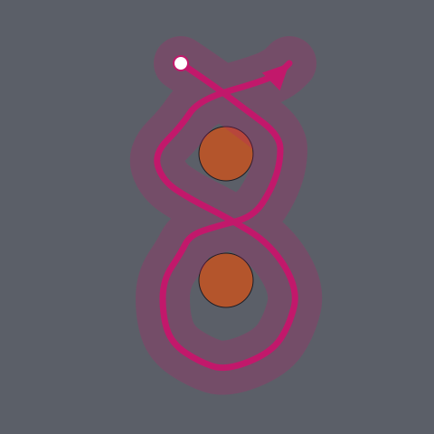

#### Drivability check

The Driving & Drift Agent's drivability check (References) drove the board's sketches with the car's driving code (task T-021), both with the Unity prototype's top speed and with the board's top speed of 3.0 times cruise speed (Drifting, Decisions); the results were the same:

- Single Boulder, arrow 1: drivable: yes.
- Single Boulder, arrow 2: drivable: yes.
- Two Boulders, arrow 1: drivable: yes.

#### MVP map

The MVP map as built in Godot (task T-019; made bigger after Playtest 1 in task T-094, then rebuilt with everything three times bigger after the combined playtest in task T-096), in flat placeholder colours: dark grey roads, the tan gravel centre, purple buildings, and dark boulders with an orange rim. The art replaces the colours later. Since task T-103 the isometric view draws the ground art, and since task T-034 its buildings rise as boxes that turn see-through ("See-through buildings" below).

**No challenges in the MVP** (task T-097, as Decisions says). The map draws no challenge arrows and tracks no challenges, so it never sends a completed challenge and the run never flashes a score; likes come from drifting only. Every pattern copy below stays on the roads, its boulders exactly where they were, as plain obstacles the car bounces off. The challenges, the fitted versions, the completion rule, the arrows and the meteor challenges are kept in the code and the layout data, unused, so they can be switched back on in one place if the board brings them back (how: `game/docs/level/mvp-map.md`, "MVP map"). The parts of this section about challenges and arrows describe what comes back then.

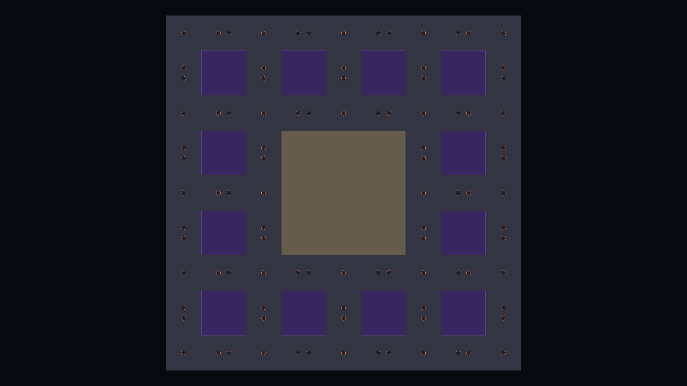

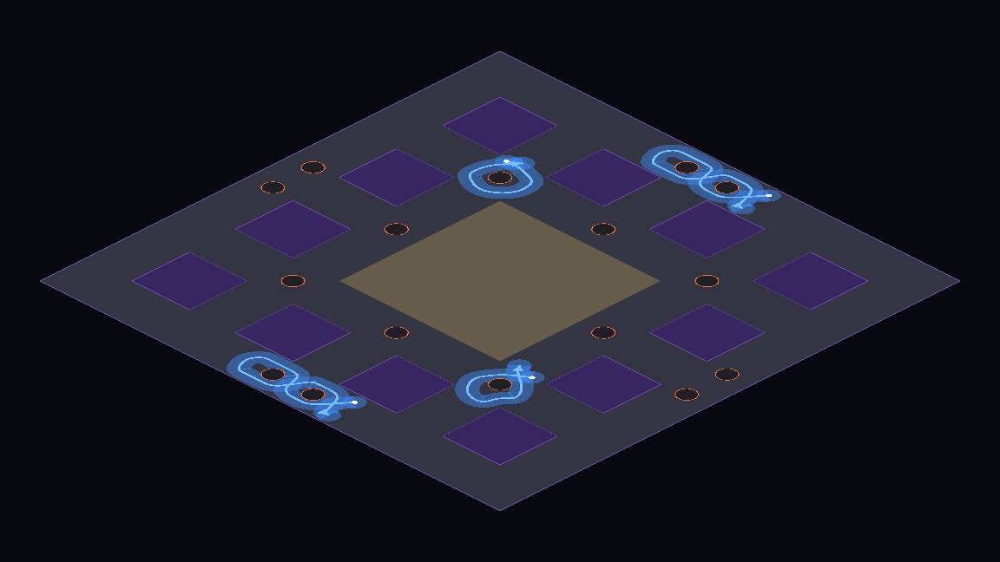

**Size.** The map is **240 by 240 units**, as Decisions says: across the map, the two 24-unit sides of the perimeter road, 4 blocks of 30 and the 3 roads of 24 between them (24 + 4 x 30 + 3 x 24 + 24 = 240). The gravel centre is the middle 2 by 2 blocks and the road between them, 84 by 84 units, which leaves 12 blocks.

**Coordinates.** Positions are in units from the map's centre, x to the right and y down, as in Crash City Grid, so the map runs from -120 to 120. The perimeter road runs from the edge to 96 units from the centre; the blocks start at -96, -42, 12 and 66 on each axis; the gravel centre runs from -42 to 42. The road centre lines are at -108 and 108 (the perimeter road) and -54, 0 and 54 (the roads between the blocks), and the middle of each block side is at -81, -27, 27 or 81. The car starts at 0, 0, in the gravel.

**Fitted patterns.** Each sketch has a fitted version next to it (`arrow-1.fitted.json` and `.svg`), made by a script from the sketch. The rule is the same as before: the sketch's boulders are kept, 3 units across and as far apart as drawn, and its arrow points are moved as little as possible until the arrow's centre line stays at least 2 units from each boulder's centre (the rock's radius plus half the car's width) and the 3-unit corridor stays at least 0.25 units from every building. On the 24-unit roads every sketch already keeps those distances, so no arrow point is moved: each fitted version is the board's sketch exactly, only shifted so its boulders sit on the crossing's centre or the road's centre line.

| Fitted version | Made to fit | Around each boulder |
|---|---|---|
| [Single Boulder, arrow 1](level-design/single-boulder/arrow-1.fitted.svg) | A crossing of two 24-unit roads, the boulder on its centre | Clockwise, 389 degrees, as in the sketch |
| [Single Boulder, arrow 2](level-design/single-boulder/arrow-2.fitted.svg) | A crossing of two 24-unit roads, the boulder on its centre | Counter-clockwise, 431 degrees, as in the sketch |
| [Two Boulders, arrow 1](level-design/two-boulders/arrow-1.fitted.svg) | A straight 24-unit road, the boulders on its centre line, 7 units apart | Clockwise 422 degrees, then counter-clockwise 332, as in the sketch |

The figure-eight is no longer squeezed across the road: its loops are as wide as the board drew them (about 8 units).

**Pattern copies.** 60 copies: 24 Single Boulder and 36 Two Boulders. None is in the gravel.

- A Single Boulder on the centre of every place where two road centre lines meet: the 8 crossings of the inner roads, the 12 junctions where they join the perimeter road, and its 4 corners.
- A Two Boulders on the middle of every stretch of road between those places (the middle of each block side), turned to run along the road.
- So along any road the next copy is 27 units away.

Every copy has room for any of its pattern's arrows, clear of buildings, the map's edge and the other copies, so which copies are challenges can change later without moving them.

**Challenges (off in the MVP, kept for later).** 30% of 60 is 18 challenges (rounded half up, as before): 6 Single Boulder (3 with arrow 1, 3 with arrow 2) and 12 Two Boulders. They are the same every run. They are chosen evenly through the copies in reading order (top to bottom, then left to right), which spreads them over the whole map; the Single Boulder ones take arrow 1 and arrow 2 in turn. The rotation turns the fitted version clockwise on screen (0: the Two Boulders runs along y).

| Copy | Pattern | Centre | Where | Rotation | Challenge (when switched on) |
|---|---|---|---|---|---|
| copy-01 | Single Boulder | -108, -108 | corner of the perimeter road | 0 |  |
| copy-02 | Two Boulders | -81, -108 | perimeter road, top side | 90 | challenge-1, arrow 1 (figure-eight) |
| copy-03 | Single Boulder | -54, -108 | perimeter road junction | 0 |  |
| copy-04 | Two Boulders | -27, -108 | perimeter road, top side | 90 |  |
| copy-05 | Single Boulder | 0, -108 | perimeter road junction | 0 |  |
| copy-06 | Two Boulders | 27, -108 | perimeter road, top side | 90 | challenge-2, arrow 1 (figure-eight) |
| copy-07 | Single Boulder | 54, -108 | perimeter road junction | 0 |  |
| copy-08 | Two Boulders | 81, -108 | perimeter road, top side | 90 |  |
| copy-09 | Single Boulder | 108, -108 | corner of the perimeter road | 0 | challenge-3, arrow 1 (clockwise) |
| copy-10 | Two Boulders | -108, -81 | perimeter road, left side | 0 |  |
| copy-11 | Two Boulders | -54, -81 | road along y | 0 |  |
| copy-12 | Two Boulders | 0, -81 | road along y | 0 | challenge-4, arrow 1 (figure-eight) |
| copy-13 | Two Boulders | 54, -81 | road along y | 0 |  |
| copy-14 | Two Boulders | 108, -81 | perimeter road, right side | 0 |  |
| copy-15 | Single Boulder | -108, -54 | perimeter road junction | 0 |  |
| copy-16 | Two Boulders | -81, -54 | road along x | 90 | challenge-5, arrow 1 (figure-eight) |
| copy-17 | Single Boulder | -54, -54 | crossing | 0 |  |
| copy-18 | Two Boulders | -27, -54 | road along x | 90 |  |
| copy-19 | Single Boulder | 0, -54 | crossing | 0 | challenge-6, arrow 2 (counter-clockwise) |
| copy-20 | Two Boulders | 27, -54 | road along x | 90 |  |
| copy-21 | Single Boulder | 54, -54 | crossing | 0 |  |
| copy-22 | Two Boulders | 81, -54 | road along x | 90 | challenge-7, arrow 1 (figure-eight) |
| copy-23 | Single Boulder | 108, -54 | perimeter road junction | 0 |  |
| copy-24 | Two Boulders | -108, -27 | perimeter road, left side | 0 |  |
| copy-25 | Two Boulders | -54, -27 | road along y | 0 |  |
| copy-26 | Two Boulders | 54, -27 | road along y | 0 | challenge-8, arrow 1 (figure-eight) |
| copy-27 | Two Boulders | 108, -27 | perimeter road, right side | 0 |  |
| copy-28 | Single Boulder | -108, 0 | perimeter road junction | 0 |  |
| copy-29 | Two Boulders | -81, 0 | road along x | 90 | challenge-9, arrow 1 (figure-eight) |
| copy-30 | Single Boulder | -54, 0 | crossing | 0 |  |
| copy-31 | Single Boulder | 54, 0 | crossing | 0 |  |
| copy-32 | Two Boulders | 81, 0 | road along x | 90 | challenge-10, arrow 1 (figure-eight) |
| copy-33 | Single Boulder | 108, 0 | perimeter road junction | 0 |  |
| copy-34 | Two Boulders | -108, 27 | perimeter road, left side | 0 |  |
| copy-35 | Two Boulders | -54, 27 | road along y | 0 |  |
| copy-36 | Two Boulders | 54, 27 | road along y | 0 | challenge-11, arrow 1 (figure-eight) |
| copy-37 | Two Boulders | 108, 27 | perimeter road, right side | 0 |  |
| copy-38 | Single Boulder | -108, 54 | perimeter road junction | 0 |  |
| copy-39 | Two Boulders | -81, 54 | road along x | 90 | challenge-12, arrow 1 (figure-eight) |
| copy-40 | Single Boulder | -54, 54 | crossing | 0 |  |
| copy-41 | Two Boulders | -27, 54 | road along x | 90 |  |
| copy-42 | Single Boulder | 0, 54 | crossing | 0 | challenge-13, arrow 1 (clockwise) |
| copy-43 | Two Boulders | 27, 54 | road along x | 90 |  |
| copy-44 | Single Boulder | 54, 54 | crossing | 0 |  |
| copy-45 | Two Boulders | 81, 54 | road along x | 90 |  |
| copy-46 | Single Boulder | 108, 54 | perimeter road junction | 0 | challenge-14, arrow 2 (counter-clockwise) |
| copy-47 | Two Boulders | -108, 81 | perimeter road, left side | 0 |  |
| copy-48 | Two Boulders | -54, 81 | road along y | 0 |  |
| copy-49 | Two Boulders | 0, 81 | road along y | 0 | challenge-15, arrow 1 (figure-eight) |
| copy-50 | Two Boulders | 54, 81 | road along y | 0 |  |
| copy-51 | Two Boulders | 108, 81 | perimeter road, right side | 0 |  |
| copy-52 | Single Boulder | -108, 108 | corner of the perimeter road | 0 | challenge-16, arrow 1 (clockwise) |
| copy-53 | Two Boulders | -81, 108 | perimeter road, bottom side | 90 |  |
| copy-54 | Single Boulder | -54, 108 | perimeter road junction | 0 |  |
| copy-55 | Two Boulders | -27, 108 | perimeter road, bottom side | 90 |  |
| copy-56 | Single Boulder | 0, 108 | perimeter road junction | 0 | challenge-17, arrow 2 (counter-clockwise) |
| copy-57 | Two Boulders | 27, 108 | perimeter road, bottom side | 90 |  |
| copy-58 | Single Boulder | 54, 108 | perimeter road junction | 0 |  |
| copy-59 | Two Boulders | 81, 108 | perimeter road, bottom side | 90 | challenge-18, arrow 1 (figure-eight) |
| copy-60 | Single Boulder | 108, 108 | corner of the perimeter road | 0 |  |

**Completing a challenge (when switched on).** The map checks the drawn car (a 3 by 1 unit rectangle on the car's position and heading) against each open challenge every physics step. A run starts when the car touches the arrow's start; it moves forward while the car keeps touching the corridor, and only along the stretch of arrow the car is on, so crossing a figure-eight or passing the start of a loop does not skip ahead. Not touching the corridor at all, even for one step, ends the run. Reaching the arrow's end completes the challenge.

**Drivability.** The fitted challenges have not yet been checked with the Driving & Drift Agent's script (task T-021); since task T-096 they are the board's sketches unchanged, which that check found drivable ("Drivability check" above). The 18 challenges are copies of the 3 fitted versions, so checking those 3 covers them all.

#### See-through buildings

Built on the MVP map in task T-034, following task T-020's research (Visual style, References) and the values in Visual style, Decisions. In the isometric view each building is now a box that rises 15 units above its block (a placeholder height until the building art; the flat view still draws them flat), drawn in depth order with the car: a building nearer the viewer is drawn over what is behind it.

- **When a building fades:** while it covers the car on screen. The car counts as behind a building when its centre is not in front of either of the building's two visible walls (the walls facing +x and +y, towards the viewer), and covered when the drawn car (its 1 by 3 unit rectangle on the ground, together with the same rectangle 1 unit higher) overlaps the building's outline on screen. Being further back alone is not enough: the car in the gravel centre is behind the blocks south of it, but not hidden by them.
- **How:** the whole building fades as one object, to 15% visible over 0.15 seconds, and fades back to fully opaque over 0.15 seconds when the car comes out. Only the buildings covering the car fade; every other building stays fully opaque. Only the car is checked, not enemies or the kaiju.
- **Drawing order:** the car is drawn under the buildings that cover it and over every other building. The ground, the drift marks and the boulders are drawn under all the buildings.
- **Under a building:** the ground art has no tiles under the blocks, so a faded building shows the dark night colour where it stands.

How it is built, and what the final building art has to do to keep it: `game/docs/level/mvp-map.md`, "MVP map", "See-through buildings".

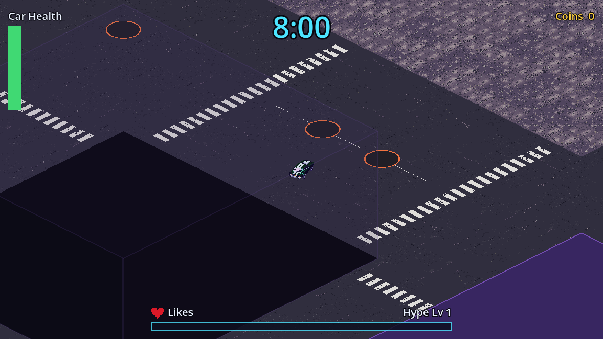

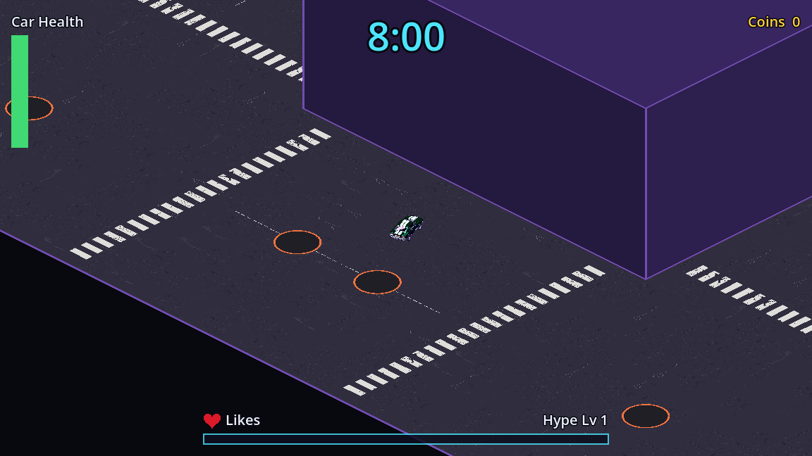

#### Meteor boulders

The kaiju's meteors leave plain boulders where they land (task T-097; when and where the kaiju drops them: Enemies). The map can place one boulder at any position during a run, the same size (3 units across), look and collision as the map's own boulders, so the car bounces off it; no challenge or arrow comes with it. A placement check says whether a spot is free: the boulder must lie wholly inside the map and must not overlap a building or any boulder already on the map (a pattern copy's or another meteor boulder's); just touching is allowed. A new run builds a new map, so the meteor boulders go with the old one. The functions are listed in `game/docs/level/mvp-map.md` ("MVP map", "Meteor boulders").

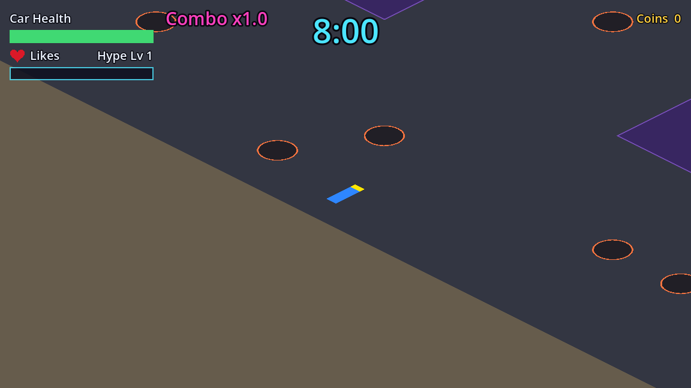

#### Meteor challenges (off in the MVP, kept for later)

Not used in the MVP: the kaiju's meteors leave plain boulders instead ("Meteor boulders" above). Kept for if challenges come back. The challenges the kaiju's meteors create during a run (task T-035; when and where the kaiju drops them: Enemies). The map can place any of the 3 fitted challenge designs (Single Boulder arrow 1 and arrow 2, Two Boulders arrow 1) at any position and angle, with the fitted boulders (3 units across) and the arrow corridor drawn in green, while the map's preset challenges stay blue. They follow the same completion rule as the preset challenges; when one is completed, its arrow disappears and its boulders stay as plain obstacles, and the map sends a separate signal for meteor challenges, so the kaiju's shield can tell them from the preset ones. Several can be open at once, each completed on its own.

A placement check says whether a design fits at a spot: none of its boulders and no part of its 3-unit corridor may overlap a building, a boulder already on the map (the pattern copies' or another meteor challenge's) or the map's edge.

The designs are stored unplaced (units from the pattern's centre, angle 0) in the layout data, under `challenge_designs`. The functions and the signal are listed in `game/docs/level/mvp-map.md` ("MVP map", "Meteor challenges").

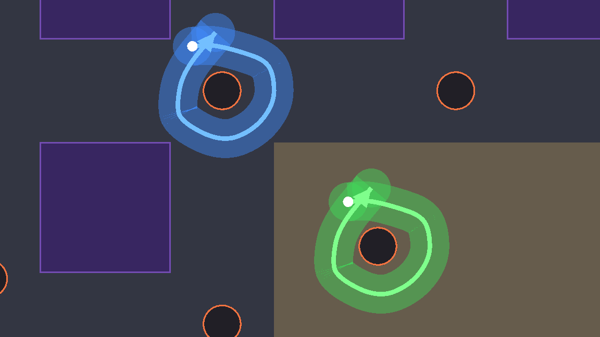

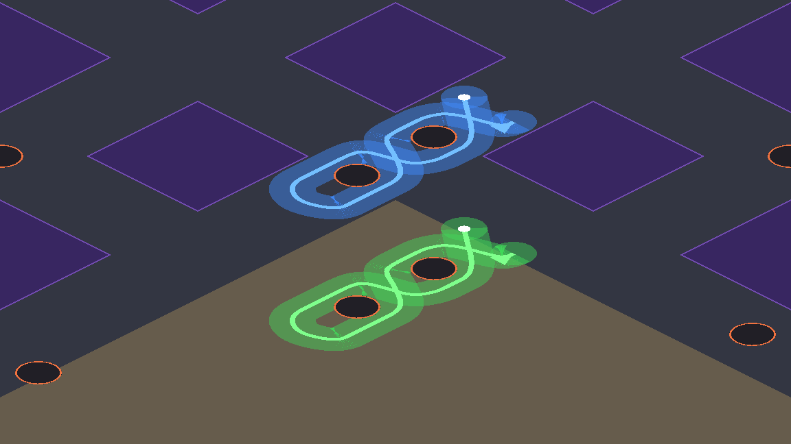

#### Level creator text

The creator's text lives in `game/data/level/creator_texts.json` (the source; each piece has a text and a note of where it appears). Plain labels: the creator is the board's own tool (task T-233). Buttons fit 16 characters, category names 12.

- **List screen:** title "Levels"; button "New level" (alone when there are no levels); per level "Play" and "Edit".
- **Editor, naming:** default name "New level"; field label "Level name".
- **Side panel categories:** Ground, Roads, Buildings, Boulders, Rooftops, Ramps.
- **Heights:** rooftops "Height 3", "Height 6"; ramps "Ramp 0 to 3", "Ramp 3 to 6".
- **Actions:** Rotate, Mirror, Delete, Save; confirmation "Level saved."; back button "Back to list".
- **Overlap message:** "Can't place here: it overlaps another piece."
- **Controls hint:** "Mouse: place. R: rotate. M: mirror. Del: delete." (the keys R, M and Del are the text's proposal; the creator's scripts must use the same keys).

Added for the piece set (task T-250; same file, T-233's keys unchanged; the pieces' tickets are T-251 to T-254):

- **Sizing a rooftop:** top bar hint "Drag to set the size."; readout "Size: {w} x {d}" (`size_hint`, `size_readout`).
- **Ramp directions:** "Climbs north", "Climbs east", "Climbs south", "Climbs west" on the top bar for a picked ramp; height label "Ramp 0 to 6" (`ramp_height_0_6`, used only if the creator adds it).
- **Road pieces (Roads):** "Corner", "T-junction", "Crossroads", "Dead end".
- **Props (new category "Props"):** "Concrete barrier", "Traffic cones", "Crate stack", "AC unit", "Water tank", "Roof vent", "Street lamp", "Rooftop sign".
- **Buildings:** "Small building", "Long building".
- **Controls hint with sizing:** "Mouse: place. Drag: size a rooftop. R: rotate. M: mirror. Del: delete." (`controls_hint_sizing`; the old `controls_hint` stays; the creator should show the new one, same keys).

Added for the creator rework (task T-261; same file, every earlier key unchanged; Decisions, "Level creator rework"):

- **Groups (side panel):** "Roads", "Ground", "Levels", "Buildings", "Obstacles", "Decoration" (`group_*`).
- **Pieces (side panel), Roads:** "Road", "Centre line", "Zebra crossing", "Cracked road". **Ground:** "Gravel", "Pavement". **Levels:** "Platform", "Ramp". **Buildings:** "Small building", "Long building", "Low-rise", "Skyscraper". **Obstacles:** "Boulder", "Barrier", "Cones", "Crates". **Decoration:** "Street lamp", "AC unit", "Water tank", "Roof vent", "Rooftop sign" (`piece_*`).
- **Looks strip under a selected piece:** heading "Looks"; counter "Look {n} of {count}" (`looks_heading`, `look_counter`).
- **Platform sizes (top bar):** "S", "M", "L", "Any size (drag)" (`platform_size_*`).
- **Ramp arrows (top bar):** "Arrows up", "Arrows down" (`ramp_arrows_up`, `ramp_arrows_down`).
- **Banner (top bar, skyscrapers):** "Banner on", "Banner off" (`banner_on`, `banner_off`).
- **Road brush (top bar):** "Drag to paint a road" (`road_brush_hint`).
- **Controls hint:** "Drag: paint roads, size platforms. R: turn. V: next look. M: mirror. H: height. A: arrows. B: banner. T: style. Del: delete." (`controls_hint_rework`; the older hints stay; the creator should show this one, same keys).

Added for sidewalks and parked cars (task T-396; same file, every earlier key unchanged; Decisions, "Sidewalks and parked cars in the level creator"; T-398 copies them into `creator_texts.json`):

- **Ground (side panel):** "Sidewalk", next to "Gravel" (`piece_sidewalk`).
- **Obstacles (side panel):** "Parked car", "Broken car", after "Crates" (`piece_parked_car`, `piece_broken_car`).
- **Looks strip under a selected car:** model counter "Model {n} of {count}" (`model_counter`), shown only if T-398 gives the cars several models; the facing labels "Facing top right", "Facing bottom right", "Facing bottom left", "Facing top left" (`facing_top_right`, `facing_bottom_right`, `facing_bottom_left`, `facing_top_left`), shown only if T-398 shows the facing.
- Style loop: score 9/10 in round 1 (Style review, T-396). The script's complaints about one line and sentence case came from checking all eight labels as one block; each label alone is short, plain and in the existing voice.

Added for meteor craters (task T-401; same file, every earlier key unchanged; Decisions, "Sidewalks and parked cars in the level creator", Meteor craters; T-398 copies it into `creator_texts.json`):

- **Ground (side panel):** "Meteor crater", after "Sidewalk" (`piece_meteor_crater`). The looks strip reuses T-396's "Model {n} of {count}" (`model_counter`).
- Style loop: score 10/10 in round 1 (Style review, T-401).

Added for the kaiju alert sign and banner pieces (task T-440; same file, every earlier key unchanged; Decisions, "Kaiju alert signs are level creator pieces"; the pieces ticket T-441 builds them):

- **Side panel buttons:** "Alert sign" (`piece_alert_sign`, the standing sign on the ground or a rooftop) and "Alert banner" (`piece_alert_banner`, hangs on a skyscraper's wall).
- **Looks strip, the two designs:** "Head in triangle" (`alert_design_head`) and "Body in circle" (`alert_design_body`).
- **Banner hints in the strip:** "R: next wall." (`banner_wall_hint`) and "H: next height." (`banner_height_hint`); the keys are the existing turn and height keys, a proposal the creator must follow.
- Style loop: score 8/10 in round 1 (Style review, T-440). The script's complaints about one line and sentence case came from checking the six labels as one block.

#### Level creator: one button per kind of piece

Task T-262 (Decisions, "Level creator rework"). How it works and where its data is: `game/docs/level/level-creator.md`, "Level creator", "The side panel: one button per kind of piece (T-262)". The groupings of looks are the Level/Challenge Design Agent's **proposals for the board's playtest**.

- **The panel:** six groups from the ground up with one button per kind (20 in all): Roads (Road, Centre line, Zebra crossing, Cracked road), Ground (Gravel), Levels (Platform, Ramp), Buildings, smallest to tallest (Small building, Long building, Low-rise, Skyscraper), Obstacles (Boulder, Barrier, Cones, Crates), Decoration (Street lamp, AC unit, Water tank, Roof vent, Rooftop sign). **Pavement is left out:** the game's only pavement art is the block pavement drawn under buildings, not a ground tile.
- **Keys:** V next look, R turn, M mirror, H height (Platform 3 / 6; Ramp 0 to 3, 3 to 6, 0 to 6), T style. Under the picked piece a **looks strip** shows its looks as small clickable pictures with "Look n of count".
- **Looks (proposals):** Road is the plainer asphalts (the approved tile with its mirror, and two PixelLab ones); **Cracked road** is the three visibly cracked PixelLab asphalts; Centre line holds the line tiles on every asphalt and the corner, T-junction, crossroads and dead-end pieces (R turns them); Zebra crossing the zebra tiles on every asphalt; a road tile turns (R) to its tile along the other axis. **Skyscraper** has 12 looks: each of the 6 towers' two bodies (the second body was in the game's art but not offered by the old panel). Since T-263 the road kinds are brushes ("Level creator: the road brush" below).
- **Saved levels** are unchanged: a piece writes the same data as before, so earlier levels open, place and play as before.

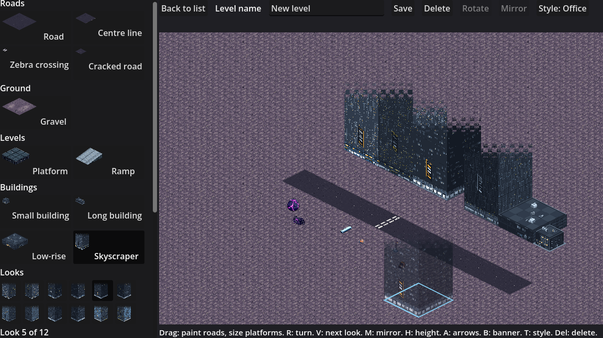

#### Level creator: the road brush

Task T-263 (Decisions, "Level creator rework"). How it works and where its code and tiles are: `game/docs/level/level-creator-pieces.md`, "Level creator", "The road brush (T-263)". The points marked as proposals are the Level/Challenge Design Agent's, for the board's playtest.

- **Painting:** pick Road, Centre line or Cracked road, press the left button on the map and drag. The road comes whole along the drag, today's two-tile-wide road (4 units), with the centre line in its middle for Centre line. The road follows the drag in steps along x and y, with no gaps when the drag goes diagonally. V picks the asphalt: Road and Centre line a0 (M: its mirror a0m), g6, g9; Cracked road g4, g5, g7. Painting over a road changes its kind and asphalt. The top bar shows "Drag to paint a road".
- **Joining:** wherever painted roads meet, the editor picks the piece itself: straights along y and x, corners, T-junctions, crossroads, and a dead end at each open end (a kerb across the road, gravel beyond). With Centre line the line runs on through every piece. On Road and Cracked road a corner, T-junction or crossroads is plain asphalt.
- **Erasing:** a right-drag erases road along the drag, and Del erases the road under the mouse. The roads around then join again.
- **Zebra crossing:** pick it and click on a straight road. The crossing goes across the road on the row of tiles clicked, on that road's own asphalt, and stays when the road is painted over with another kind. It is not laid on a corner, junction or dead end, and goes away when its block becomes one.
- **Never over:** a road is not painted over a building, platform or ramp. It stops at them, and they close it in a dead end.
- **Proposals:** roads lie on a 4-unit grid (blocks of 2 x 2 tiles). Every road block joins every road block next to it, so two roads painted side by side become one wide road. A single block on its own is plain asphalt. Where a centre-line road meets a road without a line, the line runs to the edge of its own block. A crossing has four stripes evenly across the road (the full zebra tile on both tiles). The game's map leaves out the stripe at each edge, which on a road this narrow would leave only two.
- **New tiles, drawn by script (no PixelLab):** T-252's centre-line pieces on the asphalts a0m, g6 and g9, and the dead ends of roads without a line on all seven asphalts. 268 tiles, appended to the ground atlas, so every earlier tile keeps its index.
- **Saved levels** write the same ground data as before (a road tile per cell), so a painted level passes the level check and plays. Earlier levels open unchanged, and a road saved earlier joins a newly painted one when its tiles fill whole blocks. The old single road tiles are no longer panel looks; they stay in the catalogue so old levels draw.
- **In the run (T-391; Decisions, "Roads painted in the creator show in the run"):** a level played from the creator draws exactly the ground and road tiles painted in the editor, roads beside rooftops and ramps included. Before the fix the run always drew the game's own map's ground, whatever the level held, so painted roads never showed. A level saved with the creator's ground (every level the creator saves) now shows its own: a level that is all gravel, like `level_01`, plays on plain gravel instead of the game's streets. The game's own map, and a level file without the creator's ground, draw the game's ground as before. Where the code is: `game/docs/level/level-creator.md`, "Painted roads in the run (T-391)".

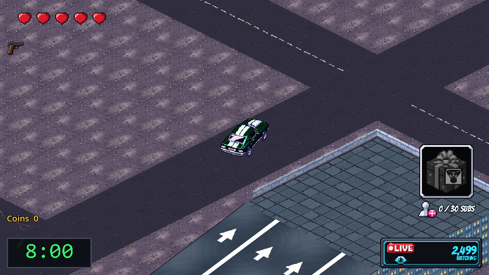

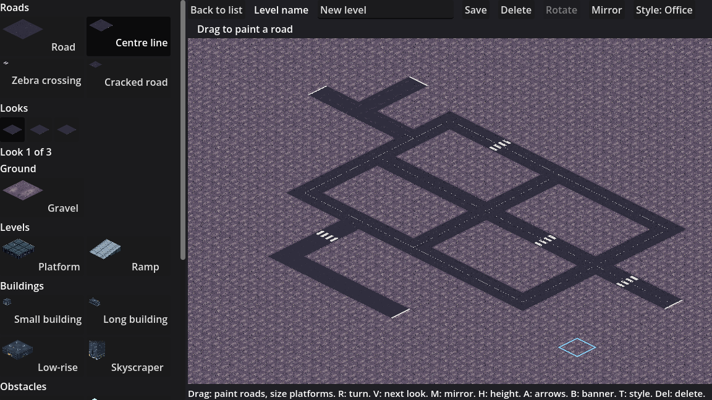

#### Level creator: closed ramps, arrows and platform sizes

Task T-264 (Decisions, "Level creator rework"). How it works: `game/docs/level/level-creator-pieces.md`, "Level creator", "Closed ramps, arrows up or down, platform sizes (T-264)". The numbers are the Level/Challenge Design Agent's proposals for the board's playtest.

- **Closed ramps:** every ramp, in each direction and height step, has a wall at its tall end down to what it stands on, in the ramp side's texture, even where it meets a rooftop or building.
- **Arrows:** every ramp can have its arrows pointing up or down the slope, the board's choice per ramp (key A, or the top bar's "Arrows up" and "Arrows down"), saved with the ramp. The default is up.
- **Platform sizes:** a platform at height 3 or 6 places in one click at S 8 x 8, M 16 x 16 or L 32 x 32 units, chosen on the top bar; the default is M. Dragging still sizes it freely ("Any size (drag)").

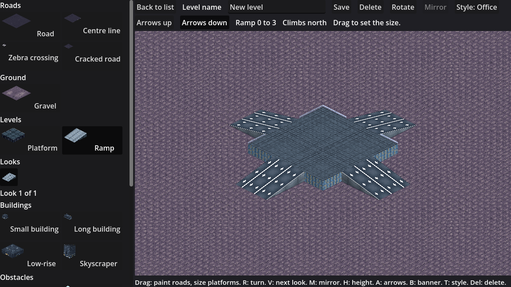
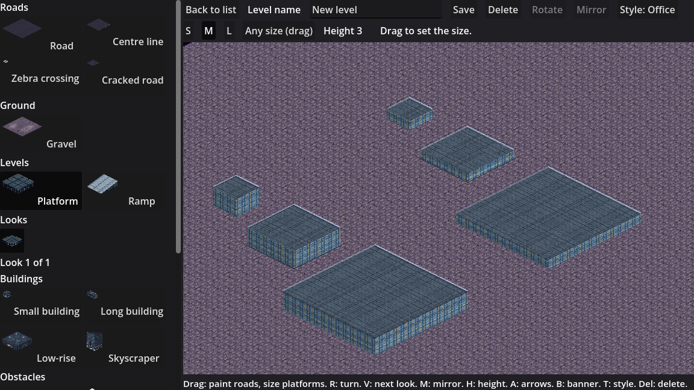

#### Level creator: the small jump ramp

Task T-400 (Decisions, "A small jump ramp"). How it works: `game/docs/level/level-creator-pieces.md`, "Level creator", "The small jump ramp (T-400)". Every point below is the Level/Challenge Design Agent's proposal for the board's playtest.

- **The piece:** three more height steps of the Ramp family, after 0 to 6: **Ramp 0 to 2** (on the street), **Ramp 3 to 5** (on a height 3 rooftop) and **Ramp 6 to 8** (on a height 6 rooftop), so it rises 2 units from whatever it stands on, as the other ramps are raised by their height step. Key **H** steps 0 to 3, 3 to 6, 0 to 6, 0 to 2, 3 to 5, 6 to 8; **R** turns it to climb north, east, south or west; dragging sets its width (default 10, at least 4 units), like the other ramps.
- **Size:** one tile long, 4 units (a third of a 12-unit ramp), and 2 units high, so its slope (1 in 2) is twice a 0 to 3 ramp's.
- **Its tall end is open:** it climbs to no rooftop. Nothing stands above its lip, so the car drives up it and flies off the top, taking off along the slope (the ramp's own vertical speed, as at a ramp's top) when it climbs at 4 units/s or more; slower it just rolls off. The face under the lip is drawn as the ramp's back in the ramp side's texture (as the other ramps' tall ends), so it doesn't look hollow; from behind it is a 2-unit step the car can't climb, like any raised side. A jump counts for the airtime trick and the air tricks like a ramp hop: after a 22-unit run-up from a standstill the car spends about 1.6 seconds in the air and rises to about 4.7 units (2.7 over the lip) on a Ramp 0 to 2.
- **Its slope:** shown by today's arrows on its top, up the slope by default, turned with key A.
- **Enemies** go round it or over it as the height rules decide (it is a ramp like the others: up from its foot, down off its top or its sides).

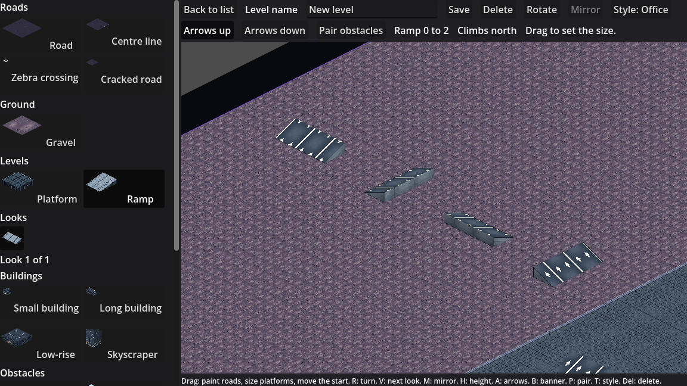
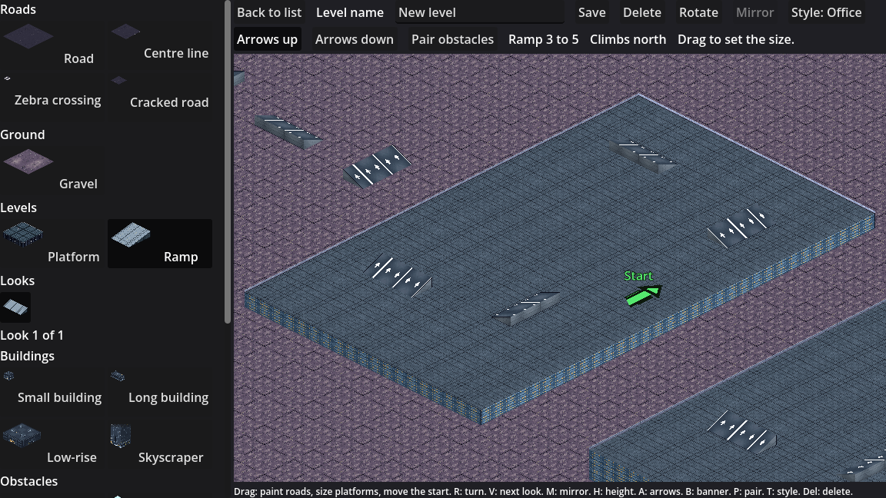
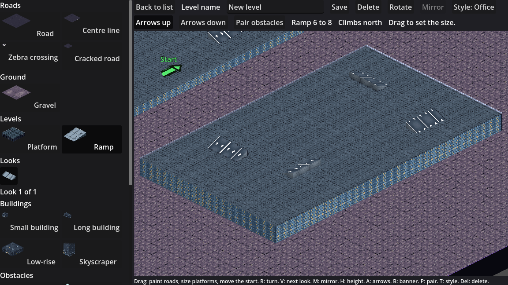

GIF of the car jumping off the small ramps in a run: `art-archive/T-400/screenshots/jump_drive.gif`.

#### Level creator: skyscraper banners on or off

Task T-265 (Decisions, "Level creator rework"). How it works: `game/docs/level/level-creator-pieces.md`, "Level creator", "Skyscraper banners on or off (T-265)". The choices marked here are the Level/Challenge Design Agent's proposals for the board's playtest.

- **What the banner is:** the vertical sign in the middle of a skyscraper's face is painted into the building's own picture (every one of the 12 looks has one), not a separate sprite. The kaiju alert banners (`game/art/banners/`) are a different thing and are not part of this: since T-441 they are pieces of their own ("Level creator: kaiju alert signs and banners" below).
- **On or off per skyscraper:** key B, or the top bar's "Banner on" and "Banner off", chooses it for the next skyscraper placed; with a skyscraper selected and nothing picked, B changes that building. **Off by default.** The choice is saved with the building and the preview shows it.
- **The pictures without a banner:** the same 12 bodies, built again by script from the same pieces with the sign left out (no PixelLab); the originals stay.
- **Earlier saved levels** (a skyscraper with no banner choice written) open with the banner **off** (a proposal).
- **The game's own map** keeps its banners and signs as before.

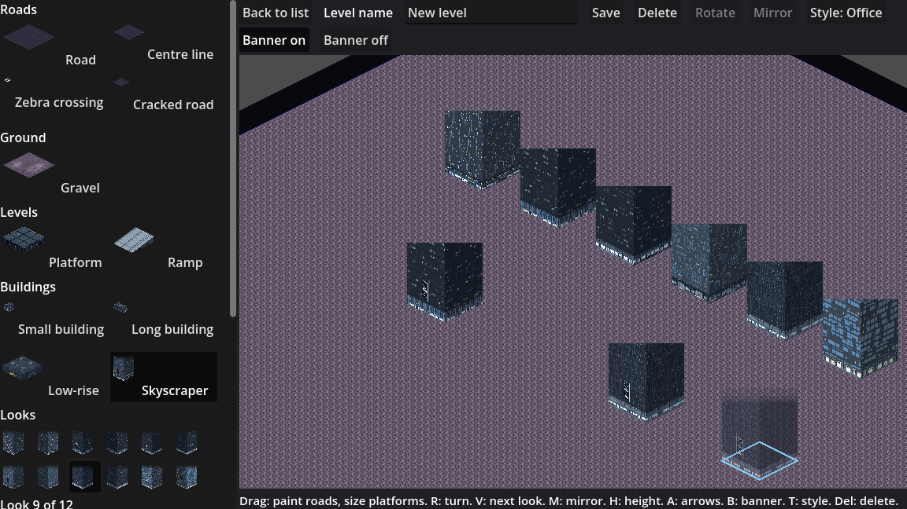
Added for thread the needle (task T-271; same file, every earlier key unchanged; Decisions, "Thread the needle"; the build is T-272):
- **Pair tool (top bar or Obstacles panel):** button "Pair obstacles" (`pair_tool`); hint while picked "Pair: click two obstacles" (`pair_hint`).
- **Messages (top bar):** after a pair is made "Pair made. Drive between them." (`pair_made`); when the click is not on an obstacle "Not an obstacle. Pick a boulder, barrier, cones or crates." (`pair_not_obstacle`).
- **Removing a pair:** button "Unpair" (`unpair_label`).
- **Controls hint:** the rework hint with "P: pair." added: "Drag: paint roads, size platforms. R: turn. V: next look. M: mirror. H: height. A: arrows. B: banner. P: pair. T: style. Del: delete." (`controls_hint_pairs`; the older hints stay; the creator should show this one; P is the text's proposal and the creator must use the same key).
Added for the car's spawn point (task T-279; same file, every earlier key unchanged; Decisions, "The car's spawn point"; the build is T-280):
- **Marker (on the map):** "Start" (`spawn_label`).
- **Hint while selected (top bar):** "Start: drag to move. R: turn." (`spawn_hint`; R is the same turn key as for pieces, the heading being a proposal).
- **Message when it can't go where dropped (top bar):** "Can't start here: it's blocked." (`spawn_blocked`; inside a building, on an obstacle or off the map).
- **Message when the board tries to delete it (top bar):** "The start can't be deleted." (`spawn_no_delete`).
- **Controls hint:** the pairs hint with "move the start" added: "Drag: paint roads, size platforms, move the start. R: turn. V: next look. M: mirror. H: height. A: arrows. B: banner. P: pair. T: style. Del: delete." (`controls_hint_spawn`; the older hints stay; the creator should show this one).

#### Level creator: thread the needle

Task T-272 (Decisions, "Thread the needle"; the text is T-271's, above). How it works: `game/docs/level/level-creator-pieces.md`, "Level creator", "Thread the needle (T-272)". The points marked as proposals are the Level/Challenge Design Agent's, for the board's playtest; the numbers are in `game/data/combo.json` (`trick_add.thread_the_needle` and `thread_the_needle`, with their reasons).

- **Which pieces are obstacles:** the four of the panel's Obstacles group, boulders, barriers, cones and crates. Decoration (street lamps, AC units, water tanks, roof vents, rooftop signs) is refused with "Not an obstacle...", as are buildings, rooftops, ramps and the ground.
- **Pairing:** the top bar's "Pair obstacles", or **P**, turns the pair tool on (it drops the picked piece); click one obstacle, then another: the top bar says "Pair made. Drive between them." The tool stays on for the next pair until P, Esc, a right-click or picking a piece. Clicking the same obstacle twice lets it go.
- **An obstacle in several pairs (T-394, below):** pairing an obstacle that is already in a pair keeps its old pair too; T-272's "one pair per obstacle" is gone.
- **How a pair shows in the editor (a proposal):** a dashed mint-green line across the gap, from one obstacle's edge to the other's, and a ring round each; the obstacles picked with the tool on are ringed thicker.
- **Removing a pair:** select a paired obstacle (nothing picked) and press "Unpair" (since T-394 this removes all of its pairs), or delete either obstacle.
- **In the level file:** a `pairs` list, saved and reopened with the level; `check_level.py` checks every pair names two different existing obstacles (since T-394 an obstacle can be in several pairs, but the same two obstacles make one pair at most).
- **In a run on the level:** when the car's centre crosses the line between the two obstacles' centres without touching either, it is the **thread the needle** trick: the combo goes up and THREAD THE NEEDLE! "+{amount}" pops. Proposals: worth **0.5**, like ALT DRIFT! and AIR 360!; the same pair pays again on a later pass in either direction once **3 seconds** have gone by since it last paid; it **counts in the air** (a jump through the gap); a touch of either obstacle from half a second before the crossing until a quarter second after it voids the pass, and the crash cuts the combo as always. The trick pops a quarter second after the crossing, once the car is clear.
- **How a pair shows in the run (a proposal):** a faint dashed chalk-white line on the ground across the gap, under the car and the obstacles, drawn in code.
- **The flash when a pair pays (T-451, board, 2026-10-31; the look is a proposal for the playtest):** on the step the trick pays, the two obstacles of the threaded pair and the dashed line between them flash: two quick white pulses over **0.6 seconds** (bright at once, dark at 0.15 s, bright again at 0.3 s, at rest from 0.6 s). The obstacles' pixels mix up to 75 percent towards white (alpha kept), the line goes opaque white and twice as thick. Only the pair just threaded flashes: in a chained row the other gaps stay still, and the next gap flashes when it pays. A pass that doesn't thread (going round, or a touch that voids it) makes no flash. Code only, no new art (`game/scripts/level/needle_flash.gd`).
- **The game's own map** has no pairs and is unchanged.

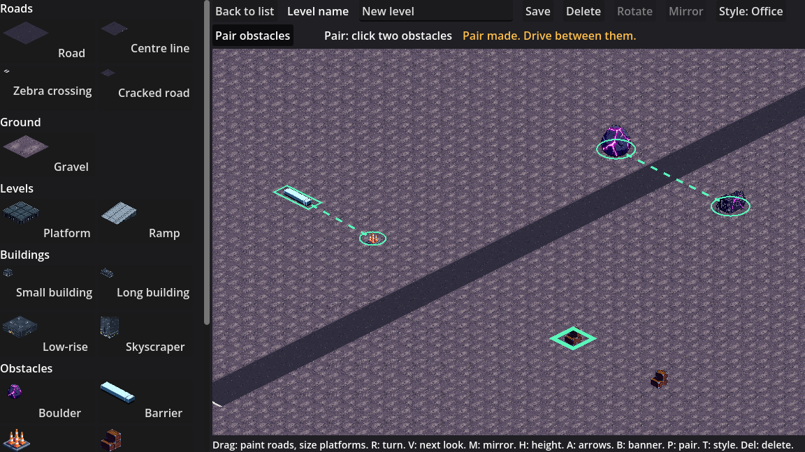
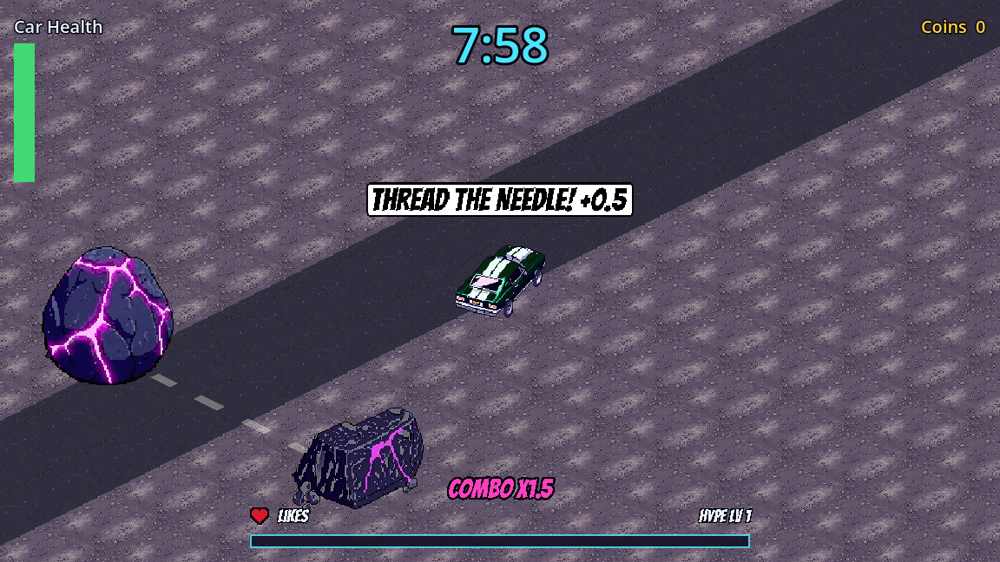
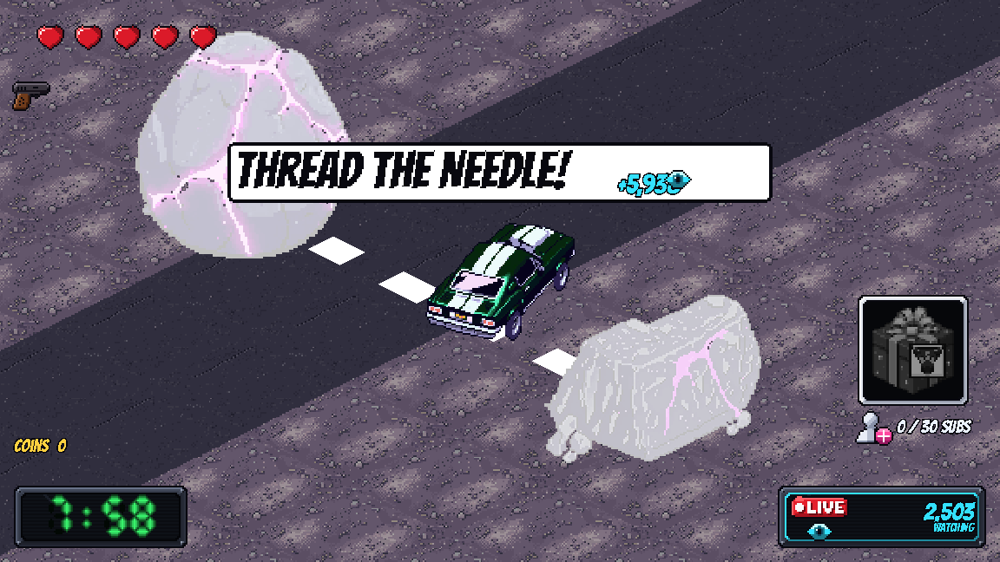

#### Level creator: a row paired as a chain

Task T-394 (Decisions, "A row of obstacles can be threaded gap after gap"). It changes the pair tool above; no new text (the labels and messages are T-271's). How it works: `game/docs/level/level-creator-pieces.md`, "Thread the needle (T-272)", "Several pairs and chains (T-394)".
- **Two ways to pair a row.** One pair at a time, as before: click A, then B; click B, then C; and so on. Each new pair keeps the earlier ones, so the row ends up paired A-B, B-C, C-D. Or the whole row in one go: with the pair tool on, **Shift+click** the obstacles in order (each is ringed thicker and numbered 1, 2, 3 above it; Shift+click a numbered one again to take it out), then press **P** or **Pair obstacles**: each is paired with the next (A with B, B with C, C with D) and the tool stays on. A plain click after a Shift+click row adds that obstacle as the last one and pairs the row straight away. Shift+click on an obstacle with the pair tool off (and nothing picked) turns the tool on and starts a row with it.
- **The same two obstacles are one pair at most:** pairing them again (in either order) changes nothing.
- **Unpair removes only the pair aimed at.** With the pair tool on, Shift+click to aim, then "Unpair": two picked removes their pair; a row picked removes only the pairs between consecutive picked ones (A-B, B-C), and the obstacles' other pairs stay; one picked removes all of its pairs. With the tool off, a selected obstacle's "Unpair" removes all of its pairs (the proposal for one obstacle: all its pairs, rather than a choice). "Unpair" shows only when there is something to remove. Deleting an obstacle removes its pairs; the rest of a chain stays.
- **In the editor** every pair shows its own dashed line, so a chain reads as a row of links.
- **In the run** each pair is its own gap: threading a row gap after gap pays thread the needle for each gap, each gap with its own 3-second cool-down; a touch of an obstacle voids the passes of every gap it is part of, and the crash pays nothing and cuts the combo as always.
- **Saved levels:** the level file keeps its `pairs` list, one pair per entry, so a level saved before opens with its pairs, and `check_level.py` accepts an obstacle in several pairs.

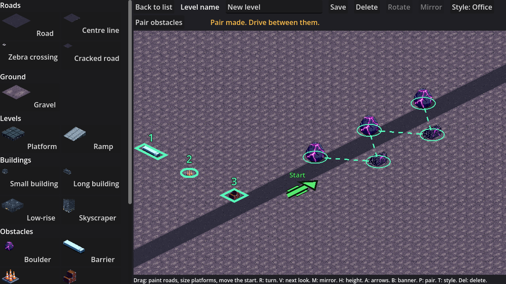
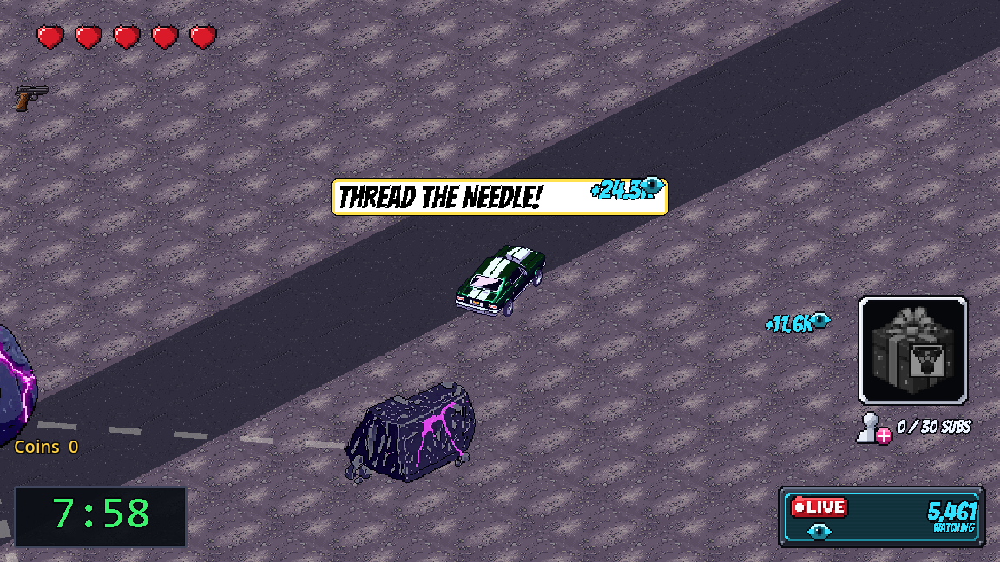

#### Level creator: the spawn point

Built in task T-280 from Decisions, "The car's spawn point", with T-279's labels. The choices below are proposals for the playtest.

- **The marker:** a green arrow on the point's cell, turned to the car's starting heading, with a dark outline and the label "Start" above it, drawn in code above every piece so nothing hides it, lifted to the surface it stands on (a rooftop's or ramp's height). Never Redgull red. Selected, it gets the yellow selection outline and the top bar shows its hint.
- **Moving it:** press on it and drag; a ghost shows the cell under the mouse (grey when the car can't stand there) and the point snaps to that cell's middle on release. Anywhere the car can stand: the street, a rooftop or a ramp. A plain click only selects it. (The decision's "select it and click where it should go" is not built; the drag does the job.)
- **Where the car can stand:** inside the map and clear of every building, obstacle (barrier, cones, crates and the other props) and boulder by 1 unit; the cell beside one is fine. Anywhere else is refused with "Can't start here: it's blocked." and the point stays where it was. A building or obstacle placed over it is refused with the same message.
- **Turning it:** R with it selected steps the heading round eight directions (45 degrees each); a new level starts facing the way the run always did.
- **Never deleted:** Del shows "The start can't be deleted." and it stays.
- **Saved and used:** the level file's `spawn` ({x, y, heading}); a run started from the creator puts the car there, at the ground's height there, facing that way. The level check refuses a level whose spawn point is missing or not where a car can stand. The game's own map has none and starts the car as before.

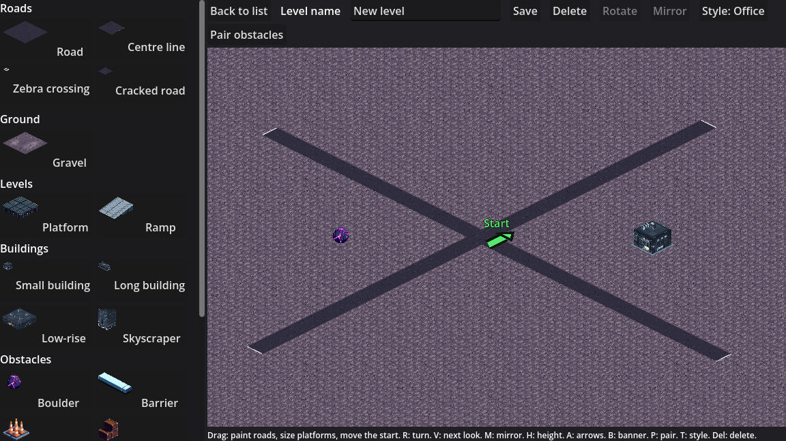
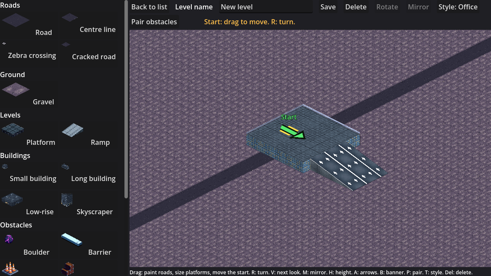
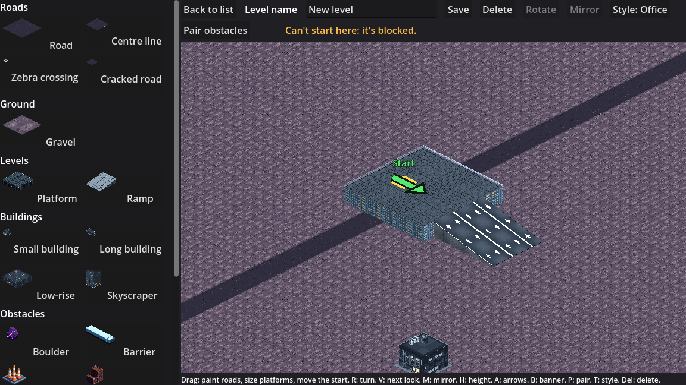

#### Level creator: rooftops of any size and ramps in every direction

Task T-251 (Decisions, "Level creator piece set"). Every number here is the Level/Challenge Design Agent's **proposal for the board's playtest**. Units are the flat world's (x east, y south). How it works and how to rebuild it: `game/docs/level/level-creator-pieces.md`, "Level creator", "Rooftops and ramps of any size (T-251)".

- **Rooftops** at height 3 and 6, of any size: picked, then dragged on the map over the cells they cover, so every size is even (whole 2 x 2 unit cells), at least 4 by 4, at most the map. A click without a drag places the elevation sample map's size (84 by 30 at height 3, 30 by 30 at 6). A 6 stands on a 3 that holds its whole footprint (`on`) or on the street. Snapping and the overlap refusal are as before (T-237).
- **Ramps** climb north, east, south or west (R steps through the four; the top bar names the direction), at 0 to 3, 3 to 6 and **0 to 6** (the height data allows it: a ramp from the street straight up to a 6 standing on the street, or on a 3 whose edge it shares). The width along the rooftop's side is dragged (at least 4 units, 10 on a click, the sample map's); the length is fixed at the sample map's slope, **12 units per 3 of rise** (12 for 0 to 3 and 3 to 6, 24 for 0 to 6).
- **Drawn in the engine**, not as fixed pictures: tileable textures projected onto the top and the east and south walls (the sample map art's projection), mirror-tiled, hard pixel edges, a dark outline on the edges, and a low parapet on a rooftop's back (north and west) edges, broken where a ramp meets the edge or a higher rooftop stands on it. Walls start on what the piece stands on. Until T-255 the textures are T-198's (Visual style, "Elevation sample map art"); they are settings in one resource, so new ones swap in there.
- **The game's own map** is unchanged: its rooftops and ramps, and pieces placed before T-251 (which name an `art` piece), keep their art.
- **The multi-layer test level** (`game/tests/fixtures/level_creator_pieces_level.gd`; screenshots and a GIF of the car driving it in a run in `art-archive/T-251/screenshots/`): a 48 by 32 rooftop at 3 with a 14 by 12 at 6 on it, a 16 by 16 at 3, a 16 by 16 at 6 on the street; ramps 0 to 3 climbing north, east and west, 3 to 6 climbing south and east on the big 3, and a 0 to 6 climbing north.

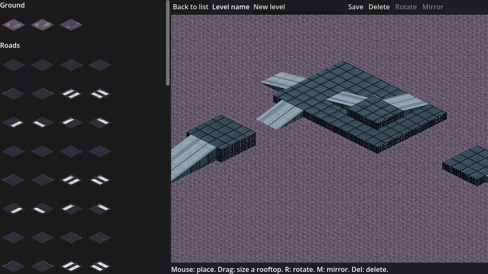

#### Level creator: props

Task T-253 (Decisions, "Level creator piece set"). Every number here is the Level/Challenge Design Agent's **proposal for the board's playtest**. How it works and how to rebuild the placeholder art: `game/docs/level/level-creator-pieces.md`, "Level creator", "Props (T-253)".

- **The set** (category "Props", names from T-250): concrete barrier, traffic cones, crate stack, AC unit, water tank, roof vent, street lamp, rooftop sign. Footprints (north-facing, units): barrier 4 by 1, rooftop sign 4 by 1, water tank 4 by 4, the rest 2 by 2. Heights drawn: barrier 1.2, cones 0.9, crates 2.2, AC unit 1.5, roof vent 1.45, sign 3.3, tank 3.3, lamp 5.35.
- **Four rotations** (R steps north, east, south, west; the facing is the direction a small pale arrow on the placeholder points). East and west swap the footprint's two numbers. A prop goes on the 2 by 2 tile grid like the other pieces, is not refused for overlapping other objects, and is refused where its footprint would leave the map, reach into a building or stand across a rooftop's or ramp's edge (T-393, below).
- **Ground or rooftop:** a prop stands at the height under the centre of its footprint (the street, a rooftop, a ramp's slope), drawn lifted by it.
- **Solid obstacles:** each is a static body like a boulder: the car crashes into it (the combo is cut as for a boulder) and the minions and the kaiju are stopped by it; the enemies' paths close the cells it takes. Collision: a rectangle (the footprint) for the barrier, crates, AC unit and sign, a circle for the cones (radius 0.9), tank (1.8), roof vent (0.9) and lamp (0.4). Since T-405 a prop blocks the car only at its own heights, from the ground it stands on to its top ("Short buildings as platforms", below).
- **Placeholder look:** code-drawn boxes and cylinders (a top and two visible faces, a dark outline, none of Greenbull's colours), one sprite per prop and rotation. Everything about a prop is in `game/data/level/props.json` (footprint, collision, height, the sprite of each rotation and its anchor), so T-256's art changes only that file and the PNGs.
- **Saved levels** keep their props in a `props` list; `check_level.py` checks that each names a known prop and rotation, has the right turned footprint and lies inside the map.

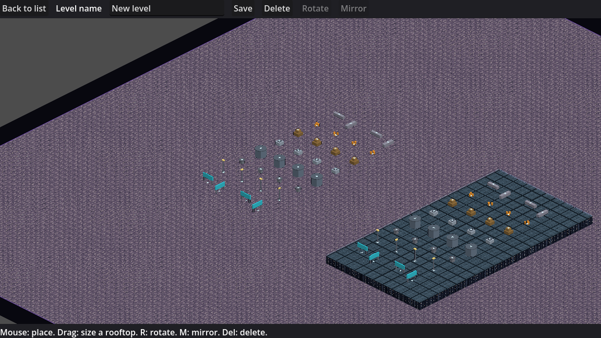

#### Level creator: objects, heights and depth

Task T-393 (Decisions, "Obstacles and decorations respect the buildings' and rooftops' heights"). How it works in the code: `game/docs/level/level-creator-pieces.md`, "Props (T-253)", "Heights and depth of placed objects (T-393)".

- **Heights:** every placed object, the boulders and the eight props, stands at the height under the centre of its footprint: the street (0), a rooftop (3 or 6) or a ramp's slope, in the editor and in the run. Boulders used to stand on the street even on a rooftop; now they are lifted like the props.
- **Depth:** an object behind a building or a rooftop and overlapping it on screen is drawn under it; one in front of it, or standing on it, is drawn over it. The board's barriers by the low-rise were drawn over it on any level with rooftops, because the buildings' order there was read wrongly; that is fixed for every kind of object.
- **Edges (the Level/Challenge Design Agent's proposal for the board's playtest):** an object stands wholly on one surface. One whose footprint would reach into a building, or across the edge of a rooftop or a ramp, is not placed, with the same message as a piece that overlaps another ("Can't place here: it overlaps another piece."); touching a building or an edge is fine. The other way round, a building placed over an object, or a rooftop or ramp whose edge would cut through one, is not placed either; a rooftop or ramp placed wholly over an object lifts it to its height. Levels saved before keep what they have (the board's Kaiju City barrier inside its low-rise stays; since T-405 the low-rise is a platform, so it stands on its roof). Since T-405 "a building" here means a skyscraper: the short buildings are platforms and take objects like rooftops.
- **As before:** the game's own map and levels without rooftops draw their objects exactly as before.

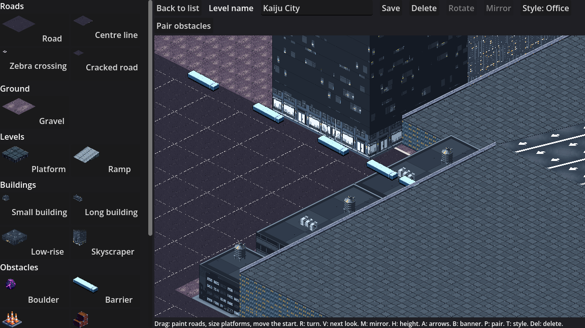

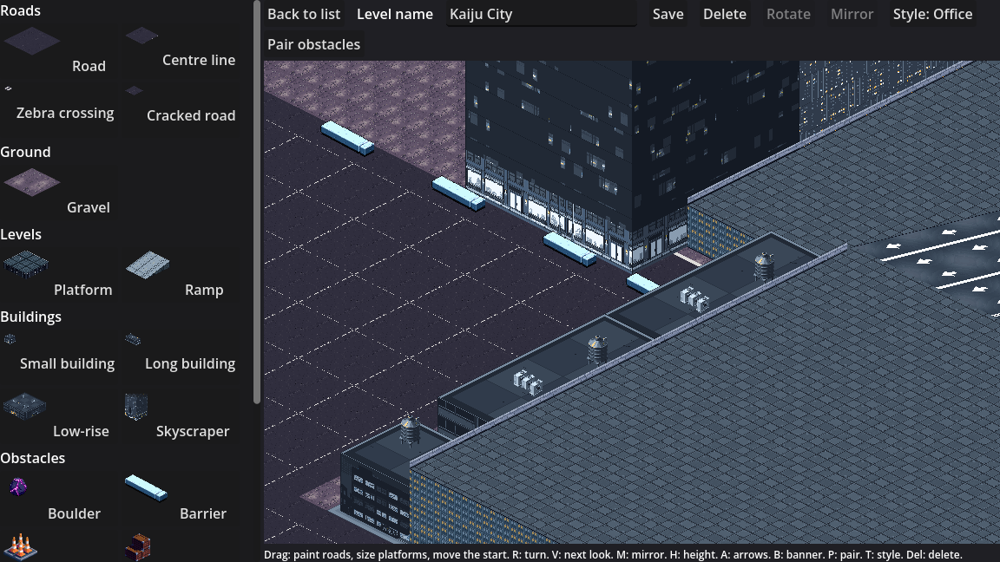

#### Level creator: sidewalks, parked cars and meteor craters

Task T-398 (Decisions, "Sidewalks and parked cars in the level creator"; names from T-396 and T-401, "Level creator text" above). Placeholder art until T-399. The points marked as proposals are the Level/Challenge Design Agent's, for the board's playtest. How it works in the code: `game/docs/level/level-creator-pieces.md`, "Sidewalks, parked cars and meteor craters (T-398)".

- **Sidewalk (Ground):** pick it, press the left button on the map and drag, as with a road; a right-drag erases it, and Del erases the tile under the mouse. A proposal: it paints one ground tile (2 x 2 units) at a time, so a sidewalk can be one tile wide beside a road. It is never painted over a road, a building, a platform or a ramp. **The curb comes by itself** on every side where a sidewalk tile meets a road: straight curbs, outer corners (two sides) and inner corners (a road only diagonally next to it), and it follows the roads: painting or erasing a road next to a sidewalk changes its curb. 47 curb pieces in all.
- **In a run** the sidewalk is ground at the street's height; the curb is drawn on the tile, so the car drives up over it and back down with no crash and no slowing (a step under the 0.1-unit curb rule, Drifting, Decisions, "Curbs"). Enemies cross it like any ground.
- **Parked car and Broken car (Obstacles):** three parked models and two broken ones (a proposal); V steps the model ("Model {n} of {count}" under the looks), R turns the car through its four facings, top right, bottom right, bottom left, top left, named on the top bar ("Facing top right" ...). Each is a solid obstacle like a boulder: the car crashes into it and the combo is cut, the enemies go round it, and it can be paired or chained for thread the needle. It stands at the height under it (on a rooftop too) and is refused where it would reach into a building or across an edge (T-393). Proposals: a footprint of 2 by 3 units (3 along the way it faces), 1.35 units high (the broken ones 0.95), collision the whole footprint.
- **Meteor crater (Ground):** three models (V, "Model {n} of {count}"), placed with a click like a piece, one ground tile (2 x 2 units) each, drawn on the ground under everything else. Not an obstacle: the car drives over it with no crash, enemies cross it, and it never blocks the start. A proposal: it lies on the street only, so it is refused where it would reach onto a building, a platform or a ramp.
- **Saved levels:** a sidewalk is ground tiles like the roads (a tile per cell), the cars are props, and the craters a new `craters` list; `check_level.py` checks the craters (a known crater, its footprint, inside the map). Levels saved before open unchanged, and the game's own map has none of these pieces.

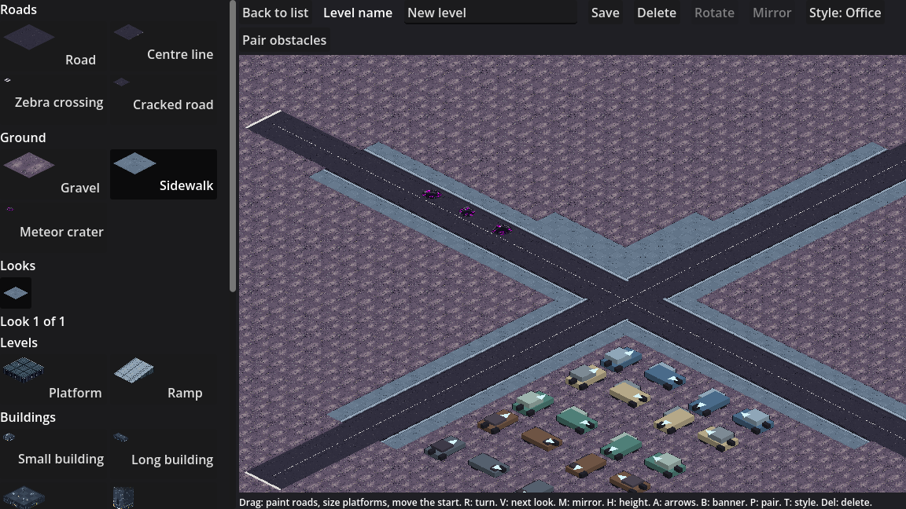

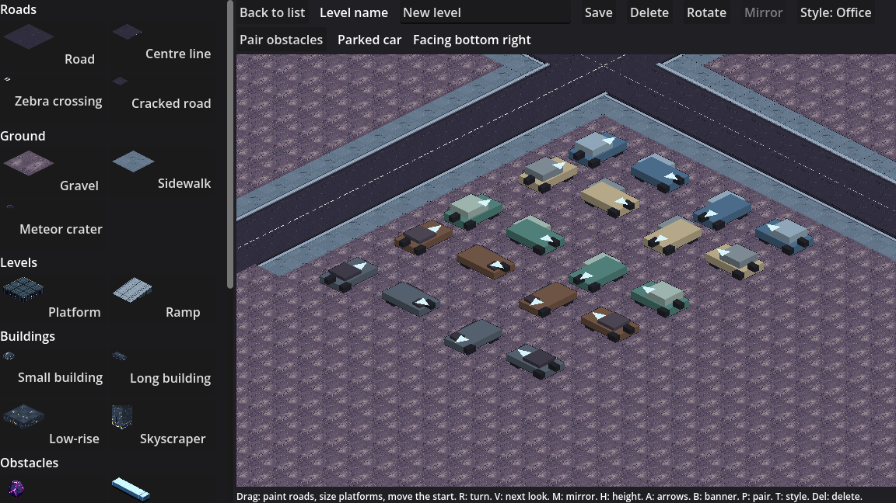

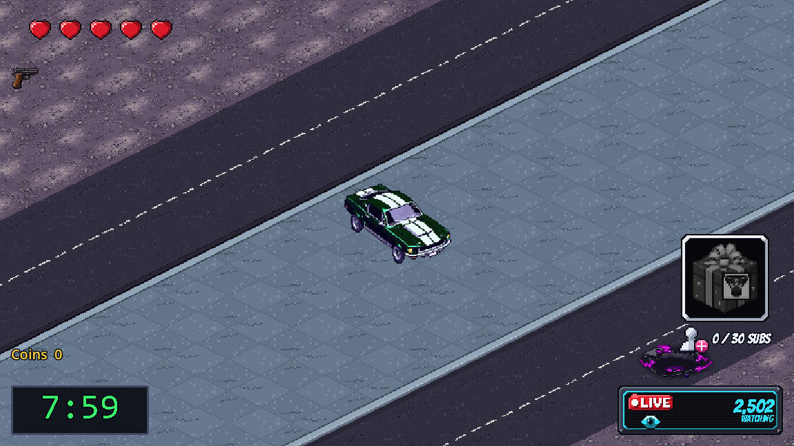

#### Level creator: kaiju alert signs and banners

Task T-441 (Decisions, "Kaiju alert signs are level creator pieces"; the labels are T-440's, "Level creator text" above). How it works: `game/docs/level/level-creator-pieces.md`, "Kaiju alert signs and banners (T-441)". The art is T-130's (`game/art/banners/`), no new art. The points marked as proposals are the Level/Challenge Design Agent's, for the board's playtest.

- **Two pieces under Decoration:** "Alert sign" (the standing road-style sign) and "Alert banner" (the banner that hangs on a skyscraper's wall). Each comes in the two designs, chosen in the looks strip under the picked piece or with V: "Head in triangle" (the red triangle with the kaiju's head) and "Body in circle" (the red circle with its body); the strip names the chosen design.
- **The standing sign** goes on the 2 x 2 unit cell clicked, its post on the cell's middle, on whatever is there: the street, a rooftop or ramp, or a low-rise or small or long building (they are platforms), and it stands at that height (Decisions, "Obstacles and decorations respect the buildings' and rooftops' heights"). Its art has one view, so R does nothing; **M mirrors it** (a proposal: the kaiju then faces the other way). Like a prop, it is not placed where it would reach into a skyscraper or across a rooftop's or ramp's edge ("Can't place here: it overlaps another piece.").
- **The banner** goes on the skyscraper under the mouse (the nearest one drawn there), and on nothing else: over a platform, a low-rise, a small or long building, or the street nothing happens. **R chooses the wall** (the south or the east face, the two the view shows; "R: next wall." in the strip), and **H how high** its bottom hangs: 3, 6, 9, 12 or 15 units above the ground (a proposal: 3 is T-130's height, 15 keeps it below the tower's dissolving top; "H: next height." in the strip). Along the wall it is centred on the mouse, in half-unit steps, and always stays on the wall (a proposal). It looks as T-130's banners did: sheared onto the wall, flipped for the east face, part of that skyscraper's picture, so it fades with that skyscraper when the car is behind it and is drawn in its depth.
- **Preview, selecting, moving, deleting:** the piece is shown where it will go before the click (a banner only over a skyscraper). A click on a placed sign's or banner's picture selects it (outlined), and Delete removes it; moving one is deleting it and placing it again, as for the other pieces. Deleting a skyscraper takes its banners with it.
- **Pictures only:** neither has a collision; the car, the enemies and the kaiju pass through them.
- **Saved levels:** a new `alert_signs` list in the level file (a sign: its cell and design and whether it is mirrored; a banner: its skyscraper, wall, place along the wall, height and design). The run draws them exactly where the editor shows them. Levels saved before have none and open unchanged.
- **The fixed sign list is retired:** `game/data/level/kaiju_signs.json` (T-130's four banners and two standing signs at fixed places) is gone, and a map shows only the signs its own level places. The game's map, Kaiju City, has none until the board places them in the creator and the level is copied into the game.

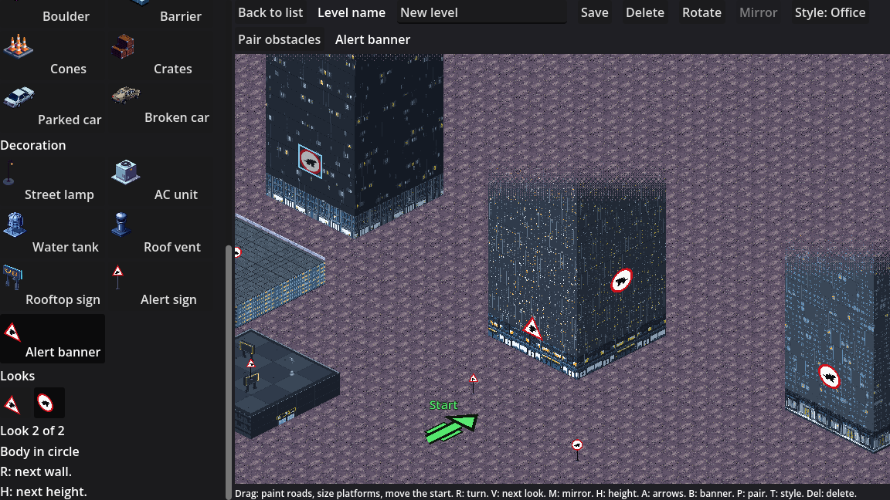

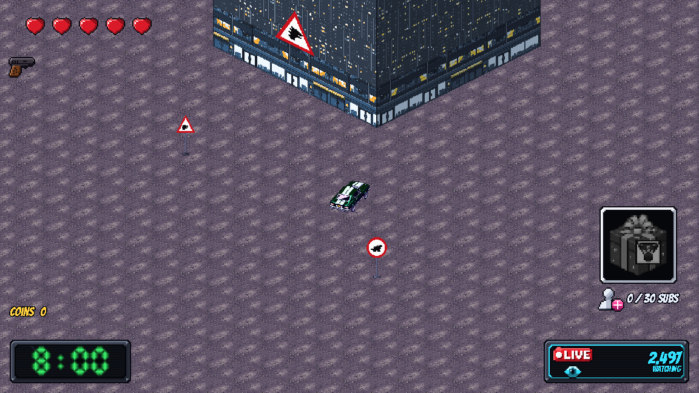

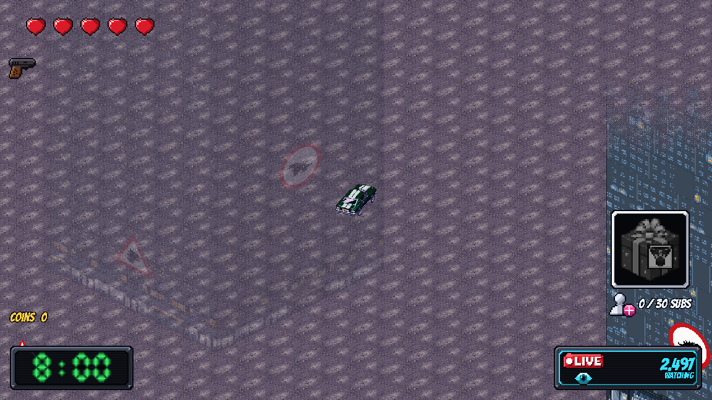

#### Short buildings as platforms

Task T-405 (Decisions, "Short buildings become platforms"). How it works in the code: `game/docs/level/level-creator-pieces.md`, "Short buildings as platforms (T-405)". The art: Visual style, Content, "Short buildings as platforms".

- **Which buildings:** the low-rise (4 designs, 2 looks each), the small (6 by 6) and the long (12 by 6, turned 6 by 12) building are platforms at **height 3**. Only the skyscrapers stay solid buildings. Nothing changes in how they are placed, mirrored or saved: a level file still lists them under `buildings`, so every level saved before loads them as platforms.
- **Driving:** the car drives on a short building's roof like on a rooftop, reaches it by a 0-to-3 ramp (the creator links a ramp to it like to a rooftop at 3), meets its sides from the street as walls, and falls off its edges. A rooftop at 6 may stand on it.
- **Joins:** two short buildings side by side, or one beside (or overlapping) a 3-high rooftop, make one surface: the same height, so no bump and no wall, and no wall or roof edge drawn along the join. A parapet breaks where a ramp meets the edge, as on the rooftops. A short building beside a higher rooftop draws no wall or edge against it either.
- **Enemies** treat them as rooftops: they walk up the ramps onto them and drop off their edges (the enemies' paths, T-226).
- **Objects:** props and boulders go on them like on a rooftop, at height 3; one across a short building's edge, or across the join between two of them, is not placed (T-393's edge rule; a proposal: the join could be allowed later). The car's spawn point may stand on one.
- **See-through (proposal):** a short building fades while it covers the car behind it, as the rooftops do (the car on its roof, or in front of it, never fades it).
- **The game's own map:** each short building of its blocks (about one per block) is a platform on its 12 by 12 footprint; the block's other three slots stay solid skyscrapers with their pavement, and the pavement round the short building is open street (proposal: before, the whole block was solid). It has no ramp to them, so they are reached only from the air. The old MVP map without heights is unchanged.

**The altitude audit (proposals for the board's playtest).** Every collider of a level and how it works at height:

| Collider | How it blocks the car |
|---|---|
| Skyscraper (and a block's skyscraper slot) | A wall at any height, on the street, on a rooftop and in the air. |
| Map edge | A wall at any height. |
| Short building, rooftop | No body: its sides stop a car below its top (a car that drives into a 3 from the street bounces off its side); a car at or above its top drives or lands on it. |
| Ramp | No body: its sides stop a car below the slope; its foot and top end are open. |
| Prop (barrier, cones, crates, AC unit, water tank, roof vent, street lamp, rooftop sign) | Only from the ground it stands on (the height under its centre) up to its top (its drawn height): a car on a rooftop passes over a street prop at the rooftop's edge, a car in the air passes over a prop it clears, a car on the street never touches a prop up on a roof. |
| Boulder (placed, a meteor's) | The same, from its ground up by its diameter (3 units). |
| Spawn point | Not a body: the car starts at the ground's height there (a short building's 3 included). |

The car's own height model treats the car as its centre point (car_height.gd): a car that lands overlapping a prop or boulder keeps passing through it until it is clear of it rather than being pushed out (a proposal); T-411 (the car's whole footprint) would make the sides and edges meet the drawn car instead.

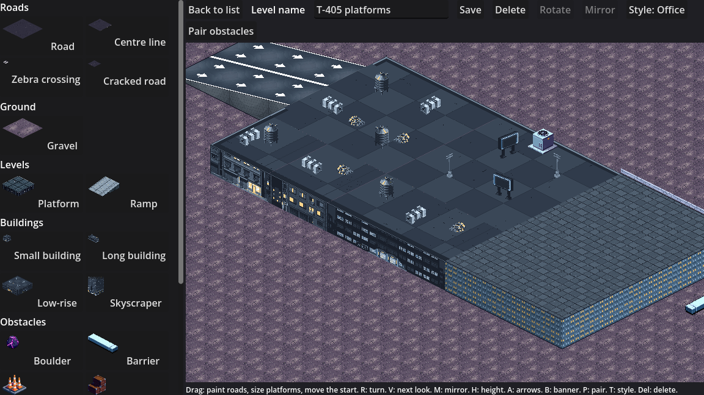

#### Elevation test scene

The ground side of the elevation test scene (task T-182; Decisions, "Raised areas and ramps"). Every number below is a proposal for the board's playtest. Units are the flat world's (x east, y south).

- **Platform:** one raised platform, an axis-aligned rectangle of 16 by 16 units (proposal), 3 units high (proposal). The car can drive onto and across it.
- **Ramp:** one ramp on the platform's east side, 12 by 8 units (proposal), rising in a straight line from 0 at its foot to the platform's height at the platform's edge.
- **Drop-off edges:** the platform's other three sides, and its east side beside the ramp, are drop-offs: leaving the platform there is a step down of the platform's height.
- **Height data format:** `game/data/level/elevation_test.json` holds a list of platforms (rectangle and height) and a list of ramps (footprint, platform, the side it climbs, bottom and top height), so the map and the board's later level editor can add more. The file's fields and the query's functions: `game/docs/level/elevation-test-scene.md`, "Elevation test scene". The ramp's top is at the platform's side, and its foot is 12 units east of it (x from 8 to 20, y from -4 to 4; the platform spans -8 to 8 on both). The art drawn over them: Drifting, Content, "Elevation test scene".

#### Elevation sample map

The drive-only sample map with three layers (Decisions, "Elevation sample map"). Every number below is a proposal for the board's playtest. Units are the flat world's (x east, y south).

**Height data** (task T-193). The map's heights are a list of areas a level editor can later edit, in the same format as the elevation test scene's file:

- **Platforms** (raised areas, the rooftops): each has an `id`, an axis-aligned rectangle (`x`, `y` = its north-west corner, `w`, `h`) and a `height` (3 for the first floor, 6 for the second).
- **Stacking:** a platform may stand on another (a second-floor rooftop on a first-floor one). It says so with an optional `on` field naming the platform under it; its whole rectangle lies inside that platform, and it is higher. Two areas may overlap only like that; any other overlap is a mistake. At any point the ground's height is the highest area's.
- **Ramps:** each has an `id`, the `platform` it climbs to, the `side` of that platform it climbs (`north`, `east`, `south` or `west`), a footprint rectangle next to that side (its top end on the side), a `bottom_height` and a `top_height`. The height rises in a straight line from the foot to the top. `bottom_height` is the ground at the foot: 0 for a ramp from the street, 3 for a ramp standing on a first-floor rooftop and climbing to a second-floor one. `top_height` is the height of the area it climbs to.
- **Drop-offs:** every side of a raised area without a ramp, and a ramp's own two sides, are drop-offs. From a second-floor rooftop onto the first-floor rooftop under it, the drop is 3; onto the street, 6.
- **Validator:** `python game/tools/check_height_data.py <file>` checks a height-data file before a map is handed over (overlaps, stacking, each ramp's top touching its area, its bottom and top heights matching the ground at its foot and the area it climbs to, its side). Every field and how to run it: `game/docs/level/elevation-sample-map.md`, "Elevation sample map".

**The layout** (task T-194). The MVP map ("MVP map" above: 240 by 240, the same roads, gravel centre, buildings and boulders) with two parking garages added. Every rooftop, ramp, size and position here is the Level/Challenge Design Agent's **proposal for the board's playtest**.

- **North-west garage** (proposal): a first-floor rooftop (height 3) over the top row's two west blocks and the road between them (x -96 to -12, y -96 to -66, 84 by 30). On its east block stands a second-floor rooftop (height 6, x -42 to -12, 30 by 30), whose north, east and south sides drop 6 straight to the street.
- **Ramps** (proposal): a 0-to-3 ramp climbs the first floor's south side from the road below it (x -86 to -76, y -66 to -54); a 3-to-6 ramp stands on the first floor and climbs the second floor's west side (x -54 to -42, y -86 to -76). Each is 12 units long per 3 units of rise (the elevation test scene's slope) and 10 units wide (the car is 1 by 3; roads are 24).
- **The drive:** street, up the first ramp onto the height-3 rooftop, east up the second ramp onto the height-6 rooftop, then off its east edge onto the road at x 0 (a 6-unit drop), or off its north or south edge.
- **South-east garage** (proposal): the same, turned half a turn around the map's centre (first floor x 12 to 96, y 66 to 96; second floor x 12 to 42; the 0-to-3 ramp on the first floor's north side, the 3-to-6 ramp on the second floor's east side).
- **Left out of the MVP layout:** the 4 buildings under the rooftops, and the 8 boulders on a rooftop, on a ramp or on the 6-unit strip in front of a ramp's foot (4 Two Boulders copies, so 1 challenge, kept off in the MVP, goes too). Everything else is the MVP map's, unchanged.

The file is `game/data/level/elevation_sample_map.json`, made by `python game/tools/build_elevation_sample_map.py` from `mvp_map.json` (which it doesn't change); how to rebuild and check it: `game/docs/level/elevation-sample-map.md`, "Elevation sample map", "The layout file (T-194)".

**The scene** (task T-196): `game/scenes/elevation_sample/elevation_sample_map.tscn`, drive-only (no enemies, weapons, run timer, likes, levels or HUD). It shows, in the isometric view, the MVP map's ground art, buildings (see-through), boulders and edge walls built from the layout file above; every rooftop and ramp of it with the elevation test scene's script drawing as a placeholder (the art is a later ticket); the car with its final sprite lifted by its height and its round shadow on the ground under it, with its real height on the rooftops and ramps; and the camera following as in the elevation test scene. W/A/S/D drive.

- **Start** (proposal): on the road at (-81, -50), facing north, 4 units from the foot of the north-west garage's 0-to-3 ramp, so W drives straight up it.
- **How the board opens it** (proposal, an open question below): like the elevation test scene, open the scene in the editor and press F6, or the run command in `game/docs/level/elevation-sample-map.md`, "Elevation sample map", "The scene (T-196)". No main menu button.
- **Depth order** (task T-197): every rooftop, ramp and building is drawn in one back-to-front order with the others: a second-floor rooftop over the first-floor one it stands on, a ramp standing on a rooftop over that rooftop, and otherwise whatever lies wholly west or north of another (the far sides on screen) under it. The car and its shadow are drawn under any rooftop, ramp or building they are behind and lower than its top, and over the ones they are on, above or in front of: on a height-3 rooftop behind a height-6 one, the car is over the first and under the second; in the air above 6 it is over both. As in the elevation test scene (T-191), "behind" is judged by the car's centre, so a car driving into a rooftop's back side (top-left or top-right on screen) stays under it through the hit, with no popping over it. How it works: `game/docs/level/elevation-sample-map.md`, "Elevation sample map", "Depth order and see-through (T-197)".
- **See-through** (task T-197; Decisions, "Raised areas turn see-through like buildings"): every rooftop and ramp that covers the car fades exactly like the buildings ("When a building fades"), with the buildings' own fade, not a copy; the others stay solid. The buildings keep fading as on the MVP map, judged against the car drawn at its height.

**The run on this map** (task T-206; Decisions, "The elevation sample map becomes the run's map"): a run started from the main menu plays on this layout, with the rooftops, ramps, the car's height, its round shadow, its shadowless frames in the air, see-through and the depth order exactly as in the drive-only scene (the same code, `game/scripts/level/elevation_layer.gd`), and with the whole run on top: enemies, weapons, the timer, likes and levels, the gift pack drop and the kaiju. The drive-only scene stays as it is (F6). Proposals for the playtest:

- **Start:** the run's start is unchanged, the centre of the gravel square (0, 0), nose north; the gravel square is the MVP map's and lies at street level on this layout.
- **Enemies, coins, pickups and effects** are drawn at street level (height 0) in the depth order: under a rooftop or ramp that covers them, like the car on the street. Gift packages, meteors and other things that look for an open spot on the ground only pick street-level spots (no rooftop or ramp). One exception, the gift package (T-402; Decisions, "A gift pack that falls on a platform shows on it"): when no street spot is open within its search, because the car is well inside a large rooftop, it lands on open, flat ground of that rooftop, drawn at the rooftop's height and picked up there (Game loop architecture, "The gift pack drop"). Every pickup (gift package, coin, health pickup) is drawn and picked up at the height of the ground it lies on: on a rooftop only from the rooftop, never from the street below (board, 2026-10-30, T-402). How enemies deal with heights is task T-207's.
- **The car's drift smoke and boost** are lifted with the ground under the car, so on a rooftop they stay at its tyres; in the air they stay on the rooftop or street under it.
- **Switching back to the MVP map:** one constant, `USE_ELEVATION_MAP` in `game/scripts/run/run.gd` (`game/docs/game-loop/the-run.md`, "The run").

**The art** (task T-198; proposal for the board's playtest): the rooftops are building rooftops with the city's lit-window walls, and the ramps parking-garage ramps of concrete with painted lane lines. What was generated, and the weak results: Visual style, Decisions, "Elevation sample map art, what T-198 made"; how it is built: `game/docs/level/elevation-sample-map.md`, "Rooftop and ramp art (T-198)".

**The scripted drive** (task T-195): `bash game/tools/drive_elevation_sample.sh` drives the real car from the street up the 0-to-3 ramp, up the 3-to-6 ramp and off the height-6 edge, and prints the layers reached, the maximum height and the airtime. What it checks and its log: `game/docs/level/elevation-sample-map.md`, "The car's height on the three layers (T-195)"; the behaviour: Drifting, Content, "Elevation sample map".

**The final screenshot set** (task T-199, final art) is in `art-archive/T-199/screenshots/`: `street.png`, `ramp-0-3.png`, `ramp-3-6.png`, `height-3.png`, `height-6.png`, `air.png`, `behind-height-3.png`, `behind-height-6.png` and `city-overview.png`.

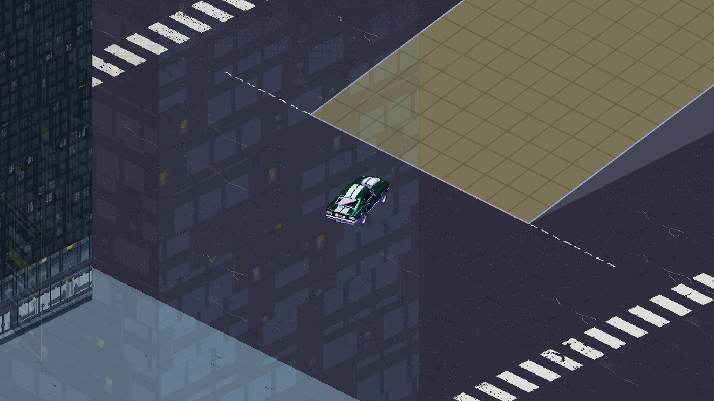

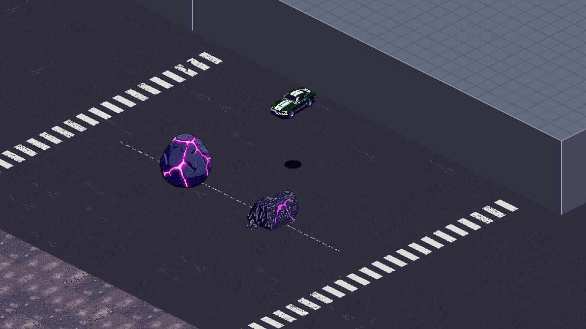

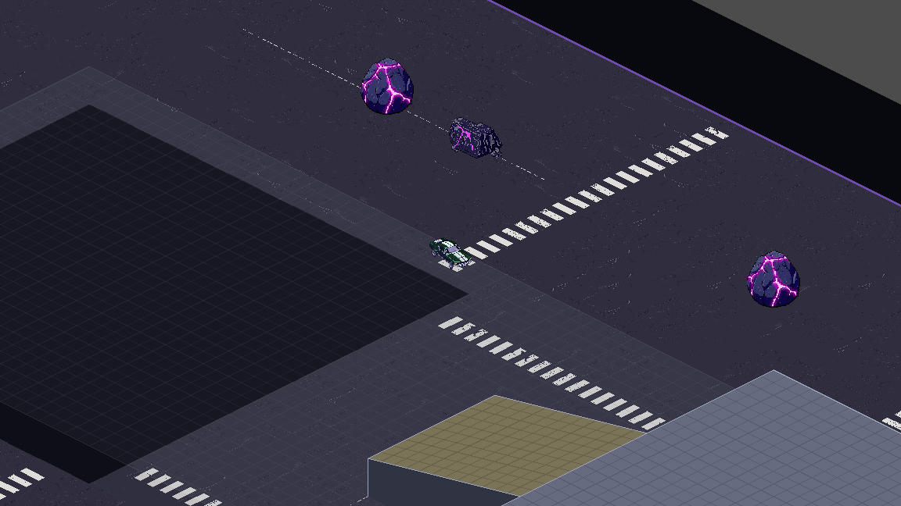

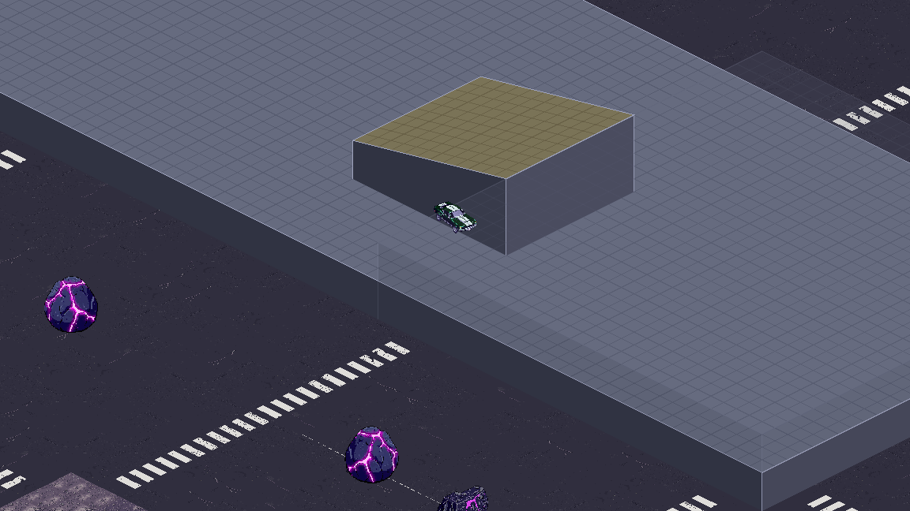

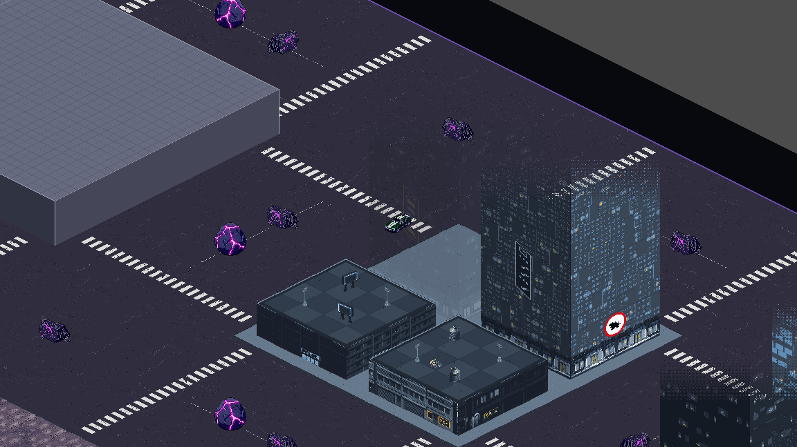

### References

- The board's challenge drawings: `docs/level-design/` (Content, "MVP challenges"). They are exported from Crash City Grid with `python tools/export_challenge_drawings.py <folder of downloaded drawings>`.
- Drivability check (task T-021): `game/tools/check_challenge.sh`, explained in `game/docs/level/challenge-check.md` ("Challenge drivability check"). The lines the car drove on the board's sketches: [Single Boulder, arrow 1](level-design/single-boulder/arrow-1.driven.svg), [Single Boulder, arrow 2](level-design/single-boulder/arrow-2.driven.svg), [Two Boulders, arrow 1](level-design/two-boulders/arrow-1.driven.svg) (data in the `.driven.json` next to each).
- The MVP map's layout data (Content, "MVP map"): [../game/data/level/mvp_map.json](../game/data/level/mvp_map.json), with the buildings, ground cells, pattern copies, boulders and challenges (arrow points and centre lines) in units from the map's centre. It and the fitted patterns are made with `python game/tools/build_mvp_map.py`; how to open the map in Godot: [../game/docs/level/mvp-map.md](../game/docs/level/mvp-map.md), section "MVP map".
- Crash City Grid, the map editor the board and the Project Lead draw the map in: https://claude.ai/artifact/R9AUtdNttfHKNgeqGDCPAH (private to the board). Each map is saved as an 80 by 80 grid of cells, plus its boulders, pattern groups, challenges and arrow paths, in units from the map centre; the Project Lead reads it and copies what the Level/Challenge Design Agent needs into its tasks.

## 4. Enemies

*Source: [enemies.md](enemies.md). Which enemies exist, what they look like, how they move, deal damage and behave, including the boss.*

Each level ends with its own final boss; in the first level, Crash City, it is the kaiju. The MVP boss is a huge, slow sprite that walks toward the player and deals contact damage. Its one special move rains meteors that land as boulders, new obstacles on the roads. Weapons can damage it at any time.

### Decisions

- Each level ends with a different type of monster as its final boss. The kaiju is only the first level's boss.
- MVP boss: a sprite much bigger than the player, walking slowly toward the player, with contact damage.
- The boss has one special move. After a short animation, several meteors rain down at once. In 2D, each is a meteor sprite falling top to bottom, with an impact animation on landing.
- Before the meteors land, a danger warning area shows on the ground for 2 seconds. A meteor that lands on the player deals damage and knocks them back.
- Landed meteors become boulders, plain obstacles like the map's own, where they land. No challenge or arrow comes with them, since challenges are left out of the MVP (Level design, Decisions).
- A boulder left by a meteor stays for 10 seconds after it lands, then fades away and is gone.
- A meteor never lands on a boulder left by an earlier meteor that is still there (standing or fading); once that boulder is gone, its spot is free again.
- **The kaiju can be damaged at any time.** It has no shield and no vulnerability windows.
- Over a run, the number of enemies grows slightly. Enemies do not get tougher.
- The MVP minion walks on four legs towards the player (how it looks: Visual style, Decisions). Its health, contact damage and knockback are balancing numbers for the Game Data Agent; it does not copy a Unity prototype enemy.
- The Game Data Agent proposes the kaiju's health, together with the player's weapon damage; the board judges it in playtests.
- The Game Data Agent, with the Enemy Behavior Agent, works out the balancing numbers: how enemy numbers grow over the 7 minutes (within "slightly"), the coin drop chance and amounts, and how often the kaiju drops meteors and how many. The board judges them in playtests.
- When the kaiju is defeated it always drops a few coins (100% chance). Its death ends the run straight away, so its coins are added to the run's coins as the run ends, without being picked up.
- Where and how minions spawn, and how often their contact damage applies, are proposed by the Enemy Behavior Agent with the Game Data Agent; the board judges them in playtests.
- Killing the kaiju ends the run at once, as a win.
- The higher the player's combo (Game loop architecture, Decisions), the more minions spawn, on top of the slow growth over the run. It can be switched off, so the board can judge in playtests whether to keep it; the Game Data Agent proposes how strongly the combo raises spawning.
- **Minions spawn on a timer, and 30% slower** (board, 2026-10-31): minions no longer top up to a wanted number around the car (that rewarded not killing them: the fewer the player killed, the fewer came, so runs reached the end with few likes and weapons). Instead they spawn on a constant timer, coming in from the edges of the screen, however many are already around, and the timer speeds up as the run goes on, so more of them come later in the run. The combo still raises spawning on top of that (the decision above). Minions move 30% slower (move speed 6 becomes 4.2 units per second). With many more enemies on screen, the game is optimised so a crowd of minions doesn't slow it down much. The spawn rates at the start and the end of the run, and any safety ceiling on how many can be alive at once, are the Enemy Behavior Agent's proposals for the playtest. (T-443, T-444)
- Polish for the MVP, once the MVP is playable end to end: minions get a damage animation when hit, and when two minions bump into each other they fall down, get up again and carry on running at the car. How long they stay down is proposed by the Enemy Behavior Agent; the board judges it in playtests.
- The kaiju walks round buildings and boulders, like the minions, rather than through them.

- **Enemies follow the car up the ramps** (board, 2026-10-21, after playing the full game on the elevation map, where enemies ignored every raised surface): enemies treat rooftops as raised ground they can only reach by the ramps. To reach a car on a rooftop they find their way to a ramp, drive or walk up it and follow the car, with pathfinding over the map's streets, ramps and rooftops; a rooftop's edge blocks them like a wall from below. (T-207)
- **Enemies jump down off ledges** (board, 2026-10-21, after playing T-207): going down, enemies don't walk all the way round to a ramp: to chase a car below them they jump (drop) off a rooftop's edge. Going up still needs a ramp, and an edge still blocks them from below. A falling enemy plays a falling animation from the edge until it lands (board, 2026-10-21; placeholder T-226, art T-227). (T-226)

- **Health drops** (board, 2026-10-21): enemies also drop health pickups, at the same drop rate as the coins. Picking one up restores 30% of the car's health (never above its maximum). It looks like a red gas canister with a white cross on it (look: Visual style, Decisions). (T-220, art T-221) **Halved** (board, 2026-10-22): health drops now drop at half that rate (0.6 to 0.3), no longer the coins' rate; the coins are unchanged. (T-277)
- **Damage in hearts, fewer health drops, bolder outlines** (board, 2026-10-28): with hearts (Game loop architecture, Decisions, "Hearts instead of health points"), a minion's hit and a meteor take 1 heart and the kaiju's 2, once per hit, with the car's 1-second invulnerability after it instead of repeated contact hits. Health pickups drop at half today's chance (15% instead of 30%) and heal 1 heart. Every enemy's outline is a little bolder, so the player sees where they are and can steer round them. (T-333, T-334, T-340)
- **Health drops 1.5 times as often** (board, 2026-10-29): "increase the drop rate of health items by enemies by 1.5 times of what it is now": a killed minion drops a health pickup with a chance of 22.5% instead of 15%. The coins, the heal (1 heart) and the kaiju (none) are unchanged. (T-371)
- **Minions twice as big** (board, 2026-10-29, an MVP nice-to-have): the minions are drawn twice as big, and the size they hit and get hit with grows to match, so what the player sees is what touches the car. The kaiju stays as it is. **Built in T-379:** `size_scale` 2 in `game/data/enemies.json` (`minion`).
- **Minions don't get stuck on ramps** (board, 2026-10-29, an MVP nice-to-have; a bug): chasing the car, minions sometimes get stuck on walls as they try to go round a corner, mostly at the bottom end of a ramp. They should find their way round. **Built in T-380** (see Content, "Finding the way").
- **A red flash when an enemy takes damage** (board, 2026-10-30): every enemy (minions and the kaiju) flashes red when a weapon or the car hits it, the same red flash the car shows when it loses a heart (Game loop architecture, Decisions). Its length and shade match the car's; for the kaiju, whether it flashes on every hit or only in its vulnerable window is a proposal. Built in T-404 (see Content, "The red flash").
- **Meteors hit minions and push pickups aside** (board, 2026-10-30, audit): a meteor that lands on minions damages them; coins and health pickups where a boulder appears are pushed out of its way. A meteor misses a car more than 1 unit above it, the same rule as contact damage.
- **The kaiju only takes paths it fits through** (board, 2026-10-30, audit; a bug): the kaiju plans its way round buildings for its own size, so it never heads into a gap too narrow for it. It also keeps its body off rooftops', ramps' and the map's edges, and drops off a rooftop from a little way back from the edge (board, 2026-10-30, after playing build J: keep the edge rule; T-419).

### Content

#### The red flash (built in task T-404)

Every minion and the kaiju flash the car's red (Game loop architecture, Decisions) when a weapon or the car damages them and they survive: same colour and length, read from `hit_flash` in `game/data/run.json` (0.4 s, red [1, 0.25, 0.25], proposals). It replaces T-072's pale 0.12 s tint. Proposals: a hit that kills skips the flash (the enemy is gone at once); the kaiju flashes on every hit, not only in its vulnerable window; a new hit restarts the flash; the flamethrower's orange burn flash still wins over red. How: `game/docs/enemies/minions.md`.

#### The minion (built in task T-044)

What the game does now, with the numbers in `game/data/enemies.json` (see References). How it is built, and the damage function the weapons call: `game/docs/enemies/minions.md`, "Minions".

- **Look:** a placeholder for now: a light green four-legged lizard shape with a tail, drawn in code, facing the way it walks. Since T-379 the minions are drawn twice as big (`size_scale` 2, a whole number, so the pixel edges stay hard): about two units across, twice the car's width. The final minion art comes from a separate art task.
- **Spawning (T-443, on a timer):** minions come in one after another on a timer, however many are already around, each just beyond the edge of the visible screen (3 units out), at a random point on the street that is clear of buildings and boulders, so they walk in from the edges. The timer speeds up over the run: one every 1.2 seconds at the start, one every 0.3 seconds (4 a second) at the 7-minute mark (the kaiju's arrival), then held; in between the number per second grows in a straight line (one every 0.48 seconds at 3:30), about 870 minions over the 7 minutes. A safety ceiling of 100 minions alive at once stops the timer only while that many are alive, to protect the frame rate. All of these are proposals for the playtest (reasons: T-443's result notes; numbers in `game/data/enemies.json`, `spawning`). Minions the car has left a whole screen behind disappear, and the timer keeps bringing new ones in at the screen's edge. The higher the combo, the faster the timer (Decisions; see "The combo raises spawning" below).
- **Movement:** each minion walks straight towards the car at 4.2 units a second (30% slower than the old 6, T-443). Minions push a little apart from each other so they spread around the car. They do not walk through buildings, walls or boulders: they slide along them and walk round one that is in the way. They never block or push the car.
- **The combo raises spawning:** the spawn rate is multiplied by the combo's spawn multiplier, so the timer's interval is divided by it (T-443; up to 1.75 times as many, 0.3 s becoming about 0.17 s at the top) (Game loop architecture, The combo; numbers in the combo data), live as the combo changes: no combo, no extra minions; the higher the combo, the more, up to the data's maximum. A setting (`combo_raises_spawning`, on by default; how to flip it is in `game/docs/enemies/minions.md`, Minions) switches it off for playtests.
- **Contact damage:** while a minion touches the car's body, it hits the car: 1 heart off the car (which also cuts the combo, Game loop architecture) and a knockback away from the minion. Data (T-333): `contact_damage` 1; the old 0.5 s repeat (`contact_damage_interval`) is gone from the data, the car's 1 s invulnerability after a hit spaces the hits (built in T-334: while it lasts no enemy hits the car or knocks it back, a proposal for the playtest).
- **Health and death:** 4 health. The weapons damage it; at 0 it dies and disappears.
- **Knocked back by a weapon (built in task T-167):** a weapon can push a minion (the windshield wiper does; Weapons). The weapon gives a direction and a distance in units (the flat world's units, like every distance here); the minion is pushed that far in that direction over 0.15 seconds at an even speed, without walking, then walks towards the car again. It is stopped by buildings, walls and boulders just as its walking is (it slides along them and is never pushed into one). A second push during a push adds to what is left. Only minions can be pushed: the kaiju has no knockback and is never pushed. The 0.15 seconds is a proposed feel number in the code (`KNOCKBACK_SECONDS`); the distance is the weapon's number. How to call it: `game/docs/enemies/minions.md`, "Minions".
- **Coins:** a dying minion drops coins 60% of the time, 2 coins each time, around where it died: placeholder gold coins on the ground. Driving over a coin collects it and adds it to the run's coins. Coins stay on the ground until collected or the run ends.
- **Boulders fade:** a boulder a meteor left stays 10 seconds after it lands, fully visible and solid. Then it fades out over 2 seconds (still drawn and still solid while it fades) and is gone: it no longer blocks the car or anything else, and its spot is free again. The 10 seconds and the 2-second fade are in `meteor_attack` (`boulder_lifetime_seconds`, `boulder_fade_seconds`; the fade's length is a proposed number). The map's own boulders never fade. The flat view's placeholder circles vanish at the end without fading (only the boulder art is see-through).
- **Health pickups (built in T-220):** a dying minion also drops a health pickup where it died, at the ground height it stood on, rolled separately from the coins (so one kill can drop both) at 22.5% (`drop_chance` 0.225; was 15%, T-371; 30% before, T-333; 60% before that, T-277), 3/8 of the coins' rate. Driving over it restores 1 heart (`restore_hearts` 1; was `restore_fraction` 0.3), never above the maximum; a full-health car still uses it up (proposal). The kaiju drops none (proposal). Numbers: `health_drops` in `game/data/enemies.json`. The look is a placeholder drawn in code: a small orange-red canister with a white cross; final art T-221.
- **Pause and new runs:** minions, coins and health pickups stand still while the game is paused, and are all gone when a new run starts.
- **Draw order:** minions and coins are drawn in the buildings' depth order like the car: behind a building that covers them, in front of the rest. Buildings fade only for the car, so a minion behind an opaque skyscraper is hidden by it.

#### The kaiju (built in task T-045)

What the game does now, with the numbers in `game/data/enemies.json` (see References). How it is built, and how the weapons and the HUD reach it: `game/docs/enemies/kaiju.md`, "The kaiju". Its meteor attack: below.

- **Look:** a placeholder for now: a large dark slate green Godzilla-style shape drawn in code, seen from the side, with a lighter belly, pale cyan back plates and yellow eyes, facing left or right the way it walks and stomping as it walks. It stands on a ground circle 4 units across (four times the car's width) and is 7 units tall (over twice the car's length). The final kaiju art comes from a separate art task.
- **Arrival:** when the run reaches the boss time (7 minutes in, 1:00 left), the kaiju appears at a random point just beyond the edge of the visible screen, its whole drawing out of view, on the map and clear of buildings and boulders. One kaiju per run.
- **Movement:** it walks straight towards the car at 3 units a second, a little under three quarters of a minion's speed (4.2). Like the minions, it does not walk through buildings, walls or boulders: it slides along them and walks round one that is in the way (confirmed by the board, 2026-10-14). It never blocks or pushes the car.
- **Contact damage:** while it touches the car's body, it hits the car: 2 hearts off the car (which also cuts the combo; data `contact_damage` 2, the old 1 s repeat gone with the minion's) and a knockback of 16 units a second away from the kaiju.
- **Health and damage:** 500 health. Weapons damage it at any time, as soon as it has appeared, the same way they damage minions; there is no shield and no vulnerability window. Any overlap with its body on the ground (the 4-unit circle) counts as a flamethrower hit (board, 2026-10-14; minions keep the centre rule). Its health, and each change to it, can be read for the HUD (no HUD shows it yet).
- **Death:** at 0 health it dies and disappears. Its 10 coins are added to the run's coins at once, without a pickup, and then the run ends as a win, so the coins count in the coins saved.
- **Pause and new runs:** the kaiju stands still while the game is paused, and is gone when a new run starts; it arrives again at the new run's boss time.
- **Draw order:** like the minions, in the buildings' depth order: behind a building that covers it, in front of the rest.
- **Playtest switch:** for the board's playtest of this task, the kaiju arrives 30 seconds into the run instead of at 7 minutes, so it can be seen, fought with the weapons and killed early; it is set back to 7 minutes right before the task merges (board, 2026-10-14). Nothing else in the run moves (`game/data/playtest.json`; how to switch it: `game/docs/enemies/kaiju.md`, "The kaiju").

#### The kaiju's meteor attack (built in task T-046)

What the game does now, with the numbers in `game/data/enemies.json`, `meteor_attack` (see References). How it is built: `game/docs/enemies/kaiju.md`, "The kaiju", "The meteor attack".

- **When:** while the kaiju is on the map, its first attack starts 5 seconds after it appears, then one every 8 seconds.
- **Windup:** each attack starts with a short placeholder animation of 1 second: pale yellow rings pulse above the kaiju's head.
- **Warning:** then 3 warning circles appear on the ground at once, each where a meteor will land, and stay 2 seconds. Each lies within 10 units of the car (where the car was when they appeared), only where the map's placement check accepts a boulder (inside the map, off buildings and other boulders), never on or next to a boulder a meteor left that is still there (standing, fading or waiting for the car to move off; a free ground gap of 1.5 units, `boulder_clearance_units`, because the boulder's drawing is taller than its circle), not overlapping or next to another meteor still to land (same gap), and not on the kaiju. If no spot is free, fewer meteors fall; once a boulder is gone its spot is free again (T-147). A circle is the size of the boulder it will leave (3 units across). Placeholder look: a hazard amber disc with a thick, pulsing amber edge and an inner ring that closes in as the meteor gets near. Amber, not red, chosen while red was kept for Redgull's things and the kaiju alert signs (Visual style, Decisions); it stays amber after the rebrand; the final look comes from a separate art task.
- **Falling and impact:** in the last half second a placeholder meteor (a dark purple rock with a magenta glow and trail) falls onto the circle; when it lands, a placeholder burst of grey dust shows for half a second.
- **Hitting the car:** a meteor that lands with the car's centre within 1.5 units (the boulder's radius) takes 1 heart off the car (`impact_damage` 1, was 15) (which also cuts the combo) and knocks it back at 20 units a second, away from where it landed. One landing anywhere else does nothing to the car. A car more than 1 unit above the landing (jumping over it, or on a rooftop above it) is missed, the same rule as contact damage (T-418).
- **Hitting minions:** a meteor that lands damages every minion at the landing's level whose body reaches within 1.5 units (`impact_radius_units`) of it, for `minion_damage` (2 health points, a proposed number for the playtest; a minion has 4) (T-418).
- **New boulders:** each landed meteor leaves a plain boulder where it landed, the same size, look and collision as the map's own, so the car bounces off it and enemies walk round it. No challenge or arrow comes with it. If the car or the kaiju is on the spot as the meteor lands, the boulder appears as soon as they have moved off it (the car is knocked away at once on a hit), so nothing is trapped inside a boulder. Coins and health pickups on a boulder's spot, when it appears, are moved just outside it (a tenth of a unit clear, to the nearest side that is free ground), still collectable (T-418).
- **Pause and new runs:** the attack, the warning circles and the falling meteors stop while the game is paused, nothing lands once the run is over, and a new run clears them all.
- **Playtest switch:** for the board's playtest of this task the kaiju arrives 30 seconds into the run (the T-045 switch, above), so its first attack comes 35 seconds in; it is set back to 7 minutes right before the task merges.

#### Enemies on the rooftops and ramps (built in task T-207)

What the game does on a map with rooftops and ramps (the elevation map, Level design), following the decision "Enemies follow the car up the ramps". On the MVP map nothing here applies and the enemies walk as described above. Points marked "proposal" go beyond the decision and wait for the board's playtest. How it is built: `game/docs/enemies/ledges-and-rooftops.md`, "Enemies on the rooftops and ramps".

- **Standing on the ground:** every enemy stands on the ground under it: on the street, on a rooftop, or part way up a ramp, and is drawn lifted by that height, in the depth order at that height (over the rooftop it stands on, under a higher rooftop or a building in front of it).
- **Edges are walls:** a rooftop's edge stops an enemy like a wall from below, so an enemy climbs only along a ramp. From above it stops an enemy too, except where the enemy's way to the car drops off it (since T-226: "Enemies drop off ledges" below). It keeps its whole body off an edge, and slides along it. The sides of a ramp are walls too, except near its foot, where the ramp is still low (proposal). A weapon's knockback cannot push a minion over an edge either.
- **Finding the way:** on the car's own surface (the street, one rooftop, one ramp) an enemy walks straight at the car as before. Otherwise it follows a path to the car over the streets, ramps and rooftops, round buildings and boulders, going up each ramp along its middle (and down by a ramp only where that is shorter than dropping off an edge, T-226); the path is renewed about once a second, and at once when the car changes surface. **Minions (since T-380):** a minion walks straight at the car only while nothing stands between them (no building, boulder, rooftop edge or high ramp side on the line to the car, on any surface; a ramp's low foot and the climb along a ramp do not count), and otherwise follows a path round, so it no longer walks into a wall it cannot pass. Why they got stuck before: on the car's surface a minion walked straight at the car even with a wall in the way, so it stood against a ramp's high side, in the corner where a ramp's side meets its rooftop, or against a building just short of its corner; and at a ramp's bottom end it went back and forth between the street (straight at the car, onto the ramp's foot) and the ramp (another surface, so a path back down to the foot). It also turns for the next point of its path only half a unit from it, so its bigger body (T-379) does not cut a building's corner. The kaiju keeps the surface rule. Since the short buildings became platforms (T-405), whose edges lie between the grid's lines, a minion also checks the true ground near those edges before walking straight, and its path keeps a body's reach off them, so it no longer stands at such a platform's corner. A minion far off screen is kept for its walk round only when it is on another surface than the car (a rooftop or ramp), as before T-380.
- **Spawning:** minions come in from the screen's edges on the street only, never on a rooftop or a ramp. The kaiju arrives on the street too (proposal).
- **Staying round the car:** a minion on its way to a ramp is not removed for being far off screen, as long as it is within 120 units of the car (half the map; others are removed a screen beyond the visible one, as before), so minions walking round to a far ramp still arrive (proposal).
- **Contact damage at the car's level:** a minion or the kaiju only hits the car when the car's height (in the air too) is within 1 unit of the ground the enemy stands on: a car on a rooftop is safe from the minions on the street below its edge, and a car that jumps higher than 1 unit over a minion is not hit (proposal for the 1 unit).
- **Pushing apart:** minions push apart only from minions at their own level (proposal).
- **The kaiju (proposal):** the same rules as the minions: it climbs the ramps (its 4-unit body fits the 10-unit ramps), edges stop it, it is drawn at its height and only hits the car at its level, although it is taller than the highest rooftop.
- **The kaiju's way is planned for its size (built in task T-419):** following the decision "The kaiju only takes paths it fits through", the kaiju's way to the car is planned for its own 2-unit body, the minions' for theirs: every point of its way stays at least 2 units off buildings, props and boulders, a gap narrower than its 4-unit body is never on it (minions still go through), and it keeps 2 units off rooftops' and ramps' edges and the map's edge. Where its way drops off a rooftop it walks to a point 3 units back from the edge and drops from there, and it keeps to that way until it has dropped. Where a prop stands at a ramp's end, its way goes over the ramp cell by cell instead of along the ramp's middle. How: `game/docs/enemies/ledges-and-rooftops.md`.
- **Coins:** a coin is drawn at the height where its minion died, and stays on that level. Picking one up is unchanged: driving over it, at any height (proposal).
- **Weapons:** since T-326 (board, 2026-10-28) a weapon hits only enemies on its own height level (Weapons, Decisions, "Weapons hit only enemies on the car's own level"); at the time of this task they hit enemies at any height.

#### Enemies drop off ledges (built in task T-226)

What the game does on the elevation map, following the decision "Enemies jump down off ledges". Points marked "proposal" go beyond the decision and wait for the board's playtest. How it is built, and the hook for the falling art: `game/docs/enemies/ledges-and-rooftops.md`, "Enemies drop off ledges".

- **Dropping off:** an enemy on a rooftop whose way to the car is lower down takes the shortest way, which is usually straight off the nearest edge rather than round to a ramp. It walks out over the edge and falls. It never drops off a ramp's sides, never drops by accident (pushing apart or a weapon's knockback never takes it over an edge), and still never climbs an edge or ends up inside a building.
- **The fall (proposal):** it falls like the car does, from rest under the car's own gravity: about 0.7 s from a height-3 rooftop and 1 s from height 6, walking on at its usual speed meanwhile, so it lands a few units out from the wall (it cannot pass through a building or a higher rooftop while falling). It is drawn at its height in the air, in the depth order at that height, all the way down.
- **How the drop looks (proposal, placeholder):** from the moment it leaves the edge until it lands, a falling animation made by script from its walk frames: the legs flail (the walk cycle three times as fast for a minion, 2.5 times for the kaiju) and the body tips from side to side (and a minion is stretched a little); on landing a short squash (0.18 s for a minion, 0.25 s for the kaiju). The kaiju's ground shadow is not drawn while it is in the air. None of Greenbull's colours. Final falling frames come from a separate art task (T-227) and replace the placeholder per direction as soon as they are in the project.
- **Hurting the car while falling (proposal):** yes, with the same rule as on the ground, by its height in the air: a falling enemy hits the car only when the car's height is within 1 unit of the enemy's height, so one landing on the car hits it, and one still high above it does not.
- **The kaiju (proposal):** it drops off edges too, with the same rules and the same fall.
- **Numbers (proposal):** the gravity (the car's), the animation's speeds, tilt and squash are in the code, not balancing data.

#### Rusty Overcoat: the car damages what it touches (built in task T-463)

Following Drifting, Decisions, "Driving power-ups". Numbers: `game/data/power_ups.json`, `rusty_overcoat` (all proposals for the board's playtest). How it is built: `game/docs/enemies/minions.md`, "Rusty Overcoat".

- **The rule:** with Rusty Overcoat owned, a minion whose body touches the car's takes the owned tier's `contact_damage` (2 / 3 / 4 / 5; a minion has 4 health), with the usual red hit flash, and dies and drops coins as from any damage. The same level rule as the minion's own contact damage applies (the car within 1 unit of the minion's height). The minion still hits the car as before. The overcoat never stops an enemy's hit on the car, not even when its damage kills the enemy in that same step (T-477). Without the power-up, contact deals the minion no damage.
- **Repeat (proposal, open question for the board):** each enemy can be hit again only after the tier's `repeat_cooldown_seconds` (0.5 / 0.5 / 0.4 / 0.3 s), counted per enemy, so driving through a crowd hits each minion once per cooldown and a minion stuck to the car does not melt in one frame. The car's invulnerability after a hit does not stop it (that only protects the car).
- **The kaiju (proposal, open question for the board):** hit only when the tier's `hits_kaiju` is true, which is tier 4 only; it then takes the tier's damage on the same repeat cooldown.

### References

- Enemy numbers (the minion, how many minions are kept around over the run, coin drops, the kaiju and its meteor attack): [../game/data/enemies.json](../game/data/enemies.json), read through `game/scripts/data/enemy_data.gd`; the reasons for each number are in task T-039's result notes.

## 5. Weapons

*Source: [weapons.md](weapons.md). Which weapons exist and their progression trees.*

The car's weapons fire on their own, so the player only drives. The MVP has five: a simple gun the player starts every run with, which automatically shoots at enemies in range, a flamethrower out of the exhaust that fires only while drifting, a neon underglow that hurts enemies around the car, molotovs that leave fire on the ground, and a windshield wiper that sweeps enemies away.

### Decisions

- The MVP has 2 weapons: the starting gun and the exhaust flamethrower (below); since 2026-10-18, 5 (the three new weapons, below). Each level-up offers a choice between them (the level-up flow below).
- The final release has around 8 to 12 weapons, and each level-up offers 3 to choose from.
- **Size upgrades grow on screen** (board, 2026-10-24, after playing the game build): when a picked upgrade makes a weapon bigger (the wiper, the underglow, the flame), the weapon grows to its new size with a short animation instead of jumping to it. The damage area follows what is drawn. The timing is the Weapon Behavior Agent's proposal (T-286).
- The Game Data Agent works out how weapon upgrades scale from level to level, starting from the Unity prototype's upgrade values (below).
- **Starting gun:** the player starts every run with it. It has no visible weapon on the car, only the bullets it fires. It fires only when an enemy is within range, aims automatically, and fires at set intervals.
- **Exhaust flamethrower:** fires flames out of the car's exhaust, only while the car is drifting.
- Both MVP weapons copy the behaviour of the matching weapons in the board's Unity prototype (its starting gun and its Flame Exhaust): targeting, firing, the flame's shape and what turns it on. A report on how they work there is task T-022.
- Their upgrades also copy the Unity prototype's: the same upgrade tiers and what each tier changes.
- **Level-up flow in the MVP:** each level-up offers 2 choices and the player takes 1. The player starts every run with the gun, so the first level-up offers "get the flamethrower" or "upgrade the gun"; once the player has both, each level-up offers "upgrade the gun" or "upgrade the flamethrower".
- A weapon at its last upgrade tier is no longer offered: the level-up offers the other weapon's next tier instead, and if both are at their last tier, the level-up is skipped and the run goes on.
- Where the Unity prototype's weapons behave in unexpected ways (Unity weapons report, section 7), the MVP copies them, with three fixes:
  - **Copied:** the flame uses the gun's damage (2), not its own (1); the bullet's hit circle stays 2 units across, larger than it is drawn; the gun looks for a target only once per firing interval; the weapons never push enemies back; the flame's steering tier makes the car steer 20% faster, compounding; the flame's tier 5 only makes the burn flash last longer; reversing while steering counts as drifting, so the flame comes on.
  - **Fixed:** damage is not rounded to whole numbers, so the flame's "hotter flame" tier always adds damage; the flame's area is the same size whichever way the car faces; a bullet that misses is removed once it has flown past the gun's range.
- The exhaust flamethrower does not switch off the drift smoke (unlike the Unity prototype): smoke and flames both show. (Since 2026-10-22 any enemy is hit when any part of it touches the drawn flame; see "A smaller exhaust flame that burns what it touches" below.) The kaiju is hit when any part of its body overlaps the flames. The starting gun's bullet size and its wait before the first shot stay as built (the Unity values).
- **The flamethrower at height** (board, 2026-10-21): on a rooftop or in the air, the exhaust flames come out of the car's exhaust where the car is drawn, at its height, not somewhere else on the map; they burn what they touch at that spot. (T-206)
- **The underglow and the wiper at height** (board, 2026-10-21): the neon ring is drawn under the car at the car's height, so on a rooftop, a ramp or in the air it rises with the car instead of staying on the street; the windshield wiper's arm is lifted the same way. Their damage areas are unchanged. The molotov fire stays on the ground where the bottle landed, so it is not lifted. In the air the ring stays under the car (a proposal for the playtest). (T-225)
- **Three new weapons** (board, 2026-10-18), gained at a level-up like the flamethrower:
  - **Neon underglow:** neon lights under the car that make a circular area around it. Enemies inside take damage every second, and an enemy takes damage as soon as it enters the area.
  - **Molotovs:** thrown from the car at random, each one makes a circular area on fire where it lands. Enemies in a fire area burn and take damage.
  - **Windshield wiper:** one wiper in front of the car that sweeps in a semicircle, like a windshield wiper. Enemies it hits take damage and are knocked back. It is the only weapon that pushes enemies (the "never push enemies back" rule above is about the gun and the flamethrower).
  - They join the MVP, which then has 5 weapons (6 with Bricks, below). Each has 8 tiers like the gun and the flamethrower: getting it is tier 1, then 7 upgrades. Their numbers and what each tier changes are proposals by the agents, judged in the board's playtest.
  - Answers to the goal runner's questions (board, 2026-10-18): an enemy burns only while it is inside a molotov's fire area, not after it leaves. The windshield wiper sweeps all the time; it damages the kaiju but pushes only minions. The garage's damage bonus multiplies the damage of every weapon, the three new ones included. The starting gun's level-up card shows a small pixel-art gun.
- **A smaller exhaust flame that burns what it touches** (board, 2026-10-22, after playtests; replaces "a minion is in the flames when its centre is" of 2026-10-14): when the flamethrower is first picked up (tier 1) its flame is drawn 4 to 5 times smaller than today (a proposal of about a quarter of today's length and width), growing with its size tiers as before; it is drawn behind the car and behind the enemies, never over them; and its damage area is the flame as drawn, so a minion takes damage as soon as any part of it touches the visible flame (the kaiju as before, any overlap). (T-267)
- **A stronger wiper push** (board, 2026-10-22, after playtests): the windshield wiper's first level (tier 1, when it is picked up) pushes a minion back about twice the car's size; read as twice the car's length, 6 units (the car is 1 unit wide and 3 long), against 1.5 today. The later tiers keep their multipliers, so they grow from the new base. (T-266)
  - **Level-up offers with five weapons:** each level-up still offers 2 choices, now two different ones drawn at random from every choice available (getting a weapon the car doesn't have, or the next tier of one it has).
- **The first gift pack can hold any weapon** (board, 2026-10-28; replaces "The first level-up still offers 'get the flamethrower' or 'upgrade the gun'" above): the first level-up draws its two choices at random from every choice available, like every later level-up, not only the gun and the flamethrower. (T-321)
- **Bricks** (board, 2026-10-28): a new weapon. The car carries a load of bricks; each time the car lands on the ground after being in the air, from any height, a powerful impact wave goes out around it and damages the enemies it reaches. In the first build the wave is the same whatever the height of the fall. Its card makes it sound useless, so the player is tempted to try a jump and find out: the board's direction for the description is "Bricks - A bunch of bricks. No real use, other than making the car heavier." with a hint to jump. Text: T-322; numbers: T-323; the weapon: T-324; art: T-325.
- **Weapons hit only enemies on the car's own level** (board, 2026-10-28; replaces "Their damage areas are unchanged" in "The underglow and the wiper at height" above, for damage): on a map with rooftops and ramps, a weapon damages only the enemies on the same height level as the weapon's hit: the car's level for the gun, the flamethrower, the underglow, the wiper and Bricks, and the fire's level for a molotov. An enemy on the street is not hit from a rooftop above it, and the other way round. How a ramp's in-between heights and the kaiju count are the agents' proposals for the playtest. (T-326)
- **The gun one-shots minions and grows in bullets, speed and targets** (board, 2026-10-30; replaces the gun's tier plan in "The starting gun" below and answers the open question on upgrading how often it fires): from tier 1 one bullet kills a minion. Its upgrades go to how many bullets it fires and how fast, in this order: **+1 bullet** twice, **faster attack** twice, then at the halfway upgrade it **targets up to 3 enemies at once** (it has 3 bullets by then); then **+1 bullet** twice and **faster attack** twice, and at its last upgrade it **targets up to 5 enemies at once**. That makes 10 upgrades (tiers 2 to 11) against today's 7; the range and pass-through tiers go. What "targets up to N" means against today's closest-first spread, and the speeds, are the agents' proposals for the playtest. (T-408)
- **The neon underglow kills a minion in 2 ticks and pushes from tier 1** (board, 2026-10-30): each tick deals half a minion's maximum health at tier 1, so 2 ticks kill it, and from tier 1 it knocks enemies back a little (today it never pushes). How far, and whether the push grows with the tiers, are proposals. (T-409)
- **Weapons during the wreck** (board, 2026-10-30, audit): while the car is wrecked (Game loop architecture, Decisions, "The wreck decides the loss at its end"), damage already on the map keeps going (molotov fires, burning enemies) and the neon underglow keeps ticking; the bricks still go off if the wrecked car lands from the air. Nothing new is fired: no gun, no molotov throws, no wiper, no exhaust flamethrower. Built in T-414. Proposals for the playtest (T-414, not the board's yet): a bullet or a molotov bottle already in the air carries on and lands; a gun volley still queued is dropped; the flamethrower's burn tints already on enemies run out; and the weapons stop at once when the run ends, even in the middle of a step (a kaiju kill ends the run, and nothing later in that step damages anything).
- **Molotovs land where enemies can be** (board, 2026-10-30, audit): a molotov whose landing spot is inside a building or off the map picks another spot. Built in T-414. Proposals for the playtest: a short building counts as ground (a platform the car can drive onto), so a bottle may land on it; a bottle tries up to 30 spots and, if none fits, lands at the car.
- **The underglow barely pushes the kaiju** (board, 2026-10-30, audit; answers T-409's open point): the kaiju is pushed very little, just a slight stop at each damage tick. Minions are pushed as T-409 says.

### Content

#### Garage damage bonus

The garage's damage bonus upgrade (Garage design) is applied at the start of every run: its percentage multiplies the damage of the gun and the flamethrower, on top of each weapon's own tier (the two multiply). Level 0 changes nothing. Built in T-062.

#### Unity prototype weapons

Facts from the Unity prototype weapons report (sections 1 to 5). No new decisions.

- The prototype's starting gun is its "Simple Gun" (`SimpleGunWeapon`, data asset `Weapon_MachineGun`): the only weapon on the car when a run starts.
- The gun checks for living enemies within 12 units of the car's centre every 1.26 seconds and fires one bullet at the closest. Bullets fly straight from the car's centre at 15 units per second, deal 2 damage, and are removed on their first hit. Bullets that miss are never removed.
- The Flame Exhaust is on while the car is drifting (W or S held with A or D) at 0.85 units per second or more, and for 0.2 seconds after. It damages enemies inside a rectangle behind the car that starts each drift at half size and reaches full size (about 2.6 wide and 3.25 deep) after 1 second of drifting.
- An enemy entering the flame takes 2 damage at once, and every enemy inside takes 2 more every 0.2 seconds. The flame takes this damage from the gun's stats; its own asset's damage (1) is not used.
- Each weapon has 8 tiers: getting it is tier 1, and each later pick applies the next of 7 upgrades. The gun gets more bullets, faster fire, a wider range and, last, bullets that pierce the first enemy. The flame gets a bigger area, more damage, a longer burn flash, faster car steering and, last, an always-on flame.
- The prototype's level-up offers 3 choices drawn at random from power-ups, new weapons and the next tiers of owned weapons. A weapon at tier 8 is no longer offered, and when nothing is left the only choice is 4 coins.
- The report lists every value with its source, the differences from Solid Carbide's level-up flow, notes on porting to Godot, and open questions for the board: [weapons/unity-weapons-report.md](weapons/unity-weapons-report.md).

#### The starting gun (built in task T-041)

What the built gun does in the game. It follows Decisions and the Unity prototype weapons report, with the board's T-408 rework (Decisions, "The gun one-shots minions and grows in bullets, speed and targets"); the numbers are T-040's and T-408's ([../game/data/weapons.json](../game/data/weapons.json)). How the code is put together: `game/docs/weapons/shared.md` and `game/docs/weapons/starting-gun.md`.

- Every run starts with the gun at tier 1 and no other weapon; a new run puts it back to tier 1 and removes any bullets in flight. Nothing is drawn on the car, only the bullets.
- Every 1.26 seconds (at tier 1) the gun looks for living enemies whose centre is within 12 units of the car's centre. With none, it does nothing until the next check; with some, it fires a volley. It checks only at those moments, so an enemy that comes into range just after a check is shot at the next one.
- **Targeting rule** (T-408, a proposal for the playtest): the enemies in range are sorted closest first, and the tier says how many of them a volley aims at: 1 below tier 6, up to 3 from tier 6, up to 5 at tier 11.
  - **Below tier 6 (one target):** the volley's bullets leave 0.05 seconds apart, each at the closest enemy in range that is alive and not already doomed: an enemy counts as doomed when the gun's bullets in flight at it carry at least its health. So against minions (one bullet each) bullet 1 goes to the closest, bullet 2 to the next closest and so on, and each +1 bullet upgrade kills one more minion a volley; a tough enemy (the kaiju) takes the whole volley. When every enemy in range is doomed, the bullet goes at its first target anyway.
  - **From tier 6 (up to 3, at tier 11 up to 5):** the volley aims at that many of the closest enemies; bullet 1 goes to the closest, bullet 2 to the second closest and so on, going round them again from the closest when there are more bullets than targets. The whole volley leaves at the same moment, a fan of bullets.
  - Each bullet leaves the car's centre aimed at its target's centre at that moment, with no leading, and flies straight on.
- Bullets fly at 15 units per second and hit an enemy whose body comes within 1 unit of the bullet's centre, dealing 4 damage through the enemy's damage function (a minion's health, so one bullet kills a minion from tier 1; the garage's damage bonus only adds to it). A bullet is gone after its first hit, or once it has flown as far as the gun's range without hitting anything. Bullets never push enemies and pass through walls and boulders.
- The gun targets every damageable enemy, not only minions, so the kaiju will be shot as soon as it exists.
- The upgrade tiers (2 to 11, T-408; the gun's own last tier in the data, while the other weapons stop at 8) change the gun in the board's order: +1 bullet at tiers 2 and 3 (2, then 3 bullets a volley), 20% faster at tiers 4 and 5 (1.26 s at tier 1, then 1.06 and 0.893 s), up to 3 targets at tier 6, +1 bullet at tiers 7 and 8 (4, then 5), 20% faster at tiers 9 and 10 (0.754 and 0.639 s), and up to 5 targets at tier 11. The range stays 12 units and bullets never pass through an enemy. "20% faster" multiplies the fire rate by 1.2, as the level-up cards say; the interval is 1.2 s divided by the rate, plus the prototype's 0.06 s. The level-ups offer the gun's upgrades until tier 11 (the level-up offers, below).
- **The kaiju** takes the same 4 damage a bullet. With the gun alone that roughly halves its fight against T-039's numbers: about 158 s at tier 1 (was 315), 22 s at tier 8 (was 38) and 16 s at tier 11 (the kaiju's 500 health; flame and garage bonus shorten it further). A proposal for the playtest; Enemies' kaiju numbers are unchanged.
- The gun stops while the run is paused and once the run has ended.
- The bullets are a small cyan neon ball with a white-hot core, pulsing in 2 frames, drawn about half a unit above the ground (art: T-071, drawn by script, `game/art/effects/bullet.png`).

#### The exhaust flamethrower (built in task T-042)

What the built flamethrower does in the game. It follows Decisions (the prototype's Flame Exhaust with the board's fixes) and takes every number from [../game/data/weapons.json](../game/data/weapons.json). How the code is put together: `game/docs/weapons/flamethrower.md`, "The exhaust flamethrower".

- **Owning it:** a run starts without it. It is one of the car's weapons next to the gun, gained at a level-up (the level-up offers, below), which also applies its upgrade tiers. A playtest switch (`game/data/playtest.json`, `flamethrower_at_start`) gives it to the car at the start of every run.
- **On and off:** on while the car is drifting (W, or S, held with A or D: the car's own drift state) at 0.85 units per second or more, and for 0.2 seconds after the drift ends. Driving straight, steering while standing still, or drifting slower than that never lights it. From tier 8 it is always on. It stops while the run is paused.
- **Area (T-267):** the flame as it is drawn, at every moment: the outline of the pixels of the flame art's current picture (its direction and flicker frame), at the drawn size, from the exhaust, pointing back. There is no separate rectangle any more. At tier 1 the flame is a quarter of its old size (size factor 0.625, was 2.5): about 30 screen pixels long at full size, 15 at the start of a drift. Each drift starts it at half size; it grows to full size over 1 second of drifting (always full size at tier 8). It is the same size on the screen whichever way the car faces.
- **Why the area and the art differed before (T-267):** the area was a rectangle from numbers in the data (3.25 units deep, 2.6 wide at full size, lined up with the car in the flat world), while the drawing was the 95-pixel plume scaled by the same size factor, but with no link to the rectangle: the plume was about twice as long as the rectangle's depth on the screen, the rectangle started 0.175 units behind the car's centre and the drawing 0.42, and a rectangle is not a teardrop. A minion counted only by its centre, so the flame could cover most of its body without burning it.
- **Where it starts (T-267, a proposal for the playtest):** the car's rear bumper, 1.2 units behind its centre (it was 0.42, under the car's body). At a quarter of the size the whole flame would otherwise sit under the car and not show.
- **Who is hit (T-267):** an enemy is hit when any part of its body touches the flame: its body circle (the minions' 0.5 units, the kaiju's own size) against the flame's outline. It replaces "a minion is inside when its centre is" (board, 2026-10-14; Decisions, 2026-10-22).
- **Damage:** an enemy entering the flame takes 2 at once and flashes orange for 0.38 seconds; every 0.2 seconds while the flame is on, every enemy inside takes 2 more. No limit on how many it hits, no push. It burns every enemy, through their damage function.
- **Tiers:** tiers 2, 4 and 6 make the flame, drawn and hit area, bigger (x1.2, x1.2, x1.3: size factor 0.75, 0.9, 1.17); tier 3 multiplies the damage by 1.2 (2.4 per hit, not rounded); tier 5 makes the flash 0.5 seconds longer; tier 7 makes the car turn 20% faster; tier 8 keeps it always on at full size.
- **Look:** a pixel-art flame plume (orange, yellow and a pale core) out of the exhaust in 32 directions, flickering between 2 frames, drawn behind the car and behind every enemy (one depth step under the car's, so also under enemies standing at the same depth; over the ground, rooftops and buildings), on the street, on rooftops and in the air, at the car's height. The drift smoke still shows with the flames (board, 2026-10-14). Enemies it burns show small flames on them (`burning_flames.png`). Art: T-071, from a PixelLab sample the board approved (`game/art/effects/exhaust_flame_sheet.png`).

#### Numbers for the three new weapons (proposal, task T-166)

Proposals by the Game Data Agent for the board's playtest; the board judges and asks for changes. Numbers: [../game/data/weapons.json](../game/data/weapons.json). Each has 8 tiers (tier 1 is getting it; tiers 2 to 8 are 7 upgrades). Units and seconds as in the file. The garage damage bonus multiplies all of them.

- **Neon underglow:** circle of radius 2.5 around the car; 2 damage (half a minion's health, T-409) when an enemy enters and every 1 second inside, and each hit pushes a minion 0.5 units away from the car (the kaiju 0.1). Tiers: 2 radius x1.2; 3 damage x1.5 (3); 4 tick interval x0.75; 5 radius x1.25; 6 damage x1.5 (4.5); 7 tick interval x0.67; 8 radius x1.3 (final: radius about 5.85, damage 4.5 every 0.5 seconds).
- **Molotovs:** one thrown every 3 seconds at a random spot 3 to 8 units from the car; fire area radius 1.5 lasting 3 seconds; enemies take 2 on entering and every 0.5 seconds while inside. Tiers: 2 radius x1.2; 3 throw interval x0.8; 4 damage x1.5; 5 one more molotov per throw; 6 fire lasts 1.5 seconds longer; 7 radius x1.3; 8 one more molotov per throw (final: 3 per throw every 2.4 seconds, radius 2.34, 4.5 seconds, 3 damage).
- **Windshield wiper:** one arm 2.5 units long sweeping a 180 degree semicircle in front of the car at 240 degrees per second; 3 damage per hit, the same enemy can be hit again after 0.5 seconds; minions are pushed back 6 units (twice the car's length), the kaiju is damaged but not pushed. Tiers: 2 length x1.2; 3 damage x1.4; 4 sweep speed x1.25; 5 knockback x1.5; 6 length x1.3; 7 damage x1.4; 8 sweep speed x1.3 (final: length 3.9, damage 5.9, knockback 9).

#### Bricks

What the built weapon does in the game (built in task T-324). It follows Decisions ("Bricks", 2026-10-28), takes every number from [../game/data/weapons.json](../game/data/weapons.json) (the numbers below) and shows the card texts below. How the code is put together: `game/docs/weapons/bricks.md`, "Bricks".

- **Owning it:** a run starts without it. It is one of the car's weapons, offered on level-up cards like the other five, gained and upgraded through the same call (`upgrade("bricks")`); since T-321 it can be on the very first gift pack. A playtest switch (`game/data/playtest.json`, `bricks_at_start`, off) gives it at the start of every run.
- **The landing:** each step the weapon reads whether the car is in the air (the car's height model, the same airborne state the airtime trick uses) and counts the seconds; the step the car is back on the ground is the landing. A landing after at least the minimum time in the air (0.3 seconds) sends one impact wave; a shorter hop (a curb, a bump, a low step down) sends none. Any way of being in the air counts: a ramp's top, a rooftop's edge, any drop. Nothing is counted while the run is paused or after it ends.
- **The wave:** one wave at the landing spot, the same whatever the height of the fall (the impact speed is not read). Every enemy whose body is within the radius (4 units at tier 1) takes the damage once (6 at tier 1, times the garage damage bonus), the kaiju too: a minion counts when its body's edge is inside, an enemy that reports its body size (the kaiju) when any part of its body is. Nothing outside the radius is touched, and the steps after the landing send nothing more. Only the enemies on the level where the car lands are hit and pushed (since T-326, "Weapons hit only their own level" below). Minions that survive are pushed straight away from the landing spot by the knockback (4 units at tier 1), through the same call as the wiper's push; the kaiju is never pushed; a minion the wave kills is not pushed.
- **Two landings close together** (the cooldown, 0.5 seconds): a landing less than the cooldown after the last wave sends none, so a bounce cannot stack two waves on the same enemies.
- **Tiers:** as the numbers below (radius, damage and knockback multipliers), applied from code; the drawn ring follows the radius.
- **The car:** its handling is not changed; "making the car heavier" is only the card's joke.
- **Look:** T-325's art (Visual style, Decisions, "Bricks' art"): at the landing spot (on a rooftop, on the roof) an impact ring on the ground, the circle as seen in the isometric view, growing in stepped frames from the car's size out to exactly the damage radius in about a third of a second and showing for 0.6 seconds, with dust clouds and brick chips thrown up, then crumbling away; one script-drawn sheet per tier radius. The level-up card (and the HUD icon) shows T-325's PixelLab picture of a stack of bricks. T-324's code-drawn placeholder stays as the fallback for a radius with no sheet. No sound yet (the SFX bus has no fitting sound; a separate task can add one).

**Numbers** (proposed in task T-323): proposals by the Game Data Agent for the board's playtest, for the board's decision in Decisions ("Bricks", 2026-10-28). Numbers: `bricks` in [../game/data/weapons.json](../game/data/weapons.json), read through `WeaponData.bricks_at(tier)`. The weapon itself is T-324, which turned it on at level-ups (`offered_in_level_ups` true, `bricks` in `WEAPON_ORDER` and the choice ids in `level_up_offers.gd`). Same 8 tiers as the other weapons (tier 1 is getting it, tiers 2 to 8 are 7 upgrades; the card texts, T-322, are written for that count). The garage damage bonus multiplies its damage.

- **Damage 6**, once per enemy per landing. A minion has 4 health, so the first tier already kills a minion outright, as the board's "powerful impact wave" asks. A landing is rare (see below), so one hit has to be worth far more than the wiper's 3 per 0.5 seconds.
- **Radius 4** units around the car, a disc about 50 square units against the wiper's half disc of radius 2.5 (about 10). It is wide because the wave is the point of the weapon, and a player lands rarely.
- **Knockback 4** units, minions only, never the kaiju (the wiper's rule). Smaller than the wiper's 6: the wave is meant to clear space around the car and kill, and a minion that survives (kaiju excluded) is not thrown out of reach.
- **Minimum time in the air 0.3 seconds**, the same as the airtime trick's `min_seconds` (`combo.json`, Drifting, Content, "Airtime trick"): a curb or a bump stays under it, a ramp hop (about 0.7 seconds) and a rooftop fall (about 1 second) are well over it. One number for "a real jump" keeps the two features agreeing.
- **Cooldown 0.5 seconds** between waves, so a bounce or two quick landings cannot stack waves on the same enemies. It is rarely felt: a jump takes over 0.3 seconds in the air plus time on the ground.
- **Same wave whatever the height** (first build); the height does not scale any number.
- **Tiers:** 2 radius x1.2; 3 damage x1.5; 4 knockback x1.5; 5 radius x1.25; 6 damage x1.5; 7 knockback x1.5; 8 radius x1.3 (final: radius 7.8, damage 13.5, knockback 9). Radius and damage alternate so the weapon reads as a bigger, harder wave; the knockback steps are the wiper's tier 5 step.
- **How it compares:** the wiper at tier 1 does about 6 damage per second to an enemy it keeps hitting; the underglow 2 per second. Landings on the elevation map come from ramps and rooftop edges only, perhaps one every 10 to 20 seconds of a run that uses them, so Bricks' average damage per second to one enemy is about 0.3 to 0.6 at tier 1, but it hits everything within 4 units at once and kills a minion, so against a crowd it matches the wiper and fires only when the player jumps. If the board finds it too weak or too strong in playtest, damage and radius are the first numbers to move.

**Card texts** (task T-322; the board's line, kept word for word, with a hint to jump; scored 8 or more in the style loop). They are in [../game/scripts/ui/level_up_texts.gd](../game/scripts/ui/level_up_texts.gd). The upgrade texts follow T-323's 7 tiers (2 to 8: wider wave, harder hit, stronger knockback, wider wave, harder hit, stronger knockback, widest wave) and carry no numbers.

- `get_bricks.title`: Bricks
- `get_bricks.desc`: A bunch of bricks. No real use, other than making the car heavier. Maybe try a jump?
- `upgrade_bricks.tier2.title`: Wider Wave
- `upgrade_bricks.tier2.desc`: Each landing's impact wave reaches further. Greenbull calls it ground-breaking content.
- `upgrade_bricks.tier3.title`: Harder Landing
- `upgrade_bricks.tier3.desc`: Your landing wave hits harder. Greenbull calls it a high-impact brand activation.
- `upgrade_bricks.tier4.title`: Shove Factor
- `upgrade_bricks.tier4.desc`: Impact waves knock minions back harder. Never the kaiju; it doesn't take feedback.
- `upgrade_bricks.tier5.title`: Wider Wave II
- `upgrade_bricks.tier5.desc`: Each landing's wave spreads wider again. Greenbull calls it expanding the brand footprint.
- `upgrade_bricks.tier6.title`: Harder Landing II
- `upgrade_bricks.tier6.desc`: Your landing wave hits harder again. Greenbull is trademarking the thud.
- `upgrade_bricks.tier7.title`: Shove Factor II
- `upgrade_bricks.tier7.desc`: Landing waves shove minions even further, never the kaiju. Greenbull calls it outreach.
- `upgrade_bricks.tier8.title`: Widest Wave
- `upgrade_bricks.tier8.desc`: Your landing wave reaches its widest yet. Greenbull calls it a city-wide rollout.

#### The neon underglow (built in task T-168)

What the built underglow does in the game. It follows Decisions ("Three new weapons") and takes every number from [../game/data/weapons.json](../game/data/weapons.json) (the proposal above). How the code is put together: `game/docs/weapons/neon-underglow.md`, "The neon underglow".

- **Owning it:** a run starts without it. It is one of the car's weapons, gained and upgraded through the same call as the flamethrower (`upgrade("underglow")`), offered at a level-up (the level-up offers, below). A playtest switch (`game/data/playtest.json`, `underglow_at_start`, off) gives it at the start of every run.
- **Area:** a circle around the car's centre (radius 2.5 at tier 1), the same in every direction, moving with the car. A minion is inside when its centre is; an enemy that reports its body size, such as the kaiju, when any part of its body overlaps the circle (the flamethrower's rule).
- **Damage:** an enemy is hit on the step it enters, then every tick interval (1 second at tier 1) while it stays inside; each hit is the tier's damage times the garage damage bonus, through the enemy's damage function. No limit on how many it hits. Tier 1's hit is 2, half a minion's health (4), so a minion dies on its second tick; tiers 3 and 6 make it 3 and 4.5 (T-409). Each hit also pushes a surviving minion 0.5 units straight away from the car, at every tier (a proposal for the playtest; `knockback_distance` in `weapons.json`); the kaiju is damaged and only nudged 0.1 units away per tick (`kaiju_nudge_distance`, the board's "slight stop", 2026-10-30). It stops while the run is paused and once the run has ended.
- **Leaving and coming back** (the Weapon Behavior Agent's proposal, for the board's playtest): each enemy has its own clock. An enemy that leaves and comes back before a tick interval has passed since its last hit is not hit again on entering; it is hit once its interval is over, if it is still inside. One that was out for longer is hit as it enters.
- **Tiers:** as the proposal above (radius, damage and tick interval multipliers), applied from code.
- **Look:** a placeholder neon ring drawn in code under the car, the circle as seen in the isometric view: opaque cyan with a darker inner line and a dark outline, never in Greenbull's colours, sized with the radius tiers. The final art replaces it.

#### The molotovs (built in task T-169)

What the built molotovs do in the game. They follow Decisions ("Three new weapons" and the board's answer that an enemy burns only while inside) and take every number from [../game/data/weapons.json](../game/data/weapons.json) (the proposal above). How the code is put together: `game/docs/weapons/molotovs.md`, "The molotovs".

- **Owning them:** a run starts without them. They are one of the car's weapons, gained and upgraded through the same call as the others (`upgrade("molotov")`), offered at a level-up (the level-up offers, below). A playtest switch (`game/data/playtest.json`, `molotov_at_start`, off) gives them at the start of every run.
- **Throwing** (the Weapon Behavior Agent's proposal, for the board's playtest): a clock starts when the car gets them; each time it reaches the throw interval (3 seconds at tier 1), that tier's number of bottles leave the car's centre at once. Each lands at its own random spot: any direction around the car, at a distance picked evenly between 3 and 8 units. Where enemies are plays no part. A bottle takes half a second to land, along a small arc; this flight time is in the code, not the data.
- **Fire areas:** a circle on the ground where the bottle landed (radius 1.5 at tier 1), burning for the fire duration (3 seconds at tier 1), then gone. It does not move. Fire areas can overlap.
- **Damage:** an enemy inside a fire area is hit on the step it enters, then every tick interval (0.5 seconds) while it stays inside; each hit is the tier's damage times the garage damage bonus, through the enemy's damage function. An enemy that leaves takes nothing more (board, 2026-10-18). A minion is inside when its centre is; an enemy that reports its body size, such as the kaiju, when any part of its body overlaps the circle. Each fire area counts on its own, so an enemy inside two is hit by both (proposal). No push.
- **Pause and new run:** bottles in flight and fire areas stop while the run is paused or over, and a new run removes them all.
- **Tiers:** as the proposal above, applied from code. A fire area keeps the values of the tier it landed at.
- **Look:** placeholders drawn in code. The bottle is a small green bottle with a pale rag and a yellow flame, spinning as it flies. The fire is a flat circle on the ground, drawn under the buildings, enemies and car: orange with a yellow middle and a pale core, a dark rim and small yellow flickers. Never in Greenbull's colours. The final art replaces them.

#### The windshield wiper (built in task T-170)

What the built wiper does in the game. It follows Decisions ("Three new weapons" and the board's answers: it sweeps all the time, damages the kaiju, pushes only minions) and takes every number from [../game/data/weapons.json](../game/data/weapons.json) (the proposal above). How the code is put together: `game/docs/weapons/windshield-wiper.md`, "The windshield wiper".

- **Owning it:** a run starts without it. It is one of the car's weapons, gained and upgraded through the same call as the others (`upgrade("wiper")`), offered at a level-up (the level-up offers, below). A playtest switch (`game/data/playtest.json`, `wiper_at_start`, off) gives it at the start of every run.
- **The arm** (the Weapon Behavior Agent's proposal, for the board's playtest): one arm turning round a point on the nose of the car's body (half a unit ahead of its centre), 2.5 units long at tier 1. It sweeps from one side of the car to the other and back across the semicircle in front of the car (180 degrees) at 240 degrees per second, all the time, turning back at each end. The semicircle is fixed to the car, so it turns when the car turns.
- **Hits:** an enemy is hit when the arm touches its body as it sweeps. Each hit is the tier's damage times the garage damage bonus, through the enemy's damage function. **How often** (proposal): one enemy is hit at most once per pass (one sweep from one side to the other), and never twice within 0.5 seconds (the data's hit cooldown). So an enemy that stays in front of the car is hit about once per pass, about every 0.75 seconds at tier 1.
- **Knockback:** a hit minion is pushed 6 units (tier 1; 9 at the last tier) straight away from the car's centre, through the minion's knockback call (obstacles stop it). The kaiju is damaged but never pushed. The gun's bullets and the flamethrower still never push (tested).
- **Pause and new run:** the arm and its hits stop while the run is paused or over; a new run removes the wiper and puts the arm back to its start.
- **Tiers:** as the proposal above (length, damage, sweep speed and knockback multipliers), applied from code.
- **Look:** a placeholder wiper drawn in code: a dark steel arm with a pale grey rubber blade and a dark outline, from the car's nose out to the arm's tip, drawn over the car while it points down the screen and under it while it points up. Never in Greenbull's colours. The final art replaces it.

#### Weapons hit only their own level (built in task T-326)

What the game does on a map with rooftops and ramps (the elevation map, and levels from the level creator). It follows Decisions ("Weapons hit only enemies on the car's own level", 2026-10-28). Points marked "proposal" go beyond the decision and wait for the board's playtest. How it is built: `game/docs/weapons/shared.md`, "Weapons", "Levels".

- **Whose level:** the car's level for the starting gun, the exhaust flamethrower, the neon underglow, the windshield wiper (its push too) and Bricks (its damage and its push; the wave is on the level of the ground where the car lands). A molotov's fire burns on its own level, the ground's height where the bottle landed, wherever the car is by then. An enemy on another level inside a weapon's reach is not damaged and not pushed.
- **The starting gun:** it aims only at enemies on the car's level, so it does not fire (and wastes no volley) when the only enemies in range are on another level. Each bullet hits only enemies on the level it was fired on and flies past the rest.
- **The car's level:** the height of the ground under the car's centre: the street, the rooftop or the point of the ramp it stands on.
- **In the air (proposal):** the level under the car, the ground right below its centre. A car jumping across a rooftop still hits the enemies on that rooftop; once it is over the street, the ones on the street. Chosen over "nothing until it lands" so the weapons do not stop at every jump, and over the car's own height in the air so a high jump does not switch every weapon off.
- **A ramp's in-between heights (proposal): a tolerance of 1.5 units.** An enemy counts as on the level when its height is within 1.5 units of it. On a ramp (3 units of rise over 12) that is 6 units along the slope either way, so an enemy part way up a ramp next to the car is hit, while a rooftop is always at least 3 units from the street and the next rooftop, so nothing on another rooftop or the street below ever is. A falling enemy counts at its height in the air. The enemies' contact damage uses 1 unit (Enemies, Content, "Contact damage at the car's level"); the weapons' wider 1.5 lets a ramp's slope count a little more generously.
- **The kaiju (proposal): yes, on every level.** It is taller than the highest rooftop, so every weapon hits it from the street, a rooftop or a ramp, as before. Its push rules are unchanged (the wiper and Bricks never push it).
- **The MVP map:** a map without heights has no levels, so every weapon hits every enemy in reach exactly as before. An enemy that reports no height of its own also counts on every level.

#### Size upgrades grow on screen (built in task T-286)

What the built grow does. It follows Decisions ("Size upgrades grow on screen"). The numbers and reasons are the Weapon Behavior Agent's proposal for the board's playtest; the code is in `game/docs/weapons/shared.md`, "Weapons", "Size upgrades grow".

- **Which tiers grow:** the ones whose effect in `weapons.json` is a size. The windshield wiper's tiers 2 and 6 (arm length x1.2 and x1.3), the neon underglow's tiers 2, 5 and 8 (radius x1.2, x1.25, x1.3) and the exhaust flamethrower's tiers 2, 4 and 6 (flame size x1.2, x1.2, x1.3). Every other tier, and getting a weapon, plays no grow. The molotovs' tiers 2 and 7 (fire radius) play none either: each fire area is made when a bottle lands and keeps its size, so the next bottle just makes a bigger one and there is no standing weapon to grow (the board can ask for the fires on the ground to grow too).
- **When:** when the card or gift pack that raises the size is picked. The run is paused for the pick, so the grow starts as the game resumes and stands still while it is paused.
- **The curve (one place, `game/scripts/weapons/size_grow.gd`):** the size goes from the old size to the new one in **0.4 seconds** with a small overshoot (an ease-out-back, strength 3.0, about 20% of the step: a step is 20 to 30% of the size, so the size passes the new one by about 5% and settles) and ends exactly on the data's size. 0.4 seconds is long enough to read as growing and short enough that nobody waits for it; the overshoot is a small pop and not a wobble. The likes bar's spring (0.25 s, T-273) is the model; a weapon is bigger and further from the eye, so it gets a little longer.
- **Damage follows the drawing:** the wiper's reach, the underglow's circle and the flame's outline are all read from the size being drawn at each step, so nothing is hit outside what is drawn (and the overshoot is hit as drawn). Damage, timing and everything else are unchanged.
- **The wiper's art now follows its length (T-286):** the wiper's sheet was drawn for the first tier's 2.5 units and was never stretched, so the drawn blade stayed the same size at every tier while only the hit area grew. The art is now stretched by the arm's length over 2.5, so the drawing grows with the tiers and the hit area is the drawing. The underglow's ring and the flame already scaled with their size.

#### The level-up offers (built in tasks T-043 and T-172)

What the built level-up offers do. It follows Decisions ("Level-up flow in the MVP" and "Level-up offers with five weapons"). The screen that shows them is a separate UI task; how the code is put together: `game/docs/weapons/shared.md`, "Weapons", "The level-up offers".

- When a level-up's weapon choice starts (the run is paused for it, Game loop architecture), the car's weapons decide the choices. Each of the weapons (six since T-324 added Bricks) gives at most one available choice: "get" it while the car does not have it, or "upgrade" it (its next tier) once it does, until its last tier (8; the gun's 11 since T-408, each weapon's own last tier in the data). The gun is always owned, so it only has "upgrade the gun". That makes 11 possible choices: upgrade the gun, and get or upgrade the flamethrower, the neon underglow, the molotovs, the windshield wiper and Bricks.
- Each level-up offers 2 different choices drawn at random, all equally likely, from every choice available at that moment. They are shown in a fixed order (gun, flamethrower, underglow, molotovs, wiper, Bricks), not in the order drawn.
- The first level-up is drawn like every other one (Decisions, "The first gift pack can hold any weapon", T-321): two different choices at random from every choice available, so it can offer any weapon the car doesn't have (five besides the gun, with Bricks), or the gun's upgrade. A run that already starts with the flamethrower (its playtest switch) draws the same way, and the flamethrower's upgrades are among the choices.
- Taking a choice applies it at once (the weapon at tier 1, or its next tier) and the run resumes. If several levels were reached at once, their choices follow one after another, each drawn on its own.
- A weapon at its last tier is not offered. If only one choice is left, the level-up offers just that one (the docs say nothing here; the simplest case was taken). If none is left, the choice is skipped and the run goes on, as Decisions says.
- **Playtest switch** `all_weapons_at_start` (`game/data/playtest.json`, false, never visible to players): true gives the car every weapon (all six) at tier 1 at the start of every run, for the integration check and the board's playtest; the level-ups then offer only upgrades.

#### Level-up card text (T-412)

Titles and lines for the gun's tiers 2 to 11 (replacing today's tiers 2 to 8) and the changed neon underglow lines, keyed as in `game/scripts/ui/level_up_texts.gd`; T-408 and T-409 copy them. Numbers are the Project Lead's, for the playtest. Style loop scores in brackets.

- `upgrade_gun.tier2`: "Extra Bullet" [9] / "+1 bullet per volley, 2 in all. A free sample, courtesy of Greenbull." [8]
- `upgrade_gun.tier3`: "Another Extra Bullet" [9] / "+1 bullet per volley, 3 in all. Greenbull feels generous on camera." [8]
- `upgrade_gun.tier4`: "Quicker Trigger" [9] / "Fires 20% faster. The audience is getting restless." [9]
- `upgrade_gun.tier5`: "Quicker Trigger II" [9] / "Fires 20% faster again. Engagement waits for no one." [8]
- `upgrade_gun.tier6`: "Multi-Target Mode" [8] / "Aims at up to 3 enemies at once. Multitasking is a brand value." [8]
- `upgrade_gun.tier7`: "Bullet Bundle" [9] / "+1 bullet per volley, 4 in all. Buy more, shoot more." [8]
- `upgrade_gun.tier8`: "Bulk Bullets" [9] / "+1 bullet per volley, 5 in all. Terms and conditions apply to enemies." [9]
- `upgrade_gun.tier9`: "Quicker Trigger III" / "Fires 20% faster. Content never sleeps." [8]
- `upgrade_gun.tier10`: "Quicker Trigger IV" [9] / "Fires 20% faster again. Viewers blink less, so we sell more ads." [9, after 1 refine]
- `upgrade_gun.tier11`: "Everyone Gets Exposure" [9] / "Aims at up to 5 enemies at once. Nobody is left unengaged." [8]
- `get_underglow.desc`: "A neon ring burns nearby enemies, 2 damage a second, and nudges them back. So aesthetic." [8]
- `upgrade_underglow.tier3.desc`: "Glow damage up 50%, to 3. Looks expensive." [9]
- `upgrade_underglow.tier6.desc`: "Glow damage up another 50%, to 4.5. Peak aesthetic." [9]

### References

- Unity prototype weapons report: [weapons/unity-weapons-report.md](weapons/unity-weapons-report.md).
- Weapon numbers (base values and the 7 upgrade tiers of each weapon): [../game/data/weapons.json](../game/data/weapons.json), read through `game/scripts/data/weapon_data.gd`.

## 6. Garage design

*Source: [garage-design.md](garage-design.md). The garage's visual UI style, persistent car upgrades, the current car stats display, and future scope for unlockable cars with different driving styles.*

The garage is where coins earned in runs buy permanent upgrades for the car. It is opened from the main menu. In the MVP it sells three upgrades, each with about 10 levels: acceleration, car HP, and a damage bonus for the car's weapons, shown as a plain list.

### Decisions

- The garage is opened from the main menu (how the menus connect: Game loop architecture, Decisions).
- The MVP garage sells three permanent upgrades: **acceleration** (reaching top speed faster), **car HP**, and a **damage bonus** in percent for the car's weapons.
- Each upgrade has about 10 levels. The Game Data Agent works out each level's price and how much it improves.
- In the MVP the garage screen is a plain list: each upgrade with its current level, the price of the next level and a button to buy it, plus the player's coins and a way back to the main menu. Its visual style comes after the MVP.
- The player's coins and the upgrade levels bought are saved to disk, so they are kept between game sessions.
- **Pickup magnet upgrade** (board, 2026-10-21): the radius within which coins, gift packs and health drops are pulled to the car (Game loop architecture, Decisions, "Pickup magnet") is a garage upgrade, starting at 1 car length; its levels, prices and how far each level reaches are the Game Data Agent's proposals. Built in T-224 (proposal): 10 levels, radius 3.0 units (1 car length) at level 0, +0.6 units (a fifth of a car length) per level, 9.0 (3 car lengths) at level 10; prices 40, 50, 60, 80, 100, 120, 155, 190, 240, 300, the same curve as the acceleration upgrade. The numbers live in `game/data/garage.json`. Its name and description in the garage: T-223. (T-224)
- **Air turn upgrade** (board, 2026-10-22): a fifth garage upgrade raises how fast the car spins in the air (Drifting, Decisions, "Slower air turn, upgradable"), from the new base of 1.25 times the ground rate. Its levels, prices and how much each level adds are the Game Data Agent's proposals (the Project Lead's suggestion: back up to today's 2.5 at the top level). Built in T-270 (proposal): 10 levels, the value is the air turn's total multiplier of the ground rate, 1.25 at level 0 and +0.125 per level, 2.5 (today's old value) at level 10 (1.375, 1.5, 1.625, 1.75, 1.875, 2.0, 2.125, 2.25, 2.375, 2.5); prices 40, 50, 60, 80, 100, 120, 155, 190, 240, 300, the same curve as the acceleration and magnet upgrades. Reasons: an eighth of the ground rate per level is the old 2.5 split into ten even steps, so the top level gives back what T-269 took away; an air 360 off the tallest rooftop needs a total of about 1.9 (Drifting, T-269's notes), so it becomes reachable at level 6 (2.0, with a margin; level 5 gives 1.875, just short), and the air 180 is there from level 0; one shared price curve keeps the five upgrades comparable until the playtest. The run takes the bought level's value minus the base and passes it to the car's `apply_air_turn_bonus()` at every run's start (`CarTuning.apply_air_turn_upgrade`, called in `GameFlow.start_run()`); the drift prototype never gets it. The numbers live in `game/data/garage.json`. Its name and description: T-268. (T-270)
- **The car health upgrade adds hearts** (board, 2026-10-28): with hearts (Game loop architecture, Decisions, "Hearts instead of health points"), each level of the car health upgrade adds 1 heart to the 5 the car starts with. Its description names no number, so it stays as it is. (T-333) Data: `car_health` in `game/data/garage.json`, unit `hearts`, base 5, +1 per level to 15 at level 10; the 10 levels and their prices (40 to 300) are unchanged, they still make sense.
- **Pixel art icons for the upgrades** (board, 2026-10-29): each garage upgrade gets a small pixel art icon, shown beside its row in the garage. One art ticket per upgrade (acceleration, car health, damage bonus, pickup magnet, air turn), each icon its own PNG in `game/art/garage/<upgrade key>.png`, which the garage picks up on its own; placeholders drawn in code until then. Script-drawn first (no PixelLab go yet), in the bold comic look of the HUD's reaction icons. (T-365, T-366 to T-370)
- **A broken save never wipes progress** (board, 2026-10-30, audit): a save file that fails to load is never overwritten; the game keeps a backup of the last good save and loads it. Each save records its version, so a renamed upgrade keeps its level. The same goes for the runs list. (T-417) Built as: a save is written to a temp file and renamed; the previous good file becomes `<file>.bak`; a file that fails to load is renamed to `<file>.broken-<time>` and kept; `version` starts at 1 (a file with none is 1), and a renamed upgrade id is mapped in `PlayerProgress.ID_RENAMES`.

### Content

#### Pickup magnet text (T-223)

The fourth upgrade's text, in the form of the other three (name up to 25 characters, description up to 80; T-224 uses it word for word, with the key `pickup_magnet`). It names no number, because the Game Data Agent proposes how far each level reaches.

| Key | Text | Length |
|---|---|---|
| garage.pickup_magnet.name | Brand Magnet | 12/25 |
| garage.pickup_magnet.desc | Coins and drops fly to you from further per level. | 50/80 |

#### Air turn text (T-268)

The fifth upgrade's text, in the form of the other four (name up to 25 characters, description up to 80; T-270 uses it word for word, with the key `air_turn`). It names no number, because the Game Data Agent proposes how much each level adds.

| Key | Text | Length |
|---|---|---|
| garage.air_turn.name | Spin Doctor | 11/25 |
| garage.air_turn.desc | Spin faster in the air per level. More flips, more views. | 57/80 |

#### Upgrade icons (T-365)

Each upgrade row begins with a small icon. The art is `game/art/garage/<upgrade key>.png` (a proposal: 16 x 16, drawn at 3x with hard pixel edges), one file per upgrade (`acceleration`, `car_health`, `damage_bonus`, `pickup_magnet`, `air_turn`); the art tickets T-366 to T-370 each add only their file and the garage picks it up with no code change. A missing file shows a grey pixel-square placeholder drawn in code, without text or Greenbull's colours. The rest of the row is unchanged. (Built in T-365: `game/docs/garage/garage-screen.md`.)

#### Saving

The player's coins and the level of each upgrade are kept in one small file under `user://` (`progress.json`), so they last between game sessions. A missing file means a new player: 0 coins, every upgrade at level 0. When a run ends, win or loss, the coins it collected are added to the total and saved. Buying an upgrade spends its price, raises its level by one and saves; it is refused, with nothing changed, when the player has too few coins or the upgrade is at its last level. The functions the garage screen and the run call are in `game/docs/data/game-data.md` ("Game data", "Saving and buying").

- **Keyboard** (board, 2026-11-02, T-492): the garage works with the arrow keys alone. It opens with the first upgrade's Buy selected; Up and Down (or W and S) walk the Buy buttons in the list's order, then Back, and wrap round (Left and Right, or A and D, keep the selection where it is; W, A, S and D work exactly like the arrows, board, 2026-11-02); Enter or Space presses the selected button; the selection shows with the shared button's focus plate. A Buy that is too expensive ("Not enough coins") can still be selected (it just does nothing); a fully funded upgrade's hidden Buy is skipped, and if it was selected the selection moves to the next one. Only fresh presses count, so a key held when the screen opens does nothing. The mouse works as before. How it is built: `GarageScreen.focus_order` and `KeyNav` (`game/scripts/ui/key_nav.gd`).

#### The garage screen (MVP)

A plain list (task T-058, `game/scenes/menu/garage_screen.tscn`, script `game/scripts/menu/garage_screen.gd`, `GarageScreen`). From the top: the heading, the player's coins, one row per upgrade, and a back button. Each row shows the upgrade's name and description, its current level, the price of the next level and a buy button. All text is the approved text from task T-059. Buying calls the save-and-buy object (`PlayerProgress`), and the whole screen redraws from it: the coins, the level and the price. When the player cannot afford the next level, the buy button is disabled and the row says "Not enough coins". At the last level the price and buy button go and the row says "Fully Funded". The back button only sends a signal; connecting it to the main menu, and the main menu's Garage button to this screen, is the screen flow's job.

#### How the garage fits the window (T-470)

The whole list (heading, coins, the five rows and Back) is one column, measured at its natural size (descriptions wrap in a 300 px width so a long one never widens a row) and scaled to the largest size that fits the window, then centred. Every Buy button and Back are therefore fully on screen at any window size: the base 1152 x 648, 1920 x 1080, ultrawide 2560 x 1080 and small windows (960 x 540). It refits whenever the window is resized. Like the HUD (T-431) the column uses nearest filtering and the scale follows the window, but it has no size slider.

### References

- The upgrade prices and effects: `game/data/garage.json` (task T-056).

## 7. Visual style

*Source: [visual-style.md](visual-style.md). The visual style for generated art (pixel art, isometric). May connect to the narrative theme.*

Solid Carbide is retro-feeling 2D pixel art in a 3/4 isometric view, set at night in downtown Tokyo under a kaiju attack. The city is steel and glass with small amber accents; the alien boulders and meteors glow navy, purple and magenta; the game's own effects glow pink and cyan; the sponsor Greenbull's colours, a leading dark green with light green and a little yellow, appear only on Greenbull's own things and on the car. The player drives a car in Greenbull's dark green, Mustang-inspired with white stripes, through cracked streets, chased by green lizard minions and a Godzilla-style kaiju. All art follows one technical style: hard-edged pixel art at 32 art pixels per unit, with a selective dark outline, detailed shading and a limited palette. The rules every asset is checked against are in Content, "Rules".

### Decisions

- The first map's city is cyberpunk and futuristic, in a Tokyo style, with skyscrapers and modern buildings.
- All roads are asphalt.
- Obstacles are drawn as boulders (in the MVP, crashed meteor boulders; Level design, Decisions).
- When the car drives behind a building, the building turns see-through so the car stays visible.
- How buildings turn see-through (from task T-020's research): the whole building fades while the car is behind it, to **15% visible**, over **0.15 seconds**, and fades back when the car comes out. Only buildings actually covering the car fade. In the MVP only the car is kept visible this way, not enemies or the kaiju; the board may revisit this after playtests.
- **Pixel-art technical style** (from the board's reference image, References): true pixel art drawn at its final size, never scaled up; hard pixel edges with no anti-aliasing and no semi-transparent pixels; transparent backgrounds; a dark, almost black **selective outline** (broken by lighter highlight pixels); **detailed shading**; **high detail**; a limited palette of about **30 colours per sprite**.
- **Scale:** **32 art pixels per unit** (1 unit = the car's width), drawn at scale 0.5 in the game, so the car is about 96 art pixels long. The car's frames are **128 by 128 pixels**. Everything else in the world (buildings, boulders, enemies, ground) is drawn at the same scale.
- **View:** a 3/4 isometric view, seeing the top and one side. The final car art is drawn for the isometric view only; the flat top-down view keeps the placeholder.
- **Palette:** a dark navy and purple night base, with pink and cyan neon accents. The sponsor's colours are not part of the city's palette; they appear only on Greenbull's own things (Greenbull's look, below).
- **Mood:** the game is set at night and should feel retro.
- **Glow:** drawn into the sprites themselves, as bright pixels with small, stepped halos of darker shades. No smooth blur or bloom effects from the engine, which keeps the retro pixel look.
- **Real-world references are inspiration only:** generated art never shows real brand logos or badges (for example no Ford or Shelby badges), and creatures are never exact copies of existing characters (the kaiju is Godzilla-style, not Godzilla).
- **The car:** inspired by a 1967 Ford Mustang GT fastback, in dark green as the main colour, with two parallel white racing stripes running down its length (bonnet, roof and boot), centred on the car as much as possible, with a gap of body colour between the two stripes. See the reference photos in References.
- **Buildings:** Tokyo-style towers with vertical signs and lit windows. The city has nothing to do with Greenbull, so the buildings carry none of its colours or branding. After the MVP, occasional Greenbull banners may be added as separate assets placed on the buildings, not drawn into them.
- **Buildings, redesigned** (board, 2026-10-14; replaces the dense narrow towers of earlier the same day): downtown Tokyo **under attack from the kaiju**. Each 30 by 30 block is split into **2 by 2 skyscrapers**, drawn as the bases of really tall towers whose tops are out of view, so the car is realistic in size next to them; **6 different skyscrapers**. **Shorter buildings** whose roofs show fill some of the slots. **Every building asset has a pavement drawn around it**, inside the block. **A few** alert banners about the kaiju hang on buildings or stand as signs on the pavement, with silly, minimalistic pixel paintings of its head or its Godzilla-like body. The signs may show Japanese-like marks that are not real words. All the city's art follows one brief from the Narrative Theme Agent (task T-128) so it stays consistent.
- **City brief** (board, 2026-10-15, from the Narrative Theme Agent's brief in task T-128; every city asset follows it): night; the city's colours are set by the "City colours" decision below; vertical neon signs with Japanese-like marks that are not real words, and no real brands; **pavements** a lighter, cooler grey than the asphalt, with a raised kerb on the road side and light cracks; **damage from the attack light to medium**: cracks, a few broken or dark windows, a little rubble, and no big fires, collapsed buildings or gore; the **alert banners are picture-only**, with no words, and look like road warning or prohibition signs: a red outline, a plain white inside, and only the black silhouette of the kaiju (its head or its Godzilla-like body shape), with no other detail and no neon colours (board, 2026-10-15; replaces the first cyan and pink drawings); the larger ones hang on buildings, small standing signs are on the pavement, and only a few on the map; kept out: Greenbull's colours, branding and bull logo, real brands, real words, the name Godzilla or an exact copy of the film monster, and any name for the kaiju.
- **City colours** (board, 2026-10-15, after playing the first skyscraper sample in the game): the city must **not share the boulders' palette**. The boulders and the kaiju's meteors are alien, so their navy, purple and magenta glow must stand apart from the city, never match it. The city is **less neon**: real concrete, glass and lit windows, with only small, muted signs. The board judged two palettes in the game, A (concrete and sodium light: warm greys and beige, yellow-orange windows) and B, and chose **B, steel and glass**: **cool blue-grey walls, pale white and pale blue lit windows, and small amber accents** (signs, shop lights) (board, 2026-10-15). Every city asset (skyscrapers, shorter buildings, pavements) uses the chosen palette; the alert signs keep their own warning-sign colours.
- **The rebrand: Redgull becomes Greenbull** (board, 2026-10-26): the sponsor is renamed **Greenbull**, one word, in a complete rebrand: a new name, logo and colours. It replaces Redgull, its seagull logo and its red everywhere. The old Redgull art stays in the archive (Every generated asset is kept).
- **Greenbull's look** (board, 2026-10-26): the logo is a **bull's head**, cool and bold, its own design: nothing like the real energy-drink logo of two charging bulls. It comes as an **emblem** (the head alone) and a **wordmark** (the head with the name GREENBULL in pixel letters). Its colours are **dark green, light green and yellow**, and the same three are the company's palette: **dark green is the main theme colour**, light green supports it, and **yellow is a small accent, used sparingly**. Proposed values (Project Lead, for the board's review): dark green RGB 12, 76, 44, the car's own body green, so the car already wears the sponsor's colour; light green RGB 104, 220, 96; yellow RGB 247, 208, 52. The logo is flat brand art, so it is exempt from the shading and detail of rule 2 (Content, "Rules"). The colours are used only on things that belong to Greenbull: its logo and wordmark, its banners (after the MVP) and, in the MVP, the weapons, which arrive as Greenbull gift packs, the helicopter that drops each gift pack, the package itself, which carries Greenbull's brand, and the level-up screen (the drop: Game loop architecture, Decisions, "Gift pack drop"). They don't have to be all green; the colours are included where they fit. The dark green is also the car's colour (The car), which is not changed. The emblem and wordmark are made through the style loop (`tasks/README.md`, "The style loop"). The game-ready files are in `game/art/logo/`: `greenbull_emblem_128.png`, `_64.png`, `_32.png` (T-294, run 2) and `greenbull_wordmark.png` (T-295, run 1), each with a json record beside it (T-300).
- **Red after the rebrand** (proposal for the board's review, 2026-10-26): with Redgull gone, red is no longer a brand colour, so it is no longer reserved. The reds already in the game stay as they are, each because of its subject: the kaiju alert signs' traffic-sign red outline (board, 2026-10-15), the car's pale tail lights (RGB 230, 110, 102; board, 2026-10-25), the minion's dull pink mouth (RGB 147, 93, 93; board, 2026-10-26), the health canister and the combo broken popup's warning red. The HUD's likes heart stays red, as a social-media heart.
- **Ground:** asphalt roads with **white** lane lines and **zebra crossings** at the junctions, with **light cracks** from the disaster; the centre is dusty gravel. No pavements in the MVP (after the MVP: Level design, Open questions).
- **Boulders:** dark rock with glowing cracks.
- **Challenge arrow** (after the MVP, if challenges come back; Level design, Decisions, 2026-10-11): a glowing painted arrow that draws itself along the path, pulses while the challenge is open, and fades when it is completed. Arrows of the challenges on the map are **blue**; arrows of the challenges the kaiju's meteors create are **green**.
- **See-through rule:** the no-semi-transparent-pixels rule covers the pixels inside each sprite. The game itself may fade a whole object, such as the kaiju's shield or a building the car drives behind.
- **Kaiju shield** (not in the MVP: the kaiju can be damaged at any time, Enemies, Decisions, 2026-10-11): while the kaiju can't be hurt, it is surrounded by a **green, see-through, oval shield**, the same green as its challenges' arrows. When one of those challenges is completed, the shield disappears and the kaiju shows its normal look while it can be hurt.
- **Effects** (gun bullets, exhaust flames, enemy hits and deaths, burning, coins, car damage, drift smoke and tire tracks, level-up; challenge completed after the MVP, if challenges come back): designed by the Asset Generation Agent within the palette, glow and pixel style above.
- **Level-up effect:** when the player levels up, the car gives off a burst of pixel-art particles. The particle sprites are drawn by a script, not generated with PixelLab, within the palette, glow and pixel style above, and not in Greenbull's colours. They pop out or shrink rather than fading. Approved look (T-074): six shapes (cyan and pink four-point stars, pink and cyan diamonds, a violet pixel cross, a small cyan spark), each with a white-hot core and darker halo pixels, one random shape per particle.
- **Drift marks:** while the car drifts, its two rear tyres leave dark tyre marks on the ground, which stay for a few seconds and then fade out as a whole. The mark texture is drawn by a script, not generated with PixelLab, within the pixel style above, and not in Greenbull's colours.
- **The neon underglow drawn in code** (board, 2026-10-22, after playtests): the board doesn't like the generated underglow sprite (T-175). The neon zone under the car is drawn in code instead, like the drift marks and the burning likes bar: pixel-art neon rings and glow made of bright pixels with stepped halos (no engine blur or bloom, per "Glow" above), in the underglow's purple and pink, never in Greenbull's colours, marking exactly its damage circle at every tier and following the car's height (Weapons, Decisions, "The underglow and the wiper at height"). The look (pulse, shimmer, rings) is the agent's proposal for the playtest. The T-175 sprite is kept, not deleted. (T-274)
- **Hype drift trail** (board, 2026-10-22): the drift marks change and gain effects with the hype level, on the combo heat steps (x2, x3, x4 and up; HUD and menus, Decisions), so a hotter combo leaves a hotter trail; below x2 they stay the plain tyre marks. The effects for each step are the agents' proposal for the playtest, drawn in code (no PixelLab), within the pixel style above and never in Greenbull's colours. Built (T-249, proposal for the playtest): x2 gets a yellow glow along the marks and a few yellow sparks off the tyres; x3 an orange glow that flickers, a yellow core line down the mark and more orange and yellow sparks; x4 and up a wider orange, light orange and yellow flickering glow, a white-hot core, many white, yellow and orange sparks, and flames rising off the tyres. A mark keeps the look of the step it was laid at. All opaque pixel squares and solid lines, no fading inside a sprite. (T-249)
- **Drift smoke:** while the car drifts, puffs of smoke come off its two rear tyres, stay where they were left, grow and then shrink or break up. The smoke sprites are drawn by a script, not generated with PixelLab, within the pixel style above (no semi-transparent pixels), and not in Greenbull's colours.
- **Every generated asset is kept, and kept apart by status.** Art that is clean and ready for the game lives under `game/art/`. Every other generation (rejected versions, failed attempts, test runs, edits the board didn't choose) is never deleted: it is archived, with its record, in `art-archive/` at the top of the repo, outside the game folder, one folder per task. So `game/art/` holds only assets fit for the game, and the archive holds everything else.
- Art details these decisions leave open (for example how many directions and animation frames the minion and the kaiju have, or how many building and ground-tile variants there are) are proposed by the Asset Generation Agent in each art task; the board judges them.
- **Health drop** (board, 2026-10-21): a red gas canister with a white cross on it, small, lying on the ground like the coins. Its red is a canister red (Red after the rebrand). (T-221)
- **The kaiju's meteor attack:** a red warning circle on the ground, then a falling meteor and a burst of dust on impact. (2026-10-08) The board keeps the meteor as it falls today and adds only a comet-tail animation while it falls and an impact animation when it lands; no new meteor pictures; two or three versions to compare as recordings, made however suits best, PixelLab included (board, 2026-10-21, T-070).
- **The kaiju:** a giant monster several times the car's size, in the style of Godzilla.
- **The minion:** light green (not too bright), scaled lizards that walk on four legs towards the player.
- **The minion, redesigned** (board, 2026-10-25): bigger and more detailed, like a **mini kaiju**: still a lizard on all fours, with a reptilian face and a snapping jaw full of teeth, **about as big as the car** (about 3 units long). First one sample direction for the board's review, made through the style loop (T-293); the walk sheets and the in-game size come after the board approves it.
- The car is drawn in **32 directions**, 11.25 degrees apart (since T-102, 2026-10-21; the board played it: "LGTM"), first in 16, 22.5 degrees apart, 3 times as long as it is wide (size: Drifting, Decisions). It moves to **32 directions**, 11.25 degrees apart, built from the approved 16 (board, 2026-10-12), now scheduled so the car turns more smoothly (board, 2026-10-20; T-102): a sample of the new frames first, for the board's review, then the rest. The shadowless frames for the air (T-204) are rebuilt from the 32-frame sheet by the same free script.
- Until the final pixel art exists, the car uses simple placeholder sprites: plain 3:1 rectangles with a distinct nose, drawn by a script rather than generated with PixelLab, in a flat top-down set and an isometric set.
- The minion is animated: it walks on all fours in 8 directions (5 drawn, 3 mirrored) with 7 walk frames each, built from the sample lizard the board approved (task T-068). Polish once the MVP is playable: a damage animation, and a fall-down and get-up animation for when minions bump into each other (Enemies, Decisions).
- The level-up screen's art is themed on the sponsor (the weapons it offers are its gift packs, so its colours fit here): first red and gold for Redgull (board, 2026-10-15), now Greenbull's dark green leading, with light green and a little yellow (board, 2026-10-26). The Greenbull look (T-303, goal G-006): dark green card bands, frames and sunburst, light green ribbon and "Take it" plates, a pale-green highlight frame with a yellow line, yellow only for small studs, lines and sparkles; Greenbull's emblem (`game/art/logo/`) on a pale medallion at each end of the ribbon and on a pale disc on the gift box, in place of the gull. All seven pieces are recoloured or redrawn by script, with no new PixelLab generation; how they are built: `game/docs/hud-and-menus/level-up-screen.md`, "Level-up screen art". The red and gold versions are kept in `art-archive/T-303/red_gold/`. The ribbon is dark green (T-311, goal G-006): its centre field is Greenbull's dark green RGB 12, 76, 44, with light green kept to the trim above and below it and the one thin yellow line on top, and the title is lettered on it in cream with a dark outline (T-310), so dark green is the most common colour of the screen's ribbon, frame and emblem art (checked on a screenshot with `game/tools/check_level_up_shot.py`). The cards and frames are unchanged; the light green ribbon is kept in `art-archive/T-311/t303/`.
- **The gift pack package in Greenbull's colours** (T-304, goal G-006): the package the helicopter drops is the level-up screen's gift box, in the same recolour: a dark green box, a light green ribbon and bow, and Greenbull's emblem (`game/art/logo/greenbull_emblem_32.png`, scaled to 16 px in the emblem's own colours) on a pale tag on its right face, in place of the gull. While it falls it hangs under a parachute of dark green and cream gores with pale cords. Both sprites are rebuilt by script from T-140's PixelLab box, with no new PixelLab generation; how: `game/docs/game-loop/gift-pack-and-pickups.md`, "The gift pack drop". The Redgull versions are kept in `art-archive/T-304/redgull/`.
- **The gift pack helicopter in Greenbull's colours** (T-305, goal G-006): the helicopter that drops each gift pack has a dark green body, led by Greenbull's dark green, with light green trim lines along the fuselage. Greenbull's emblem (`game/art/logo/greenbull_emblem_32.png`, in the emblem's own colours) sits on cream panels on the fuselage side and the tail fin, where the gull was. The glass, the skids and the dark rotor blades keep their colours. The sheet keeps its 4 rotor frames of 192 x 160. It is rebuilt by script from T-145's PixelLab sample, with no new PixelLab generation; how: `game/docs/game-loop/gift-pack-and-pickups.md`, "The gift pack drop". The Redgull sheet is kept in `art-archive/T-305/redgull/`.
- **Level-up card weapon images** (T-174, goal G-002): one PixelLab image per weapon (starting gun as a small pistol, exhaust flamethrower, neon underglow, molotovs, windshield wiper), 64 x 64, drawn at the card slot's final size, in the pixel rules above with a black outline and a transparent background. Not in Greenbull's colours, except the yellow where the subject is fire. How they were made: T-174's result notes.
- **In-world weapon art** (T-175, goal G-002): the neon underglow (a purple and pink neon ring under the car, 224 x 112 art pixels, the damage circle in the isometric view), the molotov (a green bottle with a burning rag, 32 x 32, and its fire area, an orange and yellow flame ellipse 136 x 68 that flickers between itself and its mirror) and the windshield wiper (a dark arm with a rubber blade, turned by script into 32 pre-projected directions) are PixelLab art at the scale above (32 art pixels per unit, drawn at 0.5), in `game/art/weapons/`. How they were made: T-175's result notes.
- **Bricks' art** (T-325, the board's go 2026-10-27, up to 8 PixelLab generations; the board's review in a run): the level-up card image is a PixelLab picture (`game/art/level_up/weapon_bricks.png`, 64 x 64, 1 generation): a small stack of terracotta bricks with a loose brick and a little rubble, black outline, transparent background, no car; also the HUD's weapon icon. The landing's impact wave is drawn by a free script (`game/tools/build_bricks_wave.py`, no PixelLab): one sheet of 12 stepped frames per damage radius the tiers reach (`game/art/weapons/bricks_wave_r4_0.png`, `_r4_8`, `_r6_0`, `_r7_8`), at 32 art px per unit drawn at 0.5, so the ring is never scaled: a flat isometric ring with a pale-white leading core and checker-dithered halos in the City's cool blue-greys, ragged grey dust clouds and outlined brick chips, crumbling into stepped pieces at the end; no fading, none of Greenbull's colours. Both went through the style loop (card 8/10, wave 9/10); how: T-325's result notes.
- **The car without its shadow** (board, 2026-10-20): a shadowless copy of the car's 16-direction sheet, made by a free script from `game/art/car/car_iso.png` (no PixelLab, no repainting): only the drop-shadow pixels outside the car's body are removed, everything else stays pixel for pixel. Used only while the car is in the air (Drifting, Decisions, "No sprite shadow in the air"). The original sheet stays as it is. The shadow shares its near-black with the car's outline (the hand-tried script edit in T-014 left marks), so every frame is shown to the board next to the original before it is used.
- **Shadows shrink with height** (board, 2026-10-31): every object in the air (the car, a falling gift pack, a falling enemy, and anything else drawn above the ground) casts a shadow on the ground under it that is smaller the higher the object is and grows as it comes down, up to the size of the object's own sprite at ground level. The curve between is the agent's proposal for the playtest. (T-454)
- **Elevation sample map art** (board, 2026-10-19: "I'll leave that completely up to you", up to 50 PixelLab generations; the Project Lead's direction, judged in the board's playtest): the raised areas are **building rooftops** and the ramps **parking-garage-style ramps** of concrete, following the City brief and City colours above (steel and glass: cool blue-grey concrete, small amber accents, light damage), not the boulders' navy and purple. Rooftop details are rooftop things: a low parapet wall at the edges, vents, AC units, a small rooftop sign, light cracks. A rooftop's sides are building walls with lit windows in the city's palette. Not castle stone: the elevation test scene's platform art read as a dungeon to the board, so it is not reused. Built in T-198 (`game/art/elevation_sample/`, made by `game/tools/build_elevation_sample_art.py`; rooftop details are in the sprite, so the car drives through them). How it was made and its weak results: T-198's result notes.
- **Elevation test scene art** (T-186, goal G-003): the raised platform (16 x 16 units, 3 high; 1024 x 608 art px) and its ramp (12 x 8 units; 640 x 416 art px), in `game/art/elevation/`, at 32 art px per unit drawn at 0.5, isometric, with hard pixel edges, a dark outline, at most 30 colours (29 and 26), a transparent background and none of Greenbull's colours. Made by `game/tools/build_elevation_art.py` from PixelLab textures; how it was made and its weak results: T-186's result notes.
- **Creator small and long buildings** (T-257, the board's go 2026-10-22; approved in the board's playtest of the creator, 2026-10-28): PixelLab facades for the small 6 x 6 and the long 12 x 6 building, sheared 2:1 by `game/tools/build_creator_buildings_art.py` as for the short buildings (T-129), with a tar roof, a parapet, T-129's rooftop props, palette B and a pavement round the building; in `game/art/buildings/creator_final/` (T-254's placeholders stay in `game/art/buildings/creator/`). How it was made and its weak results: T-257's result notes.
- **Creator textures** (T-255, the board's go 2026-10-22; approved in the board's playtest of the creator, 2026-10-28): tileable textures for the creator's resizable pieces, made by `game/tools/build_creator_textures_t255.py` from PixelLab pictures into `game/art/creator_pieces/t255/`, in three styles chosen per piece in the creator (Style button, T key): **Office** (the default: a concrete rooftop and an office wall), **Car park** (a deck with bay lines and a garage wall with openings) and **First set** (T-198's). How it was made and its weak results: T-255's result notes.
- **Bolder enemy outlines** (T-340, the board's decision in Enemies, Decisions, "Damage in hearts, fewer health drops, bolder outlines"): every minion walk and fall sheet and every kaiju sheet has its dark outline one pixel thicker, grown outward by the free script `game/tools/build_bolder_outlines.py` in each sheet's own outline colour (no new colours, alpha 0 or 255, sizes and frame counts unchanged, no PixelLab). The originals are kept in `art-archive/T-340/originals/`; the script always reads from there, so it is rerunnable. Each sheet set scored 8 in the style loop. Before and after screenshots on the street and a rooftop: `art-archive/T-340/screenshots/`. If the dark outline reads poorly on a dark rooftop, the proposed fix is `build --rim R,G,B` (a lighter rim ring), not yet used.
- **Level creator props art** (T-256, the board's go 2026-10-22; approved in the board's playtest of the creator, 2026-10-28): the eight props (concrete barrier, traffic cones, crate stack, AC unit, water tank, roof vent, street lamp, rooftop sign) in `game/art/props/<name>_<rotation>_art.png`, isometric, at 32 art px per unit drawn at 0.5, in the City colours (cool blue-grey steel and concrete, amber on the lamp and sign, orange cones, brown crates), a dark outline, at most 30 colours, none of Greenbull's colours. One PixelLab picture per prop, the four rotations made by script (north and south the picture, east and west its mirror). The rooftop sign's glyphs are made up and script-drawn, never real characters. How it was made and its weak results: T-256's result notes.
- **The livestream HUD art** (T-339, the board's go 2026-10-28, up to 40 PixelLab generations; HUD and menus, Decisions, "The HUD looks like a livestream"): screen-space HUD art shown at 2x (one art pixel is two screen pixels, like the likes heart), sized from the board's HUD layout page, in `game/art/hud/`, each with a json record: the clock panel (100 x 36, a dark steel bezel and a black screen with scanlines) and the clock digits (12 greyscale seven-segment frames of 16 x 26: 0 to 9, the colon and an unlit 8, with a drawn two-step halo, for the game to tint green, yellow, orange and red; also one PNG each); the viewers panel (120 x 36, the clock panel's housing with a cyan inner rim in the viewers colour, 51, 225, 255, a proposal); the red LIVE badge (34 x 13; red is not reserved); the eye icon (16 x 11, cyan); the viewers fire (12 looping frames of 136 x 64 in the burning likes bar's colours with a dark red-brown edge, the panel at (8, 24) left clear; also one PNG each); the sub goal frame (64 x 64, a white ring between dark outlines, black inside from (4, 4) to (59, 59)); the subs icon (22 x 22, the proposal instead of the star: a subscriber, a pale person with a hot pink plus badge, pink being the game's own effect colour); the full heart (18 x 16, the heart red with shading and a glint) and the empty heart (the same heart in dark slate, made from the full one by script). None of Greenbull's colours. All kept versions are script-drawn (`game/tools/build_hud_livestream_art.py`); 2 PixelLab candidates were made and not kept. The fire stayed at 7 after 3 refines, so it is flagged for the board's review. How it was made and its weak results: T-339's result notes.
- **The reaction icons** (T-352; HUD and menus, Decisions, "The HUD looks like a livestream"): six 16 x 16 icons in `game/art/hud/` (`reaction_heart`, `reaction_thumbs_up`, `reaction_fire`, `reaction_clapping`, `reaction_star`, `reaction_smile`, each with a json record), shown at 2x and 0.9 alpha in the livestream bursts and floaters. Comic HUD look: 1 pixel dark outline, two-tone shading, a highlight; the heart red, orange, skin peach and a violet cuff; the face and star stay orange, never Greenbull's yellow. All script-drawn (`game/tools/build_hud_reaction_icons.py`, 0 PixelLab generations). Weakest: the clapping hands (8 after 3 refines, reads a little like a tent).
- **The bad reaction icons** (T-357; HUD and menus, Decisions, "Bad reactions when the combo breaks"): six more 16 x 16 icons in `game/art/hud/` made like the good ones, same outline and shading (`reaction_cry_laugh`, `reaction_thumbs_down`, `reaction_peek`, `reaction_broken_heart`, `reaction_skull`, `reaction_scream`, each with a json record): a crying-laughing face with tears, thumbs down, a face with big eyes over its hands, a broken heart, a skull, a screaming face with hands on its cheeks. Script-drawn in the same file (`BAD_NAMES`), 0 PixelLab generations, no Greenbull colours. The peek and scream icons needed one refine each (5 and 7 first); every round is in T-357's Style review.
- **The acceleration garage icon** (T-366; Garage design, Decisions, "Pixel art icons for the upgrades"): a 16 x 16 icon in `game/art/garage/acceleration.png` (with a json record), shown at 3x beside the acceleration row: a round blue speedometer dial with a dark navy face, evenly spaced white tick marks and a white needle on a hub swinging up to the right, in the reaction icons' comic look (1 pixel dark outline, flat fills, one highlight), blue the one dominant colour, none of Greenbull's colours. Script-drawn (`game/tools/build_garage_icon_acceleration.py`, 0 PixelLab generations). Every round of the style loop is in T-366's Style review.
- **The garage's car health icon** (T-367; Garage design, Decisions, "Pixel art icons for the upgrades"): `game/art/garage/car_health.png` (16 x 16, with a json record), a red heart with a bold white plus, in the reaction icons' comic look (1 pixel dark outline, flat fills, one pink highlight, a crimson shade). One dominant colour (red) plus white and the outline; no Greenbull colours. Script-drawn (`game/tools/build_garage_icon_car_health.py`), 0 PixelLab generations; scored 9 in the first round of the style loop.
- **The damage bonus garage icon** (T-368; Garage design, Decisions, "Pixel art icons for the upgrades"): a 16 x 16 icon `game/art/garage/damage_bonus.png` (with a json record): a red comic burst with a white up arrow, 1 pixel dark outline, shade and one highlight, no Greenbull colours. Script-drawn (`game/tools/build_garage_icon_damage_bonus.py`, 0 PixelLab generations); scored 8 on the second version. See `game/docs/art/garage-icons.md`.
- **The pickup magnet's garage icon** (T-369; Garage design, Decisions, "Pixel art icons for the upgrades"): a 16 x 16 horseshoe magnet in `game/art/garage/pickup_magnet.png` (with a json record), shown at 3x beside its garage row. Same comic look as the reaction icons: 1 pixel dark outline, flat fills, one highlight; blue body, white pole tips, no Greenbull colours. Script-drawn (`game/tools/build_garage_icon_pickup_magnet.py`, 0 PixelLab generations); style score 8 in one round. See `game/docs/art/garage-icons.md`.
- **The air turn garage icon** (T-370; Garage design, Decisions, "Pixel art icons for the upgrades"): `game/art/garage/air_turn.png` with a json record, 16 x 16, shown at 3x beside the air turn row in the garage. A blue car under a thin white curved spin arrow, drawn like the reaction icons (1 pixel dark outline, flat fills, highlights, one dominant colour plus white, no Greenbull colours). Script-drawn (`game/tools/build_garage_icon_air_turn.py`), 0 PixelLab generations. The other garage icons follow the same rules (`game/docs/art/garage-icons.md`).
- **The cruise boost** (the short effect when W makes the car jump to cruise speed, Drifting, Decisions) is discreet: a few motion lines that show briefly. The first placeholder, five streaks behind the car, was too much. (board, 2026-10-15) The motion lines are animated, made with PixelLab, and judged by the board in the game only, without a separate sample review (board, 2026-10-16).
- **The HUD style sheet** (T-430, goal G-008 "A consistent HUD"; HUD and menus, Decisions, "A consistent HUD"; the values are a proposal for the board's playtest, the agents' reading of what the HUD already does most): every HUD piece (clock, coins, hearts, weapon icons, sub goal, live viewers counter and its fire, reactions, trick and combo broken popups, kaiju health bar, pause strip, level-up screen) follows these seven rules. The values live in `game/scripts/hud/hud_style.gd`; `game/tools/hud_sheet_check.py` checks the art.
  1. **Pixel scale:** HUD art is drawn at 1x and shown at an **integer scale, 2x** (one art pixel is two screen pixels), nearest filtering; text sizes are even numbers. Nothing is shown at a fraction (0.75x, 1.5x) or filtered.
  2. **Outline:** **1 art pixel (2 screen pixels) in (8, 8, 15)**, the near-black `HudStyle.OUTLINE_COLOR`, round every sprite and panel; a few lighter highlight pixels may break it (at most 15% of the edge, as everywhere in this game). Text and bars use the same colour: **text outline 6 screen pixels**, big numbers (the counters, the weapon count) 8, a bar's outline 2 screen pixels. Effects (the fire, glows) keep a dark red-brown edge instead, since they are light, not objects.
  3. **Palette:** the outline (8, 8, 15); a blue-grey steel bezel ramp lit from the top left for panels; screen black (10, 12, 17); white and light blue-grey (235, 242, 255) for labels; the viewers cyan (51, 225, 255) for everything about viewers; the heart red (219, 26, 41) for hearts only; pink (255, 72, 160) for effects and the subs badge; the warning red-orange (255, 80, 16) for crashes and the broken combo; the burning likes bar's yellows and oranges (255, 250, 209 / 255, 224, 77 / 255, 184, 41 / 255, 153, 20) for heat and fire; the coins' gold (255, 209, 64); neon purple (184, 46, 255) for the kaiju. Never Greenbull's light green or yellow (rule 6) outside its own things (the level-up screen and the gift pack).
  4. **Panels:** rectangles (and the one square, the sub goal), never round; a **stepped corner of radius 2** (pixels (0,0), (1,0) and (0,1) cut), a 3 pixel steel bezel lit from the top left with four screws on the clock and viewers panels, a black screen inside; the sub goal square keeps a white ring between two outlines in place of the bezel, since it must read over the street, and its black inside stays (4, 4) to (59, 59).
  5. **Font for words:** **Bangers** (`res://fonts/bangers/Bangers-Regular.ttf`), smoothing off, in capitals; every label, button and title in the HUD and its screens, with no system or default font.
  6. **Font for numbers:** the **clock's drawn seven-segment digits** (`clock_digits.png`, tinted by the game) for the clock; every other number (coins, subs, viewers, weapon counts, the popups' amounts) in Bangers, like the words. No monospaced system font (Consolas varies by computer).
  7. **Shading:** two or three steps of fill with the light from the top left, a white glint on round things, no gradients and no transparency inside a sprite (only 0 or 255 alpha).

  Checked in T-430: every HUD piece in `game/art/hud/` already fits except the sub goal frame, whose corners had radius 3 (redrawn by script with radius 2, `game/tools/build_hud_livestream_art.py subgoal-frame`, old version in `art-archive/T-430/before/`). What does not fit and is not art-by-script: the code's fonts and outlines, and the weapon icons, which are 64 x 64 pictures shown at 0.75x (rule 1): they need new 24 x 24 art (a PixelLab task, for the board). The piece-by-piece list is in T-430's result notes.
- **The four driving power-up icons** (T-465; Drifting, Decisions, "Driving power-ups"): 32 x 32 icons at `game/art/power_ups/` (`rev_charge.png`, `jump.png`, `bouncy_bumpers.png`, `rusty_overcoat.png`, the paths in `power_ups.json`), shown at 64 x 64 on the power-up overlay's cards. One matched set: dark outline, light from the top-left, neon night palette, no Greenbull light green or yellow. Each started from one PixelLab generation (4 in all) and was refined by free script fixes through the style loop. Kept scores: Rev Charge 7 (a wheel with a rev needle and cyan streaks), Jump 7 (a nose-up car over a neon pad), Rusty Overcoat 7 (a rusty armoured coat), Bouncy Bumpers 5 (weak: reads as a scene more than an icon); none reached 8, so all four are noted for the board's playtest. Other versions: `art-archive/T-465/`.
- **The splash cover** (board, 2026-10-29, an MVP nice-to-have): an AI-generated pixel art image behind the main menu, the game's cover for now. It must be very consistent with the game's style, its colours and the actual car; it doesn't have to match the game one to one and can be more cinematic: for example the car drifting round the kaiju while meteors fall and it dodges them, with drift trails and trick popups. The rest is the Asset Generation Agent's composition (the board: "I trust you"). PixelLab, up to 20 generations, through the style loop. (HUD and menus, Decisions, "Main menu polish")
- **The script-drawn trick illustrations** (T-383, goal G-007; board, 2026-10-29: the trick illustrations are made both by script and with PixelLab, and the comparison ticket picks the one that reads better): seven still 64 x 48 pictures (the size in `game/docs/hud-and-menus/tutorial-slides.md`), one per trick id, in `art-archive/T-383/script/<trick id>.png` (not in `game/art`: the comparison ticket copies the winning set there). Each shows the car's movement as a path: a long curve (extended drift), a loop (360), an S (alternate drift), a dashed cyan jump arc with a half or a full turn ring round the car (air 180, air 360), a high arc with a height mark (airtime), and a straight path between two boulders (thread the needle). One look for the set: the car is the dark green Mustang with two white stripes (rule 10), ground tricks run on a strip of night asphalt with twin neon pink tire marks, the air tricks have a dashed neon cyan path and a ramp on a ground line; a dark outline broken by lighter pixels and stepped glow halos; under 30 colours each; no Greenbull light green or yellow. Drawn by `game/tools/build_trick_illustrations.py` (0 PixelLab generations; `build --only <id> --file <png>`, `sheet` for the previews); the style loop kept every one at 7 of 10 (the evaluator sees only the 64 x 48 original), so the ticket is flagged for the board's review; the loop's record is in T-383's Style review and the preview sheets are in `art-archive/T-383/screenshots/`.
- **PixelLab trick illustrations (T-384, goal G-007, 2026-10-30):** the seven tricks' still 64 x 48 illustrations were made with PixelLab through the style loop, in `art-archive/T-384/pixellab/<trick id>.png`, to be compared with the script-drawn set (T-383); they are not in `game/art`. The comparison ticket copies the winning set. Every one is below 8 after its refines (best scores 5 to 7), so all go to the final playtest. Preview sheets and the trick list screenshot are in `art-archive/T-384/screenshots/`.
- **The trick illustrations: the script set won** (T-385, goal G-007; board, 2026-10-29: QA picks the set that reads better): QA compared the two sets row by row (`art-archive/T-385/comparison.png`, enlarged on dark and light backgrounds) on how clearly each shows the movement at the 64 x 48 size of the trick list. The script set wins 5 of 7 tricks (three_sixty, alternate_drift, air_one_eighty, airtime, thread_the_needle), PixelLab 2 (extended_drift, air_three_sixty); on the style loop's average the script set also leads (7.0 against 5.9). PixelLab's cars are better painted but the movement reads worse (noisy smoke dots, a car beside the boulders, no arc). One whole set is used so the slide keeps one look: the script set is in `game/art/tutorial/tricks/<trick id>.png` (byte-identical to `art-archive/T-383/script/`); the PixelLab set stays in `art-archive/T-384/pixellab/`. Whole set or a mix is an open question for the board's playtest.
- **Sidewalks, parked cars and meteor craters** (board, 2026-10-30, for the level creator; Level design, Decisions, "Sidewalks and parked cars in the level creator"; the sample T-397, for the board's review, the full set T-399). Proposals for the board's review:
  - **Sidewalk:** a ground tile at the road tiles' size (128 x 64, 2 x 2 units), in the same pavement greys as the pavement round the creator buildings (palette B): 1 x 1 unit slabs as a checker of two cool greys, thin joints, light speckle and a few light cracks, repeating every 2 units so tiles join without a seam. Where it meets a road it has a **curb**: a low raised stone (under 0.1 unit, about 3 art px, so the car drives up over it) with a lighter stone top, a lit lip broken by highlight pixels, a darker front face and a near-black gutter line against the asphalt. Script-drawn, no PixelLab.
  - **Parked cars:** plain, boring everyday city cars (the sample: a pale silver-grey four-door sedan), clearly not the player's car: no Mustang shape, no stripes, never dark green or any of Greenbull's colours; dull paint in the city's colours, unlit lights, no glow; in the player car's 128 x 128 frame at the same scale. Four facings (top right, bottom right, bottom left, top left); a facing and its mirror come from one picture (top right is top left mirrored). PixelLab, then cleaned by script.
  - **Meteor crater** (added by the board, 2026-10-30): a flat ground decal at the road tiles' size, transparent round it, so it lies on asphalt, gravel or sidewalk; a hole seen at the road's angle (its far inner wall shows, the near wall hides under the rim), with broken, lifted asphalt round the rim, a dithered scorched band, glowing magenta cracks running out over the ground and meteor fragments glowing on the floor: the road's own asphalt with the boulders' own rock and glow colours. The car drives over it. Script-drawn, no PixelLab.
  - How they are made: `game/docs/art/sidewalk-parked-cars.md`; every version and its score: T-397's Style review.
  - **The full set** (T-399): the 47 sidewalk tiles (every curb piece: straights, outer and inner corners) and three meteor crater looks, script-drawn from the sample and refined by script in the style loop (sidewalk 8/10, craters 8/10). The five cars (parked 1 to 3: the sample's silver-grey sedan, a slate grey-blue hatchback, an off-white kei van; broken 1 and 2: a dusty beige sedan and a dark grey hatchback, wrecked) at the four facings: each from PixelLab's 8 rotations of one picture (the board liked them, 2026-10-30), a car facing up the screen and one facing down it, the other two their mirrors. PixelLab paints the headlights red like the rear lights, so a free script repaints the front lamps grey, unlit (the board: "Only its rear lights are supposed to be red"). The broken cars' damage is partly script-drawn (cracked glass, dents, rust, scorch, a flat or missing wheel).
- **The mission notebook page and the power-up overlay's frame** (T-464, goal G-009; Game loop architecture, Decisions, "Mission packs"; proposals for the board's playtest). Screen-space HUD art, shown at 2x with hard pixel edges, script-drawn (`game/tools/build_hud_mission_art.py`, 0 PixelLab generations; each scored 8 of 10 in the style loop): `game/art/hud/mission_page.png` (88 x 90, a cream ruled notebook page with a red margin, binding holes and a bit of tape, shown 176 x 180), `mission_checkbox.png` and `mission_tick.png` (7 x 7, ink), and `mission_cross.png` (24 x 4, a pen strike-through whose 8 px middle repeats along a goal's text). The overlay's `game/art/ui/power_up_frame.png` (170 x 170, shown exactly 2x as each card's frame): a dark steel plate with an amber (255, 176, 32) frame, bolted corners and hazard stripes, so it reads as a car workshop, apart from the Greenbull weapons gift screen (no green, ribbon, sunburst or emblem). Code falls back to the old drawing if a file is missing. Every version: T-464's Style review.
- **The shared button's plates** (T-447; HUD and menus, Decisions, "One button style across the game"; proposals for the board's review): five 9-slice plates in `game/art/ui/`, one per state, `button_plate_normal.png`, `_hover`, `_focus`, `_pressed` and `_disabled` (72 x 22 art pixels, shown at 2x, slice margins 3, record `button_plates.json`), drawn by `game/tools/build_button_plates.py` (0 PixelLab generations). They follow the HUD style sheet: the (8, 8, 15) outline, a stepped corner of radius 2, a steel bezel lit from the top left (a lit top row and left column, a shaded bottom and right), flat steel faces, no Greenbull colour. Normal is mid steel; hover the same plate lit up; pressed is sunk (the bevel reversed, a darker face; the game moves the text 2 px down); disabled is dim and low in contrast; focus (keyboard selection) is a bright white and light blue-grey ring with an open, transparent middle, drawn over the current state's plate. Each went through the style loop (five runs in T-447's Style review): 8 for normal, hover, focus and pressed in the first round, disabled 7 then 8. The level-up screen's own plate stays in `game/art/level_up/`.

### Content

#### Rules

The visual style guide: every generated or script-drawn asset is checked against these rules, each written once here (with Extended narrative's Text rules, the style guide the style loop scores against; `tasks/README.md`, "The style loop"). Each rule condenses the Decisions above; when a decision changes, its rule changes with it. Rules marked *(script)* are checked by a script, the others by the Style Evaluator.

1. **Pixel art** *(script)*: true pixel art drawn at its final size, never scaled up; hard pixel edges, no anti-aliasing; every pixel fully opaque or fully transparent; a transparent background; at most 30 colours per sprite. (Decisions, "Pixel-art technical style")
2. **Outline and shading:** a dark, almost black selective outline, broken by lighter highlight pixels; detailed shading; high detail. (Decisions, "Pixel-art technical style")
3. **Scale and view** *(script, size)*: 32 art pixels per unit (1 unit = the car's width), drawn at 0.5 in the game; the car's frames are 128 x 128; a 3/4 isometric view showing the top and one side. (Decisions, "Scale", "View")
4. **Night and retro:** every scene is at night and feels retro. (Decisions, "Mood")
5. **Glow is drawn, not rendered:** glow is bright pixels with small stepped halos of darker shades, inside the sprite; no smooth blur or bloom. (Decisions, "Glow")
6. **Greenbull's colours** *(script)*: the sponsor's palette is dark green RGB 12, 76, 44 (the main colour), light green RGB 104, 220, 96 and yellow RGB 247, 208, 52 (a small accent, used sparingly). The light green and the yellow appear only on Greenbull's own things: its logo and wordmark, the gift pack and its helicopter, the weapons and the level-up screen. Never on the enemies, the city, the ground, placeholders or code-drawn effects. The dark green leads on Greenbull's things and is also the car's body colour; it is never on the city or the ground. Red is not reserved (Decisions, "Red after the rebrand"). (Decisions, "The rebrand", "Greenbull's look", "Red after the rebrand")
7. **The city** (buildings, pavements, rooftops, ramps): steel and glass: cool blue-grey walls, pale white and pale blue lit windows, small amber accents, only small muted signs; never the boulders' navy, purple and magenta; light to medium damage (cracks, a few broken or dark windows, a little rubble), never big fires, collapsed buildings or gore; nothing of Greenbull. (Decisions, "City brief", "City colours")
8. **The alien things** (boulders, the kaiju's meteors): dark rock with glowing cracks, in navy, purple and magenta, kept apart from the city's palette. (Decisions, "Boulders", "City colours")
9. **No real brands, words or characters:** no real logos or badges, no readable real words (signs carry Japanese-like marks that are not words), and no exact copy of an existing character: the kaiju is Godzilla-style, never Godzilla, and never named. (Decisions, "Real-world references", "City brief")
10. **The subjects keep their look:** the car is a 1967 Mustang GT fastback in Greenbull's dark green with two centred white stripes and a gap between them; the minions are light-green four-legged lizards, being redesigned as car-sized mini kaiju with a toothed snapping jaw (Decisions, "The minion, redesigned"); the kaiju is a giant Godzilla-style monster; the ground is asphalt with white lane lines, zebra crossings and light cracks; the alert signs are picture-only (red outline, white inside, the kaiju's black silhouette). (Decisions, "The car", "The minion", "The kaiju", "Ground", "City brief")

Greenbull's logo (emblem and wordmark) is flat brand art: exempt from rule 2's shading and detail, but it follows rule 1 (Decisions, "Greenbull's look").

#### The splash cover is now the board's own picture (T-445)

Board, 2026-10-31: the splash cover is the board's own PixelLab picture (320 x 180, made outside the studio), copied byte for byte into `game/art/menu/splash.png` (record `splash.json`); it was approved by the board, so it skipped the style loop and QA. T-433's cover, described below, is archived in `art-archive/T-445/` and is no longer the game's cover. Screenshot: `art-archive/T-445/screenshots/main_menu_with_board_splash.png`.

#### The splash cover (T-433, replaced by T-445)

Task T-433 made the splash cover (Decisions, "The splash cover") with PixelLab through the style loop, 4 generations (`create-image-pixflux`, 320 x 180, prompt only; the loop's agent was refused the script that would have given it the real car as an init image). Kept: version 2, scored 6/10, below 8 after 3 refines, noted for the board's playtest. It shows an isometric night street crossing, the dark-green fastback at the left, the kaiju at the right, steel-and-glass towers with pale lit windows. Weak points the Style Evaluator named: no meteors or drift trails, magenta windows in the towers, green patches on the pavement, little damage, and a bright zebra crossing and arrow in the middle band. The best car was version 4's, but that version has no kaiju. The kept file is `game/art/menu/splash.png` (record `splash.json`); every version and raw generation is in `art-archive/T-433/`, with the review pictures in `art-archive/T-433/screenshots/` (`splash_enlarged.png`, `compositions.png`, `main_menu_with_splash.png`). The menu's slot: `game/docs/hud-and-menus/main-menu.md`. A cheap next step, if the board wants it, is a free script composite of version 4's car and trail into version 2's scene.

#### Short buildings as platforms

Task T-405 (Level design, Decisions, "Short buildings become platforms": the same art, its walls trimmed by script to height 3, no new generations): `game/tools/build_short_platform_art.py` cuts each short building's art to a platform 3 units high, with no PixelLab call: the 8 low-rise bodies (T-129) and the 6 small and long textures (T-257) into `game/art/buildings/platforms/`, four images each (the platform alone; its roof with no parapet; with only the north and south parapets; with only the west and east ones) and a record, `platforms.json`. Each wall loses a band of rows under its lit top lip (134 or 138 rows become 96), keeping its ground floor; the small and long buildings, which stood half a unit inside their footprint, are widened to fill it by repeating one unit in the middle of each roof and wall, and lose their pavement; the parapets come out by reading the roof one unit further in. The rooftop props are never cut: the art is built again without them from the PixelLab pieces in `art-archive/T-129/raw/` and `art-archive/T-257/raw/` (the rebuild is checked to equal today's files pixel for pixel), the box is cut from that, and the props' own pixels are put back whole. Every pixel is moved whole, never resampled. In the game a platform is drawn from those pieces so that two side by side, or one beside a rooftop, show no wall or roof edge along the join (`game/docs/level/level-creator-pieces.md`, "Short buildings as platforms (T-405)"). The originals stay in place (the old MVP map still draws them) and are copied in `art-archive/T-405/originals/`.

#### See-through buildings

Task T-020 researched how buildings can turn see-through when the car is behind them: it compares three approaches and builds a demo with the recommended one (fading the whole building while the car is behind it) and a cut-out variant. The demo, the screenshots with several fade strengths and the questions for the board are in the report (References).

#### Cruise boost motion lines

Task T-009 made the cruise boost's motion lines (Decisions, "The cruise boost") with PixelLab: three thin pale-cyan and white lines that streak backwards and vanish in five frames (about a third of a second), right behind the car, following it. The first frame was drawn by a script after PixelLab's first call came back empty; PixelLab animated it. The game sheet (`game/art/effects/boost_lines.png`, with its record) holds the five frames turned by a script to 16 screen directions, so the lines always trail the car without the engine rotating pixel art. Every generation and its record is in `art-archive/T-009/`.

#### Rev Charge's charging and boost effect

Task T-466 made the art for Rev Charge's effect (Drifting, Decisions, "Driving power-ups") with a free script, `game/tools/build_rev_charge.py`, no PixelLab (0 generations), through the style loop: kept version 1, scored 7/10, below 8 after 3 refines, noted for the board's playtest (the Style Evaluator's notes: the glow's flame reads as a pointed teardrop rather than a small flame). Eleven frames of 64 x 64, drawn pointing right: four charging frames (a heat glow in oranges and yellows, stepped with a dithered outer halo, growing 25, 50, 75, 100 %), two full-charge pulse frames (a hot white core, alternated), and five boost frames (pale blue-grey speed lines that shorten as the boost runs down). The game sheet `game/art/driving/rev_charge/rev_charge.png` (record `rev_charge.json`) turns them to 16 screen directions like the cruise boost's lines; `rev_charge_effect.gd` picks the column by the charge or the boost's time left and the row by the car's heading, drawn at 0.5. The unturned sheet is `rev_charge_base.png` there. Pictures: `art-archive/T-466/screenshots/`.

#### The car without its shadow

Task T-204 made the shadowless sheet (Decisions, "The car without its shadow") with a free script, no PixelLab: `game/art/car/car_iso_noshadow.png` (record `car_iso_noshadow.json`, same size, frames and centre as `car_iso.png`), made by `game/tools/build_car_noshadow.py`. Per frame, a near-black pixel becomes transparent only when it is connected to the transparent background through near-black pixels, lies outside the convex hull of the frame's other car pixels, and is more than one step from them; the thin outline and every other pixel stay as they are, with no new colours. Dark body panels inside that hull (under the sill between the wheels, under the bumpers) keep a little shadow, because it cannot be told from the body there. Used only while the car is in the air (T-205); on the ground the car uses `car_iso.png`. Screenshots of all 16 frames, original next to shadowless: `art-archive/T-204/screenshots/`.

#### Shadows that shrink with height

Task T-454 built the rule in Decisions, "Shadows shrink with height", in code with no new art. Every object in the air draws a dark ground circle, 2:1 on screen, on the surface right under it. That surface is the street, or a rooftop's or ramp's top when the object is over one. The shadow's size depends on the object's height above that surface, not above the street, and every shadow gets it from one shared curve (`game/scripts/driving/shadow_size.gd`). At the surface the shadow is the object's own size. Higher up it is `1 / (1 + height / 4)` of that size, so it is half size at 4 units, and it never gets smaller than 35 % (reached at about 7.4 units). The shadow shrinks fastest just after the object leaves the ground, so small hops still show. The curve and the 35 % floor are the agent's proposals for the playtest. Which objects use it:

- **The car in the air**: its round shadow (`car_shadow.gd`). Full size is the car's width, 1 unit across, the same as before.
- **A falling gift pack**: the same shadow at its landing spot. Full size is the package's width on screen (40 pixels). It grows as the package comes down and goes when the package lands.
- **A falling minion**: a ground circle of its body's size, in the car shadow's colour. It shows only while the minion falls, because on the ground a minion has no shadow (board, 2026-10-15).
- **A falling kaiju**: its own ground shadow stays on the ground under it while it falls and shrinks with height. Before this task it had no shadow in the air.
- **A thrown Molotov bottle**: a small shadow, 0.5 units across at full size, that does not spin with the bottle.

Screenshots: `art-archive/T-454/screenshots/`.

#### The neon underglow in code

Task T-274 draws the underglow's zone in code, as the Decisions entry says; the generated sprite of T-175 stays in `game/art/weapons/underglow.png` with a switch back (`use_sprite`). The look is the agent's proposal for the playtest: on the damage circle's edge a bright pink ring (a light core line and a hot pink line inside it), outside it a stepped purple halo (a solid band, then a checker-dithered one), inside it a purple floor glow (half-dithered, then sparse). Every pixel is opaque or empty, so there is no blur, bloom or smoothing. The halo and floor glow pulse in steps and a lighter arc travels round the ring; both stop while paused. Purple and pink only, never Greenbull's colours. Its colours, widths and speeds are in `game/scenes/weapons/neon_underglow_look.tres` (how it is built: `game/docs/weapons/neon-underglow.md`, "The neon underglow"). Screenshots and a GIF: `art-archive/T-274/screenshots/`.

### References

- **Car look, colour:** a dark-green 1967 Ford Mustang fastback (inspiration only; no real badges).

  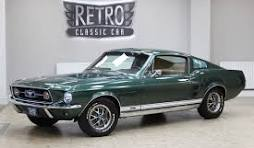

- **Car look, stripes:** the two stripes down the middle, from a black 1967 Mustang fastback (inspiration only).

  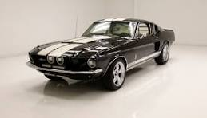

- **Technical style:** only for the technical specs in Decisions (128 by 128 pixels, 29 colours); not the actual car, colours or mood.

  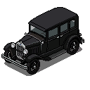

- **See-through buildings:** [research report, demo and screenshots (T-020)](visual-style/see-through-buildings.md).

## 8. Extended narrative

*Source: [extended-narrative.md](extended-narrative.md). The deeper story context and the game's tone. Most of it is never shown to players, but it puts the game on the rails, justifies future features in the plot, and sets the voice of every user-facing text and graphic.*

The player is Stunt Driver, sent by the sponsor Greenbull to cities hit by humanitarian crises and disasters, just to drift for the cameras. Every run is livestreamed to Greenbull's audience: good driving earns likes, and likes earn gift packs. The tone is satirical and tongue-in-cheek: Greenbull isn't evil, just completely out of touch, and the player should sense that their fun is slightly unethical. Each city is a level with its own monster boss; the first is Crash City and its kaiju.

### Decisions

- This document changes rarely. It puts the game on the rails: it decides what can be developed in future and how the plot justifies it, so it may hold details that only become useful later.
- Agents read it before producing any user-facing text or graphics, together with Visual style for graphics (how tasks enforce this: `tasks/README.md`).
- Overarching plot: humanitarian crises are happening around the world. Greenbull sends the player to each affected city, and each city is a new level.
- Each level's final boss is a different type of monster. The kaiju is the first level's boss, in Crash City.
- The player is **Stunt Driver**, a stunt driver sponsored by the brand **Greenbull**, sent into each disaster just to drift and show off.
- **The rebrand** (board, 2026-10-26): the sponsor, first called Redgull, is renamed **Greenbull**, one word, with a new logo and colours (Visual style, Decisions, "The rebrand"). The texts no longer explain what the brand sells: they just say Greenbull and let the player assume. Its role in the story and its voice don't change.
- **Tone:** satirical, ironic and tongue-in-cheek. It makes fun of soulless corporate language, social media and brand obsession. Greenbull is not evil, just completely out of touch and focused on profit. Playing is fun, but the player should sense that what they are doing is slightly unethical, and the game highlights this whenever it can.
- Greenbull's logo is a **cool bull's head** in dark green, light green and a little yellow (its look and colours: Visual style, Decisions, "Greenbull's look"). The brand looks cool and confident, and that polish is part of the joke: a slick logo on a company that is out of touch.
- Every run is **livestreamed** to Greenbull's audience. Driving earns **likes**: in the MVP, drifting (challenges are left out of the MVP; Level design, Decisions).
- **Likes are XP.** Players only ever see "likes", never "XP"; the board and the agents may say XP internally. Each level threshold is a likes threshold, and filling the likes bar earns a **gift pack**: the weapon reward on level-up. (2026-10-08) Greenbull delivers each gift pack by helicopter, dropping it into the disaster for Stunt Driver to drive over (how it plays: Game loop architecture, Decisions, "Gift pack drop"; board, 2026-10-16).
- **Greenbull funds the car's upgrades** between runs, all in service of the sponsorship.
- Weapon names, the level-up wording, descriptions and other user-facing text are written by the Narrative Theme Agent, using this document to get the tone; the board doesn't define them. That agent also chooses how likes are shown (the word, a heart icon, or both).
- The first map is downtown Tokyo under attack from the kaiju, the final boss: a giant monster in the style of Godzilla that is not called Godzilla. Its name is still to come from the board; until then it is "the kaiju". The city has put up a few alert banners about it.
- The city's people are not shown for now: only the signs they put up (the alert banners, picture-only).
- **Subs** (board, 2026-10-28): the stream's audience shows in two ways. **Live viewers** are the hype of the moment (the combo, rising with tricks and crashing with crashes). **Subs** are what the stream builds up: drifting brings them, and every full **sub goal** gets Greenbull to send a gift pack. "Subs" replaces "likes" in every player-facing text, and in Text rules, rule 2 (the vocabulary). (T-331)

### Content

#### Text rules

The text style guide: every piece of player-facing text is checked against these rules, each written once here (with Visual style's Rules, the style guide the style loop scores against; `tasks/README.md`, "The style loop"). Each rule condenses a decision; when the decision changes, its rule changes with it. Rules marked *(script)* are checked by a script, the others by the Style Evaluator.

1. **Tone:** satirical, ironic and tongue-in-cheek. It makes fun of soulless corporate language, social media and brand obsession. Greenbull is out of touch and focused on profit, never evil and never sincere; the fun should feel slightly unethical. The city's people and their fear are never the joke. No grimdark, gore or earnest heroics. (Decisions, "Tone"; Content, "The alert banners")
2. **Vocabulary** *(script, banned words)*: the player sees "subs" for what they earn toward a gift pack and "live viewers" for the audience counter, never "likes", "XP" or "points", and no "Hype Lv" or hype level (board, 2026-10-28); the weapon reward is a "gift pack"; the player is "Stunt Driver"; the sponsor is "Greenbull", never "Redgull" (its old name); the run is a livestream to Greenbull's audience; the monster is "the kaiju", never "Godzilla" and never given a name. (Decisions)
3. **Who speaks:** Greenbull's voice is for Greenbull's things (gift packs, level-up, garage, the stream). The city never speaks in Greenbull's voice: its signs are picture-only. No line takes the form "Greenbull says ..." (HUD and menus, Decisions, "No "Greenbull says ..." lines"). No real brands. (Decisions; Visual style, Decisions, "City brief")
4. **Format and length, by kind of text** *(script)*:
   - **Trick and combo popups:** one short line in capitals ending in "!", like LONG DRIFT!, AIR 360! and COMBO BROKEN! (HUD and menus, Content, "Trick popups", "Combo broken popup")
   - **Level-up cards:** a title of at most 30 characters and a description of at most 90 that says first what the card does, then at most one satirical aside. (T-051, T-171)
   - **Garage upgrades:** a name of at most 25 characters and a description of at most 80 that names no number. (T-268)
   - **Menu and settings labels:** short and plain, in sentence case, like "Music volume". (HUD and menus, Content)

#### The first map: downtown Tokyo under attack

The first level is downtown Tokyo at night, in the middle of the kaiju's attack (Decisions, 2026-10-14). The kaiju is a giant monster in the style of Godzilla, never called Godzilla, and still unnamed: until the board names it, the story and every text call it "the kaiju". It is the level's final boss, and the whole city is already reacting to it.

What the player drives through is a living, frightened city, not an empty set. The skyscrapers are still lit, their towers rising out of view, so the car feels small beside them. Shorter buildings show their roofs. Pavements run around every building. The streets show light cracks from the disaster (Visual style, Decisions). Neon signs are still on, with Japanese-like marks that are not real words (Visual style, Decisions), as the city's own night look. Nothing here belongs to Greenbull: the city has nothing to do with the brand, and Greenbull's colours and branding stay off the buildings, banners and pavements.

How it fits the story: Greenbull has sent Stunt Driver to a city that is in the middle of a disaster, only to drift for the cameras and for the livestream's likes. The contrast is the joke and the unease: people are in danger, and the run is entertainment. The city's own signs are what is left of the people's voice in that scene. Greenbull never writes them.

#### The alert banners

A few alert banners about the kaiju hang on buildings or stand as signs on the pavement (Decisions, 2026-10-14). The people of the city put them up, the way a city warns itself in an emergency: quickly, by hand or by the city, to tell everyone that the monster is near. They are not Greenbull's banners and carry none of its look.

Their purpose in the story is to tell the player, without any dialogue, that this city knows what is coming and is afraid of it, and to give the player a first look at the kaiju before it appears. Their look is a silly, minimalistic pixel painting of the kaiju's head or of its general Godzilla-like body shape, as if drawn by someone in a hurry. The silliness is the tone: the warning is earnest, the drawing is goofy, and the contrast sits close to the game's satire without making fun of the people. They are few, so each one is noticed.

#### Looking after consistency

All the city's generated art (the tall skyscraper bases, the shorter buildings with roofs, the pavements and the banners) follows one brief so it matches: night, dark navy and purple base, pink and cyan neon drawn into the sprites, Japanese-like marks and no real words, a damage level for the attack (the board approves it), no Greenbull colours or branding. The brief itself is given to the art tasks by the Narrative Theme Agent (task T-128); the parts the board approves are kept in Visual style, Decisions.

### References

- Final GDD (historical; superseded by the game area docs): [short-gdd/Solid_Carbide_-_Final_GDD.pdf](short-gdd/Solid_Carbide_-_Final_GDD.pdf), section "Narrative Theme".

## 9. HUD and menus

*Source: [hud-and-menus.md](hud-and-menus.md). What the player sees on screen during a run (the HUD) and the menus around it: pause, level-up and their look. Which screens exist and how they connect is in Game loop architecture.*

During a run the HUD shows the car's HP, a timer counting down from 8:00, the XP bar and level, the coins collected, and the kaiju's health once it appears. Levelling up pauses the game and shows the weapon choice as simple cards. Escape pauses the game, and the pause screen has a camera zoom slider. In the MVP every screen is kept plain; their visual style comes after the MVP.

### Decisions

- During a run, the HUD shows: the car's HP as a bar; the run timer, counting down from 8:00; the XP bar, shown to the player as a likes bar (Extended narrative, Decisions), and the current level; the coins collected this run; and the kaiju's health once it appears, as a bar above the kaiju (see below).
- When the player levels up and then drives over the dropped gift pack (Game loop architecture, Decisions, "Gift pack drop"; board, 2026-10-16), the game pauses and the level-up screen shows the options (what is offered: Weapons, Decisions). Each option has a title and a description. In the MVP it is kept simple: cards, clicked to take one (first a button on each card, 2026-10-08; clicked directly since 2026-10-31). 
- The level-up screen's cards take the game's comic look, like the trick popups and the combo counter: white rounded cards with black borders and the Bangers font, over the dimmed, paused run. The player picks a card with the keyboard (A/D or the arrow keys move between the cards, Enter or Space takes the highlighted one) or by clicking the card itself (Decisions, "Gift menu cards are clicked directly", 2026-10-31).
- The HUD shows the current combo multiplier as a counter next to the likes bar. When the player completes a trick, a short comic-style text pops out from the car with the trick's name and what it added to the multiplier (combo: Game loop architecture, Decisions). Extended-drift popups are smaller than the others, since they come every second.
- After the MVP, if challenges come back (2026-10-11): when the player completes a challenge, the likes it gave pop out from the car the same way, not on the HUD (the score flash in Game loop architecture, Decisions).
- The UI Agent proposes a first layout for where each HUD element goes on screen, and the board adjusts it in playtest.
- The car's health bar stands upright at the top left, filling from the bottom up, with its label above it. The likes bar is horizontal, centred at the bottom of the screen, with the heart, "Likes" and the level in one row above it and the combo counter above that. Labels line up with the bar they belong to.
- The combo counter is hidden when there is no combo (multiplier x1.0) and shows as soon as a trick raises it.
- **A bigger health bar with the heart, and the weapons beside it** (board, 2026-10-22): the car's health bar at the top left stays upright but becomes 3 times wider and twice as tall (from 24 x 160 to 72 x 320 pixels); its "Car Health" label goes, and the likes bar's red heart (the same one, board-approved red) sits under it. To its right, a column of small square icons shows each weapon the car has taken from gift packs this run, one per weapon, with "x2", "x3" ... when it has been taken more than once (its tier), in the HUD's comic font like the combo counter. (T-276)
- **A thicker likes bar that springs** (board, 2026-10-22): the likes bar at the bottom is 4 times thicker (from 16 to 64 pixels tall, still half the screen wide), and when likes come in it shoots quickly up to its new fill, overshoots a little and settles, instead of jumping there at once. The texts above it, the burning bar at x4 and the level-up animation follow the new size. (T-273)
- **No "Greenbull says ..." lines** (board, 2026-10-22; Redgull renamed Greenbull, 2026-10-26): the board dislikes text in the form "Greenbull says X" (first "Redgull says X") (two level-up card descriptions used it: the flamethrower's tier 6 and the underglow's tier 2). They are rewritten without it, and no new text uses that form. (T-268)
- **Airtime counter** (board, 2026-10-21): while the car is airborne, a small label near the bottom right of where the combo popups show counts its airtime up as a plain number with two decimals (0.00, 0.01 ... in seconds, no unit), next to a small icon standing for a jump (a wing or similar). It disappears on landing, when the airtime trick pays out (Drifting, Decisions, "Airtime trick"). Placeholder icon until it has art. Built in T-243 as a proposal: white Bangers number with a black outline and a code-drawn white wing, right of the screen's centre and a little below it (`game/docs/hud-and-menus/hud.md`, "Airtime counter (HUD)").
- **Drift counter** (board, 2026-10-22): while the car is drifting, a second small label next to the airtime counter counts the drift's length up the same way (0.00, seconds, no unit), with its own small icon standing for a drift; it disappears when the drift ends and pays out. Placeholder icon until it has art. Built in T-247 as a proposal: the airtime counter's look with an icon of two skid marks, directly under the airtime counter (`game/docs/hud-and-menus/hud.md`, "Drift counter (HUD)"). Since there is no drifting in the air, the drift counter ends as the car leaves an edge, so the two show together only for a moment, if at all.
- **Combo broken popup** (board, 2026-10-21): when a crash cuts the combo (hitting a wall, a building, a boulder or taking damage, Game loop architecture, Decisions), a popup like the trick popups pops from the car, but in red and in a broken, cracked style. Only on a crash, not when the combo drains away. The red is a warning red. Its text: HUD and menus, Content (T-244). (T-245)
- The combo heats up in three steps as it climbs: the counter changes look at x2, changes more at x3, and from x4 up (the top step, even though the combo goes on to its cap) it is fully maxed out, with the likes bar looking like it is on fire. When the combo drops, the look drops with it. The combo counter and the "Hype Lv" text take the game's comic look (the Bangers font of the trick popups, hard pixel edges). The fire is drawn in code first (no PixelLab), in oranges and yellows, never in Greenbull's colours; generated art only if the board finds it weak in playtest. No sound for now.
- The trick popups heat up with the combo in the same steps: unchanged black and white below x2, a hot orange or yellow accent at x2, a stronger one at x3, and a flaming edge from x4. The letters stay readable on white. Popups are always drawn above the buildings, so a building never hides one.
- The heart next to "Likes" matches the HUD's comic look: a flat red heart with a thick dark outline (first Redgull red; it stays red after the rebrand, as a social-media heart: Visual style, Decisions, "Red after the rebrand") like the text's, sized to the "LIKES" text. Drawn by script, no PixelLab.
- The trick popups look like real comic book popups: a white burst bubble with a black border and black lettering in a heavy, slanted comic font (Bangers), on one straight baseline.
- The trick popups are white rounded rectangles (not jagged bursts), with the black border and black lettering.
- Trick popups stay with the car: each one follows the car for its whole life (popping above it, rising and fading relative to it), so it stays readable at drift speed.
- The main menu shows the title "SOLID CARBIDE" in big letters, with a discreet "(work in progress)" underneath.
- Escape pauses the game. In the MVP the pause screen says "Paused", with a hint that Escape resumes, and has one setting: the camera zoom slider, labelled "Camera zoom level", which zooms the view behind the screen live while the game stays paused (Drifting, Decisions). The screen is a compact dark strip, only as tall as its content, placed just below the HUD timer so the two never overlap and as much of the map as possible stays visible (board, 2026-10-11). A full pause menu, with more settings, comes in the final release.
- The pause screen also has two checkboxes under the zoom slider, "Camera smoothing" and "Dynamic camera" (the board's names; what they do: Drifting, Decisions), and, while the dynamic camera is on, two temporary tuning buttons, "Set min zoom" and "Set max zoom", with the stored values shown next to them. The buttons are removed once the board has settled the values.
- The pause screen has an **"SFX volume"** slider (the board's name) for the sound effects' volume, from 0 to 100, starting at **0, so sound effects are silent until the player turns them up**. Like the zoom, the player's choice is saved between sessions. Music, when it comes, is separate.
- The pause screen also has a **music volume** slider (board, 2026-10-20), under the SFX volume slider and laid out like it, from 0 to 100, saved between sessions like the others. Its label comes from the Narrative Theme Agent (T-208); its starting value is a proposal for the playtest (T-210). What the music is: Game loop architecture, Decisions, "Music".
- Settings exposed for playtests and development (for example the flamethrower from the start, the kaiju's early arrival) go under an internal dev flag: players never see them.
- The kaiju's health bar sits on top of the kaiju in the world and follows it, instead of in a corner of the HUD: about as wide as the kaiju (it follows the kaiju's width, so it still fits the final art), neon purple on a white background with a black outline and thin black dividers at every 10% of its health, in a subtle version of the combo popups' comic style. No label. It is always drawn above buildings, so it shows even when the kaiju is behind one.
- The level-up screen's weapon cards each show an image of the weapon.
- The level-up screen's header title is lettered in cream (RGB 246, 250, 232) with a dark outline (RGB 14, 22, 18, 4 pixels), to read on a dark green ribbon; the card titles, descriptions and buttons keep black ink on the cream cards. (T-310)
- Level-ups are animated: the likes bar plays a short animation when the player levels up, and the level-up screen animates in. The level-up screen gets art themed on the sponsor, since the weapons it offers arrive as its gift packs; its animation uses that art. First red and gold for Redgull (board, 2026-10-15); after the rebrand, Greenbull's dark green leading, with light green and a little yellow (board, 2026-10-26; Visual style, Decisions, "Greenbull's look").
- **Restart and Exit on the pause screen** (board, 2026-10-28): the pause screen gets two buttons, **"Restart"** and **"Exit"** (the board's names): Restart ends the run and starts a fresh one straight away; Exit ends the run and goes back to the main menu (Exit on the main menu still closes the game). Where they sit, whether they ask "are you sure?" first, and what happens to the run's coins are the agents' proposals for the playtest. (T-327)
- **The HUD looks like a livestream** (board, 2026-10-28): the board places the pieces on its HUD layout page (https://claude.ai/artifact/CSHYCDV9xZbSYwQGUt5SJ4), and the game follows the positions saved there. The pieces: the **timer** at the bottom left as a digital pixel-art clock whose digits start green and turn yellow, orange and red as the time nears 0:00 (the switch points are a proposal); the **live viewers counter** at the bottom right, in place of the combo counter (Game loop architecture, Decisions, "The combo shows as live viewers"); the **sub goal** at the bottom centre, in place of the likes bar and its "Likes ... Hype Lv" row: a black square that fills green from the bottom as subs come in, with the gift pack inside it greyed out until the goal is reached, when it lights up, and the subs count under it as "{subs} / {goal}" with a subs icon; the **hearts** in a row at the top left, in place of the upright health bar (Game loop architecture, Decisions, "Hearts instead of health points"). The art is generated with PixelLab (the board: "don't be stingy"). (T-331 to T-339)
- **Tricks bring viewers, shown in one colour** (board, 2026-10-28): the live viewers counter has its own colour, used for nothing else. A trick popup keeps its name as today, and its amount shows as the viewers it brought ("+12K" with an eye icon) in that colour; that amount then flies across the screen into the counter, which bumps when it arrives. When a crash breaks the combo, the counter flashes red and a "-{viewers}" drops away from it as the number falls. (T-336)
- **"Hype Lv" is gone** (board, 2026-10-28): the level is shown only by the sub goal square (it fills, the gift lights up, the level-up goes on); there is no "Hype Lv" text and no level-up pop on it, and none of its code is kept (T-337). The older passages above that mention it describe the game before this change. The board also confirmed the proposals for the live viewers: 2,500 viewers at x1, the heat steps at 20K, 85K and 236K, and fire only from 1M (T-332, T-336), and the PixelLab cap of 40 for the HUD art (T-339). The weapon icons column may be taller than the old health bar did: the health bar is gone, replaced by the hearts, so it doesn't matter (T-338). The coins counter moves to the bottom left above the clock (T-341).
- **Reactions like a livestream** (board, 2026-10-28): little reaction icons (likes, thumbs up, hearts and the like) **burst out of the sub goal square** when the goal is reached and the gift pack comes, and **float up from the bottom of the screen** now and then, at uneven gaps like a real stream, when the live viewers count is high (more often at each heat step). They are small and partly transparent, kept to the edges and bottom of the screen, never over the car and under the HUD pieces, so they don't hide the road. The rates and the cap on how many show at once are proposals for the playtest. Placeholder icons first; the art comes after. (T-351, T-352)
- **Bad reactions when the combo breaks** (board, 2026-10-29): when a crash cuts the combo (the COMBO BROKEN! moment), the stream reacts badly: a burst of bad reactions rises from the live viewers counter, on the same right-side lane as the floating reactions. Six of them: a crying-laughing face, a thumbs down (a dislike) and a face peeking between its hands (the board's), and a broken heart, a skull and a screaming face (the board left the last three to the Project Lead). The count, spread and speed are proposals for the playtest. Placeholders first; the art is drawn by script like T-352's icons. The board also said the livestream HUD's art needs no rework (the viewers fire, the subs icon and the heart stay as they are), and no ticket to move the pause strip up. (T-356, T-357)
- **The runs list** (board, 2026-10-29): the main menu gets a new button that opens a list of the player's past runs, each with the stats from its recap screen, saved on this computer. What each row shows, and whether a row opens that run's full recap, are proposals for the playtest. The recap screen closes with a Continue button or an X at the top right (Game loop architecture, Decisions, "The recap always closes a run"). (T-362, T-364) **Deferred to the final release** (board, 2026-10-29, the MVP cut).
- **The last MVP round: no new scope after it** (board, 2026-10-29): the tutorial slides, the trick list and turning the sound effects off (the three entries below) are the last features for the MVP. After them the board adds no new scope until the MVP is done, apart from polish tickets. Built as one goal: the board's go to build the text, the slides and the art back to back and review them all in one playtest at the end, with a PixelLab cap of 40 for the trick illustrations.
- **Tutorial slides before the first run** (board, 2026-10-29): when the player presses Start, before the run begins (the clock and everything), the game shows **three slides**. A right arrow and a left arrow move between them; the last slide has a **Start** button (not an X) that starts the run, and a **"Don't show again"** checkbox: if it is ticked when the player presses Start, the slides don't appear on later Starts (saved on this computer). Where the checkbox sits (on the last slide, a proposal) is the agents' proposal. **Slide 1, the controls:** W, A, S and D and what each does, and that accelerating while turning drifts the car on its own. **Slide 2, the loop:** the list of tricks the game counts (drift, 360, alternate drift, air 180, air 360, airtime, thread the needle), each with a small **still pixel art illustration** of the car's movement for that trick (a path arrow, for example a loop for the 360, an S for the alternate drift, a jump arc for the air tricks); then that tricks bring more viewers, viewers bring subs, and at each sub goal a gift pack arrives with a weapon that helps the player survive and keep the enemies away. **Slide 3, the goal:** chain as many tricks as possible to get the most weapons, to be at your strongest when the kaiju arrives with 1 minute left (7:00 into the 8:00 run). The illustrations: made both with PixelLab (cap 40 generations for the set) and drawn by script, and QA compares which reads better; the better one goes in. The text is a text ticket's, in the game's voice.
- **A trick list in the pause screen** (board, 2026-10-29): the pause screen (the game's settings) gets a **trick list** button that opens a sub-panel showing the same trick list as slide 2 (the tricks with their illustrations only, without the rest of slide 2), with a way back to the pause screen.
- **No sound effects in the MVP** (board, 2026-10-29): every sound effect is off for the MVP and the sound effects slider is hidden from the pause screen (done in T-389: the row is hidden while the switch is off, and the layout closes the gap); the music stays, with its slider. The sound effect code stays in the game for later.
- **MVP nice-to-haves, only after the last round** (board, 2026-10-29): inside the MVP's scope, but started only once the tutorial slides and the sound effects change are done: the main menu polish, a consistent HUD, a HUD size slider with a HUD that scales with the window, bigger minions and the minions stuck on ramps (Enemies). The board may still add one or two weapons; otherwise only polish after this.
- **Main menu polish** (board, 2026-10-29): the title "SOLID CARBIDE" in a pixel-art font, the "(work in progress)" line kept and styled to match, and behind the menu a **splash cover**, an AI-generated pixel art image (Visual style, Decisions, "The splash cover").
- **A consistent HUD** (board, 2026-10-29): today's HUD pieces look as if they came from different games; they get one visual language (outline, colours, fonts, panel shapes) so they read as one interface.
- **The HUD scales with the window, and a HUD size slider** (board, 2026-10-29): the HUD keeps a predictable place and a sensible size at any window size and resolution, ultrawide included (today it stays the same pixel size, so it looks tiny on a big or ultrawide screen). The pause screen gets a slider that sets the HUD's size, saved on this computer.
- **Bigger gift pack arrows in the gift box's colours** (board, 2026-10-31): the arrows that point to gift packs off screen are 3 times as big as today's (30 by 24 pixels at the HUD's base size), and wear the gift box's colours (Visual style, Decisions, "The gift pack package in Greenbull's colours": Greenbull's dark green box with its light green ribbon) instead of the placeholder pale cyan. As they belong to the gift pack, Greenbull's colours are allowed on them (Visual style, Content, "Rules", rule 6). They keep the HUD's dark outline and stay clear of the HUD parts as today. The build (T-442): 90 by 72 pixels at the HUD's base size, scaled with the HUD's size like the rest of it (the track, the gaps and the outline too); the dark green fills the arrow, the light green is an inner stripe along it (the split is the agents' proposal for the playtest), inside the HUD's dark outline (8, 8, 15). (T-442)
- **One button style across the game** (board, 2026-10-31): every button the player meets (main menu, garage, tutorial slides, level-up screen, pause screen and the end-of-run recap) shares one look and one feel that match the game: the same shape, art, font, colours and outline from the HUD style sheet (Visual style, Content), and the same behaviour when hovered, selected with the keyboard, pressed and disabled. The board's own tools (the level creator and the tuning panel) keep their look. The exact look and feel are the agents' proposals for the board's playtest. (T-446, T-447)
- **The player can move the HUD's pieces** (board, 2026-10-31): from the in-game settings (the pause screen), the player can edit the HUD's placement: drag each HUD piece to where they want it, reset the layout to the default, and keep it, saved on this computer like the other settings. Which pieces can move, how they snap and the controls are the agents' proposals for the playtest. (T-452, T-453)
- **Gift menu cards are clicked directly** (board, 2026-10-31): every gift menu (the level-up gift pack's weapon choices and the driving power-up overlay) has no Take it button on its cards: the whole card is clicked to take it, and it shows it can be, reacting to hover and to keyboard selection; the keyboard keeps working as before. (T-474, T-475)
- **The board passes through every menu and text before the MVP** (board, 2026-11-01): before the MVP release the board reviews every screen the player can meet and every piece of player-facing text, item by item. A script builds the material for it: a screenshot of every screen and a list of every text, rebuilt after each change.
- **The tutorial slides are redrawn, with clips of the real car** (board, 2026-11-01, from the Project Lead's draft page): four slides instead of three. **1, Drive:** the W, A, S, D keys as labelled keycaps and the rule "W + turn = drift", beside a clip of the car drifting seen from higher up and zoomed out, so the drift's path shows from where it starts; no flavour line and no "no drift button" label. **2, Tricks bring gifts:** the loop as a chain of four steps with the HUD's own icons (a trick, the viewer count, the sub goal, the gift pack with its weapons), and under it three clips: a long drift, an alt drift, and the car taking a ramp at speed and flying, gaining hang time while it spins (an air 180 or 360) in one clip. **3, Missions:** the notebook page and the four driving power-ups. **4, Survive the stream:** the 8-minute run as a timeline with gift packs along it and the kaiju in the last minute, then Go live and "Don't show again"; no hearts and no sentence. The clips are recorded from the game itself, on a simple background. Every slide has a Skip control that jumps to the last slide (the board approved the draft with it, 2026-11-01). Its lines come from the Narrative Theme Agent.
- **Arrow keys in the main menu and the garage** (board, 2026-11-02, after playing the itch.io build): the main menu and the garage can be used with the arrow keys alone: the arrows move the keyboard selection between the buttons (and the garage's upgrades), Enter or Space presses the selected one, and the selection always shows (the shared button's focus plate). The mouse works as before. **W, A, S and D work the same as the arrow keys** (board, 2026-11-02, swipe-deck review of T-492: W up, S down, A left, D right).
- **Every screen scales with the window** (board, 2026-11-02, after playing the itch.io build): the gift pack (level-up) screen and the pause screen (the settings) look very small on big resolutions, and so may others. Every screen and menu the player meets scales with the window by the HUD's rule (Content, "The HUD scales with the window"), so it covers the same share of the screen at any resolution; this replaces that section's "keep their size" for the screens. A game-wide scan at several resolutions finds every piece that does not scale, and each is fixed. Things drawn in the world at the camera's zoom (trick popups, the kaiju's health bar) are not screens and keep following the camera.
- **Each trick shows the keys that make it** (board, 2026-11-01, from the Project Lead's draft page "Trick Controls Draft"): the trick list in the pause screen shows, for every trick, a **keycap recipe**: the keys held together joined with +, the steps joined with an arrow, and a short note under each step (for example W + A/D, hold 1 s or more, then let go); a key marked "/D" means either turn key works. Each trick in the trick list also has a **clip of the real car** doing it, with a small **live W A S D pad** in the clip's corner that lights each key exactly when the recording pressed it. **Thread the needle shows no keys** (the player just drives through the gap): its row has its clip and its rule only. On **tutorial slide 2** the three clips get the same live key pad; the slide adds no other tricks or recipes, so it stays uncluttered. Clips are recorded for the tricks that have none yet (FULL 360!, AIR 360!, THREAD THE NEEDLE!, and HANG TIME! without a spin). The board approved merging this straight after QA, without its own playtest of each ticket (2026-11-01).

### Content

#### The HUD's style in code (T-429, goal G-008; proposals for the playtest)

The HUD pieces follow the HUD style sheet (Visual style, Decisions, "The HUD style sheet"); the values sit in `hud_style.gd` (`game/docs/hud-and-menus/hud.md`). Words are Bangers with the near-black outline (8, 8, 15): outline 6 on the coins, the sub goal, "WATCHING" and the flight and drop numbers; 8 on the big numbers (weapon counts, airtime and drift counters, the viewers number, the combo heat steps). The trick and combo broken popups use that near-black for letters and borders, the kaiju bar for its outline and dividers (2 px). The pause strip's title and text are Bangers, shown in capitals (the text itself is unchanged; its three slider numbers stay in the default font, since Bangers would make the strip 10 pixels shorter); the level-up title has outline 6. The **clock** is T-339's art: the steel panel at 2x (exactly its 200 x 72) and the drawn seven-segment digits at 2x, tinted with the time step's colour over a dim unlit 8 (the step colour at 22%, a proposal); no system font is left in the HUD. The **weapon icons** are their own 24 x 24 art (T-429, script-drawn from the card pictures, 0 PixelLab; it scored 7 of 10 in the style loop, kept for the playtest) shown at 2x in the same 48 pixel slot, so every HUD sprite now has the same pixel size.

#### The shared button (T-446; proposals for the playtest)

Every button the player meets is one shared button (Decisions, "One button style across the game"): the main menu's three, the garage's Buy and Back, the tutorial slides' two arrows and Start (and the "Don't show again" checkbox, styled to match), the pause screen's Trick list, Restart, Exit and the trick list's Back (and its two camera checkboxes), and the recap's Continue and X. It is defined once, beside the HUD style sheet's values in `game/scripts/hud/hud_style.gd` (`HudStyle.style_button`, `HudStyle.style_checkbox`); the screens only call it and keep their buttons' text, place, size, keys and actions. The board's tools keep their own look: the level creator, the drift tuning panel and the pause strip's two camera tuning buttons (Set min and max zoom).

- **Plate** (T-447): one 9-slice plate per state in `game/art/ui/` (`button_plate_normal.png`, `_hover`, `_focus`, `_pressed`, `_disabled`; record `button_plates.json`), 72 x 22 art pixels shown at 2x, slice margins 3 art pixels; the plates are drawn in the HUD style sheet's steel (Visual style, Content, "The shared button's plates"). No tint and no recolour in code: every state is its own picture. The level-up screen's own plate (`game/art/level_up/button_plate*.png`) stays as that screen's art but is no longer used by the button.
- **Text:** Bangers in capitals, the sheet's light label colour (235, 242, 255) with its near-black outline 6; size 28, and 16 with outline 4 on the pause strip's small buttons.
- **States and feel:** hovered shows the brighter hover plate and turns the text white; keyboard-selected draws the focus plate, a bright ring with an open middle, over whichever state the button is in, and the text turns white; pressed shows the sunk plate with the text 2 pixels lower (the press-down); disabled shows the dim plate and greys the text (the garage's Buy with too few coins). The mouse pointer becomes a hand over a button. The tutorial arrows are drawn in the text colour with the outline and drop with the press too; the recap's X is white with the outline.
- **Checkbox:** no plate; the same text, the same keyboard ring plate, and a square with a light frame on steel, a light mark when checked.

#### The HUD scales with the window (T-431, goal G-008; proposals for the playtest)

Decisions, 'The HUD scales with the window, and a HUD size slider'. **The scaling rule:** the HUD is laid out on the board's layout page (1152 x 648), and at any window size the whole HUD is drawn at one scale: the smaller of the window's width over 1152 and its height over 648, times the HUD size slider's value in percent. Each piece keeps its corner or edge (hearts and weapon icons top left, coins and clock bottom left, viewers counter bottom right, the sub goal on the right edge at its share of the height) and its margins and size grow and shrink with that scale, so the HUD covers the same share of the screen at any resolution. On a wider screen than 16:9 (the 3440 x 1440 ultrawide) the height decides, and the pieces stay at the far corners; on a narrower one the width decides. Examples at 100: 1 at 1152 x 648, 1.67 at 1920 x 1080, 2.22 at 2560 x 1440 and 3440 x 1440, 0.83 at 960 x 540. The scale is often not a whole number, so the HUD's art is drawn with hard pixel edges (nearest filtering) instead; some art pixels are then one screen pixel wider than others, which the playtest judges. The world camera's zoom is never changed by the HUD. When the HUD size is above 100 the sub goal square moves up just enough to stay 16 layout pixels above the live viewers counter, so they never overlap.

**HUD size slider:** on the pause screen (below, "Pause screen"), from **50 to 125**, in steps of 5, **default 100** (the size the board laid the HUD out at, in proportion to the window). Above 125, all five weapons' icon column would reach the coins counter, since the layout page is already full at 100. Moving it resizes the HUD at once behind the pause strip; it is saved on this computer when the drag ends (and when the pause screen closes) and used at the next start. **Which screens it covers:** the run's HUD only (hearts, weapon icons, coins, clock, sub goal, live viewers counter, reaction icons, the airtime and drift counters and the viewers flying into the counter). The slider changes the HUD only: the screens below scale with the window but not with the slider, and the trick popups and the kaiju's health bar (drawn in the world, at the camera's zoom) keep their size. How it is built: `game/docs/hud-and-menus/hud.md`, "The HUD scales with the window", and `pause-screen.md`.

**The screens scale too (T-494)** (Decisions, "Every screen scales with the window"): every screen and menu uses the same rule as the HUD, through one shared helper (`UiScale`, `game/scripts/ui/ui_scale.gd`, which the HUD's scale also comes from). Each screen is laid out at 1152 x 648 and drawn at the smaller of the window's width over 1152 and its height over 648, so it covers the same share of the window at every 16:9 size (1280 x 720 to 3840 x 2160) and keeps its shape; on an ultrawide window it keeps its height share and the extra width is left and right, like the HUD. Screens it covers: the main menu, the pause screen with its trick list and HUD layout editor, the level-up (gift pack) screen, the driving power-up overlay and the recap. The garage and the tutorial slides already scaled to fit the window and now use the same helper for it; the time's up card keeps its own whole-number scale. Pixel art and text are drawn with nearest filtering, so they stay hard-edged (the text is the 1152 x 648 text enlarged, blocky rather than blurred). Keyboard and mouse work as before at every size. How it is built: `game/docs/hud-and-menus/hud.md`, "Every screen scales with the window".

#### The HUD layout editor (T-453; proposals for the playtest)

Decisions, "The player can move the HUD's pieces". **Opening it:** the pause screen has an "Edit HUD layout" button (the shared button, T-446, small) in the row of buttons at the bottom of the strip, after "Trick list" (its own row would have made the strip taller than half the screen); it shows only in a run (the drift prototype has no HUD). Pressing it hides the pause strip and its dim, so the HUD shows as it is behind the paused run, and draws a thin white frame round each piece that can move. A small dark bar in the middle of the screen holds the hint "Drag a piece to move it.", "Reset layout" and "Done" (T-452's texts, in `game/data/pause_text.json`). **Which pieces move:** the hearts row, the weapon icons column, the coins counter, the timer clock, the sub goal (its square, flames and subs label together) and the live viewers counter. The airtime and drift counters (shown only in the air or in a drift, next to the car), the reaction icons and the trick popups stay where they are. **Controls:** press the left mouse button on a piece and drag it; the piece under the pointer lights up a little, the dragged one a little more. Escape works as Done. **Snapping:** a piece snaps to a 4 pixel grid of the layout page and, when it comes within 12 pixels of an edge, to the HUD's usual 16 pixel margin from that edge; it can never leave the screen, even partly. Pieces may overlap if the player puts them on top of each other. **Reset layout** puts every piece back at its default place at once; **Done** saves the layout and returns to the pause screen. **How a place is kept:** each moved piece remembers the corner, edge or centre nearest to it (by the third of the screen its centre is in) and its distance from that point in layout pixels, so a piece left at the bottom right keeps its margins to that corner and a piece left at the top centre stays centred, at any window size and with the HUD size slider (Content, "The HUD scales with the window"); a piece that would leave the screen (a smaller window, a bigger HUD, a row of hearts that grows) is moved back just enough to stay fully on screen. The gift pack's arrows keep clear of the pieces at their new places. **Where it is saved:** on this computer, in the same settings file as the other settings (`user://settings.cfg`, section `hud_layout`, one entry per moved piece), written once when Done is pressed (T-427's save-once rule), and used in every run from then on; Reset followed by Done removes the section. How it is built: `game/docs/hud-and-menus/hud.md`, "The HUD layout", and `pause-screen.md`.

#### The MVP pass: the screen gallery and the text list (T-479)

For the board's pass through every menu and text before the MVP (Decisions, "The board passes through every menu and text before the MVP"). Two scripts build the material, so it is rebuilt after every change. Run both from the repo root:

- **Screen gallery:** `python game/tools/screen_gallery.py` (add `--out <folder>` to change where it goes; `--no-text` skips the text list). It opens the game in a real window (not headless; about half a minute), walks through every screen and saves one 1280 x 720 PNG of each, with `manifest.json` (each screen's name, file, and how it was reached; a `not_reached` list with the reason for any it could not open). The game's own saves are never touched: settings, progress and the runs list point at throwaway files. The screens: main menu (splash), tutorial slides 1 to 3, garage, the run's HUD at the start, the HUD with the mission notebook page part done, a trick popup, the combo broken popup, the level-up gift pack screen, the driving power-up overlay, the pause screen, its trick list, its HUD layout editor, the time's up screen, the wreck, and the recap for a win, a time's up and a wreck. The runs list (Past streams) is not in the game yet, so it is listed under `not_reached`. A new screen is added to `game/tools/screen_gallery.gd`.
- **Scaling scan (T-493):** `python game/tools/screen_gallery.py --sizes --out art-archive/<task>` runs the same walk five times, with the root window resized to 1280 x 720, 1920 x 1080, 2560 x 1440, 3840 x 2160 and 3440 x 1440 (about a minute and a half; a window bigger than the monitor is clamped, so 3840 x 2160 comes out 3840 x 2130 on a 2560 x 1440 monitor and the maths uses the real size). For each screen it records the visible content Controls' pixel rectangles, compares the screen's coverage of the window (bounding box and summed leaf-content area) with 1280 x 720, and writes `scaling_report.md` and `.json` (screens worst first, then the pieces that shrink) plus a side-by-side `contact_sheets/<screen>.png`. A screen is flagged under 0.85 of its 1280 x 720 coverage, a piece under 0.70 of its area share. The maths is in `game/tools/scaling_report.py`.
- **Text list:** `python game/tools/text_inventory.py` (the gallery script runs it too), into `text_inventory.json` and `text_inventory.csv` (open the CSV in a spreadsheet). `text_files` lists every string of the text files (`game/data/*_text.json`, `screen_texts.json`, and the level-up cards' table `level_up_texts.gd`) with its source file, key, text, the screen it appears on and the file's own note when it has one. `code` lists, separately, the strings found in scripts: constants named as text (`TEXT_*`, `TITLE`, `NAMES`, `DESCRIPTIONS`, ...) and labels, buttons and tooltips set from a literal, with file and line. The scan goes by pattern, so a string built another way can be missed; developer tools (the level creator, tuning panel, test rooms) are skipped and named under `not_scanned`. The screen of each string comes from two tables at the top of `text_inventory.py`; a string whose screen is missing there says "(unlisted)" and a test fails until it gets a line.
- **Where it goes:** `screenshots/mvp-gallery/` at the repo root (git-ignored, outside `game/`).

#### Main menu

A plain screen (task T-054). The title "SOLID CARBIDE" is in big cyan letters in the free pixel-art font Press Start 2P (SIL OFL; licence and record in `game/fonts/press_start_2p/`) with a near-black outline; the "(work in progress)" line under it is unchanged word for word, in the same font, small and pale, with the same outline (T-432, proposals for the playtest). Behind everything is the **splash cover slot**: when `game/art/menu/splash.png` exists it fills the screen, cropped not stretched (aspect kept) with hard pixel edges (nearest filtering), under a 35% dark veil so the buttons stay readable; when it doesn't, a plain dark navy placeholder shows. The splash art itself comes from a later Asset Generation ticket. Below are three buttons in a column: Start, Garage and Exit (text approved in T-053). The menu only shows the screen: pressing a button sends the signal `start_pressed`, `garage_pressed` or `exit_pressed`, and what happens next is the screen flow (T-055). Keyboard (T-492): focus starts on Start; Up and Down (or W and S) move the selection through Start, Garage and Exit and wrap round (Left and Right, or A and D, keep it where it is), Enter or Space presses the selected one, and the selection shows with the shared button's focus plate; the neighbours are set explicitly in `KeyNav` (`game/scripts/ui/key_nav.gd`), not guessed by Godot, and only a fresh press counts, so a key held when the menu opens does nothing (W, A, S and D ignore key repeat, and are handled by `KeyNav.handle_wasd`). The scene is `game/scenes/menu/main_menu.tscn`; how to open it is in `game/docs/hud-and-menus/main-menu.md`, "Main menu".

#### The HUD

The first piece of the HUD (task T-090) is the run timer. It shows the time left in minutes and seconds (M:SS), counting down from 8:00 to 0:00, since T-335 as a digital clock in a dark panel at the bottom left of the screen (see "Timer clock" below); until then it was big cyan digits at the top centre. It only shows what the run reports (the run owns the time) and stops moving while the game is paused. It needs no text. It is shown in every run, whether the run scene is opened on its own or started from the main menu. The rest of the HUD (task T-049, a first layout the board adjusts in playtest) is in the same scene, `game/scenes/hud/hud.tscn`, which the run scene places on screen; how to open it is in `game/docs/game-loop/the-run.md`, "The run". It only shows what the run reports, and the texts are from T-048:

- **Top left (task T-338, the livestream HUD; Decisions, "The HUD looks like a livestream"):** the upright health bar and its heart are gone. A **row of hearts** (T-339's art, 18 x 16 pixels at 2x) sits at x36 y24 on the board's layout page (220 x 40 at 1152 x 648, each heart in a 44 x 40 cell): one heart per heart the car can have (5, plus the garage's), **full** for the hearts left and **empty** for the hearts lost, no half hearts. A heart lost flashes white and shakes for 0.4 seconds as it turns empty; a heart healed pops back in for 0.3 seconds (a proposal for the playtest). Past 10 hearts a second row starts under the first (a proposal). Under the row, the **weapon icons** column at x12 y88 (the layout page): one per weapon the car has, the starting gun included (proposal), in the order taken, each 48 x 48 pixels (since T-429 the HUD's own 24 x 24 icon, `art/hud/weapon_icons.png`, at 2x, nearest filtering; before, the level-up card picture squeezed to 48) with 8 pixels between rows. A weapon above tier 1 shows "x2" ... "x8" (its tier) to the right of its icon, in Bangers size 32, white with a black outline (proposal for the playtest). It updates the moment a weapon is taken or upgraded and empties back to the gun in a new run. How it is built: `game/docs/hud-and-menus/hud.md`, "The hearts row".
- **Sub goal (task T-337, the livestream HUD; Decisions, "The HUD looks like a livestream" and "\"Hype Lv\" is gone"):** the likes bar, its "Likes ... Hype Lv" row and the heart in that row are gone; in their place is the **sub goal**, on the right edge about two thirds down: 128 x 180 pixels with its top left at x988 y340 on the board's layout page (saved at 1152 x 648), anchored to the right edge, so it keeps its 36 pixel margin from it and the same share of the height at other window sizes. It is a 128 x 128 **square** (T-339's frame art at 2x: a dark outline, a white ring, a black inside with rounded corners) that **fills green from the bottom** with the subs gained toward the current goal (the XP within the level, as the likes bar did), in whole art pixels (2 screen pixels), following the inside's rounded corners, with a lighter top line; the green is the HUD's health green, not Greenbull's light green. The fill keeps the likes bar's spring (T-273): when subs come in it shoots to its new level in 0.25 seconds with a small overshoot and settles, never below the old level and never drawn past full; the drain empties it slowly, without a spring; it stands still while the game is paused. **The gift pack** (`art/gift_pack/package.png`, cropped to its box) is centred inside it and fills 80% of the square (a 10% margin on each side), kept to its shape, with hard pixel edges; it is **greyed out and dimmed** (grey at 60% brightness, a proposal) while the goal isn't reached, and shows in **full colour** from the moment the goal is reached. **Under the square**, centred: the subs icon (T-339, at 2x) and "{subs} / {goal} SUBS" (T-331's text, Bangers 20, white with a dark outline), for example "42 / 156 SUBS"; the row is a little wider than the square. **When the goal is reached** the level-up happens at that moment, as before (the helicopter brings the gift pack; the run pauses at the pickup): the square springs to full, the gift lights up and bounces (it grows to 1.2 times, dips under its size and settles), and a pixel glow ring (white, pale mint and green, two art pixels wide, just outside the frame) flickers round the square, for one second in twelve pixel-art frames a second, playing whether the run is paused or not (proposals for the playtest). The label reads "{goal} / {goal} SUBS" while it is full. Then the square starts again from empty, the gift greys, and the label shows the next goal, the fill springing to the subs left over. Levels coming one after another restart the celebration; a new run starts it empty. At the top level it stays full with the gift lit. There is no level number or "Hype Lv" text anywhere: the level shows only through the sub goal. The flames of the combo's top heat step (below) burn along the square's top edge. The combo counter stays at the bottom centre where it was (its bottom edge 116 pixels above the screen's bottom), until the live viewers counter takes its place (T-336). How it is built: `game/docs/hud-and-menus/hud.md`, "The sub goal".
- **Combo heat (task T-131, decision of 2026-10-14):** the combo counter heats up in steps as the multiplier climbs, chosen from the multiplier the counter shows (two decimals): **base** (above x1.0, below x2.00) is the pink counter above; **step 1** (from x2.00) is bigger and yellow, with a light pulse (it pops a little on each beat and eases back); **step 2** (from x3.00) is bigger again and orange, with a yellow glow ring round its dark outline and a stronger, faster pulse; **step 3** (from x4.00 up to the cap, x6 today) is the biggest, white-hot, with a glow ring that flickers between oranges and yellows and the strongest pulse, and the **likes bar is on fire** (since T-337 the flames burn along the sub goal square's top edge, full height along all of it, since the bar and its texts are gone): pixel flames (white-hot at the base, then yellow, then orange at the tips, with a few sparks) flicker along the top of the bar. They rise tallest over the filled part of the bar and in the gap between "Likes" and "Hype Lv", stay low over the empty part, only lick the bottom of the texts (drawn on top of them), and reach only the top few pixels of the bar, so the fill and the texts stay readable; they never reach the counter. When the combo drops (drain or a collision cut) the look drops to the step of the new multiplier, and at x1.0 the counter hides as before. The pulse grows the counter upward and to both sides from its bottom centre, so it never moves into the row below. The thresholds (2, 3, 4) are kept in one place in the code. Everything is drawn in code (no generated art), in oranges, yellows and whites, never in Greenbull's colours. The effects stop moving while the game is paused. No sound. A screenshot fixture shows the four steps in a run (`game/docs/hud-and-menus/hud.md`, the HUD).
- **Level-up animation (task T-139, replaced in T-337):** the likes bar's level-up animation (a white-hot sweep across the bar, sparks, and "Hype Lv" popping bigger) went with the bar and the "Hype Lv" text; the sub goal square's celebration (above) takes its place.
- **Bottom left, above the clock:** "Coins" followed by the number collected this run, in yellow. Moved there from the top right (board, 2026-10-28; T-341). Saved layout at 1152 x 648: x16, y496, 108 x 36 (28 pixels above the clock), anchored to the bottom-left corner so it keeps its margins at other window sizes.
- **Timer clock (task T-335, the livestream HUD):** the timer is at the bottom left, 200 x 72 pixels with its corner 16 pixels from the left and bottom edges (the board's layout page, saved at 1152 x 648: x16 y560), anchored to that corner so it keeps its margins at other window sizes; the coins counter sits above it (T-341). Dark panel, digits as "M:SS", glowing. The digits are **green** above 3:00, **yellow** to 1:30, **orange** to 0:30 and **red** below (proposals; numbers and colours in `game/data/hud.json`, `timer_clock`). Since T-429 it shows T-339's clock art: the panel and the seven-segment digits, both at 2x (the HUD's style in code, above). Nothing at the top centre any more.
- **Live viewers counter (task T-336, the livestream HUD; Decisions, "The HUD looks like a livestream" and "Tricks bring viewers, shown in one colour"):** the combo counter ("Combo x2.00" above the likes bar) is gone; the combo shows as the stream's live viewers at the bottom right, 240 x 72 pixels with its corner 16 pixels from the right and bottom edges (the board's layout page at 1152 x 648: x896 y560), anchored to that corner. It is T-339's dark viewers panel with the red LIVE badge and the viewers' eye on its left, and on its right the number over "WATCHING" (T-331's texts, Livestream HUD texts below), in the comic font. It always shows, even with no combo (2,500 viewers at x1). The number counts toward the viewers for the current multiplier (T-332's curve, speeds and short format, Game loop architecture, ViewersData): up after tricks, down when the combo drains or a crash cuts it, and it wobbles a little all the time, so it never sits still while the run goes; everything stands still while the game is paused. **One viewers colour:** cyan (#33e1ff, T-339's panel rim and eye; a proposal), used for nothing else in the HUD: the number at the base look, "WATCHING", the eye and the trick popups' amounts. **Heat:** the look changes on T-332's steps (20,000, 84,736 and 236,026 viewers, the same moments as the old x2, x3 and x4): at each step the number grows (28, 30, 32 and 34 pixels) and takes the old combo counter's heat colour, glow and pulse (yellow, then orange with a yellow glow, then white-hot with a flickering glow); from 1,000,000 viewers the panel is **on fire** (T-339's 12 fire frames, a one second loop round the panel). The step follows the number the counter is counting toward, so it heats up when a trick's viewers land. **Tricks bring viewers:** each trick popup shows its name and "+{viewers}" (the viewers the trick brought, T-332's `trick_gain`, for example "ALT DRIFT! +5,938" or "+12.0K") with the eye after it, in the viewers colour with a black outline, at every heat step (the popups' rings and flames are unchanged). 0.3 seconds after the popup shows, its amount leaves it (the bubble stays, with the name only) and flies across the screen on an arc into the counter's number in 0.55 seconds, speeding up as it goes; the trick's viewers count in when it lands, and the counter **bumps** (a quick pop of the number and a cyan flash of the panel). A popup pushed out by the three-popup limit before its amount left lets its viewers in at once. **Crashes:** when a crash cuts the combo (the COMBO BROKEN! popup, as before), the counter **flashes red** (the combo broken popup's warning red-orange, number included, 0.45 seconds) and "-{viewers lost}" (T-332's `crash_loss`, for example "-226K") in that red drops away from it, falling and fading over 0.9 seconds, while the number falls. The combo draining away is not a crash: no flash, no drop. The timings and sizes are proposals for the playtest, in `game/data/hud.json` (`viewers_counter`). The likes bar's fire at x4 and the drift marks keep today's combo heat (T-337 replaces the likes bar). How it is built: `game/docs/hud-and-menus/hud.md`, "Live viewers counter (HUD)".
- **Reaction icons (task T-351, the livestream HUD; Decisions, "Reactions like a livestream"):** little pixel hearts and thumbs up (placeholders drawn in code, in pink, orange, violet and white; the art is T-352), 90 percent opaque, 4 screen pixels per art pixel, 60 on screen at most, under every other HUD piece. **A burst:** when the sub goal is reached (once per goal), 10 icons pop out of the sub goal square at once, fan up and out, slow down and fade within about two seconds. **Floating up like a real stream's live reactions (quick tuning, board, 2026-10-28):** from random spots **on the right side, over the live viewers counter's width** (the side where the view count is; the board, 2026-10-28), icons rise up the right side of the screen, a flow of 1 or 2 at a time at uneven gaps (the mean gap times a random 0.4 to 1.8), each popping in from half size, swaying a little and fading out as they near the top. None at the base step (below 20K viewers); from the first heat step a lively flow, busier at each: 2, 3.5 and 5 groups per second at the three heat steps and 7.5 at the fire step (from 1M). The board's choice replaces the first idea of the left and right thirds and the second, anywhere along the bottom: they stay on the viewers counter's side and never drift into the middle where the car is. Pause freezes them; a new run clears them. All the numbers are proposals for the playtest, in `game/data/hud.json` (`reactions`). Where the code is: `game/docs/hud-and-menus/hud.md`, "Reaction icons". **Bad reactions when the combo breaks (task T-356; Decisions, "Bad reactions when the combo breaks"):** at the same moment as the COMBO BROKEN! popup and the viewers counter's red flash (a crash that cuts the combo, once per crash; the combo draining away starts none), 10 bad reactions start one after another over about 1.5 seconds from the viewers counter's height, at random spots in the same right-side lane, and rise faster than the floaters (260 to 420 pixels per second, living 1.4 to 2 seconds). A mix of six placeholder icons drawn by script (T-357 swaps in the art): a crying-laughing face, a thumbs down, a face peeking between its hands, a broken heart, a skull and a screaming face; same size and opacity as the good ones, none in Greenbull's colours. They count toward the 60 cap, freeze on pause and clear on a new run. Numbers (proposals): `game/data/hud.json`, `reactions` (`bad_*`).

**During the wreck (task T-360; Game loop architecture, Content, "Wrecked"):** when the last heart is gone the HUD stays on screen for the wreck's 3 seconds, as it was at that moment, so the stream still feels live (a proposal for the playtest): the hearts row all empty, the clock stopped at the time survived, the coins and the sub goal unchanged, the live viewers counter around its last number. Nothing on the HUD reacts to the wreck itself, and nothing new appears (no text). Pause works as always and freezes the wreck. Then the run ends as before (the main menu, later the recap).

**The mission notebook page (task T-458, goal G-009; Game loop architecture, Decisions, "Mission packs"; texts: "Mission notebook and power-up texts" below).** The current mission shows on the left of the HUD as a notebook page, between the weapon icons above and the coins counter below (176 x 180 at the 1152 x 648 layout, from x 12, y 304; it scales with the HUD like every piece). Placeholder art drawn in code: pale paper, blue ruled lines, a red margin line, dark Bangers ink; the art ticket replaces it. The header "Content quota" is at the top, then one line per goal of the current mission, each with a checkbox. A quantity goal's line holds `{done}/{total}` and changes live with each step of progress; a duration goal has no count. A done goal has a ticked box and its line crossed off. When the mission completes the next one replaces the page's lines; after the last one the page hides. Proposals for the playtest: its place and size, and that the page is fixed (the movable HUD, T-453, was not on the branch). How it is built: `game/docs/hud-and-menus/hud.md`, "Mission notebook page (T-458)". Screenshots: `art-archive/T-458/screenshots/`.

**The kaiju's health bar (task T-050, decision of 2026-10-15 below):** a bar on top of the kaiju in the world, following it. It is hidden until the kaiju appears, shows its health (it follows the run's kaiju health signal) and disappears when the kaiju dies or a new run starts. It is as wide as the kaiju's drawing (the width comes from the kaiju's sprite, so the final art keeps it fitting) and sits just above its head. It is a neon purple fill on a white background with a black outline (stepped pixel corners, as in the combo popups) and thin black dividers at every 10% of its health; hard pixel edges, drawn in code, no text and no red. It always draws above every building, as the trick popups do. How it is built is in `game/docs/enemies/kaiju.md`, "The kaiju's health bar". The arrow to the nearest challenge is not in the MVP (T-098). The HUD stays clear of the trick popups (near the car) and the pause strip (below the timer); while paused, the strip's dark band runs across the whole width over the lower part of the health bar.

#### Livestream HUD texts

Task T-331 (Extended narrative, Decisions, "Subs"; each line scored 8 or more in the style loop). In capitals in the HUD's comic style (Bangers). They are in `game/scripts/hud/hud.gd` and `trick_popups.gd`. "Hype Lv" and the hype level are gone for good (board, 2026-10-28): no text names them; T-337 removed the old row from the code (HUD, "Sub goal"), and the older HUD paragraphs that still mention it describe the old HUD.

- **Sub goal label**, under the square: `{subs} / {goal} SUBS`, with the subs icon beside it (T-339: the proposal instead of the star), not part of the text (`TEXT_SUB_GOAL`). Example: "42 / 156 SUBS".
- **Live badge** on the live viewers counter: `LIVE` (`TEXT_LIVE_BADGE`). T-339's badge art carries the word in its pixels; the counter uses the art (T-336).
- **Viewers unit** after the counter's number: `WATCHING` (`TEXT_VIEWERS_UNIT`), for example "20,000 WATCHING". On the counter it sits under the number (T-336, a proposal).
- **A trick's viewers** on its popup: `+{amount}` (T-082's text, `ADDED_TEXT`), {amount} being the viewers it brought in T-332's short format (T-336). **The viewers a crash lost**, dropping from the counter: `-{amount}` (`LOST_TEXT`, the board's "-{viewers lost}", T-336).
- **Subs word** (`TEXT_LIKES`, value renamed): `Subs`, replaced "Likes" in the likes row; the row went in T-337, so the HUD no longer shows the word on its own (the sub goal label ends in SUBS).
- **Reward popup:** `TRENDING! +{subs} SUBS!`, replaces "Trending! +{likes} Likes".
- **Molotov tier 6 card aside:** "Linger for subs." replaces "Linger for likes."

#### Trick popups

Task T-091. When the car sends a `trick` signal (Game loop architecture; the ids are in `game/docs/driving/tricks.md`, "Tricks"), a comic-style text pops out just above the car with the trick's name, grows quickly to full size, rises a little (about 20 pixels, easing out) and fades, in one second: LONG DRIFT! (extended drift), FULL 360! and ALT DRIFT! (text approved in T-082). The two aerial tricks (T-218; Drifting, Decisions, "Aerial tricks") have their own popups: **AIR 180!** and **AIR 360!** (left and right turns read the same), for T-219 to use word for word; the word AIR keeps an air 360 apart from the drift's FULL 360!, and like the others each is followed by its "+{amount}" when the combo adds one. The airtime trick (T-241; Drifting, Decisions, "Airtime trick") pops **HANG TIME!** on every landing after the car was in the air, followed by "+{amount}", for T-242 to use word for word. It does not show the airtime itself (no seconds in the popup): the live airtime counter already shows the number while the car is up, and the line stays short and the same size as the others (a proposal for the playtest). HANG TIME! is different from AIR 180! and AIR 360!, which name a turn: it names the time in the air, and it can pop together with them on the same landing. The thread the needle trick (T-271; Level design, Decisions, "Thread the needle"), driving between two obstacles the board marked as a pair, pops **THREAD THE NEEDLE!** followed by "+{amount}", for T-272 to use word for word: the board's name for the trick, in capitals with an exclamation mark like the others. Extended-drift popups are smaller, since they come every second. The look (task T-084, reworked after the board's playtest of 2026-10-13) is a comic-book popup: a white rounded rectangle (stepped pixel corners, not a jagged burst, board 2026-10-14) fitted to the text with a small padding, with a black border, every letter black (trick names and amounts alike) in the Bangers comic font on one straight baseline, with hard pixel edges (no smoothing) and no other colour. Black on white reads over both the dark asphalt and the dusty gravel. One popup pixel is two art pixels. Bangers has capitals only, so "Trending! +{likes} Likes" shows in capitals. It sits near the car, clear of the run timer at the top centre. Since task T-125 it follows the car for its whole life (Decisions, 2026-10-13): it is placed relative to the car's drawn position (the position the camera follows, set in the physics step so it never shakes), still pops above the car, grows, rises relative to the car and fades. Popups shown close together (a long drift every second plus a 360, or several tricks on one step) are stacked: a new popup that would overlap one already showing is moved up in steps of 4 pixels until it is clear, with a 4 pixel gap, and it stays at that place relative to the car. Since the board's playtest of 2026-10-14 popups are smaller and never go higher than half way from the car to the top of the screen: the highest popup's top edge stays at or below a quarter of the screen height from the top, at any window size and camera zoom (measured on screen). At most three popups show at once (a fourth makes the oldest go away), and they are small enough that three stack under that limit at the default zoom (14.4) and window (1152x648): the popup starts about 30 pixels above the car and rises about 20, and it rises fast at first and slows towards the end, where it fades (a cubic ease-out over the same one second). The challenge popup and the drift prototype follow the car the same way. It works in the run, including runs started from the main menu, and in the drift prototype. The challenge popup (task T-092) reuses it: when a challenge is completed, the run state's `score` signal shows "Trending! +{likes} Likes" (text approved in T-048, `hud.score_flash`) from the car in the same look and size as the normal trick popups, with the likes the challenge gave. Since task T-083 each trick popup also shows what the trick added to the combo, after its name, in the approved "+{amount}" text (T-082): "LONG DRIFT! +0.05", "FULL 360! +0.25", "ALT DRIFT! +0.5". At the combo cap the trick adds nothing and only the name shows. In the run the popups follow the run state's combo signal; the drift prototype has no combo and shows the name only. How it is built is in `game/docs/hud-and-menus/popups.md`, "Trick popups". The popups are always drawn above every building, sign, boulder and the car (task T-132, board 2026-10-14): a popup has its own absolute depth at the top of the game's drawing range, not tied to the map's depth numbers, so a skyscraper or a short building never hides one, however tall the map grows. They still draw under the HUD and the pause and level-up screens. The popups heat up with the combo (task T-133, Decisions, board 2026-10-14), on the same steps as the HUD's combo counter (same thresholds, one place): a trick popup takes the step of the multiplier the trick brought the combo to, and the challenge popup the combo's multiplier when it shows. Below x2 the popup is the plain black and white one above, with no colour. From x2 (step 1) the black border becomes a thin black outline round a yellow ring (the counter is yellow at this step). From x3 (step 2) the ring is wider, orange with a yellow inner ring, and the "+amount" is orange with a thin black outline. From x4 up (step 3) the popup also has a flaming edge: pixel flames in the burning likes bar's style and colours (white-hot next to the popup, then yellow, orange-yellow and orange at the tips, the odd spark), tall over the top edge, short at the sides and below, flickering in pixel-art frames (twelve a second). At every step the fill stays white and the trick names black; oranges and yellows only, never in Greenbull's colours; hard pixel edges. The hotter rings and flames reach a little past the plain popup, but stacking, the height limit and the three-popup limit use the plain popup's size, so they work as before. The drift prototype has no combo and keeps the plain popup. **Built ahead of drawing (T-480, an audit fix, no change to the look):** a popup's pictures are made before it is first drawn, never while drawing: a trick's name at every heat step and flame frame, and the combo broken card, are baked on worker threads when a run starts and kept for the run; a popup's own picture (its amount is new each time) is made when it is shown, and its other pictures (flame frames, the look without the amount) are asked for from worker threads at the same moment. The cache of such pictures is bounded.

#### Combo broken popup

Task T-244 (decision: Decisions, "Combo broken popup", 2026-10-21). When a crash cuts the combo, the popup pops from the car like the trick popups, in red and broken-looking, with this exact text, for T-245 to use word for word: **COMBO BROKEN!**. It is one short line in the trick popups' voice (capitals, exclamation mark, like LONG DRIFT! and AIR 360!) and reads as a loss. Proposal for the playtest: it shows no amount lost (no "-{amount}"), only the line; the combo counter dropping to nothing already shows the size of the loss, and a bare line stays readable at a glance mid-crash.

Task T-245 builds it (proposals for the playtest, the board decides the look): it appears only when a collision or any damage actually takes a combo down (the run state's `combo_broken`), never with no combo to cut and never when the combo drains away. It is the trick popups' card (same size, same place above the car, follows the car, stacks with the trick popups, same one second and fade) but a warning red-orange card (255, 80, 16, clear of the heart's red) with a black border and white lettering with a black outline, cracked in two along a jagged line through the text. It shakes for the first 0.3 seconds, and from 0.08 seconds the right half falls away (down and a little right) while it fades. Hard pixel edges, no semi-transparent pixels. How it is built: `game/docs/hud-and-menus/popups.md`, "Trick popups".

#### Time's up screen

Task T-316 (decision: Decisions, "Time's up screen", 2026-10-28). When the timer runs out with the kaiju alive, the 3-second failure screen shows this exact headline, for T-317 to use word for word: **STREAM OVER, KAIJU STILL TRENDING!**. It is in the trick popups' voice (capitals, ending in "!"), reads at a glance, and has no second line: the headline says the time is up and that the kaiju is still standing, in the stream's own language, a little out of touch about the disaster, and never makes fun of the city's people. The style loop scored it 9/10 in one round. It is stored in `game/data/screen_texts.json`, key `time_up.headline`.

Task T-317 builds it (proposals for the playtest, the board decides the look and the motion). At 0:00 the run is lost and frozen: the clock stays at 0:00, the car, enemies and pickups stand still, and nothing counts (no damage, likes, coins or kills). The screen plays for 3 seconds (`game/data/run.json`, `time_up.seconds`), then the run ends exactly as before. It can't be skipped, and Escape doesn't open the pause screen over it (a skip key would be cheap if the board wants one). Look, a placeholder drawn in code: the headline on the COMBO BROKEN! popup's cracked warning red-orange card (black border, white Bangers letters with a black outline, hard pixel edges), at twice its pixel size on the default window, over the run dimmed to about half (the HUD too). The crack runs through the space between "OVER," and "KAIJU", so every letter stays whole. Motion: the run dims in a quarter second while the headline slams in from more than twice its size; it shakes on impact for about half a second; at about 1 second the crack opens, the halves part, the right one drops and tilts; it holds, cracked, until the 3 seconds are up. Health losses have their own wreck instead (T-360). How it is built: `game/docs/hud-and-menus/time-up-screen.md`. Screenshot and GIF: `art-archive/T-317/screenshots/`.

#### Mission notebook and power-up texts

Task T-456 (goal G-009; Game loop architecture, Decisions, "Mission packs"; Drifting, Decisions, "Driving power-ups"). All in `game/data/screen_texts.json`, under `missions` and `power_ups`, each with a `_comment` line saying where it appears. Every text scored 8 or more in the style loop (T-456's Style review). `{...}` are slots the UI fills; goal lines are labels in sentence case, so the count comes after the words. Proposals for the playtest.

- **Notebook page header** (`missions.header`), top of the small notebook page on the left of the HUD: "Content quota".
- **Goal lines** (`missions.goals.<trick id>`), one per trick type in `game/data/missions.json`, fixed missions and generator rules. Quantity goals hold `{done}/{total}`: alternate_drift "Alt drifts {done}/{total}" (the board's example "2/4 Alt drifts", reworded to pass the label rule); three_sixty "Full 360s {done}/{total}"; air_one_eighty "Air 180s {done}/{total}"; air_three_sixty "Air 360s {done}/{total}"; thread_the_needle "Needles threaded {done}/{total}". Duration goals have no count: extended_drift "Hold one drift for {seconds} seconds"; airtime "Rack up {seconds} seconds of airtime".
- **Power-up overlay header** (`power_ups.overlay_header`), opened when a mission completes: "Mission done: soup up the car". It talks about the car and a mission, not Greenbull or a gift pack, so it reads differently from the weapons gift screen.
- **Take button** (`power_ups.take_button`): "Take power-up". Not shown since T-475 (the cards have no button); the text stays in the data.
- **Power-up names** (`power_ups.names.<id>`), on each card, the board's names unchanged (the style loop scored them 9): Rev Charge, Jump, Bouncy Bumpers, Rusty Overcoat.
- **Power-up descriptions** (`power_ups.descriptions.<id>`), one template per power-up that names the offered tier's number, filled from `game/data/power_ups.json`: Rev Charge "Hold W+S {charge_seconds}s, let go of S: {boost_seconds}s boost. Brakes, now monetized."; Jump "Press Space to hop. Next hop in {cooldown_seconds} s. Airtime clips better than braking." (`cooldown_seconds`); Bouncy Bumpers "Bounce {bounce_multiplier}x farther off walls and obstacles. Crashes are content too." (`bounce_distance_multiplier`); Rusty Overcoat "The car deals {contact_damage} damage to minions it touches. Rust: now a feature.". None uses "Greenbull says ...".

#### Power-up overlay

Task T-459 (goal G-009; Game loop architecture, Decisions, "Mission packs"; texts above, "Mission notebook and power-up texts"). Proposals for the playtest unless the board's.

- **When:** a completed mission pauses the run (the clock, the car and everything else stop) and the overlay opens over the dimmed run, with the HUD under it.
- **What it offers:** exactly 2 cards, two different power-ups drawn at random from those the car doesn't own (offered at tier 1) and those it owns below their last tier (offered at their next tier); a power-up at its last tier is never offered. Cards show in the data's order (Rev Charge, Jump, Bouncy Bumpers, Rusty Overcoat). **With only one choice left, one card shows (proposal).** **With none left, the gift is skipped: no overlay and no pause** (power_ups.json's `offer_when_exhausted`, "skip_gift", Drifting, Content, "Driving power-ups: the tiers").
- **Choosing,** as on the level-up screen: A/D or the arrow keys move the highlight, Enter or Space takes the highlighted card, clicking a card's button takes that card. A key already held when the overlay opens takes nothing until let go, and nothing counts during its short build-up (about a third of a second: the dim fades in, the header drops in, the cards slide up one after the other, in stepped frames). Taking a card gives that power-up (tier 1, or the next tier) and the run resumes. Escape does not open the pause screen over it, and the window losing focus does nothing, as on the level-up screen.
- **Never at once with the level-up screen (proposal):** if the gift pack is picked up while the overlay is open, the weapon choice waits and shows as soon as a power-up is taken (the run stays paused between the two); if a mission is completed while the weapon choice is open, the overlay waits and opens as soon as a weapon is taken, before the run moves on. Two missions completed together open one overlay after the other. A new run closes it and drops any waiting gift.
- **Look (placeholder drawn in code, its own look so it reads as tuning the car, not Greenbull's weapons gift; no ribbon, sunburst, emblem or green):** a workshop look in amber and dark steel. The header is a bar with amber and near-black hazard stripes at both ends and a dark steel plate in the middle holding "Mission done: soup up the car" in white Bangers with a dark outline. The cards are dark steel with a 6-pixel amber frame (the weapons cards are cream with Greenbull's green frame); the highlighted card has a thick white frame round it. Each card, top to bottom: the power-up's icon (its file from power_ups.json once the art exists; until then an amber square with the name's initial in near-black), its name in amber, a row of tier pips without text (one per tier: those owned amber, the tier offered white, the rest dark grey), the description for the tier offered in white (the tier's numbers filled in, whole numbers without decimals, for example "Next hop in 2 s"). No button: the whole card is clicked to take it (Decisions, "Gift menu cards are clicked directly"; T-475, the shared `GiftCardClick`), a hover brightens its frame, and the keyboard works as on the level-up screen. Hard pixel edges. How it is built: `game/docs/hud-and-menus/level-up-screen.md`, "Power-up overlay (T-459)". Screenshots, side by side with the weapons gift screen: `art-archive/T-459/screenshots/`.

#### Pause screen

Tasks T-015, T-093, T-095 and T-124. Escape pauses the whole game and shows the pause screen; Escape again resumes from exactly where the car was. The screen is a compact, nearly opaque black strip across the whole width, starting just below the HUD timer and only as tall as its content, over a light dim of the rest of the screen, so as much of the map as possible stays visible. It works in the run (including runs started from the main menu) and in the drift prototype. From top to bottom, centred in the strip:

- **Title:** "Paused", in large white letters.
- **Hint:** "Press Escape to get back to the stream." (texts from T-047).
- **Zoom slider:** "Camera zoom level" (T-093), a slider from 6 to 20 (default 14.4) with its value as a number at the right end. Moving it zooms the view behind the strip at once while the game stays paused, and the value is saved.
- **SFX volume slider, hidden for the MVP** (T-389, board 2026-10-29, 'No sound effects in the MVP'): with every sound effect off (the switch `sfx_enabled` in `game/data/sfx.json`, T-388), the pause screen does not show this row, and the rows below it (music volume, checkboxes, buttons) move up so no gap is left. The slider's code stays, hidden, and the row comes back when the switch is turned on. The music volume slider still shows and works. What follows describes the row when it shows.
- **SFX volume slider** (T-077): "SFX volume" (the board's name), a slider from 0 to 100 with its value as a number at the right end, on its own row directly under the zoom slider, laid out exactly like it (label, slider of the same width, value at the right end). It starts at 0, which is silent, so sound effects are silent until the player turns it up. Moving it changes the volume of every sound effect at once (the sounds' own volumes are in `game/data/sfx.json`; at 100 they play at those volumes, at 0 nothing is heard), and the value is saved between sessions like the zoom.
- **Music volume slider** (T-208): "Music volume", one short plain settings line at the left of the slider, the sibling of "SFX volume" and "Camera zoom level". T-210 uses this text word for word. The slider sits on its own row directly under the SFX volume slider, laid out like it. Built in T-210: it starts from the saved music setting (T-209, starting value 40, a proposal for the playtest), changes the music at once while the music keeps playing under the pause, and is saved between sessions. The strip is one row taller (it ends about 290 pixels from the top at 1152x648, about 325 with the dynamic-camera buttons), still below the HUD timer.
- **HUD size slider** (T-426; Decisions, 'The HUD scales with the window, and a HUD size slider'): "HUD size", one short plain settings line at the left of the slider, the sibling of "Camera zoom level" and "Music volume" (short noun phrase, sentence case, no end punctuation; scored 9 in the style loop). Its value reads as a bare number at the right end like the other sliders, so no value text exists. The text is in `game/data/pause_text.json` (key `hud_size_label`), which the pause screen reads (T-431). Built in T-431: its own row directly under the music volume slider, laid out like it, from 50 to 125 (default 100), resizing the HUD at once while paused (Content, "The HUD scales with the window").
- **HUD layout editor texts** (T-452; Decisions, 'The player can move the HUD's pieces'): four texts in `game/data/pause_text.json`, all scored 8 or more in the style loop: `hud_layout_button` "Edit HUD layout" (the pause screen button that opens the editor; the one capital, HUD, is an acronym), `hud_layout_hint` "Drag a piece to move it." (the one-line hint while editing), `hud_layout_reset` "Reset layout" (puts the default layout back) and `hud_layout_done` "Done" (finishes editing and returns to the pause screen). Plain settings voice, no Greenbull line.
- **Camera checkboxes** (T-124): "Camera smoothing" and "Dynamic camera" side by side, the board's own names (what they do: Drifting, Content, "Camera options"). Each starts from the saved setting, applies at once when switched and is saved. Placeholder look: a light square frame on a dark fill, with a light square inside when checked, so both states show over any ground.
- **Tuning buttons** (T-124), shown only while "Dynamic camera" is on: "Set min zoom" and "Set max zoom", each followed by the stored value as a number (for example 11.0 and 17.0, the proposed starting values). Pressing one stores the zoom slider's current value as the dynamic camera's zoom at a standstill (min) or at top forward speed (max), saves it, and updates the number. The board can move the slider, press a button and resume to try it. They are a temporary tuning tool for the board, plain labels rather than game text, and are removed once the board has settled the values. Placeholder look: a light frame round a dark fill.
- **Restart and Exit** (T-327; Decisions, "Restart and Exit on the pause screen"): two buttons, **"Restart"** and **"Exit"** (the board's own names, word for word), in a row centred at the bottom of the strip under the camera controls, in the strip's placeholder button look. The proposals for the playtest: **no "are you sure?" prompt** (keep it quick; a prompt would need a Narrative Theme ticket for its text, so none is built); ~~**the coins collected so far are kept**, as on any loss (banked into the saved total before the run goes)~~ the run is cancelled: its coins are lost and nothing is saved (board, 2026-10-30; Game loop architecture, Decisions, "Restart, Exit or closing cancels the run", T-416); **no time's up screen and no recap** (T-317 and T-320 are not built yet: Restart and Exit never end the run through `run_ended`, so a screen listening for it never sees them; when the recap is built it must be skipped the same way, by the pause screen's own `restart_pressed` and `exit_pressed` signals doing the leaving, and no run is recorded in the runs list); **keyboard:** the focus starts on Restart when the screen opens, the arrow keys or Tab move between the two and Enter or Space presses (Escape still resumes). In a run started from the level creator (T-239): Restart replays the same level and Exit returns to the creator's level list (both cancel the run: its coins are lost). How it is built: `game/docs/hud-and-menus/pause-screen.md`.
- **Trick list button and panel** (T-386; Decisions, 'A trick list in the pause screen'): a **"Trick list"** button at the left of the Restart and Exit row, its text from `game/data/tutorial_text.json` (`button.trick_list`). Pressing it replaces the strip with a sub-panel in the strip's look, holding the trick list scene and a **"Back"** control. **The trick list (T-491):** on the left the seven tricks as a list (illustration and name; the mouse selects by clicking, the keyboard by moving the focus with the arrow keys); on the right the selected trick shown large: its name, its rule (`trick_rule.<id>`), its **clip with the live key pad** and its **keycap recipe**. The recipe draws each step's keys as keycaps joined with +, the steps joined with an arrow, the tiny note under each step (`trick_recipe.<id>.stepN_note`) and, for a step with no keys, a badge word in capitals (`stepN_badge`); a key where either turn key works carries a small /D tag. Six tricks have a recipe; THREAD THE NEEDLE! shows its clip and rule only. The recipe's structure (the keys per step, the /D marks, which clip each trick shows) is in `game/data/trick_recipes.json`; every word comes from `tutorial_text.json`. Only the selected trick's clip is loaded, and only while the panel is on screen (freed when hidden, T-485's web memory rule). **The live key pad (T-491):** a small W A S D pad in the bottom-right corner of a clip; each key is lit (blush colour, pressed down a little) while the clip's key timeline (`keys_per_frame` in the clip's sheet JSON, T-490) says it is held, in step with the clip's frame. It is one reusable piece (`game/scripts/menu/key_pad.gd`), on the trick list's clip and on slide 2's three clips (slide 1's clip has none). The panel still starts at the strip's top line and fits at 1152 x 648, clear of the HUD timer (`button.back`, same file). The panel is centred, starts at the strip's top line (below the HUD timer and clear of the clock and the viewers panel) and fits at 1152 x 648. The run stays paused throughout. Back returns to the pause screen with its sliders, checkboxes and buttons exactly as they were. **Escape while the panel is open goes back to the pause screen instead of resuming** (a proposal for the playtest; a second Escape then resumes as usual). Keyboard: opening puts the focus on Back, Enter or Space presses it, and going back returns the focus to the Trick list button. How it is built: `game/docs/hud-and-menus/pause-screen.md`.

- **Sliders save on release and on close** (T-427): the zoom, SFX volume and music volume sliders apply their value live while dragged (the view zooms, the bus volume changes at once), but write the settings file only when the drag ends, and once more when the pause screen closes (Escape, Restart, Exit), so a keyboard or click change is not lost. A drag of 20 values makes one write, not 20. The HUD size slider follows the same rule. How it is built: `game/docs/hud-and-menus/pause-screen.md`.

The checkboxes and buttons work with the mouse and the keyboard (Tab to move, Space to switch or press). The strip's dark band runs over the lower part of the car's health bar while paused. How it is built is in `game/docs/hud-and-menus/pause-screen.md`, "Pause screen".

#### Runs list

Text task T-362 (the board's decision: Game loop architecture, Decisions, "The runs list"); the screen is T-364 and reads the text from `game/data/runs_list_text.json` (keys in the file's `_comment`). Every new line scored 8 or more in the style loop. The columns are the recap's stats; the first run's rows read left to right.

| Where | Key | Text |
|---|---|---|
| Main menu button (with Start, Garage, Exit) | `menu_button` | Past streams |
| Screen title | `title` | Past livestreams |
| Column: the day | `column.date` | Stream date |
| Column: how it ended | `column.result` | Result |
| Column: survived | `column.time` | Time survived |
| Column: highest combo | `column.combo` | Peak engagement (reused: recap `heading.combo`) |
| Column: enemies | `column.enemies` | Takedowns (reused: recap `heading.enemies`) |
| Result, win | `result.win` | Kaiju clipped |
| Result, time's up | `result.time_up` | Out of airtime |
| Result, wreck | `result.wreck` | Peak content |
| No saved runs | `empty` | No runs yet, so go drift: the content won't make itself |
| Back to the main menu | `button.back` | Back to menu |
| The X's accessible label | `button.close` | Close (reused: recap `button.close`) |

Proposals for the board to judge: "Peak content" for a wreck is the weakest line (it risks reading like the "Peak engagement" column); "Past livestreams" and "Past streams" could be one word. The empty line is long for a label.

#### Level-up screen

Task T-052 (decisions: Decisions, 2026-10-15). When the player levels up the run pauses and this screen shows over it: a white rounded banner at the top with "Greenbull sent a gift pack!" (rewritten for the rebrand in T-301/T-302: Extended narrative, Decisions, "The rebrand"), and under it the 2 choices the weapons give (Weapons, Content, "The level-up offers") as plain cards side by side, each with a title, a description and its weapon image, and no button: the whole card is clicked (all text approved in T-051). The run behind it is dimmed. An upgrade card shows the text of the tier it would give (the weapon's tier now plus 1); "get the flamethrower" has one text. With only one choice left, one card shows. The look is the comic look of the trick popups and the combo counter: white rounded cards with black borders, black Bangers text with hard pixel edges, none of Greenbull's colours. The highlighted card has a thicker border in the combo counter's yellow with a black outline round it; the first card starts highlighted. A/D or the left and right arrow keys move the highlight, Enter or Space takes the highlighted card, and clicking anywhere on a card takes it (T-474: the cards have no Take it button; a hover brightens the card's frame and a click presses it down by the shared button's 2 pixels, hovering still does not move the highlight; the click area is `GiftCardClick`, `game/scripts/ui/gift_card_click.gd`, reused by the driving power-up overlay in T-475). Only a fresh key press counts: a key held down from driving when the screen opens (or its key-repeat) does nothing until it is let go. Taking a card applies it and resumes the run; when several level-ups are waiting the next one's cards show straight after. Escape does not resume the run or open the pause screen while the choice is open. Hovering a card with the mouse does not move the highlight. (T-141) The screen wears T-140's red and gold art (Visual style, Decisions): cream cards in a gold and red 9-slice frame, the highlighted card in a bright gold frame instead of the yellow ring, the red ribbon with the title lettered between its two gull medallions, the gift box emblem at the ribbon's left end, and a red and gold sunburst behind the cards that turns slowly in steps. The card text wraps at word boundaries on the cream. The screen builds up in 0.54 seconds (0.64 with three cards) in whole-pixel frames of 0.04 seconds, with no smoothing, and it runs while the run is paused: the dim fades in over four frames, the sunburst grows from small with a small overshoot, the ribbon drops in from above with a bounce, the emblem drops just after it, and the cards slide up and settle one after the other, left first. Nothing can be taken or moved while it builds up: keys do nothing (a key pressed then and still held when it ends takes nothing until it is let go, as for a key held at the start), and the cards ignore the mouse. Keyboard and mouse then work as above. The screen opens at the package pickup, so the likes bar's level-up animation normally is over; if both overlap, they play on their own, the screen above the HUD. The numbers are proposals for the board's playtest. (T-173) Every card shows an image of its weapon (Decisions, 2026-10-18) in a 64 x 64 pixel slot centred above the title: the gun (a small gun), the exhaust flamethrower, the neon underglow, the molotovs or the windshield wiper; an upgrade card shows the same weapon's image as its "get" card. The cards grew from 360 x 300 to 360 x 374 pixels so the image does not take the texts' room, and the highlight frame grows with them. Until the art task (T-174) adds the final images, each weapon has a placeholder drawn in code (16 x 16 pixels at 4 screen pixels each, hard-edged, none of Greenbull's colours). The three new weapons' cards use T-171's text. How it is built is in `game/docs/hud-and-menus/level-up-screen.md`, "Level-up screen".

#### Recap screen

Task T-318 (decision: Game loop architecture, Decisions, "Recap screen in the MVP" and "The recap always closes a run"). Every run ends on the recap: a win, the time's up screen's loss and a wreck (the car's last heart). T-320 builds the screen and reads every label from `game/data/recap_text.json` (no text in code); the player leaves it with Continue or the X at the top right, both to the main menu. Each new line scored 8 or more in the style loop (rounds in T-318's Style review). Labels follow Extended narrative, Text rules, kind "label" (sentence case); the board reads them in the morning.

- **Title**, by how the run ended (`title.win`, `title.time_up`, `title.wreck`): "Kaiju sunsetted, record engagement!" (a win), "Time's up, kaiju still trending" (time ran out), "Car wrecked, great content" (a wreck).
- **Section headings** (`heading.*`): "Takedowns" (enemies slain), "Tricks landed" (tricks completed), "Peak engagement" (highest combo), "Weapons used".
- **Buttons** (`button.continue`, `button.close`): "Continue" (the board's word; the loop's own pick was "End stream", 9/10, not used) and "Close" (the X's accessible label).
- **Weapon tier** (`tier`): "Tier {tier}", {tier} being 1 to 8.
- **Enemy names** (`enemy.*`): "Kaiju minion" (new), "The kaiju" (new).
- **Weapon names** (`weapon.*`): "Promo pistol" (new, the gun has no card title), and reused from the level-up cards' titles: "Hot Take Exhaust" (flamethrower), "Neon Underglow", "Hot Drop" (molotov), "Wiper Blade", "Bricks".
- **Trick names** (`trick.*`), all reused word for word from the trick popups: LONG DRIFT!, FULL 360!, ALT DRIFT!, AIR 180!, AIR 360!, HANG TIME!, THREAD THE NEEDLE!.

**The screen (task T-320).** Right after a run ends (after the wreck's 3 seconds on a health loss) the run makes way for the recap, full screen over the main menu's dark background, in the game's comic look: white rounded panels with black borders, black Bangers lettering with hard pixel edges, no generated art. From the top: the **title** for how the run ended in its own panel, with the **X** (a black pixel X on a white rounded square) at the top right; then **Takedowns** (each enemy type killed, its sprite, the first frame of its south-facing sheet, its name and "x{count}", e.g. "x47") beside **Peak engagement** (the board's quick tuning, 2026-10-29: "peak engagement needs to be the max current views number, not a multiplier": the run's peak live viewers, written as the live viewers counter writes it, e.g. "236K" or "1.02M", with the viewers' eye before it, in the counter's look for that number: the viewers colour at the base, then the heat colours, glow and pulse; Live viewers counter, above); then **Tricks landed** (each trick as its plain trick popup, followed by "x{count}", wrapping onto a second row when needed); then **Weapons used** (each weapon the car ended with, its level-up card image, its name and "Tier {tier}"); and **Continue** at the bottom centre. "x{n}" is the HUD's own count form (the weapon icons'). A trick or an enemy with a count of 0 is left out. Proposals for the playtest: a section with nothing to show (no kills, no tricks) is left out; peak engagement always shows (2,500 viewers, the base, with no tricks); a run saved before the peak viewers were kept shows the viewers for its highest combo on the same curve; enemies and tricks are in the text file's order, weapons in the order taken; the panels pop in one after another (the title first) in stepped frames, about 0.7 seconds in all, while Continue and the X work at once; Enter also continues, and the buttons take no keyboard focus, so a key held from driving presses nothing. The screen can show any run's summary, also one read back from the run history, so the runs list (T-364) can reopen a saved run in it. How it is built: `game/docs/hud-and-menus/recap-screen.md`.

#### Tutorial slides and trick list

Text task T-381 (Decisions, "Tutorial slides before the first run" and "A trick list in the pause screen"); the UI tickets read `game/data/tutorial_text.json` (each entry has a `_comment` line saying where it appears). Every new line scored 8 or more in the style loop (T-381's Style review). No line takes the form "Greenbull says ...".

| Where | Key | Text |
|---|---|---|
| Slide 1, controls | `slide1.controls` | W accelerate, S brake/reverse, A left, D right. Live viewers want confidence. Fake it. |
| Slide 1, drift | `slide1.drift` | Accelerate while turning and the car drifts on its own. No drift button, zero friction. |
| Slide 2, under the trick list | `slide2.chain` | Tricks bring live viewers. Live viewers bring subs. |
| Slide 2, under the trick list | `slide2.gift` | Every sub goal brings a gift pack: a weapon that keeps enemies away and the stream alive. |
| Slide 3, the goal | `slide3.goal` | Chain tricks for gift packs. Be maxed out for the kaiju at 1 minute left. Peak content. |
| Trick names (slide 2 and the trick list panel) | `trick.<id>` | LONG DRIFT!, FULL 360!, ALT DRIFT!, AIR 180!, AIR 360!, HANG TIME!, THREAD THE NEEDLE! (reused from the popups, one per trick id) |
| Slide 3 button | `button.start` | Go live |
| Slide 3 checkbox | `checkbox.dont_show` | Don't show again |
| Left arrow, accessible label | `arrow.left` | Previous slide |
| Right arrow, accessible label | `arrow.right` | Next slide |
| Pause screen button | `button.trick_list` | Trick list |
| Trick list panel, back control | `button.back` | Back |
| (T-484) The redrawn four-slide tutorial's text. Stored in sentence case, shown in capitals in the display font; the older rows above marked unused are no longer shown. | | |
| Every slide, kicker pattern | `kicker.pattern` | {n} / {total} · {topic} |
| Slide 1, kicker topic | `kicker.controls` | Controls |
| Slide 2, kicker topic | `kicker.loop` | How you get stronger |
| Slide 3, kicker topic | `kicker.missions` | Missions |
| Slide 4, kicker topic | `kicker.goal` | The goal |
| Slide 1, headline | `slide1.title` | Drive |
| Slide 1, W keycap | `slide1.key_w` | Gas |
| Slide 1, A keycap | `slide1.key_a` | Left |
| Slide 1, S keycap | `slide1.key_s` | Brake |
| Slide 1, D keycap | `slide1.key_d` | Right |
| Slide 1, drift rule | `slide1.drift_rule` | W + turn = drift |
| Slide 2, headline | `slide2.title` | Tricks bring gift packs |
| Slide 2, step 1 title | `slide2.step1_title` | Pull tricks |
| Slide 2, step 1 caption | `slide2.step1_caption` | Drifts, spins, air. |
| Slide 2, step 2 title | `slide2.step2_title` | Live viewers pile in |
| Slide 2, step 2 caption | `slide2.step2_caption` | Live viewers love a show. |
| Slide 2, step 3 title | `slide2.step3_title` | Hit a sub goal |
| Slide 2, step 3 caption | `slide2.step3_caption` | Live viewers become subs. |
| Slide 2, step 4 title | `slide2.step4_title` | Gift pack |
| Slide 2, step 4 caption | `slide2.step4_caption` | A new weapon that fires itself. |
| Slide 2, ramp clip caption (the other two clips use `trick.extended_drift` and `trick.alternate_drift`) | `slide2.clip_ramp` | HANG TIME! + AIR 180! |
| Slide 3, headline | `slide3.title` | Missions power your car |
| Slide 3, line beside the notebook | `slide3.missions` | The notebook on the left gives you one mission at a time: clear it, then pick a driving power-up. |
| Slide 4, headline | `slide4.title` | Survive the stream |
| Slide 4, last-minute zone label | `slide4.kaiju` | The kaiju! |
| Skip control, top right | `button.skip` | Skip |
| (T-489, the trick list's rules and key recipes; keys W, A, S, D, drawn as keycaps, are not text) | | |
| Trick list, one-line rule beside each clip | `trick_rule.<id>` | LONG DRIFT!: Hold gas and a turn key to drift, then let go to cash it in. / FULL 360!: Drift and hold the turn key one way until the car spins all the way round. / ALT DRIFT!: Drift forward, then swap gas for brake while holding the same turn key. / HANG TIME!: Hold gas off a ramp or a rooftop edge and fly. / AIR 180!: In the air, hold a turn key to spin the car half a turn before it lands. / AIR 360!: Hit a ramp at full gas and hold a turn key: one full spin before you land. / THREAD THE NEEDLE!: Drive between two paired obstacles without touching either. |
| Trick list, recipe notes (20 characters at most, under a keycap) and badges (capitals, no keys) | `trick_recipe.<id>.stepN_note`, `stepN_badge` | LONG DRIFT!: Hold 1 s or more, [Let go] Cash in. FULL 360!: Keep holding, [Full circle] Same way round. ALT DRIFT!: 0.3 s or more, Swap fast, hold turn. HANG TIME!: Hold off a ramp, [Airborne] 0.3 s or more, [Land] Cash in. AIR 180!: Full send at a ramp, Half a turn, midair, [Land] Cash in. AIR 360!: At a ramp, Full turn in the air, [Land] Cash in. THREAD THE NEEDLE! has no recipe. Longest note: 20 characters. |
| Unused since T-484 (kept in the file, marked unused) | `slide1.controls`, `slide1.drift`, `slide2.chain`, `slide2.gift`, `slide3.goal` | the UI ticket removes their use |

**The slides screen (task T-382; slide 2's three clips carry the live key pad, T-491).** Three full-screen slides on the main menu's dark background, a pale pink arrow triangle on each side (hidden where there is no slide to go to) and three squares at the bottom showing which slide it is. Slide 1: the two controls lines, centred. Slide 2: the seven tricks in a grid of four columns, each a still illustration (64 x 48 pixels drawn at 3 times, nearest) with its name below, then the two loop lines; until the art tickets' PNGs are in, each shows a code-made placeholder (blue picture, pink arrow). Slide 3: the goal line, the "Don't show again" checkbox and the Start button. Pressing Start sends the checkbox state to the screen flow, which starts the run and, when it is ticked, saves `tutorial_hidden` in the settings. Keys: left/right arrow or A/D move between slides, Enter presses the focused control (proposal). The trick list is its own scene so the pause screen can reuse it. How it is built: `game/docs/hud-and-menus/tutorial-slides.md`.

Proposals for the board to judge: the Start button reads "Go live" (loop score 9) where the board's word is "Start"; swap it in `button.start` if "Start" is wanted, like the main menu. Slide 2's single line failed the loop (card_desc is 90 characters at most; best 7), so it is two lines.

#### The four redrawn slides (T-485)

Decisions, "The tutorial slides are redrawn, with clips of the real car"; the board approved the draft on 2026-11-01. Laid out on a 1280 x 720 stage that scales to the window (centred, nearest-neighbour). Every slide has its kicker (Press Start 2P, cyan, "{n} / 4 · topic" in capitals), its headline (Bangers, 82 px, in capitals, with a pink offset shadow), the left and right arrows (the right one hidden on slide 4, the left one on slide 1), four slide dots (the current one a long bar) and a **Skip** button at the top right (the shared small button) that jumps to slide 4. All the words come from `game/data/tutorial_text.json` (the retired `slide1.controls`, `slide1.drift`, `slide2.chain`, `slide2.gift` and `slide3.goal` are no longer used) and, for the power-up names and the notebook sample lines, `game/data/screen_texts.json`.

- **1, Drive:** the W, A, S, D keycaps in their WASD shape (92 px, the W blush pink), each with its small label (`slide1.key_*`); under them the drift rule `slide1.drift_rule` split on "+" and "=", the W drawn as a pink keycap; right of them the drift clip (`drift`) in a framed 546 x 364 box.
- **2, Tricks bring gift packs:** a chain of four step panels with pink chevrons between: the long drift trick illustration (`art/tutorial/tricks/`, 2x), the HUD's eye icon with a sample viewer count (3x), the HUD's subs icon in a gold sub-goal ring (drawn in code), the gift pack package with four weapon icons from `art/hud/weapon_icons.png`; each with its title and caption (`slide2.step1..4_*`). Under a dashed rule, three clips (`long_drift`, `alt_drift`, `ramp_jump`, 256 x 171 each) with their captions (`trick.extended_drift`, `trick.alternate_drift`, `slide2.clip_ramp`).
- **3, Missions:** the HUD's own notebook page (`MissionPage`, 3x) with a ticked mission line and an open one (sample lines from `screen_texts.json`), the line `slide3.missions`, and the four power-up icons (`art/power_ups/`, 3x) with their names.
- **4, Survive the stream:** the 8-minute run as a timeline bar (cyan to pink, red in the last eighth, the last minute, with a dashed red box), four gift pack icons above it, the times 8:00, 4:00 and 1:00 under it (built from numbers), the kaiju sprite standing at the last minute with its label (`slide4.kaiju`); then the **Go live** button (the shared button with the HUD's LIVE badge) and the **Don't show again** checkbox under it. No hearts, no sentence.
- **Clips:** `game/scripts/menu/clip_player.gd` (`ClipPlayer`) plays them from frame sheets, because Godot does not play GIFs. `python game/tools/gif_to_sheet.py` turns each GIF in `art/tutorial/clips/` into `<name>_sheet.png` (all frames in a grid, 1 GIF pixel = 1 sheet pixel, RGBA) and `<name>_sheet.json` (frame size, columns, and each frame's own duration in milliseconds from the GIF); the player draws the current frame with nearest filtering, loops, loads the sheet when its slide first shows and only runs while visible.
- Keys, Start and "Don't show again" behave as before (only fresh key presses count; Enter on Go live starts the run). Screenshots: `art-archive/T-485/screenshots/`.

#### Tutorial clips (T-483; recordings for the redrawn slides)

Decisions, "The tutorial slides are redrawn, with clips of the real car". Four looping GIFs of the real car (its code and art, driven by scripted inputs) on the drift prototype's plain grid, 480 x 320 pixels, one shared palette, 25 frames a second for the drift clip (camera held still) and 16.7 for the other three (every third physics step, to stay under 1.5 MB), nothing else on screen (no HUD, popups, enemies, city or test room): `game/art/tutorial/clips/drift.gif` (slide 1: zoomed out, the camera held still, the car driving straight, breaking into a drift with W + A, its tyre marks tracing the path from where the drift starts), `long_drift.gif`, `alt_drift.gif` (a forward drift W + A, then a backward one S + A, which counts as ALT DRIFT!) and `ramp_jump.gif` (slide 2: the elevation test scene's ramp, hang time and an air spin in one clip). Each has a record JSON beside it (`<name>.json`: size, frames, seconds, bytes, the tricks and the airtime the run printed). The tutorial slides play them (T-485, "The four redrawn slides"), from frame sheets made by `game/tools/gif_to_sheet.py`.

**More clips and the key timeline (T-490; Decisions, "Each trick shows the keys that make it"):** four more clips, recorded the same way (`game/art/tutorial/clips/`, 480 x 320, 16.7 frames a second, each with its record JSON and its frame sheet): `three_sixty` (FULL 360!: one W + A drift that spins a full circle), `air_three_sixty` (AIR 360!: a fast run at a steeper, taller ramp, `tests/fixtures/data/tutorial_ramp_high.json`, with W + A held in the air at a slightly eased steer, about 1.9 s of air and 370 degrees turned at the base air-turn speed), `airtime` (HANG TIME! alone: the first ramp with W only, 1.12 s in the air, no spin, so no AIR 180! or AIR 360!) and `thread_the_needle` (THREAD THE NEEDLE!: the car drives straight between two paired boulders on the plain grid without touching either, the real `ThreadTheNeedle` watching the line). The recorder checks each take shows its trick (and, for `airtime`, no air spin trick) and prints a problem line otherwise. **The key timeline:** every clip's `<name>_sheet.json` has `keys_per_frame`, one string per sheet frame of the keys the script held (a subset of "WASD" in that order, for example "WA"; "" for none), written by the recorder from the scripted parts (the fixture logs the held keys on every physics step; frame i takes step 3i, or 2i for the drift clip) and copied into the sheet by `gif_to_sheet.py` (a sheet frame that is several merged identical frames takes the keys of its first). The UI's live W A S D pad reads it. The alt drift's timeline is W, W + A, S + A, W (with one frame of just A while the script lets go of W before pressing S). The four older clips' GIFs are the approved ones, unchanged; only their records and sheets gained the timeline.

**Re-recording:** from the repo root, `python game/tools/record_tutorial_clips.py` (needs a real window, not headless; Godot's movie maker, about 15 seconds a clip; `--only NAME ...` records some, `--no-archive` skips copying the take to `art-archive/T-483/takes/`). The fixture scenes are `game/tests/fixtures/tutorial_clip_<name>.tscn` (script `tutorial_clip_demo.gd`: the inputs, the zoom, the camera and the start are exported values in each scene).

### References

- The screens and how they connect (main menu, run, garage): Game loop architecture, Decisions.
- The garage screen: Garage design, Decisions.

## Source fingerprints

Used by `python tools/generate_long_gdd.py --check` to tell which game area docs changed since this file was generated.

| Game area doc | SHA-256 |
|---|---|
| `game-loop-architecture.md` | `fc69e9cb4478188f85e76862afdac1cf1697d9d005bd5de8202f480d2f164199` |
| `drifting.md` | `874e490aae83e8652aa2695869255bfab267a35ffa6b586fef6051738705a128` |
| `level-design.md` | `0cae47e3f39f663510d0f09e6b5e66c483cc83668a087513a378a9e93b03b71e` |
| `enemies.md` | `a70324c963a1b9bf92582224ce73fd6c5fba7accb5df8bdf5f237d078f62c15c` |
| `weapons.md` | `69a3236a31a446ccf1141530bf1269a68298f27931b2c583241e5075a5ca5934` |
| `garage-design.md` | `b3f77a1d21985f1d94c80cebbc4a078dafcb763bc09a9eda8f447fad72c069e7` |
| `visual-style.md` | `7452d4b4cbe58da57c2d81a33bead311dd9ccf346da6b106ca1ded22b29f77d4` |
| `extended-narrative.md` | `db8cd37e45e2a79347b0122c544f2e2a42be2126e335f9445d3b98cc20e7cf2f` |
| `hud-and-menus.md` | `e619315ff945cb978983d8761e9fcbe27f8daea3e4dd461279eb52d6603b5dbb` |
