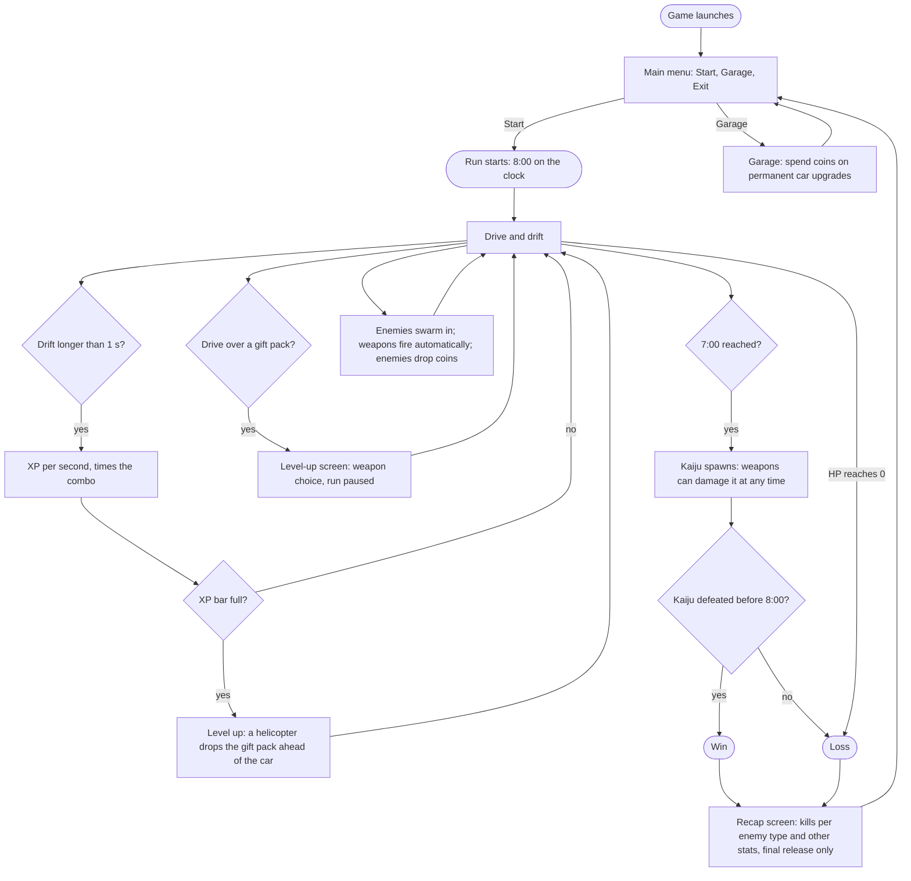
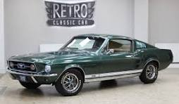
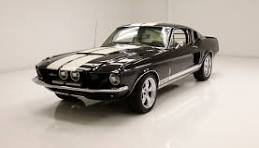
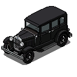

# Solid Carbide: Long GDD

The whole game design in one document, condensed from the game area docs in this folder: each chapter is one game area doc's Summary, Decisions, Content and References. Open questions stay in their own game area docs.

**Generated, do not edit by hand.** Change the game area doc instead, then regenerate with `python tools/generate_long_gdd.py`. The short GDD condenses this document (`short-gdd/`).

## Contents

1. [Game loop architecture](#1-game-loop-architecture)
2. [Drifting](#2-drifting)
3. [Level design](#3-level-design)
4. [Enemies](#4-enemies)
5. [Weapons](#5-weapons)
6. [Garage design](#6-garage-design)
7. [Visual style](#7-visual-style)
8. [Extended narrative](#8-extended-narrative)
9. [HUD and menus](#9-hud-and-menus)

## 1. Game loop architecture

*Source: [game-loop-architecture.md](game-loop-architecture.md). The overall flow of the game. Short, and reworked if the loop changes (not expected).*

Solid Carbide is played in 8-minute runs. The player only drives: drifting earns XP, each level-up brings a weapon choice, weapons fire on their own at the enemies swarming in, and enemies drop coins. At 7 minutes the kaiju arrives, and the player has the last 60 seconds to defeat it; it can be damaged at any time. Between runs, the player is back at the main menu, where the Garage spends coins on permanent car upgrades, and Start begins the next run.

### Decisions

- A run lasts 8 minutes.
- The player only drives. The car's weapons fire automatically.
- Enemies come in from the edges of the screen, in numbers that grow over the run (how they scale: Enemies, Decisions).
- XP comes only from driving, never from kills. In the MVP it comes from drifting only, since challenges are left out of the MVP (Level design, Decisions); if they come back, completed challenges give XP too.
- **Combo:** tricks (Drifting, Decisions) raise a combo multiplier, and the multiplier multiplies all XP gained (from challenges and from drifting). Each trick adds to the multiplier: extended drifts a little, a 360 more, an alternate drift the most. Colliding with anything, enemies included, cuts the combo by 80%. If no trick follows within 2 seconds, the combo drains away quickly. The Game Data Agent proposes the numbers; the board judges them in playtests. The XP from drifting seconds stays as it is, alongside the extended-drift trick. Part of the MVP.
- The higher the combo, the more enemies spawn (how: Enemies, Decisions). The board will judge in playtests whether to keep this.
- A drift that lasts longer than 1 second gives XP for every second it lasts, the first second included (a 3-second drift gives 3 seconds' worth).
- Each second of drifting gives a fixed amount of XP: 10% of the XP bar at level 1. The amount does not grow with the bar, so at higher levels it is a smaller share of the bar and drifting gives only a little XP.
- **Likes drain:** when the player isn't doing tricks, the likes bar empties, but never below the start of the current level, so the player never loses a level. It starts once the combo has fully drained, and any trick stops it. The speed is the board's playtest value, 8% of the current level's bar a second (four times the first proposal; the number: [game/data/run.json](../game/data/run.json)). Part of the MVP.
- "Drifting", for XP, uses the Unity prototype's definition: any moment W or S is held together with A or D (Unity prototype report, section 3).
- After the MVP, if challenges come back (2026-10-11): at level 1, completing one challenge fills the XP bar: the player reaches level 2 and gets the weapon choice.
- How much XP challenges and drifting give at each level, and how much XP each level needs, is worked out by the Game Data Agent as sensible XP scaling, within the decisions here.
- The weapon choice opens only when the XP bar fills and the player levels up (how many weapons are offered: Weapons, Decisions). The weapons chosen reset at the start of every run.
- **Gift pack drop** (board, 2026-10-16; tasks T-144 to T-146): the level-up screen no longer just appears. When the player levels up, a helicopter sent by Redgull flies over the screen and drops a package carrying Redgull's brand (the gift pack). When the player drives over the package, the level-up screen (the gift pack screen) opens. The look of the helicopter and the package: Visual style, Decisions. The run keeps going while the helicopter comes and the package waits; it pauses only when the screen opens. The package lands a short way ahead of the car, on open road, and stays until picked up. One package per level-up, each opening its own screen. When a landed package is off screen, an arrow at the screen edge points to it.
- After the MVP, if challenges come back (2026-10-11): completing a challenge flashes a score, the likes it gave, and gives XP.
- Enemies drop coins. The coins collected in a run are kept whether the run is won or lost.
- At the 7-minute mark the kaiju spawns. It moves slowly toward the player, deals contact damage, and can be damaged at any time (Enemies, Decisions).
- Win: defeat the kaiju within the final 60 seconds. Loss: the car's HP reaches 0 at any point, or the kaiju survives the timer.
- Between runs, coins are spent in the Garage on permanent car upgrades that improve the car in the next run (which upgrades: Garage design, Decisions).
- The game opens on a main menu with three buttons: Start (begins a run), Garage, and Exit. When a run ends, win or loss, the player returns straight to the main menu, with no win or loss message in the MVP.
- The final release adds a recap screen right after a run ends, win or loss: how many of each enemy type the player killed, and other stats the board will choose (task T-017). In the MVP there is no recap: the run ends at the main menu.
- The final release adds local co-op for 2 players (screen split in halves) and 4 players (screen split in quarters). The MVP is single-player.
- **Music** (board, 2026-10-20): the board's own two tracks, "DEMO BEAT 1 (ANDY GAME)" and "DEMO BEAT 2 (ANDY GAME)" (made by the board; the music is human-made), play through the whole game, menus and runs alike, without stopping between screens: one track, then the other, alternating and looping. Its volume is the pause screen's music volume slider (HUD and menus, Decisions). Built in T-209: one music player, a child of the game flow, so the screens changing never restarts it; it plays on its own "Music" bus, and the setting is `music_volume` in `game_settings.gd` (0 to 100, saved with the SFX volume, starting at 40 as a proposal for the playtest). (tasks T-209, T-210)
- **Pickup magnet** (board, 2026-10-21): coins, level-up gift packs and health drops are pulled towards the car once they are within a radius of 1 car length, so they are easier to pick up. The radius is a garage upgrade (Garage design, Decisions). Built in T-222: the radius is 3 units (the car is drawn 3 units long, Drifting, Decisions), read from `run.json`'s `pickup_magnet`, and pickups fly to the car at 30 units per second (proposals for the playtest: the pull speed, and the reach ignoring heights); `game/README.md`, "The pickup magnet (T-222)". (T-222)

### Content

#### One run

#### The run scene

The run is one Godot scene (task T-036; how to use it: [game/README.md](../game/README.md), section "The run"). It loads the run's map and puts the drift car (Drifting) on it, at the centre of the map, in the gravel square, with the camera following the car in the isometric view, as in the drift prototype.

The run's map (task T-206; Level design, Decisions, "The elevation sample map becomes the run's map") is the elevation sample map's layout with its rooftops and ramps (Level design, Content, "Elevation sample map", "The run on this map"): the car has its height there, and everything else in the run (enemies, weapons, pickups, coins, the HUD, the pause screen) works on it as on the MVP map. The MVP map (Level design, Content, "MVP map") stays in the project; one constant in the run switches back to it ([game/README.md](../game/README.md), "The run").

The run owns its state: the clock (8:00 counting down, stopping while the game is paused), the car's health (starting at the value in [game/data/run.json](../game/data/run.json)), and the coins collected in the run. Other parts of the game plug into it:

- At 1:00 left the run sends "boss time"; the kaiju spawns on it (Enemies).
- Enemies damage the car and add coins through the run; the kaiju's death ends the run as a win.
- Health reaching 0, or the clock reaching 0:00, ends the run as a loss.
- Either way, the run sends one "run ended" signal with the result and the coins collected, which are saved (Garage design).
- The HUD reads the time left, the health and the coins from the run (HUD and menus).

#### Likes and levels

The run also owns the likes (XP) and the level (task T-037; how to use it: [game/README.md](../game/README.md), section "The run"; the numbers: [game/data/run.json](../game/data/run.json)):

- Every completed challenge, preset or the kaiju's meteor challenges, gives the current level's challenge XP, and the run sends a "score" signal with it for the challenge popup.
- The run follows the car's drift state step by step: once an unbroken drift reaches 1 second it gives the drift XP for that second, then for each further full second.
- When XP reaches the level's threshold the level goes up (leftover XP carries over, so one gain can give several level-ups), and the run sends "level up" with the new level. At the top level the bar stops.
- On every level-up the run plays the level-up effect: a burst of pixel particles from the car, following it while it plays (task T-112; the look: Visual style, Decisions, "Level-up effect"). Several level-ups in the same moment show as one burst, and the burst keeps playing while the run is paused for the weapon choice.
- The HUD reads the XP, the level's threshold and the level, with a signal whenever they change.
- A level-up does not pause the run by itself: it sends the gift pack (below, task T-144). The run pauses (clock and car) when the car drives over the gift pack's package and the level-up screen opens (task T-052), until the weapon choice is made, one choice after another when several packages are picked up at once.
- **Likes drain** (task T-115; the speed: [game/data/run.json](../game/data/run.json), `likes_drain`, task T-114): once the combo has fully drained back to "no combo", the XP in the current level goes down, stopping at the start of the level, so the level never goes down. Any trick raises the combo and stops it; it starts again once the combo has drained again. It stops while the run is paused (pause screen, level-up screen) and after the run ends. At the top level there is nothing to drain. The HUD's likes bar follows it, so the bar visibly empties.
- A new run starts back at level 1 with no XP.

#### The gift pack drop

How the level-up screen is reached (task T-144; how to use it: [game/README.md](../game/README.md), section "The gift pack drop"; the numbers: [game/data/gift_pack.json](../game/data/gift_pack.json)):

- On every level-up the run sends a helicopter. It flies across the screen from beyond one edge to beyond the other, carrying the package, and drops it over the landing spot; the package falls and lands. Built with placeholder art for now (the final art: tasks T-145 and T-146).
- The landing spot is a short way ahead of the car, along the way it is moving, on open road: never in a building, a boulder or past the map's edge. If straight ahead is blocked, the nearest open spot around it is used.
- The run keeps going the whole time (the clock, enemies, likes and the likes drain). The level-up moment itself (the "level up" signal, the level-up effect, the likes bar) is unchanged.
- One package per level-up. Packages stay on the ground until picked up; a new run clears them.
- Driving over a landed package removes it and opens the level-up screen for that level, with the same weapon choices as before; the run pauses until the choice is made. Two packages picked up together give two screens, one after the other.
- While a landed package is off screen, an arrow at the screen's edge points to it, one per package, kept clear of the HUD.

#### The combo

The run also owns the combo (task T-081; how to use it: [game/README.md](../game/README.md), section "The run"; the numbers: [game/data/combo.json](../game/data/combo.json)):

- Each trick the car does raises the combo multiplier by that trick's amount, up to a cap. The run sends a signal with the trick, the amount added and the new multiplier, for the trick popups.
- The multiplier multiplies all XP gained: each completed challenge's XP (the "score" signal carries the multiplied amount) and each drift second's XP.
- Hitting a wall, a building, the map edge or a boulder cuts the combo by 80%, and so does any damage to the car (enemies, meteors). The cut applies to the part of the multiplier above "no combo".
- When no trick has come for 2 seconds, the combo drains, down to "no combo". A trick restarts the wait.
- The HUD and enemy spawning read the multiplier, with a signal whenever it changes. It stops while the run is paused and resets with every new run.

Starting a new run resets the map, the car and the state. The run's camera zoom can be changed from the pause screen.

#### Screen flow

One screen is on show at a time (task T-055; how to use it: [game/README.md](../game/README.md), section "Screen flow"):

- The game opens on the main menu (HUD and menus, Content).
- **Start** replaces the menu with a fresh run. During the run, Escape pauses and resumes it (the pause screen, HUD and menus).
- When the run ends, win or loss, the run is removed and the main menu comes straight back, with no message. Another Start begins a fresh run.
- **Garage** opens the garage, and leaving the garage goes back to the main menu (Garage design). Wired in task T-089: the garage's back button returns to the main menu.
- **Exit** closes the game.

The drift prototype is not part of the flow; it stays as a tuning tool, opened on its own.

### References

- Final GDD (historical; superseded by the game area docs): [short-gdd/Solid_Carbide_-_Final_GDD.pdf](short-gdd/Solid_Carbide_-_Final_GDD.pdf), sections "Game Specificity" and "Player Experience".
- Unity prototype report: [drifting/unity-prototype-report.md](drifting/unity-prototype-report.md), for the definition of drifting used for XP.
- Run numbers (XP per challenge, XP per level, drift XP, car starting health): [game/data/run.json](../game/data/run.json), read through `game/scripts/data/run_data.gd`.
- Combo numbers (what each trick adds, the cap, the collision cut, the drain, how the combo raises spawning): [game/data/combo.json](../game/data/combo.json), read through `game/scripts/data/combo_data.gd`.
- Gift pack numbers (the helicopter's speed, height and margin; the package's fall time, landing distance, clearance and pickup radius): [game/data/gift_pack.json](../game/data/gift_pack.json), read through `game/scripts/data/gift_pack_data.gd`.

## 2. Drifting

*Source: [drifting.md](drifting.md). How the car drives, drifts and reverses, the prototypes built so far, and the research and decisions behind them.*

Drifting is the one core skill of Solid Carbide. The car's driving and drifting copy the board's older Unity prototype, including its drift curve and its camera, with a higher top speed chosen after the board's playtest of the Godot version, and the car can also reverse. The player sets the camera zoom in the pause menu. The player drives with W to go forward, S to reverse, and A and D to steer and drift.

### Decisions

- The car's driving and drifting copy the board's Unity prototype (see Content, "Prototypes so far").
- The car can reverse with the S key, as in the Unity prototype. Controls: W to go forward, S to reverse, A and D to steer and drift.
- The drift curve is the one the Unity prototype uses. This replaces the earlier plan to choose between three candidate curves (square root, linear or exponential) by playtesting. Drift is not meant to be realistic.
- The camera behaves like the Unity prototype's camera by default (how it follows the car, its zoom and any look-ahead), unless the board decides otherwise later.
- The car is drawn 3 times as long as it is wide: 1 unit wide and 3 units long. This is the drawing only: the car's physics body stays a 1 by 1 unit square, as in the Unity prototype, so collisions behave the same. The drawing sticks out past the body at the front and back.
- The car bounces off walls slightly (buildings and the map's edges), and off boulders the same way.
- The car does not bounce off enemies: they only damage it.
- The bounce off walls and boulders sends the car back at a quarter of the speed it hit with (bounce strength 0.25). While W is held the car stays pressed against the wall, and a knockback against the car's nose is cancelled, because W keeps snapping the car back to cruise speed; the board is fine with both.
- The MVP has three **tricks**, all done with the car's existing driving (what tricks are worth: Game loop architecture, Decisions):
  - **Extended drift:** every second of drifting counts as one low-value trick.
  - **360:** the car's heading turns a full 360 degrees in one direction during one unbroken drift; a mid-value trick. 720 degrees counts as two.
  - **Alternate drift:** drift forwards, release W while still steering, switch to S and drift backwards, then back to W, so the car draws semicircles. Each switch between a forward and a backward drift while keeping the same steering direction counts as one high-value trick. The Driving & Drift Agent proposes the timing limits; the board tunes them.
- **Aerial tricks** (board, 2026-10-21): two tricks in the air, from turning the car while it is airborne (off a ramp or a rooftop's edge): a **180** (the heading turns 180 degrees during one airtime) and a **360** (a full turn). Either direction counts the same: a left 180 and a right 180 are the same trick, and so for the 360. What they are worth, and whether a 360 also counts its 180, are the Driving & Drift Agent's proposals for the playtest (Game loop architecture, Decisions, for how tricks raise the combo). Their popup texts: HUD and menus, Content (T-218). (T-219) The car turns faster in the air than on the ground, so an air 360 fits in a jump off the tallest rooftop (board, 2026-10-21, after T-219 found the longest airtime, 1 second, too short for a 360 at the ground turn rate); how fast is the Driving & Drift Agent's proposal for the playtest. Each spin pays once (board, 2026-10-21): turning while airborne no longer counts towards the drift's 360, so an air spin pays only its aerial trick, not FULL 360! as well. No drifting in the air (board, 2026-10-21, after playing T-219): once the car leaves the ground it keeps the speed and direction it had at takeoff and its path can't be changed until it lands; W, S, A and D in the air only spin the car (its heading), they don't steer, speed up, slow down or drift it. Since the car isn't drifting in the air, airtime doesn't count as drift time for LONG DRIFT! either.
- **Airtime trick** (board, 2026-10-21): every time the car is off the ground, its airtime is a trick of its own: on landing it pays a combo amount that scales with how long it was in the air (seconds and hundredths). Reasonable defaults for the scaling are the Driving & Drift Agent's proposal for the playtest. It counts alongside AIR 180! and AIR 360!. Its popup text: HUD and menus, Content (T-241). (T-242)
- **Drift pays once, at its end** (board, 2026-10-22, like the airtime trick): the extended drift no longer pays a small trick every second; a whole drift pays once when it ends, with a combo amount scaled by how long it lasted (seconds and hundredths). Its popup keeps the existing LONG DRIFT! text with its amount. The XP from drifting seconds stays as it is (Game loop architecture, Decisions). The scaling defaults are the Driving & Drift Agent's proposal for the playtest. (T-246)
- Settling the movement mechanics is one of the project's top priorities and the first thing to work on.
- When W makes the car jump instantly to cruise speed, a short "boost" effect plays to emphasise the jump. This comes after the MVP (tasks T-008 and T-009, final release). Its look: Visual style, Decisions.
- The reference feel is the Unity prototype on its Grass stage, the only stage the board played. Grass has no off-road slowdown, so the Isometric stage's off-road damping is not part of the reference.
- The camera zoom is a player setting: a slider in the pause menu (HUD and menus, Decisions), with the Unity prototype's range, 6 to 20, and its default, 14.4. As in the Unity prototype, the player's choice is saved between sessions.
- Two camera options to try, each a pause-screen checkbox, off by default and saved like the zoom (board, 2026-10-13): **camera smoothing** (the camera follows the car with a short smooth lag instead of sitting exactly on it), and the **dynamic camera** (the zoom follows the car's speed, from a min zoom at very low speed to a max zoom at the car's top forward speed, easing there with a short delay instead of jumping; while it is on it replaces the slider's fixed zoom). The board tunes the min and max in playtests with temporary pause-screen buttons. These are a change from the Unity prototype's camera, which stays the default.
- **The camera follows the car's height** (board, 2026-10-21, after playing the elevation map, where on a height-6 rooftop the car sat high on the screen and the view was hard to read): the camera follows the car as drawn, height included, so the car stays near the middle of the screen on rooftops, ramps and in the air; the height change is eased smoothly so jumps and landings don't jerk the view. (T-228)
- The car's top forward speed is **half** what it was: 16.5 units a second instead of 33 (the top-speed multiplier on the cruise speed goes from 3 to 1.5; the cruise speed of 11 is unchanged). Tried in the board's quick tuning on T-124 and kept.
- The Godot car runs its physics at 50 steps per second, like the Unity prototype, so the per-step values carry over exactly. If 50 turns out not to be possible, the values are converted for 60.
- The car's physics stays flat top-down, as in the Unity prototype, and the Godot version draws it isometrically.
- The board playtested the Godot drift prototype in the isometric view and is very happy with it. The game uses the isometric view and the Unity values, with two changes: the top speed is **3.0 times** cruise speed (Unity: 2.5), and **physics interpolation is on**, for smoother motion between physics steps. The jump to cruise speed stays at 11.

- **Arrow-key tricks, prototype** (board, 2026-10-16): a standalone trick prototype to playtest the idea of tricks done by chaining arrow keys while driving with W/A/S/D. One trick for now: Up, Right, Down, Left in a row makes the car do a **side flip to the right** (a full roll around its long axis) with the illusion of a small jump; the car's physics stays on the ground. A live HUD in the bottom-right corner shows the four arrow keys as they are pressed, and completing the sequence plays a comic-style confirmation animation. The roll is generated with PixelLab for one car direction first. Not part of the MVP; it tries out the far-future trick idea (Open questions). Tasks T-150 to T-153.

- **Trick prototype, round 2** (board, 2026-10-17, after playing it): during any trick's jump the car flies over obstacles and walls, and clearing one earns a jump-over bonus that counts as a trick. Two more arrow tricks: **Up, Left, Down, Right**, the side flip to the left (the mirror of the right one), and **Up, Down, Up, Up**, the nose launch: the car leans onto its nose, then springs forward into the air with its nose flipping up as it flies, and lands, like a toy car pressed down at the back and let go. The board's verdict on the first roll art: fine for a prototype, but it looks flat, like flipping a 2D image ("Paper Mario"), with no depth or sense of physics. Asked how to give the tricks real depth (a 3D car rendered as pixels, more PixelLab, or keep the code stand-in), the board first chose to keep the code stand-in, then the same day replaced that: the tricks get full generated art made with PixelLab's rotation tools (`/rotate` with its tilt, in-betweens from `/interpolation-v2`), not the code stand-in (board, 2026-10-17: "scratch the current way, i want to do it with the full art"). Sample first: one direction for the side roll and the nose pop, then all 16 directions after the board approves. Tasks T-154 to T-157.

- **Trick prototype, round 3** (board, 2026-10-17): while the car is on the ground, the last pressed arrow key that is still held tilts the car slightly toward that direction (relative to the car, matching the tricks), as live feedback. **Wall grinds:** landing from a trick close to the edge of a wall (walls, not boulders) locks the car into a grind, sitting across the wall nearly perpendicular but slightly diagonal, carrying on along the wall in the direction it was going and slowing as it burns speed, with discrete sparks; the grind counts as a trick. Space (a new jump key) or another arrow trick exits it, keeping the speed and direction along the wall. Tasks T-158 to T-160.

- **The trick prototype is a reference; tricks are rebuilt on real height** (board, 2026-10-19): building the trick prototype before an elevation system was a mistake, since its jumps only fake height. The tricks are rebuilt on the elevation system below, once the board trusts it. The prototype is not merged: its trick definitions, animations, numbers and art stay as a reference (Content, "Trick prototype (reference)"), its code on the branch `hold/trick-prototype`, and tasks T-151 to T-160 are cancelled.

- **Elevation** (board, 2026-10-17; go-ahead 2026-10-19): the car gets a real height above the ground, separate from where it is on the map, with gravity, a takeoff speed and a landing. It can drive up a ramp onto a raised area, drive along it, and jump off its edge or off a ramp. The illusion of height in this 2D game: the car's drawing lifts up the screen with its height while its round shadow stays on the ground under it (the car is always drawn at its normal size; the board tried drawing it bigger when high and removed it, task T-192). Built first in a test scene, the way the drift prototype was, not in the real map. The map side (raised areas and ramps) is in Level design. Later, on top of it: the car jumping on its own, grinds, and rotating the car in the air (the trick system, rebuilt from the reference); far later, maybe loops.

- **Elevation test scene, the board's playtest** (board, 2026-10-19): the board likes the physics: how the car drives, how it looks going up the ramp, and jumping over the platform ("amazing"). Three changes before it merges:
  - **See-through raised areas.** When the car is behind a raised area it must not disappear: the raised area turns see-through the way the map's buildings do (Level design, "When a building fades"), reusing the same logic. And driving into a raised area's side from behind (its top-right or top-left side on screen, where the car is hidden) must not make the car suddenly draw over the raised area.
  - **No "bigger when high" option.** The board tried drawing the car bigger with height and didn't like it: the option is removed, and the car is always drawn at its normal size.
  - **A round shadow.** The shadow is a circle right under the centre of the car, in the same colour and feel as now, instead of the rectangle, so the player sees where the car is on the ground when it is in the air.
- **No sprite shadow in the air** (board, 2026-10-20, from the elevation sample map's screenshots): the car's sprite has a drop shadow drawn into most of its 16 frames, which travels up with the car when it is in the air, beside the round shadow. In the air the car is drawn without it, so only the round shadow shows; on the ground it keeps the sprite's own shadow, as now. The shadowless frames are made by a free script, not PixelLab (Visual style, Decisions, "The car without its shadow").
- **No drift smoke or tyre marks in the air** (board, 2026-10-21, after playing the full game on the elevation map): while the car is airborne it leaves no drift smoke and no tyre marks, even if the drift keys are held; both come back when it lands (tyre marks: board, 2026-10-21, same day). (T-206)

### Content

#### Prototypes so far

The board built two drift prototypes before this project:

- **The older prototype, in Unity: the board is very happy with it.** It is at `C:\Users\andre\drift-to-survive` on the board's machine (Unity 6000.3, project name DriftSurvivors). The reference is its current state. Its driving values come from the project files (the vehicle data asset); the board's earlier pause-menu tuning is no longer read by the current code, and only the camera zoom is still a saved pause-menu setting (in the Windows registry). Its driving and drifting are the reference for Solid Carbide. It also has reverse on the S key.
- **The newer prototype: the board is not happy with how it turned out.** It is not used as a reference and will not be analysed.

A report on how driving, drifting and reverse behave in the Unity prototype, with the preparations needed to reproduce them in Godot, is done (task T-006). See References.

#### Unity prototype summary

Facts from the report (Unity prototype report, sections 1 to 7). No new decisions.

- The car is a top-down 2D physics body. Every physics step (50 per second) the code sets its velocity directly, split into speed along the nose and speed across it. No forces.
- The handling values come from the car's data asset in the project files. The current code reads no driving value from the registry; the only saved setting that still matters is the camera zoom.
- W snaps the car to a cruise speed of 11 units per second (the Unity car is 1 unit long), then speed climbs in a straight line to a top speed of 27.5. Letting go coasts down in a straight line.
- S brakes in a straight line while moving forward, snaps to 11 backwards at zero, then climbs to 27.5 backwards. W always wins over S.
- A and D rotate the car at a fixed 191.9 degrees per second at every speed, including standing still.
- The drift comes from sideways speed being kept at 98% per physics step: held W + A or W + D builds a wide slide that levels off near a 75 degree drift angle at about 34 units per second.
- A coded "drift amount" ramps from 0 to 1 in 0.08 seconds and back in 0.33 seconds. With the current car values it does not change the handling; it drives the drift effects.
- The camera is orthographic, sits exactly on the car every frame, never rotates, and has no smoothing or look-ahead. Its zoom (default 14.4, half the visible height in world units) is a saved pause-menu setting.

#### Godot drift prototype

The Godot copy of the Unity car (task T-012), for the board's playtest.

- **Where:** the scene `game/scenes/drift_prototype/drift_prototype.tscn`, the project's main scene, with its code in `game/scripts/driving/`. How it is built, its keys and how to run it: `game/README.md`, "Drift prototype".
- **How to run it:** open `game/` in Godot 4.6 and press F5, or run `"$GODOT_BIN" --path game` from the repo root.
- **Controls:** W, S, A and D as in the Unity prototype (Unity prototype report, section 2). Tab opens the tuning panel, V switches the view. No jump, arrow keys or gamepad.
- **Ground:** flat and empty, like the Unity Grass stage, with a grid (a thin line every unit, a stronger one every 5 units) and a marker at the start point.
- **Movement:** the Unity prototype report's section 4, step by step, at 50 physics steps per second, with the Unity values (report, section 5). The GUT tests check it against the report's numbers. One difference: the comparison that decides whether W snaps to cruise speed (and S to reverse cruise speed) ignores rounding errors below 0.000000001 units per second. Without it, at some headings the forward speed reads back a hair under cruise speed and W would snap to cruise speed on every step instead of climbing to top speed.
- **Boost signal:** the car signals each time W makes it jump up to cruise speed, with the speed before the jump and whether W was just pressed. During a held W + A or W + D drift the slide pulls the forward speed under cruise speed, so the jump happens on most steps of the drift too (with W not just pressed).
- **Scale and camera:** 16 pixels per unit, the scale of the placeholder car sheets. The camera sits exactly on the drawn car, never rotates and has no smoothing or look-ahead. Its zoom is Unity's orthographic size, half the visible height in units.
- **View switch:** the physics always runs in the flat top-down world. V, or the panel's "Isometric view" toggle, switches only the drawing: flat top-down with the flat placeholder sheet, or a standard 2:1 isometric projection (screen = (x - y, (x + y) / 2)) of the same world with the isometric sheet. It can be switched mid-drive; the car's position, speed and rotation do not change.
- **Collisions (task T-033):** the car's 1 by 1 unit body bounces off walls, buildings, the map's edge and boulders, and drives through enemies without bouncing. How hard it bounces is a tuning panel slider, "Wall bounce", in a "Collisions" group at the bottom of the panel: the share of its speed into the wall the car keeps, bouncing back (0 = no bounce, 1 = full bounce). The proposed default is 0.25, for the board to judge in a playtest; the Unity prototype has no bounce. The prototype has a test room for trying it: a few walls and a boulder 3 units across. The car also signals each hit (for the combo) and can be knocked back by other code (minions, meteors). Details, the collision layers and the knockback function: `game/README.md`, "Car collisions".
- **Tricks (task T-079):** the car finds the three tricks (Decisions) in its own driving without changing how it drives, and signals each one with its id for the combo and the popups. "Drifting" is the Unity definition (W or S held together with A or D); any step without it is a break. An extended drift is one whole unbroken drift, paid once when it ends (since T-246; it paid every full second before). A 360 is each full turn of the heading in one direction during one unbroken drift; turning back the other way or a break starts the count again. An alternate drift is each switch between a forward drift (W) and a backward drift (S) with the same steering side, within limits the board tunes in the tuning panel's "Tricks" group: the switch from one drift to the other may take at most 0.5 seconds, both drifts must last at least 0.3 seconds (the trick counts when the new one reaches it), and A or D must stay held on the same side during the switch. These three values are proposals. The tuning panel's readout shows the last trick. The signal, the trick ids and the details: `game/README.md`, "Tricks".
- **Camera options (task T-123):** the two camera options (Decisions, 2026-10-13), both off by default; with both off the camera is exactly as above. They work the same in the drift prototype and in the run (also a run started from the main menu), and are saved with the zoom in the player's settings. **Camera smoothing:** each physics step the camera closes 1 - e^(-8 x step time) of its gap to the drawn car (rate 8 per second), so it trails a moving car by about its speed / 8 (about 4 units at the top speed of 33 units per second, under a third of the default half-height of 14.4) and catches up within about half a second once the car stops. **Dynamic camera:** the zoom's target is the min zoom at a standstill and the max zoom at the car's top forward speed, in a straight line in between (half speed: halfway), using the car's speed in any direction as a share of its top forward speed (capped at 1), so a fast slide or a fast reverse also zooms out. The zoom eases toward the target at a rate of 3 per second (about 63% of the way in a third of a second, 95% in one second), so it never jumps. While it is on it replaces the slider's zoom; moving the slider while it is on shows that zoom at once (so the board can see the value it is about to set as min or max), and the camera eases back to the speed's zoom once the car moves. Turning it off goes straight back to the slider's zoom. **Min and max:** proposed 11 (zoomed in at a standstill) and 17 (zoomed out at top speed), around the default 14.4 and within the slider's 6 to 20; the board sets them in playtests with the pause screen's buttons (task T-124), which take the slider's current zoom. The two rates are proposals in one place in the code. Settings keys, the API for the pause screen and where the saved min and max can be read: `game/README.md`, "Camera options".
- **Camera follows the car's height (task T-228; the decision is in Decisions, 2026-10-21):** the camera's position is the ground part plus a height part. The ground part follows the car's map position as before, with the camera options (smoothing, dynamic camera). The height part is the lift of the car's drawing (16 pixels per unit of height, straight up the screen) and **eases** toward it at a rate of 4 per second (a proposal, `HEIGHT_EASE_RATE` in `camera_follow.gd`): about 63% of a change in a quarter of a second and 95% in 0.75 s, so a jump, a landing or a ramp climb never jerks the view, and the car sits near the middle of the screen on a rooftop once it has settled (within 5 px of a height-6 rooftop's 96 px after 0.75 s). While the car rises or falls, it is off-centre by the part not yet eased (at most the full lift). A new run or a view switch snaps the camera straight onto the lifted car. At height 0 the lift is 0 and the camera is exactly as before, so the street is unchanged. It is used in the run on the elevation map, the drive-only elevation sample scene and the elevation test scene; the drift prototype has no heights.
- **Tuning panel (Tab):** one slider per setting in the report's section 8 list except off-road damping and the physics rate (cruise speed, top speed multiplier, time to top speed, coast slowdown, turn speed, steering sensitivity, base sideways grip, drift grip at low and high speed, drift speed reference, drift enter and exit rates), plus the camera zoom (6 to 20, starting at 14.4). Each slider applies live and has a tooltip showing the Unity value. The sliders start at the game's values (Decisions, 2026-10-08 and 2026-10-10), and one button resets everything to them. A "Physics interpolation" toggle (on, the game's value; Unity has it off) smooths the motion between physics steps. A readout shows speed, drift angle and drift amount. Nothing is saved between runs.

#### Elevation test scene

The test scene for the car's real height (Decisions, "Elevation"; tasks T-182 to T-187), built like the Godot drift prototype and kept apart from the real map. How it is built: `game/README.md`, "Elevation test scene".

- **Where:** `game/scenes/elevation_test/elevation_test.tscn`. It is not the project's main scene and no menu leads to it.
- **How to run it:** open the scene in the Godot editor and press F6 (Run Current Scene), or run `"$GODOT_BIN" --path game res://scenes/elevation_test/elevation_test.tscn` from the repo root. W, S, A and D drive as in the drift prototype; there is no tuning panel, view switch, pause screen or on-screen text. The car starts on the street east of the ramp's foot, facing it (a proposal), so W drives straight up the ramp.
- **What is in it:** the drift prototype's car (the same driving, at 50 physics steps per second, with physics interpolation on), its camera (the saved zoom and camera options) and its isometric view, on the street with its grid, plus one raised platform and one ramp up to it (Level design, "Elevation test scene").
- **What the car's height does** (tasks T-183 and T-184): the car has a height above the ground, separate from where it is on the map. On the ground and on the ramp it follows the ground. Leaving the ramp's top climbing at 4 units/s or more, it takes off with the ramp's slope; driving off a drop-off edge or a ramp's side, it falls. In the air, gravity of 12 units/s² pulls it down until it lands on whatever ground is under it, the platform's top or the street. In the air the car keeps its takeoff speed and direction and the keys only spin it (task T-219; Content, "Aerial tricks (task T-219)", "No drifting in the air"). From the street, a drop-off edge or a ramp's side higher than 0.1 units is a wall the car bounces off; lower steps are curbs it drives over. Details and the numbers: "Elevation: the platform's sides" below and `game/README.md`, "The car's height (T-183)".
- **The drawing (task T-185):** the car's drawing is lifted straight up the screen by its height, 16 pixels per unit (the drawing's scale), so on the platform it sits 48 pixels up. Its **shadow**, a dark opaque filled circle about 1 unit across (a proposal; task T-192), an ellipse twice as wide as tall on screen, not turning with the car, stays centred at the car's map position on the ground under it: on the platform's top or the ramp when over them, on the street otherwise. Its size doesn't change with height (a proposal; the car is always drawn at its normal size: the bigger-when-high option was removed). (Superseded by T-228, 2026-10-21: the camera now follows the car as drawn, height included, see "Camera follows the car's height" below.)
- **A round shadow, and no bigger-when-high (task T-192, board's playtest 2026-10-19):** the board tried drawing the car bigger when high (task T-187) and did not like it: the option is removed, the car is always drawn at its normal size. The shadow is now a filled circle on the ground right under the centre of the car's map position (the platform's top or the ramp when over them), about 1 unit across (a proposal, for the board's playtest), drawn in the isometric view as an ellipse twice as wide as it is tall. Same dark, opaque colour with hard pixel edges as before; it does not turn with the car and does not change with height. Where it sits, its depth order and the see-through stay as they were. See `game/README.md`, "The round shadow, and no bigger-when-high (T-192)".
- **The platform and ramp art (task T-186):** PixelLab art (`game/art/elevation/platform.png` and `ramp.png`) is drawn over the platform and the ramp, made from 3 generations and fitted to the sizes in the height data. How it is built: `game/README.md`, "The platform and ramp art (T-186)". Screenshots: [elevation-final-art](drifting/elevation-final-art.png), [elevation-final-art-platform](drifting/elevation-final-art-platform.png).
- **The script drawing (fallback):** the first version, still used if the art files are missing: flat-coloured top faces with a grid every unit, the east and south side faces the isometric view shows, and light edges. Grey-blue for the platform, a dull sand colour for the ramp's top (proposals), no Redgull red, no semi-transparent pixels. The five screenshots below show this version.
- **Depth order:** the car and its shadow are drawn under a raised area they are behind (their centre north or west of it on the map, not wholly east or south of it, and lower than its top), and over it when on it, above it or in front of it. Each is placed on its own: a car high above the street behind the platform is drawn over it while its shadow on the street is hidden under it. Behind is judged by the car's centre (task T-191): driving into the platform's back sides (top-left and top-right on screen), the car's centre stops at the side while its body reaches into it, and the old rule (the whole body north or west of it) drew the car over the platform for the moment of the hit. Now it stays under it through the hit.
- **See-through raised areas (task T-191):** when the car is behind the platform or the ramp and it covers the car on screen, the whole area fades like the map's buildings, with their numbers: to 15% visible over 0.15 seconds, and back over 0.15 seconds when it no longer covers the car (Level design, Content, "When a building fades"). The code is shared with the buildings rather than copied: the numbers are the map's (`mvp_map.gd`), the fade step is the buildings' (`map_building.gd`) and so is the car's on-screen shape. Where it lives: `game/README.md`, "See-through raised areas (T-191)". Screenshots: the car behind the see-through platform and at a wall hit on each back side, and the same hits with the fade off (the car hidden under the platform): `art-archive/T-191/screenshots/`.
- **The car's sheet in the air (task T-205; Decisions, "No sprite shadow in the air"):** while the car's height is above the ground under it, the isometric car is drawn from the shadowless sheet (`car_iso_noshadow.png`, same layout, same frame for the heading), so only the round shadow shows; on the ground, a rooftop or a ramp it is drawn from `car_iso.png` with its own shadow. The sheet switches on the physics step the car takes off and the step it lands. The run and the drift prototype have no ground heights, so their car never switches. Screenshots: `art-archive/T-205/screenshots/`.
- **Screenshots:** the car on the street, on the ramp, on the platform, in the air past the platform's south edge, and behind the platform (only its roof shows): [elevation-ground](drifting/elevation-ground.png), [elevation-ramp](drifting/elevation-ramp.png), [elevation-platform](drifting/elevation-platform.png), [elevation-air](drifting/elevation-air.png), [elevation-behind](drifting/elevation-behind.png).
- **Before T-191:** a car behind the platform was hidden by it (the last screenshot, taken before the see-through existed).

#### Elevation: the platform's sides (task T-184)

How the sides of a raised area and its ramp meet the car, in the elevation test scene (Decisions, "Elevation"; the ground: Level design, "Raised areas and ramps"). The docs left these open; each point below is a **proposal for the board's playtest**, built on the car's existing collisions (Godot drift prototype, "Collisions"). How it is built and its one number: `game/README.md`, "The platform's sides (T-184)".

- **A drop-off edge met from the ground below** (proposal): for a car lower than the platform's top, the edge is a wall. The car stops at it and bounces off it like off any wall, with the same "Wall bounce" share, and signals the hit like any wall hit. It stays on the ground. A car high enough to clear the edge (in the air, above the top) passes over it.
- **Landing** (proposal): a jump that ends over the platform's top lands on the top; one that ends beside it lands on the ground. A car in the air that would enter the platform's outline lower than its top meets its side as a wall (it bounces off and keeps falling beside it), so it never ends a physics step inside the platform.
- **The ramp's sides** (its two long sides, not its climbing end or its top; proposal): the same as a drop-off edge, a step of the ramp's height at that point. Driving off a side from on the ramp, the car leaves the ground at the ramp's height there and falls to the ground with gravity. From the ground beside the ramp, the side is a wall as high as the ramp at that point.
- **Curbs** (proposal): a step of the ground no higher than 0.1 units is driven over, not a wall or a drop; near the ramp's foot, where its sides are that low, the car drives onto the ramp from the side.

#### Elevation: the three layers of the sample map (task T-195)

The car's height (above) checked on the elevation sample map's three layers, the street (0), the first-floor rooftops (3) and the second-floor rooftops (6) (Level design, "Elevation sample map"). It works there unchanged: the ramps whose foot is on a rooftop (3 to 6) need no special case, since the car's height always follows, leaves and lands on the ground under it, whatever that ground's height. The numbers (gravity, the takeoff speed and factor, the curb height) are unchanged. How it is tested and run: `game/README.md`, "The car's height on the three layers (T-195)".

- **What the tests show**, with the real car code, picking the ramps and rooftops from the map's file by their heights: up a 0-to-3 ramp and a 3-to-6 ramp the car follows the slope; off a 3-to-6 ramp's top at cruise speed it takes off along the slope, as at the test scene's ramp; driving off a height-6 rooftop's side it falls and lands on the height-3 rooftop under it, or on the street; on a height-3 rooftop, the side of a height-6 rooftop is a wall it bounces off. In the sample map scene, the MVP map's tall buildings and boulders block the car at every height it can reach: on the street, on 3, on 6 and in the air (they are walls in the flat world, so no jump clears them; a proposal kept from the MVP map).
- **The scripted drive** (`game/tools/drive_elevation_sample.sh`, or `.ps1`, from the repo root): drives the car, headless, from the street up a 0-to-3 ramp, up a 3-to-6 ramp and off a height-6 edge, the way a player would (W held, steering toward the route), and prints each layer reached, every jump, the maximum height and the airtime off the edge. With today's layout and numbers: height 3 at 1.8 s, height 6 at 5.3 s, a small hop off each ramp's top (up to 3.75 and 6.89), and 1.00 s in the air falling the 6 units off the edge onto the street. Plot of the height over time: [art-archive/T-195/screenshots/height-over-time.png](../art-archive/T-195/screenshots/height-over-time.png).

#### Aerial tricks (task T-219)

The air 180 and air 360 (Decisions, "Aerial tricks"), built in `game/scripts/driving/trick_detector.gd` from the car's heading and its airborne state; how it is built is in `game/README.md`, "Tricks". The detector only reads the driving. Two changes to the driving in the air come from the board (below): no drifting in the air, and faster turning in the air. Ground driving is unchanged. Every point below is a proposal for the board's playtest.

- **No drifting in the air** (Decisions, "Aerial tricks", board 2026-10-21, after playing T-219): from the first step that starts with the car in the air, the driving model keeps the car's velocity (speed and direction on the map) exactly as it was at takeoff. There is no speeding up, braking, steering of the path, grip or drift. W, S, A and D only spin the body: A and D at the air turn rate, and W and S alone do nothing. The car is not drifting in the air (its drift amount fades as whenever it stops drifting), so there is no drift smoke or tyre marks, no drift likes, no LONG DRIFT! and no drift sound, and the exhaust flamethrower, which fires while drifting, is off in the air too.
  - **Not changed:** the takeoff step is still a ground step. A wall or building side met in the air still bounces the car, and an enemy's knockback still pushes it, as before; neither is driving.
  - **Landing:** driving resumes on the step after the landing, from the heading the car landed with and the velocity it kept.
    - Landing straight on, it simply drives on.
    - Landing at an angle to its path, the part of its speed along the new nose becomes its forward speed. The part across the nose is a sideways slide that fades with the normal grip: 0.98 is kept per step when not drifting, so about a third of it is left after a second. In effect it lands into a drift-like slide.
    - With W held, a forward speed under cruise snaps up to cruise along the new nose, as W always does.
    - Landing backwards (more than 90 degrees off its path) with W held, the car snaps to cruise speed forward along its new nose, which is a sudden turnaround. Holding A or D with W or S on landing is a normal drift from that step.

- **What counts:** only heading turned on physics steps that end with the car in the air (from the takeoff step to the step before landing). Turning on the ground, before the takeoff or after the landing, counts nothing, and turns in two airtimes don't add up. The turn is counted in one direction; turning back starts a new count, and the airtime keeps its largest one, so a 180 followed by a small wiggle back still counts. Letting go of A or D in the air keeps the count. W makes no difference (steering turns the car with or without it).
- **Paid on landing:** the tricks are given on the step the car lands, not mid-air, so the turn must be finished before landing, and the popup shows as the car lands. A run that resets mid-air (a new car) forgets the airtime.
- **A 360 counts only the 360, not its 180 too.** The airtime's turn is paid in half turns: 180 gives AIR 180!, 360 gives AIR 360!, **540 gives AIR 360! and AIR 180!**, **720 gives two AIR 360!**.
- **Worth:** `air_one_eighty` adds 0.25 to the combo (as much as a drift 360) and `air_three_sixty` 0.5 (twice the turn, as much as an alternate drift, the hardest ground trick), in `game/data/combo.json`, `trick_add`.
- **A drift 360 that spans the jump: each spin pays once** (Decisions, "Aerial tricks", board 2026-10-21; this replaces the first build's independent counting). Turning on a step that ends in the air counts only for the aerial tricks and never towards the drift's FULL 360!, so an air spin with W held pays AIR 360! (or AIR 180!) and no FULL 360!.
  - **At takeoff**, since there is no drifting in the air, the airtime is a break in the drift. A drift 360 in progress starts again from zero, and a drift in progress ends there and pays (T-246). A drift segment ends too, for the alternate drift's switch timing. After landing, a drift starts counting from the landing. (Before "no drifting in the air", a drift 360 in progress was kept through the airtime.)
- **Faster turning in the air** (Decisions, "Aerial tricks"; the board chose this after the first build found the 360 out of reach): in the air the car turns `air_turn_multiplier` times faster than on the ground. This is a tuning value in `game/scripts/driving/car_tuning.gd`, with a slider in the drift prototype's tuning panel ("In the air"). Proposed: **2.5**, which is 479.75 degrees a second (9.6 per physics step) in the air. The ground rate stays 191.9. The faster rate applies on every step that starts with the car in the air, so the takeoff step still turns at the ground rate.
- **What it gives on today's map** (measured in the tests): the highest drop is a height-6 rooftop onto the street, 1.0 s, of which 49 steps count as in the air.
  - **A 360 takes 38 steps (0.76 s).** A player who steers the whole fall makes it with **about 0.2 s to spare**: starting the turn 10 steps (0.2 s) late still gives AIR 360!, while 12 steps late gives only AIR 180!.
  - **A 180 takes 19 steps (0.38 s)**, half of that, so it also fits a hop off a ramp's top (about 0.7 s).
  - The most a rooftop fall can turn is about 470 degrees, so a 540 can't be done on today's map.
- **The recordings:**
  - [air_360_run_straight.gif](../art-archive/T-219/screenshots/air_360_run_straight.gif), the current build (no drifting in the air), in a run on the elevation map. The car drives off a height-6 rooftop's side with W and holds W and A for the whole fall. It keeps flying in its takeoff direction while it spins about 470 degrees: the camera follows the car, so the street and boulders scroll past steadily in one direction while the car turns on the spot over its shadow. It lands to AIR 360! +0.5 alone, with no LONG DRIFT! and no FULL 360!. Popup: [air_360_run_straight_popup.png](../art-archive/T-219/screenshots/air_360_run_straight_popup.png).
  - Kept from before "no drifting in the air": [air_360_run_pays_once.gif](../art-archive/T-219/screenshots/air_360_run_pays_once.gif), with the faster air turn and each spin paying once, in a run on the elevation map. The car drives off a height-6 rooftop's side with W and turns with A for the whole fall (about 470 degrees). Nothing pops mid-air. It lands to AIR 360! +0.5, with LONG DRIFT! +0.05 from the drift's seconds, and no FULL 360!. Popup: [air_360_run_pays_once_popup.png](../art-archive/T-219/screenshots/air_360_run_pays_once_popup.png).
  - Kept from before each spin paid once: [air_360_run.gif](../art-archive/T-219/screenshots/air_360_run.gif), with the faster air turn, in a run on the elevation map. The car drives off a height-6 rooftop's side with W and turns with A for the whole fall (50 steps, about 470 degrees). FULL 360! +0.25 pops mid-air, and the car lands to AIR 360! +0.5 (with LONG DRIFT! +0.05). Popup: [air_360_run_popup.png](../art-archive/T-219/screenshots/air_360_run_popup.png).
  - From the first build, at the ground turn rate (kept, not re-recorded): [air_180_run.gif](../art-archive/T-219/screenshots/air_180_run.gif), the same drive turning about 188 degrees in the air and landing to AIR 180! +0.25. Also [air_360_staged_drop.gif](../art-archive/T-219/screenshots/air_360_staged_drop.gif), a staged drop: the car is let go 22 units above the gravel square, zoomed out, and turns a full circle in 95 steps to AIR 360! +0.5. Popups: [air_180_popup.png](../art-archive/T-219/screenshots/air_180_popup.png), [air_360_popup.png](../art-archive/T-219/screenshots/air_360_popup.png).

#### Airtime trick (task T-242)

The board's airtime trick (Decisions, "Airtime trick", 2026-10-21): every airtime is a trick of its own, paid on landing by how long the car was in the air. Built in `game/scripts/driving/trick_detector.gd` (how: `game/README.md`, "Airtime trick"); it reads the car's airborne state like the aerial tricks and changes no driving. Its popup is "HANG TIME!" with its amount (HUD and menus, Content, T-241). The live counter while airborne is T-243's. Every number below is a proposal for the board's playtest, in `game/data/combo.json`, `airtime`.

- **Seconds** are the sum of the physics steps that end in the air (0.02 s each), so a rooftop fall of 49 steps is 0.98 s.
- **Amount** = airtime (to hundredths) times `per_second`, nothing under `min_seconds`, held at `max_add`, rounded to hundredths. It adds to the combo like any trick (held at the combo's cap; at the cap only the name shows).
- **Proposed numbers and why:**
  - `min_seconds` **0.3**: a curb or a small hop stays under it, so only a real jump pays and the popup never fires for nothing. Ramp tops and rooftop falls (about 0.7 s to 1.0 s) are well over it.
  - `per_second` **0.2**: the rooftop fall (0.98 s) pays **0.20** and a 0.7 s ramp hop 0.14. That is less than an AIR 180! (0.25), since an airtime alone asks for no steering.
  - `max_add` **0.6**: reached at 3 s, a little above an AIR 360! (0.5), so a very long fall is worth about a spin and a bit, never much more than the hardest aerial trick. Today's highest drop is 1.0 s, so the cap is not reached on today's map.
- **Next to the aerial tricks:** it pays on the same landing step, after AIR 180! or AIR 360!, as its own popup. A spin does not replace it: a 360 off a height-6 rooftop pays AIR 360! +0.5 and HANG TIME! +0.2.
- **Recording:** [airtime_run.gif](../art-archive/T-242/screenshots/airtime_run.gif), a run on the elevation map: the car drives straight off a height-6 rooftop's side, flies 0.98 s over its shadow and lands to HANG TIME! +0.2 (combo x1.2). Popup: [airtime_popup.png](../art-archive/T-242/screenshots/airtime_popup.png).

#### Drift pays once, at its end (task T-246)

The Decision "Drift pays once, at its end" (board, 2026-10-22), built in `trick_detector.gd` and `combo.json`; how: `game/README.md`, "Tricks". Nothing pays while a drift lasts. When it ends (the keys let go, W alone, or a takeoff, "No drifting in the air") it pays one `extended_drift` trick, with the existing LONG DRIFT! popup and its amount (the amount is `+0.12` for a 2.37 s drift). FULL 360!, ALT DRIFT! and the XP from drifting seconds are unchanged. The numbers are in `game/data/combo.json`, `drift_pay`; every one is a proposal for the board's playtest:

- **per_second: 0.05.** The old build paid 0.05 for each full second, so a drift pays about what it did in total (a 4 s drift: 0.20, as 4 x 0.05 before), now with hundredths of a second counting.
- **min_seconds: 1.0.** The old build paid nothing before the first full second; a shorter drift still pays nothing.
- **max: 0.5.** The same as an ALT DRIFT!, reached at 10 s of drifting, so one very long drift cannot outrun the other tricks. The old build had no cap.

The popup stays the small size (a drift is a small trick). Screenshot and GIF: `art-archive/T-246/screenshots/`.

#### Trick prototype (reference)

What the trick prototype built (tasks T-151 to T-160, 2026-10-16 and 17), kept as the reference for rebuilding the tricks on real height (Decisions, 2026-10-19). Its code is on the branch `hold/trick-prototype` (the README sections named below are on that branch); its PixelLab art is in `art-archive/T-153/` and `art-archive/T-157/`. The card texts were approved in T-154 and T-158: RIGHT FLIP!, LEFT FLIP!, NOSE POP!, CLEARED IT!, GRIND!. All numbers were proposals for the board's playtest.

**Round 1 (task T-151).** A standalone scene to try the arrow-key tricks: the Godot drift prototype unchanged, driven with W/A/S/D, plus tricks on the arrow keys. Up, Right, Down, Left as consecutive presses, each within 0.6 seconds of the one before, makes a side flip to the right; a wrong key or a slow press starts the sequence again, and no new trick starts while a flip plays. The flip is drawing only: the car rises 16 pixels on an arc and lands after 0.6 seconds with a short squash, rolling a full turn on the way, while a dark shadow stays on the ground and shrinks and fades a little at the top. The car keeps driving and colliding as before. A HUD (T-152) in the bottom-right corner, 16 px from the edges, shows the label TRICK and four arrow keys in keyboard layout: a held key lights up white, a key already in the sequence gets a yellow ring, and a finished trick shows its name on a white rounded card with a black border in Bangers, popping in with an overshoot, holding and fading over 1 second, while the four keys flash yellow for 0.35 seconds.

**Round 2 (task T-155).**
- **Two more arrow tricks.** Up, Left, Down, Right is the side flip to the left: the same hop, rolling the other way (the roll frames played backwards). Up, Down, Up, Up is the nose launch: a 0.15 second nose dip on the ground (the drawing tips forward and squashes), then the launch, which adds 8 units/s to the car's speed along its nose (cruise is 11), a hop of 0.9 seconds and 28 pixels with the drawing pitching nose-up through one full backflip, and a deeper landing squash. All three start with Up and are told apart at the second key.
- **Jumping over obstacles.** While any trick is in the air, the car passes over obstacles and walls instead of hitting them. It never lands inside one: if the hop would end over an obstacle, it stays in the air, low (6 pixels up), until it is clear, then lands; while it waits, a car slower than 3 units/s is pushed gently along its nose. The car can still drive while in the air.
- **The jump-over bonus** counts as a trick of its own: one for each obstacle cleared, at the moment the car comes clear of it. It has its own card (T-156), which can show while a flip's card is showing; visible cards stack upward, 16 px apart, from 28% down the screen.
- **Known limits:** no depth order (the car was always drawn over obstacles), and a jump could carry the car out of the test room.

**Round 3 (task T-159).**
- **Live tilt.** On the ground, the last pressed arrow key that is still held tilts the car's drawing toward it, relative to the car: Up the nose down, Down the tail down, Left and Right onto that side. Releasing it falls back to the key pressed before it, if still held. Slight (25 degrees' worth of squash and a 2 pixel lean), easing in and out in 0.08 seconds; none during a trick or grind.
- **Wall grinds.** Landing from a trick with the car's side within 1.5 units of a wall's long edge, or on top of the wall, or up to a unit past its end (walls, not boulders), while moving along the wall at 1 unit/s or more (an angled landing counts its speed along the wall), locks the car into a grind. (Loosened after the board's playtest, "make grinding a little bit easier"; at first half a unit, beside the wall only, 2 units/s.) The car snaps onto the wall's edge and sits across it at 70 degrees to the wall, the nose leaning the way it travels, and carries on along the wall, slowing by 4 units/s every second. Yellow and orange pixel sparks fly back from the contact point, 5 per second for each unit/s of speed. The grind counts as a trick. When the wall runs out or the speed drops below 1.5 units/s, the car drops off onto the ground on the side it came from.
- **Leaving a grind.** Space (a jump key that only works on a wall) makes a small hop with no trick, landing beside the wall; any arrow trick also carries the car off. Either way the car keeps its speed and direction along the wall, its nose turned along the wall, and doesn't land back on the same wall or count it as a jump-over.
- **Known limits:** dropping off moved the car sideways in one step, and its nose turned along the wall at once.

**The art.** T-153 made the side-flip roll with PixelLab for one direction (the car's start direction, frame 12): one `/animate-with-text-v3` call, 8 frames, palette-matched by script. The board found it flat, like flipping a 2D image. T-157 then made a sample with real depth for the same direction: a script (`game/tools/render_trick_guides.py`) draws a simple 3D model of the car rolled or pitched by any angle, and each frame is one PixelLab `/rotate` call with the real car as the reference and the drawing as the pose (15 calls, starting-image strength 450); `game/tools/build_trick_frames.py` maps the colours and centres the frames. The result: the nose pop has real depth in most frames (the 135-degree one is weak); the roll is inconsistent in its middle frames. The board hadn't chosen the next step for the roll when the prototype was stopped (a free script fix was the Project Lead's pick).

### References

- Unity prototype report: [drifting/unity-prototype-report.md](drifting/unity-prototype-report.md).
- Godot drift prototype: [../game/README.md](../game/README.md), section "Drift prototype".

- **Garage acceleration upgrade (T-060):** at the start of a run (not in the drift prototype) the car's time to top speed is the acceleration upgrade's value at the player's saved level (Garage design). Level 0 is the base 2.3 s, so the car is unchanged until the player buys it. How it is applied: `game/README.md`, "Saving and buying".

## 3. Level design

*Source: [level-design.md](level-design.md). What the map looks like, plus the designs for the driving challenges. The board defines the challenges geometrically or visually at first, then agents build from that.*

The MVP has one map: a city laid out as a grid of building blocks, with roads of different widths running between them. Obstacles (crashed meteor boulders) stand on the roads in set patterns. Driving challenges, arrows painted on the ground around some of the patterns, are left out of the MVP; the board might bring them back later, and their design is kept here for that.

### Decisions

- **Challenges are left out of the MVP.** The MVP map has no challenge arrows and no challenges: the obstacle pattern copies stay on the roads as plain boulder obstacles. The board might bring challenges back after the MVP; the decisions below about challenges, arrows and corridors are kept for that and do not apply to the MVP.
- A challenge is defined as a curved corridor with a width, so there is room for tolerance.
- The car counts as in the challenge as long as any part of it is touching the corridor. "The car" here is the drawn car (1 by 3 units), not its smaller physics body.
- The MVP map is a city laid out as a grid: blocks of buildings, with roads running between the blocks. (How it looks: Visual style, Decisions.)
- Roads are 24 units wide, three times the first plan's 8, so the car drives through them easily (board, after playing the first map). A street never widens along its length.
- Map sizes are measured in units, where 1 unit is the drawn car's width (the smaller of its two dimensions; Drifting, Decisions). It is the same unit the driving values use.
- The MVP map is **240 by 240 units**: the first plan's 80 by 80 map with everything three times bigger (perimeter road, blocks, roads and the gravel centre). The boulders and the challenges stay sized to the car.
- A wide road, 24 units wide, runs around the whole edge of the map. The map ends in a hard stop at its edges.
- Inside the perimeter road, building blocks of 30 by 30 units are laid out in a 4 by 4 grid, separated by roads 24 units wide (3 roads in each direction).
- The centre of the map is an open square of 84 by 84 units with no blocks. Its ground is gravel, not road.
- Obstacles are placed on the roads. In the MVP the only obstacle is a crashed meteor boulder; more kinds come later.
- In the MVP, obstacles are circles, all 3 units across (one car length), so they never block a road. They stay this size on the bigger map.
- In the MVP, a challenge includes up to 2 obstacles.
- Each challenge's arrow path is shaped to its obstacles, using scripts from the Driving & Drift Agent that show what the car can actually drive and how it behaves.
- Some obstacles are on the map from the start; others appear during the run, dropped by the boss (Enemies, Decisions).
- The obstacles on the map from the start are placed in set patterns, called obstacle pattern groups. The board defines the patterns.
- The MVP has 2 obstacle patterns, each drawn by the board (Content, "MVP challenges"):
  - **Single Boulder:** 1 boulder, with 2 possible challenges: one loop clockwise and one counter-clockwise around it.
  - **Two Boulders:** 2 boulders, with 1 possible challenge: a figure-eight around both.
- A pattern can have several possible challenges: each challenge is a different arrow path around the same obstacles.
- For the MVP, the board does no level design itself. The Level/Challenge Design Agent makes the map once, following the rules in this document and the board's descriptions and drawings, and every run uses that same map.
- 30% of the obstacle pattern groups on the map become challenges. Each challenge gets an arrow that appears under it, animated as if painted on the ground, showing the player how to drive the challenge. The arrow's animation is designed in advance.
- Which pattern groups are challenges is set in advance, the same every run. The Level/Challenge Design Agent makes the first choice, and the board adjusts it if needed.
- The painted arrow marks the challenge's corridor (the corridor in the first Decision). The arrow is as wide as the car is long (3 units), so the player doesn't have to follow its centre line exactly: the car only has to touch the arrow. The Driving & Drift Agent's scripts make sure each path is drivable.
- The Level/Challenge Design Agent decides how many copies of each pattern are placed on the map, and where.
- A challenge is completed when the drawn car touches its corridor continuously from the arrow's start to its end, in the arrow's direction. Leaving the corridor midway means starting again from the start.
- When a challenge is completed, its arrow disappears and the player gets XP on the XP bar. The group's boulders stay on the map as plain obstacles for the rest of the run.
- When a pattern with several possible arrows becomes a challenge, the Level/Challenge Design Agent picks one of its arrows.
- The board draws each challenge as its own drawing in Crash City Grid (References): one drawing per arrow path, kept in a folder per obstacle pattern. Every drawing in a pattern's folder has the same boulders; only the arrow differs.
- The board's drawings are rough sketches of each challenge's general shape, not exact layouts. The Level/Challenge Design Agent makes them fit the map (for example the 8-unit roads), with whatever reasonable adjustments that needs (size, spacing, how tight the loops are), while keeping the shape: how many boulders, which way the arrow goes around each one, and the overall path (a loop, a figure-eight). The Driving & Drift Agent's check confirms the fitted versions can be driven.
- The kaiju's meteors leave plain boulders where they land, not challenges (Enemies, Decisions).
- After the MVP, if challenges come back (2026-10-11): a challenge the kaiju's meteors create never lands on another challenge: its boulders and its arrow corridor must not overlap any other challenge's arrow corridor, preset or meteor.
- **Raised areas and ramps** (board, 2026-10-17; go-ahead 2026-10-19): the map can have elevated areas, for example in the size of the current 2 by 2 grid of blocks. One side of a raised area is a ramp the car drives up; its other edges are drop-offs the car can jump off. How the car's height works: Drifting, Decisions, "Elevation". First built in a test scene with one raised platform, one ramp and one drop-off edge, not in the real map. The map's data format leaves room for heights and ramps from the start, for the level editor the board wants later.
- **Raised areas turn see-through like buildings** (board, 2026-10-19, after playing the elevation test scene): when a raised area (and its ramp) covers the car on screen, it fades the way buildings do ("When a building fades" below), with the same logic, so the car never vanishes behind it.
- **Elevation sample map** (board, 2026-10-19, after approving the elevation test scene): elevation goes into the game first, the tricks later. A drive-only sample map (no enemies, weapons or run timer; driving around freely, like the test scene but city-sized), made by the agents, with **three layers**: the street (height 0), a first floor (height 3) and a second floor (height 6), with ramps connecting the street to the first floor and the first floor to the second, so the car can jump from higher with more airtime. The raised areas are building rooftops and the ramps parking-garage-style ramps (look: Visual style, Decisions, "Elevation sample map art"). It uses the elevation system as approved (the car's height, edges, see-through, the round shadow) and the map's buildings, boulders and roads. Its map file holds the heights and ramps in the format a level editor would later edit. After the board's playtest: if the board is happy, maybe aerial tricks next (a 360 in the air, a combo from airtime); if not, a level editor so the board can make levels by hand and playtest them at once. The arrow-key tricks come after both. Full runs on elevated maps (enemies that handle heights) are a later step.
- **The elevation sample map becomes the run's map** (board, 2026-10-20, after playing it: "plays great"): a run started from the main menu now plays on the elevation sample map's layout, with its rooftops, ramps and the car's height, as the full game (enemies, weapons, timer, likes, levels, the kaiju), so the board can see how the enemies behave on it. The MVP map stays in the project and can be switched back to (tasks T-206, T-207). How enemies handle heights: Enemies, Decisions, "Enemies follow the car up the ramps" (board, 2026-10-21).
- **Level creator** (board, 2026-10-21): a separate app, opened like the game but never shipped with it, where the board makes levels by hand. It lists the levels made so far: pick one to play it as a full run (the same 8 minutes, enemies and kaiju as the game), or press a button to create a new one (the only option when there are none). Creating or editing a level is a scene with a side panel of every asset already in the game (ground tiles, roads, buildings, boulders, rooftops, ramps): pick one, place it, rotate it before placing (which means switching between the views the art exists in and mirroring them, since the art has only the angles that were generated), with rooftops and ramps at heights 3 and 6 as on today's map, and pieces snapping to the map's tile grid and to close neighbours so they align with little effort. Custom levels are played only from the creator; the game keeps its own map. Enemies find their way on whatever is built. Built by a goal run (G-005), first with today's art only.
- **Level creator piece set** (board, 2026-10-22, after playing G-005's creator; replaces "no new art is generated for it"): today's assets are not enough to build a full level, so the creator gets a comprehensive set of pieces generated with PixelLab, up to **100 generations** in all (the board's go). The aim is a functional, multi-layer world to drive around: rooftops and platforms that can be made smaller and bigger, ramps between the layers, and pieces in more rotations. What the set holds is the Project Lead's plan (the tickets list it); the board judges it in the playtest.
- **Tutorial levels** (board, 2026-10-20, "not a request now"): short tutorial levels that show the player the tricks, one trick at a time. The board will describe them later; nothing is built until then (task T-211).

### Content

#### MVP challenges

The board's sketches of the 3 MVP challenges, one per arrow path. They show the general shape only; the fitted versions on the map are the Level/Challenge Design Agent's (Decisions). Each drawing's data (boulders and arrow points, in units from the sheet's centre) is in a `.json` file next to its picture. The pale band is the 3-unit corridor, the white dot is the start, and the arrowhead is the finish.

| Pattern | Challenge | How the arrow goes |
|---|---|---|
| Single Boulder | [arrow 1](level-design/single-boulder/arrow-1.svg) | One loop around the boulder, clockwise |
| Single Boulder | [arrow 2](level-design/single-boulder/arrow-2.svg) | One loop around the boulder, counter-clockwise |
| Two Boulders | [arrow 1](level-design/two-boulders/arrow-1.svg) | A figure-eight: clockwise around the top boulder, counter-clockwise around the bottom one |

#### Drivability check

The Driving & Drift Agent's drivability check (References) drove the board's sketches with the car's driving code (task T-021), both with the Unity prototype's top speed and with the board's top speed of 3.0 times cruise speed (Drifting, Decisions); the results were the same:

- Single Boulder, arrow 1: drivable: yes.
- Single Boulder, arrow 2: drivable: yes.
- Two Boulders, arrow 1: drivable: yes.

#### MVP map

The MVP map as built in Godot (task T-019; made bigger after Playtest 1 in task T-094, then rebuilt with everything three times bigger after the combined playtest in task T-096), in flat placeholder colours: dark grey roads, the tan gravel centre, purple buildings, and dark boulders with an orange rim. The art replaces the colours later. Since task T-103 the isometric view draws the ground art, and since task T-034 its buildings rise as boxes that turn see-through ("See-through buildings" below).

**No challenges in the MVP** (task T-097, as Decisions says). The map draws no challenge arrows and tracks no challenges, so it never sends a completed challenge and the run never flashes a score; likes come from drifting only. Every pattern copy below stays on the roads, its boulders exactly where they were, as plain obstacles the car bounces off. The challenges, the fitted versions, the completion rule, the arrows and the meteor challenges are kept in the code and the layout data, unused, so they can be switched back on in one place if the board brings them back (how: `game/README.md`, "MVP map"). The parts of this section about challenges and arrows describe what comes back then.

**Size.** The map is **240 by 240 units**, as Decisions says: across the map, the two 24-unit sides of the perimeter road, 4 blocks of 30 and the 3 roads of 24 between them (24 + 4 x 30 + 3 x 24 + 24 = 240). The gravel centre is the middle 2 by 2 blocks and the road between them, 84 by 84 units, which leaves 12 blocks.

**Coordinates.** Positions are in units from the map's centre, x to the right and y down, as in Crash City Grid, so the map runs from -120 to 120. The perimeter road runs from the edge to 96 units from the centre; the blocks start at -96, -42, 12 and 66 on each axis; the gravel centre runs from -42 to 42. The road centre lines are at -108 and 108 (the perimeter road) and -54, 0 and 54 (the roads between the blocks), and the middle of each block side is at -81, -27, 27 or 81. The car starts at 0, 0, in the gravel.

**Fitted patterns.** Each sketch has a fitted version next to it (`arrow-1.fitted.json` and `.svg`), made by a script from the sketch. The rule is the same as before: the sketch's boulders are kept, 3 units across and as far apart as drawn, and its arrow points are moved as little as possible until the arrow's centre line stays at least 2 units from each boulder's centre (the rock's radius plus half the car's width) and the 3-unit corridor stays at least 0.25 units from every building. On the 24-unit roads every sketch already keeps those distances, so no arrow point is moved: each fitted version is the board's sketch exactly, only shifted so its boulders sit on the crossing's centre or the road's centre line.

| Fitted version | Made to fit | Around each boulder |
|---|---|---|
| [Single Boulder, arrow 1](level-design/single-boulder/arrow-1.fitted.svg) | A crossing of two 24-unit roads, the boulder on its centre | Clockwise, 389 degrees, as in the sketch |
| [Single Boulder, arrow 2](level-design/single-boulder/arrow-2.fitted.svg) | A crossing of two 24-unit roads, the boulder on its centre | Counter-clockwise, 431 degrees, as in the sketch |
| [Two Boulders, arrow 1](level-design/two-boulders/arrow-1.fitted.svg) | A straight 24-unit road, the boulders on its centre line, 7 units apart | Clockwise 422 degrees, then counter-clockwise 332, as in the sketch |

The figure-eight is no longer squeezed across the road: its loops are as wide as the board drew them (about 8 units).

**Pattern copies.** 60 copies: 24 Single Boulder and 36 Two Boulders. None is in the gravel.

- A Single Boulder on the centre of every place where two road centre lines meet: the 8 crossings of the inner roads, the 12 junctions where they join the perimeter road, and its 4 corners.
- A Two Boulders on the middle of every stretch of road between those places (the middle of each block side), turned to run along the road.
- So along any road the next copy is 27 units away.

Every copy has room for any of its pattern's arrows, clear of buildings, the map's edge and the other copies, so which copies are challenges can change later without moving them.

**Challenges (off in the MVP, kept for later).** 30% of 60 is 18 challenges (rounded half up, as before): 6 Single Boulder (3 with arrow 1, 3 with arrow 2) and 12 Two Boulders. They are the same every run. They are chosen evenly through the copies in reading order (top to bottom, then left to right), which spreads them over the whole map; the Single Boulder ones take arrow 1 and arrow 2 in turn. The rotation turns the fitted version clockwise on screen (0: the Two Boulders runs along y).

| Copy | Pattern | Centre | Where | Rotation | Challenge (when switched on) |
|---|---|---|---|---|---|
| copy-01 | Single Boulder | -108, -108 | corner of the perimeter road | 0 |  |
| copy-02 | Two Boulders | -81, -108 | perimeter road, top side | 90 | challenge-1, arrow 1 (figure-eight) |
| copy-03 | Single Boulder | -54, -108 | perimeter road junction | 0 |  |
| copy-04 | Two Boulders | -27, -108 | perimeter road, top side | 90 |  |
| copy-05 | Single Boulder | 0, -108 | perimeter road junction | 0 |  |
| copy-06 | Two Boulders | 27, -108 | perimeter road, top side | 90 | challenge-2, arrow 1 (figure-eight) |
| copy-07 | Single Boulder | 54, -108 | perimeter road junction | 0 |  |
| copy-08 | Two Boulders | 81, -108 | perimeter road, top side | 90 |  |
| copy-09 | Single Boulder | 108, -108 | corner of the perimeter road | 0 | challenge-3, arrow 1 (clockwise) |
| copy-10 | Two Boulders | -108, -81 | perimeter road, left side | 0 |  |
| copy-11 | Two Boulders | -54, -81 | road along y | 0 |  |
| copy-12 | Two Boulders | 0, -81 | road along y | 0 | challenge-4, arrow 1 (figure-eight) |
| copy-13 | Two Boulders | 54, -81 | road along y | 0 |  |
| copy-14 | Two Boulders | 108, -81 | perimeter road, right side | 0 |  |
| copy-15 | Single Boulder | -108, -54 | perimeter road junction | 0 |  |
| copy-16 | Two Boulders | -81, -54 | road along x | 90 | challenge-5, arrow 1 (figure-eight) |
| copy-17 | Single Boulder | -54, -54 | crossing | 0 |  |
| copy-18 | Two Boulders | -27, -54 | road along x | 90 |  |
| copy-19 | Single Boulder | 0, -54 | crossing | 0 | challenge-6, arrow 2 (counter-clockwise) |
| copy-20 | Two Boulders | 27, -54 | road along x | 90 |  |
| copy-21 | Single Boulder | 54, -54 | crossing | 0 |  |
| copy-22 | Two Boulders | 81, -54 | road along x | 90 | challenge-7, arrow 1 (figure-eight) |
| copy-23 | Single Boulder | 108, -54 | perimeter road junction | 0 |  |
| copy-24 | Two Boulders | -108, -27 | perimeter road, left side | 0 |  |
| copy-25 | Two Boulders | -54, -27 | road along y | 0 |  |
| copy-26 | Two Boulders | 54, -27 | road along y | 0 | challenge-8, arrow 1 (figure-eight) |
| copy-27 | Two Boulders | 108, -27 | perimeter road, right side | 0 |  |
| copy-28 | Single Boulder | -108, 0 | perimeter road junction | 0 |  |
| copy-29 | Two Boulders | -81, 0 | road along x | 90 | challenge-9, arrow 1 (figure-eight) |
| copy-30 | Single Boulder | -54, 0 | crossing | 0 |  |
| copy-31 | Single Boulder | 54, 0 | crossing | 0 |  |
| copy-32 | Two Boulders | 81, 0 | road along x | 90 | challenge-10, arrow 1 (figure-eight) |
| copy-33 | Single Boulder | 108, 0 | perimeter road junction | 0 |  |
| copy-34 | Two Boulders | -108, 27 | perimeter road, left side | 0 |  |
| copy-35 | Two Boulders | -54, 27 | road along y | 0 |  |
| copy-36 | Two Boulders | 54, 27 | road along y | 0 | challenge-11, arrow 1 (figure-eight) |
| copy-37 | Two Boulders | 108, 27 | perimeter road, right side | 0 |  |
| copy-38 | Single Boulder | -108, 54 | perimeter road junction | 0 |  |
| copy-39 | Two Boulders | -81, 54 | road along x | 90 | challenge-12, arrow 1 (figure-eight) |
| copy-40 | Single Boulder | -54, 54 | crossing | 0 |  |
| copy-41 | Two Boulders | -27, 54 | road along x | 90 |  |
| copy-42 | Single Boulder | 0, 54 | crossing | 0 | challenge-13, arrow 1 (clockwise) |
| copy-43 | Two Boulders | 27, 54 | road along x | 90 |  |
| copy-44 | Single Boulder | 54, 54 | crossing | 0 |  |
| copy-45 | Two Boulders | 81, 54 | road along x | 90 |  |
| copy-46 | Single Boulder | 108, 54 | perimeter road junction | 0 | challenge-14, arrow 2 (counter-clockwise) |
| copy-47 | Two Boulders | -108, 81 | perimeter road, left side | 0 |  |
| copy-48 | Two Boulders | -54, 81 | road along y | 0 |  |
| copy-49 | Two Boulders | 0, 81 | road along y | 0 | challenge-15, arrow 1 (figure-eight) |
| copy-50 | Two Boulders | 54, 81 | road along y | 0 |  |
| copy-51 | Two Boulders | 108, 81 | perimeter road, right side | 0 |  |
| copy-52 | Single Boulder | -108, 108 | corner of the perimeter road | 0 | challenge-16, arrow 1 (clockwise) |
| copy-53 | Two Boulders | -81, 108 | perimeter road, bottom side | 90 |  |
| copy-54 | Single Boulder | -54, 108 | perimeter road junction | 0 |  |
| copy-55 | Two Boulders | -27, 108 | perimeter road, bottom side | 90 |  |
| copy-56 | Single Boulder | 0, 108 | perimeter road junction | 0 | challenge-17, arrow 2 (counter-clockwise) |
| copy-57 | Two Boulders | 27, 108 | perimeter road, bottom side | 90 |  |
| copy-58 | Single Boulder | 54, 108 | perimeter road junction | 0 |  |
| copy-59 | Two Boulders | 81, 108 | perimeter road, bottom side | 90 | challenge-18, arrow 1 (figure-eight) |
| copy-60 | Single Boulder | 108, 108 | corner of the perimeter road | 0 |  |

**Completing a challenge (when switched on).** The map checks the drawn car (a 3 by 1 unit rectangle on the car's position and heading) against each open challenge every physics step. A run starts when the car touches the arrow's start; it moves forward while the car keeps touching the corridor, and only along the stretch of arrow the car is on, so crossing a figure-eight or passing the start of a loop does not skip ahead. Not touching the corridor at all, even for one step, ends the run. Reaching the arrow's end completes the challenge.

**Drivability.** The fitted challenges have not yet been checked with the Driving & Drift Agent's script (task T-021); since task T-096 they are the board's sketches unchanged, which that check found drivable ("Drivability check" above). The 18 challenges are copies of the 3 fitted versions, so checking those 3 covers them all.

#### See-through buildings

Built on the MVP map in task T-034, following task T-020's research (Visual style, References) and the values in Visual style, Decisions. In the isometric view each building is now a box that rises 15 units above its block (a placeholder height until the building art; the flat view still draws them flat), drawn in depth order with the car: a building nearer the viewer is drawn over what is behind it.

- **When a building fades:** while it covers the car on screen. The car counts as behind a building when its centre is not in front of either of the building's two visible walls (the walls facing +x and +y, towards the viewer), and covered when the drawn car (its 1 by 3 unit rectangle on the ground, together with the same rectangle 1 unit higher) overlaps the building's outline on screen. Being further back alone is not enough: the car in the gravel centre is behind the blocks south of it, but not hidden by them.
- **How:** the whole building fades as one object, to 15% visible over 0.15 seconds, and fades back to fully opaque over 0.15 seconds when the car comes out. Only the buildings covering the car fade; every other building stays fully opaque. Only the car is checked, not enemies or the kaiju.
- **Drawing order:** the car is drawn under the buildings that cover it and over every other building. The ground, the drift marks and the boulders are drawn under all the buildings.
- **Under a building:** the ground art has no tiles under the blocks, so a faded building shows the dark night colour where it stands.

How it is built, and what the final building art has to do to keep it: `game/README.md`, "MVP map", "See-through buildings".

#### Meteor boulders

The kaiju's meteors leave plain boulders where they land (task T-097; when and where the kaiju drops them: Enemies). The map can place one boulder at any position during a run, the same size (3 units across), look and collision as the map's own boulders, so the car bounces off it; no challenge or arrow comes with it. A placement check says whether a spot is free: the boulder must lie wholly inside the map and must not overlap a building or any boulder already on the map (a pattern copy's or another meteor boulder's); just touching is allowed. A new run builds a new map, so the meteor boulders go with the old one. The functions are listed in `game/README.md` ("MVP map", "Meteor boulders").

#### Meteor challenges (off in the MVP, kept for later)

Not used in the MVP: the kaiju's meteors leave plain boulders instead ("Meteor boulders" above). Kept for if challenges come back. The challenges the kaiju's meteors create during a run (task T-035; when and where the kaiju drops them: Enemies). The map can place any of the 3 fitted challenge designs (Single Boulder arrow 1 and arrow 2, Two Boulders arrow 1) at any position and angle, with the fitted boulders (3 units across) and the arrow corridor drawn in green, while the map's preset challenges stay blue. They follow the same completion rule as the preset challenges; when one is completed, its arrow disappears and its boulders stay as plain obstacles, and the map sends a separate signal for meteor challenges, so the kaiju's shield can tell them from the preset ones. Several can be open at once, each completed on its own.

A placement check says whether a design fits at a spot: none of its boulders and no part of its 3-unit corridor may overlap a building, a boulder already on the map (the pattern copies' or another meteor challenge's) or the map's edge.

The designs are stored unplaced (units from the pattern's centre, angle 0) in the layout data, under `challenge_designs`. The functions and the signal are listed in `game/README.md` ("MVP map", "Meteor challenges").

#### Elevation test scene

The ground side of the elevation test scene (task T-182; Decisions, "Raised areas and ramps"). Every number below is a proposal for the board's playtest. Units are the flat world's (x east, y south).

- **Platform:** one raised platform, an axis-aligned rectangle of 16 by 16 units (proposal), 3 units high (proposal). The car can drive onto and across it.
- **Ramp:** one ramp on the platform's east side, 12 by 8 units (proposal), rising in a straight line from 0 at its foot to the platform's height at the platform's edge.
- **Drop-off edges:** the platform's other three sides, and its east side beside the ramp, are drop-offs: leaving the platform there is a step down of the platform's height.
- **Height data format:** `game/data/level/elevation_test.json` holds a list of platforms (rectangle and height) and a list of ramps (footprint, platform, the side it climbs, bottom and top height), so the map and the board's later level editor can add more. The file's fields and the query's functions: `game/README.md`, "Elevation test scene". The ramp's top is at the platform's side, and its foot is 12 units east of it (x from 8 to 20, y from -4 to 4; the platform spans -8 to 8 on both). The art drawn over them: Drifting, Content, "Elevation test scene".

#### Elevation sample map

The drive-only sample map with three layers (Decisions, "Elevation sample map"). Every number below is a proposal for the board's playtest. Units are the flat world's (x east, y south).

**Height data** (task T-193). The map's heights are a list of areas a level editor can later edit, in the same format as the elevation test scene's file:

- **Platforms** (raised areas, the rooftops): each has an `id`, an axis-aligned rectangle (`x`, `y` = its north-west corner, `w`, `h`) and a `height` (3 for the first floor, 6 for the second).
- **Stacking:** a platform may stand on another (a second-floor rooftop on a first-floor one). It says so with an optional `on` field naming the platform under it; its whole rectangle lies inside that platform, and it is higher. Two areas may overlap only like that; any other overlap is a mistake. At any point the ground's height is the highest area's.
- **Ramps:** each has an `id`, the `platform` it climbs to, the `side` of that platform it climbs (`north`, `east`, `south` or `west`), a footprint rectangle next to that side (its top end on the side), a `bottom_height` and a `top_height`. The height rises in a straight line from the foot to the top. `bottom_height` is the ground at the foot: 0 for a ramp from the street, 3 for a ramp standing on a first-floor rooftop and climbing to a second-floor one. `top_height` is the height of the area it climbs to.
- **Drop-offs:** every side of a raised area without a ramp, and a ramp's own two sides, are drop-offs. From a second-floor rooftop onto the first-floor rooftop under it, the drop is 3; onto the street, 6.
- **Validator:** `python game/tools/check_height_data.py <file>` checks a height-data file before a map is handed over (overlaps, stacking, each ramp's top touching its area, its bottom and top heights matching the ground at its foot and the area it climbs to, its side). Every field and how to run it: `game/README.md`, "Elevation sample map".

**The layout** (task T-194). The MVP map ("MVP map" above: 240 by 240, the same roads, gravel centre, buildings and boulders) with two parking garages added. Every rooftop, ramp, size and position here is the Level/Challenge Design Agent's **proposal for the board's playtest**.

- **North-west garage** (proposal): a first-floor rooftop (height 3) over the top row's two west blocks and the road between them (x -96 to -12, y -96 to -66, 84 by 30). On its east block stands a second-floor rooftop (height 6, x -42 to -12, 30 by 30), whose north, east and south sides drop 6 straight to the street.
- **Ramps** (proposal): a 0-to-3 ramp climbs the first floor's south side from the road below it (x -86 to -76, y -66 to -54); a 3-to-6 ramp stands on the first floor and climbs the second floor's west side (x -54 to -42, y -86 to -76). Each is 12 units long per 3 units of rise (the elevation test scene's slope) and 10 units wide (the car is 1 by 3; roads are 24).
- **The drive:** street, up the first ramp onto the height-3 rooftop, east up the second ramp onto the height-6 rooftop, then off its east edge onto the road at x 0 (a 6-unit drop), or off its north or south edge.
- **South-east garage** (proposal): the same, turned half a turn around the map's centre (first floor x 12 to 96, y 66 to 96; second floor x 12 to 42; the 0-to-3 ramp on the first floor's north side, the 3-to-6 ramp on the second floor's east side).
- **Left out of the MVP layout:** the 4 buildings under the rooftops, and the 8 boulders on a rooftop, on a ramp or on the 6-unit strip in front of a ramp's foot (4 Two Boulders copies, so 1 challenge, kept off in the MVP, goes too). Everything else is the MVP map's, unchanged.

The file is `game/data/level/elevation_sample_map.json`, made by `python game/tools/build_elevation_sample_map.py` from `mvp_map.json` (which it doesn't change); how to rebuild and check it: `game/README.md`, "Elevation sample map", "The layout file (T-194)".

**The scene** (task T-196): `game/scenes/elevation_sample/elevation_sample_map.tscn`, drive-only (no enemies, weapons, run timer, likes, levels or HUD). It shows, in the isometric view, the MVP map's ground art, buildings (see-through), boulders and edge walls built from the layout file above; every rooftop and ramp of it with the elevation test scene's script drawing as a placeholder (the art is a later ticket); the car with its final sprite lifted by its height and its round shadow on the ground under it, with its real height on the rooftops and ramps; and the camera following as in the elevation test scene. W/A/S/D drive.

- **Start** (proposal): on the road at (-81, -50), facing north, 4 units from the foot of the north-west garage's 0-to-3 ramp, so W drives straight up it.
- **How the board opens it** (proposal, an open question below): like the elevation test scene, open the scene in the editor and press F6, or the run command in `game/README.md`, "Elevation sample map", "The scene (T-196)". No main menu button.
- **Depth order** (task T-197): every rooftop, ramp and building is drawn in one back-to-front order with the others: a second-floor rooftop over the first-floor one it stands on, a ramp standing on a rooftop over that rooftop, and otherwise whatever lies wholly west or north of another (the far sides on screen) under it. The car and its shadow are drawn under any rooftop, ramp or building they are behind and lower than its top, and over the ones they are on, above or in front of: on a height-3 rooftop behind a height-6 one, the car is over the first and under the second; in the air above 6 it is over both. As in the elevation test scene (T-191), "behind" is judged by the car's centre, so a car driving into a rooftop's back side (top-left or top-right on screen) stays under it through the hit, with no popping over it. How it works: `game/README.md`, "Elevation sample map", "Depth order and see-through (T-197)".
- **See-through** (task T-197; Decisions, "Raised areas turn see-through like buildings"): every rooftop and ramp that covers the car fades exactly like the buildings ("When a building fades"), with the buildings' own fade, not a copy; the others stay solid. The buildings keep fading as on the MVP map, judged against the car drawn at its height.

**The run on this map** (task T-206; Decisions, "The elevation sample map becomes the run's map"): a run started from the main menu plays on this layout, with the rooftops, ramps, the car's height, its round shadow, its shadowless frames in the air, see-through and the depth order exactly as in the drive-only scene (the same code, `game/scripts/level/elevation_layer.gd`), and with the whole run on top: enemies, weapons, the timer, likes and levels, the gift pack drop and the kaiju. The drive-only scene stays as it is (F6). Proposals for the playtest:

- **Start:** the run's start is unchanged, the centre of the gravel square (0, 0), nose north; the gravel square is the MVP map's and lies at street level on this layout.
- **Enemies, coins, pickups and effects** are drawn at street level (height 0) in the depth order: under a rooftop or ramp that covers them, like the car on the street. Gift packages, meteors and other things that look for an open spot on the ground only pick street-level spots (no rooftop or ramp). How enemies deal with heights is task T-207's.
- **The car's drift smoke and boost** are lifted with the ground under the car, so on a rooftop they stay at its tyres; in the air they stay on the rooftop or street under it.
- **Switching back to the MVP map:** one constant, `USE_ELEVATION_MAP` in `game/scripts/run/run.gd` (`game/README.md`, "The run").

**The art** (task T-198; proposal for the board's playtest): the rooftops are building rooftops with the city's lit-window walls, and the ramps parking-garage ramps of concrete with painted lane lines. What was generated, and the weak results: Visual style, Decisions, "Elevation sample map art, what T-198 made"; how it is built: `game/README.md`, "Rooftop and ramp art (T-198)".

**The scripted drive** (task T-195): `bash game/tools/drive_elevation_sample.sh` drives the real car from the street up the 0-to-3 ramp, up the 3-to-6 ramp and off the height-6 edge, and prints the layers reached, the maximum height and the airtime. What it checks and its log: `game/README.md`, "The car's height on the three layers (T-195)"; the behaviour: Drifting, Content, "Elevation sample map".

**The final screenshot set** (task T-199, final art) is in `art-archive/T-199/screenshots/`: `street.png`, `ramp-0-3.png`, `ramp-3-6.png`, `height-3.png`, `height-6.png`, `air.png`, `behind-height-3.png`, `behind-height-6.png` and `city-overview.png`.

### References

- The board's challenge drawings: `docs/level-design/` (Content, "MVP challenges"). They are exported from Crash City Grid with `python tools/export_challenge_drawings.py <folder of downloaded drawings>`.
- Drivability check (task T-021): `game/tools/check_challenge.sh`, explained in `game/README.md` ("Challenge drivability check"). The lines the car drove on the board's sketches: [Single Boulder, arrow 1](level-design/single-boulder/arrow-1.driven.svg), [Single Boulder, arrow 2](level-design/single-boulder/arrow-2.driven.svg), [Two Boulders, arrow 1](level-design/two-boulders/arrow-1.driven.svg) (data in the `.driven.json` next to each).
- The MVP map's layout data (Content, "MVP map"): [../game/data/level/mvp_map.json](../game/data/level/mvp_map.json), with the buildings, ground cells, pattern copies, boulders and challenges (arrow points and centre lines) in units from the map's centre. It and the fitted patterns are made with `python game/tools/build_mvp_map.py`; how to open the map in Godot: [../game/README.md](../game/README.md), section "MVP map".
- Crash City Grid, the map editor the board and the Project Lead draw the map in: https://claude.ai/artifact/R9AUtdNttfHKNgeqGDCPAH (private to the board). Each map is saved as an 80 by 80 grid of cells, plus its boulders, pattern groups, challenges and arrow paths, in units from the map centre; the Project Lead reads it and copies what the Level/Challenge Design Agent needs into its tasks.

## 4. Enemies

*Source: [enemies.md](enemies.md). Which enemies exist, what they look like, how they move, deal damage and behave, including the boss.*

Each level ends with its own final boss; in the first level, Crash City, it is the kaiju. The MVP boss is a huge, slow sprite that walks toward the player and deals contact damage. Its one special move rains meteors that land as boulders, new obstacles on the roads. Weapons can damage it at any time.

### Decisions

- Each level ends with a different type of monster as its final boss. The kaiju is only the first level's boss.
- MVP boss: a sprite much bigger than the player, walking slowly toward the player, with contact damage.
- The boss has one special move. After a short animation, several meteors rain down at once. In 2D, each is a meteor sprite falling top to bottom, with an impact animation on landing.
- Before the meteors land, a danger warning area shows on the ground for 2 seconds. A meteor that lands on the player deals damage and knocks them back.
- Landed meteors become boulders, plain obstacles like the map's own, where they land. No challenge or arrow comes with them, since challenges are left out of the MVP (Level design, Decisions).
- A boulder left by a meteor stays for 10 seconds after it lands, then fades away and is gone.
- A meteor never lands on a boulder left by an earlier meteor that is still there (standing or fading); once that boulder is gone, its spot is free again.
- **The kaiju can be damaged at any time.** It has no shield and no vulnerability windows.
- Over a run, the number of enemies grows slightly. Enemies do not get tougher.
- The MVP minion walks on four legs towards the player (how it looks: Visual style, Decisions). Its health, contact damage and knockback are balancing numbers for the Game Data Agent; it does not copy a Unity prototype enemy.
- The Game Data Agent proposes the kaiju's health, together with the player's weapon damage; the board judges it in playtests.
- The Game Data Agent, with the Enemy Behavior Agent, works out the balancing numbers: how enemy numbers grow over the 7 minutes (within "slightly"), the coin drop chance and amounts, and how often the kaiju drops meteors and how many. The board judges them in playtests.
- When the kaiju is defeated it always drops a few coins (100% chance). Its death ends the run straight away, so its coins are added to the run's coins as the run ends, without being picked up.
- Where and how minions spawn, and how often their contact damage applies, are proposed by the Enemy Behavior Agent with the Game Data Agent; the board judges them in playtests.
- Killing the kaiju ends the run at once, as a win.
- The higher the player's combo (Game loop architecture, Decisions), the more minions spawn, on top of the slow growth over the run. It can be switched off, so the board can judge in playtests whether to keep it; the Game Data Agent proposes how strongly the combo raises spawning.
- Polish for the MVP, once the MVP is playable end to end: minions get a damage animation when hit, and when two minions bump into each other they fall down, get up again and carry on running at the car. How long they stay down is proposed by the Enemy Behavior Agent; the board judges it in playtests.
- The kaiju walks round buildings and boulders, like the minions, rather than through them.

- **Enemies follow the car up the ramps** (board, 2026-10-21, after playing the full game on the elevation map, where enemies ignored every raised surface): enemies treat rooftops as raised ground they can only reach by the ramps. To reach a car on a rooftop they find their way to a ramp, drive or walk up it and follow the car, with pathfinding over the map's streets, ramps and rooftops; a rooftop's edge blocks them like a wall from below. (T-207)
- **Enemies jump down off ledges** (board, 2026-10-21, after playing T-207): going down, enemies don't walk all the way round to a ramp: to chase a car below them they jump (drop) off a rooftop's edge. Going up still needs a ramp, and an edge still blocks them from below. A falling enemy plays a falling animation from the edge until it lands (board, 2026-10-21; placeholder T-226, art T-227). (T-226)

- **Health drops** (board, 2026-10-21): enemies also drop health pickups, at the same drop rate as the coins. Picking one up restores 30% of the car's health (never above its maximum). It looks like a red gas canister with a white cross on it (look: Visual style, Decisions). (T-220, art T-221)

### Content

#### The minion (built in task T-044)

What the game does now, with the numbers in `game/data/enemies.json` (see References). How it is built, and the damage function the weapons call: `game/README.md`, "Minions".

- **Look:** a placeholder for now: a light green four-legged lizard shape with a tail, drawn in code, facing the way it walks, about one unit (the car's width) across. The final minion art comes from a separate art task.
- **Spawning:** the game keeps a number of minions around the car that grows in a straight line from 12 at the start of the run to 20 at the 7-minute mark (the kaiju's arrival), then stays there. While fewer are around, one comes in every half second, just beyond the edge of the visible screen, at a random point on the map that is clear of buildings and boulders, so they walk in from the edges. Minions the car has left a whole screen behind disappear, and new ones come in at the screen's edge, so the swarm stays around the car. The higher the combo, the more minions are kept around (Decisions; see "The combo raises spawning" below).
- **Movement:** each minion walks straight towards the car at 6 units a second, a bit over half the car's cruise speed. Minions push a little apart from each other so they spread around the car. They do not walk through buildings, walls or boulders: they slide along them and walk round one that is in the way. They never block or push the car.
- **The combo raises spawning:** the wanted count is multiplied by the combo's spawn multiplier (Game loop architecture, The combo; numbers in the combo data), live as the combo changes: no combo, no extra minions; the higher the combo, the more, up to the data's maximum. A setting (`combo_raises_spawning`, on by default; how to flip it is in `game/README.md`, Minions) switches it off for playtests.
- **Contact damage:** while a minion touches the car's body, it hits the car once every half second, the first hit as soon as it touches: 5 health off the car (which also cuts the combo, Game loop architecture) and a knockback away from the minion. Several minions touching the car each hit it.
- **Health and death:** 4 health. The weapons damage it; at 0 it dies and disappears.
- **Knocked back by a weapon (built in task T-167):** a weapon can push a minion (the windshield wiper does; Weapons). The weapon gives a direction and a distance in units (the flat world's units, like every distance here); the minion is pushed that far in that direction over 0.15 seconds at an even speed, without walking, then walks towards the car again. It is stopped by buildings, walls and boulders just as its walking is (it slides along them and is never pushed into one). A second push during a push adds to what is left. Only minions can be pushed: the kaiju has no knockback and is never pushed. The 0.15 seconds is a proposed feel number in the code (`KNOCKBACK_SECONDS`); the distance is the weapon's number. How to call it: `game/README.md`, "Minions".
- **Coins:** a dying minion drops coins 60% of the time, 2 coins each time, around where it died: placeholder gold coins on the ground. Driving over a coin collects it and adds it to the run's coins. Coins stay on the ground until collected or the run ends.
- **Boulders fade:** a boulder a meteor left stays 10 seconds after it lands, fully visible and solid. Then it fades out over 2 seconds (still drawn and still solid while it fades) and is gone: it no longer blocks the car or anything else, and its spot is free again. The 10 seconds and the 2-second fade are in `meteor_attack` (`boulder_lifetime_seconds`, `boulder_fade_seconds`; the fade's length is a proposed number). The map's own boulders never fade. The flat view's placeholder circles vanish at the end without fading (only the boulder art is see-through).
- **Health pickups (built in T-220):** a dying minion also drops a health pickup where it died, at the ground height it stood on, rolled separately from the coins (so one kill can drop both) at 60%, the coins' rate. Driving over it restores 30% of the car's maximum health, never above it; a full-health car still uses it up (proposal). The kaiju drops none (proposal). Numbers: `health_drops` in `game/data/enemies.json`. The look is a placeholder drawn in code: a small orange-red canister with a white cross (not Redgull's red); final art T-221.
- **Pause and new runs:** minions, coins and health pickups stand still while the game is paused, and are all gone when a new run starts.
- **Draw order:** minions and coins are drawn in the buildings' depth order like the car: behind a building that covers them, in front of the rest. Buildings fade only for the car, so a minion behind an opaque skyscraper is hidden by it.

#### The kaiju (built in task T-045)

What the game does now, with the numbers in `game/data/enemies.json` (see References). How it is built, and how the weapons and the HUD reach it: `game/README.md`, "The kaiju". Its meteor attack: below.

- **Look:** a placeholder for now: a large dark slate green Godzilla-style shape drawn in code, seen from the side, with a lighter belly, pale cyan back plates and yellow eyes, facing left or right the way it walks and stomping as it walks. It stands on a ground circle 4 units across (four times the car's width) and is 7 units tall (over twice the car's length). The final kaiju art comes from a separate art task.
- **Arrival:** when the run reaches the boss time (7 minutes in, 1:00 left), the kaiju appears at a random point just beyond the edge of the visible screen, its whole drawing out of view, on the map and clear of buildings and boulders. One kaiju per run.
- **Movement:** it walks straight towards the car at 3 units a second, half a minion's speed. Like the minions, it does not walk through buildings, walls or boulders: it slides along them and walks round one that is in the way (confirmed by the board, 2026-10-14). It never blocks or pushes the car.
- **Contact damage:** while it touches the car's body, it hits the car once a second, the first hit as soon as it touches: 20 health off the car (which also cuts the combo) and a knockback of 16 units a second away from the kaiju.
- **Health and damage:** 500 health. Weapons damage it at any time, as soon as it has appeared, the same way they damage minions; there is no shield and no vulnerability window. Any overlap with its body on the ground (the 4-unit circle) counts as a flamethrower hit (board, 2026-10-14; minions keep the centre rule). Its health, and each change to it, can be read for the HUD (no HUD shows it yet).
- **Death:** at 0 health it dies and disappears. Its 10 coins are added to the run's coins at once, without a pickup, and then the run ends as a win, so the coins count in the coins saved.
- **Pause and new runs:** the kaiju stands still while the game is paused, and is gone when a new run starts; it arrives again at the new run's boss time.
- **Draw order:** like the minions, in the buildings' depth order: behind a building that covers it, in front of the rest.
- **Playtest switch:** for the board's playtest of this task, the kaiju arrives 30 seconds into the run instead of at 7 minutes, so it can be seen, fought with the weapons and killed early; it is set back to 7 minutes right before the task merges (board, 2026-10-14). Nothing else in the run moves (`game/data/playtest.json`; how to switch it: `game/README.md`, "The kaiju").

#### The kaiju's meteor attack (built in task T-046)

What the game does now, with the numbers in `game/data/enemies.json`, `meteor_attack` (see References). How it is built: `game/README.md`, "The kaiju", "The meteor attack".

- **When:** while the kaiju is on the map, its first attack starts 5 seconds after it appears, then one every 8 seconds.
- **Windup:** each attack starts with a short placeholder animation of 1 second: pale yellow rings pulse above the kaiju's head.
- **Warning:** then 3 warning circles appear on the ground at once, each where a meteor will land, and stay 2 seconds. Each lies within 10 units of the car (where the car was when they appeared), only where the map's placement check accepts a boulder (inside the map, off buildings and other boulders), never on or next to a boulder a meteor left that is still there (standing, fading or waiting for the car to move off; a free ground gap of 1.5 units, `boulder_clearance_units`, because the boulder's drawing is taller than its circle), not overlapping or next to another meteor still to land (same gap), and not on the kaiju. If no spot is free, fewer meteors fall; once a boulder is gone its spot is free again (T-147). A circle is the size of the boulder it will leave (3 units across). Placeholder look: a hazard amber disc with a thick, pulsing amber edge and an inner ring that closes in as the meteor gets near. Amber, not red, because only Redgull's things and the kaiju alert signs use red (Visual style, Decisions); the final look comes from a separate art task.
- **Falling and impact:** in the last half second a placeholder meteor (a dark purple rock with a magenta glow and trail) falls onto the circle; when it lands, a placeholder burst of grey dust shows for half a second.
- **Hitting the car:** a meteor that lands with the car's centre within 1.5 units (the boulder's radius) takes 15 health off the car (which also cuts the combo) and knocks it back at 20 units a second, away from where it landed. One landing anywhere else does nothing to the car.
- **New boulders:** each landed meteor leaves a plain boulder where it landed, the same size, look and collision as the map's own, so the car bounces off it and enemies walk round it. No challenge or arrow comes with it. If the car or the kaiju is on the spot as the meteor lands, the boulder appears as soon as they have moved off it (the car is knocked away at once on a hit), so nothing is trapped inside a boulder.
- **Pause and new runs:** the attack, the warning circles and the falling meteors stop while the game is paused, nothing lands once the run is over, and a new run clears them all.
- **Playtest switch:** for the board's playtest of this task the kaiju arrives 30 seconds into the run (the T-045 switch, above), so its first attack comes 35 seconds in; it is set back to 7 minutes right before the task merges.

#### Enemies on the rooftops and ramps (built in task T-207)

What the game does on a map with rooftops and ramps (the elevation map, Level design), following the decision "Enemies follow the car up the ramps". On the MVP map nothing here applies and the enemies walk as described above. Points marked "proposal" go beyond the decision and wait for the board's playtest. How it is built: `game/README.md`, "Enemies on the rooftops and ramps".

- **Standing on the ground:** every enemy stands on the ground under it: on the street, on a rooftop, or part way up a ramp, and is drawn lifted by that height, in the depth order at that height (over the rooftop it stands on, under a higher rooftop or a building in front of it).
- **Edges are walls:** a rooftop's edge stops an enemy like a wall from below, so an enemy climbs only along a ramp. From above it stops an enemy too, except where the enemy's way to the car drops off it (since T-226: "Enemies drop off ledges" below). It keeps its whole body off an edge, and slides along it. The sides of a ramp are walls too, except near its foot, where the ramp is still low (proposal). A weapon's knockback cannot push a minion over an edge either.
- **Finding the way:** on the car's own surface (the street, one rooftop, one ramp) an enemy walks straight at the car as before. Otherwise it follows a path to the car over the streets, ramps and rooftops, round buildings and boulders, going up each ramp along its middle (and down by a ramp only where that is shorter than dropping off an edge, T-226); the path is renewed about once a second, and at once when the car changes surface.
- **Spawning:** minions come in from the screen's edges on the street only, never on a rooftop or a ramp. The kaiju arrives on the street too (proposal).
- **Staying round the car:** a minion on its way to a ramp is not removed for being far off screen, as long as it is within 120 units of the car (half the map; others are removed a screen beyond the visible one, as before), so minions walking round to a far ramp still arrive (proposal).
- **Contact damage at the car's level:** a minion or the kaiju only hits the car when the car's height (in the air too) is within 1 unit of the ground the enemy stands on: a car on a rooftop is safe from the minions on the street below its edge, and a car that jumps higher than 1 unit over a minion is not hit (proposal for the 1 unit).
- **Pushing apart:** minions push apart only from minions at their own level (proposal).
- **The kaiju (proposal):** the same rules as the minions: it climbs the ramps (its 4-unit body fits the 10-unit ramps), edges stop it, it is drawn at its height and only hits the car at its level, although it is taller than the highest rooftop.
- **Coins:** a coin is drawn at the height where its minion died, and stays on that level. Picking one up is unchanged: driving over it, at any height (proposal).
- **Weapons:** unchanged by this task: the weapons find and hit enemies at any height (proposal; a later weapons task can change it).

#### Enemies drop off ledges (built in task T-226)

What the game does on the elevation map, following the decision "Enemies jump down off ledges". Points marked "proposal" go beyond the decision and wait for the board's playtest. How it is built, and the hook for the falling art: `game/README.md`, "Enemies drop off ledges".

- **Dropping off:** an enemy on a rooftop whose way to the car is lower down takes the shortest way, which is usually straight off the nearest edge rather than round to a ramp. It walks out over the edge and falls. It never drops off a ramp's sides, never drops by accident (pushing apart or a weapon's knockback never takes it over an edge), and still never climbs an edge or ends up inside a building.
- **The fall (proposal):** it falls like the car does, from rest under the car's own gravity: about 0.7 s from a height-3 rooftop and 1 s from height 6, walking on at its usual speed meanwhile, so it lands a few units out from the wall (it cannot pass through a building or a higher rooftop while falling). It is drawn at its height in the air, in the depth order at that height, all the way down.
- **How the drop looks (proposal, placeholder):** from the moment it leaves the edge until it lands, a falling animation made by script from its walk frames: the legs flail (the walk cycle three times as fast for a minion, 2.5 times for the kaiju) and the body tips from side to side (and a minion is stretched a little); on landing a short squash (0.18 s for a minion, 0.25 s for the kaiju). The kaiju's ground shadow is not drawn while it is in the air. No Redgull red. Final falling frames come from a separate art task (T-227) and replace the placeholder per direction as soon as they are in the project.
- **Hurting the car while falling (proposal):** yes, with the same rule as on the ground, by its height in the air: a falling enemy hits the car only when the car's height is within 1 unit of the enemy's height, so one landing on the car hits it, and one still high above it does not.
- **The kaiju (proposal):** it drops off edges too, with the same rules and the same fall.
- **Numbers (proposal):** the gravity (the car's), the animation's speeds, tilt and squash are in the code, not balancing data.

### References

- Enemy numbers (the minion, how many minions are kept around over the run, coin drops, the kaiju and its meteor attack): [../game/data/enemies.json](../game/data/enemies.json), read through `game/scripts/data/enemy_data.gd`; the reasons for each number are in task T-039's result notes.

## 5. Weapons

*Source: [weapons.md](weapons.md). Which weapons exist and their progression trees.*

The car's weapons fire on their own, so the player only drives. The MVP has five: a simple gun the player starts every run with, which automatically shoots at enemies in range, a flamethrower out of the exhaust that fires only while drifting, a neon underglow that hurts enemies around the car, molotovs that leave fire on the ground, and a windshield wiper that sweeps enemies away.

### Decisions

- The MVP has 2 weapons: the starting gun and the exhaust flamethrower (below); since 2026-10-18, 5 (the three new weapons, below). Each level-up offers a choice between them (the level-up flow below).
- The final release has around 8 to 12 weapons, and each level-up offers 3 to choose from.
- The Game Data Agent works out how weapon upgrades scale from level to level, starting from the Unity prototype's upgrade values (below).
- **Starting gun:** the player starts every run with it. It has no visible weapon on the car, only the bullets it fires. It fires only when an enemy is within range, aims automatically, and fires at set intervals.
- **Exhaust flamethrower:** fires flames out of the car's exhaust, only while the car is drifting.
- Both MVP weapons copy the behaviour of the matching weapons in the board's Unity prototype (its starting gun and its Flame Exhaust): targeting, firing, the flame's shape and what turns it on. A report on how they work there is task T-022.
- Their upgrades also copy the Unity prototype's: the same upgrade tiers and what each tier changes.
- **Level-up flow in the MVP:** each level-up offers 2 choices and the player takes 1. The player starts every run with the gun, so the first level-up offers "get the flamethrower" or "upgrade the gun"; once the player has both, each level-up offers "upgrade the gun" or "upgrade the flamethrower".
- A weapon at its last upgrade tier is no longer offered: the level-up offers the other weapon's next tier instead, and if both are at their last tier, the level-up is skipped and the run goes on.
- Where the Unity prototype's weapons behave in unexpected ways (Unity weapons report, section 7), the MVP copies them, with three fixes:
  - **Copied:** the flame uses the gun's damage (2), not its own (1); the bullet's hit circle stays 2 units across, larger than it is drawn; the gun looks for a target only once per firing interval; the weapons never push enemies back; the flame's steering tier makes the car steer 20% faster, compounding; the flame's tier 5 only makes the burn flash last longer; reversing while steering counts as drifting, so the flame comes on.
  - **Fixed:** damage is not rounded to whole numbers, so the flame's "hotter flame" tier always adds damage; the flame's area is the same size whichever way the car faces; a bullet that misses is removed once it has flown past the gun's range.
- The exhaust flamethrower does not switch off the drift smoke (unlike the Unity prototype): smoke and flames both show. A minion is in the flames when its centre is; the kaiju is when any part of its body overlaps them. The starting gun's bullet size and its wait before the first shot stay as built (the Unity values).
- **The flamethrower at height** (board, 2026-10-21): on a rooftop or in the air, the exhaust flames come out of the car's exhaust where the car is drawn, at its height, not somewhere else on the map; they burn what they touch at that spot. (T-206)
- **The underglow and the wiper at height** (board, 2026-10-21): the neon ring is drawn under the car at the car's height, so on a rooftop, a ramp or in the air it rises with the car instead of staying on the street; the windshield wiper's arm is lifted the same way. Their damage areas are unchanged. The molotov fire stays on the ground where the bottle landed, so it is not lifted. In the air the ring stays under the car (a proposal for the playtest). (T-225)
- **Three new weapons** (board, 2026-10-18), gained at a level-up like the flamethrower:
  - **Neon underglow:** neon lights under the car that make a circular area around it. Enemies inside take damage every second, and an enemy takes damage as soon as it enters the area.
  - **Molotovs:** thrown from the car at random, each one makes a circular area on fire where it lands. Enemies in a fire area burn and take damage.
  - **Windshield wiper:** one wiper in front of the car that sweeps in a semicircle, like a windshield wiper. Enemies it hits take damage and are knocked back. It is the only weapon that pushes enemies (the "never push enemies back" rule above is about the gun and the flamethrower).
  - They join the MVP, which then has 5 weapons. Each has 8 tiers like the gun and the flamethrower: getting it is tier 1, then 7 upgrades. Their numbers and what each tier changes are proposals by the agents, judged in the board's playtest.
  - Answers to the goal runner's questions (board, 2026-10-18): an enemy burns only while it is inside a molotov's fire area, not after it leaves. The windshield wiper sweeps all the time; it damages the kaiju but pushes only minions. The garage's damage bonus multiplies the damage of every weapon, the three new ones included. The starting gun's level-up card shows a small pixel-art gun.
  - **Level-up offers with five weapons:** each level-up still offers 2 choices, now two different ones drawn at random from every choice available (getting a weapon the car doesn't have, or the next tier of one it has). The first level-up still offers "get the flamethrower" or "upgrade the gun".

### Content

#### Garage damage bonus

The garage's damage bonus upgrade (Garage design) is applied at the start of every run: its percentage multiplies the damage of the gun and the flamethrower, on top of each weapon's own tier (the two multiply). Level 0 changes nothing. Built in T-062.

#### Unity prototype weapons

Facts from the Unity prototype weapons report (sections 1 to 5). No new decisions.

- The prototype's starting gun is its "Simple Gun" (`SimpleGunWeapon`, data asset `Weapon_MachineGun`): the only weapon on the car when a run starts.
- The gun checks for living enemies within 12 units of the car's centre every 1.26 seconds and fires one bullet at the closest. Bullets fly straight from the car's centre at 15 units per second, deal 2 damage, and are removed on their first hit. Bullets that miss are never removed.
- The Flame Exhaust is on while the car is drifting (W or S held with A or D) at 0.85 units per second or more, and for 0.2 seconds after. It damages enemies inside a rectangle behind the car that starts each drift at half size and reaches full size (about 2.6 wide and 3.25 deep) after 1 second of drifting.
- An enemy entering the flame takes 2 damage at once, and every enemy inside takes 2 more every 0.2 seconds. The flame takes this damage from the gun's stats; its own asset's damage (1) is not used.
- Each weapon has 8 tiers: getting it is tier 1, and each later pick applies the next of 7 upgrades. The gun gets more bullets, faster fire, a wider range and, last, bullets that pierce the first enemy. The flame gets a bigger area, more damage, a longer burn flash, faster car steering and, last, an always-on flame.
- The prototype's level-up offers 3 choices drawn at random from power-ups, new weapons and the next tiers of owned weapons. A weapon at tier 8 is no longer offered, and when nothing is left the only choice is 4 coins.
- The report lists every value with its source, the differences from Solid Carbide's level-up flow, notes on porting to Godot, and open questions for the board: [weapons/unity-weapons-report.md](weapons/unity-weapons-report.md).

#### The starting gun (built in task T-041)

What the built gun does in the game. It follows Decisions and the Unity prototype weapons report; the numbers are T-040's ([../game/data/weapons.json](../game/data/weapons.json)). How the code is put together: `game/README.md`, "Weapons".

- Every run starts with the gun at tier 1 and no other weapon; a new run puts it back to tier 1 and removes any bullets in flight. Nothing is drawn on the car, only the bullets.
- Every 1.26 seconds (at tier 1) the gun looks for living enemies whose centre is within 12 units of the car's centre. With none, it does nothing until the next check; with some, it fires a volley. It checks only at those moments, so an enemy that comes into range just after a check is shot at the next one.
- **Targeting rule:** the prototype's, closest first. Bullet 1 of a volley goes to the closest enemy in range, bullet 2 to the second closest, and so on, going round them again from the closest when there are more bullets than enemies. Bullets in a volley leave 0.05 seconds apart. Each leaves the car's centre aimed at its target's centre at that moment, with no leading, and flies straight on.
- Bullets fly at 15 units per second and hit an enemy whose body comes within 1 unit of the bullet's centre, dealing 2 damage through the enemy's damage function. A bullet is gone after its hit (after its second hit at tier 8), or once it has flown as far as the gun's range without hitting anything. Bullets never push enemies and pass through walls and boulders.
- The gun targets every damageable enemy, not only minions, so the kaiju will be shot as soon as it exists.
- The upgrade tiers (2 to 8) can be applied from code and change the gun as T-040's data says: 3 bullets a volley at tier 2 and 5 at tier 6, a shorter interval at tiers 3, 4 and 7 (1.06, 0.893 and 0.754 seconds), an 18-unit range at tier 5, and bullets passing through their first enemy at tier 8. Offering them at a level-up is built too (the level-up offers, below).
- The gun stops while the run is paused and once the run has ended.
- The bullets are a small cyan neon ball with a white-hot core, pulsing in 2 frames, drawn about half a unit above the ground (art: T-071, drawn by script, `game/art/effects/bullet.png`).

#### The exhaust flamethrower (built in task T-042)

What the built flamethrower does in the game. It follows Decisions (the prototype's Flame Exhaust with the board's fixes) and takes every number from [../game/data/weapons.json](../game/data/weapons.json). How the code is put together: `game/README.md`, "Weapons", "The exhaust flamethrower".

- **Owning it:** a run starts without it. It is one of the car's weapons next to the gun, gained at a level-up (the level-up offers, below), which also applies its upgrade tiers. A playtest switch (`game/data/playtest.json`, `flamethrower_at_start`) gives it to the car at the start of every run.
- **On and off:** on while the car is drifting (W, or S, held with A or D: the car's own drift state) at 0.85 units per second or more, and for 0.2 seconds after the drift ends. Driving straight, steering while standing still, or drifting slower than that never lights it. From tier 8 it is always on. It stops while the run is paused.
- **Area:** a rectangle behind the car, lined up with it, starting 0.175 units behind the car's centre. At full size it is 2.625 units wide and 3.25 deep, the same whichever way the car faces. Each drift starts it at half size; it grows to full size over 1 second of drifting (always full size at tier 8).
- **Who is inside:** a minion is inside when its centre is. An enemy that reports its body size, such as the kaiju, is inside when any part of its body overlaps the area (board, 2026-10-14).
- **Damage:** an enemy entering the flame takes 2 at once and flashes orange for 0.38 seconds; every 0.2 seconds while the flame is on, every enemy inside takes 2 more. No limit on how many it hits, no push. It burns every enemy, through their damage function.
- **Tiers:** tiers 2, 4 and 6 make the area bigger (x1.2, x1.2, x1.3); tier 3 multiplies the damage by 1.2 (2.4 per hit, not rounded); tier 5 makes the flash 0.5 seconds longer; tier 7 makes the car turn 20% faster; tier 8 keeps it always on at full size.
- **Look:** a pixel-art flame plume (orange, yellow and a pale core) out of the exhaust in 32 directions, flickering between 2 frames, drawn just under the car, sized with the area, at the car's height. The drift smoke still shows with the flames (board, 2026-10-14). Enemies it burns show small flames on them (`burning_flames.png`). Art: T-071, from a PixelLab sample the board approved (`game/art/effects/exhaust_flame_sheet.png`).

#### Numbers for the three new weapons (proposal, task T-166)

Proposals by the Game Data Agent for the board's playtest; the board judges and asks for changes. Numbers: [../game/data/weapons.json](../game/data/weapons.json). Each has 8 tiers (tier 1 is getting it; tiers 2 to 8 are 7 upgrades). Units and seconds as in the file. The garage damage bonus multiplies all of them.

- **Neon underglow:** circle of radius 2.5 around the car; 1 damage when an enemy enters and every 1 second inside. Tiers: 2 radius x1.2; 3 damage x1.5; 4 tick interval x0.75; 5 radius x1.25; 6 damage x1.5; 7 tick interval x0.67; 8 radius x1.3 (final: radius about 5.85, damage 2.25 every 0.5 seconds).
- **Molotovs:** one thrown every 3 seconds at a random spot 3 to 8 units from the car; fire area radius 1.5 lasting 3 seconds; enemies take 2 on entering and every 0.5 seconds while inside. Tiers: 2 radius x1.2; 3 throw interval x0.8; 4 damage x1.5; 5 one more molotov per throw; 6 fire lasts 1.5 seconds longer; 7 radius x1.3; 8 one more molotov per throw (final: 3 per throw every 2.4 seconds, radius 2.34, 4.5 seconds, 3 damage).
- **Windshield wiper:** one arm 2.5 units long sweeping a 180 degree semicircle in front of the car at 240 degrees per second; 3 damage per hit, the same enemy can be hit again after 0.5 seconds; minions are pushed back 1.5 units, the kaiju is damaged but not pushed. Tiers: 2 length x1.2; 3 damage x1.4; 4 sweep speed x1.25; 5 knockback x1.5; 6 length x1.3; 7 damage x1.4; 8 sweep speed x1.3 (final: length 3.9, damage 5.9, knockback 2.25).

#### The neon underglow (built in task T-168)

What the built underglow does in the game. It follows Decisions ("Three new weapons") and takes every number from [../game/data/weapons.json](../game/data/weapons.json) (the proposal above). How the code is put together: `game/README.md`, "Weapons", "The neon underglow".

- **Owning it:** a run starts without it. It is one of the car's weapons, gained and upgraded through the same call as the flamethrower (`upgrade("underglow")`), offered at a level-up (the level-up offers, below). A playtest switch (`game/data/playtest.json`, `underglow_at_start`, off) gives it at the start of every run.
- **Area:** a circle around the car's centre (radius 2.5 at tier 1), the same in every direction, moving with the car. A minion is inside when its centre is; an enemy that reports its body size, such as the kaiju, when any part of its body overlaps the circle (the flamethrower's rule).
- **Damage:** an enemy is hit on the step it enters, then every tick interval (1 second at tier 1) while it stays inside; each hit is the tier's damage times the garage damage bonus, through the enemy's damage function. No limit on how many it hits, no push. It stops while the run is paused and once the run has ended.
- **Leaving and coming back** (the Weapon Behavior Agent's proposal, for the board's playtest): each enemy has its own clock. An enemy that leaves and comes back before a tick interval has passed since its last hit is not hit again on entering; it is hit once its interval is over, if it is still inside. One that was out for longer is hit as it enters.
- **Tiers:** as the proposal above (radius, damage and tick interval multipliers), applied from code.
- **Look:** a placeholder neon ring drawn in code under the car, the circle as seen in the isometric view: opaque cyan with a darker inner line and a dark outline, never Redgull red, sized with the radius tiers. The final art replaces it.

#### The molotovs (built in task T-169)

What the built molotovs do in the game. They follow Decisions ("Three new weapons" and the board's answer that an enemy burns only while inside) and take every number from [../game/data/weapons.json](../game/data/weapons.json) (the proposal above). How the code is put together: `game/README.md`, "Weapons", "The molotovs".

- **Owning them:** a run starts without them. They are one of the car's weapons, gained and upgraded through the same call as the others (`upgrade("molotov")`), offered at a level-up (the level-up offers, below). A playtest switch (`game/data/playtest.json`, `molotov_at_start`, off) gives them at the start of every run.
- **Throwing** (the Weapon Behavior Agent's proposal, for the board's playtest): a clock starts when the car gets them; each time it reaches the throw interval (3 seconds at tier 1), that tier's number of bottles leave the car's centre at once. Each lands at its own random spot: any direction around the car, at a distance picked evenly between 3 and 8 units. Where enemies are plays no part. A bottle takes half a second to land, along a small arc; this flight time is in the code, not the data.
- **Fire areas:** a circle on the ground where the bottle landed (radius 1.5 at tier 1), burning for the fire duration (3 seconds at tier 1), then gone. It does not move. Fire areas can overlap.
- **Damage:** an enemy inside a fire area is hit on the step it enters, then every tick interval (0.5 seconds) while it stays inside; each hit is the tier's damage times the garage damage bonus, through the enemy's damage function. An enemy that leaves takes nothing more (board, 2026-10-18). A minion is inside when its centre is; an enemy that reports its body size, such as the kaiju, when any part of its body overlaps the circle. Each fire area counts on its own, so an enemy inside two is hit by both (proposal). No push.
- **Pause and new run:** bottles in flight and fire areas stop while the run is paused or over, and a new run removes them all.
- **Tiers:** as the proposal above, applied from code. A fire area keeps the values of the tier it landed at.
- **Look:** placeholders drawn in code. The bottle is a small green bottle with a pale rag and a yellow flame, spinning as it flies. The fire is a flat circle on the ground, drawn under the buildings, enemies and car: orange with a yellow middle and a pale core, a dark rim and small yellow flickers. Never Redgull red. The final art replaces them.

#### The windshield wiper (built in task T-170)

What the built wiper does in the game. It follows Decisions ("Three new weapons" and the board's answers: it sweeps all the time, damages the kaiju, pushes only minions) and takes every number from [../game/data/weapons.json](../game/data/weapons.json) (the proposal above). How the code is put together: `game/README.md`, "Weapons", "The windshield wiper".

- **Owning it:** a run starts without it. It is one of the car's weapons, gained and upgraded through the same call as the others (`upgrade("wiper")`), offered at a level-up (the level-up offers, below). A playtest switch (`game/data/playtest.json`, `wiper_at_start`, off) gives it at the start of every run.
- **The arm** (the Weapon Behavior Agent's proposal, for the board's playtest): one arm turning round a point on the nose of the car's body (half a unit ahead of its centre), 2.5 units long at tier 1. It sweeps from one side of the car to the other and back across the semicircle in front of the car (180 degrees) at 240 degrees per second, all the time, turning back at each end. The semicircle is fixed to the car, so it turns when the car turns.
- **Hits:** an enemy is hit when the arm touches its body as it sweeps. Each hit is the tier's damage times the garage damage bonus, through the enemy's damage function. **How often** (proposal): one enemy is hit at most once per pass (one sweep from one side to the other), and never twice within 0.5 seconds (the data's hit cooldown). So an enemy that stays in front of the car is hit about once per pass, about every 0.75 seconds at tier 1.
- **Knockback:** a hit minion is pushed 1.5 units (tier 1) straight away from the car's centre, through the minion's knockback call (obstacles stop it). The kaiju is damaged but never pushed. The gun's bullets and the flamethrower still never push (tested).
- **Pause and new run:** the arm and its hits stop while the run is paused or over; a new run removes the wiper and puts the arm back to its start.
- **Tiers:** as the proposal above (length, damage, sweep speed and knockback multipliers), applied from code.
- **Look:** a placeholder wiper drawn in code: a dark steel arm with a pale grey rubber blade and a dark outline, from the car's nose out to the arm's tip, drawn over the car while it points down the screen and under it while it points up. Never Redgull red. The final art replaces it.

#### The level-up offers (built in tasks T-043 and T-172)

What the built level-up offers do. It follows Decisions ("Level-up flow in the MVP" and "Level-up offers with five weapons"). The screen that shows them is a separate UI task; how the code is put together: `game/README.md`, "Weapons", "The level-up offers".

- When a level-up's weapon choice starts (the run is paused for it, Game loop architecture), the car's weapons decide the choices. Each of the five weapons gives at most one available choice: "get" it while the car does not have it, or "upgrade" it (its next tier) once it does, until its last tier (8). The gun is always owned, so it only has "upgrade the gun". That makes 9 possible choices: upgrade the gun, and get or upgrade the flamethrower, the neon underglow, the molotovs and the windshield wiper.
- Each level-up offers 2 different choices drawn at random, all equally likely, from every choice available at that moment. They are shown in a fixed order (gun, flamethrower, underglow, molotovs, wiper), not in the order drawn.
- The first level-up of a normal run (no choice taken yet, the car has only the gun) always offers "upgrade the gun" and "get the flamethrower", as Decisions says. Every level-up after that is drawn. A run that already starts with the flamethrower (its playtest switch) is not a normal run, so its first level-up is drawn too, and the flamethrower's upgrades are among the choices.
- Taking a choice applies it at once (the weapon at tier 1, or its next tier) and the run resumes. If several levels were reached at once, their choices follow one after another, each drawn on its own.
- A weapon at its last tier is not offered. If only one choice is left, the level-up offers just that one (the docs say nothing here; the simplest case was taken). If none is left, the choice is skipped and the run goes on, as Decisions says.
- **Playtest switch** `all_weapons_at_start` (`game/data/playtest.json`, false, never visible to players): true gives the car all five weapons at tier 1 at the start of every run, for the integration check and the board's playtest; the level-ups then offer only upgrades.

### References

- Unity prototype weapons report: [weapons/unity-weapons-report.md](weapons/unity-weapons-report.md).
- Weapon numbers (base values and the 7 upgrade tiers of each weapon): [../game/data/weapons.json](../game/data/weapons.json), read through `game/scripts/data/weapon_data.gd`.

## 6. Garage design

*Source: [garage-design.md](garage-design.md). The garage's visual UI style, persistent car upgrades, the current car stats display, and future scope for unlockable cars with different driving styles.*

The garage is where coins earned in runs buy permanent upgrades for the car. It is opened from the main menu. In the MVP it sells three upgrades, each with about 10 levels: acceleration, car HP, and a damage bonus for the car's weapons, shown as a plain list.

### Decisions

- The garage is opened from the main menu (how the menus connect: Game loop architecture, Decisions).
- The MVP garage sells three permanent upgrades: **acceleration** (reaching top speed faster), **car HP**, and a **damage bonus** in percent for the car's weapons.
- Each upgrade has about 10 levels. The Game Data Agent works out each level's price and how much it improves.
- In the MVP the garage screen is a plain list: each upgrade with its current level, the price of the next level and a button to buy it, plus the player's coins and a way back to the main menu. Its visual style comes after the MVP.
- The player's coins and the upgrade levels bought are saved to disk, so they are kept between game sessions.
- **Pickup magnet upgrade** (board, 2026-10-21): the radius within which coins, gift packs and health drops are pulled to the car (Game loop architecture, Decisions, "Pickup magnet") is a garage upgrade, starting at 1 car length; its levels, prices and how far each level reaches are the Game Data Agent's proposals. Built in T-224 (proposal): 10 levels, radius 3.0 units (1 car length) at level 0, +0.6 units (a fifth of a car length) per level, 9.0 (3 car lengths) at level 10; prices 40, 50, 60, 80, 100, 120, 155, 190, 240, 300, the same curve as the acceleration upgrade. The numbers live in `game/data/garage.json`. Its name and description in the garage: T-223. (T-224)

### Content

#### Pickup magnet text (T-223)

The fourth upgrade's text, in the form of the other three (name up to 25 characters, description up to 80; T-224 uses it word for word, with the key `pickup_magnet`). It names no number, because the Game Data Agent proposes how far each level reaches.

| Key | Text | Length |
|---|---|---|
| garage.pickup_magnet.name | Brand Magnet | 12/25 |
| garage.pickup_magnet.desc | Pickups reach you from further per level. Redgull calls it engagement. | 70/80 |

#### Saving

The player's coins and the level of each upgrade are kept in one small file under `user://` (`progress.json`), so they last between game sessions. A missing file means a new player: 0 coins, every upgrade at level 0. When a run ends, win or loss, the coins it collected are added to the total and saved. Buying an upgrade spends its price, raises its level by one and saves; it is refused, with nothing changed, when the player has too few coins or the upgrade is at its last level. The functions the garage screen and the run call are in `game/README.md` ("Game data", "Saving and buying").

#### The garage screen (MVP)

A plain list (task T-058, `game/scenes/menu/garage_screen.tscn`, script `game/scripts/menu/garage_screen.gd`, `GarageScreen`). From the top: the heading, the player's coins, one row per upgrade, and a back button. Each row shows the upgrade's name and description, its current level, the price of the next level and a buy button. All text is the approved text from task T-059. Buying calls the save-and-buy object (`PlayerProgress`), and the whole screen redraws from it: the coins, the level and the price. When the player cannot afford the next level, the buy button is disabled and the row says "Not enough coins". At the last level the price and buy button go and the row says "Fully Funded". The back button only sends a signal; connecting it to the main menu, and the main menu's Garage button to this screen, is the screen flow's job.

### References

- The upgrade prices and effects: `game/data/garage.json` (task T-056).

## 7. Visual style

*Source: [visual-style.md](visual-style.md). The visual style for generated art (pixel art, isometric). May connect to the narrative theme.*

Solid Carbide is retro-feeling 2D pixel art in a 3/4 isometric view, set at night in a neon, Tokyo-style cyberpunk city: dark navy and purple, lit by pink and cyan neon drawn into the sprites, with Redgull's red only on Redgull's own things. The player drives a dark-green, Mustang-inspired car with white stripes through cracked streets, past dark boulders with glowing cracks, chased by green lizard minions and a Godzilla-style kaiju. All art follows one technical style: hard-edged pixel art at about 40 pixels per unit, with a selective dark outline, detailed shading and a limited palette.

### Decisions

- The first map's city is cyberpunk and futuristic, in a Tokyo style, with skyscrapers and modern buildings.
- All roads are asphalt.
- Obstacles are drawn as boulders (in the MVP, crashed meteor boulders; Level design, Decisions).
- When the car drives behind a building, the building turns see-through so the car stays visible.
- How buildings turn see-through (from task T-020's research): the whole building fades while the car is behind it, to **15% visible**, over **0.15 seconds**, and fades back when the car comes out. Only buildings actually covering the car fade. In the MVP only the car is kept visible this way, not enemies or the kaiju; the board may revisit this after playtests.
- **Pixel-art technical style** (from the board's reference image, References): true pixel art drawn at its final size, never scaled up; hard pixel edges with no anti-aliasing and no semi-transparent pixels; transparent backgrounds; a dark, almost black **selective outline** (broken by lighter highlight pixels); **detailed shading**; **high detail**; a limited palette of about **30 colours per sprite**.
- **Scale:** **32 art pixels per unit** (1 unit = the car's width), drawn at scale 0.5 in the game, so the car is about 96 art pixels long. The car's frames are **128 by 128 pixels**. Everything else in the world (buildings, boulders, enemies, ground) is drawn at the same scale.
- **View:** a 3/4 isometric view, seeing the top and one side. The final car art is drawn for the isometric view only; the flat top-down view keeps the placeholder.
- **Palette:** a dark navy and purple night base, with pink and cyan neon accents. Redgull's red is not part of the city's palette; it appears only on Redgull's own things (Redgull's look, below).
- **Mood:** the game is set at night and should feel retro.
- **Glow:** drawn into the sprites themselves, as bright pixels with small, stepped halos of darker shades. No smooth blur or bloom effects from the engine, which keeps the retro pixel look.
- **Real-world references are inspiration only:** generated art never shows real brand logos or badges (for example no Ford or Shelby badges), and creatures are never exact copies of existing characters (the kaiju is Godzilla-style, not Godzilla).
- **The car:** inspired by a 1967 Ford Mustang GT fastback, in dark green as the main colour, with two parallel white racing stripes running down its length (bonnet, roof and boot), centred on the car as much as possible, with a gap of body colour between the two stripes. See the reference photos in References.
- **Buildings:** Tokyo-style towers with vertical signs and lit windows. The city has nothing to do with Redgull, so the buildings carry none of its colours or branding. After the MVP, occasional Redgull banners may be added as separate assets placed on the buildings, not drawn into them.
- **Buildings, redesigned** (board, 2026-10-14; replaces the dense narrow towers of earlier the same day): downtown Tokyo **under attack from the kaiju**. Each 30 by 30 block is split into **2 by 2 skyscrapers**, drawn as the bases of really tall towers whose tops are out of view, so the car is realistic in size next to them; **6 different skyscrapers**. **Shorter buildings** whose roofs show fill some of the slots. **Every building asset has a pavement drawn around it**, inside the block. **A few** alert banners about the kaiju hang on buildings or stand as signs on the pavement, with silly, minimalistic pixel paintings of its head or its Godzilla-like body. The signs may show Japanese-like marks that are not real words. All the city's art follows one brief from the Narrative Theme Agent (task T-128) so it stays consistent.
- **City brief** (board, 2026-10-15, from the Narrative Theme Agent's brief in task T-128; every city asset follows it): night; the city's colours are set by the "City colours" decision below; vertical neon signs with Japanese-like marks that are not real words, and no real brands; **pavements** a lighter, cooler grey than the asphalt, with a raised kerb on the road side and light cracks; **damage from the attack light to medium**: cracks, a few broken or dark windows, a little rubble, and no big fires, collapsed buildings or gore; the **alert banners are picture-only**, with no words, and look like road warning or prohibition signs: a red outline, a plain white inside, and only the black silhouette of the kaiju (its head or its Godzilla-like body shape), with no other detail and no neon colours (board, 2026-10-15; replaces the first cyan and pink drawings); the larger ones hang on buildings, small standing signs are on the pavement, and only a few on the map; kept out: Redgull's red, branding and seagull logo, real brands, real words, the name Godzilla or an exact copy of the film monster, and any name for the kaiju.
- **City colours** (board, 2026-10-15, after playing the first skyscraper sample in the game): the city must **not share the boulders' palette**. The boulders and the kaiju's meteors are alien, so their navy, purple and magenta glow must stand apart from the city, never match it. The city is **less neon**: real concrete, glass and lit windows, with only small, muted signs. The board judged two palettes in the game, A (concrete and sodium light: warm greys and beige, yellow-orange windows) and B, and chose **B, steel and glass**: **cool blue-grey walls, pale white and pale blue lit windows, and small amber accents** (signs, shop lights) (board, 2026-10-15). Every city asset (skyscrapers, shorter buildings, pavements) uses the chosen palette; the alert signs keep their own warning-sign colours.
- **Redgull's look:** the company's logo is the side profile of a seagull's head only (not the whole bird, which would read as any bird), as minimal as a logo can be, in one single shade of dark red on a transparent background, slightly evil and unsettling (why: Extended narrative, Decisions). Being a flat one-colour logo, it does not follow the outline, shading and colour-count rules for sprites above. The approved logo (T-075, board, 2026-10-16) is a gull's head facing right with a hooked beak and a slanted eye cut out of the head, in RGB 135,17,27, at 128, 64 and 32 pixels (`game/art/logo/`). (board, 2026-10-16; replaces the first "sketched seagull with red eyes") Red is the company's theme colour, used only on things that belong to Redgull: its logo, its banners (after the MVP) and, in the MVP, the weapons, which arrive as Redgull gift packs, and the helicopter that drops each gift pack and the package itself, which carries Redgull's brand (board, 2026-10-16; the drop: Game loop architecture, Decisions, "Gift pack drop"). They don't have to be all red; red is included where it fits. It does not change the colour of the car, the enemies, the map or anything else.
- **Exception to red-for-Redgull only:** the kaiju alert signs use a traffic-sign red outline, because they must read as real road warning signs (board, 2026-10-15). Nothing else outside Redgull uses red.
- **Ground:** asphalt roads with **white** lane lines and **zebra crossings** at the junctions, with **light cracks** from the disaster; the centre is dusty gravel. No pavements in the MVP (after the MVP: Level design, Open questions).
- **Boulders:** dark rock with glowing cracks.
- **Challenge arrow** (after the MVP, if challenges come back; Level design, Decisions, 2026-10-11): a glowing painted arrow that draws itself along the path, pulses while the challenge is open, and fades when it is completed. Arrows of the challenges on the map are **blue**; arrows of the challenges the kaiju's meteors create are **green**.
- **See-through rule:** the no-semi-transparent-pixels rule covers the pixels inside each sprite. The game itself may fade a whole object, such as the kaiju's shield or a building the car drives behind.
- **Kaiju shield** (not in the MVP: the kaiju can be damaged at any time, Enemies, Decisions, 2026-10-11): while the kaiju can't be hurt, it is surrounded by a **green, see-through, oval shield**, the same green as its challenges' arrows. When one of those challenges is completed, the shield disappears and the kaiju shows its normal look while it can be hurt.
- **Effects** (gun bullets, exhaust flames, enemy hits and deaths, burning, coins, car damage, drift smoke and tire tracks, level-up; challenge completed after the MVP, if challenges come back): designed by the Asset Generation Agent within the palette, glow and pixel style above.
- **Level-up effect:** when the player levels up, the car gives off a burst of pixel-art particles. The particle sprites are drawn by a script, not generated with PixelLab, within the palette, glow and pixel style above, and not in Redgull red. They pop out or shrink rather than fading. Approved look (T-074): six shapes (cyan and pink four-point stars, pink and cyan diamonds, a violet pixel cross, a small cyan spark), each with a white-hot core and darker halo pixels, one random shape per particle.
- **Drift marks:** while the car drifts, its two rear tyres leave dark tyre marks on the ground, which stay for a few seconds and then fade out as a whole. The mark texture is drawn by a script, not generated with PixelLab, within the pixel style above, and not in Redgull red.
- **Hype drift trail** (board, 2026-10-22): the drift marks change and gain effects with the hype level, on the combo heat steps (x2, x3, x4 and up; HUD and menus, Decisions), so a hotter combo leaves a hotter trail; below x2 they stay the plain tyre marks. The effects for each step are the agents' proposal for the playtest, drawn in code (no PixelLab), within the pixel style above and never in Redgull red. Built (T-249, proposal for the playtest): x2 gets a yellow glow along the marks and a few yellow sparks off the tyres; x3 an orange glow that flickers, a yellow core line down the mark and more orange and yellow sparks; x4 and up a wider orange, light orange and yellow flickering glow, a white-hot core, many white, yellow and orange sparks, and flames rising off the tyres. A mark keeps the look of the step it was laid at. All opaque pixel squares and solid lines, no fading inside a sprite. (T-249)
- **Drift smoke:** while the car drifts, puffs of smoke come off its two rear tyres, stay where they were left, grow and then shrink or break up. The smoke sprites are drawn by a script, not generated with PixelLab, within the pixel style above (no semi-transparent pixels), and not in Redgull red.
- **Every generated asset is kept, and kept apart by status.** Art that is clean and ready for the game lives under `game/art/`. Every other generation (rejected versions, failed attempts, test runs, edits the board didn't choose) is never deleted: it is archived, with its record, in `art-archive/` at the top of the repo, outside the game folder, one folder per task. So `game/art/` holds only assets fit for the game, and the archive holds everything else.
- Art details these decisions leave open (for example how many directions and animation frames the minion and the kaiju have, or how many building and ground-tile variants there are) are proposed by the Asset Generation Agent in each art task; the board judges them.
- **Health drop** (board, 2026-10-21): a red gas canister with a white cross on it, small, lying on the ground like the coins. Its red is a canister red, not Redgull's red, which stays Redgull's own (Palette). (T-221)
- **The kaiju's meteor attack:** a red warning circle on the ground, then a falling meteor and a burst of dust on impact. (2026-10-08) The board keeps the meteor as it falls today and adds only a comet-tail animation while it falls and an impact animation when it lands; no new meteor pictures; two or three versions to compare as recordings, made however suits best, PixelLab included (board, 2026-10-21, T-070).
- **The kaiju:** a giant monster several times the car's size, in the style of Godzilla.
- **The minion:** light green (not too bright), scaled lizards that walk on four legs towards the player.
- The car is drawn in **32 directions**, 11.25 degrees apart (since T-102, 2026-10-21; the board played it: "LGTM"), first in 16, 22.5 degrees apart, 3 times as long as it is wide (size: Drifting, Decisions). It moves to **32 directions**, 11.25 degrees apart, built from the approved 16 (board, 2026-10-12), now scheduled so the car turns more smoothly (board, 2026-10-20; T-102): a sample of the new frames first, for the board's review, then the rest. The shadowless frames for the air (T-204) are rebuilt from the 32-frame sheet by the same free script.
- Until the final pixel art exists, the car uses simple placeholder sprites: plain 3:1 rectangles with a distinct nose, drawn by a script rather than generated with PixelLab, in a flat top-down set and an isometric set.
- The minion is animated: it walks on all fours in 8 directions (5 drawn, 3 mirrored) with 7 walk frames each, built from the sample lizard the board approved (task T-068). Polish once the MVP is playable: a damage animation, and a fall-down and get-up animation for when minions bump into each other (Enemies, Decisions).
- The level-up screen's art is red and gold, themed on Redgull (the weapons it offers are Redgull gift packs, so Redgull's red fits here).
- **Level-up card weapon images** (T-174, goal G-002): one PixelLab image per weapon (starting gun as a small pistol, exhaust flamethrower, neon underglow, molotovs, windshield wiper), 64 x 64, drawn at the card slot's final size, in the pixel rules above with a black outline and a transparent background. Not Redgull red except where the subject is fire. Made in one round (5 generations, no sample review, no regeneration); one image was cut from 35 to 30 colours by script (`reduce_palette.py`, raw kept in `art-archive/T-174/`). Judged by the board in the goal's final playtest.
- **In-world weapon art** (T-175, goal G-002): the neon underglow (a purple and pink neon ring under the car, 224 x 112 art pixels, the damage circle in the isometric view), the molotov (a green bottle with a burning rag, 32 x 32, and its fire area, an orange and yellow flame ellipse 136 x 68 that flickers between itself and its mirror) and the windshield wiper (a dark arm with a rubber blade, turned by script into 32 pre-projected directions) are PixelLab art at the scale above (32 art pixels per unit, drawn at 0.5), in `game/art/weapons/`. Made in one round (4 generations, no sample review, no regeneration), judged by the board in the goal's final playtest. Deep flame shades close to Redgull's red were pushed to orange by script; no Redgull red.
- **The car without its shadow** (board, 2026-10-20): a shadowless copy of the car's 16-direction sheet, made by a free script from `game/art/car/car_iso.png` (no PixelLab, no repainting): only the drop-shadow pixels outside the car's body are removed, everything else stays pixel for pixel. Used only while the car is in the air (Drifting, Decisions, "No sprite shadow in the air"). The original sheet stays as it is. The shadow shares its near-black with the car's outline (the hand-tried script edit in T-014 left marks), so every frame is shown to the board next to the original before it is used.
- **Elevation sample map art** (board, 2026-10-19: "I'll leave that completely up to you", up to 50 PixelLab generations; the Project Lead's direction, judged in the board's playtest): the raised areas are **building rooftops** and the ramps **parking-garage-style ramps** of concrete, following the City brief and City colours above (steel and glass: cool blue-grey concrete, small amber accents, light damage), not the boulders' navy and purple. Rooftop details are rooftop things: a low parapet wall at the edges, vents, AC units, a small rooftop sign, light cracks. A rooftop's sides are building walls with lit windows in the city's palette. Not castle stone: the elevation test scene's platform art read as a dungeon to the board, so it is not reused.

**Elevation sample map art, what T-198 made** (the goal run's go; judged in the final playtest): **8 PixelLab generations** of the 50 allowed (`create-image-pixflux`, one round, no regeneration; raws and records in `art-archive/T-198/`): a rooftop texture, a building wall with lit windows, a garage-ramp concrete with painted lane lines, and five rooftop details (AC unit, vent, sign, parapet, cracks). `python game/tools/build_elevation_sample_art.py build` projects them onto every rooftop and ramp of `data/level/elevation_sample_map.json` (one sprite and record per area in `game/art/elevation_sample/`, 32 art px per unit, drawn at 0.5, at most 30 colours). Rooftop sides are the building wall; a ramp's sides are darker rooftop concrete. Free script fixes: the teal rooftop and ramp textures are pulled towards blue-grey, the crack decal's grey background is cut away (only its dark lines are kept, darkening the rooftop), a lighter cap line on the walls. **Weak results, not regenerated:** the rooftop texture came back as a grid of big tiles (it reads as a paved floor more than a rooftop, and its dark seams are strong at this size); the building wall is very dark with small lit windows (the walls read as one dark mass at distance); the parapet is thin and grey, and shows only on the back (north and west) edges, with gaps where a ramp joins; the details are few and small (an AC unit, a vent, a sign per rooftop), and the crack decals are faint. The garage ramps read best (lane lines and concrete). Rooftop details are in the sprite, so the car drives through them (they are not obstacles).
- **Elevation test scene art** (T-186, goal G-003): the raised platform (16 x 16 units, 3 high; 1024 x 608 art px) and its ramp (12 x 8 units; 640 x 416 art px), in `game/art/elevation/`, at 32 art px per unit drawn at 0.5, isometric, with hard pixel edges, a dark outline, at most 30 colours (29 and 26), a transparent background and no Redgull red. PixelLab (`create-image-pixflux`, 128 x 128) made three textures, one generation each (**3 generations in all**, no sample review, no regeneration): the platform's top, a concrete brick wall for the drop-off sides, and the ramp's asphalt with painted arrows. `game/tools/build_elevation_art.py` projects them exactly onto the faces of `data/level/elevation_test.json`'s pieces (mirror tiling, outline, rim light, palette reduction); the raw generations are in `art-archive/T-186/`. **Weak results, noted, not regenerated:** the top texture came back as blue cobblestone with a bright vignette rather than flat concrete or asphalt (desaturated and darkened by script), so it shows a mirrored, repeating blob pattern; the ramp is purple with white arrows, not the grey asphalt of the street ground; the wall reads as brick rather than poured concrete. Judged by the board in the goal's final playtest.
- **The cruise boost** (the short effect when W makes the car jump to cruise speed, Drifting, Decisions) is discreet: a few motion lines that show briefly. The first placeholder, five streaks behind the car, was too much. (board, 2026-10-15) The motion lines are animated, made with PixelLab, and judged by the board in the game only, without a separate sample review (board, 2026-10-16).

### Content

#### See-through buildings

Task T-020 researched how buildings can turn see-through when the car is behind them: it compares three approaches and builds a demo with the recommended one (fading the whole building while the car is behind it) and a cut-out variant. The demo, the screenshots with several fade strengths and the questions for the board are in the report (References).

#### Cruise boost motion lines

Task T-009 made the cruise boost's motion lines (Decisions, "The cruise boost") with PixelLab: three thin pale-cyan and white lines that streak backwards and vanish in five frames (about a third of a second), right behind the car, following it. The first frame was drawn by a script after PixelLab's first call came back empty; PixelLab animated it. The game sheet (`game/art/effects/boost_lines.png`, with its record) holds the five frames turned by a script to 16 screen directions, so the lines always trail the car without the engine rotating pixel art. Every generation and its record is in `art-archive/T-009/`.

#### The car without its shadow

Task T-204 made the shadowless sheet (Decisions, "The car without its shadow") with a free script, no PixelLab: `game/art/car/car_iso_noshadow.png` (record `car_iso_noshadow.json`, same size, frames and centre as `car_iso.png`), made by `game/tools/build_car_noshadow.py`. Per frame, a near-black pixel becomes transparent only when it is connected to the transparent background through near-black pixels, lies outside the convex hull of the frame's other car pixels, and is more than one step from them; the thin outline and every other pixel stay as they are, with no new colours. Dark body panels inside that hull (under the sill between the wheels, under the bumpers) keep a little shadow, because it cannot be told from the body there. Used only while the car is in the air (T-205); on the ground the car uses `car_iso.png`. Screenshots of all 16 frames, original next to shadowless: `art-archive/T-204/screenshots/`.

### References

- **Car look, colour:** a dark-green 1967 Ford Mustang fastback (inspiration only; no real badges).

  

- **Car look, stripes:** the two stripes down the middle, from a black 1967 Mustang fastback (inspiration only).

  

- **Technical style:** only for the technical specs in Decisions (128 by 128 pixels, 29 colours); not the actual car, colours or mood.

  

- **See-through buildings:** [research report, demo and screenshots (T-020)](visual-style/see-through-buildings.md).

## 8. Extended narrative

*Source: [extended-narrative.md](extended-narrative.md). The deeper story context and the game's tone. Most of it is never shown to players, but it puts the game on the rails, justifies future features in the plot, and sets the voice of every user-facing text and graphic.*

The player is Stunt Driver, sent by the energy-drink brand Redgull to cities hit by humanitarian crises and disasters, just to drift for the cameras. Every run is livestreamed to Redgull's audience: good driving earns likes, and likes earn gift packs. The tone is satirical and tongue-in-cheek: Redgull isn't evil, just completely out of touch, and the player should sense that their fun is slightly unethical. Each city is a level with its own monster boss; the first is Crash City and its kaiju.

### Decisions

- This document changes rarely. It puts the game on the rails: it decides what can be developed in future and how the plot justifies it, so it may hold details that only become useful later.
- Agents read it before producing any user-facing text or graphics, together with Visual style for graphics (how tasks enforce this: `tasks/README.md`).
- Overarching plot: humanitarian crises are happening around the world. Redgull sends the player to each affected city, and each city is a new level.
- Each level's final boss is a different type of monster. The kaiju is the first level's boss, in Crash City.
- The player is **Stunt Driver**, a stunt driver sponsored by the energy-drink brand **Redgull**, sent into each disaster just to drift and show off.
- **Tone:** satirical, ironic and tongue-in-cheek. It makes fun of soulless corporate language, social media and brand obsession. Redgull is not evil, just completely out of touch and focused on profit. Playing is fun, but the player should sense that what they are doing is slightly unethical, and the game highlights this whenever it can.
- Redgull's logo, a seagull's head in Redgull red, looks **slightly evil and unsettling** on purpose, which suits the company's role in the story (the logo's look and the company's red: Visual style, Decisions).
- Every run is **livestreamed** to Redgull's audience. Driving earns **likes**: in the MVP, drifting (challenges are left out of the MVP; Level design, Decisions).
- **Likes are XP.** Players only ever see "likes", never "XP"; the board and the agents may say XP internally. Each level threshold is a likes threshold, and filling the likes bar earns a **gift pack**: the weapon reward on level-up. (2026-10-08) Redgull delivers each gift pack by helicopter, dropping it into the disaster for Stunt Driver to drive over (how it plays: Game loop architecture, Decisions, "Gift pack drop"; board, 2026-10-16).
- **Redgull funds the car's upgrades** between runs, all in service of the sponsorship.
- Weapon names, the level-up wording, descriptions and other user-facing text are written by the Narrative Theme Agent, using this document to get the tone; the board doesn't define them. That agent also chooses how likes are shown (the word, a heart icon, or both).
- The first map is downtown Tokyo under attack from the kaiju, the final boss: a giant monster in the style of Godzilla that is not called Godzilla. Its name is still to come from the board; until then it is "the kaiju". The city has put up a few alert banners about it.
- The city's people are not shown for now: only the signs they put up (the alert banners, picture-only).

### Content

#### The first map: downtown Tokyo under attack

The first level is downtown Tokyo at night, in the middle of the kaiju's attack (Decisions, 2026-10-14). The kaiju is a giant monster in the style of Godzilla, never called Godzilla, and still unnamed: until the board names it, the story and every text call it "the kaiju". It is the level's final boss, and the whole city is already reacting to it.

What the player drives through is a living, frightened city, not an empty set. The skyscrapers are still lit, their towers rising out of view, so the car feels small beside them. Shorter buildings show their roofs. Pavements run around every building. The streets show light cracks from the disaster (Visual style, Decisions). Neon signs are still on, with Japanese-like marks that are not real words (Visual style, Decisions), as the city's own night look. Nothing here belongs to Redgull: the city has nothing to do with the brand, and Redgull's colours and branding stay off the buildings, banners and pavements.

How it fits the story: Redgull has sent Stunt Driver to a city that is in the middle of a disaster, only to drift for the cameras and for the livestream's likes. The contrast is the joke and the unease: people are in danger, and the run is entertainment. The city's own signs are what is left of the people's voice in that scene. Redgull never writes them.

#### The alert banners

A few alert banners about the kaiju hang on buildings or stand as signs on the pavement (Decisions, 2026-10-14). The people of the city put them up, the way a city warns itself in an emergency: quickly, by hand or by the city, to tell everyone that the monster is near. They are not Redgull's banners and carry none of its look.

Their purpose in the story is to tell the player, without any dialogue, that this city knows what is coming and is afraid of it, and to give the player a first look at the kaiju before it appears. Their look is a silly, minimalistic pixel painting of the kaiju's head or of its general Godzilla-like body shape, as if drawn by someone in a hurry. The silliness is the tone: the warning is earnest, the drawing is goofy, and the contrast sits close to the game's satire without making fun of the people. They are few, so each one is noticed.

#### Looking after consistency

All the city's generated art (the tall skyscraper bases, the shorter buildings with roofs, the pavements and the banners) follows one brief so it matches: night, dark navy and purple base, pink and cyan neon drawn into the sprites, Japanese-like marks and no real words, a damage level for the attack (the board approves it), no Redgull colours or branding. The brief itself is given to the art tasks by the Narrative Theme Agent (task T-128); the parts the board approves are kept in Visual style, Decisions.

### References

- Final GDD (historical; superseded by the game area docs): [short-gdd/Solid_Carbide_-_Final_GDD.pdf](short-gdd/Solid_Carbide_-_Final_GDD.pdf), section "Narrative Theme".

## 9. HUD and menus

*Source: [hud-and-menus.md](hud-and-menus.md). What the player sees on screen during a run (the HUD) and the menus around it: pause, level-up and their look. Which screens exist and how they connect is in Game loop architecture.*

During a run the HUD shows the car's HP, a timer counting down from 8:00, the XP bar and level, the coins collected, and the kaiju's health once it appears. Levelling up pauses the game and shows the weapon choice as simple cards. Escape pauses the game, and the pause screen has a camera zoom slider. In the MVP every screen is kept plain; their visual style comes after the MVP.

### Decisions

- During a run, the HUD shows: the car's HP as a bar; the run timer, counting down from 8:00; the XP bar, shown to the player as a likes bar (Extended narrative, Decisions), and the current level; the coins collected this run; and the kaiju's health once it appears, as a bar above the kaiju (see below).
- When the player levels up and then drives over the dropped gift pack (Game loop architecture, Decisions, "Gift pack drop"; board, 2026-10-16), the game pauses and the level-up screen shows the options (what is offered: Weapons, Decisions). Each option has a title and a description. In the MVP it is kept simple: cards, each with a button to take it.
- The level-up screen's cards take the game's comic look, like the trick popups and the combo counter: white rounded cards with black borders and the Bangers font, over the dimmed, paused run. The player picks a card with the keyboard (A/D or the arrow keys move between the cards, Enter or Space takes the highlighted one) or by clicking its button.
- The HUD shows the current combo multiplier as a counter next to the likes bar. When the player completes a trick, a short comic-style text pops out from the car with the trick's name and what it added to the multiplier (combo: Game loop architecture, Decisions). Extended-drift popups are smaller than the others, since they come every second.
- After the MVP, if challenges come back (2026-10-11): when the player completes a challenge, the likes it gave pop out from the car the same way, not on the HUD (the score flash in Game loop architecture, Decisions).
- The UI Agent proposes a first layout for where each HUD element goes on screen, and the board adjusts it in playtest.
- The car's health bar stands upright at the top left, filling from the bottom up, with its label above it. The likes bar is horizontal, centred at the bottom of the screen, with the heart, "Likes" and the level in one row above it and the combo counter above that. Labels line up with the bar they belong to.
- The combo counter is hidden when there is no combo (multiplier x1.0) and shows as soon as a trick raises it.
- **Airtime counter** (board, 2026-10-21): while the car is airborne, a small label near the bottom right of where the combo popups show counts its airtime up as a plain number with two decimals (0.00, 0.01 ... in seconds, no unit), next to a small icon standing for a jump (a wing or similar). It disappears on landing, when the airtime trick pays out (Drifting, Decisions, "Airtime trick"). Placeholder icon until it has art. Built in T-243 as a proposal: white Bangers number with a black outline and a code-drawn white wing, right of the screen's centre and a little below it (`game/README.md`, "Airtime counter (HUD)").
- **Drift counter** (board, 2026-10-22): while the car is drifting, a second small label next to the airtime counter counts the drift's length up the same way (0.00, seconds, no unit), with its own small icon standing for a drift; it disappears when the drift ends and pays out. Placeholder icon until it has art. Built in T-247 as a proposal: the airtime counter's look with an icon of two skid marks, directly under the airtime counter (`game/README.md`, "Drift counter (HUD)"). Since there is no drifting in the air, the drift counter ends as the car leaves an edge, so the two show together only for a moment, if at all.
- **Combo broken popup** (board, 2026-10-21): when a crash cuts the combo (hitting a wall, a building, a boulder or taking damage, Game loop architecture, Decisions), a popup like the trick popups pops from the car, but in red and in a broken, cracked style. Only on a crash, not when the combo drains away. The red is a warning red, not Redgull's. Its text: HUD and menus, Content (T-244). (T-245)
- The combo heats up in three steps as it climbs: the counter changes look at x2, changes more at x3, and from x4 up (the top step, even though the combo goes on to its cap) it is fully maxed out, with the likes bar looking like it is on fire. When the combo drops, the look drops with it. The combo counter and the "Hype Lv" text take the game's comic look (the Bangers font of the trick popups, hard pixel edges). The fire is drawn in code first (no PixelLab), in oranges and yellows, never Redgull red; generated art only if the board finds it weak in playtest. No sound for now.
- The trick popups heat up with the combo in the same steps: unchanged black and white below x2, a hot orange or yellow accent at x2, a stronger one at x3, and a flaming edge from x4. The letters stay readable on white. Popups are always drawn above the buildings, so a building never hides one.
- The heart next to "Likes" matches the HUD's comic look: a flat Redgull-red heart with a thick dark outline like the text's, sized to the "LIKES" text. Drawn by script, no PixelLab.
- The trick popups look like real comic book popups: a white burst bubble with a black border and black lettering in a heavy, slanted comic font (Bangers), on one straight baseline.
- The trick popups are white rounded rectangles (not jagged bursts), with the black border and black lettering.
- Trick popups stay with the car: each one follows the car for its whole life (popping above it, rising and fading relative to it), so it stays readable at drift speed.
- The main menu shows the title "SOLID CARBIDE" in big letters, with a discreet "(work in progress)" underneath.
- Escape pauses the game. In the MVP the pause screen says "Paused", with a hint that Escape resumes, and has one setting: the camera zoom slider, labelled "Camera zoom level", which zooms the view behind the screen live while the game stays paused (Drifting, Decisions). The screen is a compact dark strip, only as tall as its content, placed just below the HUD timer so the two never overlap and as much of the map as possible stays visible (board, 2026-10-11). A full pause menu, with more settings, comes in the final release.
- The pause screen also has two checkboxes under the zoom slider, "Camera smoothing" and "Dynamic camera" (the board's names; what they do: Drifting, Decisions), and, while the dynamic camera is on, two temporary tuning buttons, "Set min zoom" and "Set max zoom", with the stored values shown next to them. The buttons are removed once the board has settled the values.
- The pause screen has an **"SFX volume"** slider (the board's name) for the sound effects' volume, from 0 to 100, starting at **0, so sound effects are silent until the player turns them up**. Like the zoom, the player's choice is saved between sessions. Music, when it comes, is separate.
- The pause screen also has a **music volume** slider (board, 2026-10-20), under the SFX volume slider and laid out like it, from 0 to 100, saved between sessions like the others. Its label comes from the Narrative Theme Agent (T-208); its starting value is a proposal for the playtest (T-210). What the music is: Game loop architecture, Decisions, "Music".
- Settings exposed for playtests and development (for example the flamethrower from the start, the kaiju's early arrival) go under an internal dev flag: players never see them.
- The kaiju's health bar sits on top of the kaiju in the world and follows it, instead of in a corner of the HUD: about as wide as the kaiju (it follows the kaiju's width, so it still fits the final art), neon purple on a white background with a black outline and thin black dividers at every 10% of its health, in a subtle version of the combo popups' comic style. No label. It is always drawn above buildings, so it shows even when the kaiju is behind one.
- The level-up screen's weapon cards each show an image of the weapon.
- Level-ups are animated: the likes bar plays a short animation when the player levels up, and the level-up screen animates in. The level-up screen gets art in red and gold, themed on Redgull, since the weapons it offers arrive as Redgull gift packs; its animation uses that art.

### Content

#### Main menu

A plain screen (task T-054) with a dark navy background. The title "SOLID CARBIDE" is in big cyan letters, with a small grey "(work in progress)" under it. Below are three buttons in a column: Start, Garage and Exit (text approved in T-053). The menu only shows the screen: pressing a button sends the signal `start_pressed`, `garage_pressed` or `exit_pressed`, and what happens next is the screen flow (T-055). Keyboard focus starts on Start. The scene is `game/scenes/menu/main_menu.tscn`; how to open it is in `game/README.md`, "Main menu".

#### The HUD

The first piece of the HUD (task T-090) is the run timer. It shows the time left in minutes and seconds (M:SS), counting down from 8:00 to 0:00, in big cyan digits with a dark outline at the top centre of the screen. It only shows what the run reports (the run owns the time) and stops moving while the game is paused. It needs no text. It is shown in every run, whether the run scene is opened on its own or started from the main menu. The rest of the HUD (task T-049, a first layout the board adjusts in playtest) is in the same scene, `game/scenes/hud/hud.tscn`, which the run scene places on screen; how to open it is in `game/README.md`, "The run". It only shows what the run reports, and the texts are from T-048:

- **Top left:** since task T-113, the label "Car Health" with the car's health bar directly under it, both starting at the same left edge. The bar stands upright, 24 pixels wide and 160 tall, filling from the bottom up (green fill).
- **Bottom centre:** since task T-113, the likes bar lies across the bottom of the screen: half the screen wide, 16 pixels tall, centred, 16 pixels above the bottom edge, filling from left to right (purple fill). It fills toward the next level and starts again after a level-up; at the top level it stays full. Directly above it is one row of text, the same width as the bar: a small heart and the word "Likes" at its left end, and "Hype Lv {level}" (for example "Hype Lv 2") ending at its right end, both on the same line and in the same size. The heart is a placeholder shape in Redgull red until its art task (T-086); no other part of the HUD is red. Centred above that row is the combo counter (task T-083): "Combo x{multiplier}" (text approved in T-082) in bold pink with a dark outline, for example "Combo x2.5". It follows the run's combo multiplier, including its drain, and is not red. Since task T-116 it is hidden when there is no combo (the multiplier at its starting value, x1.0): a run starts with it hidden, it appears as soon as a trick raises the multiplier, and it disappears again once the combo has drained back to x1.0. Hiding it moves nothing else: the likes row and bar stay where they are, and the counter always appears in the same place. Since task T-131 the counter, "Likes" and "Hype Lv" are in the comic look of the trick popups: the Bangers font with hard pixel edges (no smoothing), so they show in capitals; the words are unchanged.
- **Combo heat (task T-131, decision of 2026-10-14):** the combo counter heats up in steps as the multiplier climbs, chosen from the multiplier the counter shows (two decimals): **base** (above x1.0, below x2.00) is the pink counter above; **step 1** (from x2.00) is bigger and yellow, with a light pulse (it pops a little on each beat and eases back); **step 2** (from x3.00) is bigger again and orange, with a yellow glow ring round its dark outline and a stronger, faster pulse; **step 3** (from x4.00 up to the cap, x6 today) is the biggest, white-hot, with a glow ring that flickers between oranges and yellows and the strongest pulse, and the **likes bar is on fire**: pixel flames (white-hot at the base, then yellow, then orange at the tips, with a few sparks) flicker along the top of the bar. They rise tallest over the filled part of the bar and in the gap between "Likes" and "Hype Lv", stay low over the empty part, only lick the bottom of the texts (drawn on top of them), and reach only the top few pixels of the bar, so the fill and the texts stay readable; they never reach the counter. When the combo drops (drain or a collision cut) the look drops to the step of the new multiplier, and at x1.0 the counter hides as before. The pulse grows the counter upward and to both sides from its bottom centre, so it never moves into the row below. The thresholds (2, 3, 4) are kept in one place in the code. Everything is drawn in code (no generated art), in oranges, yellows and whites, never Redgull red. The effects stop moving while the game is paused. No sound. A screenshot fixture shows the four steps in a run (`game/README.md`, the HUD).
- **Level-up animation (task T-139, board 2026-10-15; the board judges the look in playtest):** at the moment the player levels up (the bar fills), not when the level-up screen opens, the likes bar plays a 0.75 second animation in nine pixel-art frames (twelve a second): a white-hot cover sweeps across the bar from the left in three frames (the bar fills to the end), stays white-hot for two frames, goes yellow, then flickers away in yellow and orange stripes while the bar is back at its new start; a burst of square pixel sparks (white, yellow, orange) flies up off the bar, no higher than 24 pixels above it, and fades; and "Hype Lv {level}" pops to about 1.3 times its size from its bottom right corner (up and to the left, never down onto the bar), is white-hot, then yellow, then settles back. The new level number shows the whole time. It plays whether the run is paused or keeps going at that moment, and only at a level-up: likes going up or the combo draining do not play it. Levels coming one after another restart it. Drawn in code, hard pixel edges, in the fire's whites, yellows and oranges, never Redgull red; no new text and no sound. It stays inside the bar's width and clear of the combo counter at its biggest step, at the HUD's window sizes. How it is built: `game/README.md`, "The HUD".
- **Top right:** "Coins" followed by the number collected this run, in yellow.
- **Top centre:** the timer, as above.

**The kaiju's health bar (task T-050, decision of 2026-10-15 below):** a bar on top of the kaiju in the world, following it. It is hidden until the kaiju appears, shows its health (it follows the run's kaiju health signal) and disappears when the kaiju dies or a new run starts. It is as wide as the kaiju's drawing (the width comes from the kaiju's sprite, so the final art keeps it fitting) and sits just above its head. It is a neon purple fill on a white background with a black outline (stepped pixel corners, as in the combo popups) and thin black dividers at every 10% of its health; hard pixel edges, drawn in code, no text and no red. It always draws above every building, as the trick popups do. How it is built is in `game/README.md`, "The kaiju's health bar". The arrow to the nearest challenge is not in the MVP (T-098). The HUD stays clear of the trick popups (near the car) and the pause strip (below the timer); while paused, the strip's dark band runs across the whole width over the lower part of the health bar.

#### Trick popups

Task T-091. When the car sends a `trick` signal (Game loop architecture; the ids are in `game/README.md`, "Tricks"), a comic-style text pops out just above the car with the trick's name, grows quickly to full size, rises a little (about 20 pixels, easing out) and fades, in one second: LONG DRIFT! (extended drift), FULL 360! and ALT DRIFT! (text approved in T-082). The two aerial tricks (T-218; Drifting, Decisions, "Aerial tricks") have their own popups: **AIR 180!** and **AIR 360!** (left and right turns read the same), for T-219 to use word for word; the word AIR keeps an air 360 apart from the drift's FULL 360!, and like the others each is followed by its "+{amount}" when the combo adds one. The airtime trick (T-241; Drifting, Decisions, "Airtime trick") pops **HANG TIME!** on every landing after the car was in the air, followed by "+{amount}", for T-242 to use word for word. It does not show the airtime itself (no seconds in the popup): the live airtime counter already shows the number while the car is up, and the line stays short and the same size as the others (a proposal for the playtest). HANG TIME! is different from AIR 180! and AIR 360!, which name a turn: it names the time in the air, and it can pop together with them on the same landing. Extended-drift popups are smaller, since they come every second. The look (task T-084, reworked after the board's playtest of 2026-10-13) is a comic-book popup: a white rounded rectangle (stepped pixel corners, not a jagged burst, board 2026-10-14) fitted to the text with a small padding, with a black border, every letter black (trick names and amounts alike) in the Bangers comic font on one straight baseline, with hard pixel edges (no smoothing) and no other colour. Black on white reads over both the dark asphalt and the dusty gravel. One popup pixel is two art pixels. Bangers has capitals only, so "Trending! +{likes} Likes" shows in capitals. It sits near the car, clear of the run timer at the top centre. Since task T-125 it follows the car for its whole life (Decisions, 2026-10-13): it is placed relative to the car's drawn position (the position the camera follows, set in the physics step so it never shakes), still pops above the car, grows, rises relative to the car and fades. Popups shown close together (a long drift every second plus a 360, or several tricks on one step) are stacked: a new popup that would overlap one already showing is moved up in steps of 4 pixels until it is clear, with a 4 pixel gap, and it stays at that place relative to the car. Since the board's playtest of 2026-10-14 popups are smaller and never go higher than half way from the car to the top of the screen: the highest popup's top edge stays at or below a quarter of the screen height from the top, at any window size and camera zoom (measured on screen). At most three popups show at once (a fourth makes the oldest go away), and they are small enough that three stack under that limit at the default zoom (14.4) and window (1152x648): the popup starts about 30 pixels above the car and rises about 20, and it rises fast at first and slows towards the end, where it fades (a cubic ease-out over the same one second). The challenge popup and the drift prototype follow the car the same way. It works in the run, including runs started from the main menu, and in the drift prototype. The challenge popup (task T-092) reuses it: when a challenge is completed, the run state's `score` signal shows "Trending! +{likes} Likes" (text approved in T-048, `hud.score_flash`) from the car in the same look and size as the normal trick popups, with the likes the challenge gave. Since task T-083 each trick popup also shows what the trick added to the combo, after its name, in the approved "+{amount}" text (T-082): "LONG DRIFT! +0.05", "FULL 360! +0.25", "ALT DRIFT! +0.5". At the combo cap the trick adds nothing and only the name shows. In the run the popups follow the run state's combo signal; the drift prototype has no combo and shows the name only. How it is built is in `game/README.md`, "Trick popups". The popups are always drawn above every building, sign, boulder and the car (task T-132, board 2026-10-14): a popup has its own absolute depth at the top of the game's drawing range, not tied to the map's depth numbers, so a skyscraper or a short building never hides one, however tall the map grows. They still draw under the HUD and the pause and level-up screens. The popups heat up with the combo (task T-133, Decisions, board 2026-10-14), on the same steps as the HUD's combo counter (same thresholds, one place): a trick popup takes the step of the multiplier the trick brought the combo to, and the challenge popup the combo's multiplier when it shows. Below x2 the popup is the plain black and white one above, with no colour. From x2 (step 1) the black border becomes a thin black outline round a yellow ring (the counter is yellow at this step). From x3 (step 2) the ring is wider, orange with a yellow inner ring, and the "+amount" is orange with a thin black outline. From x4 up (step 3) the popup also has a flaming edge: pixel flames in the burning likes bar's style and colours (white-hot next to the popup, then yellow, orange-yellow and orange at the tips, the odd spark), tall over the top edge, short at the sides and below, flickering in pixel-art frames (twelve a second). At every step the fill stays white and the trick names black; oranges and yellows only, never Redgull red; hard pixel edges. The hotter rings and flames reach a little past the plain popup, but stacking, the height limit and the three-popup limit use the plain popup's size, so they work as before. The drift prototype has no combo and keeps the plain popup.

#### Combo broken popup

Task T-244 (decision: Decisions, "Combo broken popup", 2026-10-21). When a crash cuts the combo, the popup pops from the car like the trick popups, in red and broken-looking, with this exact text, for T-245 to use word for word: **COMBO BROKEN!**. It is one short line in the trick popups' voice (capitals, exclamation mark, like LONG DRIFT! and AIR 360!) and reads as a loss. Proposal for the playtest: it shows no amount lost (no "-{amount}"), only the line; the combo counter dropping to nothing already shows the size of the loss, and a bare line stays readable at a glance mid-crash.

Task T-245 builds it (proposals for the playtest, the board decides the look): it appears only when a collision or any damage actually takes a combo down (the run state's `combo_broken`), never with no combo to cut and never when the combo drains away. It is the trick popups' card (same size, same place above the car, follows the car, stacks with the trick popups, same one second and fade) but a warning red-orange card (255, 80, 16, clear of the heart's Redgull red) with a black border and white lettering with a black outline, cracked in two along a jagged line through the text. It shakes for the first 0.3 seconds, and from 0.08 seconds the right half falls away (down and a little right) while it fades. Hard pixel edges, no semi-transparent pixels. How it is built: `game/README.md`, "Trick popups".

#### Pause screen

Tasks T-015, T-093, T-095 and T-124. Escape pauses the whole game and shows the pause screen; Escape again resumes from exactly where the car was. The screen is a compact, nearly opaque black strip across the whole width, starting just below the HUD timer and only as tall as its content, over a light dim of the rest of the screen, so as much of the map as possible stays visible. It works in the run (including runs started from the main menu) and in the drift prototype. From top to bottom, centred in the strip:

- **Title:** "Paused", in large white letters.
- **Hint:** "Press Escape to get back to the stream." (texts from T-047).
- **Zoom slider:** "Camera zoom level" (T-093), a slider from 6 to 20 (default 14.4) with its value as a number at the right end. Moving it zooms the view behind the strip at once while the game stays paused, and the value is saved.
- **SFX volume slider** (T-077): "SFX volume" (the board's name), a slider from 0 to 100 with its value as a number at the right end, on its own row directly under the zoom slider, laid out exactly like it (label, slider of the same width, value at the right end). It starts at 0, which is silent, so sound effects are silent until the player turns it up. Moving it changes the volume of every sound effect at once (the sounds' own volumes are in `game/data/sfx.json`; at 100 they play at those volumes, at 0 nothing is heard), and the value is saved between sessions like the zoom.
- **Music volume slider** (T-208): "Music volume", one short plain settings line at the left of the slider, the sibling of "SFX volume" and "Camera zoom level". T-210 uses this text word for word. The slider sits on its own row directly under the SFX volume slider, laid out like it. Built in T-210: it starts from the saved music setting (T-209, starting value 40, a proposal for the playtest), changes the music at once while the music keeps playing under the pause, and is saved between sessions. The strip is one row taller (it ends about 290 pixels from the top at 1152x648, about 325 with the dynamic-camera buttons), still below the HUD timer.
- **Camera checkboxes** (T-124): "Camera smoothing" and "Dynamic camera" side by side, the board's own names (what they do: Drifting, Content, "Camera options"). Each starts from the saved setting, applies at once when switched and is saved. Placeholder look: a light square frame on a dark fill, with a light square inside when checked, so both states show over any ground.
- **Tuning buttons** (T-124), shown only while "Dynamic camera" is on: "Set min zoom" and "Set max zoom", each followed by the stored value as a number (for example 11.0 and 17.0, the proposed starting values). Pressing one stores the zoom slider's current value as the dynamic camera's zoom at a standstill (min) or at top forward speed (max), saves it, and updates the number. The board can move the slider, press a button and resume to try it. They are a temporary tuning tool for the board, plain labels rather than game text, and are removed once the board has settled the values. Placeholder look: a light frame round a dark fill.

The checkboxes and buttons work with the mouse and the keyboard (Tab to move, Space to switch or press). The strip's dark band runs over the lower part of the car's health bar while paused. How it is built is in `game/README.md`, "Pause screen".

#### Level-up screen

Task T-052 (decisions: Decisions, 2026-10-15). When the player levels up the run pauses and this screen shows over it: a white rounded banner at the top with "Redgull Sent a Gift Pack!", and under it the 2 choices the weapons give (Weapons, Content, "The level-up offers") as plain cards side by side, each with a title, a description and a "Take it" button (all text approved in T-051). The run behind it is dimmed. An upgrade card shows the text of the tier it would give (the weapon's tier now plus 1); "get the flamethrower" has one text. With only one choice left, one card shows. The look is the comic look of the trick popups and the combo counter: white rounded cards with black borders, black Bangers text with hard pixel edges, no Redgull red. The highlighted card has a thicker border in the combo counter's yellow with a black outline round it; the first card starts highlighted. A/D or the left and right arrow keys move the highlight, Enter or Space takes the highlighted card, and clicking a card's "Take it" button takes that card. Only a fresh key press counts: a key held down from driving when the screen opens (or its key-repeat) does nothing until it is let go. Taking a card applies it and resumes the run; when several level-ups are waiting the next one's cards show straight after. Escape does not resume the run or open the pause screen while the choice is open. Hovering a card with the mouse does not move the highlight. (T-141) The screen wears T-140's red and gold art (Visual style, Decisions): cream cards in a gold and red 9-slice frame, the highlighted card in a bright gold frame instead of the yellow ring, the red ribbon with the title lettered between its two gull medallions, gold "Take it" plates (a darker, flat one while pressed), the gift box emblem at the ribbon's left end, and a red and gold sunburst behind the cards that turns slowly in steps. The card text wraps at word boundaries on the cream. The screen builds up in 0.54 seconds (0.64 with three cards) in whole-pixel frames of 0.04 seconds, with no smoothing, and it runs while the run is paused: the dim fades in over four frames, the sunburst grows from small with a small overshoot, the ribbon drops in from above with a bounce, the emblem drops just after it, and the cards slide up and settle one after the other, left first. Nothing can be taken or moved while it builds up: keys do nothing (a key pressed then and still held when it ends takes nothing until it is let go, as for a key held at the start), and the buttons ignore the mouse. Keyboard and mouse then work as above. The screen opens at the package pickup, so the likes bar's level-up animation normally is over; if both overlap, they play on their own, the screen above the HUD. The numbers are proposals for the board's playtest. (T-173) Every card shows an image of its weapon (Decisions, 2026-10-18) in a 64 x 64 pixel slot centred above the title: the gun (a small gun), the exhaust flamethrower, the neon underglow, the molotovs or the windshield wiper; an upgrade card shows the same weapon's image as its "get" card. The cards grew from 360 x 300 to 360 x 374 pixels so the image does not take the texts' room, and the highlight frame grows with them. Until the art task (T-174) adds the final images, each weapon has a placeholder drawn in code (16 x 16 pixels at 4 screen pixels each, hard-edged, no Redgull red). The three new weapons' cards use T-171's text. How it is built is in `game/README.md`, "Level-up screen".

### References

- The screens and how they connect (main menu, run, garage): Game loop architecture, Decisions.
- The garage screen: Garage design, Decisions.

## Source fingerprints

Used by `python tools/generate_long_gdd.py --check` to tell which game area docs changed since this file was generated.

| Game area doc | SHA-256 |
|---|---|
| `game-loop-architecture.md` | `a41567e474f3b35e749f6621680dc90da53cc107d9a372e451edd66912ae2f73` |
| `drifting.md` | `79992b7499de7176b5a8d7c168af4defc2e974159e4c819ceb29a41afec5aa94` |
| `level-design.md` | `84dac8e5a212d92ed0b3ed0a795879a2fd87897201c97ab6e8441777496e6b86` |
| `enemies.md` | `965eae9788028d11b44a7a0e23670716e52946e62cb28d4ffead87ee0c0ddf97` |
| `weapons.md` | `bb87d4440281af11e051dff3b4742efcd66973ce1d83e5369ec7667981e311a1` |
| `garage-design.md` | `5d5d364ed5b19794565fe6d45fabeb422e46d2eeedff20bc00d233094d523393` |
| `visual-style.md` | `3453b60999006d3aa092d4791f750b2365d7fc118191562f88ac5e06abeb2b04` |
| `extended-narrative.md` | `1167ffa9dd4158f3a921ef3e78d104b7546afddd7337c59e14a39a54ede99895` |
| `hud-and-menus.md` | `c365aa8211eed68a85966891b028a752be18467970410b6d24ad26fa735c805b` |
