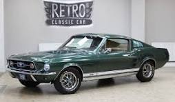
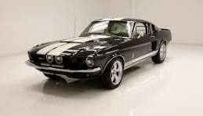
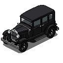

# Visual style

## Summary

Solid Carbide is retro-feeling 2D pixel art in a 3/4 isometric view, set at night in downtown Tokyo under a kaiju attack. The city is steel and glass with small amber accents; the alien boulders and meteors glow navy, purple and magenta; the game's own effects glow pink and cyan; the sponsor Greenbull's colours, a leading dark green with light green and a little yellow, appear only on Greenbull's own things and on the car. The player drives a car in Greenbull's dark green, Mustang-inspired with white stripes, through cracked streets, chased by green lizard minions and a Godzilla-style kaiju. All art follows one technical style: hard-edged pixel art at 32 art pixels per unit, with a selective dark outline, detailed shading and a limited palette. The rules every asset is checked against are in Content, "Rules".

## Decisions

- The first map's city is cyberpunk and futuristic, in a Tokyo style, with skyscrapers and modern buildings. (2026-10-07)
- All roads are asphalt. (2026-10-07)
- Obstacles are drawn as boulders (in the MVP, crashed meteor boulders; Level design, Decisions). (2026-10-07)
- When the car drives behind a building, the building turns see-through so the car stays visible. (2026-10-07)
- How buildings turn see-through (from task T-020's research): the whole building fades while the car is behind it, to **15% visible**, over **0.15 seconds**, and fades back when the car comes out. Only buildings actually covering the car fade. In the MVP only the car is kept visible this way, not enemies or the kaiju; the board may revisit this after playtests. (2026-10-10)
- **Pixel-art technical style** (from the board's reference image, References): true pixel art drawn at its final size, never scaled up; hard pixel edges with no anti-aliasing and no semi-transparent pixels; transparent backgrounds; a dark, almost black **selective outline** (broken by lighter highlight pixels); **detailed shading**; **high detail**; a limited palette of about **30 colours per sprite**. (2026-10-08)
- **Scale:** **32 art pixels per unit** (1 unit = the car's width), drawn at scale 0.5 in the game, so the car is about 96 art pixels long. The car's frames are **128 by 128 pixels**. Everything else in the world (buildings, boulders, enemies, ground) is drawn at the same scale. (2026-10-08; corrected from "about 40" to the 32 the game has used since the car and ground went in, board, 2026-10-15)
- **View:** a 3/4 isometric view, seeing the top and one side. The final car art is drawn for the isometric view only; the flat top-down view keeps the placeholder. (2026-10-08)
- **Palette:** a dark navy and purple night base, with pink and cyan neon accents. The sponsor's colours are not part of the city's palette; they appear only on Greenbull's own things (Greenbull's look, below). (2026-10-08; brand colour corrected the same day; Greenbull's colours, 2026-10-26)
- **Mood:** the game is set at night and should feel retro. (2026-10-08)
- **Glow:** drawn into the sprites themselves, as bright pixels with small, stepped halos of darker shades. No smooth blur or bloom effects from the engine, which keeps the retro pixel look. (2026-10-08)
- **Real-world references are inspiration only:** generated art never shows real brand logos or badges (for example no Ford or Shelby badges), and creatures are never exact copies of existing characters (the kaiju is Godzilla-style, not Godzilla). (2026-10-08)
- **The car:** inspired by a 1967 Ford Mustang GT fastback, in dark green as the main colour, with two parallel white racing stripes running down its length (bonnet, roof and boot), centred on the car as much as possible, with a gap of body colour between the two stripes. See the reference photos in References. (2026-10-08; the GT, centred stripes and the gap between them, 2026-10-12)
- **Buildings:** Tokyo-style towers with vertical signs and lit windows. The city has nothing to do with Greenbull, so the buildings carry none of its colours or branding. After the MVP, occasional Greenbull banners may be added as separate assets placed on the buildings, not drawn into them. (2026-10-08; billboards replaced by after-MVP banners the same day)
- **Buildings, redesigned** (board, 2026-10-14; replaces the dense narrow towers of earlier the same day): downtown Tokyo **under attack from the kaiju**. Each 30 by 30 block is split into **2 by 2 skyscrapers**, drawn as the bases of really tall towers whose tops are out of view, so the car is realistic in size next to them; **6 different skyscrapers**. **Shorter buildings** whose roofs show fill some of the slots. **Every building asset has a pavement drawn around it**, inside the block. **A few** alert banners about the kaiju hang on buildings or stand as signs on the pavement, with silly, minimalistic pixel paintings of its head or its Godzilla-like body. The signs may show Japanese-like marks that are not real words. All the city's art follows one brief from the Narrative Theme Agent (task T-128) so it stays consistent.
- **City brief** (board, 2026-10-15, from the Narrative Theme Agent's brief in task T-128; every city asset follows it): night; the city's colours are set by the "City colours" decision below; vertical neon signs with Japanese-like marks that are not real words, and no real brands; **pavements** a lighter, cooler grey than the asphalt, with a raised kerb on the road side and light cracks; **damage from the attack light to medium**: cracks, a few broken or dark windows, a little rubble, and no big fires, collapsed buildings or gore; the **alert banners are picture-only**, with no words, and look like road warning or prohibition signs: a red outline, a plain white inside, and only the black silhouette of the kaiju (its head or its Godzilla-like body shape), with no other detail and no neon colours (board, 2026-10-15; replaces the first cyan and pink drawings); the larger ones hang on buildings, small standing signs are on the pavement, and only a few on the map; kept out: Greenbull's colours, branding and bull logo, real brands, real words, the name Godzilla or an exact copy of the film monster, and any name for the kaiju.
- **City colours** (board, 2026-10-15, after playing the first skyscraper sample in the game): the city must **not share the boulders' palette**. The boulders and the kaiju's meteors are alien, so their navy, purple and magenta glow must stand apart from the city, never match it. The city is **less neon**: real concrete, glass and lit windows, with only small, muted signs. The board judged two palettes in the game, A (concrete and sodium light: warm greys and beige, yellow-orange windows) and B, and chose **B, steel and glass**: **cool blue-grey walls, pale white and pale blue lit windows, and small amber accents** (signs, shop lights) (board, 2026-10-15). Every city asset (skyscrapers, shorter buildings, pavements) uses the chosen palette; the alert signs keep their own warning-sign colours.
- **The rebrand: Redgull becomes Greenbull** (board, 2026-10-26): the sponsor is renamed **Greenbull**, one word, in a complete rebrand: a new name, logo and colours. It replaces Redgull, its seagull logo and its red everywhere. The old Redgull art stays in the archive (Every generated asset is kept).
- **Greenbull's look** (board, 2026-10-26): the logo is a **bull's head**, cool and bold, its own design: nothing like the real energy-drink logo of two charging bulls. It comes as an **emblem** (the head alone) and a **wordmark** (the head with the name GREENBULL in pixel letters). Its colours are **dark green, light green and yellow**, and the same three are the company's palette: **dark green is the main theme colour**, light green supports it, and **yellow is a small accent, used sparingly**. Proposed values (Project Lead, for the board's review): dark green RGB 12, 76, 44, the car's own body green, so the car already wears the sponsor's colour; light green RGB 104, 220, 96; yellow RGB 247, 208, 52. The logo is flat brand art, so it is exempt from the shading and detail of rule 2 (Content, "Rules"). The colours are used only on things that belong to Greenbull: its logo and wordmark, its banners (after the MVP) and, in the MVP, the weapons, which arrive as Greenbull gift packs, the helicopter that drops each gift pack, the package itself, which carries Greenbull's brand, and the level-up screen (the drop: Game loop architecture, Decisions, "Gift pack drop"). They don't have to be all green; the colours are included where they fit. The dark green is also the car's colour (The car), which is not changed. The emblem and wordmark are made through the style loop (`tasks/README.md`, "The style loop"). The game-ready files are in `game/art/logo/`: `greenbull_emblem_128.png`, `_64.png`, `_32.png` (T-294, run 2) and `greenbull_wordmark.png` (T-295, run 1), each with a json record beside it (T-300). (board, 2026-10-26; replaces Redgull's seagull head in dark red, T-075, board, 2026-10-16)
- **Red after the rebrand** (proposal for the board's review, 2026-10-26): with Redgull gone, red is no longer a brand colour, so it is no longer reserved. The reds already in the game stay as they are, each because of its subject: the kaiju alert signs' traffic-sign red outline (board, 2026-10-15), the car's pale tail lights (RGB 230, 110, 102; board, 2026-10-25), the minion's dull pink mouth (RGB 147, 93, 93; board, 2026-10-26), the health canister and the combo broken popup's warning red. The HUD's likes heart stays red, as a social-media heart.
- **Ground:** asphalt roads with **white** lane lines and **zebra crossings** at the junctions, with **light cracks** from the disaster; the centre is dusty gravel. No pavements in the MVP (after the MVP: Level design, Open questions). (2026-10-08; white lines, zebra crossings and light cracks, 2026-10-12; pavements moved after the MVP the same day)
- **Boulders:** dark rock with glowing cracks. (2026-10-08)
- **Challenge arrow** (after the MVP, if challenges come back; Level design, Decisions, 2026-10-11): a glowing painted arrow that draws itself along the path, pulses while the challenge is open, and fades when it is completed. Arrows of the challenges on the map are **blue**; arrows of the challenges the kaiju's meteors create are **green**. (2026-10-08)
- **See-through rule:** the no-semi-transparent-pixels rule covers the pixels inside each sprite. The game itself may fade a whole object, such as the kaiju's shield or a building the car drives behind. (2026-10-08)
- **Kaiju shield** (not in the MVP: the kaiju can be damaged at any time, Enemies, Decisions, 2026-10-11): while the kaiju can't be hurt, it is surrounded by a **green, see-through, oval shield**, the same green as its challenges' arrows. When one of those challenges is completed, the shield disappears and the kaiju shows its normal look while it can be hurt. (2026-10-08)
- **Effects** (gun bullets, exhaust flames, enemy hits and deaths, burning, coins, car damage, drift smoke and tire tracks, level-up; challenge completed after the MVP, if challenges come back): designed by the Asset Generation Agent within the palette, glow and pixel style above. (2026-10-08)
- **Level-up effect:** when the player levels up, the car gives off a burst of pixel-art particles. The particle sprites are drawn by a script, not generated with PixelLab, within the palette, glow and pixel style above, and not in Greenbull's colours. They pop out or shrink rather than fading. Approved look (T-074): six shapes (cyan and pink four-point stars, pink and cyan diamonds, a violet pixel cross, a small cyan spark), each with a white-hot core and darker halo pixels, one random shape per particle. (board, 2026-10-13)
- **Drift marks:** while the car drifts, its two rear tyres leave dark tyre marks on the ground, which stay for a few seconds and then fade out as a whole. The mark texture is drawn by a script, not generated with PixelLab, within the pixel style above, and not in Greenbull's colours. (board, 2026-10-13)
- **The neon underglow drawn in code** (board, 2026-10-22, after playtests): the board doesn't like the generated underglow sprite (T-175). The neon zone under the car is drawn in code instead, like the drift marks and the burning likes bar: pixel-art neon rings and glow made of bright pixels with stepped halos (no engine blur or bloom, per "Glow" above), in the underglow's purple and pink, never in Greenbull's colours, marking exactly its damage circle at every tier and following the car's height (Weapons, Decisions, "The underglow and the wiper at height"). The look (pulse, shimmer, rings) is the agent's proposal for the playtest. The T-175 sprite is kept, not deleted. (T-274)
- **Hype drift trail** (board, 2026-10-22): the drift marks change and gain effects with the hype level, on the combo heat steps (x2, x3, x4 and up; HUD and menus, Decisions), so a hotter combo leaves a hotter trail; below x2 they stay the plain tyre marks. The effects for each step are the agents' proposal for the playtest, drawn in code (no PixelLab), within the pixel style above and never in Greenbull's colours. Built (T-249, proposal for the playtest): x2 gets a yellow glow along the marks and a few yellow sparks off the tyres; x3 an orange glow that flickers, a yellow core line down the mark and more orange and yellow sparks; x4 and up a wider orange, light orange and yellow flickering glow, a white-hot core, many white, yellow and orange sparks, and flames rising off the tyres. A mark keeps the look of the step it was laid at. All opaque pixel squares and solid lines, no fading inside a sprite. (T-249)
- **Drift smoke:** while the car drifts, puffs of smoke come off its two rear tyres, stay where they were left, grow and then shrink or break up. The smoke sprites are drawn by a script, not generated with PixelLab, within the pixel style above (no semi-transparent pixels), and not in Greenbull's colours. (board, 2026-10-13)
- **Every generated asset is kept, and kept apart by status.** Art that is clean and ready for the game lives under `game/art/`. Every other generation (rejected versions, failed attempts, test runs, edits the board didn't choose) is never deleted: it is archived, with its record, in `art-archive/` at the top of the repo, outside the game folder, one folder per task. So `game/art/` holds only assets fit for the game, and the archive holds everything else. (2026-10-12)
- Art details these decisions leave open (for example how many directions and animation frames the minion and the kaiju have, or how many building and ground-tile variants there are) are proposed by the Asset Generation Agent in each art task; the board judges them. (2026-10-09)
- **Health drop** (board, 2026-10-21): a red gas canister with a white cross on it, small, lying on the ground like the coins. Its red is a canister red (Red after the rebrand). (T-221)
- **The kaiju's meteor attack:** a red warning circle on the ground, then a falling meteor and a burst of dust on impact. (2026-10-08) The board keeps the meteor as it falls today and adds only a comet-tail animation while it falls and an impact animation when it lands; no new meteor pictures; two or three versions to compare as recordings, made however suits best, PixelLab included (board, 2026-10-21, T-070).
- **The kaiju:** a giant monster several times the car's size, in the style of Godzilla. (2026-10-08)
- **The minion:** light green (not too bright), scaled lizards that walk on four legs towards the player. (2026-10-08)
- **The minion, redesigned** (board, 2026-10-25): bigger and more detailed, like a **mini kaiju**: still a lizard on all fours, with a reptilian face and a snapping jaw full of teeth, **about as big as the car** (about 3 units long). First one sample direction for the board's review, made through the style loop (T-293); the walk sheets and the in-game size come after the board approves it.
- The car is drawn in **32 directions**, 11.25 degrees apart (since T-102, 2026-10-21; the board played it: "LGTM"), first in 16, 22.5 degrees apart, 3 times as long as it is wide (size: Drifting, Decisions). It moves to **32 directions**, 11.25 degrees apart, built from the approved 16 (board, 2026-10-12), now scheduled so the car turns more smoothly (board, 2026-10-20; T-102): a sample of the new frames first, for the board's review, then the rest. The shadowless frames for the air (T-204) are rebuilt from the 32-frame sheet by the same free script. (2026-10-07; 32 directions later, 2026-10-12; scheduled, 2026-10-20)
- Until the final pixel art exists, the car uses simple placeholder sprites: plain 3:1 rectangles with a distinct nose, drawn by a script rather than generated with PixelLab, in a flat top-down set and an isometric set. (2026-10-07)
- The minion is animated: it walks on all fours in 8 directions (5 drawn, 3 mirrored) with 7 walk frames each, built from the sample lizard the board approved (task T-068). Polish once the MVP is playable: a damage animation, and a fall-down and get-up animation for when minions bump into each other (Enemies, Decisions). (board, 2026-10-14)
- The level-up screen's art is themed on the sponsor (the weapons it offers are its gift packs, so its colours fit here): first red and gold for Redgull (board, 2026-10-15), now Greenbull's dark green leading, with light green and a little yellow (board, 2026-10-26). The Greenbull look (T-303, goal G-006): dark green card bands, frames and sunburst, light green ribbon and "Take it" plates, a pale-green highlight frame with a yellow line, yellow only for small studs, lines and sparkles; Greenbull's emblem (`game/art/logo/`) on a pale medallion at each end of the ribbon and on a pale disc on the gift box, in place of the gull. All seven pieces are recoloured or redrawn by script, with no new PixelLab generation; how they are built: `game/docs/hud-and-menus/level-up-screen.md`, "Level-up screen art". The red and gold versions are kept in `art-archive/T-303/red_gold/`. The ribbon is dark green (T-311, goal G-006): its centre field is Greenbull's dark green RGB 12, 76, 44, with light green kept to the trim above and below it and the one thin yellow line on top, and the title is lettered on it in cream with a dark outline (T-310), so dark green is the most common colour of the screen's ribbon, frame and emblem art (checked on a screenshot with `game/tools/check_level_up_shot.py`). The cards and frames are unchanged; the light green ribbon is kept in `art-archive/T-311/t303/`.
- **The gift pack package in Greenbull's colours** (T-304, goal G-006): the package the helicopter drops is the level-up screen's gift box, in the same recolour: a dark green box, a light green ribbon and bow, and Greenbull's emblem (`game/art/logo/greenbull_emblem_32.png`, scaled to 16 px in the emblem's own colours) on a pale tag on its right face, in place of the gull. While it falls it hangs under a parachute of dark green and cream gores with pale cords. Both sprites are rebuilt by script from T-140's PixelLab box, with no new PixelLab generation; how: `game/docs/game-loop/gift-pack-and-pickups.md`, "The gift pack drop". The Redgull versions are kept in `art-archive/T-304/redgull/`.
- **The gift pack helicopter in Greenbull's colours** (T-305, goal G-006): the helicopter that drops each gift pack has a dark green body, led by Greenbull's dark green, with light green trim lines along the fuselage. Greenbull's emblem (`game/art/logo/greenbull_emblem_32.png`, in the emblem's own colours) sits on cream panels on the fuselage side and the tail fin, where the gull was. The glass, the skids and the dark rotor blades keep their colours. The sheet keeps its 4 rotor frames of 192 x 160. It is rebuilt by script from T-145's PixelLab sample, with no new PixelLab generation; how: `game/docs/game-loop/gift-pack-and-pickups.md`, "The gift pack drop". The Redgull sheet is kept in `art-archive/T-305/redgull/`.
- **Level-up card weapon images** (T-174, goal G-002): one PixelLab image per weapon (starting gun as a small pistol, exhaust flamethrower, neon underglow, molotovs, windshield wiper), 64 x 64, drawn at the card slot's final size, in the pixel rules above with a black outline and a transparent background. Not in Greenbull's colours, except the yellow where the subject is fire. How they were made: T-174's result notes. (goal run, 2026-10-18)
- **In-world weapon art** (T-175, goal G-002): the neon underglow (a purple and pink neon ring under the car, 224 x 112 art pixels, the damage circle in the isometric view), the molotov (a green bottle with a burning rag, 32 x 32, and its fire area, an orange and yellow flame ellipse 136 x 68 that flickers between itself and its mirror) and the windshield wiper (a dark arm with a rubber blade, turned by script into 32 pre-projected directions) are PixelLab art at the scale above (32 art pixels per unit, drawn at 0.5), in `game/art/weapons/`. How they were made: T-175's result notes. (goal run, 2026-10-18)
- **Bricks' art** (T-325, the board's go 2026-10-27, up to 8 PixelLab generations; the board's review in a run): the level-up card image is a PixelLab picture (`game/art/level_up/weapon_bricks.png`, 64 x 64, 1 generation): a small stack of terracotta bricks with a loose brick and a little rubble, black outline, transparent background, no car; also the HUD's weapon icon. The landing's impact wave is drawn by a free script (`game/tools/build_bricks_wave.py`, no PixelLab): one sheet of 12 stepped frames per damage radius the tiers reach (`game/art/weapons/bricks_wave_r4_0.png`, `_r4_8`, `_r6_0`, `_r7_8`), at 32 art px per unit drawn at 0.5, so the ring is never scaled: a flat isometric ring with a pale-white leading core and checker-dithered halos in the City's cool blue-greys, ragged grey dust clouds and outlined brick chips, crumbling into stepped pieces at the end; no fading, none of Greenbull's colours. Both went through the style loop (card 8/10, wave 9/10); how: T-325's result notes.
- **The car without its shadow** (board, 2026-10-20): a shadowless copy of the car's 16-direction sheet, made by a free script from `game/art/car/car_iso.png` (no PixelLab, no repainting): only the drop-shadow pixels outside the car's body are removed, everything else stays pixel for pixel. Used only while the car is in the air (Drifting, Decisions, "No sprite shadow in the air"). The original sheet stays as it is. The shadow shares its near-black with the car's outline (the hand-tried script edit in T-014 left marks), so every frame is shown to the board next to the original before it is used.
- **Elevation sample map art** (board, 2026-10-19: "I'll leave that completely up to you", up to 50 PixelLab generations; the Project Lead's direction, judged in the board's playtest): the raised areas are **building rooftops** and the ramps **parking-garage-style ramps** of concrete, following the City brief and City colours above (steel and glass: cool blue-grey concrete, small amber accents, light damage), not the boulders' navy and purple. Rooftop details are rooftop things: a low parapet wall at the edges, vents, AC units, a small rooftop sign, light cracks. A rooftop's sides are building walls with lit windows in the city's palette. Not castle stone: the elevation test scene's platform art read as a dungeon to the board, so it is not reused. Built in T-198 (`game/art/elevation_sample/`, made by `game/tools/build_elevation_sample_art.py`; rooftop details are in the sprite, so the car drives through them). How it was made and its weak results: T-198's result notes.
- **Elevation test scene art** (T-186, goal G-003): the raised platform (16 x 16 units, 3 high; 1024 x 608 art px) and its ramp (12 x 8 units; 640 x 416 art px), in `game/art/elevation/`, at 32 art px per unit drawn at 0.5, isometric, with hard pixel edges, a dark outline, at most 30 colours (29 and 26), a transparent background and none of Greenbull's colours. Made by `game/tools/build_elevation_art.py` from PixelLab textures; how it was made and its weak results: T-186's result notes. (goal run, 2026-10-19)
- **Creator small and long buildings** (T-257, the board's go 2026-10-22; approved in the board's playtest of the creator, 2026-10-28): PixelLab facades for the small 6 x 6 and the long 12 x 6 building, sheared 2:1 by `game/tools/build_creator_buildings_art.py` as for the short buildings (T-129), with a tar roof, a parapet, T-129's rooftop props, palette B and a pavement round the building; in `game/art/buildings/creator_final/` (T-254's placeholders stay in `game/art/buildings/creator/`). How it was made and its weak results: T-257's result notes.
- **Creator textures** (T-255, the board's go 2026-10-22; approved in the board's playtest of the creator, 2026-10-28): tileable textures for the creator's resizable pieces, made by `game/tools/build_creator_textures_t255.py` from PixelLab pictures into `game/art/creator_pieces/t255/`, in three styles chosen per piece in the creator (Style button, T key): **Office** (the default: a concrete rooftop and an office wall), **Car park** (a deck with bay lines and a garage wall with openings) and **First set** (T-198's). How it was made and its weak results: T-255's result notes.
- **Bolder enemy outlines** (T-340, the board's decision in Enemies, Decisions, "Damage in hearts, fewer health drops, bolder outlines"): every minion walk and fall sheet and every kaiju sheet has its dark outline one pixel thicker, grown outward by the free script `game/tools/build_bolder_outlines.py` in each sheet's own outline colour (no new colours, alpha 0 or 255, sizes and frame counts unchanged, no PixelLab). The originals are kept in `art-archive/T-340/originals/`; the script always reads from there, so it is rerunnable. Each sheet set scored 8 in the style loop. Before and after screenshots on the street and a rooftop: `art-archive/T-340/screenshots/`. If the dark outline reads poorly on a dark rooftop, the proposed fix is `build --rim R,G,B` (a lighter rim ring), not yet used.
- **Level creator props art** (T-256, the board's go 2026-10-22; approved in the board's playtest of the creator, 2026-10-28): the eight props (concrete barrier, traffic cones, crate stack, AC unit, water tank, roof vent, street lamp, rooftop sign) in `game/art/props/<name>_<rotation>_art.png`, isometric, at 32 art px per unit drawn at 0.5, in the City colours (cool blue-grey steel and concrete, amber on the lamp and sign, orange cones, brown crates), a dark outline, at most 30 colours, none of Greenbull's colours. One PixelLab picture per prop, the four rotations made by script (north and south the picture, east and west its mirror). The rooftop sign's glyphs are made up and script-drawn, never real characters. How it was made and its weak results: T-256's result notes.
- **The livestream HUD art** (T-339, the board's go 2026-10-28, up to 40 PixelLab generations; HUD and menus, Decisions, "The HUD looks like a livestream"): screen-space HUD art shown at 2x (one art pixel is two screen pixels, like the likes heart), sized from the board's HUD layout page, in `game/art/hud/`, each with a json record: the clock panel (100 x 36, a dark steel bezel and a black screen with scanlines) and the clock digits (12 greyscale seven-segment frames of 16 x 26: 0 to 9, the colon and an unlit 8, with a drawn two-step halo, for the game to tint green, yellow, orange and red; also one PNG each); the viewers panel (120 x 36, the clock panel's housing with a cyan inner rim in the viewers colour, 51, 225, 255, a proposal); the red LIVE badge (34 x 13; red is not reserved); the eye icon (16 x 11, cyan); the viewers fire (12 looping frames of 136 x 64 in the burning likes bar's colours with a dark red-brown edge, the panel at (8, 24) left clear; also one PNG each); the sub goal frame (64 x 64, a white ring between dark outlines, black inside from (4, 4) to (59, 59)); the subs icon (22 x 22, the proposal instead of the star: a subscriber, a pale person with a hot pink plus badge, pink being the game's own effect colour); the full heart (18 x 16, the heart red with shading and a glint) and the empty heart (the same heart in dark slate, made from the full one by script). None of Greenbull's colours. All kept versions are script-drawn (`game/tools/build_hud_livestream_art.py`); 2 PixelLab candidates were made and not kept. The fire stayed at 7 after 3 refines, so it is flagged for the board's review. How it was made and its weak results: T-339's result notes.
- **The reaction icons** (T-352; HUD and menus, Decisions, "The HUD looks like a livestream"): six 16 x 16 icons in `game/art/hud/` (`reaction_heart`, `reaction_thumbs_up`, `reaction_fire`, `reaction_clapping`, `reaction_star`, `reaction_smile`, each with a json record), shown at 2x and 0.9 alpha in the livestream bursts and floaters. Comic HUD look: 1 pixel dark outline, two-tone shading, a highlight; the heart red, orange, skin peach and a violet cuff; the face and star stay orange, never Greenbull's yellow. All script-drawn (`game/tools/build_hud_reaction_icons.py`, 0 PixelLab generations). Weakest: the clapping hands (8 after 3 refines, reads a little like a tent).
- **The bad reaction icons** (T-357; HUD and menus, Decisions, "Bad reactions when the combo breaks"): six more 16 x 16 icons in `game/art/hud/` made like the good ones, same outline and shading (`reaction_cry_laugh`, `reaction_thumbs_down`, `reaction_peek`, `reaction_broken_heart`, `reaction_skull`, `reaction_scream`, each with a json record): a crying-laughing face with tears, thumbs down, a face with big eyes over its hands, a broken heart, a skull, a screaming face with hands on its cheeks. Script-drawn in the same file (`BAD_NAMES`), 0 PixelLab generations, no Greenbull colours. The peek and scream icons needed one refine each (5 and 7 first); every round is in T-357's Style review.
- **The pickup magnet's garage icon** (T-369; Garage design, Decisions, "Pixel art icons for the upgrades"): a 16 x 16 horseshoe magnet in `game/art/garage/pickup_magnet.png` (with a json record), shown at 3x beside its garage row. Same comic look as the reaction icons: 1 pixel dark outline, flat fills, one highlight; blue body, white pole tips, no Greenbull colours. Script-drawn (`game/tools/build_garage_icon_pickup_magnet.py`, 0 PixelLab generations); style score 8 in one round. See `game/docs/art/garage-icons.md`.
- **The cruise boost** (the short effect when W makes the car jump to cruise speed, Drifting, Decisions) is discreet: a few motion lines that show briefly. The first placeholder, five streaks behind the car, was too much. (board, 2026-10-15) The motion lines are animated, made with PixelLab, and judged by the board in the game only, without a separate sample review (board, 2026-10-16).

## Content

### Rules

The visual style guide: every generated or script-drawn asset is checked against these rules, each written once here (with Extended narrative's Text rules, the style guide the style loop scores against; `tasks/README.md`, "The style loop"). Each rule condenses the Decisions above; when a decision changes, its rule changes with it. Rules marked *(script)* are checked by a script, the others by the Style Evaluator.

1. **Pixel art** *(script)*: true pixel art drawn at its final size, never scaled up; hard pixel edges, no anti-aliasing; every pixel fully opaque or fully transparent; a transparent background; at most 30 colours per sprite. (Decisions, "Pixel-art technical style")
2. **Outline and shading:** a dark, almost black selective outline, broken by lighter highlight pixels; detailed shading; high detail. (Decisions, "Pixel-art technical style")
3. **Scale and view** *(script, size)*: 32 art pixels per unit (1 unit = the car's width), drawn at 0.5 in the game; the car's frames are 128 x 128; a 3/4 isometric view showing the top and one side. (Decisions, "Scale", "View")
4. **Night and retro:** every scene is at night and feels retro. (Decisions, "Mood")
5. **Glow is drawn, not rendered:** glow is bright pixels with small stepped halos of darker shades, inside the sprite; no smooth blur or bloom. (Decisions, "Glow")
6. **Greenbull's colours** *(script)*: the sponsor's palette is dark green RGB 12, 76, 44 (the main colour), light green RGB 104, 220, 96 and yellow RGB 247, 208, 52 (a small accent, used sparingly). The light green and the yellow appear only on Greenbull's own things: its logo and wordmark, the gift pack and its helicopter, the weapons and the level-up screen. Never on the enemies, the city, the ground, placeholders or code-drawn effects. The dark green leads on Greenbull's things and is also the car's body colour; it is never on the city or the ground. Red is not reserved (Decisions, "Red after the rebrand"). (Decisions, "The rebrand", "Greenbull's look", "Red after the rebrand")
7. **The city** (buildings, pavements, rooftops, ramps): steel and glass: cool blue-grey walls, pale white and pale blue lit windows, small amber accents, only small muted signs; never the boulders' navy, purple and magenta; light to medium damage (cracks, a few broken or dark windows, a little rubble), never big fires, collapsed buildings or gore; nothing of Greenbull. (Decisions, "City brief", "City colours")
8. **The alien things** (boulders, the kaiju's meteors): dark rock with glowing cracks, in navy, purple and magenta, kept apart from the city's palette. (Decisions, "Boulders", "City colours")
9. **No real brands, words or characters:** no real logos or badges, no readable real words (signs carry Japanese-like marks that are not words), and no exact copy of an existing character: the kaiju is Godzilla-style, never Godzilla, and never named. (Decisions, "Real-world references", "City brief")
10. **The subjects keep their look:** the car is a 1967 Mustang GT fastback in Greenbull's dark green with two centred white stripes and a gap between them; the minions are light-green four-legged lizards, being redesigned as car-sized mini kaiju with a toothed snapping jaw (Decisions, "The minion, redesigned"); the kaiju is a giant Godzilla-style monster; the ground is asphalt with white lane lines, zebra crossings and light cracks; the alert signs are picture-only (red outline, white inside, the kaiju's black silhouette). (Decisions, "The car", "The minion", "The kaiju", "Ground", "City brief")

Greenbull's logo (emblem and wordmark) is flat brand art: exempt from rule 2's shading and detail, but it follows rule 1 (Decisions, "Greenbull's look").

### See-through buildings

Task T-020 researched how buildings can turn see-through when the car is behind them: it compares three approaches and builds a demo with the recommended one (fading the whole building while the car is behind it) and a cut-out variant. The demo, the screenshots with several fade strengths and the questions for the board are in the report (References).

### Cruise boost motion lines

Task T-009 made the cruise boost's motion lines (Decisions, "The cruise boost") with PixelLab: three thin pale-cyan and white lines that streak backwards and vanish in five frames (about a third of a second), right behind the car, following it. The first frame was drawn by a script after PixelLab's first call came back empty; PixelLab animated it. The game sheet (`game/art/effects/boost_lines.png`, with its record) holds the five frames turned by a script to 16 screen directions, so the lines always trail the car without the engine rotating pixel art. Every generation and its record is in `art-archive/T-009/`.

### The car without its shadow

Task T-204 made the shadowless sheet (Decisions, "The car without its shadow") with a free script, no PixelLab: `game/art/car/car_iso_noshadow.png` (record `car_iso_noshadow.json`, same size, frames and centre as `car_iso.png`), made by `game/tools/build_car_noshadow.py`. Per frame, a near-black pixel becomes transparent only when it is connected to the transparent background through near-black pixels, lies outside the convex hull of the frame's other car pixels, and is more than one step from them; the thin outline and every other pixel stay as they are, with no new colours. Dark body panels inside that hull (under the sill between the wheels, under the bumpers) keep a little shadow, because it cannot be told from the body there. Used only while the car is in the air (T-205); on the ground the car uses `car_iso.png`. Screenshots of all 16 frames, original next to shadowless: `art-archive/T-204/screenshots/`.

### The neon underglow in code

Task T-274 draws the underglow's zone in code, as the Decisions entry says; the generated sprite of T-175 stays in `game/art/weapons/underglow.png` with a switch back (`use_sprite`). The look is the agent's proposal for the playtest: on the damage circle's edge a bright pink ring (a light core line and a hot pink line inside it), outside it a stepped purple halo (a solid band, then a checker-dithered one), inside it a purple floor glow (half-dithered, then sparse). Every pixel is opaque or empty, so there is no blur, bloom or smoothing. The halo and floor glow pulse in steps and a lighter arc travels round the ring; both stop while paused. Purple and pink only, never Greenbull's colours. Its colours, widths and speeds are in `game/scenes/weapons/neon_underglow_look.tres` (how it is built: `game/docs/weapons/neon-underglow.md`, "The neon underglow"). Screenshots and a GIF: `art-archive/T-274/screenshots/`.

## Open questions

- (After MVP) Does the car carry any Greenbull livery or stickers? In the MVP it is kept simple: Greenbull's dark green with two white stripes.

## References

- **Car look, colour:** a dark-green 1967 Ford Mustang fastback (inspiration only; no real badges).

  

- **Car look, stripes:** the two stripes down the middle, from a black 1967 Mustang fastback (inspiration only).

  

- **Technical style:** only for the technical specs in Decisions (128 by 128 pixels, 29 colours); not the actual car, colours or mood.

  

- **See-through buildings:** [research report, demo and screenshots (T-020)](visual-style/see-through-buildings.md).
