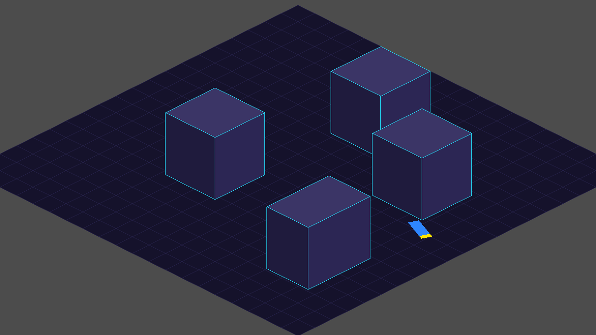
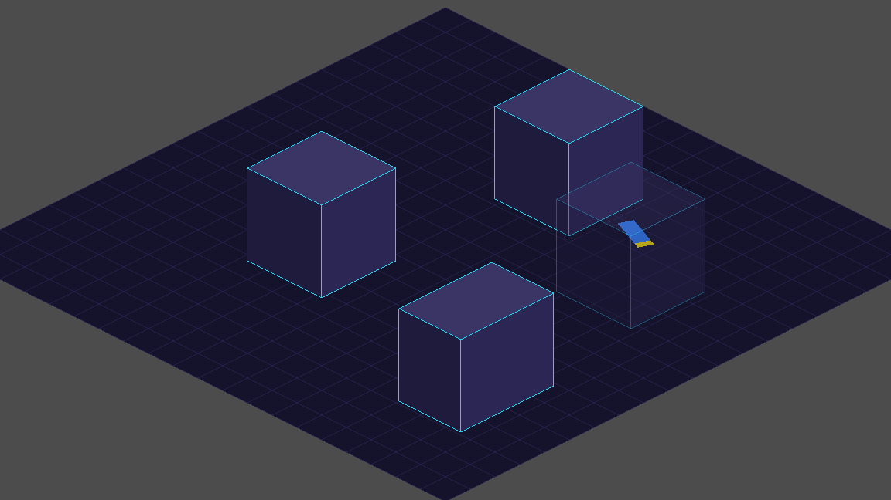
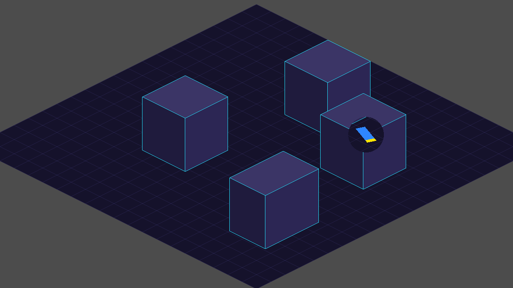

# See-through buildings: research (task T-020)

The board decided that when the car drives behind a building, the building turns see-through so the car stays visible (Visual style, Decisions). This report compares ways to do it in Godot 4.6 for a 2D isometric game, says which one is built in the demo, and lists what the real map needs to do. The look (how transparent, how fast) is the board's choice; the screenshots below show options.

The demo is `game/scenes/see_through_demo/see_through_demo.tscn` (W S A D drive the stand-in car, using the placeholder isometric car sheet). It uses plain coloured boxes, not the real map (task T-019) and no PixelLab art. Code: `game/scripts/level/see_through_building.gd`, `see_through_demo.gd` and `see_through_cutout.gdshader`; tests: `game/tests/unit/test_see_through_buildings.gd`.

## Approaches compared

| | A. Fade the whole building (screen overlap + depth order) | B. `Area2D` behind each building | C. Shader cut-out around the car |
|---|---|---|---|
| Idea | Each frame, a building is "in front of the car" when the car's depth (x + y) is smaller than the building's front corner. If so, and the car's drawn rectangle overlaps the building's on-screen silhouette, the building's alpha fades down. | A trigger area is placed in the world where a car would be hidden by the building; when the car's body enters it, the building fades. | The building is drawn with a shader that makes the pixels within a circle around the car (screen position) transparent. The rest stays solid. |
| Look | The whole building turns ghostly (screenshots A1 to A3). Easy to read, and hides nothing of the car. | The same as A (it only decides when to fade). | Only a round window opens; the building stays mostly solid. The hole shows what is behind it, including other buildings. The shader can make a hard edge, which fits the pixel look (screenshot C). |
| Effort | Low. About 40 lines of logic, no extra nodes. Uses geometry the map already has (footprint, height). | Medium. Every building needs a hand-placed or generated area, and the area has to be redrawn whenever a building's size or sprite changes. | Medium. A shader and per-building uniforms for the car's position. Needs a decision for the hole's size and edge. |
| Accuracy | Follows the drawn silhouette, so it fades exactly when the car is really covered, not before. | Approximate: the area is a simplified shape, so it fires a little early or late, and tall or oddly shaped buildings are awkward. | Exact for the car's centre; a long car can still poke out of the hole at its ends (the car is 3 units long). |
| Many buildings | Cheap: one polygon test per building near the car (it can be limited to buildings whose bounding rectangle is near the car). Several buildings can fade at once, each on its own. | Cheap at run time (the physics engine does the work), but many areas to author and keep right. | Cheap on the GPU, but each building needs the car's position every frame, and a hole can open in more than one building at once. |
| Risk | Needs a reliable depth order between buildings and the car (see limits). | Same depth-order need, plus the authoring work. | Semi-transparent holes would break the "no semi-transparent pixels" rule if the hole were faded; a fully clear hole does not. |

Not built: a variant of C that uses a `Light2D` mask or a viewport copy of the car, and a "depth buffer" approach (3D-style depth test). Neither is the usual choice for a 2D game of this size and both add more setup than A for the same result.

## Recommendation: A, whole-building fade

It is the least work, it needs nothing the real map does not already have (each building's footprint and height), it fades only when the car is truly covered, and it handles many buildings without any per-building setup. The fade alpha and the speed are two numbers, so the board can choose them freely. If the board prefers the "window" look, C can replace the alpha step in the same place (the demo has both: `SeeThroughBuilding.Mode.FADE` and `Mode.CUTOUT`).

### What is built

- `SeeThroughBuilding.occludes()` decides: the car is behind the building when `car.x + car.y < footprint.end.x + footprint.end.y` (the same number is the draw order, `z_index`), and the car's four drawn corners, projected to the screen, overlap the building's six-point silhouette (`Geometry2D.intersect_polygons`).
- `update_fade()` moves the alpha towards the target (`see_through_alpha` while the car is behind, 1 otherwise) at a speed set by `fade_time`. The building node's `modulate.a` is the only thing changed.
- The car and buildings are sorted with `z_index` from that same depth number, so the car is drawn behind a building exactly when it counts as behind it.

## Screenshots (the board chooses the look)

Taken with the T-001 screenshot tool, from fixtures under `game/tests/fixtures/see_through_*.tscn`. The car is the placeholder iso sprite (tiny, blue with a yellow nose).

| What | Screenshot |
|---|---|
| Car in front of the building: the building is solid | [see-through-front.png](see-through-front.png) |
| A1. Behind, building at 60% visible | [see-through-behind_alpha60.png](see-through-behind_alpha60.png) |
| A2. Behind, building at 35% visible | [see-through-behind_alpha35.png](see-through-behind_alpha35.png) |
| A3. Behind, building at 15% visible | [see-through-behind_alpha15.png](see-through-behind_alpha15.png) |
| C. Behind, round cut-out around the car (hard edge, fully clear) | [see-through-behind_cutout.png](see-through-behind_cutout.png) |

## Limits

- **Pixel rule.** A fade makes every pixel of the building semi-transparent. Visual style, Decisions ("See-through rule") already allows this for a whole object. The cut-out with a fully clear hole has no semi-transparent pixels at all.
- **Depth order.** The rule uses one number per building (its front corner, `x1 + y1`). That is right for buildings that do not overlap and are not much longer than the car. A very long building, or buildings of very different sizes side by side, can sort wrongly; the map's blocks are all 10 by 10 units, so this should not appear in the MVP.
- **The car's height.** The car is treated as flat on the ground. Jumps are not in the MVP; with a jump the test would need the car's height.
- **Things other than the car.** Enemies and the kaiju behind a building are not handled. Only the car is checked. The kaiju is much taller than the car and would need its own rule if the board wants it.
- **A fade shows ground and other buildings behind.** A building that fades also reveals the building behind it, which can look busy where blocks are close (the roads are 8 units wide, so a car on a road is usually behind at most one or two blocks).
- **Real art.** The demo draws plain boxes. Real building sprites are one image each, so the whole sprite fades. A sprite taller than its footprint needs its on-screen silhouette (or a simple outline polygon) to be given with the building, instead of the box's six points computed here.
- **Not measured.** The cost was not profiled; the test is one polygon intersection per building, so it should be small, but the real map's building count was not tried.

## What the real map needs to do

1. Give every building its footprint (world rectangle), its height or silhouette polygon, and a `z_index` from the same depth number the car uses (`x + y` of the front corner), or a Godot y-sort with an equivalent anchor.
2. Use one script on every building, like `SeeThroughBuilding`, and hand it the car's world position and four drawn corners each frame. For many buildings, only test those near the car.
3. Keep `see_through_alpha` and `fade_time` as two settings in one place, so the board's choice is one number change.
4. Keep the car's drawn rectangle (1 by 3 units, Drifting, Decisions) as the thing that decides, not the smaller physics body, so the car is never partly hidden without the building fading.

## Open questions for the board

- How see-through should a building get: 60%, 35% or 15% visible (or another value)?
- How fast should the fade be (the demo uses 0.15 seconds; 0 is instant)?
- Whole-building fade (A) or a round window around the car (C)?
- Should enemies and the kaiju also be kept visible when behind a building?
