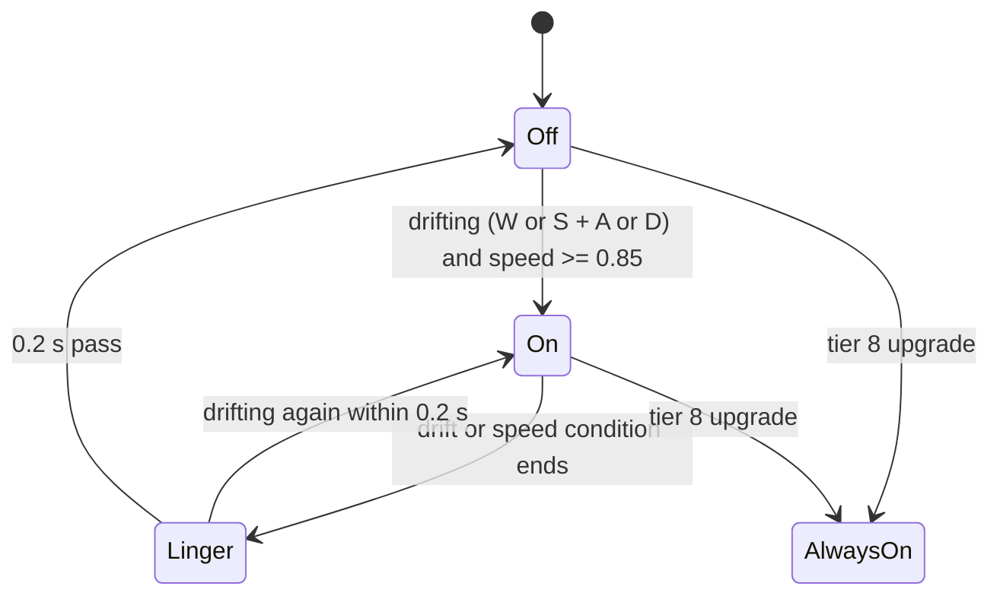

# Unity prototype report: the starting gun and the exhaust flamethrower

Task T-022, by the Weapon Behavior Agent. This report describes how the starting gun and the Flame Exhaust behave in the board's Unity prototype (`C:\Users\andre\drift-to-survive`, project name DriftSurvivors, product name `SolidCarbide`, commit `126e7ec`), how they tier up, how the prototype's level-up chooses what to offer, and what porting them to Godot 4.6 involves. It describes the prototype as it is and proposes no changes. Paths without a folder prefix are inside the Unity project. Nothing was run or built: everything here is read from the code, the data assets, the scenes and the prefabs, plus `reg query` for saved settings.

**Units.** Same as the driving report (Unity prototype report, "Units"; Drifting, Decisions): 1 unit is the car's width (the car's physics body is a 1 by 1 unit square), and physics runs at 50 steps per second. All distances below are in these units, so they carry over to Godot unchanged.

**Which Unity weapon is the starting gun.** The prototype has two guns: `SimpleGunWeapon` (data asset `Assets/Data/Weapons/Weapon_MachineGun.asset`, shown in the game as **"Simple Gun"**) and `ShotgunWeapon` (`Weapon_Shotgun.asset`). The starting gun is the **Simple Gun**, because:

- It is the only weapon already on the Player object in every stage scene, with `Weapon_MachineGun.asset` assigned (`Assets/Scenes/Stage_Grass.unity` line 75228, `MainScene.unity` line 606, `Stage_Isometric.unity` line 167744). Every other weapon, the Shotgun included, is added to the car only when picked at a level-up (`Assets/Scripts/Player/PlayerInventory.cs` lines 185-229).
- `PlayerInventory.EnsureStartingWeapon` puts it in weapon slot 1 at the start of the run (`PlayerInventory.cs` lines 54-67).
- It matches the board's description (Weapons, Decisions): no visible weapon on the car (the gun has no sprite, only its bullets have one), it fires only at enemies in range, aims automatically and fires at set intervals.

The asset's file name says "MachineGun" but its display name is "Simple Gun" (`Weapon_MachineGun.asset` line 16). This report calls it the starting gun.

## 1. Summary

**Starting gun.** Every 1.26 seconds the gun looks for living enemies within **12 units** of the car's centre. If there are none, nothing happens until the next check 1.26 seconds later: it does not fire the moment an enemy walks into range. If there are, it fires one bullet at the **closest** enemy. The bullet leaves the car's centre aimed straight at where the enemy is at that moment (no leading), and flies in a straight line at **15 units per second**. It hits the first enemy it touches, deals **2 damage** and disappears. A bullet that misses keeps flying and is never removed. The bullet is drawn small (0.32 units across, dark red) but its hit area is a circle 2 units across, twice the car's width. There is no knockback unless the player has taken the Knockback power-up.

Upgrades (7 tiers after the first) add 2 more bullets twice (each extra bullet goes to the next-closest enemy, 0.05 seconds apart), make it fire faster three times, widen the targeting range by half once (12 to 18) and finally let each bullet pass through the first enemy it hits.

**Exhaust flamethrower (Flame Exhaust).** The flame is on while the car is **drifting**, in the prototype's own definition (W or S held together with A or D, the same one the game uses for drift XP: Game loop architecture, Decisions), and the car is moving at least 0.85 units per second. When the drift ends it stays on for another **0.2 seconds**. It burns enemies inside a **rectangle behind the car**: about 2.6 units wide and 3.25 units deep when fully grown, starting just behind the car's centre. Each drift starts the rectangle at **half size**, and it grows steadily to full size over the first second of the drift. An enemy that enters the rectangle takes **2 damage** at once, and every enemy inside takes another 2 damage every 0.2 seconds, so about 10 damage per second. Enemies that get burnt flash orange briefly. Particles stream out of the back of the car while it is on. Picking up the flamethrower also switches off the tyre smoke while drifting.

Its upgrades make the rectangle bigger three times (by 20%, 20% and 30%), raise its damage by 20% once (which, because of rounding, does not change the damage of 2), make the burn flash last 0.5 seconds longer, make the **car turn 20% faster**, and at the last tier keep the flame **always on**, at full size, whether or not the car is drifting.

**Level-up.** The prototype's level-up shows **3 choices** drawn at random from everything still available: 11 power-ups (attack, toughness, ramming and car upgrades such as speed and steering), new weapons from a pool of 6, and the next tier of each weapon the player owns. A weapon at its last tier (tier 8) is no longer offered. When nothing at all is left, the only choice is 4 coins. Level-ups are stored and opened with a key. Solid Carbide's level-up is different (Weapons, Decisions): section 5 lists the differences.

## 2. Starting gun

**Code:** `Assets/Scripts/Combat/SimpleGunWeapon.cs`, bullets in `Bullet.cs` and `BulletPool.cs`, prefab `Assets/Prefabs/Bullet.prefab`. **Data:** `Assets/Data/Weapons/Weapon_MachineGun.asset`. Damage, range, bullet speed and bullet count are read through the player's shared `WeaponStats` component (`WeaponStats.cs`), which copies them from the gun's asset at the start of the run (lines 27-35) and is where the level-up power-ups change them.

### When it fires

- A timer counts real game time every rendered frame (`Update`, lines 75-85, `Time.deltaTime`, so it pauses when the game is paused). When it reaches the fire interval, the timer goes back to exactly 0 and the gun tries to fire (`TryFire`, lines 87-100).
- **Fire interval** = base interval ÷ (attack speed multiplier × tier fire-rate multiplier) + 0.06 s (lines 64-73). With the values in the game: 1.2 ÷ (1 × 1) + 0.06 = **1.26 seconds**.
- If no enemy is in range when the timer runs out, the gun does nothing and the timer has already restarted (line 82 resets it before line 91 checks for targets). So **the gun checks for targets once every 1.26 seconds**. An enemy that comes into range just after a check is not shot until the next check, up to 1.26 seconds later.
- Because the timer runs per frame and is reset to 0 (not reduced by the interval), the real interval is rounded up to the next frame: at 60 frames per second, 1.26 s becomes 1.267 s.

### How it chooses and aims at a target

- **Range:** 12 units, measured from the car's centre to the enemy's centre (`BuildBulletTargets`, lines 145-180). The enemy's size does not count.
- **Which enemies:** every living enemy in the enemy registry (`Assets/Scripts/Systems/EnemyRegistry.cs`) within range, sorted by distance, **closest first** (lines 153-167).
- **How many:** one bullet per volley at the start (`projectileCountBase` 1). With more bullets per volley (tiers 2 and 6, or the Quantity power-up), bullet 1 goes to the closest enemy, bullet 2 to the second closest, and so on. If there are fewer enemies in range than bullets, the bullets go round the enemies again in order, closest first (lines 169-179). For example 3 bullets and 2 enemies: closest, second, closest.
- **Bullet spacing in a volley:** 0.05 seconds between bullets (`delayBetweenBullets`, lines 123-138).
- **Aim:** each bullet is aimed at its target's position at the moment that bullet is fired, from the car's centre at that same moment (line 130). There is no leading of moving targets, and the bullet does not steer afterwards.

### The bullets

- **Spawn:** at the car's centre (line 134), pointing at the target.
- **Movement:** a Unity 2D physics body (Box2D) that is given a fixed velocity of 15 units per second once, when it spawns (`Bullet.cs` lines 64-65). No gravity, no damping, no steering. Physics runs at 50 steps per second, so it moves 0.3 units per step. To cross the 12-unit range takes 0.8 seconds.
- **Size:** drawn 0.32 units across (a 16 by 16 pixel sprite at 100 pixels per unit, scaled 2 times), dark red. Its **hit area** is a circle with radius 0.5 scaled 2 times: **radius 1 unit, 2 units across**. So a bullet hits an enemy whose collider comes within 1 unit of the bullet's centre.
- **What it hits:** its collider is a trigger, so it never bounces off anything. It reacts only to objects tagged "Enemy" that have health and are alive (lines 112-117). It passes through walls, boulders and other objects.
- **Damage:** 2 per hit, once per enemy (each bullet remembers which enemies it has hit, lines 119-121).
- **After a hit:** the bullet is removed at once (returned to the bullet pool, lines 127-131). With the tier 8 Pierce upgrade it survives the first enemy and is removed on the second (lines 132-135).
- **Lifetime:** **none.** A bullet that hits nothing is never removed: the only distance limit (36 units, line 27) applies only to piercing bullets (lines 103-110). Missed bullets fly on forever (the pool can keep at most 512 returned bullets, but bullets in flight are not counted).
- **Knockback:** each hit passes a push direction (from the bullet to the enemy, line 123), but the enemy only gets pushed if the player has taken the Knockback power-up (`Assets/Scripts/Enemies/EnemyHealth.cs` lines 321-354: the push strength is 0 while the player's knockback multiplier is still 1). With the power-up, the push grows with each pick: each pick adds 0.1 to the multiplier (`Upgrade_Knockback.asset`), and the push is 15 x car half-size x (picks / 16) to the power 0.6, divided by the enemy's knockback resistance. At the power-up's cap of 8 picks that is about 66% of 15 x car half-size, roughly 5 to 7 units per second, and it fades by 12% every physics step (`EnemyHealth.cs` lines 38-39, 73-79).
- **Other effects of a hit:** the enemy flashes red (at most once per second), shows a damage number if that setting is on, and the hit counts for the run statistics (`EnemyHealth.cs` lines 242-310).

### Anything else

- It is switched off while the level-up screen is open (`Assets/Scripts/UI/LevelUpUI.cs` lines 405-410) and when the player dies (`Assets/Scripts/Player/PlayerHealth.cs` lines 121-131).
- The player's power-ups change it: **Quantity** (+1 bullet per pick), **Fire Rate** (+0.2 to the attack speed multiplier per pick, so the base 1.2 s is divided by 1.2, 1.4, 1.6 and so on), **Fire Range** (+20% of the current range per pick, so it compounds), **Damage** (+20% of current damage, rounded: see section 5) and **Knockback** (`Assets/Scripts/Upgrades/UpgradeApplicator.cs` lines 19-44).

## 3. Exhaust flamethrower

**Code:** `Assets/Scripts/Combat/FlameExhaustWeapon.cs`. **Data:** `Assets/Data/Weapons/Weapon_FlameExhaust.asset`. **Particles:** `Assets/Prefabs/VFX/VFX_FlameExhaust.prefab`. The component is not in any scene: it is added to the car when the player picks the Flame Exhaust at a level-up (`PlayerInventory.cs` lines 208-214), so its settings are the defaults written in the code, with no scene overrides.

### What turns it on and off

The flame is **on** in any frame where one of these is true (`IsExhaustActive`, lines 120-130):

1. **The drift gate is satisfied** (`IsDriftGateSatisfied`, lines 113-118): the car controller's `IsDrifting` is true **and** the car's speed (the length of its velocity) is at least **0.85 units per second**.
   - `IsDrifting` is defined in `Assets/Scripts/Player/PlayerCarController.cs` line 44: `(_lastAccelerateInput > 0f || _lastReverseInput > 0f) && Mathf.Abs(_lastSteerInput) > 0.01f`. In words: **W (or the right trigger) or S (or the left trigger, when W is not held) is held, together with A or D (or the stick tilted sideways)**. These inputs are read every physics step (`FixedUpdate`, lines 160-162).
   - It counts while reversing too: S with A or D turns the flame on, pointing behind the car's nose (towards where the car is going when it reverses).
   - During the test jump (Space) the car code sets the drive inputs to 0 (lines 165-168), so the car is not "drifting" in the air.
   - The drift amount (the 0-to-1 ramp from the driving report, section 4) is not used. Only the keys and the speed matter.
2. **The linger is still running:** every frame the drift gate is satisfied, the flame's switch-off time is pushed to now + **0.2 seconds** (`flamePostDriftLingerSeconds`, `Weapon_FlameExhaust.asset` line 22). So after the drift ends (a key is released, or the car drops below 0.85 units per second) the flame stays on for 0.2 seconds more, still damaging.
3. **Always-on:** after the tier 8 upgrade (`SetExhaustAlwaysActive`, line 101) the flame is always on, with no drift and no speed needed.

It is **off** otherwise. It is also off while the level-up screen is open (the component is switched off, `LevelUpUI.cs` lines 405-410).

### Where the flame comes from, and its shape and size

**The damage area** is a rectangle lined up with the car, behind it (`CollectEnemiesInVolume`, lines 275-305). Measured from the car's centre along the car's backward direction:

- **Starts** at `inner` = 0.35 × car half-size behind the centre (at least 0.05 units). This is **not** scaled by the range or by upgrades.
- **Depth** (how far back it reaches past that start) = 2.6 × car half-size × size multiplier.
- **Half-width** (to each side of the car's centre line) = 1.05 × car half-size × size multiplier.
- An enemy is inside if **its centre point** is inside the rectangle (its size does not count).

**Size multiplier** = (the flame asset's range ÷ 12) × the tier plume multipliers × the drift ramp (lines 194-205):

- Flame asset range: **30**, so 30 ÷ 12 = **2.5** (`Weapon_FlameExhaust.asset` line 42). This range only sizes the flame; it is not the gun's targeting range.
- **Drift ramp:** each drift starts the flame at **0.5** (half size) and grows it in a straight line to **1** (full size) after **1 second** of drifting (lines 199-205, 207-225). The drift time only counts while the drift gate is satisfied, stays where it is during the 0.2 s linger, and goes back to 0 once the flame switches off. With the always-on upgrade the flame is always full size.

**Car half-size** is half of the larger side of the car's collider's bounding box in the world (`GetPlayerSize`, lines 307-315). The car's collider is the 1 by 1 unit box (`Stage_Grass.unity` line 75305). Because the bounding box is lined up with the world, not the car, it grows when the car is turned: half-size is **0.5** when the car points along a world axis (north, south, east or west) and up to **0.707** when it points diagonally. So **the flame's damage area is up to 41% longer and wider when the car faces diagonally** than when it faces straight up, down, left or right.

Damage area at the values in the game (no upgrades):

| | Car facing along an axis | Car facing diagonally |
|---|---|---|
| Starts behind the car's centre | 0.175 | 0.247 |
| Full size (after 1 s of drift): width x depth | **2.625 x 3.25** | 3.71 x 4.60 |
| Start of each drift (half size): width x depth | 1.31 x 1.63 | 1.86 x 2.30 |

For comparison, the drawn car is 1 unit wide and 3 long in Solid Carbide (Drifting, Decisions), so at full size the damage area is about 2.6 car widths wide and reaches about 3.4 units behind the car's centre.

**The particles** (what the player sees) are set separately from the damage area. A particle emitter is attached to the car 0.42 units behind its centre, pointing backwards (lines 14, 162-166), drawn just under the car (sorting offset -1, `Weapon_FlameExhaust.asset` line 23). Its scale follows the same size multiplier (2.5 × ramp × tier plume multipliers, lines 227-235), but not the car's half-size, so the drawn flame does not grow when the car faces diagonally. Emission is switched on and off with the flame; particles already out finish their life. The prefab's settings: a cone with an 18 degree angle from a point 0.018 units across, 40 particles per second, each living 0.45 seconds, moving 2.2 to 5.2 units per second, 0.29 to 0.36 units in size, at most 384 at once, moving with the car (local space). Its colours are in the material `Assets/Materials/VFX/Mat_FlameExhaust.mat`.

### How it damages enemies

Each frame the flame is on (`Update`, lines 237-273):

1. **On entering:** every enemy that is inside this frame and was not inside the previous frame takes one hit straight away, and starts its burn flash. An enemy that leaves and comes back in gets this hit again.
2. **Ticks:** one shared timer counts up while the flame is on. Every **0.2 seconds** (`damageTickInterval`, line 21) every enemy inside takes one hit, and the timer goes back to 0. The timer is not tied to when each enemy entered, and it resets to 0 whenever the flame switches off. An enemy that enters on the same frame as a tick takes both hits.
3. **Damage per hit: 2.** The code takes the damage from the shared `WeaponStats` (lines 355-363), which is seeded from the **gun's** asset (`WeaponStats.cs` lines 27-31, `Weapon_MachineGun.asset` line 45: 2), then multiplies by the tier damage multiplier and rounds to the nearest whole number, at least 1 (line 324). The flame asset's own damage (1, `Weapon_FlameExhaust.asset` line 45) and fire interval (0.1, line 43) are **not used** by the game: the asset's damage would only be used if the car had no `WeaponStats`, and the interval is never read.
4. **Per second:** about **10 damage per second** to every enemy inside (2 every 0.2 s), plus 2 on entering. There is no limit on how many enemies it hits at once.
5. **Area:** the rectangle above. There is no falloff: every enemy inside takes the same damage.
6. **Push:** each hit passes a push direction (from the car's centre to the enemy), with the same rule as the gun: no push unless the player has taken the Knockback power-up.
7. As with the gun, the timer runs per frame, so 0.2 s becomes the next frame boundary at or after 0.2 s.

### Anything else it does

- **Burn flash:** on entering, the enemy's sprite is tinted orange (multiply colour 1, 0.62, 0.38) for **0.38 seconds** (lines 72-76, 340-346). Each hit also marks the enemy as "burning" for that time (lines 331-337), but in the prototype "burning" only matters after the **Molotov** reaches tier 8 (it then slows burning enemies by 15% and adds smoke: `Assets/Scripts/Systems/BurnSlowRunState.cs`). The burn does no damage over time.
- **Tyre smoke:** once the Flame Exhaust is picked up, the car's drift tyre smoke is switched off for the rest of the run, so the two do not stack (`PlayerInventory.cs` lines 212-213, `Assets/Scripts/Player/DriftSmoke.cs` lines 55-60, 113).
- **Handling:** the flame itself does not change the car's handling. Only its tier 7 upgrade does (+20% turn speed, section 5).
- **Damage power-ups:** because the flame takes its damage from the shared `WeaponStats`, the Damage power-up affects it too. The Fire Rate, Fire Range and Quantity power-ups do not affect it.

## 4. Every value

"Value in the game" is the value the game actually uses after asset and scene overrides. "Where it is set" names the place that wins. Scene lines are for `Stage_Grass.unity`, the board's reference stage (Drifting, Decisions); `MainScene.unity` and `Stage_Isometric.unity` set the same values (lines given where they differ in place).

### Starting gun

| Parameter | Value in the game | Unit | What it does | Where it is set |
|---|---|---|---|---|
| Weapon data asset | `Weapon_MachineGun` ("Simple Gun") | - | Source of the gun's stats | `Stage_Grass.unity` line 75228 (`weaponData`); `MainScene.unity` line 606; `Stage_Isometric.unity` line 167744 |
| Weapon type | 0 (SimpleGun) | - | Selects the gun behaviour | `Weapon_MachineGun.asset` line 15 |
| Targeting range (`range`) | **12** | units | Max distance, car centre to enemy centre, to pick a target | `Weapon_MachineGun.asset` line 42 (via `WeaponStats.cs` line 33) |
| Base fire interval (`baseFireInterval`) | **1.2** | s | Seconds between volleys before multipliers | `Weapon_MachineGun.asset` line 43 |
| Base fire interval override | 0 (off) | s | 0 means use the asset's interval | `Stage_Grass.unity` line 75232 (`baseFireIntervalOverride`) |
| Extra delay between volleys (`extraDelayBetweenVolleys`) | **0.06** | s | Added to every interval after the multipliers | `Stage_Grass.unity` line 75230 (code default the same, `SimpleGunWeapon.cs` line 19) |
| Attack speed multiplier | 1 | x | Divides the base interval; Fire Rate power-up adds 0.2 per pick | `Assets/Data/Vehicles/Vehicle_Default.asset` line 28 (read in `PlayerStats.cs` line 66) |
| Effective time between volleys | **1.26** | s | 1.2 / 1 + 0.06; target check happens only at these moments | Computed, `SimpleGunWeapon.cs` lines 64-73, 79-84 |
| Bullets per volley (`projectileCountBase`) | **1** | bullets | One bullet per closest enemy | `Weapon_MachineGun.asset` line 47 (via `WeaponStats.cs` line 35) |
| Delay between bullets in a volley (`delayBetweenBullets`) | **0.05** | s | Spacing of the bullets in one volley | `Stage_Grass.unity` line 75229 (code default the same, `SimpleGunWeapon.cs` line 16) |
| Damage (`baseDamage`) | **2** | HP per hit | Damage of each bullet | `Weapon_MachineGun.asset` line 45 (via `WeaponStats.cs` line 31) |
| Base damage override | 0 (off) | HP | 0 means use the asset's damage | `Stage_Grass.unity` line 75231 (`baseDamageOverride`) |
| Bullet speed (`bulletSpeed`) | **15** | units/s | Straight-line bullet speed | `Weapon_MachineGun.asset` line 46 (via `WeaponStats.cs` line 34) |
| Bullet prefab | `Assets/Prefabs/Bullet.prefab` | - | The bullet object | `Weapon_MachineGun.asset` line 44 |
| Bullet scale | 2 | x | Scales sprite and hit circle | `Bullet.prefab` line 33 |
| Bullet hit circle radius | 0.5 (x 2 = **1**) | units | Trigger circle; touches enemies within 1 unit of its centre | `Bullet.prefab` line 159 (`m_Radius`), trigger line 154 |
| Bullet drawn size | 16 px at 100 px/unit (x 2 = **0.32**) | units | Sprite size | `Bullet.prefab` line 87 (sprite `Assets/Sprites/Bullet.png`); `Bullet.png.meta` lines 54, 121-122 |
| Bullet colour | (0.742, 0.099, 0, 1) | RGBA | Dark red tint | `Bullet.prefab` line 88 |
| Bullet draw order | 5 | sorting order | Drawn above order-0 sprites | `Bullet.prefab` line 85 |
| Bullet body | dynamic, mass 1, gravity 0, damping 0, discrete collision, no interpolation | - | Moves at its set velocity | `Bullet.prefab` lines 105-122 |
| Bullet lifetime | none (non-piercing) | s | Missed bullets are never removed | `Bullet.cs` lines 103-110 (only piercing bullets check distance) |
| Pierce max travel (`maxPierceTravelDistance`) | 36 | units | Piercing bullets (tier 8) are removed after this distance | `Bullet.cs` line 27 (not saved in the prefab, so the code default applies) |
| Knockback | 0 without the Knockback power-up | units/s | Push on hit | `EnemyHealth.cs` lines 321-354; knockback multiplier starts at 1, `PlayerStats.cs` line 34 |
| Bullet pool size | 32 to start, 512 max kept | bullets | Reuse of bullet objects | `BulletPool.cs` lines 104-105 (`defaultCapacity`, `maxSize`) |
| Tier upgrade track | 7 steps (tiers 2-8) | - | Section 5 | `Weapon_MachineGun.asset` lines 48-69 |

### Exhaust flamethrower

| Parameter | Value in the game | Unit | What it does | Where it is set |
|---|---|---|---|---|
| Weapon data asset | `Weapon_FlameExhaust` ("Flame Exhaust") | - | Source of the flame's asset values | `Assets/Resources/WeaponPool.asset` line 18; assigned at pick-up, `PlayerInventory.cs` line 211 |
| Weapon type | 2 (FlameExhaust) | - | Selects the flame behaviour | `Weapon_FlameExhaust.asset` line 15 |
| Drift definition (`IsDrifting`) | W or S held, and steer input beyond 0.01 | - | Part of the on/off gate | `PlayerCarController.cs` line 44 |
| Minimum speed (`minSpeedForExhaust`) | **0.85** | units/s | Car speed needed while drifting | `FlameExhaustWeapon.cs` line 37 |
| Linger after drift (`flamePostDriftLingerSeconds`) | **0.2** | s | Flame stays on this long after the drift gate ends | `Weapon_FlameExhaust.asset` line 22 (code fallback 0.5, `FlameExhaustWeapon.cs` line 41, not used) |
| Always on (`exhaustAlwaysActive`) | false (true after tier 8) | - | Skips the drift gate and the ramp | `FlameExhaustWeapon.cs` line 34 |
| Damage tick interval (`damageTickInterval`) | **0.2** | s | Time between hits on every enemy inside | `FlameExhaustWeapon.cs` line 21 (minimum 0.02, line 352) |
| Base fire interval override | 0 (off) | s | 0 means use the tick interval above | `FlameExhaustWeapon.cs` line 30 |
| Asset fire interval | 0.1 (not used) | s | Never read by the flame | `Weapon_FlameExhaust.asset` line 43 (saved under the old name `fireInterval`) |
| Damage per hit | **2** | HP | Damage on entering and on each tick | Gun's asset, `Weapon_MachineGun.asset` line 45, via `WeaponStats.cs` lines 27-31, read in `FlameExhaustWeapon.cs` lines 355-363 |
| Asset damage | 1 (not used) | HP | Only used if the car had no `WeaponStats` | `Weapon_FlameExhaust.asset` line 45 (saved under the old name `damage`) |
| Base damage override | 0 (off) | HP | 0 means use `WeaponStats` damage | `FlameExhaustWeapon.cs` line 26 |
| Flame range (`range`) | **30** | units | Size multiplier = 30 / 12 = 2.5 | `Weapon_FlameExhaust.asset` line 42; divisor 12 at `FlameExhaustWeapon.cs` line 15 |
| Half-width multiplier (`halfWidthMultiplier`) | **1.05** | x car half-size x size multiplier | Half the rectangle's width | `FlameExhaustWeapon.cs` line 54 |
| Depth multiplier (`depthMultiplier`) | **2.6** | x car half-size x size multiplier | Rectangle's length backwards | `FlameExhaustWeapon.cs` line 57 |
| Inner edge multiplier (`innerEdgeMultiplier`) | **0.35** | x car half-size | Gap from the car's centre to the rectangle's front edge (min 0.05 units) | `FlameExhaustWeapon.cs` line 60 |
| Car half-size | 0.5 to 0.707 | units | Half the larger side of the car collider's world bounding box | `FlameExhaustWeapon.cs` lines 307-315; collider 1 x 1, `Stage_Grass.unity` line 75305 |
| Starting size (`startingPlumeSizeFraction`) | **0.5** | x full size | Size at the start of each drift | `FlameExhaustWeapon.cs` line 50 |
| Time to full size (`fullExhaustAfterDriftSeconds`) | **1** | s | Drift time to grow from 0.5 to full size (straight line) | `FlameExhaustWeapon.cs` line 46 |
| Burn flash length (`burnDurationSeconds`) | **0.38** | s | Orange tint on entering; also the "burning" mark | `FlameExhaustWeapon.cs` line 76 |
| Burn flash colour (`burnTint`) | (1, 0.62, 0.38, 1) | RGBA | Multiply tint on the enemy | `FlameExhaustWeapon.cs` line 73 |
| Knockback | 0 without the Knockback power-up | units/s | Push on hit | `EnemyHealth.cs` lines 321-354 |
| Particle emitter position | 0.42 behind the car's centre, pointing back | units | Where the drawn flame starts | `FlameExhaustWeapon.cs` lines 14, 165-166 |
| Particle prefab | `VFX_FlameExhaust` | - | The drawn flame | `Weapon_FlameExhaust.asset` line 21 |
| Particle draw order | car's order - 1 | sorting order | Drawn just under the car | `Weapon_FlameExhaust.asset` line 23 |
| Particle lifetime | 0.45 | s | How long each particle lives | `VFX_FlameExhaust.prefab` line 119 |
| Particle speed | 2.2 to 5.2 | units/s (before scale) | Speed of each particle | `VFX_FlameExhaust.prefab` lines 172-173 |
| Particle size | 0.29 to 0.36 | units (before scale) | Size of each particle | `VFX_FlameExhaust.prefab` lines 290-291 |
| Particle shape | cone, 18 degrees, radius 0.018 | degrees, units | Spread of the stream | `VFX_FlameExhaust.prefab` lines 667-668, 754 |
| Particle rate, maximum | 40 per s, 384 | particles | Emission | `VFX_FlameExhaust.prefab` lines 873, 607 |
| Tier upgrade track | 7 steps (tiers 2-8) | - | Section 5 | `Weapon_FlameExhaust.asset` lines 48-70 |

## 5. Upgrades and level-ups in the prototype

### How a weapon tiers up

Each weapon has a **tier from 1 to 8** (`PlayerInventory.cs` line 14). Getting the weapon is tier 1. Each later pick of that weapon at a level-up raises its tier by 1 and applies that tier's effect (`TryUpgradeWeaponTier`, lines 232-245). The effects are listed in each weapon's asset (`tierUpgradeSteps`: 7 entries for tiers 2 to 8, `WeaponData.cs` lines 180-198) and carried out by `Assets/Scripts/Combat/WeaponTierEffectApplicator.cs`. Effects add up: a multiplier picked twice is applied twice. The name and description shown on the level-up card are the asset's, quoted below.

### Starting gun tiers

| Tier | Card name (asset) | Effect in the code | Result (with no power-ups) |
|---|---|---|---|
| 1 | (starting weapon) | - | 1 bullet, every 1.26 s, range 12, damage 2 |
| 2 | "+2 bullets" | +2 bullets per volley (`WeaponTierEffectApplicator.cs` lines 68-70) | 3 bullets |
| 3 | "Fire rate +" | Fire-rate multiplier x 1.2 (lines 71-73) | Every 1.2 / 1.2 + 0.06 = **1.06 s** |
| 4 | "Fire rate ++" | x 1.2 again (total 1.44) | Every 0.833 + 0.06 = **0.893 s** |
| 5 | "Reach" | Targeting range multiplier set to 1.5 (lines 74-76) | Range **18** |
| 6 | "+2 bullets" | +2 bullets per volley | **5 bullets** |
| 7 | "Fire rate +++" | x 1.2 again (total 1.728) | Every 0.694 + 0.06 = **0.754 s** |
| 8 | "Pierce" | Bullets pass through the first enemy hit (lines 77-79) | Each bullet can hit 2 enemies; removed on the second hit or after 36 units |

The fire-rate cards say "+20% fire rate", but because the 0.06 s extra delay is added after the multiplier, each one shortens the interval by a little less than that.

### Exhaust flamethrower tiers

| Tier | Card name (asset) | Effect in the code | Result (with no power-ups) |
|---|---|---|---|
| 1 | "Flame Exhaust" (new weapon card: "Burns enemies in the plume behind your car") | - | Size multiplier 2.5; full-size area 2.625 x 3.25 (car facing along an axis); 2 damage per hit |
| 2 | "Bigger plume" | Plume size x 1.2 (`WeaponTierEffectApplicator.cs` lines 150-152) | Multiplier 3.0; area 3.15 x 3.9 |
| 3 | "Hotter flame" | Damage x 1.2, rounded (lines 153-155; rounding at `FlameExhaustWeapon.cs` line 324) | 2 x 1.2 = 2.4, rounded to **2: no change** |
| 4 | "Bigger plume" | Plume size x 1.2 (total 1.44) | Multiplier 3.6; area 3.78 x 4.68 |
| 5 | "Longer burn tint" | Burn flash +0.5 s (lines 156-158) | Flash 0.88 s (looks only; no damage) |
| 6 | "Bigger plume" | Plume size x 1.3 (total 1.872) | Multiplier 4.68; area 4.91 x 6.08 |
| 7 | "Steering" | Car turn speed + 20% of its current value (lines 162-165) | Turn speed 202 to 242.4; rotation 191.9 to **230.3 degrees per second** |
| 8 | "Always-on exhaust" | Flame always on, full size, no drift needed (lines 166-168) | Burns behind the car all the time |

Notes:

- The plume cards say "+20% exhaust volume" and "+30% exhaust volume", but the code scales the width and the depth each by that amount, so the area grows by 44% and 69%.
- The size upgrades change the damage area and the drawn particles, but not the inner edge (where the area starts behind the car).
- "Hotter flame" would change the damage only if the damage were higher: the Damage power-up raises the shared damage by 20% and rounds it, which also leaves 2 at 2 (2 x 1.2 = 2.4, rounded to 2; `WeaponStats.cs` line 107). So with the prototype's values, neither the Damage power-up nor "Hotter flame" ever changes the gun's or the flame's damage.
- "Steering" adds 20% of the turn speed at the time of the pick, so it compounds with the Steering sensitivity power-up (the card says so: `Weapon_FlameExhaust.asset` lines 64-66). It changes the car's handling for the rest of the run.

### How the prototype's level-up chooses what to offer

**When it opens.** XP fills a bar; each time it fills, a level-up is **stored**, not opened (`Assets/Scripts/Player/PlayerXP.cs` lines 74-100). The HUD shows an arrow, and the player opens it with a key: Left Ctrl or the gamepad's West button by default (`Assets/Scripts/Systems/LevelUpInputSettings.cs` lines 15-16; the board's editor settings have it saved as E). Several stored level-ups open one after another. Chests grant levels and open the screen straight away (`Assets/Scripts/Pickups/ChestPickup.cs` line 45). While the screen is open, the game is paused, the car is hidden, cannot be hurt and its weapons are off (`LevelUpUI.cs` lines 369-428).

**What is offered** (`PickChoices`, `LevelUpUI.cs` lines 446-663). **3 choices** (line 39), shown side by side; the player picks one. The code:

1. Makes a list of every valid choice:
   - **Power-ups:** the 11 in `Assets/Data/Powerups/PowerUpPool.asset` (assigned in `Stage_Grass.unity` line 74192): Quantity, Damage, Fire Rate, Fire Range (attack); Health Regen, Max HP (toughness); Ram Damage, Knockback (ramming); Pickup Range, Speed, Steering sensitivity (car). An owned power-up is valid until it reaches its cap (the asset's `maxLevel`, never more than 8; Quantity's is 5); a new one is valid while the player has fewer than **5** power-ups.
   - **New weapons:** every weapon in `Assets/Resources/WeaponPool.asset` the player does not own yet (the scene leaves the pool empty, so this file is loaded: `Stage_Grass.unity` line 74194, `LevelUpUI.cs` line 475), while the player has fewer than **5** weapons. The pool has 6 weapons: the Simple Gun, the Shotgun, the Flame Exhaust and three others. Since the gun is owned from the start, 5 are offered.
   - **Weapon tier-ups:** the next tier of every owned weapon below tier 8, shown with that tier's card name and description.
2. Shuffles the list, every order equally likely (lines 514-520).
3. Takes the first 3, skipping duplicates (lines 645-649).
4. If the list is empty (everything owned and maxed), offers a single choice: **4 coins** for the run's wallet ("Everything else is maxed. Coins go to this run's wallet.", lines 651-660, coin count `Stage_Grass.unity` line 74196).

So at the first level-up there are 17 valid choices (11 power-ups, 5 new weapons and the gun's tier 2), and the Flame Exhaust is among the 3 offered about 3 times in 17 (18%).

**Once a weapon is at tier 8** it is simply no longer offered (lines 497-498); the other choices fill its place.

**Armed offers (a test setting).** The pause menu has toggles that make a chosen weapon (Wipers, Flame, Shotgun, Neon, Molotov) or Steering sensitivity always one of the 3 choices (lines 522-649, `Assets/Scripts/Systems/LevelUpSettings.cs`). The board's build turns all of them off every time it starts (`Assets/Scripts/Systems/FriendBuildPauseTuning.cs` lines 51-57), and the saved settings in the registry are all off. They do not affect the game as played.

### Differences from Solid Carbide's level-up flow

Solid Carbide's MVP level-up is decided in Weapons, Decisions (level-up flow) and Game loop architecture, Decisions. Compared with the prototype:

| | Unity prototype | Solid Carbide MVP |
|---|---|---|
| Choices per level-up | 3 | 2 |
| What can be offered | 11 power-ups, 5 other weapons, tier-ups of owned weapons | Only the two weapons: get the flamethrower, upgrade the gun, upgrade the flamethrower |
| How choices are picked | At random from everything valid | Fixed: first "get the flamethrower" or "upgrade the gun", then "upgrade the gun" or "upgrade the flamethrower" |
| Car upgrades | Offered at level-up as power-ups (speed, steering, HP and more) | Bought in the Garage between runs (Game loop architecture, Decisions) |
| Weapon limit | 5 weapons and 5 power-ups | 2 weapons |
| Tiers | 8 per weapon (tier 1 is getting it) | The same tiers, copied (Weapons, Decisions) |
| A weapon at its last tier | No longer offered; others fill in | Not decided (section 7) |
| Everything maxed | One choice: 4 coins | Not decided (section 7) |
| When the screen opens | Stored; the player opens it with a key | As soon as the player levels up (Game loop architecture, Open questions) |
| How the player gets XP | Not part of this report | From driving only (Game loop architecture, Decisions) |

Also, in the prototype the Damage, Fire Rate, Fire Range, Quantity and Knockback power-ups change both weapons. Solid Carbide's MVP level-up does not offer them, so the two weapons stay at their base values apart from their own tiers; in particular, they never push enemies back, since only the Knockback power-up gives that.

## 6. Porting to Godot 4.6

Units carry over unchanged: 1 Unity unit = 1 Godot unit = the car's width = 16 pixels at the drift prototype's scale (Drifting, Content, "Godot drift prototype"), and physics runs at 50 steps per second in both. The Godot car already computes `is_drifting` with the prototype's definition (`game/scripts/driving/car_model.gd` line 107), and its turn speed is `turn_speed` x `steer_sensitivity` (`game/scripts/driving/car_tuning.gd` lines 15-23).

| Unity feature | Closest Godot 4.6 equivalent | What does not carry over exactly |
|---|---|---|
| `MonoBehaviour.Update` timers with `Time.deltaTime` (gun interval, flame ticks, linger, drift ramp) | `_process(delta)` (per frame) or `_physics_process(delta)` (50 per second) | Unity's timers run per rendered frame and reset to 0, so intervals round up to the next frame and depend on the frame rate. In `_physics_process` they round up to the next 0.02 s step instead: 1.26 s and 0.2 s are whole numbers of steps (63 and 10), but floating-point sums may land one step late unless compared with a small tolerance. Either way the timing is within one frame or step of Unity's |
| `Time.timeScale = 0` while the level-up screen is open | `get_tree().paused = true`, with the weapons' `process_mode` pausable | Same effect |
| `EnemyRegistry` (list of living enemies) | A node group (`get_tree().get_nodes_in_group("enemies")`) or a registry kept by the enemy code | Same behaviour; the enemy side is the Enemy Behavior Agent's |
| Coroutine with `WaitForSeconds(0.05)` between bullets in a volley | `await get_tree().create_timer(0.05, false).timeout` (does not run while paused), or a small queue processed in `_physics_process` | Unity's `WaitForSeconds` waits for the next frame after 0.05 s; Godot's timer fires at the next frame or step after 0.05 s. Within one frame |
| `Rigidbody2D` (dynamic, no gravity) + trigger `CircleCollider2D` for bullets | `Area2D` with a `CircleShape2D` of radius 1 unit (16 px), moved by `position += velocity * delta` in `_physics_process`; hits through `area_entered` or `body_entered`, depending on what the enemies are | Unity's 2D physics moves the body before testing overlaps; Godot reports overlaps one physics step after the move. Hits may land one step (0.02 s, 0.3 units) later. Unity's trigger hit fires once per overlap start, as Godot's signals do |
| `transform.up` as the bullet's forward and the car's forward | The Godot car's own forward vector (whatever axis `car.gd` uses) | Unity's 2D "up" is +y with y pointing up on screen; Godot's y points down. Directions must be converted once, as the drift prototype already does |
| `ObjectPool<Bullet>` | Instancing a bullet scene and `queue_free()`, or a simple array of reusable nodes | Pooling is only for speed; it does not change behaviour. Missed bullets that are never removed (as in Unity) would keep piling up in Godot too |
| `Collider2D.bounds` (world bounding box) for the car's half-size | No direct property for a physics shape; compute it: for the 1 x 1 body at rotation r, half-size = 0.5 x (abs(cos r) + abs(sin r)) | Same values once computed this way |
| Flame rectangle test in the car's frame (dot products with `transform.up` and `transform.right`) | The same dot products with the Godot car's forward and right vectors, or `to_local()` | Exact |
| `ParticleSystem` (cone, local space, scaled root) | `GPUParticles2D` or `CPUParticles2D` with `local_coords = true`, `spread = 18`, `lifetime = 0.45`, `amount` about 18 (40 per s x 0.45 s), initial velocity 2.2 to 5.2 units per s, scale following the size multiplier | Unity's particle module options (colour over life, size curves, the material) have no one-to-one mapping and the art is a placeholder until the Asset Generation Agent's flame arrives. Solid Carbide draws the world isometrically (Drifting, Decisions), so the particles must be drawn in the projected view while the damage rectangle stays in the flat physics world |
| Sorting order (bullet 5, flame under the car) | `z_index`, or y-sorting in the isometric view | Draw order rules in the isometric view are the art side's choice |
| `Mathf.RoundToInt` (flame damage and the Damage power-up) | `roundi()` | Unity rounds halves to the nearest even number (2.5 becomes 2); Godot rounds halves away from zero (2.5 becomes 3). With the prototype's values (2.4) both give 2, but a damage value that lands exactly on .5 rounds differently |
| `EnemyBurnVisual` tint (multiply colour) | The enemy sprite's `modulate` for 0.38 s | Same look; the enemy side is the Enemy Behavior Agent's |
| `PlayerStats.AddTurnSpeed` (flame tier 7) | Raise the Godot car's `turn_speed` by 20% of its current value | Exact; the change lasts until the run ends |
| `PlayerPrefs` (armed offers, level-up key) | Not needed: Solid Carbide's level-up has no armed offers and opens on its own | - |

## 7. Open questions

These could not be settled from the files, or are places where copying the prototype exactly may not be what the board remembers. The report does not answer them.

1. **Flame damage source.** The flame deals 2 per hit because the code takes the gun's damage; the flame's own asset says 1, which the game never uses. Which number should Solid Carbide's flamethrower start from?
2. **"Hotter flame" and rounding.** At damage 2, the 20% damage tier rounds back to 2 and does nothing. Copy it as it behaves, or should the tier change the damage?
3. **Flame size depends on the car's heading.** The damage area is up to 41% bigger when the car faces diagonally, because the code measures the car's world bounding box. Copy this, or keep the size the same in every direction?
4. **Bullets that miss never disappear.** Should Solid Carbide's missed bullets also fly on forever, or be removed (for example when they leave the screen or after a distance)? The board decides the rule; building it is the Weapon Behavior Agent's.
5. **Bullet hit area.** The bullet hits enemies within 1 unit of its centre, although it is drawn only 0.32 units across. Copy the 1-unit hit area?
6. **The gun checks for targets only once every 1.26 s,** so it can wait up to 1.26 s before shooting an enemy that has just come into range. Copy this?
7. **No knockback.** In the prototype, the weapons push enemies only once the player takes the Knockback power-up, which Solid Carbide's level-up does not offer. So the two weapons never push enemies. Is that what the board wants?
8. **Last tier.** Once one weapon is at tier 8, what does the level-up offer instead of upgrading it? And once both are at tier 8, what does it offer (the prototype gives 4 coins)?
9. **"Steering" tier (flamethrower tier 7)** makes the car turn 20% faster for the rest of the run. Should it also stack with any Garage steering upgrade the way the prototype stacks it with the Steering sensitivity power-up (20% of the current turn speed)?
10. **"Longer burn tint" (flamethrower tier 5)** only makes the orange flash last longer; burning does nothing else unless the Molotov is at tier 8, and Solid Carbide's MVP has no Molotov. Copy it as a purely visual tier?
11. **Reversing.** S with A or D counts as drifting, so the flame also comes on while reversing and steering, pointing towards where the car is going. This follows from the drift definition already decided (Game loop architecture, Decisions); noted here so it is not a surprise in the playtest.
